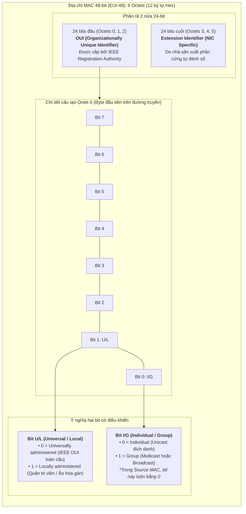
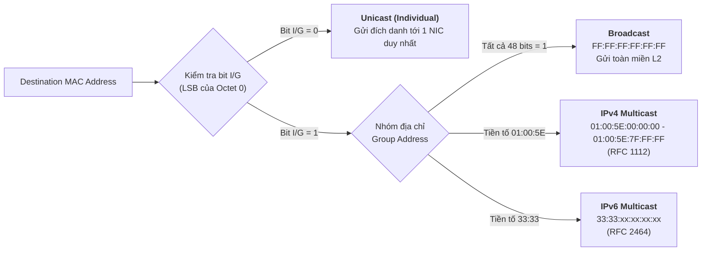

# 2_2_1 MAC Address Structure

> **Khóa học**: Cloud DevOps Basic — Networking Core  
> **Phân nhóm**: 2 Domain 2 - Computer Networking Core Fundamentals › 2_2 Data Link Layer and Physical Addressing  
> **Chủ đề**: Cấu trúc địa chỉ MAC 48-bit, phân bổ OUI/NIC, bit I/G và U/L, địa chỉ Broadcast và Multicast  
> **Trạng thái**: Verified (WRITE-CDB-2_2_1, 14-11-2026)  
> **Checklist đối chiếu**: [2_2_1](../../../CHECKLIST.md#22-data-link-layer-l2--physical-addressing)  

---

## 1. Khái Niệm Cốt Lõi & Bản Chất Kỹ Thuật (Core Concepts & Technical Deep Dive)

Địa chỉ MAC (Media Access Control Address), hay còn gọi theo chuẩn định danh IEEE là **EUI-48** (Extended Unique Identifier 48-bit), là địa chỉ vật lý hoạt động tại Tầng liên kết dữ liệu (Layer 2 - Data Link Layer) trong mô hình OSI/TCP-IP. Địa chỉ này dùng để định danh duy nhất giao tiếp mạng (NIC - Network Interface Card) trong cùng một miền quảng bá (broadcast domain).

### Cấu trúc 48-bit (6 Octets) của EUI-48

Theo tiêu chuẩn **RFC 7042** và đặc tả IEEE 802, một địa chỉ MAC Ethernet tiêu chuẩn có độ dài chính xác **48 bits** (tương đương **6 octets / 6 bytes**), thường được biểu diễn dưới dạng 12 chữ số thập lục phân (hexadecimal) phân tách bằng dấu hai chấm hoặc dấu gạch nối (ví dụ: `00:1A:2B:3C:4D:5E` hoặc `00-1A-2B-3C-4D-5E`):

```text
+-------------------------+-------------------------+
|  24 bits (3 octets)     |  24 bits (3 octets)     |
|  OUI (Vendor/Org ID)    |  NIC Specific Extension |
+-------------------------+-------------------------+
```

1. **OUI (Organizationally Unique Identifier) — 24 bits đầu (3 octets)**:
   - Được cấp phát độc quyền bởi cơ quan quản lý đăng ký IEEE (IEEE Registration Authority) cho nhà sản xuất phần cứng (như Intel, Realtek, Cisco, Apple, v.v.).
   - Giúp xác định danh tính của đơn vị sản xuất card mạng trên phạm vi toàn cầu.

2. **Phần định danh mở rộng (Extension Identifier / NIC Specific) — 24 bits cuối (3 octets)**:
   - Do chính nhà sản xuất nắm giữ mã OUI tự đánh số và gán duy nhất cho từng cổng giao tiếp/card mạng khi xuất xưởng.
   - Với 24 bits, mỗi nhà sản xuất có thể gán tối đa $2^{24} = 16.777.216$ địa chỉ duy nhất cho mỗi mã OUI mà họ sở hữu.

---

### Hai bit cờ đặc biệt trong Octet đầu tiên: I/G và U/L

Trong octet đầu tiên (Byte 0) của địa chỉ MAC, hai bit có trọng số thấp nhất mang ý nghĩa điều khiển giao thức mạng cực kỳ quan trọng:

```text
Octet 0 (Byte đầu tiên):
Bit vị trí:   b7   b6   b5   b4   b3   b2   b1   b0
                                            |    |
                                            |    +---> Bit I/G (Individual / Group)
                                            +--------> Bit U/L (Universal / Local)
```

1. **Bit I/G (Individual / Group) — Bit có trọng số thấp nhất (LSB) của Octet 0 theo thứ tự truyền tín hiệu trên dây**:
   - **`0` (Individual Address - Unicast)**: Gói tin chỉ được gửi đích danh tới một giao tiếp mạng duy nhất trên đường truyền.
   - **`1` (Group Address - Multicast hoặc Broadcast)**: Gói tin gửi cho một nhóm giao tiếp hoặc gửi cho toàn bộ các trạm trong mạng nội bộ.
   - *Quy chuẩn*: Trong địa chỉ MAC nguồn (Source MAC Address), bit I/G **luôn luôn được bảo lưu và phải bằng `0`**, vì một khung truyền dữ liệu chỉ có thể bắt nguồn từ một card mạng cá nhân đơn lẻ, không thể có địa chỉ nguồn là multicast hay broadcast.

2. **Bit U/L (Universal / Local) — Bit thứ hai kế tiếp bit I/G của Octet 0 theo thứ tự truyền tín hiệu**:
   - **`0` (Universally Administered Address)**: Địa chỉ được quản trị toàn cầu, đảm bảo tính duy nhất trên toàn thế giới dựa trên mã OUI do IEEE cấp phát.
   - **`1` (Locally Administered Address)**: Địa chỉ do quản trị viên hệ thống hoặc phần mềm ảo hóa (hypervisor, container engine) tự định nghĩa và quản trị cục bộ trong mạng nội bộ, không phụ thuộc vào đăng ký với IEEE.

---

### Quy tắc truyền thứ tự bit trên dây vật lý (Wire Transmission Order)

Theo quy định trong **RFC 7042** và đặc tả **IEEE 802.3**:
- Trên các đường truyền cáp Ethernet, các octet được truyền lần lượt từ octet 0 đến octet 5.
- Tuy nhiên, bên trong **từng octet**, dữ liệu được đưa lên đường truyền vật lý theo thứ tự **Least Significant Bit (LSB) first** (bit có trọng số nhỏ nhất truyền trước, bit có trọng số lớn nhất truyền sau).
- Vì vậy, bit I/G chính là bit vật lý đầu tiên xuất hiện trên đường cáp mạng Ethernet, cho phép card mạng nhận biết ngay tức thì khung truyền đến là Unicast hay Multicast/Broadcast trước khi nhận toàn bộ 48 bits.

---

### Địa chỉ Broadcast và Dải địa chỉ Multicast

Dựa trên cơ chế cờ bit, Ethernet định nghĩa các địa chỉ đặc biệt:

1. **Địa chỉ Broadcast (`FF:FF:FF:FF:FF:FF`)**:
   - Tất cả 48 bits đều mang giá trị `1`.
   - Vì bit I/G là `1`, đây là địa chỉ nhóm. Khi nhận được khung có Destination MAC là `FF:FF:FF:FF:FF:FF`, mọi thiết bị trong cùng miền mạng L2 (broadcast domain) đều phải tiếp nhận và chuyển lên tầng trên xử lý.

2. **Địa chỉ IPv4 Multicast MAC (RFC 1112 & RFC 7042)**:
   - Chiếm dải địa chỉ cố định từ **`01:00:5E:00:00:00`** đến **`01:00:5E:7F:FF:FF`**.
   - Byte đầu tiên `01` (dạng nhị phân `0000 0001`) có bit I/G bằng `1`, xác định đây là địa chỉ nhóm (Multicast).
   - Cơ chế ánh xạ: Đúng **23 bits có trọng số thấp nhất** của địa chỉ IPv4 Multicast (Class D) được sao chép và ghép vào 23 bits thấp nhất của địa chỉ MAC `01:00:5E`.

3. **Địa chỉ IPv6 Multicast MAC (RFC 2464 & RFC 7042)**:
   - Sử dụng tiền tố cố định **`33:33:xx:xx:xx:xx`**.
   - Cơ chế ánh xạ: **32 bits có trọng số thấp nhất** của địa chỉ IPv6 Multicast được sao chép nguyên vẹn vào 32 bits (4 octets cuối) của địa chỉ MAC.

---

## 2. Ví Dụ Đời Sống Thực Tế Dễ Hiểu (Intuitive Real-World Analogies)

### Ẩn dụ: Số Căn cước / Số khung xe máy (VIN) và Hệ thống Loa phát thanh

Hãy hình dung mạng máy tính giống như một **Khu phố**, và mỗi máy tính là một **Chiếc xe máy** đang lưu thông trong khu phố đó:

1. **Số khung xe (VIN) dập từ nhà máy = Địa chỉ MAC EUI-48**:
   - Khi xe máy được xuất xưởng, nhà sản xuất dập một dãy số khung kim loại cố định không thể tẩy xóa lên thân xe.
   - **3 ký tự đầu của số khung (OUI)**: Đại diện cho hãng sản xuất (ví dụ: mã của hãng Honda, Yamaha hoặc Toyota). Bất cứ ai nhìn vào 3 ký tự này đều biết xe do tập đoàn nào chế tạo.
   - **3 cụm số tiếp theo (NIC Extension)**: Là số thứ tự xuất xưởng độc nhất của riêng chiếc xe đó trong dây chuyền. Hai chiếc xe xuất xưởng từ cùng một nhà máy sẽ có phần đầu giống nhau nhưng phần đuôi hoàn toàn khác nhau.

2. **Địa chỉ Broadcast (`FF:FF:FF:FF:FF:FF`) = Loa phát thanh phường**:
   - Khi trưởng khu phố cần thông báo khẩn cấp (như thông báo cắt nước toàn khu phố), bác không đến gõ cửa từng nhà mà bật **Hệ thống loa phát thanh phường**.
   - Âm thanh từ loa phát thanh vang đến tất cả mọi ngôi nhà trong khu phố. Mọi người dân đều nghe thấy và phải chú ý tiếp nhận thông điệp (tương tự việc mọi máy tính trong VLAN đều phải nhận khung broadcast).

3. **Địa chỉ Multicast = Tần số đàm thoại bộ đàm của đội dân phòng**:
   - Đội dân phòng khu phố có một kênh bộ đàm riêng (ví dụ kênh số 5). Khi đội trưởng phát lệnh, chỉ những người trong đội dân phòng bật bộ đàm ở kênh 5 mới nghe và trả lời, người dân bình thường không liên quan sẽ bỏ qua.

---

## 3. Kiến Trúc, Luồng Hoạt Động & Hình Ảnh Trực Quan (Architecture, Diagrams & Visual Media)

Sơ đồ phân rã chi tiết cấu trúc 48 bits của địa chỉ MAC Ethernet theo tiêu chuẩn IEEE 802 và RFC 7042:



Sơ đồ phân loại địa chỉ MAC đích (Destination MAC) dựa trên cờ I/G và giá trị byte:



---

## 4. Hướng Dẫn Thực Hành & Kiểm Chứng Dòng Lệnh (Hands-on CLI & Wire-Level Observations)

Trên hệ điều hành Linux hiện đại, công cụ chuẩn nhất trong gói `iproute2` để tra cứu và cấu hình địa chỉ MAC tầng liên kết là `ip link` và `ip address`.

### 1. Kiểm tra địa chỉ MAC và cờ Broadcast qua lệnh `ip link show`

Thực thi lệnh sau trên terminal Linux:

```bash
ip link show
```

*Minh họa kết quả đầu ra thực tế trên Linux*:

```text
1: lo: <LOOPBACK,UP,LOWER_UP> mtu 65536 qdisc noqueue state UNKNOWN mode DEFAULT group default qlen 1000
    link/loopback 00:00:00:00:00:00 brd 00:00:00:00:00:00
2: eth0: <BROADCAST,MULTICAST,UP,LOWER_UP> mtu 1500 qdisc fq_codel state UP mode DEFAULT group default qlen 1000
    link/ether 52:54:00:12:34:56 brd ff:ff:ff:ff:ff:ff
```

**Phân tích các trường thông tin kỹ thuật**:
- `link/ether 52:54:00:12:34:56`:
  - `52:54:00`: Mã OUI (trong trường hợp này là mã OUI thuộc dải QEMU/KVM Virtual Machine).
  - `12:34:56`: Mã NIC Extension định danh riêng cho card ảo này.
- `brd ff:ff:ff:ff:ff:ff`: Địa chỉ Broadcast tương ứng của giao diện Ethernet, đúng chuẩn 48 bits `1` toàn bộ.
- Cờ `<BROADCAST,MULTICAST>`: Báo hiệu phần cứng card mạng hỗ trợ tiếp nhận khung quảng bá broadcast và các nhóm multicast.

### 2. Phân tích bit I/G và U/L của địa chỉ mẫu `52:54:00:12:34:56`

Hãy chuyển đổi octet đầu tiên `52` (hex) sang hệ nhị phân:
- Ký tự hex `5` = nhị phân `0101`
- Ký tự hex `2` = nhị phân `0010`
- Ghép lại Octet 0 = `0101 0010`

Đối chiếu các bit điều khiển:
- **Bit 0 (LSB - I/G)** = `0`: Đây là địa chỉ **Individual (Unicast)**.
- **Bit 1 (U/L)** = `1`: Bit Universal/Local bằng `1`, nghĩa là đây là địa chỉ **Locally Administered** (được trình ảo hóa tạo cục bộ, không phải địa chỉ vật lý cứng ghi từ nhà máy).

---

## 5. Cạm Bẫy Thực Tế & Thực Tiễn Sản Xuất (Production Gotchas & Best Practices)

Trong vận hành hệ thống Cloud, hạ tầng DevOps và trung tâm dữ liệu, kỹ sư mạng cần nắm chắc các cạm bẫy sau:

1. **Hiện tượng "Chồng lấn địa chỉ Multicast" (Multicast MAC Aliasing / Overlap)**:
   - *Cơ chế*: Tiêu chuẩn IPv4 Multicast (RFC 1112) có không gian địa chỉ $2^{28}$ nhóm khả dụng (do 4 bit đầu cố định là `1110`). Tuy nhiên, theo thỏa thuận khi thiết kế RFC 1112, IEEE chỉ cấp cho IANA nửa khối OUI với **23 bits** để ánh xạ địa chỉ IP Multicast vào MAC Multicast `01:00:5E`.
   - *Hậu quả*: $28 - 23 = 5$ bits bị mất trong quá trình ánh xạ. Kết quả là có tới **32 địa chỉ IPv4 Multicast khác nhau cùng ánh xạ về duy nhất 1 địa chỉ MAC L2**. Nếu hai ứng dụng trên cùng VLAN sử dụng hai dải IP Multicast bị trùng lặp MAC, card mạng của máy chủ sẽ nhận cả hai luồng lưu lượng và phải nhờ CPU Tầng 3 lọc bỏ, gây lãng phí tài nguyên CPU.

2. **Xung đột MAC cục bộ trong môi trường ảo hóa & Container**:
   - Khi triển khai hạ tầng ảo hóa (KVM, VMware) hoặc mạng Docker/Kubernetes sử dụng chế độ MACVLAN, các card mạng ảo thường sinh địa chỉ với bit `U/L = 1`.
   - Nếu thuật toán sinh địa chỉ MAC ngẫu nhiên không có cơ chế kiểm tra trùng lặp trên cùng broadcast domain, hai VM hoặc Container có thể mang cùng một địa chỉ MAC, dẫn đến hiện tượng Switch bị "nhảy MAC" (MAC Flapping) làm tê liệt kết nối mạng.

3. **Nguy cơ bảo mật: Giả mạo địa chỉ MAC (MAC Spoofing)**:
   - Do địa chỉ MAC là trường thông tin không mã hóa nằm ở phần đầu của khung Ethernet L2, kẻ tấn công trên cùng mạng cục bộ có thể dễ dàng thay đổi MAC của máy mình thành MAC của Default Gateway hoặc máy chủ nạn nhân.
   - *Thực tiễn sản xuất*: Các Switch doanh nghiệp và nền tảng Cloud (như AWS Security Groups, Azure Network Security Groups) luôn bật tính năng kiểm tra chống giả mạo MAC (MAC Anti-Spoofing / Port Security) để khóa cổng nếu phát hiện khung truyền mang địa chỉ MAC không hợp lệ.

---

## 6. Câu Hỏi Củng Cố Kiến Thức (Active Recall Quiz)

<details>
<summary><b>Câu hỏi 1:</b> Một card mạng Ethernet nhận được một khung tin có Destination MAC là <code>01:00:5E:12:34:56</code>. Bằng cách nào phần cứng NIC xác định được ngay đây là gói tin Multicast chứ không phải Unicast?</summary>

**Đáp án:**
Phần cứng NIC kiểm tra bit I/G (Individual/Group), tức bit có trọng số thấp nhất (LSB) của octet đầu tiên trong thứ tự truyền trên dây cáp:
- Octet đầu tiên là `01` (hex), đổi sang nhị phân là `0000 0001`.
- Bit có trọng số nhỏ nhất (bit 0) mang giá trị `1`.
- Giá trị `1` của bit I/G khẳng định đây là địa chỉ nhóm (Group Address / Multicast), cho phép NIC nhận diện ngay mà không cần đợi giải mã toàn bộ khung tin.
</details>

<details>
<summary><b>Câu hỏi 2:</b> Tại sao trong cấu trúc địa chỉ MAC Ethernet chuẩn, một khung tin truyền đi không bao giờ được phép mang Source MAC là <code>FF:FF:FF:FF:FF:FF</code> hay một địa chỉ bắt đầu bằng <code>01:...</code>?</summary>

**Đáp án:**
Theo tiêu chuẩn RFC 7042 và IEEE 802.3, bit I/G trong địa chỉ MAC nguồn (Source MAC) **luôn luôn được bảo lưu và bắt buộc phải bằng 0** (Individual). Một gói tin mạng chỉ có thể được tạo ra và truyền đi từ một cổng phần cứng đơn lẻ cụ thể, không thể bắt nguồn từ một nhóm trừu tượng hay từ toàn thể mạng (Group/Broadcast). Nếu một thiết bị gửi khung tin có Source MAC mang bit I/G = 1, khung tin đó là dị thường (malformed frame) và sẽ bị switch hoặc ngăn xếp mạng loại bỏ.
</details>

<details>
<summary><b>Câu hỏi 3:</b> Trong địa chỉ MAC 48-bit, bit U/L (Universal/Local) có vai trò gì và giá trị của nó khác biệt như thế nào giữa một card mạng vật lý mua từ nhà sản xuất và một card mạng ảo (virtual interface) tạo bởi Docker hay KVM?</summary>

**Đáp án:**
- **Bit U/L (Universal/Local)**: Là bit thứ hai kế tiếp bit I/G trong octet đầu tiên, dùng để xác định thẩm quyền quản trị của địa chỉ MAC:
  - Giá trị `0` (Universal): Địa chỉ được quản trị toàn cầu, duy nhất trên thế giới theo định danh OUI đăng ký với IEEE. Card mạng vật lý sản xuất từ nhà máy luôn có bit `U/L = 0`.
  - Giá trị `1` (Local): Địa chỉ được quản trị cục bộ. Các trình ảo hóa (KVM, VMware) hoặc cơ chế container (Docker) thường tự sinh MAC cho giao diện mạng ảo với bit `U/L = 1` để tránh xâm phạm vào không gian địa chỉ toàn cầu được cấp phép của IEEE.
</details>

---

## 7. 📚 Nguồn Tài Liệu Chính Thống (Tier-1 Official References)

- [RFC 7042: IANA Considerations and IETF Protocol and Documentation Usage for IEEE 802 Parameters](https://datatracker.ietf.org/doc/html/rfc7042#section-2.1) - Tiêu chuẩn IETF đặc tả cấu trúc EUI-48, phân bổ OUI, thứ tự truyền bit trên dây (LSB first) cùng ý nghĩa cờ bit I/G và U/L.
- [RFC 1112: Host Extensions for IP Multicasting](https://datatracker.ietf.org/doc/html/rfc1112#section-6.4) - Tài liệu tiêu chuẩn quy định dải địa chỉ IPv4 Multicast MAC `01:00:5E` và thuật toán ánh xạ 23-bit từ IP Multicast sang MAC.
- [RFC 2464: Transmission of IPv6 Packets over Ethernet Networks](https://datatracker.ietf.org/doc/html/rfc2464#section-7) - Đặc tả tiêu chuẩn IETF về định dạng khung Ethernet cho IPv6 và tiền tố địa chỉ IPv6 Multicast MAC `33:33`.
- [Linux Manual Pages: ip-link(8)](https://man7.org/linux/man-pages/man8/ip-link.8.html) - Tài liệu hướng dẫn chính thức từ dự án Linux iproute2 về tiện ích `ip link` hiển thị và quản lý cấu hình liên kết mạng L2.
