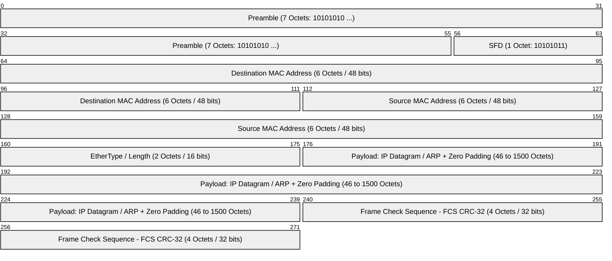
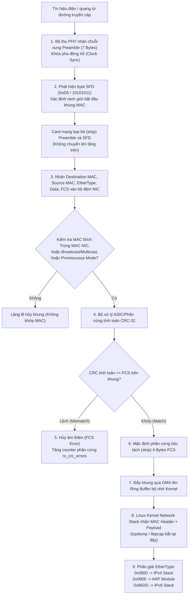

# 2_2_2 Ethernet Frame Structure

> **Khóa học**: Cloud DevOps Basic — Networking Core  
> **Phân nhóm**: 2 Domain 2 - Computer Networking Core Fundamentals › 2_2 Data Link Layer and Physical Addressing  
> **Chủ đề**: Cấu trúc khung Ethernet II / IEEE 802.3, phân biệt Preamble/SFD với MAC Frame, MTU và FCS CRC-32  
> **Trạng thái**: Verified (WRITE-CDB-2_2_2, 14-11-2026)  
> **Checklist đối chiếu**: [2_2_2](../../../CHECKLIST.md#22-data-link-layer-l2--physical-addressing)  

---

## 1. Khái Niệm Cốt Lõi & Bản Chất Kỹ Thuật (Core Concepts & Technical Deep Dive)

Trong kiến trúc mạng máy tính, **Tầng Liên kết Dữ liệu (Data Link Layer - Tầng 2)** chịu trách nhiệm đóng gói các gói tin Tầng Mạng (Layer 3 Datagrams) thành các **khung dữ liệu (Frames)** để truyền dẫn tin cậy giữa các nút mạng trực tiếp kề nhau trên cùng một môi trường truyền dẫn vật lý.

Định dạng khung phổ biến nhất trong toàn bộ mạng máy tính có dây hiện nay là **Ethernet II** (còn gọi là DIX Ethernet — phát triển bởi DEC, Intel, Xerox) và biến thể chuẩn hóa tương ứng trong họ tiêu chuẩn **IEEE 802.3**.

```text
+-------------------------------------------------------------------------------------------------------+
|                                     PHY PDU (Physical Layer Packet)                                   |
|  +--------------------+------------------+---------------------------------------------------------+  |
|  |  Preamble (7 B)    |  SFD (1 B)       |               MAC Frame (64 - 1518 Bytes)               |  |
|  |  10101010...       |  10101011        |                                                         |  |
|  +--------------------+------------------+---------------------------------------------------------+  |
+------------------------------------------+------------------------------------------------------------+
                                           |                                                            |
                                           v                                                            v
                      +---------------------------------------------------------------------------------+
                      |                         Layer 2 MAC Frame (Proper)                              |
                      |  +------------+------------+-----------+--------------------+----------------+  |
                      |  | Dest MAC   | Source MAC | EtherType |  Payload (Data)    |  FCS (CRC-32)  |  |
                      |  | (6 Bytes)  | (6 Bytes)  | (2 Bytes) |  (46 - 1500 Bytes) |  (4 Bytes)     |  |
                      |  +------------+------------+-----------+--------------------+----------------+  |
                      +---------------------------------------------------------------------------------+
```

### 1.1 Năm trường cấu trúc chuẩn của Layer 2 MAC Frame

Theo tiêu chuẩn IEEE Std 802.3 (Clause 3.1.1), một khung MAC chuẩn hóa bao gồm đúng **5 trường thành phần**:

1. **Địa chỉ MAC Đích (Destination MAC Address - 6 octets / 48 bits)**:
   - Xác định card mạng (NIC) đích nhận khung trong mạng cục bộ.
   - Có thể là địa chỉ **Unicast** (gửi riêng cho 1 host), **Multicast** (gửi cho nhóm host đăng ký trước), hoặc **Broadcast** (`FF:FF:FF:FF:FF:FF` gửi cho toàn bộ thiết bị trong cùng broadcast domain).
2. **Địa chỉ MAC Nguồn (Source MAC Address - 6 octets / 48 bits)**:
   - Xác định card mạng gửi khung dữ liệu. Luôn luôn là địa chỉ Unicast vật lý của thiết bị gửi.
   - Thiết bị chuyển mạch (Switch) dựa vào trường này để học vị trí cổng (MAC learning / CAM table).
3. **Định danh Giao thức / Độ dài (EtherType / Length - 2 octets / 16 bits)**:
   - Trong định dạng **Ethernet II**, trường này đóng vai trò là **EtherType** (chỉ định giao thức Tầng 3 đang được đóng gói trong Payload).
   - Giá trị quy ước: Nếu trường này có giá trị $\ge 1536$ (`0x0600`), nó được diễn giải là EtherType. Nếu $\le 1500$ (`0x05DC`), nó được IEEE 802.3 diễn giải là trường chỉ độ dài (Length field kết hợp với LLC/SNAP).
   - Các mã EtherType phổ biến trên môi trường mạng thực tế:
     - `0x0800`: Giao thức Internet phiên bản 4 (**IPv4**) — RFC 894.
     - `0x0806`: Giao thức phân giải địa chỉ (**ARP**) — RFC 826 / RFC 7042.
     - `0x86DD`: Giao thức Internet phiên bản 6 (**IPv6**) — RFC 2464.
     - `0x8100`: Nhãn nhận diện phân chia mạng ảo (**IEEE 802.1Q VLAN Tag**).
4. **Dữ liệu Tầng Mạng & Đệm lót (MAC Client Data / Payload - 46 đến 1500 octets)**:
   - Chứa gói tin IP (IP Datagram) hoặc thông điệp ARP được đóng gói.
   - **Giới hạn trên (MTU - Maximum Transmission Unit)**: Mặc định là 1500 bytes cho Ethernet chuẩn.
   - **Giới hạn dưới & Cơ chế chèn đệm (Padding)**: Kích thước Payload tối thiểu bắt buộc là **46 bytes**. Nếu dữ liệu tầng trên nhỏ hơn 46 bytes (ví dụ gói tin ARP chỉ có 28 bytes), tầng Data Link bắt buộc phải chèn thêm các byte `0x00` (zero-padding) để trường Data đạt đủ 46 bytes.
5. **Dãy kiểm tra khung (Frame Check Sequence - FCS - 4 octets / 32 bits)**:
   - Chứa giá trị kiểm tra mã dư tuần hoàn **CRC-32 (Cyclic Redundancy Check)** 32-bit.
   - Thuật toán CRC-32 được tính toán bởi card mạng gửi trên toàn bộ chuỗi bit của các trường: **Destination MAC, Source MAC, EtherType, Data, và Padding**.
   - Phía nhận tính toán lại giá trị CRC trên toàn bộ khung nhận được; nếu kết quả tính toán không khớp với 4 bytes FCS đính kèm, khung bị khẳng định là đã biến dạng bit (bit flip) trong quá trình truyền dẫn và bị **loại bỏ âm thầm ngay trên phần cứng card mạng** (silently dropped as FCS error).

---

### 1.2 Phân biệt bản chất: Preamble / SFD (Tầng Vật Lý) vs MAC Frame (Tầng 2)

> [!IMPORTANT]
> **Điểm mấu chốt về giới hạn kích thước khung**:  
> Rất nhiều tài liệu nhập môn mô tả sai lệch rằng Preamble và SFD là các trường thuộc khung Tầng 2. Tiêu chuẩn quốc tế **IEEE Std 802.3 (Clause 3.1.1, 3.2.1, 3.2.2)** và **IEEE P802.3as** quy định rõ: **Preamble và SFD thuộc về gói đồng bộ hóa Tầng Vật Lý (PHY Packet), hoàn toàn KHÔNG thuộc về Layer 2 MAC Frame**.

1. **Preamble (7 octets / 56 bits)**:
   - Bao gồm 7 bytes lặp lại chuỗi bit luân phiên `10101010` (khi phát tín hiệu vật lý LSB-first theo chuẩn IEEE, biểu diễn hex là `0x55`).
   - Mục đích: Cung cấp chuỗi xung dao động tần số ổn định để mạch thu vật lý của card mạng đích điều chỉnh xung nhịp (clock synchronization) và khóa pha (phase lock) đồng bộ với nguồn phát.
2. **SFD (Start Frame Delimiter - 1 octet / 8 bits)**:
   - Mang chuỗi bit `10101011` (`0xD5` khi phát trên đường truyền).
   - Mục đích: Hai bit `11` liên tiếp ở cuối đóng vai trò là "tiếng súng lệnh", thông báo cho bộ điều khiển card mạng biết rằng quá trình đồng bộ xung nhịp đã hoàn tất, và bit tiếp theo ngay sau đó chính là bit đầu tiên của khung dữ liệu Tầng 2 (Destination MAC).

### 1.3 Quy định kích thước khung tối thiểu (64 Bytes) và tối đa (1518 Bytes)

Dựa trên cấu trúc 5 trường của khung MAC Tầng 2, các kích thước chuẩn được định nghĩa chính xác như sau:

$$\text{Kích thước khung MAC} = \text{Dest MAC}(6) + \text{Src MAC}(6) + \text{EtherType}(2) + \text{Payload}(N) + \text{FCS}(4) = 18 + N \text{ bytes}$$

- **Kích thước tối thiểu (Minimum Frame Size = 64 Bytes)**:
  - Khi $N = 46$ bytes: $6 + 6 + 2 + 46 + 4 = 64$ octets.
  - *Ý nghĩa lịch sử & vật lý*: Con số 64 bytes được tính toán trong kỷ nguyên Ethernet bán song công (Half-Duplex) dùng thuật toán CSMA/CD qua cáp đồng trục. 64 bytes là khoảng thời gian tối thiểu (Slot Time - 512 bit times ở tốc độ 10 Mbps) để tín hiệu điện truyền đi hết chiều dài tối đa của đoạn mạng cáp vật lý (khoảng cách 2500m qua repeater) và phản hồi lại, đảm bảo rằng nếu xảy ra va chạm (collision), bên gửi vẫn đang truyền khung và phát hiện được va chạm trước khi kết thúc việc phát khung.
- **Kích thước cơ bản tối đa (Maximum Basic Frame Size = 1518 Bytes)**:
  - Khi $N = 1500$ bytes (chuẩn MTU): $6 + 6 + 2 + 1500 + 4 = 1518$ octets.
  - (Khi có thêm nhãn 4 bytes 802.1Q VLAN Tag, kích thước tối đa mở rộng là $1518 + 4 = 1522$ octets — IEEE 802.3ac/802.3as).
- **HOÀN TOÀN KHÔNG TÍNH 8 BYTES PREAMBLE VÀ SFD**: Cả hai con số $64$ bytes và $1518$ bytes đều chỉ đo lường từ Destination MAC đến hết FCS.

---

## 2. Ví Dụ Đời Sống Thực Tế Dễ Hiểu (Intuitive Real-World Analogies)

### Ẩn dụ: Đoàn Xe Áp Tải Phong Bì Bưu Chính Bọc Thép

Hãy hình dung quá trình gửi dữ liệu qua Ethernet giống như dịch vụ chuyển phát tài liệu bảo mật cao cấp bằng xe bọc thép:

1. **Tiếng còi hú dẹp đường & Pháo lệnh xuất hiện (Preamble & SFD)**:
   - Trước khi đoàn xe áp tải lao tới bưu cục nhận, từ đằng xa người ta nghe thấy tiếng còi hú ngắt quãng đều đặn: *"Tút... tút... tút... tút..."* trong 7 giây (**Preamble - 7 bytes**). Tiếng còi này giúp nhân viên bảo vệ bưu cục nhận giật mình tỉnh ngủ, chỉnh lại đồng hồ đeo tay và sẵn sàng mở cổng trạm cân.
   - Khi xe vừa chạm cổng trạm, tài xế bấm còi kép vang dội: *"Tút... TING!"* (**SFD - 1 byte kết thúc bằng `11`**). Tiếng "TING!" báo hiệu: Hết màn chào hỏi khởi động, phong bì tài liệu chính thức xuất hiện ngay tức khắc!
2. **Vỏ phong bì bưu phẩm (MAC Header - 14 bytes)**:
   - Mặt trước phong bì ghi rõ: Địa chỉ nhà nhận hàng (**Destination MAC - 6 bytes**), địa chỉ nhà gửi hàng (**Source MAC - 6 bytes**), và một con tem màu chỉ định loại văn bản bên trong (**EtherType - 2 bytes**: ví dụ tem xanh lá đại diện cho công văn thường IPv4 `0x0800`, tem vàng đại diện cho giấy hỏi danh tính ARP `0x0806`).
3. **Ruột tài liệu và Lớp mút xốp lót (Payload & Padding)**:
   - Khoang bọc thép cho phép chở gói tài liệu nặng tối đa 1500 trang (**MTU 1500 bytes**).
   - Nhưng quy chế an toàn của trạm phân loại tự động yêu cầu: Mọi phong bì đưa lên băng chuyền phải dày tối thiểu 64 mm để cảm biến quang học nhận diện được. Nếu bạn chỉ gửi một tấm danh thiếp mỏng dính nặng 28 trang (như bản tin ARP 28 bytes), bưu tá bắt buộc phải nhét thêm các miếng xốp đệm trắng rỗng ruột (**Padding 18 bytes**) cho đủ 46 trang ruột, tạo thành tổng phong bì đúng 64 mm. Nếu không có xốp đệm, máy quét tự động sẽ tưởng nhầm đó là mảnh rác giấy vụn bị rách rơi ra từ vụ tai nạn nào đó (**Runt frame / Collision fragment**) và lập tức hút vào máy nghiền rác!
4. **Con dấu sáp niêm chì chống giả mạo (FCS CRC-32 - 4 bytes)**:
   - Ở nắp dán phía sau, người gửi dùng máy khắc laser dập một mã số kiểm toán 32-bit dựa trên toàn bộ chữ viết trên vỏ và ruột phong bì.
   - Khi phong bì đến tay bảo vệ bên nhận, máy quét laser tại cổng sẽ tự động đọc lại toàn bộ chữ viết và tính toán lại mã số này. Nếu mã số khớp từng nét, phong bì được xé ra chuyển giao cho phòng ban Tầng 3. Nếu lệch dù chỉ một dấu chấm mờ (nhiễu sóng điện làm đổi bit), bảo vệ hiểu rằng phong bì đã bị thủng hoặc biến dạng trên đường cao tốc; bảo vệ **vứt thẳng tay phong bì vào lò thiêu rác mà không hề gọi điện hay giải thích cho bên gửi**!

---

## 3. Kiến Trúc, Luồng Hoạt Động & Hình Ảnh Trực Quan (Architecture, Diagrams & Visual Media)

### 3.1 Sơ đồ chi tiết các trường nhị phân trong khung Ethernet



### 3.2 Quy trình xử lý khung tại phần cứng Card Mạng (NIC Ingress Flow)

Sơ đồ tuần tự dưới đây thể hiện chính xác lý do tại sao hệ điều hành (OS) và các công cụ giám sát như Wireshark không thể nhìn thấy Preamble, SFD hay FCS trong điều kiện thu nhận thông thường:



---

## 4. Hướng Dẫn Thực Hành & Kiểm Chứng Dòng Lệnh (Hands-on CLI & Wire-Level Observations)

### 4.1 Bắt khung Ethernet và mổ xẻ cấu trúc nhị phân với `tcpdump`

Khi phân tích gói tin ở Tầng 2, tham số `-e` của lệnh `tcpdump` yêu cầu in tiêu đề Tầng Liên kết Dữ liệu (Link-Level Header), và tham số `-xx` hiển thị toàn bộ nội dung dưới dạng bảng mã thập lục phân (hexadecimal dump):

```bash
# Bắt đúng 1 khung dữ liệu trên card mạng eth0 kèm Link-Level Header và mã Hex
sudo tcpdump -i eth0 -e -nn -xx -c 1
```

> 💡 **Minh họa thực thi (Illustrative Output)**:
```text
14:20:15.102456 52:54:00:12:34:56 > 52:54:00:ab:cd:ef, ethertype IPv4 (0x0800), length 98: 192.168.1.50.22 > 192.168.1.100.54321: Flags [P.], seq 1:45, ack 1, win 502, length 44
	0x0000:  5254 00ab cdef 5254 0012 3456 0800 4500
	0x0010:  0054 1a2b 4000 4006 3c4d c0a8 0132 c0a8
	0x0020:  0164 0016 d431 0000 0001 0000 0001 8018
	0x0030:  01f6 8a2b 0000 0101 080a 1234 5678 8765
	0x0040:  4321 0000 0000 0000 0000 0000 0000 0000
```

#### Phân giải chi tiết từng byte trong dòng hex `0x0000`:
- `52 54 00 ab cd ef`: **Destination MAC Address** (6 bytes) — Địa chỉ card mạng đích.
- `52 54 00 12 34 56`: **Source MAC Address** (6 bytes) — Địa chỉ card mạng nguồn gửi khung.
- `08 00`: **EtherType** (2 bytes) — Mang giá trị `0x0800`, báo hiệu Payload bên trong là gói tin IPv4.
- `45 00 ...`: Bắt đầu byte đầu tiên của phần Payload (tiêu đề IPv4: Version 4, IHL 5).

> [!NOTE]
> **Tại sao không thấy Preamble, SFD và FCS?**:  
> 1. Chuỗi xung **Preamble (7B)** và **SFD (1B)** chỉ tồn tại dưới dạng tín hiệu xung điện áp/ánh sáng trên cáp vật lý. Card mạng (PHY chip) dùng chúng để đồng bộ dao động thạch anh rồi vứt bỏ trước khi lưu khung vào thanh ghi số.  
> 2. **FCS CRC-32 (4B)** được kiểm tra tính toàn vẹn ngay trên vi mạch tích hợp (ASIC) của card mạng. Sau khi xác minh gói tin hoàn hảo, bộ điều khiển card mạng mặc định cắt bỏ 4 bytes này để giải phóng băng thông bus PCI/DMA trước khi nạp dữ liệu vào RAM hệ thống cho kernel `libpcap/AF_PACKET`.

---

### 4.2 Kiểm tra bộ đếm lỗi phần cứng Tầng 2 với `ip` và `ethtool`

Nếu đường truyền cáp bị nhiễu điện từ, đầu nối RJ45 bị rỉ sét, hoặc có va chạm, các khung hỏng FCS CRC-32 sẽ bị card mạng hủy bỏ và ghi nhận vào các thanh ghi bộ đếm phần cứng:

```bash
# 1. Xem thống kê gói tin và lỗi tổng quát trên giao diện eth0
ip -s link show dev eth0
```

> 💡 **Minh họa thực thi (Illustrative Output)**:
```text
2: eth0: <BROADCAST,MULTICAST,UP,LOWER_UP> mtu 1500 qdisc fq_codel state UP mode DEFAULT group default qlen 1000
    link/ether 52:54:00:12:34:56 brd ff:ff:ff:ff:ff:ff
    RX:  bytes packets errors dropped missed mcast
      15420310   45120      0       0      0     0
    TX:  bytes packets errors dropped carrier collsns
      12891402   38910      0       0        0       0
```

```bash
# 2. Truy vấn trực tiếp các thanh ghi bộ đếm phần cứng chi tiết của chip NIC
sudo ethtool -S eth0 | grep -E "crc|fcs|frame|drop|error|runt|jabber"
```

> 💡 **Minh họa thực thi (Illustrative Output)**:
```text
     rx_crc_errors: 0
     rx_frame_errors: 0
     rx_dropped: 0
     rx_length_errors: 0
     rx_oversize_pkts: 0
     rx_undersize_pkts: 0
     rx_jabbers: 0
```
*Giải thích các chỉ số*:
- `rx_crc_errors`: Số lượng khung bị card mạng hủy âm thầm do tính toán lại CRC-32 không khớp với FCS.
- `rx_undersize_pkts` (Runts): Số lượng khung có độ dài hợp lệ về cấu trúc nhưng nhỏ hơn 64 bytes.
- `rx_jabbers`: Số lượng khung nhận được vượt quá kích thước tối đa (thường $> 1518$ bytes) và đồng thời có mã lỗi FCS CRC-32 không hợp lệ (theo định nghĩa trong RFC 2819).

---

## 5. Cạm Bẫy Thực Tế & Thực Tiễn Sản Xuất (Production Gotchas & Best Practices)

Trong thiết kế hạ tầng mạng Cloud, On-Premises và vận hành hệ thống DevOps, các sai lầm liên quan đến kích thước khung Ethernet là nguyên nhân hàng đầu gây ra các sự cố nghẽn mạng khó chẩn đoán:

### 5.1 Nhầm lẫn kinh điển: MTU 1500 vs Kích thước Khung MAC L2 (1518 / 1522 Bytes)

- **Cạm bẫy**: Rất nhiều kỹ sư cho rằng cấu hình `MTU = 1500` nghĩa là khung Ethernet trên dây chỉ dài tối đa 1500 bytes.
- **Bản chất kỹ thuật**:
  - **MTU (Maximum Transmission Unit)** là khái niệm của **Layer 3**, quy định kích thước tối đa của **Payload** (gói tin IP).
  - Khi gói tin IP 1500 bytes được đẩy xuống Tầng 2, khung MAC hoàn chỉnh sẽ dài:
    $$\text{Payload}(1500) + \text{MAC Header}(14) + \text{FCS Trailer}(4) = 1518 \text{ Bytes}$$
  - Nếu kết nối đi qua đường truyền Trunk có đóng nhãn VLAN 802.1Q (thêm 4 bytes), khung sẽ có kích thước **1522 Bytes**.
- **Hậu quả sản xuất**: Nếu switch trung gian chỉ được cấu hình giới hạn kích thước khung là 1500 bytes, switch sẽ coi mọi khung dữ liệu IPv4 đạt chuẩn MTU 1500 là khung quá khổ (oversize/babble) và drop toàn bộ, dẫn đến hiện tượng mạng chỉ ping được gói tin nhỏ nhưng nghẽn hoàn toàn khi truyền file dung lượng lớn hoặc thiết lập phiên SSH/HTTPS!

### 5.2 Khung Runt (< 64 Bytes) và Khung Jabber (> 1518 Bytes lỗi CRC)

Theo định nghĩa chuẩn hóa trong tiêu chuẩn quản trị mạng **RFC 2819 (RMON MIB)**:

1. **Runt Frames (Undersize Packets)**:
   - Các khung có kích thước nhỏ hơn **64 octets** (chưa tính preamble/SFD).
   - *Nguyên nhân*: Trong quá khứ, runts là hệ quả tự nhiên của sự va chạm tín hiệu (collisions) trong mạng chia sẻ bus CSMA/CD. Trong hạ tầng chuyển mạch hiện đại hoạt động ở chế độ Full-Duplex (không còn va chạm), sự xuất hiện của `rx_undersize_pkts` trên switch/host là dấu hiệu cảnh báo hư hỏng vật lý nghiêm trọng: card mạng phát bị lỗi firmware, lỗi vi mạch ASIC, hoặc cáp mạng quang/đồng bị gập gãy gây đứt quãng chuỗi bit.
2. **Jabber Frames**:
   - Các khung có độ dài vượt quá giới hạn tối đa thông thường (**$> 1518$ octets**) và **đồng thời bị lỗi mã kiểm tra FCS CRC-32**.
   - *Nguyên nhân*: Hiện tượng "nói sảng" (jabbering) xảy ra khi mạch phát tín hiệu của card mạng bị treo ở trạng thái bật liên tục (transceiver locked in transmit state), truyền một dòng bit rác vô nghĩa kéo dài trên đường cáp, làm nghẹt băng thông của toàn bộ phân đoạn mạng.

### 5.3 Thảm họa "Lỗ đen MTU" khi cấu hình Jumbo Frames (MTU 9000)

- **Mục đích của Jumbo Frames**: Trong các trung tâm dữ liệu lưu trữ đám mây (SAN, iSCSI, Ceph, NFS), việc tăng kích thước MTU từ 1500 lên **9000 bytes** giúp giảm số lượng ngắt CPU (CPU interrupts) và giảm chi phí tiêu đề (header overhead) tới 6 lần.
- **Cạm bẫy**: Jumbo Frames **không phải là một tiêu chuẩn bắt buộc của IEEE**. Không có cơ chế tự động đàm phán kích thước khung ở Tầng 2!
- **Thực tiễn sản xuất**:
  - Bắt buộc phải cấu hình MTU 9000 đồng bộ xuyên suốt trên **mọi thiết bị trên đường truyền**: Từ Card mạng Host gửi $\rightarrow$ Cổng Switch Access $\rightarrow$ Cổng Switch Core/Spine $\rightarrow$ Cổng Switch Leaf $\rightarrow$ Card mạng Host nhận.
  - Nếu chỉ một thiết bị chuyển mạch ở giữa vẫn giữ MTU 1500, các khung 9000 bytes sẽ bị drop âm thầm mà không hề có gói tin ICMP thông báo lỗi (vì switch Tầng 2 thuần túy không tạo bản tin ICMP Fragmentation Needed). Kết quả là tạo ra một "lỗ đen MTU" (MTU Black Hole): Lệnh `ping` cơ bản (64 bytes) chạy hoàn hảo, nhưng các tác vụ đồng bộ cơ sở dữ liệu hoặc sao lưu file lớn bị treo đơ vĩnh viễn (hang/timeout).

---

## 6. Câu Hỏi Củng Cố Kiến Thức (Active Recall Quiz)

<details>
<summary><b>Câu hỏi 1:</b> Phân tích năm trường thành phần của một khung MAC Ethernet II chuẩn. Kích thước khung MAC tối thiểu là 64 bytes và tối đa là 1518 bytes có bao gồm 7 bytes Preamble và 1 byte SFD không? Giải thích bản chất kỹ thuật.</summary>

**Đáp án:**
Năm trường thành phần của khung MAC Ethernet II gồm:
1. **Destination MAC** (6 bytes): Địa chỉ card mạng đích.
2. **Source MAC** (6 bytes): Địa chỉ card mạng nguồn.
3. **EtherType** (2 bytes): Mã định danh giao thức tầng mạng bên trong (ví dụ `0x0800` cho IPv4).
4. **Data / Payload** (46 đến 1500 bytes): Dữ liệu tầng mạng, có thể kèm zero-padding nếu nhỏ hơn 46 bytes.
5. **Frame Check Sequence (FCS)** (4 bytes): Mã kiểm tra dư thừa tuần hoàn CRC-32.

**Không bao gồm Preamble và SFD**. Theo tiêu chuẩn IEEE Std 802.3 (Clause 3), Preamble (7 bytes) và SFD (1 byte) thuộc về gói đồng bộ hóa Tầng Vật Lý (PHY synchronization packet). Khung Tầng 2 MAC Frame thực sự bắt đầu từ byte đầu tiên của Destination MAC và kết thúc ở byte cuối của FCS. Do đó:
- Khung tối thiểu: $6 + 6 + 2 + 46 + 4 = 64$ bytes.
- Khung tối đa cơ bản: $6 + 6 + 2 + 1500 + 4 = 1518$ bytes.
Cả hai con số này hoàn toàn không tính 8 bytes Preamble và SFD.
</details>

<details>
<summary><b>Câu hỏi 2:</b> Trường EtherType có giá trị `0x0800`, `0x0806`, `0x86DD`, và `0x8100` đại diện cho các giao thức nào? Tại sao một gói tin ARP chỉ có kích thước 28 bytes nhưng khi truyền qua mạng Ethernet vẫn tạo ra khung có kích thước 64 bytes?</summary>

**Đáp án:**
- `0x0800`: Giao thức **IPv4** (Internet Protocol version 4).
- `0x0806`: Giao thức **ARP** (Address Resolution Protocol).
- `0x86DD`: Giao thức **IPv6** (Internet Protocol version 6).
- `0x8100`: Nhãn nhận diện mạng ảo **IEEE 802.1Q (VLAN Tag)**.

Một gói tin ARP cho IPv4 trên Ethernet có kích thước cố định là 28 bytes. Tuy nhiên, tiêu chuẩn Ethernet quy định kích thước khung MAC tối thiểu là 64 bytes (tương ứng với Payload tối thiểu là 46 bytes). Do 28 bytes nhỏ hơn 46 bytes, lớp Data Link bắt buộc phải chèn thêm **18 bytes zero-padding** (`0x00`) vào sau gói ARP:
$$\text{Khung} = 6 \text{ (Dest MAC)} + 6 \text{ (Src MAC)} + 2 \text{ (EtherType)} + [28 \text{ (ARP)} + 18 \text{ (Padding)}] + 4 \text{ (FCS)} = 64 \text{ Bytes}$$
Việc chèn đệm này đảm bảo khung không bị các thiết bị mạng nhận diện nhầm là mảnh vỡ va chạm (runt/collision fragment).
</details>

<details>
<summary><b>Câu hỏi 3:</b> Tại sao khi sử dụng công cụ bắt gói tin như `tcpdump` hoặc `Wireshark` trên hệ điều hành Linux/Windows, người quản trị mạng thông thường không nhìn thấy 8 bytes Preamble/SFD và 4 bytes FCS? Nếu một khung bị biến dạng bit trên dây cáp quang/đồng, hệ điều hành có nhận được để phân tích không?</summary>

**Đáp án:**
1. **Lý do không thấy Preamble/SFD**: Preamble và SFD được xử lý hoàn toàn ở chip thu phát Tầng Vật Lý (PHY) của card mạng để đồng bộ xung nhịp và căn lề khung dữ liệu. Sau khi phát hiện SFD, chip PHY cắt bỏ 8 bytes này trước khi chuyển chuỗi byte số vào chip MAC.
2. **Lý do không thấy FCS**: Bộ điều khiển MAC trên card mạng tính toán lại mã CRC-32 bằng phần cứng. Nếu CRC hợp lệ, phần cứng card mạng mặc định cắt bỏ (strip) 4 bytes FCS để tiết kiệm băng thông bus PCI/DMA trước khi nạp khung vào RAM cho Kernel Driver.
3. **Khi khung bị lỗi bit trên đường truyền**: Card mạng phát hiện CRC-32 tính toán bị lệch so với trường FCS nhận được. Phần cứng card mạng sẽ **lập tức hủy bỏ âm thầm khung đó (silent discard)** và tăng bộ đếm lỗi `rx_crc_errors`. Khung hỏng hoàn toàn không được chuyển lên bộ đệm RAM của hệ điều hành, do đó `tcpdump` và `Wireshark` sẽ không nhận được khung này (trừ khi sử dụng card mạng chuyên dụng hoặc bật chế độ đặc biệt `rx-fcs` / `rx-all` qua `ethtool`).
</details>

---

## 7. 📚 Nguồn Tài Liệu Chính Thống (Tier-1 Official References)

- [IEEE Std 802.3 Clause 3: Media Access Control (MAC) Frame and Packet Specifications](https://www.ieee802.org/3/as/public/0503/3d0_1_CMP.pdf#page=50) - Đặc tả kỹ thuật chính thức của IEEE về định dạng 5 trường của khung MAC, cơ chế đồng bộ Preamble/SFD tầng vật lý, trường dữ liệu và thuật toán FCS CRC-32.
- [IEEE 802.3as Overview: Frame Format and Envelope Frames](https://www.ieee802.org/3/as/public/0607/802.3as_overview.pdf#page=16) - Tài liệu đính chính và tổng kết của nhóm đặc trách IEEE 802.3 khẳng định kích thước `minFrameSize = 64 octets`, `maxUntaggedFrameSize = 1518 octets` hoàn toàn không tính Preamble và SFD.
- [RFC 894: A Standard for the Transmission of IP Datagrams over Ethernet Networks](https://datatracker.ietf.org/doc/html/rfc894#page-2) - Tiêu chuẩn IETF định nghĩa việc đóng gói gói tin IP trên khung Ethernet II, giá trị EtherType `0x0800`, giới hạn MTU 1500 bytes và cơ chế padding cho payload dưới 46 bytes.
- [RFC 2819: Remote Network Monitoring Management Information Base (RMON MIB)](https://datatracker.ietf.org/doc/html/rfc2819#section-5) - Đặc tả kỹ thuật IETF định nghĩa chi tiết các bộ đếm thống kê lỗi tầng liên kết dữ liệu: `etherStatsUndersizePkts` (Runts) và `etherStatsJabbers` (Jabbers).
- [Linux Manual Pages: packet(7) - Packet Interface on Device Level](https://man7.org/linux/man-pages/man7/packet.7.html) - Tài liệu hướng dẫn chính thức từ Linux man-pages về giao diện raw packet socket (`AF_PACKET`), cơ chế đóng gói và truyền nhận khung Ethernet qua libpcap.
