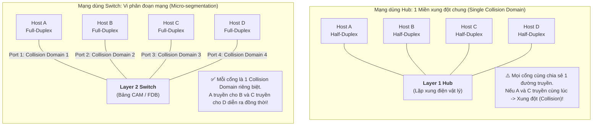
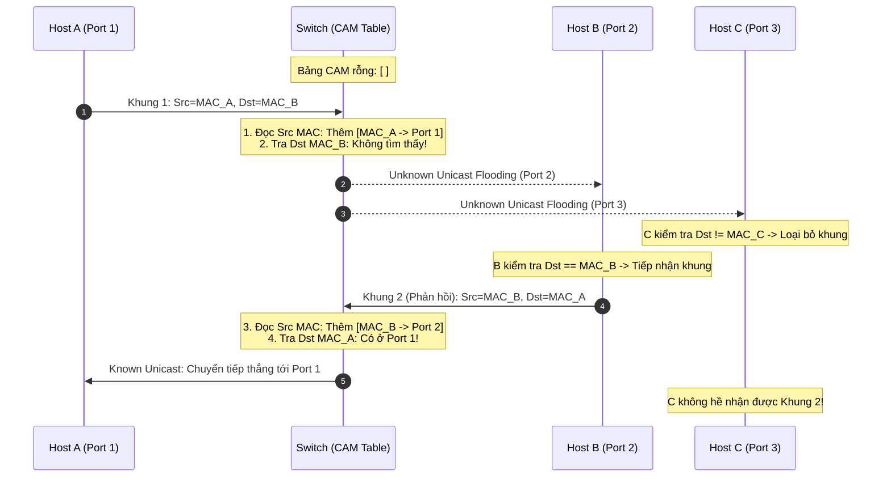

# 2_2_3 Switches vs Hubs and MAC Learning

> **Khóa học**: Cloud DevOps Basic — Networking Core  
> **Phân nhóm**: 2 Domain 2 - Computer Networking Core Fundamentals › 2_2 Data Link Layer and Physical Addressing  
> **Chủ đề**: So sánh Hub (Layer 1) và Switch (Layer 2), thuật toán học địa chỉ MAC, bảng CAM/FDB, Unknown Unicast Flooding và Aging Timer  
> **Trạng thái**: Verified (WRITE-CDB-2_2_3, 14-11-2026)  
> **Checklist đối chiếu**: [2_2_3](../../../CHECKLIST.md#22-data-link-layer-l2--physical-addressing)  

---

## 1. Khái Niệm Cốt Lõi & Bản Chất Kỹ Thuật (Core Concepts & Technical Deep Dive)

Trong mạng cục bộ Ethernet (LAN), thiết bị kết nối trung tâm đóng vai trò quyết định đến hiệu năng, băng thông và khả năng mở rộng của toàn bộ hệ thống. Sự tiến hóa từ **Hub (Bộ tập trung Tầng 1)** sang **Switch (Bộ chuyển mạch Tầng 2)** đại diện cho một bước nhảy vọt về mặt kiến trúc từ truyền dẫn quảng bá vật lý sang chuyển mạch thông minh dựa trên địa chỉ MAC.

---

### So sánh bản chất: Hub (Layer 1) vs Switch (Layer 2)

| Tiêu chí kỹ thuật | Hub (Multiport Repeater) | Switch (Multiport Bridge) |
| :--- | :--- | :--- |
| **Tầng hoạt động OSI** | **Layer 1 (Physical Layer)** | **Layer 2 (Data Link Layer)** |
| **Phương thức xử lý dữ liệu** | Lặp lại xung điện (electrical repeat) thuần túy; nhận bit vào cổng nào sẽ khuếch đại và đẩy ra tất cả các cổng còn lại mà không kiểm tra khung | Đọc và giải mã phần đầu khung Ethernet (Destination MAC & Source MAC) để đưa ra quyết định chuyển tiếp có chọn lọc |
| **Miền xung đột (Collision Domain)** | **1 miền xung đột duy nhất** cho toàn bộ tất cả các cổng kết nối vào Hub | **Mỗi cổng là 1 miền xung đột độc lập** (Micro-segmentation) |
| **Chế độ truyền thông** | Bán song công (**Half-Duplex**); tại một thời điểm chỉ một máy được truyền tín hiệu | Song công toàn phần (**Full-Duplex**); gửi và nhận dữ liệu đồng thời trên hai kênh riêng biệt |
| **Nguy cơ va chạm tín hiệu** | Rất cao khi nhiều máy truyền cùng lúc (phải dùng thuật toán CSMA/CD để dò va chạm) | Hoàn toàn bị triệt tiêu trên từng cổng vật lý nhờ bộ đệm đệm khung (frame buffer) |
| **Bảo mật vật lý** | Rất kém; bất kỳ máy nào kết nối vào Hub đều có thể lắng nghe (sniff) toàn bộ lưu lượng của các máy khác | Cao; khung Unicast chỉ được gửi đến đúng cổng của thiết bị đích |

---

### Thuật toán học địa chỉ MAC (MAC Learning Algorithm)

Khác với Hub chỉ lặp xung điện thụ động, Switch là một thiết bị chuyển mạch thông minh. Switch duy trì trong bộ nhớ một bảng tra cứu gọi là **CAM (Content-Addressable Memory)** hoặc **FDB (Forwarding Database)** theo tiêu chuẩn **IEEE 802.1D** và **RFC 1493**. Bảng FDB ánh xạ:

$$\{\text{MAC Address}\} \longleftrightarrow \{\text{Port vật lý}, \text{VLAN ID}\}$$

Quá trình học địa chỉ diễn ra hoàn toàn tự động theo nguyên tắc cốt lõi:
1. **Kiểm tra địa chỉ nguồn (Inspect Source MAC)**: Mỗi khi nhận được một khung Ethernet trên bất kỳ cổng nào, Switch lập tức đọc địa chỉ **Source MAC** trong phần header của khung đó.
2. **Ghi nhớ và cập nhật FDB**:
   - Nếu cặp `{Source MAC, Cổng nhận}` chưa có trong bảng FDB, Switch tạo mới một bản ghi.
   - Nếu bản ghi đã tồn tại trên cổng đó, Switch thiết lập lại đồng hồ đếm thời gian (Aging Timer) của bản ghi về giá trị ban đầu.
   - Nếu bản ghi đã tồn tại nhưng khung tin lại đến từ một cổng khác (người dùng chuyển cổng cắm cáp), Switch lập tức cập nhật lại cổng mới cho địa chỉ MAC tương ứng.

---

### Ba quyết định chuyển tiếp khung (Forwarding Logic)

Sau khi đã học địa chỉ nguồn, Switch đọc tiếp địa chỉ **Destination MAC** của khung để đưa ra một trong ba quyết định chuyển tiếp:

1. **Known Unicast (Chuyển tiếp đích danh đã biết)**:
   - Nếu Destination MAC là địa chỉ đơn (bit `I/G = 0`) và **đã tồn tại** trong bảng FDB.
   - Switch chuyển tiếp khung tin ra **duy nhất một cổng đầu ra (egress port)** tương ứng được chỉ định trong FDB. Các cổng khác hoàn toàn không nhận được khung tin này.

2. **Unknown Unicast Flooding (Tràn khung unicast chưa biết)**:
   - Nếu Destination MAC là địa chỉ đơn (bit `I/G = 0`) nhưng **chưa hề có mặt** trong bảng FDB (Switch chưa từng thấy máy này gửi dữ liệu).
   - Switch buộc phải phát tràn khung (flood) ra **tất cả các cổng** thuộc cùng VLAN, ngoại trừ cổng vừa nhận khung vào (ingress port).
   - Ngay khi trạm đích nhận được khung và gửi phản hồi ngược lại, Switch sẽ học được cổng của trạm đích từ Source MAC phản hồi, và các khung tin tiếp theo sẽ chuyển sang chế độ Known Unicast.

3. **Broadcast Flooding (Tràn khung quảng bá)**:
   - Nếu Destination MAC là địa chỉ quảng bá `FF:FF:FF:FF:FF:FF` (tất cả 48 bits bằng `1`).
   - Switch phát tràn khung ra tất cả các cổng thuộc cùng VLAN ngoại trừ cổng nhận vào, đảm bảo mọi thiết bị trong miền mạng L2 đều nhận được thông điệp.

---

### Cơ chế dọn dẹp bảng CAM: Aging Timer

Bộ nhớ phần cứng CAM của Switch là tài nguyên hữu hạn. Nếu một máy tính bị rút cáp hoặc tắt nguồn, bản ghi của nó nếu lưu mãi mãi sẽ gây lãng phí bộ nhớ và dẫn đến chuyển tiếp sai nếu máy đó được cắm sang cổng khác.

- **Thời gian chờ dọn dẹp (Aging Timeout)**: Theo đặc tả chuẩn **IEEE 802.1D** và **RFC 1493** (mục `dot1dTpAgingTime`), cũng như tham số mặc định của Linux Kernel (`BR_DEFAULT_AGEING_TIME`), thời gian dọn dẹp mặc định là **300 giây (5 phút)**.
- **Quy trình lão hóa**:
  - Mỗi bản ghi động (dynamic entry) trong FDB được gắn một bộ đếm thời gian.
  - Nếu trong vòng 300 giây không có bất kỳ khung tin nào mang Source MAC tương ứng đi vào cổng đó, Switch sẽ tự động xóa bỏ bản ghi khỏi FDB.
  - Khung tiếp theo gửi tới MAC này sẽ kích hoạt lại cơ chế Unknown Unicast Flooding để tìm lại vị trí mới của thiết bị.

---

## 2. Ví Dụ Đời Sống Thực Tế Dễ Hiểu (Intuitive Real-World Analogies)

### Ẩn dụ: Phòng họp ồn ào không micro (Hub) vs Bưu điện tòa nhà văn phòng thông minh (Switch)

Hãy hình dung một tòa nhà văn phòng gồm nhiều phòng ban cần trao đổi tài liệu giấy với nhau:

1. **Mô hình Hub = Phòng họp chung không có micro**:
   - Tất cả các nhân viên (các máy tính) ngồi chung trong một căn phòng lớn.
   - Khi Nhân viên A muốn nói chuyện với Nhân viên B, A phải hét to lên toàn phòng. Mọi người khác (Nhân viên C, D, E) đều phải nghe thấy tiếng ồn và bị gián đoạn công việc.
   - Nếu cả Nhân viên A và Nhân viên C cùng cất tiếng nói cùng một lúc, âm thanh va đập vào nhau tạo thành tiếng ồn hỗn loạn vô nghĩa (**Xung đột dữ liệu - Collision**). Cả hai buộc phải im lặng, đợi một khoảng thời gian ngẫu nhiên rồi mới thử nói lại. Đó chính là cơ chế bán song công (Half-Duplex) và chia sẻ miền xung đột của Hub.

2. **Mô hình Switch = Nhân viên bưu điện tòa nhà có sổ tay ghi nhớ**:
   - Mỗi nhân viên ngồi trong một phòng làm việc riêng biệt cách âm, có ống gửi thư khí nén nối về bàn lễ tân trung tâm (**Micro-segmentation, Full-Duplex**).
   - Bác lễ tân bưu điện (Switch) cầm một cuốn **Sổ tay danh bạ (Bảng FDB/CAM)**:
     - Ngày đầu tiên làm việc, sổ tay trống trơn.
     - Nhân viên A gửi một phong bì ghi người gửi là "A - Phòng 101" và người nhận là "B". Bác lễ tân nhìn vào tên người gửi, liền ghi ngay vào sổ: *"Nhân viên A ở Phòng 101"* (**MAC Learning**).
     - Bác tra sổ tìm nhân viên B nhưng chưa biết B ở phòng nào. Bác liền photocopy phong bì và bấm chuông gửi thử đến tất cả các phòng 102, 103, 104 (**Unknown Unicast Flooding**).
     - Nhân viên B ở phòng 103 nhận được thư, liền viết thư hồi âm gửi lại lễ tân với người gửi là "B - Phòng 103". Bác lễ tân mừng rỡ ghi ngay vào sổ: *"Nhân viên B ở Phòng 103"*.
     - Kể từ lần sau, hễ có ai gửi thư cho A hoặc B, bác lễ tân chỉ việc chuyển thẳng đến phòng 101 hoặc 103 mà không làm phiền bất kỳ phòng nào khác (**Known Unicast**).
     - Nếu một nhân viên không gửi thư trong suốt 5 phút (300 giây), bác lễ tân sẽ dùng bút chì tẩy tên họ khỏi sổ để nhường chỗ cho người khác (**Aging Timer**).

---

## 3. Kiến Trúc, Luồng Hoạt Động & Hình Ảnh Trực Quan (Architecture, Diagrams & Visual Media)

### Phân biệt Miền Xung Đột (Collision Domain) giữa Hub và Switch



### Luồng hoạt động: Học địa chỉ MAC và Xử lý Khung Tin

Quy trình tuần tự từ trạng thái bảng CAM trống rỗng cho đến khi chuyển tiếp đích danh (Known Unicast):



---

## 4. Hướng Dẫn Thực Hành & Kiểm Chứng Dòng Lệnh (Hands-on CLI & Wire-Level Observations)

Hệ điều hành Linux có sẵn kiến trúc cầu nối mạng phần mềm (Linux Software Bridge) mô phỏng chính xác hoạt động của một Switch Layer 2 chuẩn IEEE 802.1D. Ta có thể quản lý và kiểm chứng bảng FDB thông qua tiện ích `ip link` và `bridge` trong gói `iproute2`.

### 1. Khởi tạo một Switch ảo (Linux Bridge) và gắn cổng mạng

Thực hiện các câu lệnh sau trên Linux:

```bash
# 1. Tạo một thiết bị Switch ảo Layer 2 tên là br0
sudo ip link add name br0 type bridge

# 2. Gán giao tiếp mạng eth0 làm cổng thành viên (enslave/master) của switch br0
sudo ip link set dev eth0 master br0

# 3. Kích hoạt giao diện bridge br0 lên trạng thái hoạt động
sudo ip link set dev br0 up
```

### 2. Kiểm tra bảng Forwarding Database (FDB) bằng lệnh `bridge fdb show`

Thực thi lệnh tra cứu bảng FDB của switch:

```bash
bridge fdb show dev br0
```

*Minh họa kết quả đầu ra thực tế trên Linux*:

```text
33:33:00:00:00:01 dev br0 self permanent
01:00:5e:00:00:01 dev br0 self permanent
52:54:00:aa:bb:cc dev br0 master br0 permanent
52:54:00:12:34:56 dev eth0 master br0
    state reachable
    ageing timer: 42.15
```

**Phân tích kỹ thuật các trường đầu ra**:
- `permanent`: Bản ghi tĩnh cố định, đại diện cho chính địa chỉ MAC cục bộ của interface bridge hoặc các địa chỉ Multicast mà nhân kernel lắng nghe (`33:33:...` cho IPv6, `01:00:5e:...` cho IPv4).
- `52:54:00:12:34:56 dev eth0 master br0`: Bản ghi **động (dynamic entry)** học được từ cổng `eth0`. Switch nhận diện host này nằm phía sau cổng `eth0`.
- `ageing timer: 42.15`: Bộ đếm thời gian lão hóa đang chạy (đã trôi qua 42.15 giây kể từ lần cuối nhận được khung tin có Source MAC này). Nếu bộ đếm chạm mốc 300 giây mà không có lưu lượng mới, bản ghi này sẽ tự động bị xóa khỏi bộ nhớ.

---

## 5. Cạm Bẫy Thực Tế & Thực Tiễn Sản Xuất (Production Gotchas & Best Practices)

Trong thiết kế hạ tầng mạng và an ninh trung tâm dữ liệu, việc hiểu rõ bản chất hoạt động của Switch giúp kỹ sư ngăn ngừa các rủi ro nghiêm trọng:

1. **Tấn công tràn bảng CAM (MAC Flooding Attack)**:
   - *Cơ chế tấn công*: Kẻ tấn công trên mạng LAN sử dụng công cụ gửi hàng trăm nghìn khung tin Ethernet mỗi giây với các địa chỉ Source MAC ngẫu nhiên giả mạo.
   - *Hậu quả*: Dung lượng bảng CAM của switch bị lấp đầy hoàn toàn. Khi bảng CAM quá tải, Switch không thể học thêm địa chỉ mới và buộc phải chuyển sang chế độ "Fail-Open": biến thành một chiếc Hub và kích hoạt **Unknown Unicast Flooding cho tất cả mọi khung tin**. Kẻ tấn công lúc này có thể dễ dàng nghe lén toàn bộ lưu lượng dữ liệu của nạn nhân.
   - *Giải pháp phòng vệ*: Bật tính năng **Port Security** trên Switch (giới hạn tối đa số địa chỉ MAC được phép học trên một cổng vật lý; tự động khóa cổng nếu vượt quá ngưỡng).

2. **Cơn bão quảng bá do vòng lặp mạng L2 (Broadcast Storms & Switching Loops)**:
   - *Cơ chế*: Nếu quản trị viên vô tình cắm hai dây cáp nối giữa hai switch tạo thành một vòng khép kín (loop) mà không bật cơ chế phòng chống vòng lặp.
   - *Hậu quả*: Một khung tin Broadcast hoặc Unknown Unicast khi bị flood sẽ quay vòng liên tục giữa các switch, nhân bản theo cấp số nhân và lấp đầy 100% băng thông đường truyền trong vài giây (Broadcast Storm), làm tê liệt toàn bộ mạng.
   - *Giải pháp*: Bắt buộc kích hoạt giao thức **Spanning Tree Protocol (STP / RSTP - IEEE 802.1D / 802.1w)** để tự động phát hiện và khóa (block) các cổng dự phòng tạo vòng lặp.

3. **Hiện tượng "Nhảy cổng địa chỉ MAC" (MAC Flapping)**:
   - Xảy ra khi Switch liên tục nhận được các khung tin có cùng một địa chỉ Source MAC từ hai cổng vật lý khác nhau trong khoảng thời gian rất ngắn.
   - *Nguyên nhân*: Có thể do vòng lặp L2, lỗi cấu hình gộp kênh mạng (NIC Teaming / LACP Bond) không đồng bộ giữa máy chủ và switch, hoặc có kẻ tấn công đang cố tình giả mạo địa chỉ MAC của gateway. Switch sẽ ghi nhận cảnh báo `MAC Flapping detected` trong log hệ thống và có thể tạm ngắt cổng để tự vệ.

---

## 6. Câu Hỏi Củng Cố Kiến Thức (Active Recall Quiz)

<details>
<summary><b>Câu hỏi 1:</b> Tại sao trong một mạng Ethernet thuần túy sử dụng Switch Layer 2, nguy cơ va chạm tín hiệu (collision) hoàn toàn bị loại bỏ và các máy tính có thể chạy ở chế độ Full-Duplex?</summary>

**Đáp án:**
Switch thực hiện vi phân đoạn mạng (Micro-segmentation). Thay vì nối chung mọi thiết bị vào một môi trường truyền dẫn vật lý duy nhất như Hub, Switch biến mỗi cổng vật lý thành một **miền xung đột (Collision Domain) độc lập**. Trên mỗi liên kết điểm-điểm (point-to-point) giữa cổng switch và card mạng máy tính, việc truyền và nhận dữ liệu được tách biệt trên các cặp dây dẫn riêng biệt (Full-Duplex). Switch sử dụng các bộ đệm lưu trữ (buffers) để xếp hàng và chuyển tiếp khung tin, triệt tiêu hoàn toàn khả năng các xung điện va chạm vào nhau trên đường truyền.
</details>

<details>
<summary><b>Câu hỏi 2:</b> Khi Switch nhận được một khung tin có Destination MAC chưa từng xuất hiện trong bảng CAM (Unknown Unicast), hành động tiếp theo của Switch là gì? Điều này khác với việc nhận khung Broadcast như thế nào?</summary>

**Đáp án:**
- Đối với **Unknown Unicast**: Switch kích hoạt cơ chế **Unknown Unicast Flooding**, nghĩa là phát tràn khung tin ra tất cả các cổng trong cùng VLAN ngoại trừ cổng vừa nhận khung vào. Tuy nhiên, khung này vẫn mang cờ Unicast (bit I/G = 0). Khi các trạm khác trên mạng nhận được khung, những trạm không khớp địa chỉ MAC sẽ hủy gói tin ngay ở tầng NIC, chỉ duy nhất trạm đích thực sự mới xử lý và phản hồi.
- Đối với **Broadcast** (`FF:FF:FF:FF:FF:FF`): Switch cũng phát tràn khung tin ra tất cả các cổng trong VLAN ngoại trừ cổng vào, nhưng vì đây là địa chỉ quảng bá (tất cả các bit bằng 1), **mọi máy trạm nhận được đều bắt buộc phải chuyển khung tin lên CPU** để xử lý, tạo ra tải tính toán trên tất cả các host trong miền mạng.
</details>

<details>
<summary><b>Câu hỏi 3:</b> Giá trị mặc định của bộ đếm thời gian dọn dẹp (Aging Timer) trong bảng CAM/FDB theo tiêu chuẩn IEEE 802.1D và Linux bridge là bao nhiêu giây? Nếu thời gian này được đặt quá ngắn (ví dụ 2 giây) hoặc quá dài (ví dụ vài ngày) thì mạng sẽ gặp vấn đề gì?</summary>

**Đáp án:**
- Giá trị mặc định là **300 giây (5 phút)**.
- **Nếu đặt quá ngắn (2 giây)**: Các bản ghi MAC sẽ liên tục bị xóa khi các ứng dụng có khoảng nghỉ không truyền dữ liệu. Hậu quả là Switch phải liên tục phát tràn các khung tin (Unknown Unicast Flooding), làm tăng đột biến lưu lượng rác và biến switch hoạt động gần giống như một chiếc Hub.
- **Nếu đặt quá dài (vài ngày)**: Bảng CAM sẽ lưu giữ nhiều bản ghi "ma" của các máy đã tắt hoặc đổi địa chỉ. Khi một máy tính chuyển vị trí sang cắm ở một cổng switch khác, switch vẫn gửi nhầm dữ liệu về cổng cũ cho đến khi bản ghi hết hạn, gây gián đoạn kết nối của máy trạm.
</details>

---

## 7. 📚 Nguồn Tài Liệu Chính Thống (Tier-1 Official References)

- [RFC 1493: Definitions of Managed Objects for Bridges](https://datatracker.ietf.org/doc/html/rfc1493#page-23) - Tiêu chuẩn IETF định nghĩa cấu trúc bảng chuyển tiếp `dot1dTpFdbTable`, cơ chế học địa chỉ nguồn và tham số thời gian lão hóa `dot1dTpAgingTime` (300 giây).
- [Linux Kernel Switchdev Documentation](https://docs.kernel.org/networking/switchdev.html) - Tài liệu kiến trúc chính thức từ Linux Kernel mô tả nguyên lý chuyển tiếp L2, vi phân đoạn mạng (micro-segmentation) và bảng FDB phần cứng/phần mềm.
- [Linux Manual Pages: bridge(8)](https://man7.org/linux/man-pages/man8/bridge.8.html) - Tài liệu hướng dẫn chính thức từ Linux iproute2 về lệnh `bridge fdb` hiển thị và quản lý bảng chuyển tiếp L2.
- [Linux Manual Pages: ip-link(8)](https://man7.org/linux/man-pages/man8/ip-link.8.html) - Tài liệu hướng dẫn chính thức cấu hình loại giao diện `bridge` và gán cổng master trên hệ thống Linux.
