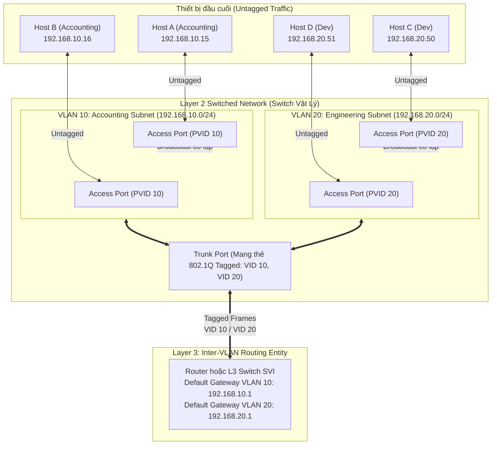
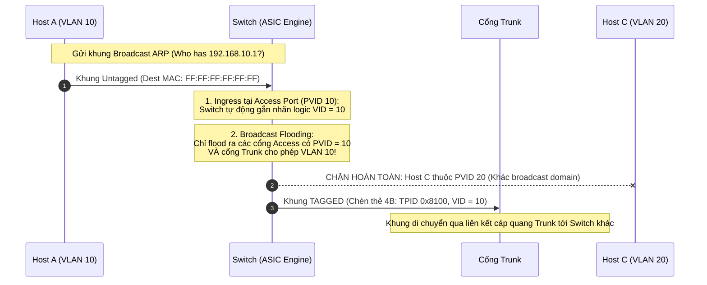

# 2_2_4 VLANs and IEEE 802.1Q Tagging

> **Khóa học**: Cloud DevOps Basic — Networking Core  
> **Phân nhóm**: 2 Domain 2 - Computer Networking Core Fundamentals › 2_2 Data Link Layer and Physical Addressing  
> **Chủ đề**: Mạng cục bộ ảo (VLAN), cấu trúc nhãn IEEE 802.1Q (TPID/TCI/VID/PCP), cổng Access/Trunk và định tuyến liên VLAN  
> **Trạng thái**: Verified (WRITE-CDB-2_2_4, 14-11-2026)  
> **Checklist đối chiếu**: [2_2_4](../../../CHECKLIST.md#22-data-link-layer-l2--physical-addressing)  

---

## 1. Khái Niệm Cốt Lõi & Bản Chất Kỹ Thuật (Core Concepts & Technical Deep Dive)

Trong các mô hình mạng chuyển mạch Ethernet truyền thống, mọi cổng trên một thiết bị chuyển mạch (Switch Tầng 2) đều thuộc về cùng một **miền quảng bá (Broadcast Domain)**. Khi một máy trạm phát tán một khung quảng bá (chẳng hạn như bản tin ARP Request `FF:FF:FF:FF:FF:FF`), switch sẽ chuyển tiếp (flood) khung đó ra toàn bộ các cổng còn lại. Khi số lượng máy trạm tăng lên hàng trăm hoặc hàng nghìn thiết bị, lưu lượng broadcast sẽ chiếm dụng băng thông nghiêm trọng, gây suy giảm hiệu năng và tiềm ẩn nguy cơ bảo mật khi các máy trạm có thể nghe lén lưu lượng của nhau.

Để giải quyết bài toán này, công nghệ **Mạng Cục bộ Ảo (Virtual Local Area Network - VLAN)** ra đời và được chuẩn hóa quốc tế theo tiêu chuẩn **IEEE 802.1Q** và **RFC 3069**.

```text
Khung Ethernet II Tiêu Chuẩn (Untagged - 1518 Bytes Max):
+---------------+---------------+---------------+--------------------+---------------+
|  Dest MAC (6) |  Src MAC (6)  | EtherType (2) | Payload (46-1500)  |  FCS CRC (4)  |
+---------------+---------------+---------------+--------------------+---------------+

Khung Ethernet Được Gắn Thẻ IEEE 802.1Q (Tagged - 1522 Bytes Max):
+---------------+---------------+---------------+---------------+--------------------+---------------+
|  Dest MAC (6) |  Src MAC (6)  | 802.1Q Tag(4) | EtherType (2) | Payload (46-1500)  |  FCS CRC (4)  |
+---------------+---------------+---------------+---------------+--------------------+---------------+
                                 |             |
                                 +------+------+
                                        |
     +----------------------------------+----------------------------------+
     |   TPID (2 Bytes = 0x8100)        |        TCI (2 Bytes / 16 bits)   |
     +----------------------------------+----------------------------------+
                                        |  PCP (3b)  | DEI (1b) | VID (12b)|
                                        +------------+----------+----------+
```

### 1.1 Bản chất của VLAN: Phân chia miền quảng bá logic

Theo định nghĩa kỹ thuật trong **RFC 3069 (Section 1)**:
- Một VLAN là một **miền quảng bá logic (Logical Broadcast Domain)** độc lập.
- Một khung quảng bá (broadcast) hoặc đa hướng (multicast) phát xuất từ một máy trạm trong một VLAN nhất định sẽ chỉ được các máy trạm thuộc cùng VLAN đó tiếp nhận; nó hoàn toàn bị chặn và cô lập, không bao giờ lan truyền sang các máy trạm thuộc VLAN khác trên cùng một switch vật lý.
- Về mặt logic, việc tạo ra nhiều VLAN trên cùng một switch vật lý tương đương hoàn toàn với việc bạn chia switch đó thành nhiều switch vật lý riêng biệt đặt cạnh nhau.

---

### 1.2 Cấu trúc nhãn IEEE 802.1Q (QTag Prefix - 4 Octets)

Khi các khung dữ liệu cần truyền qua các liên kết dùng chung giữa các switch hoặc router, tiêu chuẩn **IEEE 802.1Q** (được tích hợp trong **IEEE P802.3as Clause 3.5**) chèn một khối tiêu đề 4 octets (thường gọi là **QTag Prefix**) vào giữa trường **Source MAC Address** và trường **EtherType/Length** nguyên thủy.

Khối thẻ 4 octets này bao gồm hai trường chính:

#### 1. Định danh giao thức gắn thẻ (Tag Protocol Identifier - TPID - 2 octets / 16 bits)
- Mang giá trị cố định **`0x8100`**.
- Khi một switch hoặc card mạng đọc tới byte thứ 13 của khung và phát hiện giá trị `0x8100`, nó hiểu ngay rằng khung này đã được gắn thẻ 802.1Q, và 2 bytes tiếp theo chính là thông tin điều khiển thẻ (TCI).

#### 2. Thông tin điều khiển thẻ (Tag Control Information - TCI - 2 octets / 16 bits)
Trường TCI 16-bit được chia thành 3 trường con cụ thể:

- **PCP (Priority Code Point - 3 bits)**:
  - Cung cấp $2^3 = 8$ mức độ ưu tiên (từ `0` đến `7`) theo chuẩn **IEEE 802.1p**.
  - Dùng cho cơ chế phân loại chất lượng dịch vụ (Class of Service - CoS) ở Tầng 2, cho phép switch ưu tiên truyền các gói tin nhạy cảm với độ trễ (như thoại VoIP hoặc video streaming) trước lưu lượng dữ liệu thông thường.
- **DEI (Drop Eligible Indicator - 1 bit)**:
  - Trong tiêu chuẩn 802.1Q trước đây, bit này được gọi là **CFI (Canonical Format Indicator)** dùng để tương thích với mạng Token Ring.
  - Trong tiêu chuẩn hiện đại, bit này chỉ thị khả năng chấp nhận bị loại bỏ (Drop Eligibility). Khi mạng xảy ra nghẽn (congestion), các khung có bit `DEI = 1` sẽ bị switch ưu tiên drop trước để cứu vãn băng thông cho các khung quan trọng có `DEI = 0`.
- **VID (VLAN Identifier - 12 bits)**:
  - Định danh chính xác VLAN mà khung dữ liệu này trực thuộc.
  - Với 12 bits, không gian địa chỉ VLAN hỗ trợ $2^{12} = 4096$ giá trị (từ `0` đến `4095`):
    - `VID 0`: Khung có gắn thẻ ưu tiên (**Priority-tagged frame**). Khung này chỉ mang thông tin mức độ ưu tiên CoS (PCP) mà không thuộc về một VLAN cụ thể nào.
    - `VID 1`: **VLAN Mặc định (Default VLAN)** trên hầu hết các thiết bị chuyển mạch thương mại (Cisco, Juniper, Linux Bridge).
    - `VID 1` đến `4094`: **Dải VLAN khả dụng** để người quản trị mạng cấu hình phân chia phòng ban, dịch vụ hoặc tenant.
    - `VID 4095`: Dành riêng cho mục đích nội bộ của hệ thống (Reserved for system use).

---

### 1.3 Phân loại cổng chuyển mạch: Access Port vs Trunk Port

Các cổng vật lý trên switch được phân chia theo hai chế độ vận hành cốt lõi:

| Đặc tính kỹ thuật | Cổng Truy Cập (Access Port) | Cổng Trung Kế (Trunk Port) |
| :--- | :--- | :--- |
| **Thiết bị kết nối** | Kết nối tới thiết bị đầu cuối (PC, Laptop, Server, Máy in). | Kết nối giữa Switch với Switch, hoặc Switch với Router/Firewall/Hypervisor. |
| **Số lượng VLAN** | Chỉ thuộc về **duy nhất 1 VLAN** (gọi là PVID - Port VLAN ID). | Cho phép truyền tải đồng thời **nhiều VLAN** (VLAN Multiplexing). |
| **Đặc điểm khung (Frame)** | Thiết bị đầu cuối chỉ nhận và gửi khung **Untagged** (không có thẻ 802.1Q). | Khung truyền qua cổng Trunk hầu hết được **Tagged** (có gắn thẻ 4 bytes 802.1Q). |
| **Xử lý Ingress (Đi vào)** | Gán thẻ logic với mã `VID = PVID` của cổng. | Kiểm tra thẻ: Nếu VID nằm trong danh sách `Allowed VLANs`, giữ nguyên thẻ và chuyển tiếp; nếu không cho phép, hủy khung. |
| **Xử lý Egress (Đi ra)** | **Tự động bóc tách (strip)** thẻ 4 bytes 802.1Q trước khi đưa khung ra dây cáp tới host. | Giữ nguyên thẻ 802.1Q (trừ khi khung thuộc Native VLAN). |

#### Khái niệm Native VLAN trên cổng Trunk
- **Native VLAN**: Là một VLAN được chỉ định trên cổng Trunk (mặc định thường là VLAN 1).
- **Quy tắc**:
  - Khi một khung thuộc Native VLAN đi ra khỏi cổng Trunk, switch sẽ **KHÔNG gắn thẻ 802.1Q** (truyền dưới dạng khung untagged thông thường).
  - Ngược lại, khi cổng Trunk nhận được một khung không gắn thẻ (untagged), nó sẽ tự động coi khung đó thuộc về Native VLAN.
- *Mục đích*: Tương thích ngược với các thiết bị mạng cũ không hỗ trợ chuẩn 802.1Q hoặc các giao thức điều khiển tầng liên kết như CDP (Cisco Discovery Protocol), STP (Spanning Tree Protocol).

---

### 1.4 Bản chất Định tuyến Liên VLAN (Inter-VLAN Routing)

> [!IMPORTANT]
> **Quy tắc bất biến của Tầng 2**:  
> Thiết bị chuyển mạch Tầng 2 (Layer 2 Switch) **hoàn toàn không thể tự mình chuyển tiếp dữ liệu giữa hai VLAN khác nhau**. Vì mỗi VLAN là một subnet IP và một miền broadcast hoàn toàn độc lập, nên mọi nỗ lực giao tiếp giữa các VLAN bắt buộc phải thông qua một **thực thể định tuyến Tầng 3 (Layer 3 Routing Entity)**.

Hai phương pháp định tuyến liên VLAN phổ biến nhất:

1. **Bộ định tuyến một chân (Router-on-a-stick)**:
   - Sử dụng một đường cáp vật lý duy nhất (Trunk link) nối từ Switch lên một cổng mạng của Router.
   - Trên router, cổng vật lý đó được chia thành nhiều **giao diện con ảo (subinterfaces)** (ví dụ: `eth0.10` cho VLAN 10, `eth0.20` cho VLAN 20).
   - Mỗi subinterface được cấu hình gắn nhãn 802.1Q tương ứng và đóng vai trò là **Default Gateway** cho subnet của VLAN đó. Router tiếp nhận gói tin từ VLAN 10, định tuyến ở Tầng 3, thay đổi tiêu đề Tầng 2 rồi truyền ngược lại qua cùng sợi cáp Trunk sang VLAN 20.
2. **Thiết bị chuyển mạch Tầng 3 & Giao diện Ảo (Layer 3 Switch with SVIs)**:
   - Trong mạng doanh nghiệp và trung tâm dữ liệu hiện đại, việc sử dụng router ngoài gây nghẽn cổ chai (traffic bottleneck). Thay vào đó, người ta sử dụng **Layer 3 Switch** hỗ trợ **SVI (Switched Virtual Interface)** (ví dụ `interface Vlan 10`, `interface Vlan 20`).
   - SVI đóng vai trò là gateway ảo nằm ngay trong chip chuyển mạch của switch. Việc định tuyến giữa các VLAN diễn ra bằng phần cứng (ASIC/TCAM) ở tốc độ dây (wire-speed), đạt thông lượng hàng trăm Gigabit/giây mà không cần bất kỳ dây cáp ngoài nào.

---

## 2. Ví Dụ Đời Sống Thực Tế Dễ Hiểu (Intuitive Real-World Analogies)

### Ẩn dụ: Cao Ốc Văn Phòng Dùng Chung & Hệ Thống Thẻ Màu An Ninh

Hãy tưởng tượng một tòa nhà văn phòng hiện đại cao cấp, nơi có nhiều công ty hoàn toàn độc lập cùng thuê mặt sàn:

1. **Mạng vật lý dùng chung (Tòa nhà & Thang máy trục chính)**:
   - Tòa nhà có chung hệ thống thang máy tốc độ cao và hành lang trung tâm (tương tự như sợi cáp mạng và switch vật lý kết nối toàn bộ hệ thống).
2. **Các VLAN độc lập (Công ty Tài chính vs Công ty Phần mềm)**:
   - **VLAN 10**: Công ty Tài chính Kế toán (cần bảo mật tuyệt đối số liệu hóa đơn).
   - **VLAN 20**: Công ty Phát triển Phần mềm (chuyên lập trình và thử nghiệm công nghệ).
   - **VLAN 30**: Khách vãng lai đến họp (Guest Wi-Fi).
   - Nếu không có hệ thống an ninh, một nhân viên công ty phần mềm có thể tự do mở cửa bước vào phòng giám đốc tài chính để lục lọi hồ sơ (tương đương với việc máy trạm nghe lén gói tin broadcast ARP/DHCP khi không có VLAN).
3. **Cửa văn phòng cá nhân (Access Port)**:
   - Khi nhân viên kế toán ngồi làm việc trong phòng riêng của họ, họ thoải mái trao đổi công việc mà không cần đeo huy hiệu thẻ từ lủng lẳng trước ngực (**Untagged Frame**).
   - Nhưng khi họ bước chân ra cửa phòng để đi ra hành lang chung, nhân viên bảo vệ gác cửa sẽ dán ngay một chiếc huy hiệu màu Đỏ lên ngực họ (**Gán thẻ 802.1Q với VID = 10**).
4. **Thang máy trục chính (Trunk Port)**:
   - Thang máy trục chính vận chuyển nhân viên của tất cả các công ty (Đỏ, Xanh, Vàng) cùng một lúc.
   - Khi thang máy dừng ở tầng của Công ty Phần mềm (VLAN 20), cảm biến quang học ở cửa thang máy sẽ quét thẻ: Chỉ những người có thẻ Xanh mới được bước ra khỏi thang máy; người đeo thẻ Đỏ bị cửa kính khóa chặt, không thể thâm nhập.
   - Trước khi người thẻ Xanh bước vào sảnh làm việc nội bộ của Công ty Phần mềm, bảo vệ tại cửa sẽ gỡ chiếc huy hiệu màu Xanh ra khỏi áo họ (**Strip 802.1Q Tag**), trả lại trạng thái thoải mái ban đầu.
5. **Khách vãng lai không có thẻ (Native VLAN)**:
   - Bất kỳ ai bước vào thang máy mà không dán thẻ màu nào trên áo (**Untagged frame trên cổng Trunk**) sẽ bị hệ thống tự động đưa về sảnh lễ tân tầng trệt (**Native VLAN**) để cách ly.
6. **Muốn gửi tài liệu giữa hai công ty? Phải qua Quầy Văn Thư Tầng 1 (Inter-VLAN Routing)**:
   - Giám đốc Tài chính (VLAN 10) muốn gửi hợp đồng thanh toán cho Trưởng phòng Lập trình (VLAN 20).
   - Nhân viên Kế toán **tuyệt đối không thể tự cầm hồ sơ chạy thẳng sang phòng phần mềm** (vì thẻ Đỏ không mở được cửa Xanh - Switch Tầng 2 chặn đứng).
   - Thay vào đó, nhân viên Kế toán phải mang hồ sơ xuống **Quầy Tiếp tân & Văn thư Trung tâm ở Tầng 1 (Router Tầng 3 / SVI Gateway)**. Nhân viên tiếp tân kiểm tra tính hợp lệ của hợp đồng (IP routing table & Firewall ACL), đóng dấu chuyển giao, đổi bìa hồ sơ sang màu Xanh, rồi mới chuyển tiếp sang văn phòng của Công ty Phần mềm.

---

## 3. Kiến Trúc, Luồng Hoạt Động & Hình Ảnh Trực Quan (Architecture, Diagrams & Visual Media)

### 3.1 Mô hình Kiến trúc Phân vùng VLAN và Định tuyến Inter-VLAN



### 3.2 Luồng xử lý khung tại cổng Access và cổng Trunk (Ingress & Egress)



---

## 4. Hướng Dẫn Thực Hành & Kiểm Chứng Dòng Lệnh (Hands-on CLI & Wire-Level Observations)

Trên hệ điều hành Linux (đặc biệt trong các máy chủ DevOps, Container Host hoặc OpenStack/Kubernetes node), nhân Linux hỗ trợ đầy đủ mô đun `8021q` cho phép biến một cổng mạng vật lý thành cổng trung kế (Trunk) và gắn các giao diện mạng con (VLAN subinterfaces).

### 4.1 Tạo và cấu hình VLAN Subinterface với bộ công cụ `iproute2`

```bash
# 1. Tải mô đun nhân Linux 802.1Q (nếu chưa được nạp)
sudo modprobe 8021q

# 2. Tạo một VLAN subinterface mới có ID 100 gắn vào card mạng vật lý eth0
sudo ip link add link eth0 name eth0.100 type vlan id 100

# 3. Kích hoạt giao diện ảo eth0.100
sudo ip link set up dev eth0.100

# 4. Gán địa chỉ IP tĩnh Tầng 3 cho giao diện VLAN 100
sudo ip addr add 192.168.100.10/24 dev eth0.100
```

---

### 4.2 Kiểm tra chi tiết cấu hình giao diện VLAN với `ip -d link`

Tham số `-d` (`--details`) của lệnh `ip link show` hiển thị các thuộc tính chi tiết của giao diện ảo:

```bash
# Xem thông số chi tiết của giao diện eth0.100
ip -d link show dev eth0.100
```

> 💡 **Minh họa thực thi (Illustrative Output)**:
```text
5: eth0.100@eth0: <BROADCAST,MULTICAST,UP,LOWER_UP> mtu 1500 qdisc noqueue state UP mode DEFAULT group default qlen 1000
    link/ether 52:54:00:12:34:56 brd ff:ff:ff:ff:ff:ff promiscuity 0 minmtu 0 maxmtu 65535 
    vlan protocol 802.1Q id 100 <REORDER_HDR> addrgenmode eui64 numtxqueues 1 numrxqueues 1 gso_max_size 65536 gso_max_segs 65535
```

*Phân tích kết quả*:
- `eth0.100@eth0`: Chỉ thị giao diện mạng ảo `eth0.100` phụ thuộc trực tiếp vào thiết bị vật lý cha là `eth0`.
- `vlan protocol 802.1Q id 100`: Xác nhận giao diện đang áp dụng chuẩn gắn thẻ IEEE 802.1Q với giá trị định danh `VLAN ID = 100`.
- `<REORDER_HDR>`: Cờ tối ưu hóa của nhân Linux, tự động sắp xếp lại tiêu đề Ethernet để tăng tốc độ xử lý gói tin trong kernel stack.

---

### 4.3 Quan sát thẻ 802.1Q trên đường truyền với `tcpdump`

Khi một máy chủ gửi dữ liệu qua giao diện VLAN, card mạng vật lý bên dưới sẽ phát ra các khung có gắn thẻ 4 octets. Ta có thể dùng `tcpdump` bắt lưu lượng trên card vật lý `eth0` để nhìn thấy thẻ này:

```bash
# Bắt các khung có thẻ VLAN 100 trên card mạng vật lý eth0
sudo tcpdump -i eth0 -e -nn "vlan 100" -c 1
```

> 💡 **Minh họa thực thi (Illustrative Output)**:
```text
15:10:02.451203 52:54:00:12:34:56 > 52:54:00:fe:dc:ba, ethertype 802.1Q (0x8100), length 102: vlan 100, p 0, ethertype IPv4 (0x0800), 192.168.100.10 > 192.168.100.1: ICMP echo request, id 1423, seq 1, length 64
```

*Phân tích dấu hiệu trên đường truyền*:
- `ethertype 802.1Q (0x8100)`: Khung được gắn thẻ với mã TPID `0x8100`.
- `vlan 100, p 0`: Thẻ TCI chứa `VID = 100` và mức độ ưu tiên `PCP = 0` (Best Effort).
- `ethertype IPv4 (0x0800)`: Trường EtherType nguyên thủy nằm ngay sau nhãn 802.1Q chỉ thị gói tin bên trong là IPv4.

---

### 4.4 Dọn dẹp tài nguyên VLAN

```bash
# Xóa giao diện VLAN subinterface khi không còn nhu cầu sử dụng
sudo ip link delete dev eth0.100
```

---

## 5. Cạm Bẫy Thực Tế & Thực Tiễn Sản Xuất (Production Gotchas & Best Practices)

Trong vận hành hạ tầng Cloud, Data Center và ảo hóa hạ tầng (VMware ESXi, KVM, Kubernetes CNI), các cấu hình sai lệch về VLAN có thể dẫn đến sự cố ngắt kết nối diện rộng hoặc các lỗ hổng bảo mật nghiêm trọng:

### 5.1 Lỗ hổng tấn công nhảy VLAN qua Native VLAN (Double Tagging VLAN Hopping)

- **Cơ chế tấn công**:
  - Kẻ tấn công cắm máy tính vào một cổng Access thuộc Native VLAN của switch.
  - Kẻ tấn công phát ra một khung dữ liệu có **hai lớp nhãn 802.1Q lồng nhau (Double Tagged)**: Lớp nhãn ngoài (Outer Tag) mang `VID = Native VLAN`, và lớp nhãn trong (Inner Tag) mang `VID = Target VLAN` (ví dụ VLAN 20 của phòng giám đốc hoặc cơ sở dữ liệu nhạy cảm).
  - Khi khung đi tới switch đầu tiên, switch chuẩn bị đưa khung qua cổng Trunk. Vì Outer Tag trùng với Native VLAN của cổng Trunk, switch thực hiện quy tắc chuẩn: **Bóc tách (strip) nhãn ngoài** và đẩy khung đi.
  - Khi khung đi tới switch thứ hai, switch này nhìn thấy Inner Tag (VLAN 20) và chuyển tiếp khung thẳng vào mạng của phòng giám đốc!
- **Biện pháp phòng ngừa (Best Practices)**:
  1. **Không bao giờ dùng VLAN 1 làm Native VLAN** trong môi trường sản xuất.
  2. Cấu hình Native VLAN trên toàn bộ các cổng Trunk là một **VLAN rác không sử dụng (Unused Dummy VLAN ID)**, ví dụ `VLAN 999`, và tuyệt đối không gán bất kỳ máy chủ hay cổng Access nào vào VLAN này.
  3. Bật tính năng bắt buộc gắn thẻ cả Native VLAN trên cổng Trunk (ví dụ lệnh `vlan dot1q tag native` trên thiết bị mạng chuyên dụng).

### 5.2 Lỗi quên giới hạn danh sách VLAN (Lack of Trunk VLAN Pruning)

- **Cạm bẫy**: Khi cấu hình cổng Trunk giữa hai switch, rất nhiều kỹ sư để mặc định cho phép toàn bộ 4094 VLAN đi qua (`switchport trunk allowed vlan all`).
- **Hậu quả**: Nếu một máy trạm trong VLAN 500 bị nhiễm mã độc hoặc xảy ra loop cáp mạng tạo ra bão broadcast (Broadcast Storm), lưu lượng rác hàng gigabit/giây sẽ lập tức tràn qua tất cả các đường Trunk liên kết switch, làm tê liệt toàn bộ băng thông cáp trục chính của doanh nghiệp.
- **Thực tiễn sản xuất**: Luôn áp dụng nguyên tắc đặc quyền tối thiểu (Least Privilege). Chỉ cho phép chính xác danh sách các VLAN cần thiết đi qua đường Trunk (`switchport trunk allowed vlan 10,20,30`), loại bỏ triệt để các VLAN thừa thãi (VLAN Pruning).

### 5.3 Cạm bẫy MTU & Khung "Babbling Giant" khi chèn thêm 4 Bytes thẻ 802.1Q

- **Bản chất**: Tiêu chuẩn Ethernet II ban đầu quy định khung tối đa là 1518 bytes. Khi nhãn 802.1Q được chèn vào, kích thước khung tăng lên **1522 bytes**.
- Tiêu chuẩn **IEEE 802.3ac** (sau này được gộp vào **IEEE 802.3as**) đã mở rộng kích thước khung MAC cơ bản lên 1522 bytes để chứa vừa 4 bytes thẻ.
- **Cạm bẫy thực tế**: Một số thiết bị switch cũ hoặc các cạc mạng ảo (vNIC) thế hệ cũ không hỗ trợ kích thước khung mở rộng này sẽ coi các khung 1522 bytes là khung quá khổ bất hợp lệ (**Babbling Giants / Oversized frames**) và drop âm thầm, khiến việc kết nối mạng nội bộ VLAN hoạt động chập chờn khi truyền các gói tin TCP có kích thước tối đa (MSS = 1460).

---

## 6. Câu Hỏi Củng Cố Kiến Thức (Active Recall Quiz)

<details>
<summary><b>Câu hỏi 1:</b> Nhãn IEEE 802.1Q có kích thước bao nhiêu octets và được chèn vào vị trí nào trong khung Ethernet? Nêu ý nghĩa kỹ thuật của các trường TPID, PCP, DEI, và VID. Dải giá trị khả dụng của VLAN ID trong thực tế là bao nhiêu?</summary>

**Đáp án:**
- Nhãn IEEE 802.1Q có kích thước **4 octets (32 bits)**, được chèn vào giữa trường **Source MAC Address** và trường **EtherType/Length** nguyên thủy của khung Ethernet.
- Các trường thành phần:
  1. **TPID (16 bits)**: Mang giá trị cố định `0x8100`, báo hiệu khung có gắn thẻ 802.1Q.
  2. **PCP (3 bits)**: Mức độ ưu tiên dịch vụ Tầng 2 (Class of Service - CoS) từ 0 đến 7 theo chuẩn IEEE 802.1p.
  3. **DEI (1 bit)**: Drop Eligible Indicator, chỉ thị khung có thể bị hủy trước khi mạng bị nghẽn băng thông.
  4. **VID (12 bits)**: Định danh VLAN, mang giá trị từ $0$ đến $4095$.
- **Dải giá trị khả dụng**:
  - `VID 0`: Dành cho khung có gắn thẻ ưu tiên CoS (priority-tagged).
  - `VID 1`: VLAN mặc định của hệ thống.
  - `VID 1` đến `4094`: Dải VLAN khả dụng để người quản trị cấu hình cho hệ thống.
  - `VID 4095`: Dành riêng cho mục đích quản lý hệ thống.
</details>

<details>
<summary><b>Câu hỏi 2:</b> Phân biệt cơ chế xử lý khung của cổng Access (Access Port) và cổng Trunk (Trunk Port) trên switch khi khung đi vào (ingress) và đi ra (egress). Native VLAN hoạt động như thế nào trên đường Trunk?</summary>

**Đáp án:**
- **Cổng Access**:
  - Kết nối tới thiết bị đầu cuối, chỉ thuộc về 1 VLAN duy nhất (PVID).
  - *Ingress*: Nhận khung untagged từ máy trạm, switch tự động gán nhãn logic `VID = PVID`.
  - *Egress*: Switch tự động bóc tách (strip) nhãn 4 bytes 802.1Q, chuyển khung dạng untagged tiêu chuẩn tới máy trạm.
- **Cổng Trunk**:
  - Kết nối giữa các switch hoặc giữa switch với router, truyền tải đồng thời nhiều VLAN.
  - *Ingress*: Đọc thẻ 802.1Q; nếu VID nằm trong danh sách cho phép (Allowed VLANs) thì tiếp nhận và chuyển tiếp; nếu không, hủy khung.
  - *Egress*: Giữ nguyên thẻ 802.1Q đính kèm trên khung để switch phía đối diện nhận diện được VLAN.
- **Native VLAN**: Là một VLAN đặc biệt trên đường Trunk mà lưu lượng thuộc về nó khi truyền đi sẽ **không bị gắn thẻ (untagged)**. Khi cổng Trunk đối diện nhận được một khung không có thẻ, nó sẽ tự động coi khung đó thuộc về Native VLAN.
</details>

<details>
<summary><b>Câu hỏi 3:</b> Hai máy chủ Server A (thuộc VLAN 10) và Server B (thuộc VLAN 20) được cắm trực tiếp vào cùng một thiết bị chuyển mạch Tầng 2. Server A có thể gửi trực tiếp khung Ethernet để ping Server B được không? Tại sao? Cần cơ chế gì để hai máy chủ này có thể truyền thông với nhau?</summary>

**Đáp án:**
- **Không thể ping trực tiếp**: Vì VLAN 10 và VLAN 20 là hai miền quảng bá (broadcast domains) và hai không gian mạng logic (subnets) hoàn toàn cô lập nhau ở Tầng 2. Khung ARP Request tìm MAC của Server B phát ra từ Server A sẽ bị switch chặn lại không cho sang các cổng của VLAN 20.
- **Cơ chế cần thiết**: Giao tiếp bắt buộc phải thông qua một **thực thể định tuyến Tầng 3 (Layer 3 Routing)**:
  1. **Router-on-a-stick**: Kết nối đường Trunk từ switch lên Router vật lý ngoài, sử dụng các router subinterface (`eth0.10`, `eth0.20`) làm gateway định tuyến gói tin giữa hai subnet.
  2. **Layer 3 Switch (SVI)**: Bật tính năng định tuyến IP trên switch và tạo các giao diện ảo `interface Vlan 10` và `interface Vlan 20`. Switch sẽ thực hiện định tuyến trực tiếp bằng phần cứng ASIC tốc độ dây mà không cần gửi gói tin ra thiết bị ngoài.
</details>

---

## 7. 📚 Nguồn Tài Liệu Chính Thống (Tier-1 Official References)

- [IEEE Std 802.3 Clause 3.5: QTag Prefix Format and Envelope Frames](https://www.ieee802.org/3/as/public/0503/3d0_1_CMP.pdf#page=55) - Đặc tả kỹ thuật chính thức của IEEE về cấu trúc nhãn gắn thẻ 4 octets (TPID `0x8100`, TCI: PCP, DEI, VID) và kích thước khung mở rộng 1522 octets.
- [RFC 3069: VLAN Aggregation for Efficient IP Address Allocation](https://datatracker.ietf.org/doc/html/rfc3069#section-1) - Tiêu chuẩn IETF định nghĩa bản chất kỹ thuật của VLAN như một broadcast domain độc lập và nguyên lý cô lập truyền thông giữa các VLAN.
- [RFC 4363: Definitions of Managed Objects for Bridges with Traffic Classes and Virtual LANs](https://datatracker.ietf.org/doc/html/rfc4363#page-68) - Tiêu chuẩn IETF mô tả cấu trúc quản trị cầu nối mạng IEEE 802.1Q/802.1p, phân định dải VLAN ID (1-4094) và các giá trị bảo lưu 0 và 4095.
- [Linux Manual Pages: ip-link(8) - Network Device Configuration (VLAN Type Support)](https://man7.org/linux/man-pages/man8/ip-link.8.html) - Tài liệu hướng dẫn chính thức từ Linux man-pages về cú pháp quản trị thiết bị mạng ảo VLAN bằng `ip link add link ... type vlan id ...`.
