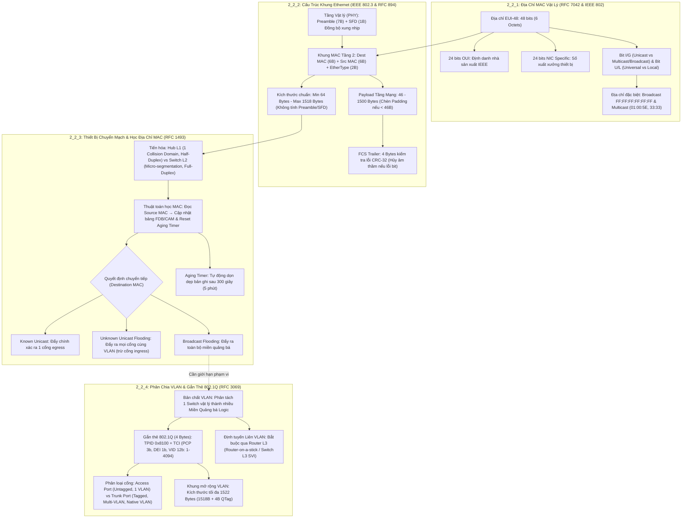

# 2_2 Data Link Layer and Physical Addressing

> **Khóa học**: Cloud DevOps Basic — Networking Core · **Domain**: 2 Domain 2 - Computer Networking Core Fundamentals · **Roadmap gốc**: [network README](<../../README.md#module-2-data-link-layer-l2-mac-addresses--ethernet-frames>)

---

## Module này dạy gì? (What & Why)

Module này phân tích nền tảng cốt lõi của Tầng Liên kết Dữ liệu (Layer 2 - Data Link Layer) trong mô hình mạng máy tính, nơi dữ liệu logic tầng mạng được chuyển giao thành các khung truyền dẫn vật lý tin cậy trên cùng một môi trường mạng cục bộ (LAN). Người học bắt đầu từ cấu trúc định danh vật lý EUI-48 (địa chỉ MAC 48-bit) với phân định mã nhà sản xuất OUI, phần mở rộng NIC, các cờ điều khiển I/G, U/L và các dải địa chỉ đặc biệt (Broadcast `FF:FF:FF:FF:FF:FF`, Multicast IPv4/IPv6 theo RFC 7042, RFC 1112, RFC 2464). Tiếp theo, module giải phẫu cấu trúc khung truyền Ethernet II và IEEE 802.3 với 5 trường thành phần bắt buộc, phân định rõ ràng giữa gói đồng bộ xung nhịp Tầng Vật lý (Preamble/SFD) với khung MAC chuẩn (64 đến 1518 bytes), cơ chế kiểm tra toàn vẹn bit bằng mã dư tuần hoàn FCS CRC-32, cùng quy tắc zero-padding khi payload nhỏ hơn 46 bytes (RFC 894). Module làm sáng tỏ bước nhảy vọt kiến trúc từ bộ tập trung Hub Tầng 1 (chia sẻ một miền xung đột, bán song công) sang thiết bị chuyển mạch Switch Tầng 2 (vi phân đoạn mạng, song công toàn phần), cơ chế tự động học địa chỉ MAC vào bảng FDB/CAM dựa trên Source MAC, 3 quyết định chuyển tiếp (Known Unicast, Unknown Unicast Flooding, Broadcast Flooding) và chu kỳ dọn dẹp Aging Timer 300 giây (RFC 1493). Cuối cùng, module hoàn thiện bức tranh chuyển mạch cục bộ bằng công nghệ Mạng cục bộ ảo (VLAN - RFC 3069), phân tích cấu trúc nhãn 4 bytes IEEE 802.1Q (TPID `0x8100`, TCI gồm PCP, DEI, VID dải 1–4094), nguyên lý vận hành giữa cổng Access và cổng Trunk (kèm Native VLAN), cùng bản chất bắt buộc phải có thực thể định tuyến Tầng 3 (Router-on-a-stick hoặc Switch L3 SVI) để truyền thông liên VLAN.

---

## Lộ trình bài học (Lesson Path)

| Bài học | Mục tiêu cốt lõi | Checklist ID |
| :--- | :--- | :---: |
| [2_2_1 MAC Address Structure](<./2_2_1 MAC Address Structure.md>) | Cấu trúc địa chỉ MAC 48-bit (OUI & NIC specific), bit I/G và U/L, broadcast và multicast | [2_2_1](<../../../CHECKLIST.md#22-data-link-layer-l2--physical-addressing>) |
| [2_2_2 Ethernet Frame Structure](<./2_2_2 Ethernet Frame Structure.md>) | Cấu trúc khung Ethernet II/802.3, phân biệt Preamble/SFD với MAC frame, MTU và FCS CRC-32 | [2_2_2](<../../../CHECKLIST.md#22-data-link-layer-l2--physical-addressing>) |
| [2_2_3 Switches vs Hubs and MAC Learning](<./2_2_3 Switches vs Hubs and MAC Learning.md>) | So sánh Hub L1 và Switch L2, thuật toán học MAC, bảng CAM/FDB và aging timer | [2_2_3](<../../../CHECKLIST.md#22-data-link-layer-l2--physical-addressing>) |
| [2_2_4 VLANs and IEEE 802.1Q Tagging](<./2_2_4 VLANs and IEEE 802.1Q Tagging.md>) | Phân tách broadcast domain bằng VLAN, cấu trúc thẻ 802.1Q (TPID/TCI/VID), access/trunk và định tuyến Inter-VLAN | [2_2_4](<../../../CHECKLIST.md#22-data-link-layer-l2--physical-addressing>) |

---

## Bản đồ khái niệm (Concept Map)

Sơ đồ dưới đây tổng hợp mối liên kết kiến trúc logic xuyên suốt 4 bài học của Module 2.2:

---

## Ẩn dụ xuyên suốt (Module Analogy)

Bốn bài học trong module được kết nối liền mạch thông qua câu chuyện thực tế về **Hệ thống thư tín nội bộ trong Tòa cao ốc văn phòng liên cơ quan**:

1. **Số Căn cước công dân và Thẻ định danh vật lý (2_2_1 - MAC Address Structure)**:
   - Mỗi nhân viên khi vào làm việc trong tòa nhà đều sở hữu một số Căn cước công dân (CCCD) và dấu vân tay gắn cứng với thể xác vật lý (địa chỉ MAC 48-bit dập cứng vào card mạng NIC). Trong đó, 3 chữ số đầu xác định tỉnh thành cấp thẻ (mã nhà sản xuất OUI do IEEE cấp), và các số còn lại là số thứ tự cá nhân độc nhất (phần mở rộng NIC).
   - Khi cần báo động hỏa hoạn hoặc cắt nước cho toàn bộ tòa nhà, bảo vệ bấm **Hệ thống loa phát thanh** (Broadcast `FF:FF:FF:FF:FF:FF`) để tất cả mọi người cùng nghe; còn khi gửi thông báo tới một ban chuyên môn đăng ký trước (như Đội phòng cháy chữa cháy), thông báo phát tới một nhóm mã hiệu riêng (Multicast `01:00:5E` hoặc `33:33`).

2. **Đoàn xe áp tải bưu chính và Phong bì niêm phong bọc thép (2_2_2 - Ethernet Frame Structure)**:
   - Để chuyển tài liệu an toàn, bưu tá không cầm từng mảnh giấy rời mà bỏ vào một **phong bì bưu chính tiêu chuẩn (Khung Ethernet II)**.
   - Trước khi xe bưu chính tới nơi, đoàn xe bật **tiếng còi hú dẹp đường và pháo lệnh chuẩn bị (Preamble 7 bytes và SFD 1 byte)** để nhân viên tiếp nhận chỉnh đồng hồ và chuẩn bị đón thư. Tuy nhiên, tiếng còi xe này chỉ thuộc về tầng nghi thức tiếp đón trên đường phố (Tầng Vật lý PHY), hoàn toàn không được tính vào kích thước của phong bì thư.
   - Trên phong bì bắt buộc ghi rõ: Địa chỉ người nhận, Địa chỉ người gửi, Mã loại tài liệu bên trong (EtherType). Bưu điện quy định phong bì phải nặng ít nhất 64 gram (Payload tối thiểu 46 bytes); nếu bức thư chỉ là một mẩu giấy ngắn vài chữ (như thông điệp ARP 28 bytes), bưu tá bắt buộc phải nhét thêm 18 tờ giấy trắng đệm lót (zero-padding) cho đủ độ dày tối thiểu.
   - Cuối cùng, miệng phong bì được dán một **con dấu sáp niêm phong chống giả mạo (FCS CRC-32)**: Nếu con dấu bị nứt vỡ hoặc sai lệch dù chỉ một nét khắc (lỗi bit do nhiễu cáp), người nhận sẽ âm thầm vứt ngay phong bì vào sọt rác (silent drop) mà không buồn mở ra đọc.

3. **Phòng họp ồn ào không micro vs Bưu tá thông minh có sổ ghi chép (2_2_3 - Switches vs Hubs and MAC Learning)**:
   - Thời kỳ đầu, tòa nhà sử dụng một phòng sinh hoạt chung lớn (Hub Tầng 1): Khi ai cất tiếng nói thì tất cả mọi người trong phòng đều phải nghe; nếu hai người nói cùng lúc, âm thanh va đập vào nhau thành tiếng ồn hỗn loạn (Collision), cả phòng phải im bặt chờ đợi (Half-Duplex).
   - Sau đó, tòa nhà chuyển sang mô hình văn phòng hiện đại với từng phòng làm việc cách âm riêng và thuê một **Bác bưu tá thông minh (Switch Tầng 2)**:
     - Bác bưu tá cầm một cuốn **Sổ tay danh bạ (Bảng FDB/CAM)**. Ban đầu sổ trống trơn.
     - Mỗi khi có thư gửi đi, bác nhìn vào tên người gửi để ghi ngay vào sổ: *"Nhân viên A ở Cổng số 1"* (MAC Learning dựa vào Source MAC).
     - Nếu thư gửi cho Nhân viên B mà bác chưa từng gặp, bác photo thư gửi tới tất cả các phòng hỏi thăm (Unknown Unicast Flooding). Ngay khi B gửi thư trả lời, bác ghi nhớ ngay phòng của B; từ đó về sau, thư gửi cho B chỉ chuyển thẳng tới đúng phòng của B (Known Unicast).
     - Nếu một nhân viên không gửi thư trong suốt 5 phút (300 giây), bác dùng bút chì tẩy tên họ khỏi sổ danh bạ (Aging Timer) để tránh gửi nhầm nếu họ chuyển phòng.

4. **Thẻ từ màu sắc phân chia công ty và Bàn phê duyệt chuyển tầng (2_2_4 - VLANs and IEEE 802.1Q Tagging)**:
   - Khi tòa nhà có nhiều công ty đối thủ cùng thuê chung mặt bằng, bác bưu tá không thể để thư thông báo nội bộ của công ty này bay sang công ty khác. Ban quản lý chia tòa nhà thành các **Công ty ảo độc lập (VLAN)**:
     - Mỗi nhân viên ngồi ở phòng làm việc bình thường chỉ gửi và nhận thư giấy không dán nhãn (Cổng Access - Untagged).
     - Nhưng khi thư được gom lại chuyển qua **đường ống khí nén trục chính giữa các tầng (Đường Trunk)**, bưu tá dán thêm một **chiếc thẻ từ màu sắc 4 bytes (Nhãn IEEE 802.1Q)** ghi rõ mã số công ty (VLAN ID từ 1 đến 4094) và mức độ khẩn cấp (PCP). Bưu tá ở tầng kia đọc thẻ màu để phân loại chính xác, và bóc bỏ thẻ trước khi đưa thư cho nhân viên đích.
     - Riêng một số thư công văn quản lý chung của tòa nhà được quy định truyền qua ống mà không cần dán thẻ màu (Native VLAN).
     - Nếu Công ty Tài chính (VLAN 10) muốn gửi tài liệu cho Công ty Luật (VLAN 20), họ **tuyệt đối không thể chuyển trực tiếp** qua bác bưu tá Tầng 2; bức thư bắt buộc phải được gửi lên **Bàn Ban Quản trị phê duyệt ở Tầng 3 (Router Tầng 3 / Inter-VLAN Routing)** để kiểm tra tính hợp lệ và dán lại mã định tuyến mới trước khi chuyển giao.

---

## Tự kiểm tra cuối module (Module Review)

<b>Câu hỏi 1:</b> Phân tích cấu trúc phân bổ của địa chỉ MAC 48-bit (EUI-48). Ý nghĩa kỹ thuật của hai bit cờ I/G và U/L trong octet đầu tiên là gì? Tại sao trong một khung Ethernet chuẩn, trường Source MAC không bao giờ được phép mang địa chỉ Broadcast (<code>FF:FF:FF:FF:FF:FF</code>) hay địa chỉ Multicast (<code>01:00:5E:...</code>)?

**Đáp án:**
- **Cấu trúc EUI-48 (RFC 7042)**: Địa chỉ MAC có độ dài 48 bits (6 octets / 6 bytes), chia thành hai nửa bằng nhau:
  - *24 bits đầu (3 octets)*: Là mã **OUI (Organizationally Unique Identifier)** do cơ quan quản lý IEEE Registration Authority cấp phát độc quyền cho từng nhà sản xuất phần cứng.
  - *24 bits sau (3 octets)*: Là phần định danh mở rộng (**NIC Specific Extension**) do nhà sản xuất tự gán duy nhất cho từng card mạng xuất xưởng ($2^{24} = 16.777.216$ địa chỉ cho mỗi OUI).
- **Ý nghĩa hai bit cờ trong octet đầu tiên (Byte 0)**:
  - *Bit I/G (Individual/Group - bit LSB của octet đầu tiên theo thứ tự truyền cáp)*: Mang giá trị `0` xác định địa chỉ đơn vị cá nhân (Individual / Unicast); mang giá trị `1` xác định địa chỉ nhóm (Group / Multicast hoặc Broadcast). Do Ethernet truyền tín hiệu bit trên dây theo quy tắc Least Significant Bit (LSB) first, phần cứng card mạng đọc được ngay bit I/G đầu tiên để phân loại gói tin trước khi nhận hết khung.
  - *Bit U/L (Universal/Local - bit kế tiếp bit I/G)*: Mang giá trị `0` chỉ thị địa chỉ được quản trị toàn cầu (Universal) theo OUI chuẩn của IEEE; mang giá trị `1` chỉ thị địa chỉ quản trị cục bộ (Local) do quản trị viên hoặc phần mềm ảo hóa (Docker, KVM) tự cấp.
- **Lý do Source MAC không được phép là Broadcast hay Multicast**:
  - Theo quy chuẩn RFC 7042 và IEEE 802.3, bit I/G trong trường Source MAC **luôn luôn được bảo lưu và bắt buộc phải bằng `0`**. Một khung dữ liệu vật lý chỉ có thể phát sinh từ một giao diện card mạng cá nhân duy nhất, không thể bắt nguồn từ một nhóm địa chỉ logic trừu tượng hay từ toàn mạng.
  - Thiết bị chuyển mạch (Switch) dựa vào Source MAC để học cổng vào bảng FDB/CAM; nếu chấp nhận địa chỉ nguồn multicast hoặc broadcast, bảng định tuyến L2 sẽ bị sai lệch hoàn toàn. Khung tin có Source MAC mang bit `I/G = 1` là khung dị thường và bị loại bỏ ngay tại tầng phần cứng.

<b>Câu hỏi 2:</b> Một khung Ethernet II tiêu chuẩn bao gồm những trường thành phần nào? Tại sao tiêu chuẩn IEEE 802.3 quy định kích thước khung MAC tối thiểu là 64 bytes và tối đa là 1518 bytes (hoàn toàn không tính 8 bytes Preamble và SFD)? Khi một gói tin nhỏ (như gói tin ARP 28 bytes) được truyền đi, tầng Data Link xử lý như thế nào để đảm bảo tính hợp lệ của khung?

**Đáp án:**
- **5 trường thành phần của khung MAC Ethernet II (IEEE Std 802.3 Clause 3.1.1)**:
  1. *Destination MAC (6 bytes)*: Địa chỉ vật lý của trạm đích nhận khung.
  2. *Source MAC (6 bytes)*: Địa chỉ vật lý của trạm gửi khung (luôn là unicast).
  3. *EtherType (2 bytes)*: Định danh giao thức tầng mạng được đóng gói (`0x0800` cho IPv4, `0x0806` cho ARP, `0x86DD` cho IPv6, `0x8100` cho nhãn VLAN 802.1Q).
  4. *Payload / Data (46 đến 1500 bytes)*: Dữ liệu tầng trên (IP Datagram / ARP packet), với giới hạn MTU mặc định 1500 bytes.
  5. *FCS (Frame Check Sequence - 4 bytes)*: Chứa giá trị kiểm tra lỗi CRC-32 tính toán trên toàn bộ 5 trường từ Destination MAC đến hết Data/Padding.
- **Lý do giới hạn 64 bytes và 1518 bytes không tính Preamble và SFD**:
  - Theo tiêu chuẩn IEEE Std 802.3 và IEEE 802.3as, **Preamble (7 bytes)** và **SFD (1 byte)** thuộc về gói đồng bộ hóa Tầng Vật lý (PHY Packet), được chip PHY dùng để khóa pha đồng hồ (clock synchronization) và định vị điểm bắt đầu của khung, sau đó bị cắt bỏ trước khi nạp vào bộ điều khiển MAC. Kích thước khung Tầng 2 chỉ đo từ Destination MAC đến hết FCS: $6 + 6 + 2 + \text{Payload} + 4 = 18 + \text{Payload}$.
  - *Kích thước tối thiểu 64 bytes* (khi Payload = 46 bytes): Bắt nguồn từ thông số vật lý thời gian chiếm rãnh (Slot Time - 512 bit times) trong mạng bán song công CSMA/CD, đảm bảo khung đủ dài trên đường truyền cáp để nguồn phát kịp thời phát hiện va chạm tín hiệu (collision detection) trước khi hoàn tất phát khung.
  - *Kích thước tối đa cơ bản 1518 bytes* (khi Payload = 1500 bytes): Giới hạn độ dài truyền tải liên tục để tránh chiếm giữ đường truyền quá lâu và tối ưu dung lượng bộ nhớ đệm (buffer) của card mạng.
- **Cơ chế xử lý khi truyền gói tin nhỏ (như ARP 28 bytes)**:
  - Do 28 bytes nhỏ hơn ngưỡng tải trọng tối thiểu 46 bytes, tầng Data Link bắt buộc phải chèn thêm **18 bytes số 0 (zero-padding `0x00`)** vào sau gói tin ARP để Payload đạt đủ 46 bytes.
  - Tổng kích thước khung đạt đúng $18 + 46 = 64$ bytes, giúp khung không bị các card mạng và switch nhận diện nhầm là khung rác hoặc mảnh vụn va chạm (runt frame theo chuẩn RFC 2819).

<b>Câu hỏi 3:</b> Phân tích sự khác biệt bản chất giữa Hub (Layer 1) và Switch (Layer 2) về miền xung đột và chế độ truyền thông. Thuật toán học địa chỉ MAC (MAC Learning) của Switch vận hành ra sao, và phân biệt giữa Unknown Unicast Flooding với Broadcast Flooding? Vai trò của Aging Timer (300 giây) trong việc duy trì bảng CAM/FDB là gì?

**Đáp án:**
- **Sự khác biệt giữa Hub và Switch**:
  - *Hub (Layer 1)*: Là bộ lặp xung điện thụ động. Toàn bộ các cổng kết nối vào Hub tạo thành **1 miền xung đột duy nhất (Collision Domain)**; hoạt động ở chế độ bán song công (**Half-Duplex**), chỉ 1 thiết bị được phát tín hiệu tại một thời điểm (phải dùng thuật toán CSMA/CD để tránh va chạm), bảo mật kém vì mọi cổng đều nhận được dữ liệu của nhau.
  - *Switch (Layer 2)*: Là bộ chuyển mạch thông minh. Mỗi cổng trên switch là **1 miền xung đột độc lập (Micro-segmentation)**; hoạt động ở chế độ song công toàn phần (**Full-Duplex**), gửi và nhận độc lập đồng thời, triệt tiêu hoàn toàn va chạm và bảo mật dữ liệu cao.
- **Thuật toán học địa chỉ MAC (IEEE 802.1D & RFC 1493)**:
  - Khi nhận được khung Ethernet trên bất kỳ cổng nào, Switch lập tức đọc trường **Source MAC** trong phần header.
  - Nếu cặp `{Source MAC, Port, VLAN}` chưa có trong bảng CAM/FDB (Forwarding Database), Switch tạo bản ghi mới.
  - Nếu đã tồn tại trên cổng đó, Switch thiết lập lại đồng hồ đếm thời gian (Aging Timer).
  - Nếu MAC xuất hiện ở một cổng khác, Switch lập tức cập nhật cổng mới cho bản ghi đó.
- **Phân biệt Unknown Unicast Flooding vs Broadcast Flooding**:
  - *Unknown Unicast Flooding*: Xảy ra khi Destination MAC là địa chỉ đơn (bit `I/G = 0`) nhưng **chưa có trong bảng FDB**. Switch phát tràn khung ra mọi cổng cùng VLAN (trừ cổng nhận vào). Khi các host khác nhận được, card mạng của những host không khớp MAC sẽ lập tức loại bỏ gói tin; chỉ duy nhất host có MAC trùng khớp mới tiếp nhận và gửi phản hồi, giúp Switch học được cổng của host đó.
  - *Broadcast Flooding*: Xảy ra khi Destination MAC là `FF:FF:FF:FF:FF:FF` (tất cả bit bằng 1). Switch phát tràn ra mọi cổng trong VLAN (trừ cổng vào). Vì đây là địa chỉ quảng bá, **tất cả mọi host** nhận được đều bắt buộc phải chuyển khung lên CPU để xử lý, tạo ra tải tính toán trên toàn mạng.
- **Vai trò của Aging Timer (300 giây)**:
  - Theo chuẩn RFC 1493 (`dot1dTpAgingTime`) và Linux Bridge mặc định, bản ghi động trong FDB sẽ tự động bị xóa nếu không có khung tin nào mang Source MAC tương ứng đi vào trong vòng **300 giây (5 phút)**.
  - Cơ chế này giúp giải phóng bộ nhớ phần cứng CAM hữu hạn, đồng thời đảm bảo hệ thống tự thích ứng ngay khi người dùng rút cáp chuyển máy tính sang cắm ở cổng switch khác, tránh việc switch tiếp tục chuyển nhầm dữ liệu về cổng cũ.

<b>Câu hỏi 4:</b> Bản chất kỹ thuật của VLAN là gì? Giải phẫu 4 bytes của nhãn IEEE 802.1Q (TPID và các trường trong TCI). Trình bày cơ chế xử lý khung của cổng Access so với cổng Trunk (bao gồm Native VLAN), và giải thích vì sao hai thiết bị thuộc hai VLAN khác nhau trên cùng một Switch vật lý không thể giao tiếp trực tiếp ở Tầng 2 mà bắt buộc phải qua thiết bị định tuyến Tầng 3?

**Đáp án:**
- **Bản chất của VLAN (RFC 3069)**:
  - Mạng cục bộ ảo (VLAN) là một **miền quảng bá logic (Logical Broadcast Domain)** độc lập. Việc tạo ra các VLAN trên switch tương đương với việc chia tách một switch vật lý thành nhiều switch vật lý độc lập. Lưu lượng broadcast và unicast của một VLAN bị cô lập hoàn toàn, không thể lan sang các VLAN khác.
- **Cấu trúc nhãn 4 bytes IEEE 802.1Q (Clause 3.5)**:
  - *TPID (Tag Protocol Identifier - 2 bytes / 16 bits)*: Mang giá trị cố định `0x8100`, báo hiệu cho thiết bị biết khung đã được gắn thẻ 802.1Q.
  - *TCI (Tag Control Information - 2 bytes / 16 bits)* gồm 3 trường:
    1. **PCP (Priority Code Point - 3 bits)**: Cung cấp 8 mức độ ưu tiên dịch vụ (CoS theo chuẩn IEEE 802.1p từ 0 đến 7).
    2. **DEI (Drop Eligible Indicator - 1 bit)**: Đánh dấu khung có thể bị loại bỏ trước khi xảy ra nghẽn mạng.
    3. **VID (VLAN Identifier - 12 bits)**: Xác định mã định danh VLAN từ 0 đến 4095. Dải sử dụng thực tế là `1` đến `4094` (trong đó VID `1` là default VLAN; VID `0` là priority-tagged; VID `4095` là reserved). Kích thước khung mở rộng tối đa đạt 1522 bytes.
- **Cơ chế xử lý của Cổng Access vs Cổng Trunk**:
  - *Cổng Access*: Nối tới thiết bị đầu cuối, chỉ thuộc về 1 VLAN duy nhất (PVID). Chiều vào (ingress) tự động gán thẻ logic với VID = PVID; chiều ra (egress) switch tự động bóc tách (strip) nhãn 4 bytes 802.1Q, chuyển khung dạng untagged tiêu chuẩn cho máy trạm.
  - *Cổng Trunk*: Nối giữa các switch hoặc router, truyền tải đồng thời nhiều VLAN. Khung đi qua được gắn thẻ 802.1Q (Tagged) để mang thông tin VID.
  - *Native VLAN trên Trunk*: Là VLAN đặc biệt mà lưu lượng thuộc về nó khi truyền qua cổng Trunk sẽ **không bị gắn thẻ (untagged)**; và khi cổng Trunk nhận được một khung untagged, nó sẽ tự động gán cho Native VLAN (đảm bảo tương thích thiết bị cũ và các giao thức quản lý như STP/CDP).
- **Lý do bắt buộc qua thiết bị định tuyến Tầng 3 (Inter-VLAN Routing)**:
  - Switch Tầng 2 chỉ chuyển tiếp khung dựa trên địa chỉ MAC và hoàn toàn tôn trọng ranh giới VLAN ID. Hai máy ở hai VLAN khác nhau nằm trên hai miền broadcast và hai dải mạng IP subnet hoàn toàn độc lập. Khung ARP Request tìm MAC của máy đích bị switch chặn lại không cho truyền qua VLAN khác.
  - Do đó, hai máy không thể tự phân giải MAC của nhau để truyền thông trực tiếp ở Tầng 2. Giao tiếp bắt buộc phải chuyển tiếp gói tin lên **Default Gateway** thuộc một **thực thể định tuyến Tầng 3** (Router vật lý theo mô hình Router-on-a-stick hoặc Switch Layer 3 thông qua các giao diện ảo SVI). Thực thể Tầng 3 sẽ bóc tiêu đề L2 cũ, định tuyến gói tin L3 sang subnet đích, đóng gói lại tiêu đề L2 mới với VID của VLAN đích và truyền tiếp.

---

## 📚 Nguồn chính (Key References)

- [RFC 7042: IANA Considerations and IETF Protocol and Documentation Usage for IEEE 802 Parameters](https://datatracker.ietf.org/doc/html/rfc7042#section-2.1) - Tiêu chuẩn IETF đặc tả cấu trúc EUI-48, phân bổ OUI, thứ tự truyền bit trên dây (LSB first) cùng ý nghĩa cờ bit I/G và U/L.
- [RFC 1112: Host Extensions for IP Multicasting](https://datatracker.ietf.org/doc/html/rfc1112#section-6.4) - Tài liệu tiêu chuẩn quy định dải địa chỉ IPv4 Multicast MAC `01:00:5E` và thuật toán ánh xạ 23-bit từ IP Multicast sang MAC.
- [RFC 2464: Transmission of IPv6 Packets over Ethernet Networks](https://datatracker.ietf.org/doc/html/rfc2464#section-7) - Đặc tả tiêu chuẩn IETF về định dạng khung Ethernet cho IPv6 và tiền tố địa chỉ IPv6 Multicast MAC `33:33`.
- [RFC 894: A Standard for the Transmission of IP Datagrams over Ethernet Networks](https://datatracker.ietf.org/doc/html/rfc894#page-2) - Tiêu chuẩn IETF định nghĩa việc đóng gói gói tin IP trên khung Ethernet II, giá trị EtherType `0x0800`, giới hạn MTU 1500 bytes và cơ chế padding cho payload dưới 46 bytes.
- [RFC 2819: Remote Network Monitoring Management Information Base (RMON MIB)](https://datatracker.ietf.org/doc/html/rfc2819#section-5) - Đặc tả kỹ thuật IETF định nghĩa chi tiết các bộ đếm thống kê lỗi tầng liên kết dữ liệu: `etherStatsUndersizePkts` (Runts) và `etherStatsJabbers` (Jabbers).
- [RFC 1493: Definitions of Managed Objects for Bridges](https://datatracker.ietf.org/doc/html/rfc1493#page-23) - Tiêu chuẩn IETF định nghĩa cấu trúc bảng chuyển tiếp `dot1dTpFdbTable`, cơ chế học địa chỉ nguồn và tham số thời gian lão hóa `dot1dTpAgingTime` (300 giây).
- [RFC 3069: VLAN Aggregation for Efficient IP Address Allocation](https://datatracker.ietf.org/doc/html/rfc3069#section-1) - Tiêu chuẩn IETF định nghĩa bản chất kỹ thuật của VLAN như một broadcast domain độc lập và nguyên lý cô lập truyền thông giữa các VLAN.
- [RFC 4363: Definitions of Managed Objects for Bridges with Traffic Classes and Virtual LANs](https://datatracker.ietf.org/doc/html/rfc4363#page-68) - Tiêu chuẩn IETF mô tả cấu trúc quản trị cầu nối mạng IEEE 802.1Q/802.1p, phân định dải VLAN ID (1-4094) và các giá trị bảo lưu 0 và 4095.
- [IEEE Std 802.3 Clause 3: Media Access Control (MAC) Frame and Packet Specifications](https://www.ieee802.org/3/as/public/0503/3d0_1_CMP.pdf#page=50) - Đặc tả kỹ thuật chính thức của IEEE về định dạng 5 trường của khung MAC, cơ chế đồng bộ Preamble/SFD tầng vật lý, trường dữ liệu và thuật toán FCS CRC-32.
- [IEEE 802.3as Overview: Frame Format and Envelope Frames](https://www.ieee802.org/3/as/public/0607/802.3as_overview.pdf#page=16) - Tài liệu đính chính và tổng kết của nhóm đặc trách IEEE 802.3 khẳng định kích thước `minFrameSize = 64 octets`, `maxUntaggedFrameSize = 1518 octets` hoàn toàn không tính Preamble và SFD.
- [Linux Manual Pages: ip-link(8) - Network Device Configuration](https://man7.org/linux/man-pages/man8/ip-link.8.html) - Tài liệu hướng dẫn chính thức từ Linux man-pages về cú pháp quản trị thiết bị mạng L2, cấu hình bridge và VLAN interface `type vlan id`.
- [Linux Manual Pages: bridge(8) - Show / Manipulate Bridge Addresses and Devices](https://man7.org/linux/man-pages/man8/bridge.8.html) - Tài liệu hướng dẫn chính thức từ Linux iproute2 về lệnh `bridge fdb` hiển thị và quản lý bảng chuyển tiếp L2.
- [Linux Manual Pages: packet(7) - Packet Interface on Device Level](https://man7.org/linux/man-pages/man7/packet.7.html) - Tài liệu hướng dẫn chính thức từ Linux man-pages về giao diện raw packet socket (`AF_PACKET`), cơ chế đóng gói và truyền nhận khung Ethernet qua libpcap.
- [Linux Kernel Switchdev Documentation](https://docs.kernel.org/networking/switchdev.html) - Tài liệu kiến trúc chính thức từ Linux Kernel mô tả nguyên lý chuyển tiếp L2, vi phân đoạn mạng (micro-segmentation) và bảng FDB phần cứng/phần mềm.
