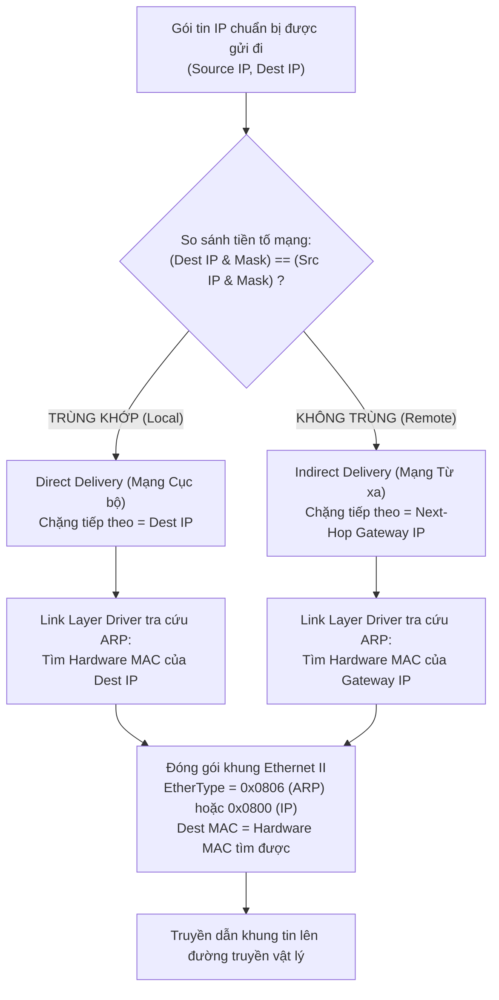
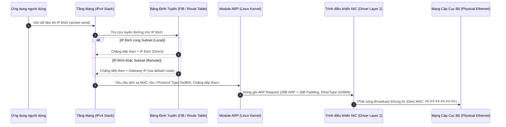

# 2_3_1 The Need for ARP

> **Khóa học**: Cloud DevOps Basic — Networking Core  
> **Phân nhóm**: 2 Domain 2 - Computer Networking Core Fundamentals › 2_3 Address Resolution Protocol  
> **Chủ đề**: Nhu cầu thiết yếu của giao thức ARP: Ánh xạ địa chỉ logic Layer 3 sang địa chỉ vật lý Layer 2 trên mạng cục bộ  
> **Trạng thái**: Verified (WRITE-CDB-2_3_1, 14-11-2026)  
> **Checklist đối chiếu**: [2_3_1](<../../../CHECKLIST.md#domain-2-computer-networking-core-fundamentals-43-items>)  

---

## 1. Khái Niệm Cốt Lõi & Bản Chất Kỹ Thuật (Core Concepts & Technical Deep Dive)

Trong kiến trúc mạng máy tính phân tầng, sự phân tách ranh giới giữa **Tầng Mạng (Network Layer - Layer 3)** và **Tầng Liên Kết Dữ Liệu (Data Link Layer - Layer 2)** là nguyên lý nền tảng để xây dựng các hệ thống mạng quy mô toàn cầu. Tuy nhiên, sự phân tách này cũng tạo ra một khoảng trống kỹ thuật lớn giữa định danh logic và môi trường truyền dẫn vật lý, dẫn tới sự ra đời tất yếu của **Giao thức Phân giải Địa chỉ (Address Resolution Protocol - ARP)**.

### 1.1 Vấn đề cốt lõi: Sự bất tương thích giữa Địa chỉ Logic (L3) và Địa chỉ Vật lý (L2)

Theo đặc tả chuẩn trong [RFC 826](https://datatracker.ietf.org/doc/html/rfc826#section-The-Problem):
- Mạng truyền thông vật lý dạng broadcast đa truy nhập như cáp Ethernet (điển hình từ chuẩn Ethernet 10 Mbit/s nguyên bản cho đến các chuẩn Ethernet hiện đại) đòi hỏi **địa chỉ phần cứng 48-bit (MAC address)** nằm trực tiếp trên cáp vật lý để các card giao tiếp mạng (NIC - Network Interface Card) có thể nhận dạng và tiếp nhận khung tin (frame).
- Tuy nhiên, phần lớn các giao thức tầng mạng phía trên (như IPv4 với địa chỉ logic 32-bit) lại có độ dài hoàn toàn khác biệt, và quan trọng hơn: **địa chỉ giao thức logic không có bất kỳ mối liên hệ cấu trúc hay toán học cố định nào với địa chỉ phần cứng 48-bit của thiết bị**.
- Một máy tính có thể thay đổi địa chỉ IP (do chuyển vùng mạng, cấp phát DHCP mới) trong khi địa chỉ MAC của card mạng vẫn giữ nguyên; hoặc card mạng bị thay mới trong khi địa chỉ IP máy chủ không thay đổi.

Do đó, hệ thống bắt buộc phải có một cơ chế giao thức nhằm **phân phối động (dynamically distribute) mối quan hệ tương ứng giữa cặp `<loại giao thức, địa chỉ giao thức>` (protocol type, protocol address) và địa chỉ phần cứng Ethernet 48-bit**. Đó chính là sứ mệnh lịch sử và chức năng sống còn của giao thức ARP.

---

### 1.2 Vị trí của ARP trong mô hình phân tầng: Giao thức "Layer 2.5"

Về mặt phân loại kiến trúc mạng, giao thức ARP sở hữu đặc tính lai ghép độc đáo:
- **Đóng gói trực tiếp trong Layer 2**: Theo tài liệu Linux Kernel [arp(7)](https://man7.org/linux/man-pages/man7/arp.7.html) và chuẩn [RFC 7042 Appendix B.1](https://datatracker.ietf.org/doc/html/rfc7042#appendix-B.1), ARP không sử dụng phần đầu gói tin IP (không có IP header). Gói tin ARP được đóng gói trực tiếp vào phần tải trọng (payload) của khung tin Ethernet II với trường mã định danh giao thức **EtherType mang giá trị `0x0806`** (khác với gói tin dữ liệu IPv4 thông thường có EtherType là `0x0800`).
- **Phục vụ mục đích Layer 3**: Mặc dù nằm trực tiếp trong khung Ethernet, dữ liệu chứa bên trong gói ARP lại phân tích và giải quyết các địa chỉ giao thức tầng mạng (IPv4).
- Vì lý do này, trong lý thuyết mạng và công cụ phân tích gói tin như [Wireshark](https://www.wireshark.org/docs/dfref/a/arp.html), ARP thường được mô tả là một giao thức nằm tại ranh giới trung gian **Layer 2.5**—đóng vai trò "chất keo" liên kết chặt chẽ giữa Tầng 2 và Tầng 3.

---

### 1.3 Cơ chế quyết định của Host: Phân biệt Đích đến Cục bộ (Local) vs Từ xa (Remote)

Một máy chủ không bao giờ tự ý phát ARP bừa bãi ra mạng cho mọi gói tin. Trước khi kích hoạt cơ chế phân giải địa chỉ, ngăn xếp mạng (network stack) của host bắt buộc phải thực hiện quy trình kiểm tra định tuyến căn bản.

Theo đặc tả trong [RFC 1122 Section 3.3.1.1](https://datatracker.ietf.org/doc/html/rfc1122#section-3.3.1.1) và [RFC 1812 Section 5.2.4.2](https://datatracker.ietf.org/doc/html/rfc1812#section-5.2.4.2), khi một datagram IP chuẩn bị được gửi đi:
1. **Phép so sánh tiền tố mạng (Address Mask Bitwise Comparison)**:
   - Host áp dụng mặt nạ mạng (subnet mask / address mask) đã được cấu hình trên giao diện mạng để trích xuất các bit mạng từ địa chỉ IP nguồn và địa chỉ IP đích.
2. **Trường hợp 1 — Chuyển giao trực tiếp trên mạng cục bộ (Direct Delivery / Local Destination)**:
   - Nếu các bit mạng của IP đích **trùng khớp** hoàn toàn với các bit mạng của IP nguồn sau khi áp mặt nạ, đích đến nằm ngay trên chính mạng kết nối trực tiếp (connected local network).
   - Tầng mạng xác định rằng gói tin datagram sẽ được truyền trực tiếp tới máy chủ đích. Tầng mạng chuyển giao IP đích xuống cho trình điều khiển liên kết dữ liệu (link layer driver), và driver này tham khảo module ARP để phân giải **địa chỉ IP của chính host đích** thành địa chỉ MAC đích tương ứng.
3. **Trường hợp 2 — Chuyển giao gián tiếp qua Gateway (Indirect Delivery / Remote Destination)**:
   - Nếu các bit mạng **không trùng khớp**, máy chủ đích nằm ở một mạng độc lập từ xa và chỉ có thể truy cập được thông qua một cổng định tuyến trung chuyển (Gateway / Router).
   - Tầng định tuyến (routing layer) lập tức xác định địa chỉ giao thức của chặng tiếp theo (**next-hop gateway IP**). Trình điều khiển liên kết dữ liệu sẽ kích hoạt module ARP để phân giải **địa chỉ IP của Next-Hop Gateway** thành địa chỉ MAC của Gateway trên phân đoạn cáp cục bộ, chứ tuyệt đối không tìm kiếm địa chỉ MAC của máy chủ đích cuối cùng.

Theo [RFC 826 Section "Packet Generation"](https://datatracker.ietf.org/doc/html/rfc826#section-Packet-Generation): Khi gói tin đi xuống qua các tầng mạng, tầng định tuyến xác định địa chỉ giao thức của chặng tiếp theo và card phần cứng tương ứng. Trình điều khiển phần cứng sau đó tham vấn module Phân giải Địa chỉ (Address Resolution module) để chuyển đổi cặp `<loại giao thức, địa chỉ giao thức chặng tiếp theo>` thành địa chỉ Ethernet 48-bit trước khi truyền dẫn khung tin ra đường truyền vật lý.

---

### 1.4 Giải phẫu cấu trúc gói tin ARP (ARP Packet Anatomy)

Theo định nghĩa chuẩn trong [RFC 826](https://datatracker.ietf.org/doc/html/rfc826), gói tin ARP được thiết kế với cấu trúc tổng quát để hỗ trợ nhiều loại phần cứng và nhiều loại giao thức mạng khác nhau:

| Tên trường (RFC 826 Identifier) | Độ dài | Ý nghĩa kỹ thuật | Giá trị cho IPv4 trên Ethernet |
| :--- | :--- | :--- | :--- |
| **Hardware Type** (`ar$hrd`) | 16 bits (2 bytes) | Định danh không gian kiến trúc phần cứng mạng. | `1` (`ares_hrd$Ethernet`) |
| **Protocol Type** (`ar$pro`) | 16 bits (2 bytes) | Định danh không gian địa chỉ giao thức tầng trên. | `0x0800` (Mã EtherType của IPv4) |
| **Hardware Length** (`ar$hln`) | 8 bits (1 byte) | Độ dài của địa chỉ phần cứng (tính bằng byte). | `6` (6 bytes cho địa chỉ MAC) |
| **Protocol Length** (`ar$pln`) | 8 bits (1 byte) | Độ dài của địa chỉ giao thức (tính bằng byte). | `4` (4 bytes cho địa chỉ IPv4) |
| **Operation Code** (`ar$op`) | 16 bits (2 bytes) | Mã thao tác: xác định gói tin là yêu cầu hay phản hồi. | `1` (ARP Request) hoặc `2` (ARP Reply) |
| **Sender Hardware Address** (`ar$sha`) | 48 bits (6 bytes) | Địa chỉ MAC vật lý của trạm gửi gói tin. | Địa chỉ MAC của máy gửi |
| **Sender Protocol Address** (`ar$spa`) | 32 bits (4 bytes) | Địa chỉ IPv4 logic của trạm gửi gói tin. | Địa chỉ IPv4 của máy gửi |
| **Target Hardware Address** (`ar$tha`) | 48 bits (6 bytes) | Địa chỉ MAC vật lý của trạm cần tìm (bỏ trống trong Request). | `00:00:00:00:00:00` trong Request |
| **Target Protocol Address** (`ar$tpa`) | 32 bits (4 bytes) | Địa chỉ IPv4 logic của trạm mục tiêu cần truy vấn. | Địa chỉ IPv4 cần phân giải |

#### Tính toán kích thước gói tin ARP:
Kích thước tổng cộng của một gói tin ARP cho cặp IPv4 - Ethernet được tính chính xác như sau:
$$\text{Kích thước ARP} = 2 + 2 + 1 + 1 + 2 + 6 + 4 + 6 + 4 = 28\text{ octets (bytes)}$$

RFC 826 nhấn mạnh rõ ràng: *"There are no padding bytes between addresses"* (Không có bất kỳ byte đệm nào xen kẽ giữa các trường địa chỉ). Do đó, tải trọng thuần của giao thức ARP chính xác là **28 bytes**.

---

### 1.5 Quy định kích thước khung Ethernet tối thiểu & Cơ chế đệm (Padding)

Mặc dù gói tin ARP chỉ chiếm 28 bytes, nó không thể được phát trực tiếp ra cáp vật lý với kích thước này do giới hạn của tầng liên kết dữ liệu Ethernet.

Theo tiêu chuẩn [RFC 894](https://datatracker.ietf.org/doc/html/rfc894) và chuẩn IEEE 802.3:
- **Giới hạn trường dữ liệu tối thiểu (Minimum Data Field)**: Độ dài tối thiểu của trường dữ liệu (payload) trong một khung tin truyền qua mạng Ethernet là **46 octets (bytes)**.
- **Quy tắc chèn đệm (Padding)**: Nếu dữ liệu tầng trên nhỏ hơn 46 bytes, trường dữ liệu bắt buộc phải được chèn thêm các byte số 0 (`octets of zero`) để đảm bảo đáp ứng kích thước tối thiểu.
- **Kích thước khung tối thiểu trên đường truyền**: Một khung Ethernet II hoàn chỉnh bao gồm:
  - Ethernet Header: `14 bytes` (6 bytes Destination MAC + 6 bytes Source MAC + 2 bytes EtherType).
  - Tải trọng (Payload): Tối thiểu `46 bytes`.
  - Frame Check Sequence (FCS - CRC-32): `4 bytes`.
  - **Tổng kích thước khung Ethernet tối thiểu**: $14 + 46 + 4 = 64\text{ bytes}$ (hoặc 60 bytes khi tính trên đường truyền vật lý tại thời điểm chưa bao gồm 4 bytes FCS).

Vì gói tin ARP chỉ có độ dài 28 bytes, trình điều khiển mạng (NIC driver/kernel) bắt buộc phải chèn thêm **18 bytes số 0 (Zero-Padding)**:
$$28\text{ bytes (ARP Data)} + 18\text{ bytes (Padding)} = 46\text{ bytes (Ethernet Payload)}$$

---

## 2. Ví Dụ Đời Sống Thực Tế Dễ Hiểu (Intuitive Real-World Analogies)

### Ẩn dụ: "Tấm Thẻ Căn Cước Công Dân và Bưu Điện Khu Phố"

Để hiểu rõ vì sao mạng máy tính phải duy trì song song hai loại địa chỉ và cần đến ARP, hãy hình dung quy trình chuyển phát thư từ trong xã hội loài người:

1. **Địa chỉ Logic (IPv4) — Danh thiếp & Chức danh công việc**:
   - Tương tự như thông tin ghi trên danh thiếp: *"Anh Minh — Trưởng phòng Kỹ thuật, Tòa nhà Keangnam, Hà Nội"*.
   - Thông tin này có tính chất **logic và định tuyến phân cấp**. Bưu điện Trung ương có thể nhìn vào chữ "Hà Nội", "Keangnam" để vận chuyển bưu phẩm qua các trục đường quốc lộ lớn, xuyên qua các tỉnh thành khác nhau (tương đương định tuyến Layer 3 qua các Router trên mạng Internet).
   - Tuy nhiên, danh thiếp có thể thay đổi: Hôm nay anh Minh làm việc tại Keangnam, ngày mai anh có thể chuyển sang công tác tại văn phòng TP. Hồ Chí Minh (đổi IP subnet).

2. **Địa chỉ Vật lý (MAC) — Số Căn cước công dân (CCCD) & Dấu vân tay**:
   - Tương tự như số CCCD hoặc vân tay gắn liền với thể xác sinh học của anh Minh.
   - Dù anh Minh có đổi việc, đổi nhà, chuyển sang công ty khác thì dấu vân tay và số CCCD của anh vẫn không bao giờ thay đổi (gắn cứng vào phần cứng NIC xuất xưởng từ nhà máy).

3. **Tình huống phát sinh nhu cầu ARP tại bưu cục địa phương**:
   - Khi bưu phẩm được chuyển đến bưu cục phụ trách tòa nhà Keangnam (mạng LAN nội bộ), bưu tá bước vào sảnh lễ tân.
   - Bưu tá không thể chuyển thư bằng cách hô to một danh xưng trừu tượng vào không khí vô định, bởi vì trong phòng có thể có nhiều người trùng tên hoặc vị trí bàn ngồi đã thay đổi. Bưu tá cần trao thư tận tay vào đúng người thực tế.
   - **Giao thức ARP chính là hành động bưu tá cầm loa phát thanh nội bộ**:
     > *"Bưu cục xin thông báo: Ai là người sở hữu danh xưng logic 'Anh Minh — Trưởng phòng Kỹ thuật' (Target IP)? Xin vui lòng xuất trình Thẻ CCCD/Dấu vân tay (MAC address) để tôi trao bưu phẩm tận tay!"*
   - Toàn bộ nhân viên trong phòng đều nghe thấy tiếng loa (ARP Broadcast tới địa chỉ MAC `FF:FF:FF:FF:FF:FF`). Những người khác thấy không phải tên mình thì lờ đi. Riêng anh Minh nhận ra đúng tên mình, liền tiến lại và nói riêng với bưu tá: *"Tôi là Minh đây, số CCCD của tôi là 00:1A:2B:3C:4D:5E"* (ARP Reply - Unicast). Bưu tá ghi nhớ mối liên hệ này vào sổ tay (ARP Cache) và trao thư.

4. **Khi người nhận ở tỉnh khác (Remote Destination)**:
   - Nếu phong thư ghi đích đến là *"Chị Lan — Văn phòng Đà Nẵng"*, bưu tá tại Hà Nội không bao giờ dùng loa hét hỏi tìm chị Lan trong phòng làm việc của mình.
   - So sánh địa chỉ (Mặt nạ mạng / Subnet Mask) cho biết chị Lan không thuộc mạng nội bộ này. Bưu tá lập tức mang phong thư tới gửi cho **Bác tài xế xe tải liên tỉnh (Default Gateway)**. Bưu tá chỉ cần hỏi địa chỉ xe của Bác tài xế trên bãi đỗ cục bộ (ARP hỏi MAC của Gateway) để xe vận chuyển thư đi xa.

> 💡 **Thông điệp cốt lõi (Core Message)**:  
> **IP định tuyến đường đi xuyên suốt qua các mạng (L3), nhưng MAC vận chuyển khung thực sự trên từng chặng cáp vật lý cục bộ (L2). ARP là chiếc cầu nối phiên dịch logic-thực tế không thể thiếu trên mọi mạng broadcast cục bộ.**

---

## 3. Kiến Trúc, Luồng Hoạt Động & Hình Ảnh Trực Quan (Architecture, Diagrams & Visual Media)

### 3.1 Quy trình kiểm tra mặt nạ mạng và kích hoạt ARP trên Host

Sơ đồ tuần tự và luồng quyết định dưới đây thể hiện chính xác nguyên lý theo RFC 1122, RFC 1812 và RFC 826:



---

### 3.2 Cấu trúc khung Ethernet II đóng gói gói tin ARP

Sơ đồ dưới đây mô tả sự tương quan về kích thước giữa khung Ethernet II, gói tin ARP 28 bytes thuần và 18 bytes phần đệm (zero-padding) theo chuẩn RFC 826 và RFC 894:

```mermaid
flowchart LR
    subgraph EthernetFrame ["Khung Ethernet II hoàn chỉnh (Tối thiểu 64 Bytes trên cáp)"]
        direction LR
        subgraph EthHeader ["Ethernet Header (14 Bytes)"]
            DMAC["Dest MAC<br/>(6B)"]
            SMAC["Src MAC<br/>(6B)"]
            ET["EtherType<br/>0x0806 (2B)"]
        end
        
        subgraph EthPayload ["Ethernet Payload (Tối thiểu 46 Bytes)"]
            direction TB
            subgraph ARPData ["Gói tin ARP thuần (28 Bytes - RFC 826)"]
                HType["Hardware Type: 1 (2B)"]
                PType["Protocol Type: 0x0800 (2B)"]
                HLen["HLEN: 6 (1B)"]
                PLen["PLEN: 4 (1B)"]
                Opcode["Opcode: 1 / 2 (2B)"]
                SHA["Sender MAC (6B)"]
                SPA["Sender IP (4B)"]
                THA["Target MAC (6B)"]
                TPA["Target IP (4B)"]
            end
            Padding["Zero-Padding bắt buộc<br/>(18 Bytes số 0)"]
        end
        
        FCS["FCS (CRC-32)<br/>(4 Bytes)"]
    end

    EthHeader --- EthPayload
    EthPayload --- FCS
```



---

### 3.3 Luồng tương tác giữa các tầng kiến trúc trong hệ điều hành



---

## 4. Thực Hành (Hands-on): Khảo Sát Phân Giải Địa Chỉ Trên Môi Trường Linux Thực Chiến

> ⚠️ Lệnh minh họa và phân tích thực nghiệm.

Trên hệ điều hành Linux hiện đại, kỹ sư Systems và DevOps có thể sử dụng bộ công cụ `iproute2` và trình phân tích gói tin `tcpdump` để quan sát quy trình định tuyến next-hop và cấu trúc khung tin ARP trên giao diện mạng.

### 4.1 Khảo sát bảng định tuyến để xác định đích Local vs Remote với `ip route`

Trước khi bất kỳ gói ARP nào được sinh ra, kernel tham vấn bảng định tuyến để kiểm tra xem đích đến là mạng kết nối trực tiếp (scope link) hay phải đi qua cổng trung chuyển (default via gateway):

```bash
# Hiển thị bảng định tuyến IPv4 chi tiết của hệ thống
ip route show
```

> 💡 **Minh họa thực thi (Illustrative Output)**:
```text
default via 192.168.1.1 dev eth0 proto dhcp src 192.168.1.50 metric 100 
192.168.1.0/24 dev eth0 proto kernel scope link src 192.168.1.50 metric 100 
```

*Phân tích kỹ thuật*:
- Dòng `192.168.1.0/24 dev eth0 proto kernel scope link`: Biểu thị phân đoạn mạng cục bộ kết nối trực tiếp (`scope link`). Mọi IP đích nằm trong dải `192.168.1.0/24` (ví dụ `192.168.1.88`) sẽ được kernel chuyển giao trực tiếp, kích hoạt ARP truy vấn MAC của chính `192.168.1.88`.
- Dòng `default via 192.168.1.1 dev eth0`: Đối với bất kỳ IP đích nào nằm ngoài dải `192.168.1.0/24` (ví dụ `8.8.8.8`), kernel xác định chặng tiếp theo là `192.168.1.1`. Kernel sẽ chỉ gửi ARP truy vấn địa chỉ MAC của Gateway `192.168.1.1`.

---

### 4.2 Khảo sát bảng lân cận (ARP Cache / Neighbor Table) với `ip neigh`

Linux Kernel duy trì bảng quan hệ tương ứng giữa địa chỉ IPv4 và địa chỉ MAC thông qua hệ thống con Neighbor Table (bảng lân cận):

```bash
# Liệt kê các ánh xạ IP-to-MAC đã được phân giải trong Kernel
ip neigh show
```

> 💡 **Minh họa thực thi (Illustrative Output)**:
```text
192.168.1.1 dev eth0 lladdr 00:1a:2b:3c:4d:5e REACHABLE
192.168.1.20 dev eth0 lladdr 52:54:00:12:34:56 STALE
```

*Phân tích*: Trường `lladdr` (Link-Layer Address) chính là địa chỉ phần cứng 48-bit (MAC) tương ứng với từng địa chỉ IPv4 đã được giao thức ARP phân giải động và lưu vào bộ nhớ đệm của Kernel.

---

### 4.3 Bắt và phân tích gói tin ARP ở cấp độ khung Ethernet với `tcpdump`

Sử dụng cờ `-e` để hiển thị phần đầu khung tin liên kết dữ liệu (Ethernet Header chứa MAC và EtherType) và cờ `-n` để ngăn chặn việc phân giải tên miền/tên cổng:

```bash
# Bắt gói tin ARP trên giao diện eth0, hiển thị chi tiết MAC header và EtherType
sudo tcpdump -e -n -i eth0 arp
```

> 💡 **Minh họa thực thi (Illustrative Output)**:
```text
15:10:02.105421 00:1a:2b:aa:bb:cc > ff:ff:ff:ff:ff:ff, ethertype ARP (0x0806), length 60: Request who-has 192.168.1.1 tell 192.168.1.50, length 28
15:10:02.105890 00:1a:2b:3c:4d:5e > 00:1a:2b:aa:bb:cc, ethertype ARP (0x0806), length 60: Reply 192.168.1.1 is-at 00:1a:2b:3c:4d:5e, length 28
```

*Phân tích chi tiết*:
1. `ethertype ARP (0x0806)`: Xác nhận giá trị EtherType chuẩn của giao thức ARP trên Ethernet II theo RFC 7042.
2. `length 28`: Xác nhận độ dài tải trọng thuần của gói tin ARP cho IPv4 trên Ethernet là đúng 28 bytes theo RFC 826.
3. `length 60`: Chiều dài tổng của khung tin bắt được trên dây là 60 bytes (chưa bao gồm 4 bytes FCS do card mạng xử lý ở tầng vật lý). Trong đó: $14\text{ bytes (MAC Header)} + 28\text{ bytes (ARP Payload)} + 18\text{ bytes (Zero-Padding)} = 60\text{ bytes}$.

---

### 4.4 Bảng tổng hợp tính toán kích thước khung Ethernet cho gói ARP

| Phân đoạn khung | Trường dữ liệu | Kích thước | Chi tiết kỹ thuật |
| :--- | :--- | :--- | :--- |
| **Ethernet Header** | Destination MAC | 6 bytes | `ff:ff:ff:ff:ff:ff` (Request) hoặc Unicast MAC (Reply) |
| | Source MAC | 6 bytes | Địa chỉ MAC của máy gửi |
| | EtherType | 2 bytes | Giá trị cố định `0x0806` (chỉ định giao thức ARP) |
| **ARP Data (RFC 826)** | Hardware Type (`ar$hrd`) | 2 bytes | `1` (Ethernet) |
| | Protocol Type (`ar$pro`) | 2 bytes | `0x0800` (IPv4) |
| | Hardware Length (`ar$hln`)| 1 byte | `6` (6 bytes MAC) |
| | Protocol Length (`ar$pln`)| 1 byte | `4` (4 bytes IPv4) |
| | Operation (`ar$op`) | 2 bytes | `1` (Request) hoặc `2` (Reply) |
| | Sender Hardware Addr (`ar$sha`)| 6 bytes | MAC máy gửi |
| | Sender Protocol Addr (`ar$spa`)| 4 bytes | IPv4 máy gửi |
| | Target Hardware Addr (`ar$tha`)| 6 bytes | Bỏ trống / `00:00:00:00:00:00` trong Request |
| | Target Protocol Addr (`ar$tpa`)| 4 bytes | IPv4 máy nhận |
| **Ethernet Padding** | Zero-Padding (RFC 894) | **18 bytes** | Byte `0x00` đệm đủ 46 bytes tải trọng tối thiểu |
| **Checksum** | FCS (Frame Check Sequence)| 4 bytes | CRC-32 kiểm tra tính toàn vẹn của khung |
| **TỔNG CỘNG** | **Khung hoàn chỉnh trên dây** | **64 bytes** | $(14 + 28 + 18 + 4 = 64\text{ octets})$ |

---

## 5. Cạm Bẫy Thực Tế & Thực Tiễn Sản Xuất (Production Gotchas & Best Practices)

Trong vận hành hạ tầng Cloud, Data Center và mạng doanh nghiệp, việc thấu hiểu bản chất kỹ thuật của ARP giúp kỹ sư nhận diện và xử lý các sự cố mạng phức tạp:

1. **Cạm bẫy cấu hình sai Subnet Mask gây tê liệt phân giải địa chỉ**:
   - *Bản chất*: Host xác định đích đến Local hay Remote hoàn toàn dựa vào phép tính bit giữa IP nguồn, IP đích và Subnet Mask được gán cho chính nó.
   - *Sự cố*: Nếu một máy chủ bị cấu hình sai mặt nạ mạng (ví dụ: máy tính thuộc mạng `/24` nhưng lại cấu hình nhầm thành `/16`), khi gửi gói tin đến một địa chỉ IP từ xa khác thuộc dải `/16` đó, host sẽ ngộ nhận rằng đích đến nằm ngay trên mạng cục bộ của mình.
   - *Hậu quả*: Thay vì gửi khung tin tới Gateway, máy chủ sẽ liên tục phát các bản tin ARP Request broadcast ra mạng LAN để tìm MAC của IP từ xa đó. Không có máy chủ nào trong mạng LAN sở hữu IP đó nên không có ARP Reply trả về. Kết nối mạng bị treo và báo lỗi timeout, dù tuyến đường và Gateway vật lý vẫn hoạt động hoàn toàn bình thường.

2. **Quy mô miền quảng bá (Broadcast Domain) và bão bản tin ARP**:
   - *Bản chất*: Vì ARP Request bắt buộc phải sử dụng địa chỉ quảng bá tầng 2 (`FF:FF:FF:FF:FF:FF`), mọi thiết bị và máy chủ nằm trong cùng một miền quảng bá (cùng VLAN / cùng mạng vật lý) đều bị card mạng ngắt CPU để đọc và xử lý gói tin ARP đó.
   - *Thực tiễn*: Trong các trung tâm dữ liệu hoặc cụm Kubernetes bare-metal lớn, việc thiết kế mạng phẳng (flat network) chứa hàng nghìn node trong cùng một subnet sẽ sinh ra lượng lưu lượng broadcast khổng lồ (ARP storm), làm suy giảm băng thông và chiếm dụng chu kỳ CPU vô ích của các máy chủ. Kỹ sư hạ tầng cần phân tách mạng thành các VLAN nhỏ hơn hoặc áp dụng mô hình định tuyến L3 tới tận đầu tủ rack (Top-of-Rack L3 routing).

3. **Hiện tượng lệch kích thước gói tin quan sát được trên các công cụ bắt gói (Packet Sniffers)**:
   - *Bản chất*: Nhiều kỹ sư khi dùng `tcpdump` hoặc `Wireshark` thắc mắc tại sao gói tin ARP trên máy gửi đôi khi hiển thị kích thước chỉ có **42 bytes** ($14\text{ bytes header} + 28\text{ bytes ARP data}$).
   - *Thực tế*: Đó là do cơ chế bắt gói tin của hệ điều hành (như Linux AF_PACKET) chặn bắt gói tin ngay tại tầng phần mềm của nhân hệ điều hành trước khi gói tin được đưa xuống card mạng (NIC). Phần cứng NIC hoặc chip điều khiển mới là nơi thực hiện chèn 18 bytes zero-padding và 4 bytes FCS trước khi phát xung điện/quang lên dây cáp. Trên máy nhận hoặc khi bắt qua cổng port-mirror của Switch, kích thước khung quan sát được sẽ luôn đạt chuẩn tối thiểu từ 60 đến 64 bytes.

---

## 6. Câu Hỏi Củng Cố Kiến Thức (Active Recall Quiz)

<details>
<summary><b>Câu hỏi 1:</b> Tại sao trong mạng truyền thông cục bộ Ethernet, các thiết bị không thể sử dụng trực tiếp địa chỉ logic IPv4 để gửi khung tin trên đường cáp mà bắt buộc phải cần đến giao thức phân giải địa chỉ ARP (RFC 826)?</summary>

**Đáp án:**
Theo RFC 826:
- Mạng truyền thông cáp vật lý Ethernet yêu cầu địa chỉ phần cứng 48-bit (MAC) được nhúng trong khung tin ở Tầng 2 để các card mạng (NIC) nhận diện và xử lý khung trên đường truyền broadcast.
- Ngược lại, địa chỉ giao thức tầng mạng như IPv4 có kích thước 32-bit và hoàn toàn không có mối liên hệ cấu trúc, toán học hay quy luật cố định nào với địa chỉ MAC 48-bit của phần cứng.
- Do đó, hệ thống bắt buộc phải có giao thức ARP để phân phối và ánh xạ động mối quan hệ giữa cặp `<loại giao thức, địa chỉ giao thức IP>` và địa chỉ phần cứng MAC tương ứng trên mạng cục bộ.
</details>

<details>
<summary><b>Câu hỏi 2:</b> Khi Host A chuẩn bị truyền một datagram IPv4, cơ chế nào giúp Host A quyết định sẽ gửi yêu cầu ARP để tìm địa chỉ MAC của chính IP đích hay tìm địa chỉ MAC của Default Gateway?</summary>

**Đáp án:**
Theo RFC 1122 (Section 3.3.1.1) và RFC 1812 (Section 5.2.4.2):
- Host A thực hiện phép toán so sánh bit giữa địa chỉ IP đích và địa chỉ IP nguồn bằng cách áp dụng mặt nạ mạng (subnet mask / address mask).
- **Nếu các bit mạng trùng khớp**: Đích đến là mạng cục bộ (Direct Delivery). Tầng định tuyến chuyển giao IP đích cho driver, và driver kích hoạt ARP để truy vấn địa chỉ MAC của **chính Host đích**.
- **Nếu các bit mạng không trùng khớp**: Đích đến nằm ở mạng từ xa (Indirect Delivery) và chỉ có thể truy cập qua Gateway. Tầng định tuyến xác định địa chỉ của chặng tiếp theo (next-hop gateway IP), và driver sẽ kích hoạt ARP để truy vấn địa chỉ MAC của **Next-Hop Gateway**, chứ không truy vấn IP đích cuối cùng.
</details>

<details>
<summary><b>Câu hỏi 3:</b> Kích thước tải trọng thuần của một gói tin ARP cho IPv4 trên mạng Ethernet là bao nhiêu byte? Tại sao khi đóng gói vào khung Ethernet II hoàn chỉnh, khung tin này lại có kích thước tối thiểu là 64 byte (hoặc 60 byte trên đường truyền chưa tính FCS)?</summary>

**Đáp án:**
Theo RFC 826 và RFC 894:
- Kích thước tải trọng thuần của gói tin ARP (IPv4 qua Ethernet) là đúng **28 octets (bytes)**: Hardware Type (2B) + Protocol Type (2B) + Hardware Len (1B) + Protocol Len (1B) + Opcode (2B) + Sender MAC (6B) + Sender IP (4B) + Target MAC (6B) + Target IP (4B).
- Theo tiêu chuẩn Ethernet (RFC 894), trường dữ liệu (payload) tối thiểu của một khung Ethernet bắt buộc phải là **46 bytes**.
- Do đó, gói tin ARP 28 bytes phải được chèn thêm **18 bytes số 0 (Zero-Padding)** để đạt đủ 46 bytes.
- Kết hợp với 14 bytes Ethernet Header (6B Dest MAC + 6B Src MAC + 2B EtherType `0x0806`) và 4 bytes FCS (CRC-32), khung tin Ethernet hoàn chỉnh trên đường truyền đạt kích thước chuẩn tối thiểu là $14 + 46 + 4 = 64\text{ bytes}$ (hoặc 60 bytes khi chưa tính FCS).
</details>

---

## 7. 📚 Nguồn Tài Liệu Chính Thống (Tier-1 Official References)

- [RFC 826: An Ethernet Address Resolution Protocol](https://datatracker.ietf.org/doc/html/rfc826) - Đặc tả kỹ thuật chuẩn gốc của David C. Plummer về giao thức ARP, định nghĩa vấn đề bất tương thích địa chỉ, kiến trúc gói tin 28 bytes và nguyên lý phân giải địa chỉ phần cứng.
- [RFC 1122: Requirements for Internet Hosts -- Communication Layers](https://datatracker.ietf.org/doc/html/rfc1122#section-3.3.1.1) - Chuẩn Internet về yêu cầu tầng giao tiếp của Host, Mục 3.3.1.1 xác định quy tắc so sánh mặt nạ địa chỉ để phân biệt chuyển giao trực tiếp (Local) và chuyển giao qua Gateway (Remote).
- [RFC 1812: Requirements for IP Version 4 Routers](https://datatracker.ietf.org/doc/html/rfc1812#section-5.2.4.2) - Đặc tả kỹ thuật của IETF cho Router IPv4, Mục 5.2.4.2 quy định chi tiết thuật toán chuyển tiếp datagram và chuyển giao cục bộ vs chuyển giao gián tiếp.
- [RFC 7042: IANA Considerations and IETF Protocol Usage for IEEE 802 Parameters](https://datatracker.ietf.org/doc/html/rfc7042#appendix-B.1) - Phụ lục B.1 công bố bảng đăng ký giá trị EtherType chính thức của IEEE 802, định danh `0x0806` cho Address Resolution Protocol (ARP).
- [RFC 894: A Standard for the Transmission of IP Datagrams over Ethernet Networks](https://datatracker.ietf.org/doc/html/rfc894) - Tiêu chuẩn truyền dẫn datagram qua mạng Ethernet, quy định độ dài trường dữ liệu tối thiểu 46 octets và yêu cầu chèn đệm zero-padding cho các gói tin dưới 46 bytes.
- [Linux Manual Pages: arp(7)](https://man7.org/linux/man-pages/man7/arp.7.html) - Hướng dẫn chính thức của Linux Kernel về module giao thức ARP triển khai theo RFC 826 và cơ chế chuyển đổi địa chỉ L2/L3.
- [Wireshark Display Filter Reference: Address Resolution Protocol](https://www.wireshark.org/docs/dfref/a/arp.html) - Tài liệu tham khảo trường giao thức ARP từ dự án Wireshark.
