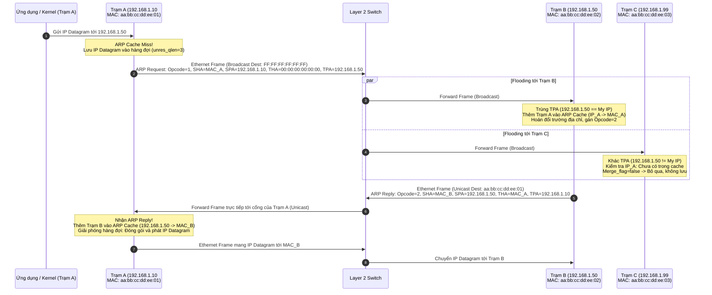
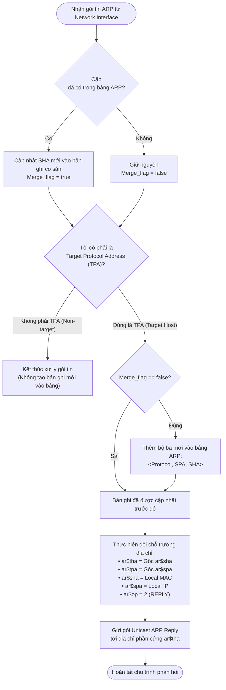

# 2_3_2 ARP Message Flow

> **Khóa học**: Cloud DevOps Basic — Computer Networking Core  
> **Phân nhóm**: 2 Domain 2 - Computer Networking Core Fundamentals › 2_3 Address Resolution Protocol  
> **Chủ đề**: Luồng thông điệp ARP: Cơ chế Broadcast Request, Unicast Reply, định dạng các trường địa chỉ (SHA, SPA, THA, TPA) và thuật toán cập nhật bảng dịch  
> **Trạng thái**: Verified (WRITE-CDB-2_3_2, 14-11-2026)  
> **Checklist đối chiếu**: [2_3_2](<../../../CHECKLIST.md#23-address-resolution-protocol-arp>)  

---

## 1. Khái Niệm Cốt Lõi & Bản Chất Kỹ Thuật (Core Concepts & Technical Deep Dive)

Giao thức phân giải địa chỉ **Address Resolution Protocol (ARP)**, được chuẩn hóa trong **RFC 826**, là cầu nối thiết yếu giữa tầng mạng (Network Layer - L3, sử dụng địa chỉ logic IPv4) và tầng liên kết dữ liệu (Data Link Layer - L2, sử dụng địa chỉ vật lý MAC) trên mạng cục bộ (LAN). Khi một máy trạm cần gửi một IP datagram tới một địa chỉ IPv4 đích cùng nằm trong mạng cục bộ nhưng chưa biết địa chỉ MAC tương ứng, nó phải thực hiện chu trình phân giải thông qua **luồng thông điệp ARP (ARP Message Flow)**.

### 1.1 Cấu trúc gói tin ARP & Định nghĩa các trường địa chỉ (RFC 826)

Khác với các giao thức tầng ứng dụng, gói tin ARP được đóng gói trực tiếp vào phần tải trọng (payload) của Ethernet frame (EtherType `0x0806`). Theo đặc tả RFC 826, cấu trúc gói tin ARP bao gồm các trường định danh và 4 trường địa chỉ cốt lõi:

- **Mã thao tác (Opcode - `ar$op`)**: Có kích thước **16-bit (2 bytes)**, xác định bản chất của thông điệp ARP:
  - `opcode = 1` (`ares_op$REQUEST`): Yêu cầu phân giải địa chỉ (ARP Request).
  - `opcode = 2` (`ares_op$REPLY`): Phản hồi chứa địa chỉ vật lý đã được phân giải (ARP Reply).
- **Địa chỉ phần cứng người gửi (Sender Hardware Address - SHA, `ar$sha`)**: Có độ dài **6 bytes** (đối với mạng Ethernet), chứa địa chỉ MAC của trạm phát sinh thông điệp.
- **Địa chỉ giao thức người gửi (Sender Protocol Address - SPA, `ar$spa`)**: Có độ dài **4 bytes** (đối với IPv4), chứa địa chỉ IP của trạm phát sinh thông điệp.
- **Địa chỉ phần cứng mục tiêu (Target Hardware Address - THA, `ar$tha`)**: Có độ dài **6 bytes**, chứa địa chỉ MAC của trạm đích cần truy vấn hoặc cần phản hồi.
- **Địa chỉ giao thức mục tiêu (Target Protocol Address - TPA, `ar$tpa`)**: Có độ dài **4 bytes**, chứa địa chỉ IPv4 của trạm đích được tìm kiếm.

| Tên trường | Tên biến RFC 826 | Độ dài | Ý nghĩa kỹ thuật |
| :--- | :--- | :--- | :--- |
| **Opcode** | `ar$op` | 16-bit (2 bytes) | Xác định loại thông điệp: `1` cho Request, `2` cho Reply. |
| **Sender Hardware Address (SHA)** | `ar$sha` | 6 bytes | Địa chỉ MAC vật lý của trạm gửi gói tin ARP. |
| **Sender Protocol Address (SPA)** | `ar$spa` | 4 bytes | Địa chỉ IPv4 logic của trạm gửi gói tin ARP. |
| **Target Hardware Address (THA)** | `ar$tha` | 6 bytes | Địa chỉ MAC của trạm mục tiêu. |
| **Target Protocol Address (TPA)** | `ar$tpa` | 4 bytes | Địa chỉ IPv4 của trạm mục tiêu cần tìm kiếm hoặc giải đáp. |

---

### 1.2 Luồng thông điệp 2 bước: Broadcast Request và Unicast Reply

Chu trình phân giải địa chỉ diễn ra qua hai pha trao đổi thông điệp bất đối xứng:

```text
[Trạm A: 192.168.1.10]                                    [Trạm B: 192.168.1.50]
        |                                                           |
        | ----- (1) ARP Request [Broadcast: FF:FF:FF:FF:FF:FF] ---> |
        |       Opcode=1, SHA=MAC_A, SPA=IP_A                       |
        |       THA=00:00:00:00:00:00, TPA=IP_B                     |
        |                                                           |
        |                                [Trạm B cập nhật MAC_A vào bảng]
        |                                [Hoán đổi SHA/SPA <-> THA/TPA]
        |                                                           |
        | <---- (2) ARP Reply [Unicast: MAC_A] -------------------- |
        |       Opcode=2, SHA=MAC_B, SPA=IP_B                       |
        |       THA=MAC_A, TPA=IP_A                                 |
        |                                                           |
[Trạm A cập nhật MAC_B vào bảng]                                    |
[Trạm A giải phóng gói tin chờ]                                     |
```

#### Bước 1: ARP Request (Cơ chế Quảng bá - Broadcast)
- Trạm nguồn (Sender) muốn gửi dữ liệu tới trạm mục tiêu (Target) nhưng trong bảng ARP (translation table) chưa có ánh xạ IP $\rightarrow$ MAC tương ứng.
- Trạm nguồn tạo gói tin ARP Request với:
  - `ar$op = 1` (`ares_op$REQUEST`).
  - `ar$sha = MAC nguồn`, `ar$spa = IP nguồn`.
  - `ar$tpa = IP đích cần tìm`.
  - `ar$tha`: Do chưa biết MAC của đích, trường này không mang ý nghĩa xác định (ignored / don't care theo RFC 826) và **được khuyến nghị gán bằng toàn bộ bit 0 (`00:00:00:00:00:00`)** theo khuyến nghị trong **RFC 5227 section 2.1.1** (*"The 'target hardware address' field is ignored and SHOULD be set to all zeroes"*).
- Gói tin ARP Request được đóng gói trong một Ethernet frame gửi tới địa chỉ MAC quảng bá **`FF:FF:FF:FF:FF:FF`**. Switch trong mạng LAN sẽ nhân bản và chuyển tiếp (flood) frame này tới toàn bộ các trạm khác trên cùng broadcast domain.

#### Bước 2: ARP Reply (Cơ chế Đích danh - Unicast)
- Khi nhận được ARP Request, chỉ có duy nhất trạm sở hữu địa chỉ IPv4 trùng khớp với `ar$tpa` mới tiến hành gửi phản hồi.
- Theo quy định tại mục *Packet Reception* của RFC 826, trạm mục tiêu thực hiện **hoán đổi các trường địa chỉ (address fields swapping)**:
  - Đưa địa chỉ MAC và IP cục bộ của mình vào vị trí người gửi: `ar$sha = MAC mục tiêu`, `ar$spa = IP mục tiêu`.
  - Đưa địa chỉ của trạm yêu cầu vào vị trí mục tiêu: `ar$tha = MAC nguồn ban đầu`, `ar$tpa = IP nguồn ban đầu`.
  - Đặt mã thao tác: `ar$op = 2` (`ares_op$REPLY`).
- Khác với Request, gói tin ARP Reply được đóng gói trong Ethernet frame gửi **trực tiếp (Unicast)** đến địa chỉ MAC của trạm yêu cầu (`ar$tha`), không làm phiền hay tiêu tốn băng thông của các trạm khác trên mạng.

---

### 1.3 Thuật toán tiếp nhận gói tin & Logic chống ô nhiễm bảng dịch (`Merge_flag`)

Một điểm đặc sắc trong thiết kế của RFC 826 là giải thuật tiếp nhận gói tin tại mọi host trên broadcast domain. Khi một frame ARP Request được phát tán quảng bá, **tất cả** các máy trạm trong broadcast domain đều nhận được và xử lý gói tin này tại tầng liên kết dữ liệu.

Để tối ưu hóa việc cập nhật bảng dịch nhưng vẫn ngăn chặn triệt để hiện tượng **tràn bộ nhớ / ô nhiễm bảng ARP (table flooding/pollution)**, RFC 826 quy định thuật toán xử lý qua biến cờ `Merge_flag`:

```text
Khởi tạo: Merge_flag := false

1. Kiểm tra bảng dịch hiện tại:
   Nếu cặp <protocol type, sender protocol address (SPA)> ĐÃ TỒN TẠI trong translation table:
       -> Cập nhật trường hardware address (SHA) mới vào bản ghi có sẵn.
       -> Đặt Merge_flag := true.

2. Kiểm tra đích đến:
   ?Tôi có phải là địa chỉ giao thức mục tiêu (Am I the Target Protocol Address - TPA)?
   - NẾU ĐÚNG (YES):
       -> Nếu Merge_flag == false (người gửi chưa có trong bảng):
            Thêm bộ ba <protocol type, SPA, SHA> vào bảng dịch.
       -> Thực hiện hoán đổi trường địa chỉ, gán ar$op = 2 (REPLY) và gửi gói Unicast ARP Reply.
   - NẾU SAI (NO):
       -> Nếu Merge_flag == false:
            KHÔNG tạo bản ghi mới! Bỏ qua gói tin.
```

> **Nguyên tắc cốt lõi của RFC 826 (Why is it done this way?)**:  
> Các trạm không phải là mục tiêu (non-target hosts) **tuyệt đối không tự ý thêm trạm gửi vào bảng dịch** nếu trước đó chúng chưa từng có nhu cầu giao tiếp với trạm gửi. Nếu mọi máy trạm đều ghi nhớ mọi gói tin broadcast xuất hiện trên mạng, bảng ARP sẽ bị phình to nhanh chóng bởi hàng loạt bản ghi rác, gây lãng phí bộ nhớ kernel và đẩy các bản ghi đang sử dụng ra khỏi bộ đệm.

---

### 1.4 Hàng đợi gói tin chiều đi trong quá trình phân giải (Outbound Datagram Queuing)

Khi một tiến trình hoặc ứng dụng gửi đi một IP datagram mà trạm phát chưa có địa chỉ MAC tương ứng trong bảng ARP cache, câu hỏi đặt ra là: *Gói tin dữ liệu ban đầu sẽ bị hủy hay được lưu trữ ở đâu trong khi chờ ARP Reply phản hồi?*

1. **Yêu cầu của chuẩn RFC 1122**:
   - Theo đặc tả **RFC 1122 section 2.3.2.2**: *"The link layer SHOULD save (rather than discard) at least one (the latest) packet of each set of packets destined to the same unresolved IP address, and transmit the saved packet when the address has been resolved"* (Tầng liên kết dữ liệu được khuyến nghị nên lưu lại—thay vì hủy bỏ—ít nhất một gói tin, cụ thể là gói mới nhất, trong tập hợp các gói gửi tới cùng một địa chỉ IP chưa phân giải và truyền gói tin đã lưu khi địa chỉ được phân giải thành công).
   - Tầng mạng hoặc driver mạng lưu tạm gói tin vào hàng đợi chờ xử lý (unresolved queue).
2. **Hiện thực hóa trong nhân Linux (`arp(7)`)**:
   - Mô-đun ARP của Linux Kernel cung cấp cấu hình `unres_qlen` trong `/proc/sys/net/ipv4/neigh/<interface>/unres_qlen`.
   - Theo hướng dẫn hệ thống **Linux man-pages `arp(7)`**, giá trị mặc định của tham số này là **`unres_qlen = 3`**. Nghĩa là hàng đợi tối đa cho phép lưu giữ 3 gói tin dữ liệu đang chờ phân giải địa chỉ cho một IP đích cụ thể.
   - Khi nhận được ARP Reply hợp lệ, hệ điều hành sẽ ngay lập tức đẩy các gói tin đang chờ trong hàng đợi xuống đường truyền vật lý.

---

## 2. Ví Dụ Đời Sống Thực Tế Dễ Hiểu (Intuitive Real-World Analogies)

### Ẩn dụ: Cái Loa Phường Phát Thanh và Lời Đáp Trực Tiếp

Để hình dung trực quan cơ chế hoạt động của thông điệp ARP, hãy tưởng tượng một ngôi làng đông đúc với hàng trăm hộ dân:

- **Địa chỉ IP**: Giống như **Họ và tên / Danh xưng** của một công dân (ví dụ: *"Anh Nguyễn Văn A"*). Đây là định danh logic mà chính quyền và bưu tá biết đến.
- **Địa chỉ MAC**: Giống như **Số nhà cụ thể / Tọa độ cửa nhà** của công dân đó trong xóm (ví dụ: *"Cổng sắt màu xanh, ngõ 12"*). Bưu tá chỉ có thể thả bức thư vào đúng khe cửa vật lý nếu biết số nhà cụ thể này.

```text
[Bác Trưởng Thôn]                                                [Anh Nguyễn Văn A]
(192.168.1.10 - Cổng số 10)                                      (192.168.1.50 - Cổng số 50)
        |                                                                    |
        | === [Loa Phường Broadcast: FF:FF:FF:FF:FF:FF] ===================> |
        |     "Bà con chú ý! Ai là Nguyễn Văn A, hãy báo cho Trưởng thôn     |
        |      ở cổng số 10 biết số nhà của anh!"                           |
        |                                                                    |
        |       [Toàn thể dân làng nghe thấy]                                |
        |       - Chị Lan, Bác Bình: "Không phải tên tôi, tôi lờ đi!"        |
        |         (Nếu sổ tay đã có tên Trưởng thôn thì cập nhật lại cổng 10) |
        |       - Anh Nguyễn Văn A: "Đúng tên mình rồi!"                     |
        |                                                                    |
        | <=== [Đi bộ trực tiếp Unicast đến Cổng số 10] ==================== |
        |      "Chào Bác, tôi là Nguyễn Văn A, cổng nhà tôi là Cổng số 50!"  |
        |                                                                    |
[Trưởng thôn ghi sổ tay: A -> Cổng 50]                                       |
[Chuyển bức thư đang chờ sang Cổng 50]                                       |
```

1. **Pha phát loa quảng bá (ARP Request - Broadcast)**:
   - Bác Trưởng thôn (Sender IP `192.168.1.10`, MAC cổng số `10`) cầm một bưu phẩm cần phát cho anh Nguyễn Văn A (`192.168.1.50`). Nhưng Bác không biết nhà anh A ở ngõ ngách nào.
   - Bác bật hệ thống **loa phát thanh của làng (Broadcast `FF:FF:FF:FF:FF:FF`)**, truyền thanh âm thanh vang vọng tới toàn thể dân làng: *"Bà con chú ý: Ai là Nguyễn Văn A (`192.168.1.50`), hãy báo ngay về cho Trưởng thôn ở Cổng số 10!"*.
2. **Phản ứng của dân làng (Non-target Hosts & Merge_flag)**:
   - Tất cả mọi người trong làng (Chị Lan, Bác Bình) đều nghe thấy loa qua tai. Tuy nhiên, họ kiểm tra và thấy tên không phải là mình.
   - Nếu trước đó Chị Lan đã từng giao dịch và lưu tên Trưởng thôn trong sổ tay, Chị nhân tiện cập nhật lại số nhà mới của Trưởng thôn (`Merge_flag = true`). Nhưng nếu Chị Lan chưa từng quen biết Trưởng thôn, Chị tuyệt đối **không ghi chép thông tin của Trưởng thôn vào sổ tay cá nhân**, vì việc ghi nhớ tên của tất cả những ai phát thanh trên loa sẽ làm cuốn sổ tay nhỏ bé của Chị nhanh chóng hết trang trắng (chống ô nhiễm bảng ARP).
3. **Pha trả lời đích danh (ARP Reply - Unicast)**:
   - Anh Nguyễn Văn A nghe thấy chính xác tên mình được xướng lên. Anh lập tức ghi lại số nhà Cổng số 10 của Bác Trưởng thôn vào sổ tay của mình.
   - Sau đó, anh A **không bật loa phát thanh ngược lại toàn làng**, mà anh tự mình đi thẳng tới Cổng số 10 nhà Trưởng thôn (**Unicast**): *"Thưa Bác, tôi là Nguyễn Văn A, địa chỉ nhà tôi ở Cổng số 50!"*.
4. **Gửi bưu phẩm đang xếp hàng (Outbound Datagram Queuing)**:
   - Ngay khi nhận được lời đáp từ anh A, Bác Trưởng thôn lưu địa chỉ Cổng số 50 vào danh bạ và chuyển giao ngay bức thư đang được giữ trên bàn bưu cục (hàng đợi chờ) sang cho anh A.

---

## 3. Kiến Trúc, Luồng Hoạt Động & Hình Ảnh Trực Quan (Architecture, Diagrams & Visual Media)

### 3.1 Sơ đồ tuần tự trao đổi gói tin ARP giữa các máy trạm (Sequence Diagram)

Sơ đồ tuần tự dưới đây mô tả đầy đủ trạng thái hàng đợi dữ liệu, quá trình truyền phát qua thiết bị chuyển mạch mạng (Switch) và logic cập nhật bảng dịch:



---

### 3.2 Lưu đồ thuật toán tiếp nhận và cập nhật bảng dịch (`Merge_flag`) theo RFC 826



---

## 4. Phân Tích Thực Chiến Bắt Gói Tin Mạng (Hands-on Packet Analysis with `tcpdump`)

Trong thực tế vận hành mạng và chẩn đoán sự cố hạ tầng Cloud/DevOps, kỹ sư sử dụng tiện ích **`tcpdump`** để bắt và giải mã trực tiếp các trường nhị phân của thông điệp ARP trên đường truyền.

### 4.1 Lệnh thu thập gói tin ARP với `tcpdump`

Sử dụng cờ `-e` để hiển thị tiêu đề tầng liên kết dữ liệu (Ethernet MAC addresses), cờ `-n` để ngăn phân giải tên miền (giữ nguyên địa chỉ IP số), và cờ `-v` để hiển thị chi tiết các trường giao thức ARP:

```bash
# Lắng nghe gói tin ARP trên giao diện eth0 với thông tin chi tiết tầng liên kết
sudo tcpdump -e -n -v -i eth0 arp
```

---

### 4.2 Bóc tách cấu trúc gói tin ARP Request (Mẫu bắt gói tin)

> ⚠️ Đầu ra mẫu minh họa gói tin từ tcpdump (not executed by squad):

```text
14:20:01.105423 aa:bb:cc:dd:ee:01 > ff:ff:ff:ff:ff:ff, ethertype ARP (0x0806), length 42: \
    Ethernet (len 6), IPv4 (len 4), Request who-has 192.168.1.50 tell 192.168.1.10, length 28
```

#### Bóc tách giải mã từng trường trong ARP Request:
1. **Tiêu đề khung Ethernet (Layer 2 Ethernet Header)**:
   - Địa chỉ MAC nguồn: `aa:bb:cc:dd:ee:01` (Trạm phát sinh yêu cầu).
   - Địa chỉ MAC đích: `ff:ff:ff:ff:ff:ff` (Quảng bá L2 tới mọi trạm trên phân đoạn mạng).
   - EtherType: `0x0806` (Chỉ định rõ tải trọng là giao thức ARP).
2. **Phần tải trọng ARP (ARP Payload Breakdown)**:
   - `Request who-has 192.168.1.50 tell 192.168.1.10`:
     - **Opcode (`ar$op`)**: `1` (`ares_op$REQUEST`, 16-bit).
     - **Sender Hardware Address (`ar$sha`)**: `aa:bb:cc:dd:ee:01` (6 bytes).
     - **Sender Protocol Address (`ar$spa`)**: `192.168.1.10` (4 bytes).
     - **Target Hardware Address (`ar$tha`)**: `00:00:00:00:00:00` (6 bytes, được gán bằng toàn bộ bit 0 theo RFC 5227).
     - **Target Protocol Address (`ar$tpa`)**: `192.168.1.50` (4 bytes).

---

### 4.3 Bóc tách cấu trúc gói tin ARP Reply (Mẫu bắt gói tin)

> ⚠️ Đầu ra mẫu minh họa gói tin từ tcpdump (not executed by squad):

```text
14:20:01.106180 aa:bb:cc:dd:ee:02 > aa:bb:cc:dd:ee:01, ethertype ARP (0x0806), length 42: \
    Ethernet (len 6), IPv4 (len 4), Reply 192.168.1.50 is-at aa:bb:cc:dd:ee:02, length 28
```

#### Bóc tách giải mã từng trường trong ARP Reply:
1. **Tiêu đề khung Ethernet (Layer 2 Ethernet Header)**:
   - Địa chỉ MAC nguồn: `aa:bb:cc:dd:ee:02` (Trạm đích phản hồi).
   - Địa chỉ MAC đích: `aa:bb:cc:dd:ee:01` (Gửi trực tiếp - Unicast tới trạm yêu cầu).
   - EtherType: `0x0806` (Giao thức ARP).
2. **Phần tải trọng ARP (ARP Payload Breakdown)**:
   - `Reply 192.168.1.50 is-at aa:bb:cc:dd:ee:02`:
     - **Opcode (`ar$op`)**: `2` (`ares_op$REPLY`, 16-bit).
     - **Sender Hardware Address (`ar$sha`)**: `aa:bb:cc:dd:ee:02` (Địa chỉ MAC của trạm được hỏi).
     - **Sender Protocol Address (`ar$spa`)**: `192.168.1.50` (Địa chỉ IPv4 của trạm được hỏi).
     - **Target Hardware Address (`ar$tha`)**: `aa:bb:cc:dd:ee:01` (Địa chỉ MAC của trạm yêu cầu ban đầu).
     - **Target Protocol Address (`ar$tpa`)**: `192.168.1.10` (Địa chỉ IPv4 của trạm yêu cầu ban đầu).

---

### 4.4 Bảng đối chiếu hoán đổi các trường địa chỉ giữa Request và Reply

| Trường dữ liệu | Bit / Byte | Giá trị trong ARP Request | Giá trị trong ARP Reply | Cơ chế hoán đổi theo RFC 826 |
| :--- | :--- | :--- | :--- | :--- |
| **Opcode (`ar$op`)** | 16-bit (2 B) | `1` (`ares_op$REQUEST`) | `2` (`ares_op$REPLY`) | Đổi từ yêu cầu sang giải đáp |
| **Sender MAC (`ar$sha`)** | 48-bit (6 B) | `aa:bb:cc:dd:ee:01` (Host A) | `aa:bb:cc:dd:ee:02` (Host B) | Host B đưa MAC cục bộ vào làm người gửi |
| **Sender IP (`ar$spa`)** | 32-bit (4 B) | `192.168.1.10` (Host A) | `192.168.1.50` (Host B) | Host B đưa IP cục bộ vào làm người gửi |
| **Target MAC (`ar$tha`)** | 48-bit (6 B) | `00:00:00:00:00:00` (Ignored / Zeroes) | `aa:bb:cc:dd:ee:01` (Host A) | Chuyển SHA ban đầu thành THA đích |
| **Target IP (`ar$tpa`)** | 32-bit (4 B) | `192.168.1.50` (Host B) | `192.168.1.10` (Host A) | Chuyển SPA ban đầu thành TPA đích |

---

## 5. Cạm Bẫy Thực Tế & Thực Tiễn Sản Xuất (Production Gotchas & Best Practices)

Trong môi trường hạ tầng trung tâm dữ liệu, cụm máy chủ ảo hóa và điện toán đám mây, các đặc tính của luồng thông điệp ARP mang lại những thách thức vận hành cần đặc biệt lưu ý:

1. **Hiểm họa bão Broadcast (Broadcast Storm) do bão ARP Request**:
   - *Bản chất*: Gói tin ARP Request sử dụng địa chỉ MAC đích `FF:FF:FF:FF:FF:FF`. Theo nguyên lý hoạt động của Switch, mọi khung quảng bá đều bị nhân bản ra tất cả các cổng trong cùng VLAN/Broadcast Domain.
   - *Rủi ro*: Khi một mạng LAN phẳng chứa hàng ngàn máy chủ hoặc container cùng khởi động đồng thời, hoặc khi có một công cụ quét mạng (network sweep / ARP scan), lượng khung quảng bá ARP khổng lồ sẽ gây nghẽn băng thông đường truyền và kích hoạt ngắt CPU (CPU interrupts) liên tục trên card mạng của mọi máy chủ trong mạng.
   - *Thực tiễn*: Luôn phân chia mạng thành các VLAN nhỏ hơn (giới hạn kích thước broadcast domain thường dưới 500-1000 hosts) và kích hoạt tính năng **Storm Control** trên các switch phân phối.

2. **Mất gói tin âm thầm do tràn hàng đợi phân giải (`unres_qlen` Overflow)**:
   - *Bản chất*: Khi một dịch vụ gửi liên tiếp một đợt bùng nổ gói tin (packet burst) tới một địa chỉ IP mới, trong thời gian chờ ARP Reply quay về, Linux Kernel chỉ xếp tối đa số gói tin được định nghĩa bởi tham số `unres_qlen` (mặc định là **3 gói tin** theo tài liệu `arp(7)`).
   - *Hậu quả*: Nếu ARP Reply bị trễ mạng (vài chục mili-giây) và ứng dụng gửi tới 10 gói tin liên tiếp, 7 gói tin vượt quá giới hạn hàng đợi sẽ bị hủy âm thầm (dropped) ngay tại tầng giao tiếp mạng cục bộ, gây ra hiện tượng trễ khởi tạo kết nối hoặc retransmission không mong muốn.

3. **Nguy cơ ô nhiễm và cạn kiệt bộ nhớ nếu không tuân thủ thuật toán `Merge_flag`**:
   - *Bản chất*: Thiết kế của RFC 826 rất tinh tế khi yêu cầu các máy trạm không phải đích (non-target) không được phép tự ý thêm bản ghi mới của người gửi broadcast vào bảng ARP của mình.
   - *Rủi ro*: Một số thiết bị nhúng hoặc phần mềm mạng viết lỗi vi phạm quy tắc này và ghi nhớ bừa bãi mọi trạm phát broadcast. Kết quả là bảng dịch ARP bị lấp đầy nhanh chóng bởi hàng ngàn bản ghi không sử dụng, làm cạn kiệt bộ nhớ bảng định tuyến tầng 2 (CAM / ARP table exhaustion) và đẩy các bản ghi dịch vụ quan trọng ra ngoài.

---

## 6. Câu Hỏi Củng Cố Kiến Thức (Active Recall Quiz)

<details>
<summary><b>Câu hỏi 1:</b> Phân tích sự khác biệt về kiểu truyền tải (Broadcast vs Unicast), giá trị mã thao tác Opcode và giá trị trường THA giữa thông điệp ARP Request và ARP Reply theo đặc tả RFC 826 và RFC 5227.</summary>

**Đáp án:**
- **Kiểu truyền tải tầng 2 (L2 Transmission)**:
  - ARP Request được đóng gói trong Ethernet frame có MAC đích là `FF:FF:FF:FF:FF:FF` (**Broadcast**) để chuyển tiếp tới toàn bộ các trạm trên liên kết cục bộ.
  - ARP Reply được gửi đích danh (**Unicast**) trực tiếp tới địa chỉ MAC của trạm yêu cầu.
- **Mã thao tác Opcode (`ar$op`, 16-bit)**:
  - ARP Request có Opcode = `1` (`ares_op$REQUEST`).
  - ARP Reply có Opcode = `2` (`ares_op$REPLY`).
- **Trường Target Hardware Address (`ar$tha`, 6 bytes)**:
  - Trong ARP Request: Do trạm gửi chưa biết địa chỉ MAC của đích, trường này được coi là không xác định và theo chuẩn **RFC 5227 section 2.1.1** được khuyến nghị nên gán bằng toàn bộ bit 0 (`00:00:00:00:00:00` - SHOULD be set to all zeroes).
  - Trong ARP Reply: Trường này chứa chính xác địa chỉ MAC của trạm đã gửi ARP Request ban đầu (được lấy từ trường `ar$sha` của gói tin yêu cầu).
</details>

<details>
<summary><b>Câu hỏi 2:</b> Trong cùng một mạng LAN, khi Trạm A gửi ARP Request để tìm kiếm Trạm B, Trạm C (không phải là trạm được hỏi) nhận được gói tin này thì hệ điều hành của Trạm C xử lý như thế nào dựa trên thuật toán `Merge_flag` của RFC 826? Vì sao RFC 826 lại thiết kế như vậy?</summary>

**Đáp án:**
- **Quy trình xử lý tại Trạm C (Non-target host)**:
  1. Trạm C kiểm tra xem cặp `<Protocol, SPA>` (địa chỉ IP của Trạm A) đã có sẵn trong bảng dịch ARP của Trạm C hay chưa:
     - Nếu đã có: Cập nhật địa chỉ MAC mới của Trạm A vào bản ghi đó và đặt `Merge_flag := true`.
     - Nếu chưa có: Đặt `Merge_flag := false`.
  2. Trạm C kiểm tra địa chỉ mục tiêu: `TPA` trong gói tin có phải là IP của Trạm C không?
     - Trạm C thấy `TPA != IP_C`, do đó Trạm C **không gửi phản hồi**.
  3. Do Trạm C không phải là đích và `Merge_flag` là `false`, Trạm C **tuyệt đối không tạo bản ghi mới** cho Trạm A vào bảng dịch của mình, sau đó hủy gói tin khỏi bộ xử lý.
- **Lý do thiết kế (RFC 826 Why is it done this way?)**:
  Thiết kế này ngăn chặn hiện tượng tràn bảng và ô nhiễm bảng ARP (table flooding/pollution). Nếu mọi máy trạm đều tự ý lưu thông tin của tất cả các host phát sinh broadcast, bảng dịch ARP của toàn bộ hệ thống sẽ bị rác và lãng phí bộ nhớ lưu trữ những máy trạm mà chúng không bao giờ cần giao tiếp.
</details>

<details>
<summary><b>Câu hỏi 3:</b> Khi một ứng dụng người dùng gửi liên tiếp một chùm 8 gói tin IP tới một địa chỉ đích chưa có trong bảng ARP cache, điều gì sẽ xảy ra ở tầng liên kết dữ liệu theo chuẩn RFC 1122 và tham số hàng đợi `unres_qlen` trên hệ thống Linux?</summary>

**Đáp án:**
- Theo tiêu chuẩn **RFC 1122 section 2.3.2.2**, tầng liên kết dữ liệu được khuyến nghị nên lưu lại (thay vì hủy bỏ) ít nhất một gói tin—ưu tiên gói tin mới nhất—trong quá trình chờ phản hồi phân giải địa chỉ ARP (`"The link layer SHOULD save (rather than discard) at least one (the latest) packet..."`), và truyền gói tin này ngay khi địa chỉ đã được phân giải.
- Trên hệ điều hành Linux, hàng đợi này được điều khiển bởi tham số **`unres_qlen`** trong mô-đun kernel `arp(7)` (mặc định cho phép lưu tối đa **3 gói tin**).
- Do đó, khi chùm 8 gói tin ập tới:
  - 3 gói tin đầu tiên sẽ được đưa an toàn vào hàng đợi để chờ nhận gói ARP Reply.
  - 5 gói tin vượt quá hạn mức hàng đợi sẽ bị tầng mạng hủy âm thầm (dropped).
  - Ngay khi nhận được gói tin ARP Reply, trạm nguồn sẽ cập nhật bảng ARP và lập tức đẩy 3 gói tin đang chờ ra đường truyền vật lý.
</details>

---

## 7. 📚 Nguồn Tài Liệu Chính Thống (Tier-1 Official References)

- [RFC 826: An Ethernet Address Resolution Protocol](https://datatracker.ietf.org/doc/html/rfc826) - Tiêu chuẩn Internet Standard chính thức của IETF đặc tả chi tiết giao thức ARP, cấu trúc 16-bit Opcode, các trường địa chỉ `ar$sha`, `ar$spa`, `ar$tha`, `ar$tpa`, cơ chế hoán đổi trường địa chỉ và thuật toán tiếp nhận gói tin bảo vệ bảng dịch (`Merge_flag`).
- [RFC 5227: IPv4 Address Conflict Detection](https://datatracker.ietf.org/doc/html/rfc5227#section-2.1.1) - Tiêu chuẩn IETF RFC 5227 Mục 2.1.1 đặc tả trường Target Hardware Address (THA) trong gói tin ARP Request bị bỏ qua và nên được gán bằng toàn bộ bit 0 (`00:00:00:00:00:00`).
- [RFC 1122: Requirements for Internet Hosts -- Communication Layers](https://datatracker.ietf.org/doc/html/rfc1122#section-2.3.2.2) - Tiêu chuẩn IETF RFC 1122 Mục 2.3.2.2 khuyến nghị tầng liên kết dữ liệu nên lưu lại (thay vì hủy bỏ) ít nhất một gói tin (gói mới nhất) gửi tới địa chỉ IP chưa phân giải và truyền đi khi hoàn tất phân giải ARP.
- [Linux Manual Pages: arp(7) - Linux ARP Kernel Module](https://man7.org/linux/man-pages/man7/arp.7.html) - Tài liệu hướng dẫn chính thức mô-đun nhân Linux ARP, giải thích thông số hàng đợi `unres_qlen` lưu trữ các gói tin chờ phân giải địa chỉ.
