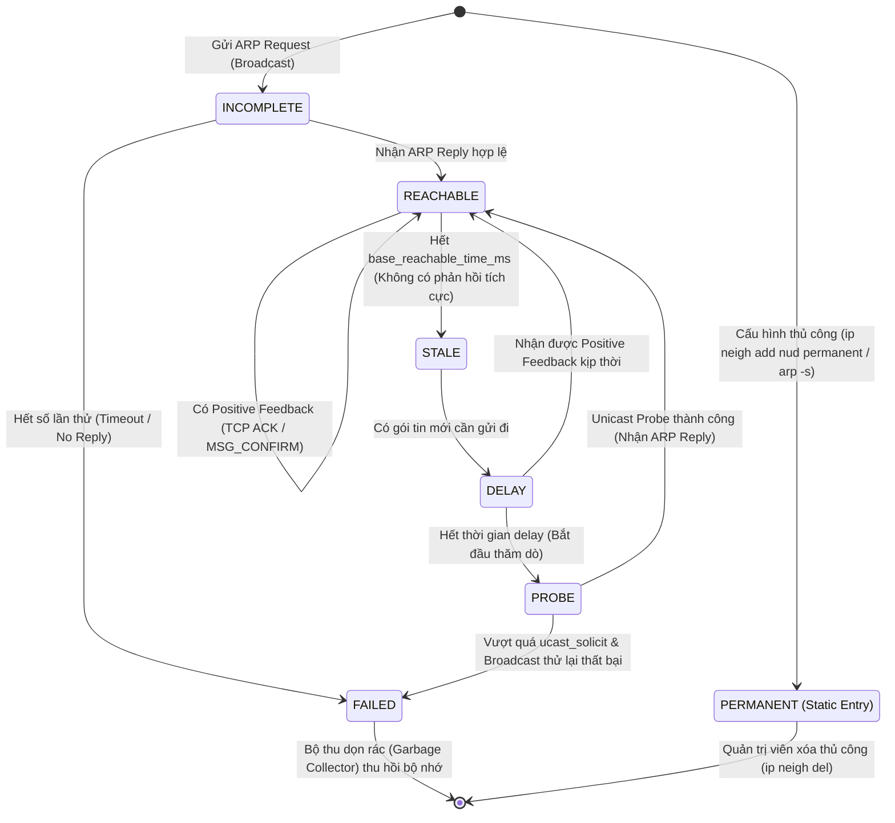
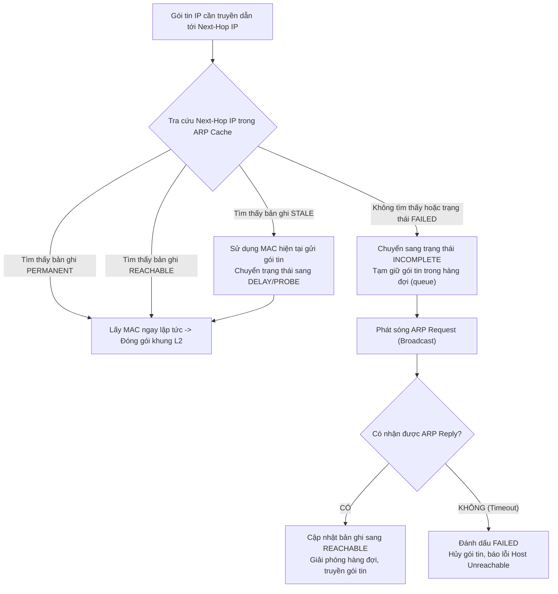

# 2_3_3 ARP Cache

> **Khóa học**: Cloud DevOps Basic — Networking Core  
> **Phân nhóm**: 2 Domain 2 - Computer Networking Core Fundamentals › 2_3 Address Resolution Protocol  
> **Chủ đề**: Bộ nhớ đệm ARP Cache: Bảng phân giải lân cận, máy trạng thái NUD (Neighbor Unreachability Detection) và quản trị bộ nhớ đệm  
> **Trạng thái**: Verified (WRITE-CDB-2_3_3, 14-11-2026)  
> **Checklist đối chiếu**: [2_3_3](<../../../CHECKLIST.md#domain-2-computer-networking-core-fundamentals-43-items>)  

---

## 1. Khái Niệm Cốt Lõi & Bản Chất Kỹ Thuật (Core Concepts & Technical Deep Dive)

Trong môi trường truyền thông mạng cục bộ (LAN), việc phân giải địa chỉ logic IPv4 (Layer 3) sang địa chỉ vật lý MAC (Layer 2) bằng giao thức ARP đòi hỏi chi phí tài nguyên: phát sóng khung quảng bá (broadcast frame) và chờ đợi phản hồi từ thiết bị đích. Nếu mọi gói tin dữ liệu gửi đi đều phải kích hoạt một chu trình ARP Request/Reply, mạng cáp sẽ nhanh chóng bị quá tải bởi bão phát thanh (broadcast storm) và độ trễ truyền dữ liệu sẽ tăng vọt.

Để giải quyết bài toán này, ngăn xếp mạng của hệ điều hành duy trì một vùng nhớ tạm trong RAM gọi là **Bộ nhớ đệm ARP (ARP Cache)**, hay trong hệ thống Linux hiện đại được chuẩn hóa dưới tên gọi **Bảng Lân Cận (Neighbor Table)**.

---

### 1.1 Bản ghi Động (Dynamic) vs Bản ghi Cố định (Permanent / Static)

Theo đặc tả trong tài liệu Linux Kernel [arp(7)](https://man7.org/linux/man-pages/man7/arp.7.html) và [ip-neighbour(8)](https://man7.org/linux/man-pages/man8/ip-neighbour.8.html), các bản ghi trong ARP Cache được phân thành hai nhóm cơ bản với cơ chế quản lý hoàn toàn khác biệt:

1. **Bản ghi động (Dynamic Entries)**:
   - Được kernel tự động sinh ra và cập nhật thông qua quá trình trao đổi các bản tin ARP Request và ARP Reply trên đường truyền.
   - Mang tính tạm thời: các bản ghi này có vòng đời giới hạn, trải qua chuỗi trạng thái xác thực và tự động bị **bộ thu dọn rác (garbage collector)** loại bỏ dựa trên tuổi thọ (age) và ngưỡng dung lượng bộ nhớ khi không còn được sử dụng thường xuyên.

2. **Bản ghi cố định / vĩnh viễn (Permanent / Static Entries)**:
   - Được thiết lập tường minh bởi người quản trị hệ thống hoặc các tiến trình dịch vụ thông qua dòng lệnh quản trị (ví dụ: `ip neigh add ... nud permanent` hoặc lệnh truyền thống `arp -s`).
   - Đặc tính cốt lõi: **Các bản ghi được đánh dấu là permanent không bao giờ bị bộ thu dọn rác (garbage collector) xóa bỏ**. Bản ghi chỉ biến mất khi người quản trị xóa thủ công hoặc khi hệ thống khởi động lại (trừ khi được cấu hình lưu trữ vĩnh viễn trong kịch bản mạng của hệ thống).

---

### 1.2 Máy trạng thái NUD (Neighbor Unreachability Detection) trong Linux Kernel

Hệ thống con quản lý lân cận của Linux Kernel triển khai một máy trạng thái chặt chẽ gọi là **NUD (Neighbor Unreachability Detection)** nhằm theo dõi và kiểm tra tính khả dụng của từng nút mạng kết nối trực tiếp.

Theo chuẩn tài liệu [ip-neighbour(8)](https://man7.org/linux/man-pages/man8/ip-neighbour.8.html) và [arp(7)](https://man7.org/linux/man-pages/man7/arp.7.html), một bản ghi lân cận trải qua các trạng thái kỹ thuật sau:

| Trạng thái NUD | Định nghĩa & Ý nghĩa kỹ thuật | Hành vi của Kernel |
| :--- | :--- | :--- |
| **`INCOMPLETE`** | Bản ghi chưa (hoặc đang) được xác thực/phân giải. | Kernel đã gửi ARP Request và đang tạm giữ các gói tin dữ liệu trong hàng đợi để chờ gói ARP Reply trả về. |
| **`REACHABLE`** | Bản ghi hợp lệ và đã được xác nhận là có thể tiếp cận được. | Ánh xạ IP-to-MAC tin cậy tuyệt đối. Trạng thái duy trì cho đến khi hết hạn thời gian reachability timeout. |
| **`STALE`** | Bản ghi vẫn hợp lệ nhưng bị "nghi ngờ" (suspicious). | Xuất hiện khi một khoảng thời gian trôi qua mà không nhận được phản hồi tích cực (positive feedback) từ tầng trên. Bản ghi vẫn dùng được để gửi gói tin nhưng cần được xác thực lại. |
| **`DELAY`** | Việc kiểm tra tính khả dụng bị trì hoãn một khoảng thời gian ngắn. | Kernel cho phép tầng trên thêm một khoảng thời gian ngắn để tự phát hiện và xác nhận khả năng tiếp cận trước khi kernel phải chủ động thăm dò. |
| **`PROBE`** | Bản ghi đang được thăm dò chủ động. | Kernel gửi trực tiếp các gói thăm dò đơn hướng (**unicast probe**) tới địa chỉ MAC đã biết thay vì phát broadcast ra toàn mạng. |
| **`FAILED`** | Đã vượt quá số lần thăm dò tối đa mà không nhận được phản hồi thành công. | Bản ghi không thể tiếp cận được. Kernel hủy các gói tin đang chờ và trả lỗi về cho ứng dụng. |
| **`PERMANENT`** | Bản ghi tĩnh do quản trị viên cấu hình. | Hợp lệ vĩnh viễn, không bao giờ hết hạn và không bao giờ bị bộ dọn rác xóa bỏ. |
| **`NOARP`** | Giao diện mạng không yêu cầu phân giải ARP (ví dụ loopback). | Luôn hợp lệ, không gửi bản tin ARP. |

---

### 1.3 Cơ chế Chuyển trạng thái & Phản hồi tích cực (Positive Feedback)

Quy trình chuyển đổi trạng thái trong ngăn xếp Linux Kernel diễn ra theo nguyên lý tối ưu hóa băng thông đường truyền:

1. **Từ `REACHABLE` sang `STALE`**:
   - Khi một bản ghi ở trạng thái `REACHABLE`, kernel giám sát xem đường truyền có tạo ra tiến triển về phía trước hay không (forward progress).
   - Nếu trong một khoảng thời gian (được xác định bởi `base_reachable_time_ms`), kernel **không nhận được phản hồi tích cực (positive feedback)** từ các tầng giao thức phía trên, bản ghi sẽ tự động chuyển sang trạng thái `STALE`.
   - **Phản hồi tích cực (Positive Feedback) là gì?**
     - Theo [arp(7)](https://man7.org/linux/man-pages/man7/arp.7.html): Phản hồi tích cực có thể đến từ tầng giao vận phía trên, điển hình là khi nhận được một gói tin **TCP ACK thành công** (chứng minh rằng bên kia vẫn đang nhận dữ liệu bình thường).
     - Đối với các giao thức khác (như UDP), ứng dụng có thể truyền cờ `MSG_CONFIRM` thông qua lời gọi hệ thống `sendmsg(2)` để báo cho kernel biết nút lân cận vẫn đang phản hồi tốt.
2. **Từ `STALE` qua `DELAY` tới `PROBE`**:
   - Khi một bản ghi đang ở trạng thái `STALE` và phát sinh nhu cầu gửi dữ liệu mới, kernel chuyển bản ghi sang trạng thái `DELAY`.
   - Sau khoảng thời gian trễ ngắn nếu vẫn không có phản hồi tích cực, kernel chuyển sang `PROBE`.
3. **Thăm dò đơn hướng (Unicast Probe) và Dự phòng (Fallback)**:
   - Trong trạng thái `PROBE`, kernel gửi gói tin ARP Request dưới dạng **unicast probe** trực tiếp đến địa chỉ MAC đã lưu (lặp lại `ucast_solicit` lần). Hành động này tránh làm phiền toàn bộ các máy khác trong mạng LAN.
   - Nếu unicast probe thành công (nhận được ARP Reply), bản ghi quay trở lại `REACHABLE`.
   - Nếu unicast probe thất bại hoàn toàn, kernel sẽ phát sóng lại một gói tin ARP Request dạng broadcast ra toàn mạng. Nếu chu kỳ này tiếp tục không có hồi đáp sau số lần quy định, bản ghi chuyển sang `FAILED`.

---

### 1.4 Giao diện cấu hình Kernel qua `/proc/sys/net/ipv4/neigh/*/*`

Hệ điều hành Linux cung cấp giao diện quản trị thông số ARP Cache và Neighbor Table thông qua hệ thống tệp ảo `/proc/sys/net/ipv4/neigh/` (áp dụng riêng cho từng card mạng hoặc chung cho `default`):

- **`base_reachable_time_ms`** (bổ sung từ Linux 2.6.12):
  - Giá trị cơ sở xác định khoảng thời gian một bản ghi duy trì trạng thái `REACHABLE`, đo bằng mili-giây.
  - Giá trị mặc định: **`30000` ms (30 giây)**.
  - *Cơ chế ngẫu nhiên hóa (Randomization)*: Để ngăn chặn tình trạng toàn bộ các máy trạm trong mạng cùng hết hạn bản ghi và đồng loạt gửi yêu cầu thăm dò tại cùng một thời điểm, kernel chọn thời gian hết hạn thực tế ngẫu nhiên trong khoảng từ $\frac{\text{base}}{2}$ đến $\frac{3 \times \text{base}}{2}$ (tức từ 15 đến 45 giây với giá trị mặc định 30000 ms).
- **`gc_stale_time`** (bổ sung từ Linux 2.2):
  - Tham số xác định tần suất bộ thu dọn rác (garbage collector) quét và kiểm tra các bản ghi lân cận đã rơi vào trạng thái `STALE`.
  - Giá trị mặc định: **`60` giây**.
  - Khi một bản ghi bị coi là stale, kernel sẽ thực hiện phân giải lại trước khi gửi dữ liệu tiếp theo đến địa chỉ đó.

---

## 2. Ví Dụ Đời Sống Thực Tế Dễ Hiểu (Intuitive Real-World Analogies)

### Ẩn dụ: "Cuốn Sổ Tay Bàn Làm Việc và Quy Tắc Mực Tự Bay Màu"

Để hiểu rõ vì sao hệ thống không lưu vĩnh viễn địa chỉ MAC và cũng không liên tục phát loa hỏi lại, hãy hình dung công việc của một **Nhân viên Lễ tân kiêm Bưu tá tòa nhà**:

1. **Cuốn sổ tay ghi chép tạm thời (ARP Cache)**:
   - Khi có bưu phẩm gửi đến cho *"Anh Tuấn — Phòng Kế toán"*, bưu tá chưa biết anh Tuấn ngồi ở vị trí nào. Anh phải bước ra sảnh phát loa hỏi (ARP Broadcast). Anh Tuấn xuất hiện và báo: *"Tôi ngồi ở Bàn số 12"* (MAC Address).
   - Bưu tá không thể mỗi lần có thư lại chạy ra sảnh phát loa một lần. Anh rút cuốn sổ tay trên bàn làm việc ra ghi: `Anh Tuấn (IP) -> Bàn số 12 (MAC)`.

2. **Cơ chế mực tự bay màu (Vòng đời Dynamic & NUD States)**:
   - Tuy nhiên, nhân viên văn phòng có thể đổi bàn, chuyển sang phòng ban khác hoặc nghỉ việc! Nếu ghi bằng mực vĩnh cửu, bưu phẩm sẽ bị chuyển nhầm sang người mới.
   - Do đó, bưu tá sử dụng một loại bút có **mực tự bay màu theo thời gian**:
     - **Mực còn mới nguyên (REACHABLE)**: Anh Tuấn vừa nhận thư và ký xác nhận biên lai gửi lại cho bưu tá (TCP ACK / Positive Feedback). Bưu tá tin tưởng 100% anh Tuấn đang ngồi ở Bàn 12.
     - **Mực bắt đầu mờ đi (STALE)**: Đã vài ngày trôi qua mà không thấy anh Tuấn gửi hay nhận thư gì cả. Bưu tá bắt đầu nghi ngờ: không biết anh Tuấn còn ngồi ở Bàn 12 không?
     - **Cử người tới ngó trực tiếp (Unicast PROBE)**: Có phong thư mới đến. Nhìn dòng chữ đã mờ trong sổ, bưu tá không tin hẳn nhưng cũng không phát loa làm phiền cả tòa nhà. Anh cử một cậu nhân viên chạy thẳng tới Bàn 12 gõ nhẹ hỏi: *"Anh Tuấn còn ngồi đây không?"* (Unicast ARP probe).
     - **Gạch tên khỏi sổ (FAILED & Garbage Collection)**: Nếu tới Bàn 12 thấy bàn trống trơn, bưu tá phát loa lần cuối khắp tòa nhà. Vẫn không ai thưa, anh gạch chéo tên anh Tuấn khỏi sổ (FAILED) và xé bỏ trang giấy cũ (Garbage Collection).

3. **Bản ghi đóng dấu đỏ vĩnh cửu (Permanent / Static Entry)**:
   - Riêng phòng làm việc của **Tổng Giám đốc tòa nhà (Default Gateway)** có vị trí cố định không bao giờ thay đổi.
   - Quản trị viên tòa nhà dùng **bút dạ dầu chuyên dụng đóng dấu đỏ vĩnh viễn** vào trang đầu cuốn sổ: `Tổng Giám đốc -> Phòng VIP 01`. Dòng chữ này không bao giờ bay màu và không một nhân viên dọn vệ sinh (Garbage Collector) nào được phép xóa đi.

> 💡 **Thông điệp cốt lõi (Core Message)**:  
> **ARP Cache tăng tốc độ truyền mạng bằng cách lưu vết phân giải L3-L2 trong RAM. Trạng thái NUD (Reachable, Stale, Delay, Probe) đảm bảo thông tin luôn tươi mới và tự động dọn rác mà không gây nghẽn mạng.**

---

## 3. Kiến Trúc, Luồng Hoạt Động & Hình Ảnh Trực Quan (Architecture, Diagrams & Visual Media)

### 3.1 Máy trạng thái NUD (Neighbor Unreachability Detection State Machine)

Sơ đồ trạng thái dưới đây mô tả chi tiết toàn bộ chu kỳ sống và các bước chuyển đổi trạng thái của một bản ghi trong Neighbor Table theo chuẩn Linux Kernel:



---

### 3.2 Quy trình xử lý gói tin tra cứu ARP Cache của Linux Kernel

Sơ đồ luồng dưới đây thể hiện cách Kernel điều phối giữa tầng mạng, ARP Cache và việc phát xung thăm dò:



---

## 4. Thực Hành (Hands-on): Quản Trị & Khảo Sát ARP Cache Trên Linux Thực Chiến

> ⚠️ Đầu ra mẫu minh họa CLI (not executed by squad).

Trên hệ điều hành Linux, người quản trị có thể tương tác với ARP Cache bằng hai bộ công cụ: công cụ truyền thống `net-tools` (`arp`) và công cụ hiện đại tiêu chuẩn `iproute2` (`ip neigh`), kết hợp kiểm tra trực tiếp các thông số hệ thống trong virtual filesystem `/proc`.

---

### 4.1 Khảo sát bảng lân cận với công cụ hiện đại `ip neigh`

Lệnh `ip neigh` hiển thị toàn bộ các nút lân cận kèm theo địa chỉ IP, địa chỉ MAC (`lladdr`), thiết bị mạng (`dev`) và trạng thái NUD hiện tại:

```bash
# Xem danh sách toàn bộ các bản ghi lân cận trên mọi giao diện mạng
ip neigh show
```

> 💡 **Minh họa thực thi (Illustrative Output)**:
```text
192.168.1.1 dev eth0 lladdr 00:1a:2b:3c:4d:5e REACHABLE
192.168.1.50 dev eth0 lladdr 52:54:00:12:34:56 STALE
192.168.1.99 dev eth0 lladdr 08:00:27:aa:bb:cc DELAY
192.168.1.120 dev eth0  FAILED
192.168.1.254 dev eth0 lladdr 00:50:56:c0:00:08 PERMANENT
```

*Phân tích chi tiết*:
- `192.168.1.1`: Đang ở trạng thái `REACHABLE`, xác nhận kết nối tới Default Gateway đang thông suốt và tin cậy.
- `192.168.1.50`: Đang ở trạng thái `STALE`, bản ghi chưa được tầng trên gửi xác nhận phản hồi tích cực trong khoảng thời gian quy định.
- `192.168.1.120`: Đang ở trạng thái `FAILED`, kernel đã gửi yêu cầu phân giải nhưng không nhận được hồi đáp từ thiết bị này.
- `192.168.1.254`: Đang ở trạng thái `PERMANENT`, bản ghi tĩnh cố định, không bao giờ bị dọn rác.

---

### 4.2 Thao tác thêm, xóa và làm sạch bảng lân cận với `ip neigh`

Hệ thống `iproute2` cung cấp các lệnh quản trị linh hoạt theo chuẩn [ip-neighbour(8)](https://man7.org/linux/man-pages/man8/ip-neighbour.8.html):

```bash
# 1. Thêm một bản ghi tĩnh vĩnh cửu (Permanent entry)
sudo ip neigh add 192.168.1.200 lladdr 00:11:22:33:44:55 dev eth0 nud permanent

# 2. Xóa một bản ghi lân cận cụ thể khỏi bảng đệm
sudo ip neigh del 192.168.1.200 dev eth0

# 3. Xóa sạch (flush) toàn bộ các bản ghi trên một giao diện mạng cụ thể
sudo ip neigh flush dev eth0
```

> 💡 **Minh họa thực thi lệnh flush (Illustrative Output)**:
```text
# Sau khi thực hiện flush, bảng lân cận trên eth0 được dọn sạch hoàn toàn:
ip neigh show dev eth0
# (Không có đầu ra, toàn bộ bản ghi động đã được giải phóng)
```

---

### 4.3 Khảo sát và thao tác bằng công cụ truyền thống `arp` (net-tools)

Theo đặc tả [arp(8)](https://man7.org/linux/man-pages/man8/arp.8.html), lệnh `arp` hỗ trợ cú pháp kinh điển:

```bash
# 1. Hiển thị bảng ARP theo định dạng BSD kinh điển (-a)
arp -a

# 2. Hiển thị dưới dạng số (-n: numeric, không tốn thời gian phân giải ngược tên miền qua DNS)
arp -n

# 3. Thêm một bản ghi cố định (permanent stored entry)
sudo arp -s 192.168.1.210 00:aa:bb:cc:dd:ee

# 4. Xóa một bản ghi khỏi ARP table
sudo arp -d 192.168.1.210
```

> 💡 **Minh họa thực thi `arp -n` (Illustrative Output)**:
```text
Address                  HWtype  HWaddress           Flags Mask            Iface
192.168.1.1              ether   00:1a:2b:3c:4d:5e   C                     eth0
192.168.1.210            ether   00:aa:bb:cc:dd:ee   CM                    eth0
```
*Giải thích cờ (Flags)*:
- `C` (Complete): Bản ghi đã được phân giải hoàn tất và hợp lệ.
- `M` (Permanent): Bản ghi tĩnh được tạo thủ công, không bị thu dọn tự động.

---

### 4.4 Kiểm tra và cấu hình các tham số hạt nhân qua giao diện `/proc`

Theo chuẩn [arp(7)](https://man7.org/linux/man-pages/man7/arp.7.html), các tham số điều khiển thời gian sống và dọn rác của ARP Cache được kiểm tra trực tiếp:

```bash
# Kiểm tra thời gian cơ sở REACHABLE (mili-giây, mặc định 30000 ms)
cat /proc/sys/net/ipv4/neigh/default/base_reachable_time_ms

# Kiểm tra tần suất quét bản ghi stale của bộ dọn rác (giây, mặc định 60s)
cat /proc/sys/net/ipv4/neigh/default/gc_stale_time
```

> 💡 **Minh họa thực thi (Illustrative Output)**:
```text
$ cat /proc/sys/net/ipv4/neigh/default/base_reachable_time_ms
30000
$ cat /proc/sys/net/ipv4/neigh/default/gc_stale_time
60
```

---

## 5. Cạm Bẫy Thực Tế & Thực Tiễn Sản Xuất (Production Gotchas & Best Practices)

Trong vận hành hệ thống Cloud, hạ tầng ảo hóa và Kubernetes quy mô lớn, ARP Cache là một trong những điểm nhạy cảm có thể gây ra các sự cố mạng nghiêm trọng nếu không nắm vững bản chất kỹ thuật:

1. **Sự cố tràn bảng lân cận (Neighbor Table Overflow) trên quy mô lớn**:
   - *Bản chất*: Mặc định, Linux Kernel giới hạn kích thước tối đa của bảng lân cận qua các ngưỡng bộ thu dọn rác (`gc_thresh1`, `gc_thresh2`, `gc_thresh3`).
   - *Sự cố*: Trên các máy chủ đóng vai trò Gateway, NAT router hoặc Kubernetes Node giao tiếp đồng thời với hàng chục nghìn Pod/IP khác nhau trên cùng một subnet phẳng, số lượng bản ghi vượt quá ngưỡng `gc_thresh3` (thường mặc định là 1024 hoặc 4096 tùy distro).
   - *Hậu quả*: Kernel ghi nhận cảnh báo nghiêm trọng `kernel: [xxx] neighbor table overflow!` vào `dmesg`. Ngay lập tức, kernel từ chối phân giải địa chỉ cho các kết nối mới, dẫn đến hiện tượng rớt gói tin hàng loạt (packet loss) và hệ thống không thể thiết lập kết nối mạng mới dù CPU và RAM máy chủ vẫn còn dư thừa.
   - *Thực tiễn khắc phục*: Cần chủ động điều chỉnh tăng các ngưỡng `net.ipv4.neigh.default.gc_thresh*` trong `/etc/sysctl.conf` tương ứng với quy mô hạ tầng.

2. **Cạm bẫy sử dụng bản ghi tĩnh (Permanent ARP) trong môi trường High Availability (HA) / IP Failover**:
   - *Bản chất*: Bản ghi tĩnh (`nud permanent` / `arp -s`) được thiết lập cứng trong RAM và **không bao giờ bị bộ dọn rác loại bỏ**.
   - *Sự cố*: Khi áp dụng các giải pháp High Availability (như Keepalived, VRRP, CARP) nơi mà một địa chỉ Virtual IP (VIP) có thể chuyển đổi linh hoạt giữa Node Active và Node Standby khi có sự cố. Nếu một máy chủ khác cấu hình bản ghi ARP tĩnh cho địa chỉ VIP đó trỏ vào địa chỉ MAC của Node A, khi Node A bị sập và VIP được Node B tiếp quản, máy chủ này sẽ tiếp tục gửi khung tin tới địa chỉ MAC cũ của Node A.
   - *Hậu quả*: Kết nối bị gián đoạn hoàn toàn (blackhole) cho đến khi quản trị viên thực hiện xóa bản ghi tĩnh thủ công. Không nên lạm dụng bản ghi tĩnh trong môi trường có tính biến động cao.

3. **Cạm bẫy cấu hình sai thời gian `base_reachable_time_ms` và `gc_stale_time`**:
   - *Bản chất*: Một số kỹ sư vì muốn thông tin mạng cập nhật tức thời nên đã hạ `base_reachable_time_ms` xuống quá thấp (ví dụ vài trăm mili-giây).
   - *Hậu quả*: Bản ghi lân cận liên tục bị đẩy từ `REACHABLE` sang `STALE`, kích hoạt chu kỳ `DELAY` và phát hàng loạt gói tin `PROBE` (unicast và broadcast) ra cáp vật lý. Điều này không những gây quá tải ngắt CPU cho card mạng mà còn lãng phí băng thông mạng nội bộ. Việc giữ giá trị mặc định của kernel (30 giây) kèm cơ chế ngẫu nhiên hóa là thiết kế tối ưu đã được kiểm nghiệm qua hàng thập kỷ.

---

## 6. Câu Hỏi Củng Cố Kiến Thức (Active Recall Quiz)

<details>
<summary><b>Câu hỏi 1:</b> Phân biệt bản chất vận hành giữa bản ghi ARP động (Dynamic) và bản ghi ARP tĩnh (Permanent/Static). Bộ thu dọn rác (Garbage Collector) của Linux Kernel xử lý hai loại bản ghi này như thế nào?</summary>

**Đáp án:**
Theo tài liệu chuẩn Linux Kernel arp(7) và ip-neighbour(8):
- **Bản ghi động (Dynamic)**: Được sinh ra tự động qua quá trình trao đổi gói tin ARP Request/Reply. Chúng có vòng đời giới hạn, trải qua các trạng thái NUD (Reachable, Stale, Delay, Probe) và tự động bị bộ thu dọn rác (Garbage Collector) thu hồi bộ nhớ khi quá hạn hoặc không còn được sử dụng thường xuyên.
- **Bản ghi tĩnh (Permanent/Static)**: Được thiết lập thủ công bởi người quản trị qua lệnh `ip neigh add ... nud permanent` hoặc `arp -s`. Đặc điểm cốt lõi là **chúng không bao giờ bị bộ thu dọn rác (garbage collector) xóa bỏ**, đảm bảo tồn tại cố định cho đến khi bị xóa thủ công hoặc khởi động lại máy.
</details>

<details>
<summary><b>Câu hỏi 2:</b> Trong máy trạng thái NUD của Linux Kernel, khi một bản ghi đang ở trạng thái REACHABLE, điều kiện nào sẽ khiến nó chuyển sang trạng thái STALE? Cơ chế "Phản hồi tích cực" (Positive Feedback) từ các tầng giao thức phía trên hoạt động ra sao?</summary>

**Đáp án:**
Theo Linux Kernel arp(7):
- Một bản ghi `REACHABLE` sẽ chuyển sang trạng thái `STALE` khi hết khoảng thời gian reachability timeout (`base_reachable_time_ms`, mặc định 30000 ms) mà **không nhận được phản hồi tích cực (positive feedback)** chứng minh đường truyền vẫn đang hoạt động thông suốt.
- **Phản hồi tích cực (Positive Feedback)**:
  - Có thể đến từ tầng giao vận, điển hình là khi nhận được một gói tin **TCP ACK thành công**.
  - Các giao thức khác (như UDP) có thể báo hiệu tiến triển thông qua việc kích hoạt cờ `MSG_CONFIRM` trong lời gọi hệ thống `sendmsg(2)`.
  - Nếu có phản hồi tích cực, kernel gia hạn trạng thái REACHABLE mà không cần phải phát bất kỳ bản tin thăm dò ARP nào ra mạng.
</details>

<details>
<summary><b>Câu hỏi 3:</b> So sánh cú pháp lệnh quản trị ARP giữa bộ công cụ truyền thống `net-tools` (`arp`) và bộ công cụ hiện đại `iproute2` (`ip neigh`). Khi cần xóa sạch toàn bộ các bản ghi trong bộ nhớ đệm trên một giao diện mạng, lệnh nào được sử dụng?</summary>

**Đáp án:**
Theo man-pages arp(8) và ip-neighbour(8):
- **Xem bảng ARP**:
  - `net-tools`: `arp -a` (dạng BSD) hoặc `arp -n` (dạng số).
  - `iproute2`: `ip neigh show` (hiển thị chi tiết trạng thái NUD: REACHABLE, STALE, DELAY, PROBE, FAILED, PERMANENT).
- **Thêm bản ghi tĩnh**:
  - `net-tools`: `sudo arp -s <ip> <mac>`
  - `iproute2`: `sudo ip neigh add <ip> lladdr <mac> dev <iface> nud permanent`
- **Xóa bản ghi đơn lẻ**:
  - `net-tools`: `sudo arp -d <ip>`
  - `iproute2`: `sudo ip neigh del <ip> dev <iface>`
- **Xóa sạch toàn bộ bảng đệm (Flush)**:
  - `iproute2` hỗ trợ lệnh chuyên dụng: **`sudo ip neigh flush dev <iface>`** để xóa sạch toàn bộ các bản ghi lân cận trên giao diện mạng chỉ định (công cụ `arp` truyền thống không có lệnh flush trực tiếp mà phải duyệt xóa từng bản ghi).
</details>

---

## 7. 📚 Nguồn Tài Liệu Chính Thống (Tier-1 Official References)

- [Linux Manual Pages: ip-neighbour(8)](https://man7.org/linux/man-pages/man8/ip-neighbour.8.html) - Hướng dẫn chính thức của dự án iproute2 về tiện ích `ip neigh`, mô tả cú pháp quản lý lân cận và định nghĩa chuẩn xác máy trạng thái NUD (`permanent`, `noarp`, `reachable`, `stale`, `incomplete`, `delay`, `probe`, `failed`).
- [Linux Manual Pages: arp(7)](https://man7.org/linux/man-pages/man7/arp.7.html) - Đặc tả kỹ thuật của Linux Kernel về module ARP, chi tiết các tham số `/proc/sys/net/ipv4/neigh/*/*` (`base_reachable_time_ms`, `gc_stale_time`), cơ chế thu dọn rác (garbage collection) và cơ chế phản hồi tích cực (`MSG_CONFIRM`, TCP ACK).
- [Linux Manual Pages: arp(8)](https://man7.org/linux/man-pages/man8/arp.8.html) - Tài liệu hướng dẫn công cụ truyền thống `arp` thuộc bộ `net-tools`, mô tả các tùy chọn kinh điển `arp -a`, `arp -n`, `arp -d`, và `arp -s`.
