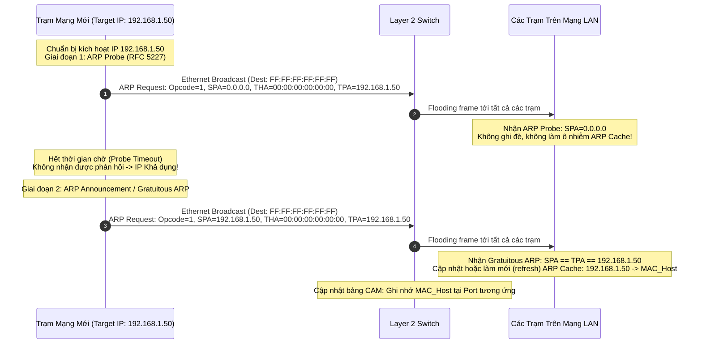
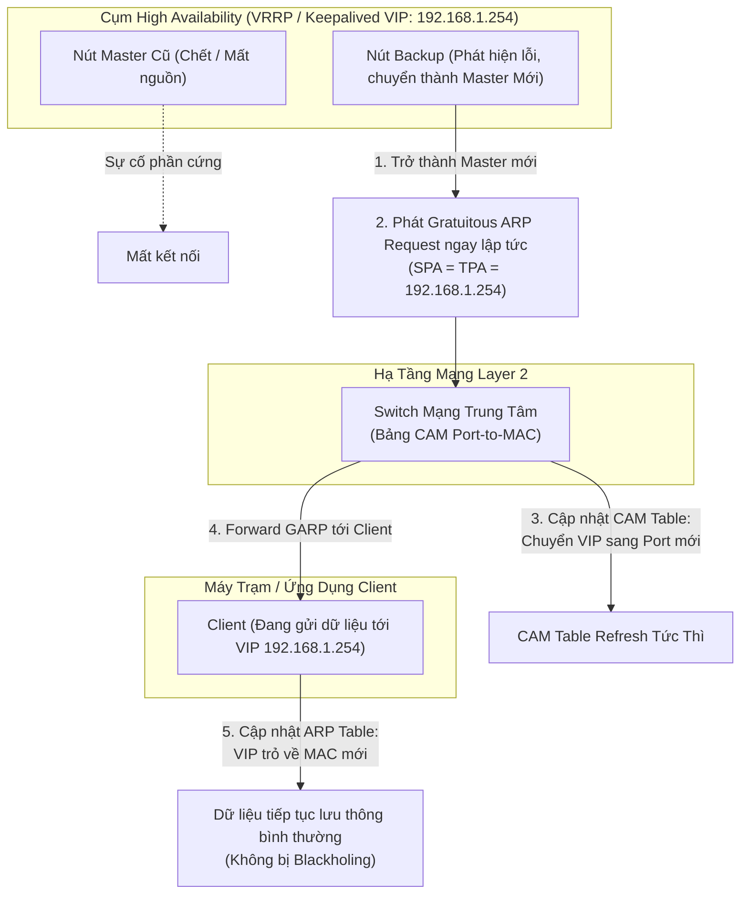
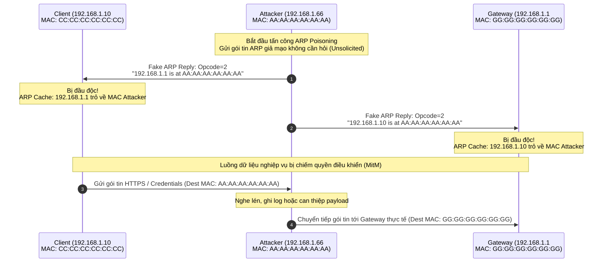

# 2_3_4 Gratuitous ARP and ARP Spoofing

> **Khóa học**: Cloud DevOps Basic — Computer Networking Core  
> **Phân nhóm**: 2 Domain 2 - Computer Networking Core Fundamentals › 2_3 Address Resolution Protocol  
> **Chủ đề**: Gratuitous ARP, phát hiện xung đột địa chỉ IPv4 (ACD), cơ chế Failover High Availability và lỗ hổng tấn công nhiễm độc ARP (ARP Poisoning / Spoofing)  
> **Trạng thái**: Verified (WRITE-CDB-2_3_4, 14-11-2026)  
> **Checklist đối chiếu**: [2_3_4](<../../../CHECKLIST.md#23-address-resolution-protocol-arp>)  

---

## 1. Khái Niệm Cốt Lõi & Bản Chất Kỹ Thuật (Core Concepts & Technical Deep Dive)

Trong vận hành mạng tiêu chuẩn, giao thức phân giải địa chỉ (ARP) thường được kích hoạt theo nhu cầu: khi một máy trạm cần gửi dữ liệu tới một địa chỉ IPv4 khác, nó phát gói ARP Request để hỏi tìm địa chỉ MAC của đối phương. Tuy nhiên, trong hai ngữ cảnh kỹ thuật đặc biệt—**tự thông báo danh tính / phát hiện xung đột địa chỉ** và **tấn công chiếm quyền kiểm soát luồng dữ liệu**—thông điệp ARP lại được sử dụng theo những phương thức hoàn toàn khác biệt: **Gratuitous ARP** và **ARP Cache Poisoning / Spoofing**.

---

### 1.1 Cơ chế Phát hiện Xung đột Địa chỉ IPv4 (ACD - RFC 5227) & Gratuitous ARP

Khi một giao diện mạng (network interface) được khởi tạo hoặc cấu hình một địa chỉ IPv4 mới (thông qua gán tĩnh hoặc DHCP), hệ thống không được phép sử dụng địa chỉ đó ngay lập tức vì địa chỉ này có thể đang bị trùng lặp với một thiết bị khác trên cùng mạng LAN. Tiêu chuẩn **RFC 5227 (IPv4 Address Conflict Detection - ACD)** định nghĩa hai loại thông điệp ARP chuẩn hóa để giải quyết triệt để vấn đề này:

```text
[Trạm Mới Khởi Tạo]                                               [Mạng LAN Cục Bộ]
        |                                                                 |
        | ----- (1) ARP Probe [Broadcast: FF:FF:FF:FF:FF:FF] -----------> |
        |       Opcode=1, SPA=0.0.0.0, THA=00:00:00:00:00:00, TPA=Target  |
        |       (Thăm dò không làm ô nhiễm bộ đệm ARP của các máy khác)   |
        |                                                                 |
   [Đợi timeout: Không có ai phản hồi -> Địa chỉ khả dụng!]               |
        |                                                                 |
        | ----- (2) ARP Announcement [Broadcast: FF:FF:FF:FF:FF:FF] ----> |
        |       Opcode=1, SPA=Target, THA=00:00:00:00:00:00, TPA=Target   |
        |       (SPA == TPA: Công bố sở hữu & Cập nhật stale cache)       |
        v                                                                 v
```

#### 1. ARP Probe (Thăm dò địa chỉ - RFC 5227 Section 2.1.1)
- **Mục đích**: Kiểm tra xem địa chỉ IPv4 dự định sử dụng đã tồn tại trên đường truyền cục bộ hay chưa trước khi hệ điều hành chính thức gán nó vào giao diện mạng.
- **Cấu hình các trường gói tin**:
  - **Mã thao tác (`ar$op`)**: `1` (`ares_op$REQUEST`).
  - **Địa chỉ giao thức người gửi (`ar$spa` / SPA)**: **BẮT BUỘC gán bằng `0.0.0.0` (all-zeroes)**.
    > *Lý do kỹ thuật sống còn*: Nếu trạm thăm dò đưa địa chỉ IP đang nghi ngờ vào trường `SPA`, tất cả các trạm khác trên mạng khi nhận gói tin broadcast này sẽ tự động cập nhật hoặc làm sai lệch (pollute) bảng ARP cache của chúng, ghi đè địa chỉ MAC của chủ sở hữu hợp pháp bằng địa chỉ MAC của trạm mới. Do đó, việc đặt `SPA = 0.0.0.0` đảm bảo không làm ô nhiễm bộ đệm ARP của các máy trạm lân cận.
  - **Địa chỉ phần cứng mục tiêu (`ar$tha` / THA)**: Bị bỏ qua và **NÊN gán bằng toàn bộ bit 0 (`00:00:00:00:00:00`)**.
  - **Địa chỉ giao thức mục tiêu (`ar$tpa` / TPA)**: **BẮT BUỘC gán bằng chính địa chỉ IPv4 đang cần thăm dò**.
- Nếu sau một khoảng thời gian chờ mà không có bất kỳ trạm nào gửi ARP Reply hoặc ARP Announcement để bảo vệ địa chỉ, trạm gửi kết luận địa chỉ an toàn để sử dụng.

#### 2. ARP Announcement / Gratuitous ARP Request (Công bố địa chỉ - RFC 5227 Section 2.3)
- **Mục đích**: Sau khi quá trình thăm dò thành công, trạm chính thức cấu hình địa chỉ IPv4 và phát đi thông điệp **ARP Announcement** (thường được gọi trong thực tế là **Gratuitous ARP - GARP**).
- **Cấu hình các trường gói tin**:
  - Có cấu trúc tương tự ARP Probe, nhưng hiện tại cả **Địa chỉ IP người gửi (`SPA`) và Địa chỉ IP mục tiêu (`TPA`) ĐỀU ĐƯỢC GÁN BẰNG ĐỊA CHỈ IP VỪA TIẾP NHẬN (`SPA == TPA`)**.
  - **Địa chỉ MAC người gửi (`SHA`)**: Chứa MAC thực tế của giao diện mạng.
  - **Địa chỉ MAC mục tiêu (`THA`)**: Gán bằng `00:00:00:00:00:00`.
  - **Mã thao tác (`ar$op`)**: `1` (Request).
- **Ý nghĩa vận hành**:
  - Thông báo cho toàn bộ các thiết bị trên mạng biết rằng IP này đã có chủ sở hữu hợp pháp.
  - Xóa bỏ và làm tươi (refresh) các bản ghi cũ, hết hạn hoặc sai lệch (stale ARP cache entries) đang lưu trên các máy trạm khác.

---

### 1.2 Ứng dụng sống còn trong Cụm dự phòng High Availability (VRRP & Failover)

Trong kiến trúc hạ tầng Cloud, Load Balancer và Firewall phân cụm (High Availability - HA) sử dụng các giao thức như **VRRP (Virtual Router Redundancy Protocol, RFC 5798)** hoặc **Keepalived**, Gratuitous ARP đóng vai trò là "chốt chặn kích hoạt tức thì" trong kịch bản chuyển đổi dự phòng (failover):

1. **Vấn đề chuyển dịch cổng vật lý trên Switch (CAM Table Invalidation)**:
   - Một cụm HA bao gồm máy chủ Master và Backup cùng chia sẻ một địa chỉ IP ảo (Virtual IP - VIP) hoặc địa chỉ MAC ảo (Virtual MAC - VMAC).
   - Thiết bị chuyển mạch mạng (Layer 2 Switch) duy trì **Bảng chuyển tiếp địa chỉ MAC (CAM / MAC Address Table)**, ghi nhớ địa chỉ MAC nào đang kết nối với cổng vật lý (port) nào của switch bằng cách theo dõi các khung dữ liệu đi vào (MAC learning).
2. **Kích hoạt Gratuitous ARP khi chuyển đổi Master (RFC 5798 Section 2.4 & 6.4.1)**:
   - Khi nút Master bị sự cố và nút Backup chuyển trạng thái lên làm Master mới, nút Master mới **bắt buộc phải phát ngay lập tức một thông điệp Gratuitous ARP broadcast** ra mạng.
   - Khi gói Gratuitous ARP đi tới switch qua cổng mới, switch lập tức cập nhật lại bảng CAM: chuyển ánh xạ của VIP/VMAC từ cổng vật lý cũ (của node chết) sang cổng vật lý mới (của node Master mới).
   - *Hậu quả nếu thiếu GARP*: Switch sẽ tiếp tục chuyển tiếp các frame dữ liệu đến cổng cũ của node đã chết gây mất kết nối hoàn toàn (**blackholing**), hoặc phải chờ đến khi hết hạn timer của bảng CAM (thường từ 300 giây) thì mới thực hiện flood frame ra mọi cổng (**unknown unicast flooding**).

---

### 1.3 Bản chất Phi trạng thái (Stateless), Thiếu Xác thực & Lỗ hổng ARP Poisoning / Spoofing

Mặc dù Gratuitous ARP là tính năng sống còn cho mạng LAN và HA, thiết kế nền tảng ban đầu của giao thức ARP từ thời kỳ RFC 826 lại chứa đựng một lỗ hổng bảo mật nghiêm trọng mang tính bản chất:

```text
[Nạn nhân 1: Client]                [Kẻ tấn công: Attacker]              [Nạn nhân 2: Gateway]
(192.168.1.10 - MAC_C)               (192.168.1.66 - MAC_A)               (192.168.1.1 - MAC_G)
          |                                     |                                     |
          | <==== "192.168.1.1 is at MAC_A" === | === "192.168.1.10 is at MAC_A" ===> |
          |       (Fake ARP Reply / Poison)     |     (Fake ARP Reply / Poison)       |
          |                                     |                                     |
[Client lưu: 192.168.1.1 -> MAC_A]              |               [Gateway lưu: 192.168.1.10 -> MAC_A]
          |                                     |                                     |
          | ----- Gói tin IP tới Internet ----> |                                     |
          |       (Dest MAC = MAC_A)            |                                     |
          |                               [Đọc trộm / Can thiệp]                      |
          |                                     | ----- Chuyển tiếp tới Gateway ----> |
          |                                     |       (Dest MAC = MAC_G)            |
          v                                     v                                     v
                           === MAN-IN-THE-MIDDLE (MitM) THÀNH CÔNG ===
```

- **Tính chất phi trạng thái (Statelessness)**: Giao thức ARP không duy trì trạng thái phiên. Một trạm mạng không lưu vết việc nó có từng gửi ARP Request hay không. Khi nhận được một gói ARP Reply, hầu hết các hệ điều hành sẽ cập nhật ngay lập tức bảng dịch của mình mà không cần kiểm tra xem gói phản hồi đó có tương ứng với một yêu cầu hợp lệ vừa gửi đi hay không (Unsolicited ARP Reply).
- **Hoàn toàn thiếu vắng cơ chế xác thực (No Authentication)**: ARP không có chữ ký số, không có mật khẩu, và không có bất kỳ cơ chế mật mã học nào để xác minh danh tính người gửi gói tin.
- **Lỗ hổng tấn công nhiễm độc bộ đệm ARP (ARP Cache Poisoning / Spoofing, RFC 5227 Section 5 & RFC 826)**:
  - Một máy trạm độc hại có thể dễ dàng chế tạo và phát tán liên tục các gói ARP giả mạo ra mạng, tuyên bố rằng địa chỉ IP của Default Gateway đang thuộc sở hữu của địa chỉ MAC của kẻ tấn công.
  - Đồng thời, kẻ tấn công gửi gói ARP giả mạo tới Gateway, tuyên bố địa chỉ IP của Client cũng đang nằm tại MAC của kẻ tấn công.
  - Cả hai nạn nhân đều mù quáng ghi đè bảng ARP cache của mình. Toàn bộ lưu lượng trao đổi giữa Client và Gateway giờ đây đều bị chuyển hướng qua máy của kẻ tấn công, hình thành thế tấn công **Đứng giữa (Man-in-the-Middle - MitM)** hoàn hảo. Kẻ tấn công có thể nghe lén thông tin nhạy cảm, sửa đổi nội dung gói tin trên đường truyền hoặc thực hiện từ chối dịch vụ (DoS).

---

### 1.4 Các tham số tinh chỉnh bảo vệ ARP trong Linux Kernel (`ip-sysctl`)

Hệ điều hành Linux cung cấp các tham số cấu hình nhân mạng (sysctl) tinh vi tại `/proc/sys/net/ipv4/conf/{all,interface}/` để kiểm soát hành vi phản hồi, công bố và thông báo ARP:

#### 1. Tham số `arp_ignore` (Xác định chế độ phản hồi ARP Request)
Quy định mức độ nghiêm ngặt khi nhân Linux quyết định có trả lời một ARP Request gửi tới hay không:
- **`0` (Mặc định)**: Phản hồi cho **bất kỳ địa chỉ IP cục bộ nào** được cấu hình trên cỗ máy, bất kể gói tin ARP Request đó đi vào từ giao diện mạng nào (mô hình Weak Host Model).
- **`1`**: Chỉ phản hồi nếu địa chỉ IP mục tiêu được cấu hình trực tiếp trên **chính giao diện mạng tiếp nhận gói tin ARP Request** (Strong Host Model, cô lập giữa các card mạng).
- **`2`**: Chỉ phản hồi nếu địa chỉ IP mục tiêu nằm trên chính giao diện tiếp nhận **VÀ** địa chỉ IP của người gửi (`SPA`) nằm trong cùng dải mạng con (subnet) với giao diện đó.

#### 2. Tham số `arp_announce` (Xác định mức độ giới hạn công bố địa chỉ nguồn)
Quy định địa chỉ IP nguồn nào được đưa vào trường `SPA` khi máy trạm Linux phát sinh một ARP Request ra ngoài:
- **`0` (Mặc định)**: Sử dụng bất kỳ địa chỉ IP cục bộ nào có trên máy, kể cả địa chỉ cấu hình trên giao diện mạng khác.
- **`1`**: Cố gắng tránh sử dụng các địa chỉ IP cục bộ không thuộc cùng subnet với giao diện mạng đang phát gói tin.
- **`2`**: **Luôn luôn sử dụng địa chỉ IP cục bộ phù hợp nhất (best local address)** cho subnet đích trên chính giao diện mạng đang gửi gói tin ra.

#### 3. Tham số `arp_notify` (Tự động phát Gratuitous ARP)
Điều khiển hành vi thông báo khi cấu hình giao diện mạng thay đổi:
- **`0` (Mặc định)**: Không tự động phát thông báo.
- **`1`**: Tự động phát các gói tin **Gratuitous ARP request** ngay khi giao diện mạng được kích hoạt (brought up) hoặc khi địa chỉ phần cứng (MAC address) thay đổi, giúp switch và các máy lân cận cập nhật bảng định tuyến tức thì.

---

## 2. Ví Dụ Đời Sống Thực Tế Dễ Hiểu (Intuitive Real-World Analogies)

### Ẩn dụ: Thư Thông Báo Đổi Địa Chỉ và Kẻ Mạo Danh Đóng Vai Bác Sĩ

Hãy tưởng tượng một khu đô thị có một phòng khám đa khoa trung tâm phục vụ bà con:

#### 1. Gratuitous ARP / ACD: Thiệp Chào Mừng và Thông Báo Đổi Ca Cấp Cứu
- **ARP Probe (Thăm dò không gây phiền hà)**: Khi một bác sĩ mới dọn về căn nhà số 10 trong phố, trước khi treo biển tên lên cổng, bác gửi một người đưa thư đi gõ cửa hỏi nhẹ nhàng: *"Cho hỏi căn nhà số 10 này hiện đã có ai đăng ký ở chưa?"*, nhưng trên phong bì người đưa thư **không ghi tên ai cả (SPA = 0.0.0.0)** để lỡ có người khác đang ở thì cũng không làm đảo lộn danh bạ của ban quản lý tòa nhà.
- **ARP Announcement / Gratuitous ARP (Thông báo chính thức)**: Khi chắc chắn không có ai tranh chấp, bác sĩ treo biển và gửi thiệp chúc mừng tới toàn thể khu phố: *"Tôi là Bác sĩ Nam, tôi chính thức chuyển tới Căn nhà số 10, khuôn mặt nhận diện của tôi là đây!"*. Toàn bộ ban quản trị và cư dân cập nhật ngay cuốn sổ tay liên lạc của mình.
- **HA Failover (Keepalived/VRRP)**: Tại phòng khám cấp cứu, khi Bác sĩ Trưởng ca số 1 đột ngột ngất xỉu, Bác sĩ trực dự phòng số 2 lập tức cầm bộ đàm phát loa khẩn cấp cho đội ngũ bảo vệ và xe cứu thương: *"Bác sĩ trực chính thức hiện tại đã chuyển sang Bác sĩ số 2 ở Phòng B!"*. Nhờ thông báo này, các xe cấp cứu chở bệnh nhân nguy kịch rẽ ngay sang Cổng B mà không bị chở nhầm vào phòng trống của Bác sĩ số 1 (chống blackholing).

#### 2. ARP Spoofing / Poisoning: Kẻ Lừa Đảo Đứng Giữa Ngõ
Do hệ thống liên lạc trong khu phố thời xưa vận hành hoàn toàn dựa trên sự tin tưởng tuyệt đối, không yêu cầu xuất trình thẻ căn cước hay con dấu chứng thực (stateless & no authentication):
- Một kẻ lừa đảo tinh vi đứng ngay tại ngã ba ngõ.
- Hắn chạy lại nói với Bệnh nhân (Client): *"Tôi chính là Bác sĩ Trưởng phòng khám đây, có tiền thuốc hay bệnh án gì hãy đưa hết cho tôi!"*.
- Cùng lúc, hắn chạy vào phòng khám nói với Bác sĩ (Gateway): *"Tôi chính là người nhà đại diện của Bệnh nhân đây, có kết quả xét nghiệm gì hãy giao cho tôi!"*.
- Do cả hai phía đều cả tin, Bệnh nhân trao toàn bộ thư từ bí mật cho kẻ lừa đảo; kẻ lừa đảo mở ra đọc trộm, sao chép dữ liệu rồi mới thong thả cầm sang đưa cho Bác sĩ. Toàn bộ thông tin riêng tư của người dân bị kiểm soát và chiếm đoạt hoàn toàn mà không ai hay biết (**Man-in-the-Middle**).

---

## 3. Kiến Trúc, Luồng Hoạt Động & Hình Ảnh Trực Quan (Architecture, Diagrams & Visual Media)

### 3.1 Quy trình Phát hiện Xung đột Địa chỉ (ACD) và Phát Gratuitous ARP



---

### 3.2 Cơ chế Chuyển đổi Cụm Dự phòng High Availability (VRRP Failover)



---

### 3.3 Cơ chế Đầu độc Bộ đệm ARP (ARP Cache Poisoning & Man-in-the-Middle)



---

## 4. Mô Phỏng Thực Chiến & Cấu Hình Phòng Vệ (Hands-on Lab & Defense Configurations)

Kỹ sư Systems và DevOps cần nắm vững phương pháp kiểm tra luồng gói tin Gratuitous ARP và thiết lập cấu hình kiên cố hóa nhân Linux để chống lại các hành vi đầu độc mạng.

### 4.1 Bắt gói tin Gratuitous ARP trên Linux với `tcpdump`

```bash
# Lắng nghe các gói tin ARP trên giao diện eth0
sudo tcpdump -e -n -v -i eth0 arp
```

> ⚠️ Đầu ra mẫu minh họa gói tin từ tcpdump (not executed by squad):

```text
15:10:02.401211 aa:bb:cc:dd:ee:01 > ff:ff:ff:ff:ff:ff, ethertype ARP (0x0806), length 42: \
    Ethernet (len 6), IPv4 (len 4), Request who-has 192.168.1.50 tell 192.168.1.50, length 28
```
*Phân tích*: Gói tin có địa chỉ MAC đích là `ff:ff:ff:ff:ff:ff` (Broadcast), mang thông điệp `who-has 192.168.1.50 tell 192.168.1.50`. Đây chính là gói **Gratuitous ARP Request (ARP Announcement)** vì địa chỉ người gửi và địa chỉ mục tiêu hoàn toàn trùng khớp nhau (`SPA == TPA == 192.168.1.50`).

---

### 4.2 Thiết lập kiên cố hóa tham số Linux Kernel Sysctl

Để ngăn ngừa lỗi định tuyến ARP trên máy chủ đa card mạng (multi-homed) và ngăn chặn việc máy chủ vô tình phản hồi ARP cho các giao diện mạng khác, cấu hình chuẩn khuyến nghị cho sản xuất như sau:

> ⚠️ Lệnh minh họa cấu hình kernel (lab VM only):

```bash
# 1. arp_ignore = 1: Chỉ trả lời ARP Request nếu target IP được gán trên chính card mạng nhận gói
sudo sysctl -w net.ipv4.conf.all.arp_ignore=1
sudo sysctl -w net.ipv4.conf.default.arp_ignore=1

# 2. arp_announce = 2: Luôn sử dụng địa chỉ IP phù hợp nhất cho subnet đích trên card mạng gửi ra
sudo sysctl -w net.ipv4.conf.all.arp_announce=2
sudo sysctl -w net.ipv4.conf.default.arp_announce=2

# 3. arp_notify = 1: Tự động phát Gratuitous ARP khi bật card mạng hoặc đổi MAC (cần thiết cho HA/Clustering)
sudo sysctl -w net.ipv4.conf.all.arp_notify=1
sudo sysctl -w net.ipv4.conf.default.arp_notify=1
```

Để lưu cấu hình vĩnh viễn qua các lần tái khởi động hệ thống, tạo tệp `/etc/sysctl.d/99-arp-security.conf`:

```ini
# /etc/sysctl.d/99-arp-security.conf
net.ipv4.conf.all.arp_ignore = 1
net.ipv4.conf.default.arp_ignore = 1
net.ipv4.conf.all.arp_announce = 2
net.ipv4.conf.default.arp_announce = 2
net.ipv4.conf.all.arp_notify = 1
net.ipv4.conf.default.arp_notify = 1
```

---

### 4.3 Giải pháp Phòng vệ Tầng Phần cứng Mạng: Dynamic ARP Inspection (DAI)

Trên hạ tầng chuyển mạch mạng vật lý của doanh nghiệp và trung tâm dữ liệu, biện pháp bảo vệ triệt để nhất chống lại ARP Poisoning là kích hoạt tính năng **Dynamic ARP Inspection (DAI)** trên Switch:

1. **Phối hợp với DHCP Snooping**:
   - Switch lắng nghe các gói tin DHCP và xây dựng một cơ sở dữ liệu tin cậy (**DHCP Snooping Binding Database**) bao gồm bộ ba: `<MAC, IP gán phát, Cổng switch, VLAN>`.
2. **Cơ chế kiểm duyệt của DAI**:
   - Khi một máy trạm gửi bất kỳ gói tin ARP nào (kể cả ARP Reply hay Gratuitous ARP), switch tại cổng truy cập (Access Port) sẽ chặn lại và giải mã phần tải trọng ARP.
   - Switch đối chiếu cặp `SPA` và `SHA` trong gói tin với cơ sở dữ liệu DHCP Snooping:
     - Nếu khớp: Switch cho phép gói tin đi qua.
     - Nếu không khớp (kẻ tấn công gửi ARP giả mạo để mạo danh IP khác): Switch lập tức **hủy gói tin (drop)** và ghi log cảnh báo bảo mật, vô hiệu hóa hoàn toàn cuộc tấn công ARP Poisoning ngay tại tầng 2.

---

## 5. Cạm Bẫy Thực Tế & Thực Tiễn Sản Xuất (Production Gotchas & Best Practices)

1. **Sự cố "ARP Flux" trên máy chủ Linux Multi-Homed**:
   - *Bản chất*: Mặc định, Linux áp dụng mô hình Weak Host Model với `arp_ignore = 0`. Nếu một máy chủ có hai card mạng `eth0` (IP1) và `eth1` (IP2) cùng cắm vào một mạng LAN, khi có một ARP Request hỏi IP2 nhưng đi vào `eth0`, Linux vẫn vui vẻ trả lời bằng địa chỉ MAC của `eth0`!
   - *Hậu quả*: Lưu lượng mạng gửi đến IP2 nhưng lại bị hút về card mạng `eth0`, làm mất cân bằng tải, gây flapping bảng MAC trên switch hoặc khiến tường lửa chặn nhầm gói tin.
   - *Khắc phục*: Luôn thiết lập `arp_ignore = 1` và `arp_announce = 2` trên tất cả các máy chủ multi-homed hoặc Kubernetes node có nhiều card mạng.

2. **Hiện tượng "Blackholing" dữ liệu sau khi vMotion hoặc VRRP Failover**:
   - *Bản chất*: Khi một máy ảo di chuyển sang host vật lý khác (vMotion trong VMware / di chuyển container) hoặc Keepalived chuyển Master, cổng switch kết nối với máy chủ đã thay đổi.
   - *Cạm bẫy*: Nếu hệ điều hành không bật `arp_notify = 1` hoặc switch mạng cấu hình chặn broadcast, switch sẽ tiếp tục đẩy dữ liệu vào cổng vật lý cũ cho đến khi bảng CAM timeout (mặc định 300 giây). Hậu quả là dịch vụ bị mất kết nối hoàn toàn trong 5 phút mà không rõ nguyên nhân.

3. **Ảo tưởng an toàn khi chỉ dùng giao thức mã hóa HTTPS/TLS**:
   - *Bản chất*: Nhiều kỹ sư cho rằng nếu ứng dụng đã dùng HTTPS thì không cần lo lắng về ARP Spoofing.
   - *Thực tế*: Mặc dù kẻ tấn công không thể giải mã trực tiếp dữ liệu mã hóa TLS (nếu không có chứng chỉ CA giả), kẻ tấn công MitM vẫn có thể đọc toàn bộ metadata tiêu đề IP, thực hiện bẻ gãy kết nối (DoS), làm sai lệch phân giải DNS (DNS Spoofing thông qua UDP không mã hóa), hoặc thu thập danh sách các máy chủ đích đang được kết nối.

---

## 6. Câu Hỏi Củng Cố Kiến Thức (Active Recall Quiz)

<details>
<summary><b>Câu hỏi 1:</b> Trong tiêu chuẩn RFC 5227 về phát hiện xung đột địa chỉ IPv4 (ACD), gói tin ARP Probe khác gì so với gói tin ARP Announcement về mặt cấu hình địa chỉ IP người gửi (SPA) và mục đích sử dụng?</summary>

**Đáp án:**
- **Về cấu hình trường `SPA`**:
  - Gói tin **ARP Probe**: Trường `SPA` bắt buộc phải gán bằng toàn bộ bit 0 (`0.0.0.0`).
  - Gói tin **ARP Announcement**: Trường `SPA` được gán bằng chính địa chỉ IPv4 vừa tiếp nhận, đồng thời bằng với trường địa chỉ mục tiêu (`SPA == TPA`).
- **Về mục đích sử dụng**:
  - **ARP Probe**: Dùng để thăm dò xem địa chỉ IP đó đã bị ai sử dụng trên mạng chưa mà **không làm ô nhiễm bảng ARP cache** của các máy khác nếu xảy ra trùng lặp.
  - **ARP Announcement**: Dùng để chính thức công bố quyền sở hữu địa chỉ IP sau khi thăm dò thành công, đồng thời làm tươi và cập nhật các bản ghi cũ (stale entries) trong bảng ARP của các trạm khác trên toàn mạng.
</details>

<details>
<summary><b>Câu hỏi 2:</b> Vì sao giao thức ARP lại dễ bị tấn công nhiễm độc bộ đệm (ARP Cache Poisoning / Spoofing)? Kẻ tấn công lợi dụng đặc tính kỹ thuật nào của ARP theo RFC 826 và RFC 5227 để thiết lập thế tấn công Man-in-the-Middle?</summary>

**Đáp án:**
- **Nguyên nhân cốt lõi**:
  1. **Tính chất phi trạng thái (Stateless)**: ARP không lưu vết trạng thái yêu cầu. Máy trạm nhận gói ARP Reply sẽ cập nhật ngay bảng dịch mà không cần biết mình có từng gửi ARP Request trước đó hay không.
  2. **Hoàn toàn thiếu cơ chế xác thực (No Authentication)**: ARP không có chữ ký số hay mật mã để chứng minh tính xác thực của người gửi.
- **Kỹ thuật tấn công MitM**:
  Kẻ tấn công gửi các gói tin ARP Reply giả mạo (Unsolicited ARP Reply) tới Client tuyên bố mình là Gateway, và tới Gateway tuyên bố mình là Client. Nhờ đặc tính cập nhật mù quáng của ARP, cả hai nạn nhân đều chuyển tiếp toàn bộ lưu lượng qua địa chỉ MAC của kẻ tấn công, biến kẻ tấn công thành trạm trung chuyển đứng giữa (Man-in-the-Middle).
</details>

<details>
<summary><b>Câu hỏi 3:</b> Trong cụm máy chủ dự phòng High Availability (như Keepalived / VRRP), việc phát Gratuitous ARP ngay sau khi nút Backup trở thành Master mới giải quyết bài toán kỹ thuật nào ở tầng chuyển mạch L2 theo RFC 5798?</summary>

**Đáp án:**
- Khi nút Backup chuyển lên làm Master, địa chỉ IP ảo (VIP) hoặc MAC ảo (VMAC) giờ đây được kết nối qua một cổng vật lý mới trên switch mạng.
- Thiết bị switch Layer 2 ghi nhớ vị trí các trạm thông qua bảng CAM (MAC Address Table).
- Việc phát gói tin Gratuitous ARP broadcast buộc switch phải đọc địa chỉ MAC nguồn trên cổng mới và cập nhật tức thì bảng CAM, chuyển hướng toàn bộ khung dữ liệu gửi tới VIP sang cổng vật lý mới.
- Điều này giúp tránh hiện tượng "hố đen dữ liệu" (blackholing - switch tiếp tục gửi dữ liệu vào cổng của nút cũ đã hỏng) hoặc hiện tượng switch phải flood gói tin ra toàn bộ các cổng (unknown unicast flooding).
</details>

---

## 7. 📚 Nguồn Tài Liệu Chính Thống (Tier-1 Official References)

- [RFC 5227: IPv4 Address Conflict Detection](https://datatracker.ietf.org/doc/html/rfc5227) - Tiêu chuẩn IETF RFC 5227 đặc tả chi tiết cơ chế ACD, cấu trúc gói tin ARP Probe (`SPA = 0.0.0.0`), ARP Announcement (`SPA == TPA`), và các cân nhắc bảo mật (Security Considerations) liên quan đến tấn công mạo danh ARP.
- [RFC 826: An Ethernet Address Resolution Protocol](https://datatracker.ietf.org/doc/html/rfc826) - Tiêu chuẩn Internet Standard RFC 826 mô tả thuật toán tiếp nhận gói tin ARP phi trạng thái, cội nguồn của việc cập nhật bảng dịch không xác thực.
- [RFC 5798: Virtual Router Redundancy Protocol (VRRP) Version 3 for IPv4 and IPv6](https://datatracker.ietf.org/doc/html/rfc5798) - Tiêu chuẩn IETF RFC 5798 quy định bắt buộc phát Gratuitous ARP ngay khi chuyển dịch trạng thái Master để làm tươi bảng định tuyến Layer 2 trên các thiết bị chuyển mạch mạng.
- [Linux Kernel Documentation: IP Sysctl](https://docs.kernel.org/networking/ip-sysctl.html) - Tài liệu hướng dẫn chính thức từ Linux Kernel Documentation về các thông số điều khiển nhân mạng `arp_ignore`, `arp_announce` và `arp_notify`.
