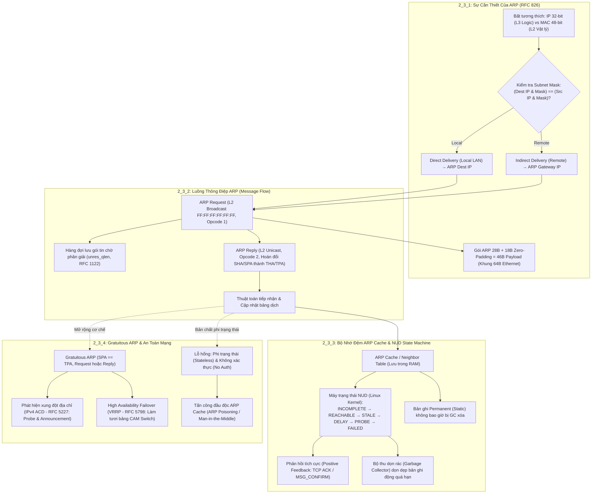

# 2_3 Address Resolution Protocol

> **Khóa học**: Cloud DevOps Basic — Computer Networking Core · **Domain**: 2 Domain 2 - Computer Networking Core Fundamentals · **Roadmap gốc**: [Networking README](<../../README.md#module-3-address-resolution-protocol-arp-rfc-826>)

---

## Module này dạy gì? (What & Why)

Module này phân tích toàn diện giao thức Phân giải Địa chỉ (Address Resolution Protocol - ARP, chuẩn hóa trong RFC 826)—chiếc cầu nối sống còn giữa tầng mạng (Layer 3 - IPv4) và tầng liên kết dữ liệu (Layer 2 - Ethernet) trên mọi mạng truyền thông cục bộ (LAN). Người học sẽ bắt đầu từ nhu cầu kỹ thuật cốt lõi giải quyết sự bất tương thích giữa địa chỉ logic 32-bit và địa chỉ phần cứng 48-bit (MAC), cơ chế so sánh mặt nạ mạng (Subnet Mask) của Host để quyết định chuyển giao trực tiếp hay gửi qua Next-Hop Gateway, và cấu trúc gói tin ARP 28 bytes được chèn 18 bytes zero-padding để đạt chuẩn khung Ethernet 64 bytes (RFC 894). Tiếp theo, module làm sáng tỏ luồng thông điệp chuẩn giữa Broadcast Request và Unicast Reply, quy tắc hoán đổi trường địa chỉ, thuật toán cập nhật bảng dịch và hàng đợi lưu giữ gói tin chờ phân giải trong Linux Kernel (`unres_qlen` theo RFC 1122). Cuối cùng, module đi sâu vào cơ chế tối ưu hiệu năng thông qua bộ nhớ đệm ARP Cache cùng máy trạng thái NUD (Neighbor Unreachability Detection) với chu kỳ kiểm tra tính khả dụng nghiêm ngặt, cũng như các biến thể nâng cao như Gratuitous ARP trong phát hiện xung đột IP (ACD - RFC 5227), chuyển dịch High Availability (VRRP - RFC 5798) và các rủi ro an ninh mạng từ tấn công nhiễm độc ARP (ARP Cache Poisoning / Man-in-the-Middle).

---

## Lộ trình bài học (Lesson Path)

| Bài học | Mục tiêu cốt lõi | Checklist ID |
| :--- | :--- | :---: |
| [2_3_1 The Need for ARP](<./2_3_1 The Need for ARP.md>) | Nắm vững sự bất tương thích giữa địa chỉ IP L3 và MAC L2, logic so sánh subnet mask để xác định Direct Delivery vs Next-Hop Gateway, giải phẫu cấu trúc gói tin ARP 28 bytes và yêu cầu zero-padding 18 bytes đạt khung Ethernet 64 bytes. | [2_3_1](<../../../CHECKLIST.md#23-address-resolution-protocol-arp>) |
| [2_3_2 ARP Message Flow](<./2_3_2 ARP Message Flow.md>) | Làm chủ chu trình luồng thông điệp Broadcast Request (`FF:FF:FF:FF:FF:FF`) và Unicast Reply, định dạng các trường địa chỉ (SHA, SPA, THA, TPA), thuật toán cập nhật bảng dịch an toàn và cơ chế hàng đợi gói tin chờ phân giải (`unres_qlen`). | [2_3_2](<../../../CHECKLIST.md#23-address-resolution-protocol-arp>) |
| [2_3_3 ARP Cache](<./2_3_3 ARP Cache.md>) | Thấu hiểu bản chất bộ nhớ đệm ARP Cache trong RAM, phân biệt bản ghi Dynamic vs Permanent, máy trạng thái NUD (Reachable, Stale, Delay, Probe, Failed) và các tham số điều khiển kernel trong `/proc/sys/net/ipv4/neigh/`. | [2_3_3](<../../../CHECKLIST.md#23-address-resolution-protocol-arp>) |
| [2_3_4 Gratuitous ARP and ARP Spoofing](<./2_3_4 Gratuitous ARP and ARP Spoofing.md>) | Khảo sát Gratuitous ARP (ARP Probe và ARP Announcement) trong phát hiện xung đột IPv4 (ACD), cập nhật bảng CAM switch trong cụm HA VRRP, và nguồn gốc lỗ hổng bảo mật phi trạng thái dẫn tới tấn công ARP Poisoning / Man-in-the-Middle. | [2_3_4](<../../../CHECKLIST.md#23-address-resolution-protocol-arp>) |

---

## Bản đồ khái niệm (Concept Map)

Sơ đồ dưới đây tổng hợp mối liên kết kiến trúc logic xuyên suốt 4 bài học của Module 2.3:

---

## Ẩn dụ xuyên suốt (Module Analogy)

Bốn bài học trong module được kết nối liền mạch thông qua câu chuyện thực tế về **Hệ thống chuyển phát bưu phẩm và Loa thông báo của Tòa nhà văn phòng**:

1. **Danh thiếp và Căn cước công dân (2_3_1 - The Need for ARP)**:
   - Địa chỉ IP giống như thông tin trên danh thiếp logic (*"Anh Minh — Trưởng phòng Kỹ thuật"*). Bưu điện thành phố dùng thông tin này để vận chuyển bưu phẩm qua các trục đường quốc lộ lớn xuyên tỉnh thành (Layer 3 Routing).
   - Địa chỉ MAC giống như số Thẻ Căn cước công dân (CCCD) và dấu vân tay gắn cứng vào thể xác vật lý của anh Minh (Card mạng NIC Layer 2).
   - Khi bưu phẩm tới cửa tòa nhà (mạng LAN), bưu tá không thể hô to danh xưng logic vào không khí vô định. Bưu tá cần một cơ chế để tra cứu: ai sở hữu danh xưng này thì cho xin số CCCD để trao thư tận tay; hoặc nếu thư gửi đi tỉnh khác (Remote Destination), bưu tá lập tức mang thư gửi cho Bác tài xế xe tải liên tỉnh (Default Gateway).

2. **Phát thanh nội bộ và Trao thư tận tay (2_3_2 - ARP Message Flow)**:
   - Bưu tá cầm loa phát thanh tòa nhà hô to: *"Ai là Anh Minh Trưởng phòng Kỹ thuật? Xin báo số phòng/CCCD cho bưu tá"* (ARP Request - Broadcast tới toàn bộ tòa nhà `FF:FF:FF:FF:FF:FF`). Mọi người đều nghe nhưng chỉ người trùng tên mới xử lý.
   - Trong lúc chờ anh Minh tới nhận, bưu tá xếp gọn các phong thư tiếp theo vào một khay chờ tạm thời gồm 3 ngăn (hàng đợi `unres_qlen` theo RFC 1122).
   - Anh Minh nghe thấy liền bước tới bàn bưu tá và nói riêng: *"Tôi là Minh đây, tôi ngồi ở Bàn 12"* (ARP Reply - Unicast). Bưu tá lấy thư trong khay đưa tận tay anh Minh và ghi nhớ vị trí bàn.

3. **Cuốn sổ tay bàn làm việc và Mực tự bay màu (2_3_3 - ARP Cache)**:
   - Bưu tá không thể cứ mỗi lần có thư lại chạy ra sảnh phát loa làm phiền cả tòa nhà. Anh mở cuốn sổ tay trên bàn (ARP Cache trong RAM) ghi lại: `Anh Minh -> Bàn 12`.
   - Tuy nhiên, nhân viên văn phòng có thể đổi bàn hoặc chuyển công tác. Vì vậy, bưu tá dùng loại **bút mực tự bay màu theo thời gian (Dynamic NUD States)**:
     - Khi thấy anh Minh liên tục ký nhận biên lai gửi lại (TCP ACK / Positive Feedback), dòng chữ vẫn đậm nét (`REACHABLE`).
     - Đã nhiều ngày không thấy anh Minh nhận thư, mực bắt đầu mờ đi (`STALE`).
     - Có thư mới, bưu tá cử cậu học việc chạy tới Bàn 12 ngó xem anh Minh còn ngồi đó không (`PROBE` - Unicast). Nếu bàn trống trơn, bưu tá gạch chéo tên (`FAILED`) và nhân viên dọn vệ sinh xé trang giấy cũ bỏ đi (Garbage Collection).
     - Riêng phòng Tổng Giám đốc (Default Gateway) có vị trí bất biến được quản trị viên dùng bút dạ dầu đóng dấu đỏ vĩnh cửu (`PERMANENT`), không bao giờ bị xóa.

4. **Tự xưng danh và Kẻ mạo danh tráo thư (2_3_4 - Gratuitous ARP & Spoofing)**:
   - Khi một nhân viên mới chuyển tới, anh ta chủ động cầm loa thông báo vị trí bàn của mình để kiểm tra xem có ai bị trùng tên không (ARP Probe / Announcement - IPv4 ACD), đồng thời giúp bác bảo vệ trực cổng cập nhật ngay sơ đồ sơ tán (Switch CAM Table trong cụm HA VRRP).
   - Thế nhưng, vì bưu tá ghi chép vào sổ hoàn toàn dựa trên sự tin tưởng mà không yêu cầu xuất trình mật khẩu hay con dấu (Stateless & No Authentication), một kẻ lừa đảo trong phòng có thể chạy tới bàn bưu tá dõng dạc tuyên bố: *"Tôi là Kế toán trưởng đây, chuyển toàn bộ séc tiền mặt sang bàn của tôi!"*. Bưu tá mù quáng tin ngay và ghi đè vào sổ (ARP Cache Poisoning). Kết quả là kẻ gian chặn bắt toàn bộ thư từ mật của công ty (Man-in-the-Middle).

---

## Tự kiểm tra cuối module (Module Review)

<b>Câu hỏi 1:</b> Tại sao trong mạng truyền thông Ethernet cục bộ, các trạm bắt buộc phải cần đến giao thức ARP (RFC 826) để truyền dữ liệu, và quy trình Host so sánh subnet mask quyết định việc phân giải địa chỉ MAC của Host đích hay Gateway như thế nào?

**Đáp án:**
- **Nhu cầu ARP (RFC 826)**: Mạng cáp vật lý Ethernet yêu cầu địa chỉ phần cứng 48-bit (MAC) được đóng gói trong tiêu đề Layer 2 để các card mạng (NIC) nhận diện và xử lý khung tin trên môi trường broadcast. Trong khi đó, địa chỉ IPv4 ở Layer 3 có độ dài 32-bit và hoàn toàn không có mối liên hệ cấu trúc hay toán học cố định nào với địa chỉ MAC của phần cứng. ARP là cơ chế phân phối động mối quan hệ tương ứng giữa cặp `<giao thức, địa chỉ IP>` và địa chỉ MAC 48-bit.
- **Quy trình so sánh Subnet Mask (RFC 1122 & RFC 1812)**:
  - Khi chuẩn bị gửi datagram, Host thực hiện phép toán AND bit giữa IP đích và Subnet Mask, so sánh với kết quả AND giữa IP nguồn và Subnet Mask.
  - *Nếu trùng khớp (Direct Delivery)*: Đích đến nằm cùng mạng LAN cục bộ. Tầng mạng giao IP đích cho driver để kích hoạt ARP tìm địa chỉ MAC của **chính Host đích**.
  - *Nếu không trùng khớp (Indirect Delivery)*: Đích đến nằm ở mạng từ xa và chỉ có thể tới được thông qua router. Tầng định tuyến xác định IP của chặng tiếp theo (Next-Hop Gateway IP) và kích hoạt ARP để tìm địa chỉ MAC của **Default Gateway**, chứ không tìm MAC của máy đích cuối cùng.

<b>Câu hỏi 2:</b> Phân tích sự đối lập về hình thức truyền tin (Broadcast vs Unicast) và cấu trúc địa chỉ giữa gói tin ARP Request và ARP Reply. Tham số `unres_qlen` trên Linux giải quyết bài toán gì khi ứng dụng gửi một chùm dữ liệu tới địa chỉ chưa phân giải?

**Đáp án:**
- **ARP Request**: Được phát dưới dạng **Broadcast ở Layer 2** (địa chỉ MAC đích `FF:FF:FF:FF:FF:FF`, EtherType `0x0806`, Opcode `1`) để toàn bộ các trạm trong cùng miền quảng bá đều tiếp nhận và kiểm tra. Trường Target Hardware Address (THA) trong gói Request chưa biết nên được gán toàn bộ bit 0 (`00:00:00:00:00:00` theo RFC 5227).
- **ARP Reply**: Trạm đích nhận diện đúng IP của mình sẽ gửi hồi đáp dưới dạng **Unicast ở Layer 2** (Opcode `2`) trực tiếp tới địa chỉ MAC của trạm yêu cầu. Các trường địa chỉ được hoán đổi: SHA/SPA của trạm đích trở thành nguồn, còn trạm phát Request ban đầu trở thành đích (THA/TPA).
- **Tham số `unres_qlen` (RFC 1122 & arp(7))**: Theo RFC 1122 Section 2.3.2.2, tầng liên kết nên lưu lại ít nhất một gói tin trong lúc chờ phân giải ARP. Trên Linux Kernel, hàng đợi này được điều khiển bởi `unres_qlen` (mặc định lưu tối đa **3 gói tin**). Khi chùm dữ liệu ập tới, 3 gói đầu được giữ trong hàng đợi, các gói vượt quá bị hủy bỏ; ngay khi nhận được ARP Reply, kernel lập tức giải phóng và truyền 3 gói tin này ra cáp vật lý.

<b>Câu hỏi 3:</b> Máy trạng thái NUD (Neighbor Unreachability Detection) của Linux Kernel vận hành như thế nào qua các trạng thái REACHABLE, STALE, DELAY và PROBE? Cơ chế "Phản hồi tích cực" (Positive Feedback) đóng vai trò gì?

**Đáp án:**
- Khi bản ghi được phân giải thành công, nó ở trạng thái **`REACHABLE`** trong khoảng thời gian `base_reachable_time_ms` (mặc định 30 giây, ngẫu nhiên hóa từ 15-45 giây).
- Nếu hết thời gian này mà không nhận được **Phản hồi tích cực (Positive Feedback)** từ tầng trên (như gói **TCP ACK** thành công hoặc cờ `MSG_CONFIRM` từ ứng dụng qua `sendmsg(2)`), bản ghi chuyển sang trạng thái **`STALE`** (bản ghi vẫn dùng được nhưng bị nghi ngờ).
- Khi có gói tin mới cần gửi tới địa chỉ đang ở trạng thái `STALE`, bản ghi chuyển sang **`DELAY`** (chờ một khoảng ngắn xem có phản hồi tích cực không).
- Nếu vẫn không có phản hồi, kernel chuyển sang **`PROBE`** và chủ động gửi các gói tin thăm dò đơn hướng (**Unicast Probe**) trực tiếp tới MAC đã lưu (lặp lại `ucast_solicit` lần). Nếu thành công, bản ghi trở lại `REACHABLE`; nếu thất bại hoàn toàn sau khi broadcast thử lại, bản ghi chuyển sang `FAILED` và bị bộ thu dọn rác (Garbage Collector) dọn dẹp.
- Cơ chế này giúp mạng vừa đảm bảo thông tin luôn tươi mới vừa không phải liên tục phát sóng broadcast làm ngập đường truyền.

<b>Câu hỏi 4:</b> Gratuitous ARP là gì? Hai ứng dụng hợp pháp quan trọng nhất của nó (ACD và HA VRRP Failover) hoạt động ra sao, và tại sao bản chất thiết kế của ARP lại tạo điều kiện cho các cuộc tấn công ARP Poisoning (Man-in-the-Middle)?

**Đáp án:**
- **Gratuitous ARP**: Là bản tin ARP đặc biệt được phát khi thiết bị tự truy vấn hoặc thông báo về chính địa chỉ IP của mình (trong gói tin có địa chỉ IP nguồn trùng với địa chỉ IP đích: `SPA == TPA`).
- **Hai ứng dụng hợp pháp**:
  1. *Phát hiện xung đột địa chỉ (IPv4 ACD - RFC 5227)*: Khi giao diện mạng kích hoạt, máy trạm phát các gói ARP Probe (`SPA = 0.0.0.0`) và ARP Announcement để kiểm tra xem có ai trong mạng đang dùng IP đó không trước khi chính thức gán IP.
  2. *Chuyển dịch dự phòng High Availability (VRRP - RFC 5798)*: Khi nút Backup chuyển lên làm Master, nó phát ngay Gratuitous ARP để buộc các switch Layer 2 cập nhật lại bảng CAM (MAC Address Table), chuyển hướng luồng dữ liệu tới cổng vật lý mới mà không bị hố đen dữ liệu (blackholing).
- **Cội nguồn lỗ hổng ARP Poisoning (RFC 826)**:
  - Giao thức ARP mang bản chất **phi trạng thái (Stateless)**: Thiết bị nhận gói ARP Reply sẽ lập tức cập nhật bảng ARP Cache mà không cần kiểm tra xem trước đó mình có gửi yêu cầu hay không.
  - Giao thức ARP **hoàn toàn thiếu cơ chế xác thực (No Authentication)**: Không có chữ ký số hay mật mã chứng minh danh tính người gửi.
  - Kẻ tấn công lợi dụng đặc tính này để gửi liên tục các bản tin ARP Reply giả mạo tới Gateway và Client, khiến lưu lượng giữa hai bên bị chuyển hướng qua máy kẻ tấn công, thực hiện thành công cuộc tấn công đứng giữa (Man-in-the-Middle).

---

## 📚 Nguồn chính (Key References)

- [RFC 826: An Ethernet Address Resolution Protocol](https://datatracker.ietf.org/doc/html/rfc826) - Tiêu chuẩn Internet Standard chính thức của David C. Plummer đặc tả giao thức ARP, định dạng gói tin 28 bytes, nguyên lý hoán đổi địa chỉ và thuật toán cập nhật bảng dịch.
- [RFC 1122: Requirements for Internet Hosts -- Communication Layers](https://datatracker.ietf.org/doc/html/rfc1122#section-2.3.2.2) - Tiêu chuẩn IETF về yêu cầu tầng giao tiếp của Host: Mục 2.3.2.2 quy định hàng đợi lưu gói tin chờ phân giải ARP; Mục 3.3.1.1 xác định quy tắc so sánh mặt nạ địa chỉ (Local vs Remote).
- [RFC 1812: Requirements for IP Version 4 Routers](https://datatracker.ietf.org/doc/html/rfc1812#section-5.2.4.2) - Đặc tả kỹ thuật IETF cho Router IPv4, Mục 5.2.4.2 quy định thuật toán chuyển tiếp datagram và chuyển giao cục bộ vs chuyển giao qua gateway.
- [RFC 7042: IANA Considerations and IETF Protocol Usage for IEEE 802 Parameters](https://datatracker.ietf.org/doc/html/rfc7042#appendix-B.1) - Phụ lục B.1 đăng ký giá trị EtherType chính thức của IEEE 802, định danh `0x0806` cho Address Resolution Protocol (ARP).
- [RFC 894: A Standard for the Transmission of IP Datagrams over Ethernet Networks](https://datatracker.ietf.org/doc/html/rfc894) - Tiêu chuẩn truyền dẫn datagram qua mạng Ethernet, quy định độ dài trường dữ liệu tối thiểu 46 octets và yêu cầu chèn đệm zero-padding (18 bytes cho ARP) đạt chuẩn khung 64 bytes.
- [RFC 5227: IPv4 Address Conflict Detection](https://datatracker.ietf.org/doc/html/rfc5227) - Tiêu chuẩn IETF RFC 5227 đặc tả cơ chế ACD, cấu trúc ARP Probe (`SPA = 0.0.0.0`), ARP Announcement (`SPA == TPA`), và các cân nhắc an ninh mạng.
- [RFC 5798: Virtual Router Redundancy Protocol (VRRP) Version 3 for IPv4 and IPv6](https://datatracker.ietf.org/doc/html/rfc5798) - Tiêu chuẩn IETF RFC 5798 quy định bắt buộc phát Gratuitous ARP khi chuyển dịch trạng thái Master để làm tươi bảng định tuyến Layer 2 trên switch.
- [Linux Manual Pages: arp(7)](https://man7.org/linux/man-pages/man7/arp.7.html) - Đặc tả kỹ thuật Linux Kernel về module ARP, tham số hàng đợi `unres_qlen`, các thông số `/proc/sys/net/ipv4/neigh/*/*` (`base_reachable_time_ms`, `gc_stale_time`), phản hồi tích cực và quy trình dọn rác (garbage collection).
- [Linux Manual Pages: ip-neighbour(8)](https://man7.org/linux/man-pages/man8/ip-neighbour.8.html) - Tài liệu hướng dẫn chính thức tiện ích `ip neigh` thuộc iproute2, đặc tả chi tiết máy trạng thái NUD (`permanent`, `noarp`, `reachable`, `stale`, `incomplete`, `delay`, `probe`, `failed`).
- [Linux Manual Pages: arp(8)](https://man7.org/linux/man-pages/man8/arp.8.html) - Tài liệu hướng dẫn công cụ `net-tools` truyền thống với các tùy chọn `arp -a`, `arp -n`, `arp -d`, và `arp -s`.
- [Linux Kernel Documentation: IP Sysctl](https://docs.kernel.org/networking/ip-sysctl.html) - Tài liệu chính thức từ Linux Kernel Documentation về các thông số điều khiển `arp_ignore`, `arp_announce` và `arp_notify`.
- [Wireshark Display Filter Reference: Address Resolution Protocol](https://www.wireshark.org/docs/dfref/a/arp.html) - Tài liệu tham khảo các trường bộ lọc phân tích giao thức ARP từ dự án Wireshark.
