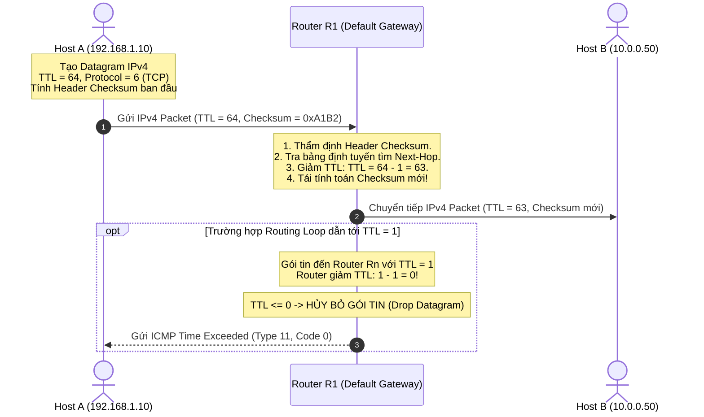

# 2_4_1 IPv4 Header Anatomy

> **Khóa học**: Cloud DevOps Basic — Networking Core  
> **Phân nhóm**: 2 Domain 2 - Computer Networking Core Fundamentals › 2_4 Network Layer and IP Addressing  
> **Chủ đề**: Giải phẫu cấu trúc gói tin IPv4 Header: Ý nghĩa 14 trường dữ liệu, cơ chế phân mảnh, vòng đời TTL và tính toán Checksum theo chuẩn RFC 791  
> **Trạng thái**: Verified (WRITE-CDB-2_4_1, 14-11-2026)  
> **Checklist đối chiếu**: [2_4_1](<../../../CHECKLIST.md#domain-2-computer-networking-core-fundamentals-43-items>)  

---

## 1. Khái Niệm Cốt Lõi & Bản Chất Kỹ Thuật (Core Concepts & Technical Deep Dive)

Tầng Mạng (Network Layer - Layer 3) chịu trách nhiệm vận chuyển gói tin từ máy chủ nguồn tới máy chủ đích xuyên qua hàng loạt hệ thống mạng trung gian độc lập. Để thực hiện được nhiệm vụ định tuyến và kiểm soát vòng đời này, mỗi gói tin IPv4 bắt buộc phải mang một phần tiêu đề (Header) chứa siêu dữ liệu sinh tử được quy định chặt chẽ trong [RFC 791 Section 3.1](https://datatracker.ietf.org/doc/html/rfc791#section-3.1).

```text
 0                   1                   2                   3
 0 1 2 3 4 5 6 7 8 9 0 1 2 3 4 5 6 7 8 9 0 1 2 3 4 5 6 7 8 9 0 1
+-+-+-+-+-+-+-+-+-+-+-+-+-+-+-+-+-+-+-+-+-+-+-+-+-+-+-+-+-+-+-+-+
|Version|  IHL  |Type of Service|          Total Length         |
+-+-+-+-+-+-+-+-+-+-+-+-+-+-+-+-+-+-+-+-+-+-+-+-+-+-+-+-+-+-+-+-+
|         Identification        |Flags|      Fragment Offset    |
+-+-+-+-+-+-+-+-+-+-+-+-+-+-+-+-+-+-+-+-+-+-+-+-+-+-+-+-+-+-+-+-+
|  Time to Live |    Protocol   |        Header Checksum        |
+-+-+-+-+-+-+-+-+-+-+-+-+-+-+-+-+-+-+-+-+-+-+-+-+-+-+-+-+-+-+-+-+
|                       Source Address                          |
+-+-+-+-+-+-+-+-+-+-+-+-+-+-+-+-+-+-+-+-+-+-+-+-+-+-+-+-+-+-+-+-+
|                    Destination Address                        |
+-+-+-+-+-+-+-+-+-+-+-+-+-+-+-+-+-+-+-+-+-+-+-+-+-+-+-+-+-+-+-+-+
|                    Options                    |    Padding    |
+-+-+-+-+-+-+-+-+-+-+-+-+-+-+-+-+-+-+-+-+-+-+-+-+-+-+-+-+-+-+-+-+
```

### 1.1 Chi Tiết Các Trường Dữ Liệu Trong Header IPv4 (RFC 791)

Một tiêu đề IPv4 tiêu chuẩn (khi không có trường Options mở rộng) có độ dài chính xác là **20 octets (bytes)**, tương ứng với 5 hàng từ 32-bit (32-bit words). Cấu trúc chi tiết của 14 trường dữ liệu được đặc tả như sau:

| Tên trường (Field Name) | Kích thước | Mô tả kỹ thuật theo chuẩn RFC 791 |
| :--- | :--- | :--- |
| **Version** | 4 bits | Xác định định dạng của internet header. Đối với IPv4, giá trị nhị phân luôn cố định là `0100` (thập phân: 4). |
| **IHL (Internet Header Length)** | 4 bits | Đo độ dài của tiêu đề internet tính theo đơn vị từ 32-bit (4 bytes). Giá trị tối thiểu cho một header hợp lệ là `5` ($5 \times 4 = 20\text{ bytes}$), và tối đa là `15` ($15 \times 4 = 60\text{ bytes}$). Điểm cuối của header chỉ trực tiếp tới vị trí bắt đầu của dữ liệu tải trọng (payload). |
| **Type of Service (ToS / DSCP)** | 8 bits | Cung cấp các tham số chất lượng dịch vụ (Quality of Service - QoS), độ ưu tiên (Precedence), độ trễ thấp hoặc thông lượng cao cho việc truyền gói qua các mạng con. |
| **Total Length** | 16 bits | Tổng độ dài của datagram tính bằng octets, bao gồm cả phần IPv4 header và dữ liệu payload tầng trên. Kích thước tối thiểu là 20 octets (chỉ có header, không có data) và tối đa là $2^{16} - 1 = 65,535\text{ octets}$. |
| **Identification** | 16 bits | Giá trị định danh duy nhất do máy chủ gửi gán để phân biệt các mảnh phân mảnh (fragments) của cùng một datagram ban đầu. |
| **Flags** | 3 bits | Các cờ điều khiển phân mảnh: <br>• **Bit 0**: Dự trữ (Reserved), bắt buộc luôn bằng `0`.<br>• **Bit 1 (DF - Don't Fragment)**: `0` = Cho phép phân mảnh, `1` = Cấm phân mảnh.<br>• **Bit 2 (MF - More Fragments)**: `0` = Mảnh cuối cùng (hoặc gói không phân mảnh), `1` = Còn các mảnh tiếp theo phía sau. |
| **Fragment Offset** | 13 bits | Xác định vị trí tương đối của dữ liệu mảnh này so với phần đầu dữ liệu gốc. Đơn vị đo được tính theo **khối 8 octets (64 bits)**. Mảnh đầu tiên luôn có Offset = `0`. |
| **Time to Live (TTL)** | 8 bits | Giới hạn thời gian sống tối đa của datagram trong mạng internet. Ban đầu được tính theo giây, nhưng trong thực tế hoạt động như bộ đếm bước nhảy (Hop Counter). Mỗi router trung gian bắt buộc phải giảm trường này ít nhất 1 đơn vị. Khi TTL giảm về `0`, gói tin bị hủy bỏ. |
| **Protocol** | 8 bits | Xác định giao thức tầng trên tiếp theo nằm trong phần tải trọng dữ liệu. Các giá trị chuẩn do IANA quy định gồm: `1` cho ICMP, `6` cho TCP, `17` cho UDP. |
| **Header Checksum** | 16 bits | Mã kiểm tra tính toàn vẹn chỉ áp dụng cho riêng phần header (không kiểm tra phần dữ liệu payload). Thuật toán là bù 1 (1's complement) của tổng bù 1 của tất cả các từ 16-bit trong header. |
| **Source IP Address** | 32 bits | Địa chỉ IPv4 logic 32-bit của máy trạm phát sinh gói tin. |
| **Destination IP Address** | 32 bits | Địa chỉ IPv4 logic 32-bit của máy trạm đích nhận gói tin. |
| **Options & Padding** | Thay đổi (0–40 bytes) | Trường tùy chọn dùng cho bảo mật, định tuyến nguồn (source routing), ghi dấu vết đường đi. Nếu options không tròn bội số của 32 bits, padding (các bit 0) được thêm vào để làm tròn. |

---

### 1.2 Cơ Chế Giảm TTL và Báo Lỗi ICMP Time Exceeded (RFC 1812)

Trường **Time to Live (TTL)** là cơ chế sinh tử ngăn chặn thảm họa lặp vòng vô tận (Routing Loops) trên không gian Internet toàn cầu:
- Theo quy định tại [RFC 1812 Section 5.3.1](https://datatracker.ietf.org/doc/html/rfc1812#section-5.3.1), khi một bộ định tuyến (router) tiếp nhận một IP datagram, router **bắt buộc phải giảm (decrement) giá trị TTL ít nhất 1 đơn vị**.
- Nếu giá trị TTL sau khi giảm đạt giá trị nhỏ hơn hoặc bằng 0 ($\text{TTL} \le 0$):
  1. Router **bắt buộc phải loại bỏ gói tin (discard the datagram)**.
  2. Router **phải gửi bản tin báo lỗi ICMP Time Exceeded (Type 11, Code 0 - Time to Live Exceeded in Transit)** quay ngược trở lại cho máy chủ nguồn (`Source IP Address`).
- Đây chính là nguyên lý vận hành cốt lõi đằng sau công cụ chẩn đoán mạng kinh điển `traceroute` / `tracert`.

---

### 1.3 Cơ Chế Kiểm Tra và Tái Tính Toán Header Checksum

Theo quy định tại [RFC 791 Section 3.1](https://datatracker.ietf.org/doc/html/rfc791#section-3.1) và [RFC 1812 Section 5.2.2](https://datatracker.ietf.org/doc/html/rfc1812#section-5.2.2):
- **Tại trạm nhận**: Trạm nhận (host hoặc router) cộng tất cả các từ 16-bit trong toàn bộ IPv4 header theo phép cộng bù 1. Nếu kết quả không phải là toàn số 1 nhị phân (tương đương bù 1 bằng 0), gói tin bị xác định là đã bị biến dạng trên đường truyền và lập tức bị loại bỏ âm thầm mà không gửi phản hồi lỗi.
- **Tại các router trung gian**: Vì router bắt buộc phải giảm giá trị của trường TTL đi 1 đơn vị tại mỗi chặng nhảy (hop), nội dung của header đã bị thay đổi. Do đó, **router bắt buộc phải tái tính toán lại giá trị trường Header Checksum** trước khi đóng gói gói tin vào khung liên kết dữ liệu mới để chuyển tiếp.

---

## 2. Ví Dụ Đời Sống Thực Tế Dễ Hiểu (Intuitive Real-World Analogies)

### Ẩn dụ: "Bì Thư Chuyển Phát Nhanh Quốc Tế (DHL / EMS Envelope)"

Để dễ hình dung bản chất của Header IPv4, hãy tưởng tượng một chiếc bì thư chuyển phát nhanh quốc tế bọc ngoài tài liệu mật của bạn:

```text
+---------------------------------------------------------------+
|  EMS EXPRESS MAIL SERVICE                                      |
|  [Version: EMS v4]  [Form Length: 5 ô]  [Dịch vụ: Hỏa tốc]   |
|  [Mã kiện hàng: #77412] [Cấm xé nhỏ kiện: DF=1]               |
|  [Số trạm tối đa cho phép: 64 trạm bưu cục]                   |
|  [Loại tài liệu bên trong: Hợp đồng kinh tế (Protocol = TCP)] |
|  [Mã vạch chống làm giả: 0x4A2F]                             |
|                                                               |
|  Người gửi: Số 123 Đường A, Quận 1, TP.HCM                     |
|  Người nhận: Số 456 Đường B, Quận Trung Tâm, Tokyo, Nhật Bản   |
+---------------------------------------------------------------+
|  >>> [RUỘT BÌ THƯ: Payload dữ liệu mật tầng trên] <<<         |
+---------------------------------------------------------------+
```

1. **Version (v4) & IHL (5 ô = 20 byte)**: Form mẫu quy chuẩn in sẵn trên vỏ bì thư. Bưu tá nhìn vào là biết chính xác biểu mẫu tiêu chuẩn dài bao nhiêu dòng và phần ruột tài liệu thực sự bắt đầu từ đâu.
2. **Total Length**: Tổng trọng lượng của cả vỏ bì thư lẫn giấy tờ chứa bên trong.
3. **Identification & Flags (DF, MF)**: Nếu gói hàng quá nặng vượt quá sức chở của xe máy bưu tá (MTU chặng trung gian), cờ `DF=1` cấm xé nhỏ kiện hàng; bưu tá sẽ trả hàng về và báo lỗi. Nếu `DF=0`, gói hàng được tách thành nhiều gói nhỏ mang cùng số hiệu `Identification`, đánh dấu thứ tự bằng `Fragment Offset`.
4. **Time to Live (TTL)**: Quy định kiện hàng chỉ được phép luân chuyển tối đa qua 64 bưu cục. Mỗi bưu cục khi tiếp nhận phải đóng một con dấu giảm trừ đi 1. Nếu qua 64 bưu cục mà vẫn chưa tới tay người nhận (do bưu tá chuyển nhầm vòng tròn giữa các kho), bưu cục thứ 64 sẽ tiêu hủy gói hàng và gửi giấy báo tử về cho người gửi (`ICMP Time Exceeded`).
5. **Header Checksum**: Mã vạch an toàn dán đè lên vỏ thư. Mỗi khi bưu tá đóng dấu trừ TTL, mã vạch này bị rách và bưu tá phải dán lại một mã vạch mới cập nhật tương ứng.

---

## 3. Kiến Trúc, Luồng Hoạt Động & Hình Ảnh Trực Quan (Architecture, Diagrams & Visual Media)

### 3.1 Vòng Đời Gói Tin IPv4 và Quy Trình Giảm TTL Tại Router

Sơ đồ tuần tự thể hiện đường đi của gói tin IPv4 qua Router trung gian, cơ chế thẩm định Checksum, giảm TTL và trường hợp gói tin hết hạn:



---

## 4. Thực Hành (Hands-on)

### 4.1 Bắt và Phân Tích Chi Tiết Từng Trường Header IPv4 Bằng `tcpdump`

Lệnh `tcpdump` với mức độ chi tiết cao (`-vvv`) cho phép phân tích trực tiếp từng trường dữ liệu của tiêu đề IPv4 khi gói tin đi qua card mạng.

> ⚠️ Chưa chạy thử (not executed by the squad)

```bash
# Lắng nghe 1 gói tin ICMP trên card eth0 và hiển thị chi tiết toàn bộ trường IPv4 header
sudo tcpdump -i eth0 -nn -vvv -c 1 icmp
```

> Minh họa kết quả phân tích cấu trúc IPv4 header từ lệnh trên:

```text
tcpdump: listening on eth0, link-type EN10MB (Ethernet), snapshot length 262144 bytes
15:30:02.102345 IP (tos 0x0, ttl 64, id 41285, offset 0, flags [DF], proto ICMP (1), length 84)
    192.168.1.10 > 1.1.1.1: ICMP echo request, id 2341, seq 1, length 64
```

#### Giải mã các trường xuất hiện trên dòng log:
- `IP`: Định dạng giao thức tầng mạng là IPv4 (Version = 4).
- `tos 0x0`: Type of Service / DSCP mang giá trị mặc định là 0 (Normal Service).
- `ttl 64`: Time to Live ban đầu do Linux kernel gán là 64.
- `id 41285`: Identification 16-bit của datagram là 41285 (dùng cho phân mảnh).
- `offset 0`: Fragment Offset bằng 0 (đây là gói tin nguyên vẹn hoặc mảnh đầu tiên).
- `flags [DF]`: Cờ Don't Fragment được bật (`1`), cấm các router trung gian xé nhỏ gói tin này.
- `proto ICMP (1)`: Mã giao thức tầng trên là `1`, định danh cho ICMP.
- `length 84`: Total Length của gói tin là 84 octets ($20\text{ bytes IPv4 Header} + 64\text{ bytes ICMP Echo payload}$).

---

### 4.2 Kiểm Tra Thuộc Tính Phần Cứng và MTU Bằng Lệnh `ip`

Để kiểm tra giá trị Maximum Transmission Unit (MTU) tác động trực tiếp tới nguy cơ phân mảnh gói tin IPv4:

> ⚠️ Chưa chạy thử (not executed by the squad)

```bash
# Hiển thị thông số chi tiết của giao diện mạng
ip -d link show eth0
```

> Minh họa kết quả thực thi:

```text
2: eth0: <BROADCAST,MULTICAST,UP,LOWER_UP> mtu 1500 qdisc fq_codel state UP mode DEFAULT group default qlen 1000
    link/ether 52:54:00:12:34:56 brd ff:ff:ff:ff:ff:ff promiscuity 0 minmtu 68 maxmtu 65535
```

- `mtu 1500`: Kích thước khung dữ liệu tối đa là 1500 bytes. Nếu một IP Datagram có `Total Length` lớn hơn 1500 bytes và cờ `DF = 0`, router hoặc card mạng sẽ kích hoạt cơ chế phân mảnh (fragmentation) dựa trên các trường `Identification`, `Flags`, và `Fragment Offset`.

---

## 5. Cạm Bẫy Thực Tế & Thực Tiễn Sản Xuất (Production Gotchas & Best Practices)

Trong vận hành hệ thống đám mây, tường lửa và kiến trúc mạng doanh nghiệp, các đặc tính của IPv4 header thường dẫn tới các cạm bẫy sau:

1. **Sự Cố PMTUD Black Hole Khi Tường Lửa Chặn Bản Tin ICMP**:
   - Khi gói tin gửi đi có cờ `DF=1` (Don't Fragment) nhưng kích thước `Total Length` lớn hơn MTU của một chặng trung gian (ví dụ: qua đường hầm VPN hoặc mạng Overlay Geneve/VXLAN với MTU 1420), router trung gian buộc phải hủy gói tin và gửi bản tin `ICMP Type 3, Code 4 (Fragmentation Needed and DF set)`.
   - Nếu quản trị viên tường lửa cấu hình chặn toàn bộ lưu lượng ICMP, bản tin này không thể quay về máy chủ nguồn. Máy chủ nguồn không nhận được phản hồi và liên tục thử gửi lại gói tin kích thước lớn, dẫn tới hiện tượng kết nối TCP treo cứng vô tận sau khi hoàn tất bắt tay 3 bước (PMTUD Black Hole).

2. **Gánh Nặng Hiệu Năng Của Header Checksum Trên Router Lõi**:
   - Trong kiến trúc IPv4, mỗi router đều phải tính lại Header Checksum tại từng bước nhảy do trường TTL bị giảm. Đối với các router chuyển mạch gói tốc độ cao (Terabit core routers), việc tính toán checksum liên tục bằng phần mềm tạo ra nút thắt cổ chai lớn.
   - *Thực tế cải tiến*: Đây là lý do cốt lõi tại sao khi thiết kế giao thức **IPv6 (RFC 8200)**, IETF đã hoàn toàn **loại bỏ trường Checksum khỏi tiêu đề IPv6**, đẩy toàn bộ trách nhiệm kiểm tra lỗi xuống tầng liên kết dữ liệu (L2 CRC) và tầng truyền vận (L4 TCP/UDP Checksum).

3. **Cạm Bẫy Bảo Mật và Tấn Công Bằng Trường Options**:
   - Trường IPv4 Options có thể bị khai thác cho các kỹ thuật tấn công như Loose/Strict Source Routing (cho phép kẻ tấn công tự chỉ định lộ trình gói tin vượt qua tường lửa) hoặc Record Route. Hầu hết các nhà cung cấp Cloud (AWS, Azure, GCP) và thiết bị định tuyến hiện đại mặc định đều loại bỏ (drop) các gói tin IPv4 có chứa trường Options mở rộng.

---

## 6. Câu Hỏi Củng Cố Kiến Thức (Active Recall Quiz)

<details>
<summary><b>Câu hỏi 1:</b> Tại sao trường Internet Header Length (IHL) trong IPv4 header chỉ có kích thước 4 bits nhưng lại có thể biểu diễn độ dài tiêu đề lên tới 60 bytes? Giá trị IHL tối thiểu cho một gói tin hợp lệ là bao nhiêu?</summary>

**Đáp án:**
Theo RFC 791 Section 3.1:
- Trường IHL không đếm độ dài theo từng byte đơn lẻ mà đếm theo đơn vị **từ 32-bit (32-bit words)**, tức là mỗi đơn vị IHL tương đương với 4 bytes.
- Với 4 bits, giá trị thập phân tối đa có thể biểu diễn là $15$ ($1111$ nhị phân). Do đó, độ dài tiêu đề tối đa là $15 \times 4 = 60\text{ bytes}$.
- Một tiêu đề IPv4 hợp lệ tối thiểu phải chứa đủ các trường cơ bản (20 bytes), do đó giá trị IHL tối thiểu bắt buộc phải là **`5`** ($5 \times 4 = 20\text{ bytes}$). Nếu IHL nhỏ hơn 5, gói tin bị coi là lỗi và bị loại bỏ ngay lập tức.
</details>

<details>
<summary><b>Câu hỏi 2:</b> Tại sao mọi router trung gian khi chuyển tiếp một gói tin IPv4 đều bắt buộc phải tính toán lại trường Header Checksum?</summary>

**Đáp án:**
Theo RFC 791 và RFC 1812 (Section 5.2.2 và Section 5.3.1):
- Khi chuyển tiếp gói tin, router bắt buộc phải giảm giá trị trường Time to Live (TTL) đi ít nhất 1 đơn vị để ngăn chặn lặp vòng định tuyến.
- Do trường TTL nằm trực tiếp bên trong 20 bytes của tiêu đề IPv4, việc thay đổi giá trị của TTL làm thay đổi tổng bù 1 của toàn bộ header.
- Vì Header Checksum phản ánh tính toàn vẹn của các bit trong header, router bắt buộc phải tính toán và cập nhật lại trường Checksum mới trước khi chuyển tiếp gói tin đi tiếp.
</details>

<details>
<summary><b>Câu hỏi 3:</b> Khi gói tin IPv4 di chuyển qua mạng và gặp một liên kết có kích thước MTU nhỏ hơn Total Length của gói tin, gói tin sẽ được xử lý như thế nào nếu cờ DF (Don't Fragment) đang được bật (giá trị 1)?</summary>

**Đáp án:**
Theo RFC 791 và RFC 1812:
- Nếu cờ Don't Fragment được bật (`DF = 1`), router trung gian tuyệt đối không được phép chia nhỏ (fragment) gói tin.
- Router buộc phải hủy bỏ (drop) gói tin đó.
- Đồng thời, router gửi bản tin báo lỗi ICMP Destination Unreachable với mã lỗi `Fragmentation Needed and DF set` (Type 3, Code 4) quay trở về cho máy chủ phát nguồn gói tin để yêu cầu giảm kích thước gói dữ liệu.
</details>

---

## 7. 📚 Nguồn Tài Liệu Chính Thống (Tier-1 Official References)

- [RFC 791: Internet Protocol - Protocol Specification](https://datatracker.ietf.org/doc/html/rfc791#section-3.1) - Đặc tả tiêu chuẩn gốc của DARPA/IETF về Giao thức Internet IPv4, định nghĩa chi tiết kiến trúc 14 trường header, quy tắc IHL, cơ chế phân mảnh và thuật toán Header Checksum.
- [RFC 1812: Requirements for IP Version 4 Routers](https://datatracker.ietf.org/doc/html/rfc1812#section-5.3.1) - Tiêu chuẩn kỹ thuật của IETF dành cho thiết bị định tuyến IPv4; Mục 5.3.1 quy định quy tắc bắt buộc giảm TTL và bản tin ICMP Time Exceeded, Mục 5.2.2 quy định quy trình thẩm định và tái tính toán Checksum.
- [IANA Protocol Numbers Registry](https://www.iana.org/assignments/protocol-numbers/protocol-numbers.xhtml) - Bảng danh mục định danh giao thức tầng mạng chính thức của IANA gán cho trường Protocol 8-bit (ICMP=1, TCP=6, UDP=17).
- [Linux Manual Pages: tcpdump(1)](https://man7.org/linux/man-pages/man1/tcpdump.1.html) - Tài liệu hướng dẫn chính thức của Linux về công cụ phân tích và giải mã chi tiết các trường tiêu đề IPv4.
