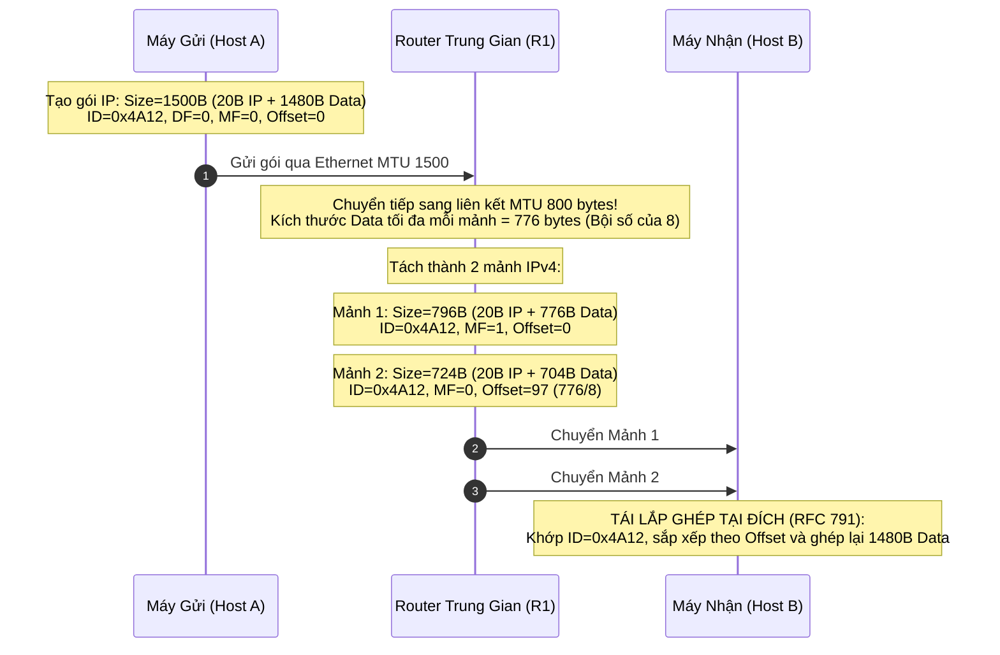
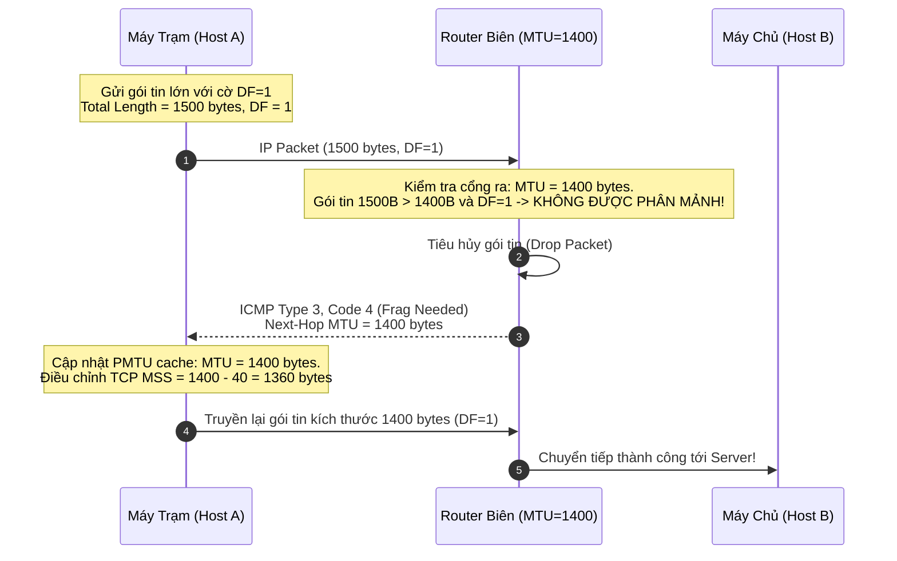
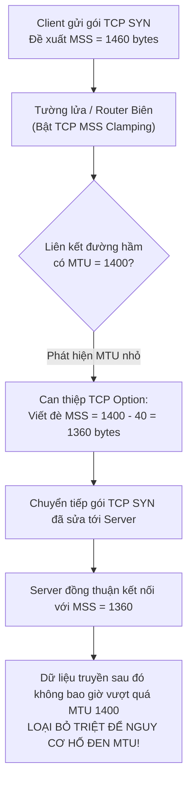

# 2_4_10 MTU Fragmentation and Path MTU Discovery

> **Khóa học**: Cloud DevOps Basic — Networking Core  
> **Phân nhóm**: 2 Domain 2 - Computer Networking Core Fundamentals › 2_4 Network Layer and IP Addressing  
> **Chủ đề**: Kích thước đơn vị truyền tối đa (MTU), Cơ chế phân mảnh IPv4 và Khám phá MTU đường truyền (PMTUD)  
> **Trạng thái**: Draft (WRITE-CDB-2_4_10, 14-11-2026)  
> **Checklist đối chiếu**: [2_4_10](<../../../CHECKLIST.md#domain-2-computer-networking-core-fundamentals-43-items>)  

---

## 1. Khái Niệm Cốt Lõi & Bản Chất Kỹ Thuật (Core Concepts & Technical Deep Dive)

Trong kiến trúc truyền dẫn dữ liệu mạng, mỗi công nghệ liên kết vật lý (Data Link Layer - L2) đều có một giới hạn vật lý về kích thước tối đa của một khung truyền (frame). Giới hạn này được định nghĩa là **Đơn vị Truyền Tối đa (Maximum Transmission Unit - MTU)**. Sự bất đối xứng về MTU giữa các phân đoạn mạng dọc đường truyền là nguyên nhân gốc rễ sinh ra cơ chế **Phân mảnh gói tin (Fragmentation)**, kỹ thuật **Khám phá MTU đường truyền (Path MTU Discovery - PMTUD)**, và sự cố kinh điển **Hố đen MTU (PMTUD Black Hole)** trong vận hành Cloud/DevOps.

```
+-----------------------------------------------------------------------------+
|                      QUAN HỆ GIỮA MTU VÀ TCP MSS                            |
|                                                                             |
|  <------------------------- Standard Ethernet MTU = 1500 octets ----------> |
|  +--------------------+--------------------+--------------------------------+
|  | IPv4 Header        | TCP Header         | TCP Data Payload               |
|  | (20 octets)        | (20 octets)        | (TCP MSS = 1460 octets)        |
|  +--------------------+--------------------+--------------------------------+
+-----------------------------------------------------------------------------+
```

---

### 1.1 Khái Niệm MTU và Mối Quan Hệ Với TCP MSS

1. **MTU (Maximum Transmission Unit)**:
   - Là kích thước gói tin Tầng Mạng (Layer 3 Datagram bao gồm cả L3 Header và Payload) tối đa có thể truyền qua một giao diện liên kết L2 mà không cần phân mảnh.
   - Chuẩn mạng **Ethernet chuẩn** có MTU mặc định là **1500 octets (bytes)**.
   - **Quy định đệm tái lắp ghép tối thiểu IPv4**: Theo [RFC 791 Section 3.1](https://datatracker.ietf.org/doc/html/rfc791#section-3.1), mọi host IPv4 bắt buộc phải có khả năng chấp nhận và tái lắp ghép các gói tin có kích thước tối thiểu là **576 octets**.
   - **Quy định MTU tối thiểu của IPv6**: Khác với IPv4, chuẩn [RFC 8200 Section 5](https://datatracker.ietf.org/doc/html/rfc8200#section-5) quy định bắt buộc mọi liên kết mạng IPv6 trên toàn Internet phải hỗ trợ MTU tối thiểu là **1280 octets**.

2. **TCP MSS (Maximum Segment Size)**:
   - Đại diện cho kích thước dữ liệu tầng ứng dụng lớn nhất mà một phân đoạn TCP có thể mang theo trong một gói IP.
   - Trên mạng Ethernet chuẩn:
     $$\text{TCP MSS} = \text{MTU} - \text{IPv4 Header (20B)} - \text{TCP Header (20B)} = 1500 - 20 - 20 = \mathbf{1460\text{ octets}}$$

---

### 1.2 Cơ Chế Phân Mảnh và Tái Lắp Ghép Gói Tin IPv4 (IPv4 Fragmentation)

Khi một router trung gian cần chuyển tiếp một gói tin IPv4 sang một liên kết có MTU nhỏ hơn kích thước của gói tin:

```
+-----------------------------------------------------------------------------+
|                      CƠ CHẾ PHÂN MẢNH GÓI TIN IPV4                          |
|                                                                             |
|  1. Cắt Payload thành các khối là BỘI SỐ CỦA 8 OCTETS (64 bits).            |
|  2. Sao chép Identification ban đầu vào tất cả các mảnh.                    |
|  3. Bật cờ MF (More Fragments) = 1 trên tất cả các mảnh, trừ mảnh cuối = 0. |
|  4. Tính toán Fragment Offset = (Vị trí byte bắt đầu / 8).                  |
|  5. Router trung gian ĐƯỢC PHÉP phân mảnh, nhưng TÁI LẮP GHÉP CHỈ DIỄN RA   |
|     DUY NHẤT TẠI MÁY ĐÍCH CUỐI CÙNG (RFC 791 Section 2.2).                  |
+-----------------------------------------------------------------------------+
```

Theo chuẩn [RFC 791 Section 3.2](https://datatracker.ietf.org/doc/html/rfc791#section-3.2):
- **Identification (16 bits)**: Mã định danh gán cho gói tin ban đầu. Mọi mảnh tách ra từ gói này đều mang chung mã định danh này để máy đích nhận biết chúng thuộc cùng một gói.
- **Flags (3 bits)**:
  - Bit 0: Luôn bằng `0` (Reserved).
  - Bit 1: **DF (Don't Fragment)**: Nếu $DF = 1$, router tuyệt đối không được phân mảnh. Nếu gói quá lớn, router phải hủy bỏ gói tin. Nếu $DF = 0$, router được phép phân mảnh.
  - Bit 2: **MF (More Fragments)**: $MF = 1$ nghĩa là phía sau mảnh này vẫn còn các mảnh khác. Mảnh cuối cùng của gói tin sẽ có $MF = 0$.
- **Fragment Offset (13 bits)**: Xác định vị trí tương đối của phần dữ liệu trong mảnh này so với dữ liệu của gói tin ban đầu. Đơn vị đo của trường này là **8 octets (64 bits)**. Do đó, kích thước dữ liệu của mọi mảnh phân mảnh (ngoại trừ mảnh cuối cùng) bắt buộc phải là một bội số của 8 bytes.
- **Nguyên tắc Tái Lắp Ghép (RFC 791 Section 2.2)**: Các router trung gian trên đường truyền có thể phân mảnh gói tin, nhưng **tuyệt đối không thực hiện tái lắp ghép**. Việc ghép các mảnh lại thành gói tin hoàn chỉnh diễn ra **duy nhất tại máy đích cuối cùng** (Destination Host). Nếu chỉ cần một mảnh bị rơi mất trên đường đi, toàn bộ gói tin ban đầu sẽ bị coi là mất và máy đích sẽ hủy toàn bộ các mảnh còn lại sau khi hết thời gian chờ (Fragment Reassembly Timeout - kích hoạt ICMP Type 11 Code 1).

---

### 1.3 Khám Phá MTU Đường Truyền (Path MTU Discovery - PMTUD)

Do việc phân mảnh gói tin gây tiêu hao tài nguyên CPU của router và tăng nguy cơ mất gói, kỹ thuật **Path MTU Discovery (PMTUD)** ra đời theo [RFC 1191](https://datatracker.ietf.org/doc/html/rfc1191) (cho IPv4) và [RFC 8201](https://datatracker.ietf.org/doc/html/rfc8201) (cho IPv6):

1. **Nguyên lý hoạt động**:
   - Host nguồn phát gói tin với cờ **`DF = 1` (Don't Fragment)** trong IPv4 Header.
   - Khi gói tin gặp một router trung gian có MTU của cổng ra nhỏ hơn kích thước gói:
     - Vì $DF = 1$, router không được phép phân mảnh mà bắt buộc phải hủy bỏ (drop) gói tin đó.
     - Router gửi ngược về cho Host nguồn một thông điệp báo lỗi: **`ICMP Type 3, Code 4` (Destination Unreachable - Fragmentation Needed and DF set)**.
   - **Trường Next-Hop MTU (RFC 1191 Section 4)**: Bên trong gói tin ICMP Type 3 Code 4, router ghi rõ giá trị MTU của liên kết mạng tiếp theo (Next-Hop MTU).
   - Host nguồn nhận được gói tin ICMP này sẽ giảm kích thước gói tin phát ra (cập nhật TCP MSS) cho vừa khớp với giá trị MTU được thông báo, rồi truyền lại dữ liệu.

---

### 1.4 Kiến Trúc Loại Bỏ Phân Mảnh Trung Gian Trong IPv6

Trong thiết kế hiện đại của **IPv6** theo chuẩn [RFC 8200 Section 5](https://datatracker.ietf.org/doc/html/rfc8200#section-5):
- **Các bộ định tuyến IPv6 trung gian TUYỆT ĐỐI KHÔNG BAO GIỜ phân mảnh gói tin trên đường truyền (Routers NEVER fragment in transit)**.
- Toàn bộ các trường phục vụ phân mảnh trong Header IPv4 (ID, Flags, Fragment Offset) đã bị xóa bỏ hoàn toàn khỏi IPv6 Header cơ bản (40 octets).
- Nếu một gói tin IPv6 vượt quá MTU của chặng tiếp theo, router IPv6 sẽ hủy gói tin và gửi trả thông điệp `ICMPv6 Type 2 (Packet Too Big)`.
- Chỉ duy nhất **Host nguồn ban đầu** mới được phép thực hiện phân mảnh (Source-only fragmentation) bằng cách chèn thêm một header mở rộng: **Fragment Extension Header (Next Header = 44)**.

---

### 1.5 Hiện Tượng "Hố Đen MTU" (PMTUD Black Hole) và Giải Pháp Cứu Cánh TCP MSS Clamping

#### Hiện tượng PMTUD Black Hole (RFC 2923 Section 2.1)
- Khi một router trung gian hủy gói tin và cố gắng gửi thông điệp `ICMP Type 3 Code 4` về cho Host nguồn, nhưng gói tin ICMP này bị chặn lại bởi một tường lửa (Firewall) hoặc thiết bị NAT cấu hình sai chính sách bảo mật (Drop all ICMP).
- **Hậu quả**: Host nguồn không bao giờ nhận được thông báo giảm MTU; nó liên tục gửi lại (retransmit) gói tin kích thước lớn ban đầu với cờ $DF=1$, và các gói tin này tiếp tục bị router trung gian lặng lẽ tiêu hủy (silent drop).
- **Biểu hiện lâm sàng**: Quá trình bắt tay TCP 3 bước (SYN, SYN-ACK, ACK) diễn ra thành công mỹ mãn vì kích thước gói chỉ khoảng 60 bytes. Nhưng ngay khi ứng dụng bắt đầu truyền dữ liệu thực tế lớn (tải trang web, trao đổi key SSH, tải file), kết nối lập tức bị treo cứng (hang) và timeout.

#### Giải pháp Kỹ thuật: TCP MSS Clamping (RFC 4459 Section 3.2)
Để khắc phục triệt để hiện tượng hố đen MTU trong các mạng VPN / Đường hầm (GRE, IPsec, VXLAN) hoặc qua các tường lửa chặn ICMP:
- Thiết bị mạng biên (Router hoặc Linux Firewall) thực hiện can thiệp vào tầng giao vận: Nó quét và sửa đổi trực tiếp tùy chọn **TCP MSS (Maximum Segment Size)** nằm trong các gói tin bắt tay **TCP SYN và SYN-ACK**.
- Router sẽ tự động ép giá trị MSS xuống mức an toàn:
  $$\text{Clamped MSS} = \text{Tunnel MTU} - 40\text{ (với IPv4)}$$
  hoặc:
  $$\text{Clamped MSS} = \text{Tunnel MTU} - 60\text{ (với IPv6)}$$
- Nhờ đó, hai đầu mút kết nối bị "đánh lừa" và tự nguyện chỉ đóng gói các phân đoạn TCP nhỏ vừa vặn với kích thước đường hầm ngay từ đầu, loại bỏ hoàn toàn nguy cơ vượt MTU.

---

## 2. Ví Dụ Đời Sống Thực Tế Dễ Hiểu (Intuitive Real-World Analogies)

```
+-----------------------------------------------------------------------------+
|                      MÔ HÌNH SO SÁNH ĐỜI SỐNG THỰC TẾ                       |
|                                                                             |
|  [MTU = 1500]      --> Chiều cao tiêu chuẩn của hầm đường bộ xuyên núi      |
|                         Đoàn xe tải chở container tiêu chuẩn đi vừa vặn.     |
|                                                                             |
|  [Phân mảnh IPv4]  --> Hầm phía trước trần quá thấp: Dỡ hàng chia làm 2 xe! |
|                         Đến tận cổng kho của khách hàng mới được phép dán    |
|                         băng dính đóng gói lại thành kiện lớn ban đầu.       |
|                                                                             |
|  [PMTUD (DF=1)]    --> Container dán nhãn niêm phong: "CẤM DỠ HÀNG".        |
|                         Khi gặp hầm thấp, trạm gác đuổi xe quay về kèm công  |
|                         văn: "Hầm này chỉ cho xe cao tối đa 1m3 đi qua!".    |
|                                                                             |
|  [PMTUD Black Hole]--> Bảo vệ công ty đốt mất bức công văn của trạm gác:    |
|                         Tài xế không biết lý do, lại điều xe to lên và liên  |
|                         tục bị chặn đuổi vô tận trong im lặng!               |
|                                                                             |
|  [TCP MSS Clamping]--> Người quản lý kho thông minh sửa ngay hợp đồng:      |
|                         "Kể từ nay chỉ được đóng thùng hàng loại nhỏ 1m3",   |
|                         giúp mọi chuyến xe vượt qua hầm trơn tru.            |
+-----------------------------------------------------------------------------+
```

1. **Phân mảnh IPv4**:
   - Bạn gửi một kiện hàng lớn qua bưu điện. Khi đi qua một cây cầu yếu chỉ cho phép tải trọng 800kg, nhân viên bưu tá trung gian cạy thùng hàng ra, chia làm 2 gói nhỏ (Phân mảnh). Nhưng hai gói này sẽ đi riêng rẽ, và chỉ khi nào cả hai gói cùng tới tận nhà người nhận, người nhận mới ngồi ghép lại (Reassembly). Nếu trên đường đi gói số 2 bị rơi xuống sông, người nhận không thể sử dụng gói 1 và toàn bộ bưu kiện coi như hỏng.
2. **PMTUD và Hố Đen**:
   - Bạn gửi chiếc container siêu trường siêu trọng có niêm phong hải quan: **"Cấm cạy dỡ" (DF=1)**. Khi đến chân đèo, trạm kiểm soát thấy xe quá cao nên từ chối cho qua, đồng thời gửi một bức thư chuyển phát nhanh về xưởng của bạn báo: *"Đường hầm này chỉ cao 1.400mm"*.
   - Nhưng không may, nhân viên văn thư ở cổng xưởng của bạn (Tường lửa Firewall) nghĩ bức thư là rác nên vứt vào lò đốt (Chặn ICMP). Xưởng của bạn không nhận được thư, thấy xe chưa đến nơi liền tiếp tục cử một chiếc xe siêu trọng khác đi lên đường và tiếp tục bị chặn lại. Đó chính là **Hố đen MTU (PMTUD Black Hole)**!
3. **TCP MSS Clamping**:
   - Giải pháp là bác bảo vệ cổng xưởng chủ động nhìn thấy tài xế đang ký hợp đồng vận chuyển. Bác lấy bút xóa gạch bớt kích thước xe trên giấy tờ xuống còn 1.360mm. Cả hai bên đối tác đồng ý giao nhận bằng xe nhỏ, và chuyến hàng từ đó chạy êm ru không bao giờ kẹt hầm nữa.

---

## 3. Kiến Trúc, Luồng Hoạt Động & Hình Ảnh Trực Quan (Architecture, Diagrams & Visual Media)

### 3.1 Cơ Chế Phân Mảnh Gói Tin IPv4 Qua Liên Kết MTU Thấp



---

### 3.2 Luồng Hoạt Động Của Path MTU Discovery (PMTUD)



---

### 3.3 Khắc Phục Sự Cố Hố Đen PMTUD Bằng TCP MSS Clamping



---

## 4. Thực Hành Lệnh Linux & Windows (Hands-on CLI & Output Simulation)

### 4.1 Cấu Hình MTU và Thăm Dò PMTUD Bằng Lệnh `ping` trên Linux

Trên Linux, thay đổi MTU của card mạng bằng lệnh `ip link set`:

> ⚠️ Chưa chạy thử (not executed by the squad)

```bash
# Đổi MTU của card mạng eth0 xuống 1400 bytes
sudo ip link set dev eth0 mtu 1400

# Xác nhận lại MTU vừa cấu hình
ip link show dev eth0
```

Minh họa kết quả xác nhận:

```text
2: eth0: <BROADCAST,MULTICAST,UP,LOWER_UP> mtu 1400 qdisc fq_codel state UP mode DEFAULT group default qlen 1000
    link/ether 52:54:00:12:34:56 brd ff:ff:ff:ff:ff:ff
```

Kiểm tra giới hạn MTU đường truyền bằng lệnh `ping` với cờ ép buộc cấm phân mảnh (`-M do` tương đương bật $DF=1$):

> ⚠️ Chưa chạy thử (not executed by the squad)

```bash
# Thử gửi gói tin đúng kích thước chuẩn 1500 bytes:
# Payload ICMP = 1472 bytes + ICMP Header 8 bytes + IP Header 20 bytes = 1500 bytes
ping -s 1472 -M do 192.168.1.1
```

Minh họa kết quả khi vượt quá MTU của giao diện:

```text
PING 192.168.1.1 (192.168.1.1) 1472(1500) bytes of data.
ping: local error: message too long, mtu=1400
```

*Phân tích kết quả*: Nhân kernel phát hiện kích thước gói tin dự kiến ($1500$ bytes) vượt quá MTU hiện tại ($1400$ bytes) trong khi cờ cấm phân mảnh `$DF=1$` đang bật, do đó kernel từ chối phát gói tin và báo lỗi `message too long`.

---

### 4.2 Thăm Dò MTU trên Hệ Điều Hành Windows

Trên Windows, cú pháp lệnh ping hỗ trợ cờ `-f` (Don't Fragment) và cờ `-l` (Buffer size):

> ⚠️ Chưa chạy thử (not executed by the squad)

```cmd
:: Kiểm tra gói 1500 bytes với cờ Don't Fragment trên Windows
ping -f -l 1472 192.168.1.1
```

Minh họa kết quả đầu ra khi bị vượt MTU:

```text
Pinging 192.168.1.1 with 1472 bytes of data:
Packet needs to be fragmented but DF set.

Ping statistics for 192.168.1.1:
    Packets: Sent = 1, Received = 0, Lost = 1 (100% loss),
```

---

### 4.3 Cấu Hình Cứu Cánh TCP MSS Clamping Trên Linux Router

Để xử lý triệt để hố đen MTU cho các client đi qua Router Linux, sử dụng bộ lọc `iptables` tại bảng mangle để tự động clamp MSS theo PMTU:

> ⚠️ Chưa chạy thử (not executed by the squad)

```bash
# Bật tính năng MSS Clamping tự động theo Path MTU trên chuỗi FORWARD của iptables
sudo iptables -t mangle -A FORWARD -p tcp --tcp-flags SYN,RST SYN -j TCPMSS --clamp-mss-to-pmtu
```

*Cơ chế hoạt động*: Lệnh này quét mọi gói tin TCP có cờ SYN hoặc RST/SYN đi qua router, tự động tính toán MTU của cổng mạng chuyển tiếp và điều chỉnh tùy chọn MSS trong gói tin về đúng giá trị $\text{MTU} - 40$, triệt tiêu hoàn toàn sự cố phân mảnh và hố đen.

---

## 5. Cạm Bẫy Thực Tế & Thực Tiễn Sản Xuất (Production Gotchas & Best Practices)

1. **Cạm bẫy Bắt Tay SSH/Web Thành Công Nhưng Treo Cứng Khi Truyền Dữ Liệu (Classic PMTUD Black Hole)**:
   - Triệu chứng điển hình trong sản xuất Cloud/DevOps: Người dùng kết nối SSH tới server trên AWS/Azure qua VPN tunnel thì gõ được mật khẩu hoặc trao đổi SSH Banner, nhưng vừa chạy lệnh `ls -la` hoặc `cat file_lon.txt` thì màn hình terminal bị đơ (freeze) hoàn toàn. Tương tự, mở trang web thì kết nối HTTPS tải được một nửa rồi dừng vô hạn.
   - **Nguyên nhân cốt lõi**: Quá trình bắt tay TCP ban đầu chỉ tốn ~60 bytes nên đi qua lọt đường hầm VPN. Nhưng khi server gửi dữ liệu phản hồi kích thước đầy 1500 bytes có cờ $DF=1$, gói tin bị router VPN hủy vì vướng overhead của IPsec/GRE. Router gửi báo lỗi ICMP Type 3 Code 4 nhưng tường lửa trung gian đã chặn ICMP.
   - **Best Practice**: Kích hoạt ngay `TCPMSS --clamp-mss-to-pmtu` trên router VPN biên, hoặc cấu hình `mtu 1420` đồng bộ trên các interface đường hầm.

2. **Tổn Thất Hiệu Năng Nghiêm Trọng Do Phân Mảnh Gói Tin (Fragmentation Performance Penalty)**:
   - Một số hệ thống vô hiệu hóa PMTUD và cho phép router phân mảnh tự do ($DF=0$).
   - **Hậu quả**: Router phải dùng CPU để chia nhỏ từng gói tin và tái tạo checksum mới; máy đích phải duy trì bộ nhớ đệm RAM để chờ gom đủ các mảnh. Nếu tỷ lệ mất gói trên mạng là 1%, xác suất mất toàn bộ gói tin sẽ tăng gấp đôi vì mất 1 mảnh là hỏng cả gói.
   - **Best Practice**: Thiết kế hạ tầng mạng đồng nhất MTU (Jumbo Frames 9000 bytes trong mạng lưu trữ SAN/Data Center hoặc 1500 chuẩn trên WAN) để loại bỏ hoàn toàn việc phân mảnh.

3. **Bỏ Quên Chi Phí Overhead Của Giao Thức Đóng Gói (Overlay Networks Overhead)**:
   - Khi triển khai Kubernetes CNI (Calico, Flannel với VXLAN/Geneve) hoặc OpenVPN, mỗi gói tin bị đội thêm từ 50 đến 70 bytes cho lớp header đóng gói mới.
   - Nếu giao diện mạng vật lý chỉ có MTU 1500 mà CNI bên trong Pod cũng đặt MTU 1500, gói tin bọc ngoài sẽ có kích thước > 1550 bytes, dẫn đến phân mảnh liên tục hoặc rớt mạng bí ẩn.
   - **Best Practice**: Cấu hình MTU của card mạng ảo trong Pod / CNI thấp hơn card vật lý ít nhất 50–100 bytes (ví dụ đặt MTU Pod là 1440 hoặc 1450).

---

## 6. Câu Hỏi Củng Cố Kiến Thức (Active Recall Quiz)

<details>
<summary><b>Câu hỏi 1:</b> Tại sao trong kiến trúc Tầng Mạng IPv4 (RFC 791), các router trung gian được phép phân mảnh một gói tin khi gặp liên kết có MTU nhỏ hơn, nhưng TUYỆT ĐỐI KHÔNG BAO GIỜ thực hiện tái lắp ghép (reassembly) các mảnh đó?</summary>

**Đáp án:**
Theo RFC 791 (Section 2.2):
- Các router trung gian hoạt động theo nguyên tắc phi trạng thái (stateless) để tối ưu hóa tốc độ chuyển tiếp gói tin ở mức cao nhất.
- Nếu router trung gian phải tái lắp ghép gói tin, nó sẽ phải lưu giữ các mảnh trong bộ đệm RAM để chờ các mảnh còn lại tới đủ. Điều này gây tiêu hao lớn bộ nhớ và độ trễ nghiêm trọng.
- Quan trọng hơn, trong mạng định tuyến chuyển mạch gói động (Dynamic Packet Switching), các mảnh phân mảnh khác nhau của cùng một gói tin có thể được chuyển tiếp qua **các tuyến đường hoàn toàn khác nhau** để tới đích. Một router trung gian không có gì đảm bảo sẽ đón nhận được đầy đủ tất cả các mảnh của gói tin. Do đó, việc tái lắp ghép chỉ có thể và bắt buộc phải diễn ra duy nhất tại máy đích cuối cùng.
</details>

<details>
<summary><b>Câu hỏi 2:</b> Hiện tượng "Hố đen MTU" (PMTUD Black Hole - RFC 2923) phát sinh do sự kết hợp của hai yếu tố kỹ thuật nào? Nêu giải pháp khắc phục bằng TCP MSS Clamping.</summary>

**Đáp án:**
Theo RFC 2923 (Section 2.1) và RFC 4459 (Section 3.2):
- Hai yếu tố kỹ thuật tạo nên PMTUD Black Hole:
  1. Gói tin có kích thước vượt quá MTU của chặng tiếp theo và mang cờ Don't Fragment ($DF=1$), buộc router trung gian phải tiêu hủy gói tin và gửi trả thông điệp ICMP Type 3 Code 4.
  2. Một thiết bị tường lửa (Firewall) hoặc router bảo mật trên đường đi đã chặn và hủy toàn bộ các gói tin ICMP (bao gồm Type 3 Code 4), khiến máy gửi không bao giờ nhận được phản hồi để giảm kích thước gói tin.
- Giải pháp khắc phục bằng TCP MSS Clamping: Thiết bị định tuyến biên hoặc tường lửa can thiệp trực tiếp vào quá trình bắt tay TCP, can thiệp vào các gói TCP SYN/SYN-ACK và viết đè (rewrite) giá trị tùy chọn TCP MSS xuống mức an toàn tương ứng với MTU của đường truyền trừ đi phần overhead của header (MTU - 40 cho IPv4). Nhờ đó, máy trạm và máy chủ tự động thỏa thuận gửi các gói tin có kích thước vừa vặn ngay từ đầu, hoàn toàn tránh được nguy cơ vượt MTU mà không cần phụ thuộc vào thông điệp ICMP.
</details>

<details>
<summary><b>Câu hỏi 3:</b> Trong giao thức IPv6 (RFC 8200 Section 5), cơ chế phân mảnh gói tin có điểm gì khác biệt mang tính cốt lõi so với IPv4?</summary>

**Đáp án:**
Theo RFC 8200 (Section 5):
- Trong IPv6, các bộ định tuyến trung gian **TUYỆT ĐỐI KHÔNG BAO GIỜ phân mảnh gói tin trên đường chuyển tiếp (Routers NEVER fragment in transit)**.
- Trường phục vụ phân mảnh đã bị loại bỏ hoàn toàn khỏi IPv6 Header cơ bản.
- Nếu một gói tin IPv6 vượt quá MTU của liên kết mạng tiếp theo, router chỉ đơn giản hủy gói tin và gửi trả thông điệp báo lỗi `ICMPv6 Type 2 (Packet Too Big)` về cho máy gửi nguồn.
- Chỉ duy nhất **Host nguồn phát gói tin ban đầu** mới được phép thực hiện phân mảnh (Source-only fragmentation) bằng cách sử dụng IPv6 Fragment Extension Header (Next Header = 44).
</details>

---

## 7. 📚 Nguồn Tài Liệu Chính Thống (Tier-1 Official References)

- [RFC 791: Internet Protocol - Protocol Specification (Section 2.2 & 3.2: Fragmentation & Reassembly)](https://datatracker.ietf.org/doc/html/rfc791) - Đặc tả gốc của DARPA/IETF về cờ DF/MF, trường Fragment Offset, đơn vị 8 octets và quy tắc tái lắp ghép tại máy đích.
- [RFC 1191: Path MTU Discovery](https://datatracker.ietf.org/doc/html/rfc1191) - Chuẩn IETF quy định cơ chế PMTUD cho IPv4 thông qua cờ DF và thông điệp ICMP Type 3 Code 4.
- [RFC 8200: Internet Protocol, Version 6 (IPv6) Specification (Section 5: Packet Size Issues)](https://datatracker.ietf.org/doc/html/rfc8200#section-5) - Quy chuẩn MTU tối thiểu 1280 octets của IPv6 và nguyên tắc router không bao giờ phân mảnh gói tin trên đường truyền.
- [RFC 8201: Path MTU Discovery for IP version 6](https://datatracker.ietf.org/doc/html/rfc8201) - Chuẩn quy định cơ chế PMTUD trong môi trường IPv6.
- [RFC 2923: TCP Problems with Path MTU Discovery](https://datatracker.ietf.org/doc/html/rfc2923) - Phân tích chi tiết nguyên nhân gốc rễ và biểu hiện của sự cố PMTUD Black Hole.
- [RFC 4459: MTU and Fragmentation Issues with Network Layer Tunnels](https://datatracker.ietf.org/doc/html/rfc4459) - Đặc tả giải pháp kỹ thuật giải quyết vấn đề MTU qua đường hầm mạng và cơ chế TCP MSS Clamping.
- [Linux man-pages: ip-link(8)](https://man7.org/linux/man-pages/man8/ip-link.8.html) - Hướng dẫn chính thức về quản lý thuộc tính MTU của giao diện mạng trên Linux.
- [Linux man-pages: iptables-extensions(8)](https://man7.org/linux/man-pages/man8/iptables-extensions.8.html) - Hướng dẫn chi tiết về target TCPMSS và cờ `--clamp-mss-to-pmtu`.
- [Microsoft Learn: ping command reference](https://learn.microsoft.com/en-us/windows-server/administration/windows-commands/ping) - Hướng dẫn chính thức về cờ -f (Don't Fragment) và -l (Buffer size) của lệnh ping trên Windows.
