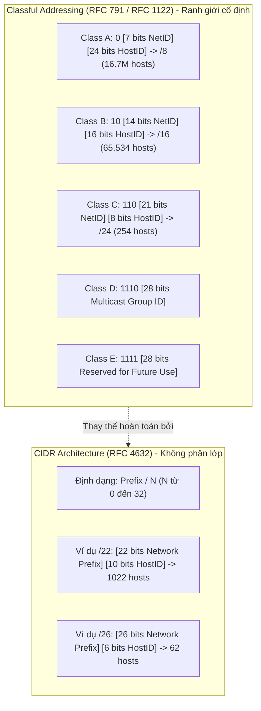
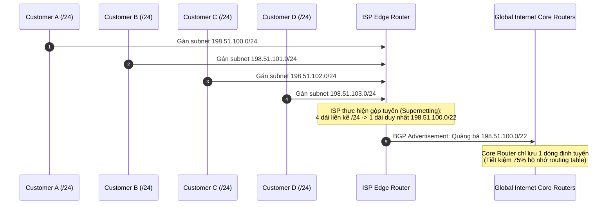

# 2_4_2 IPv4 Address Classes vs CIDR

> **Khóa học**: Cloud DevOps Basic — Networking Core  
> **Phân nhóm**: 2 Domain 2 - Computer Networking Core Fundamentals › 2_4 Network Layer and IP Addressing  
> **Chủ đề**: Kiến trúc phân lớp địa chỉ IPv4 lịch sử (Classful Addressing) đối chiếu Định tuyến liên miền không phân lớp (CIDR - Classless Inter-Domain Routing)  
> **Trạng thái**: Verified (WRITE-CDB-2_4_2, 14-11-2026)  
> **Checklist đối chiếu**: [2_4_2](<../../../CHECKLIST.md#domain-2-computer-networking-core-fundamentals-43-items>)  

---

## 1. Khái Niệm Cốt Lõi & Bản Chất Kỹ Thuật (Core Concepts & Technical Deep Dive)

Trong quá trình tiến hóa của mạng Internet toàn cầu, cơ chế định danh và phân bổ địa chỉ IPv4 (32-bit) đã trải qua một cuộc cách mạng kiến trúc sâu sắc: chuyển dịch từ **Phân bổ theo Lớp (Classful Addressing)** cứng nhắc sang **Định tuyến liên miền không phân lớp (Classless Inter-Domain Routing - CIDR)** linh hoạt.

```
+-------------------------------------------------------------------------+
|                  SỰ TIẾN HÓA CỦA ĐỊA CHỈ HÓA IPV4                       |
|                                                                         |
|  [1981 - RFC 791 / RFC 1122]           [1993 - RFC 1519 / RFC 4632]    |
|  Classful Addressing                   CIDR (Classless Addressing)      |
|  - Ranh giới cố định (/8, /16, /24)   - Ranh giới tùy ý (/N, N: 0..32)  |
|  - Lãng phí trầm trọng địa chỉ Class B - Cấp phát sát nhu cầu thực tế    |
|  - Bùng nổ bảng định tuyến toàn cầu    - Gộp tuyến theo topo (Supernet) |
+-------------------------------------------------------------------------+
```

---

### 1.1 Kiến trúc Phân lớp Địa chỉ Lịch sử (Classful Addressing)

Theo đặc tả gốc trong [RFC 791 Section 3.2](https://datatracker.ietf.org/doc/html/rfc791#section-3.2) và [RFC 1122 Section 3.2.1.3](https://datatracker.ietf.org/doc/html/rfc1122#section-3.2.1.3), không gian 32-bit của địa chỉ IPv4 ban đầu được phân chia thành 5 lớp riêng biệt dựa vào các bit trọng số cao nhất (Most Significant Bits - MSB) của octet đầu tiên:

| Lớp (Class) | Các bit đầu tiên (MSB) | Dải địa chỉ IP (First Octet) | Tiền tố ngầm định | Subnet Mask ngầm định | Số lượng Host khả dụng mỗi mạng | Mục đích sử dụng |
| :--- | :--- | :--- | :--- | :--- | :--- | :--- |
| **Class A** | `0` | `1.0.0.0` – `126.255.255.255` | `/8` | `255.0.0.0` | ~16 triệu ($2^{24}-2 = 16.777.214$) | Mạng cực lớn (chính phủ, tập đoàn đa quốc gia) |
| **Class B** | `10` | `128.0.0.0` – `191.255.255.255` | `/16` | `255.255.0.0` | 65.534 ($2^{16}-2$) | Tổ chức, trường đại học quy mô vừa và lớn |
| **Class C** | `110` | `192.0.0.0` – `223.255.255.255` | `/24` | `255.255.255.0` | 254 ($2^8-2$) | Doanh nghiệp nhỏ, mạng LAN cục bộ |
| **Class D** | `1110` | `224.0.0.0` – `239.255.255.255` | N/A | N/A | N/A | Định tuyến đa hướng (Multicast) |
| **Class E** | `1111` | `240.0.0.0` – `255.255.255.255` | N/A | N/A | N/A | Dành riêng cho thử nghiệm (Experimental/Reserved) |

*Ghi chú*: Dải `127.0.0.0/8` không được gán cho Class A thông thường mà được quy chuẩn làm địa chỉ Loopback nội bộ của host theo RFC 1122 Section 3.2.1.3.

---

### 1.2 Động lực Lịch sử dẫn đến Sự Ra Đời của CIDR

Vào đầu thập niên 1990, kiến trúc Classful Addressing đã đẩy mạng Internet non trẻ đứng trước nguy cơ khủng hoảng sinh tồn. Theo tài liệu chuẩn hóa [RFC 4632 Section 2](https://datatracker.ietf.org/doc/html/rfc4632#section-2), có hai động lực kỹ thuật cấp bách bắt buộc cộng đồng mạng phải thay thế hoàn toàn cơ chế Classful:

1. **Sự cạn kiệt nhanh chóng của không gian địa chỉ Class B (Class B Exhaustion)**:
   - Các tổ chức quy mô vừa và lớn thường có nhu cầu kết nối từ vài trăm đến vài nghìn thiết bị.
   - Một mạng Class C chỉ cung cấp tối đa 254 host, quá nhỏ cho nhu cầu của họ.
   - Do đó, các tổ chức buộc phải xin cấp phát một khối mạng Class B với dung lượng lên tới 65.534 địa chỉ host.
   - Nếu một công ty chỉ có 2.000 máy tính nhưng được cấp một mạng Class B, hơn 63.000 địa chỉ còn lại bị bỏ hoang hoàn toàn, không thể chia sẻ cho tổ chức khác. Không gian mạng Class B rơi vào tình trạng cạn kiệt nghiêm trọng.

2. **Bùng nổ bảng định tuyến toàn cầu (Routing Table Explosion)**:
   - Khi các tổ chức không xin được dải Class B, họ được cấp phát hàng chục dải mạng Class C độc lập rời rạc.
   - Hậu quả trực tiếp: Các bộ định tuyến đường trục (core routers) trên Internet phải lưu trữ và quảng bá riêng lẻ từng tiền tố mạng Class C đó.
   - Số lượng mục định tuyến (routing entries) trong các router tăng theo hàm số mũ, vượt xa dung lượng bộ nhớ RAM và năng lực xử lý CPU của phần cứng thiết bị định tuyến tại thời điểm bấy giờ.

---

### 1.3 Cơ chế Kỹ thuật của CIDR (RFC 4632)

Để tháo gỡ cùng lúc cả hai nút thắt trên, IETF đã chuẩn hóa cơ chế **Classless Inter-Domain Routing (CIDR)** trong RFC 1519 và cập nhật toàn diện tại [RFC 4632](https://datatracker.ietf.org/doc/html/rfc4632).

#### 1. Cú pháp Tiền tố CIDR (CIDR Prefix Notation - RFC 4632 Section 3.1)
- CIDR xóa bỏ hoàn toàn khái niệm phân chia ranh giới theo octet cố định (`/8`, `/16`, `/24`).
- Một khối địa chỉ CIDR được biểu diễn chuẩn hóa bằng một lượng 4-octet dưới dạng số thập phân có dấu chấm (dotted-decimal), theo sau bởi một dấu gạch chéo `/` và một số nguyên thập phân $N$ nằm trong khoảng từ $0$ đến $32$ (`/N`):
  $$\text{Prefix} / N \quad (0 \le N \le 32)$$
- Trong đó, $N$ thể hiện chính xác **chiều dài tiền tố mạng (Prefix Length)**—tức số bit `1` liên tiếp tính từ bit trọng số cao nhất (MSB) dùng để nhận diện mạng, phần còn lại $(32 - N)$ bit thuộc về không gian địa chỉ định danh host.

#### 2. Gộp Tuyến theo Cấu trúc Topo (Topological Route Aggregation / Supernetting - RFC 4632 Section 4.1)
- Nhờ việc tiền tố có thể mang độ dài bất kỳ, các nhà cung cấp dịch vụ Internet (ISP) có thể cấp phát một khối địa chỉ lớn (ví dụ `/19` tương đương $8.192$ địa chỉ, hoặc `/20` tương đương $4.096$ địa chỉ) sát với nhu cầu của doanh nghiệp mà không gây lãng phí.
- Quan trọng hơn, CIDR cho phép **Route Aggregation (Gộp tuyến / Siêu mạng - Supernetting)**: Nhiều tiền tố mạng liền kề nằm trong cùng một vùng topo có thể được tóm lược thành một mục duy nhất trong bảng định tuyến toàn cầu.
- Ví dụ: 4 dải mạng `/24` liền kề `198.51.100.0/24`, `198.51.101.0/24`, `198.51.102.0/24`, `198.51.103.0/24` có thể được bộ định tuyến ISP gộp lại thành một mục định tuyến duy nhất: `198.51.100.0/22`, giúp giảm tới 75% số lượng entry mà các router khác trên Internet phải ghi nhớ.

---

## 2. Ví Dụ Đời Sống Thực Tế Dễ Hiểu (Intuitive Real-World Analogies)

```
+-------------------------------------------------------------------------+
|                  ẨN DỤ QUẦN ÁO MAY SẴN VS MAY ĐO THEO YÊU CẦU            |
|                                                                         |
|  [Classful Addressing]                   [CIDR (Classless)]             |
|  Cửa hàng chỉ có 3 cỡ áo:                Nhà may may đo theo thước dây: |
|  - Cỡ S (Class C): Chật ních (254 người) - Thước dây '/N' đo đúng milimet|
|  - Cỡ M (Class B): Thùng thình (65K người) - Vừa khít thân hình          |
|  - Cỡ XL (Class A): Khổng lồ (16M người)  - Đóng gói bọc vải gửi chung   |
|  --> Kho cỡ M nhanh chóng cháy hàng!      1 chuyến xe (Supernetting)    |
+-------------------------------------------------------------------------+
```

Hãy hình dung việc cấp phát địa chỉ IP giống như cách phân phối đồng phục cho các công ty:

1. **Thời kỳ Classful — Tiệm may chỉ bán 3 cỡ áo may sẵn cố định**:
   - Tiệm may thời xưa chỉ sản xuất đúng 3 kích cỡ:
     - **Cỡ S (Class C)**: Chỉ vừa cho đoàn thể 254 người.
     - **Cỡ M (Class B)**: Dành cho công ty có 65.534 người.
     - **Cỡ XL (Class A)**: Dành riêng cho tập đoàn 16 triệu người.
   - Khi một công ty có 1.000 nhân viên đến mua áo, cỡ S quá chật (chỉ chứa được 254 người), họ bắt buộc phải mua cỡ M. Hậu quả là chiếc áo rộng thùng thình cho 65.534 người, 64.000 chỗ trống bị vứt bỏ lãng phí. Các doanh nghiệp ồ ạt đổ xô đi mua cỡ M, khiến kho áo cỡ M nhanh chóng cạn kiệt sạch sẽ!

2. **Thời kỳ CIDR — Tiệm may đo cao cấp với thước dây chính xác từng milimét**:
   - Thay vì bán 3 kích cỡ đóng khung, tiệm may CIDR trang bị thước dây mang tên `/N`.
   - Khách hàng cần 1.000 chỗ ngồi? Thợ may kéo thước đo lấy đúng cỡ `/22` (cung cấp $1.024$ địa chỉ, $1.022$ máy khả dụng), vừa khít với cơ thể công ty mà không lãng phí một mét vải nào.
   - Khi giao hàng, thay vì chuyển phát 4 gói bưu phẩm nhỏ rời rạc (`198.51.100.0/24`, `198.51.101.0/24`, `198.51.102.0/24`, `198.51.103.0/24`), bác bưu tá gom chung vào một thùng hàng lớn có nhãn chung `198.51.100.0/22` (Route Aggregation). Xe tải giao hàng (router) chỉ cần nhìn nhãn thùng hàng lớn là biết đường đi, không lo bị nghẽn tải.

---

## 3. Kiến Trúc, Luồng Hoạt Động & Hình Ảnh Trực Quan (Architecture, Diagrams & Visual Media)

### 3.1 Sơ đồ Phân chia Không gian Bit Classful vs CIDR

Sơ đồ sau mô tả quy luật phân chia bit nhận diện của các lớp địa chỉ lịch sử so với kiến trúc linh hoạt của tiền tố CIDR:



---

### 3.2 Sơ đồ Luồng Gộp Tuyến (Route Aggregation / Supernetting)

Cơ chế gộp tuyến topo (RFC 4632 Section 4.1) giúp các router ISP giảm tải tối đa số lượng mục trong bảng định tuyến:



---

## 4. Thực Hành (Hands-on)

### 4.1 Khảo sát Tiền tố CIDR trên Linux với `ip addr`

Trên các bản phân phối Linux hiện đại sử dụng bộ công cụ `iproute2`, lệnh `ip addr show` hiển thị trực tiếp cấu trúc tiền tố CIDR dạng `/N`:

> ⚠️ Chưa chạy thử (not executed by the squad)

```bash
# Kiểm tra địa chỉ IP và tiền tố CIDR của tất cả giao diện mạng
ip addr show
```

Minh họa kết quả đầu ra thực tế:

```text
1: lo: <LOOPBACK,UP,LOWER_UP> mtu 65536 qdisc noqueue state UNKNOWN group default qlen 1000
    link/loopback 00:00:00:00:00:00 brd 00:00:00:00:00:00
    inet 127.0.0.1/8 scope host lo
       valid_lft forever preferred_lft forever
2: eth0: <BROADCAST,MULTICAST,UP,LOWER_UP> mtu 1500 qdisc fq_codel state UP group default qlen 1000
    link/ether 52:54:00:12:34:56 brd ff:ff:ff:ff:ff:ff
    inet 192.168.10.15/24 brd 192.168.10.255 scope global dynamic eth0
       valid_lft 86350sec preferred_lft 86350sec
3: eth1: <BROADCAST,MULTICAST,UP,LOWER_UP> mtu 1500 qdisc fq_codel state UP group default qlen 1000
    link/ether 52:54:00:78:9a:bc brd ff:ff:ff:ff:ff:ff
    inet 10.0.4.50/22 brd 10.0.7.255 scope global eth1
       valid_lft forever preferred_lft forever
```

*Phân tích kết quả*:
- `127.0.0.1/8`: Giao diện loopback mang tiền tố `/8`.
- `192.168.10.15/24`: Giao diện `eth0` sử dụng tiền tố chuẩn `/24` (254 host khả dụng).
- `10.0.4.50/22`: Giao diện `eth1` sử dụng tiền tố CIDR tùy ý `/22` ($32 - 22 = 10$ bit host $\rightarrow 1.022$ host khả dụng với dải broadcast `10.0.7.255`), điều không thể biểu diễn bằng các lớp mạng truyền thống.

---

### 4.2 Đối chiếu với Lệnh Cũ `ifconfig` và Lệnh Windows

Trên các hệ thống Linux cũ sử dụng lệnh `ifconfig` (thuộc gói `net-tools` đã cũ) hoặc Windows `ipconfig`, thông tin mạng thường được biểu diễn dưới dạng Subnet Mask thập phân:

> ⚠️ Chưa chạy thử (not executed by the squad)

```cmd
:: Trên hệ điều hành Windows
ipconfig
```

Minh họa kết quả đầu ra:

```text
Ethernet adapter Ethernet0:
   IPv4 Address. . . . . . . . . . . : 192.168.10.15
   Subnet Mask . . . . . . . . . . . : 255.255.255.0
   Default Gateway . . . . . . . . . : 192.168.10.1
```

*Nhận xét*: Giá trị `Subnet Mask: 255.255.255.0` tương đương hoàn toàn với ký hiệu CIDR `/24` (24 bit `1` liên tiếp).

---

## 5. Cạm Bẫy Thực Tế & Thực Tiễn Sản Xuất (Production Gotchas & Best Practices)

1. **Cạm bẫy "Mặc định theo Lớp" (Classful Assumption Fallacy)**:
   - Một số kỹ sư vẫn có thói quen gọi một mạng `/24` là "Class C" hoặc mạng `/16` là "Class B". 
   - Trong thực tế sản xuất hiện đại, khái niệm Class đã hoàn toàn lỗi thời kể từ năm 1993. Một dải mạng nằm trong khoảng `10.0.0.0/24` có địa chỉ IP thuộc không gian Class A cũ, nhưng tiền tố định tuyến lại là `/24`.
   - **Best Practice**: Luôn luôn chỉ định rõ ràng cả địa chỉ IP kèm theo tiền tố CIDR `/N` (ví dụ: `10.0.0.0/24`, `172.16.5.0/26`). Tuyệt đối không bao giờ cấu hình địa chỉ IP đơn lẻ mà không khai báo kèm mặt nạ mạng hoặc chiều dài tiền tố.

2. **Cạm bẫy Gộp Tuyến Sai Lệch (Non-Contiguous Supernetting Misconfiguration)**:
   - Để thực hiện Supernetting thành công (ví dụ gộp 4 dải `/24` thành `/22`), 4 dải mạng đó bắt buộc phải **liền kề nhau về mặt số học nhị phân** và bắt đầu tại một bội số chẵn của kích thước khối (Boundary Alignment).
   - Nếu gom các dải rời rạc (ví dụ: `198.51.100.0/24` và `198.51.102.0/24`), router sẽ vô tình định tuyến cả dải `198.51.101.0/24` vào sai hướng, dẫn đến mất mát lưu lượng (Blackhole routing) hoặc chập chờn dịch vụ.

3. **Cạn kiệt Không gian Mạng Private do Cấp phát Quá tay**:
   - Khi thiết kế VPC trên AWS/Azure/GCP, việc cấp phát các dải quá lớn như `/16` cho một dịch vụ nhỏ chỉ cần vài chục node sẽ nhanh chóng làm cạn kiệt không gian địa chỉ riêng của doanh nghiệp khi cần kết nối VPN/Peering đa cụm.
   - **Best Practice**: Áp dụng triệt để CIDR để chia nhỏ subnet hợp lý (`/24`, `/26`, `/28`) theo đúng quy mô tải dự kiến.

---

## 6. Câu Hỏi Củng Cố Kiến Thức (Active Recall Quiz)

<details>
<summary><b>Câu hỏi 1:</b> Tại sao trong kiến trúc Classful Addressing ban đầu (RFC 791), không gian mạng Class B lại bị cạn kiệt nghiêm trọng nhất so với Class A và Class C?</summary>

**Đáp án:**
Theo RFC 4632 (Section 2):
- Không gian mạng Class C chỉ cung cấp tối đa 254 địa chỉ host khả dụng, quá nhỏ cho đa số các tổ chức, trường học và doanh nghiệp cỡ vừa (thường cần từ 500 đến vài nghìn host).
- Ngược lại, Class B cung cấp tới 65.534 host. Do không có kích thước trung gian, các tổ chức buộc phải xin cấp cả một mạng Class B dù chỉ sử dụng vài nghìn IP, làm lãng phí hàng chục nghìn IP còn lại.
- Nhu cầu đăng ký Class B tăng vọt trong khi chỉ có tổng cộng $16.384$ mạng Class B trên toàn cầu ($2^{14}$ mạng), dẫn tới sự cạn kiệt nhanh chóng của lớp này vào đầu thập niên 1990.
</details>

<details>
<summary><b>Câu hỏi 2:</b> Ký hiệu CIDR `192.168.1.0/26` biểu thị điều gì? Trong dải mạng này có tổng cộng bao nhiêu địa chỉ IP và có bao nhiêu địa chỉ khả dụng để gán cho thiết bị?</summary>

**Đáp án:**
Theo RFC 4632 (Section 3.1):
- Ký hiệu `/26` thể hiện chiều dài tiền tố mạng là 26 bit (26 bit `1` đầu tiên trong mặt nạ mạng: `255.255.255.192`).
- Số bit dành cho phần host là: $32 - 26 = 6\text{ bit}$.
- Tổng số địa chỉ IP trong dải: $2^6 = 64\text{ IP}$ (từ `192.168.1.0` đến `192.168.1.63`).
- Số địa chỉ khả dụng để gán cho thiết bị host: $2^6 - 2 = 62\text{ IP}$ (trừ đi địa chỉ đại diện mạng `192.168.1.0` và địa chỉ broadcast `192.168.1.63`).
</details>

<details>
<summary><b>Câu hỏi 3:</b> Kỹ thuật gộp tuyến (Route Aggregation / Supernetting) trong CIDR (RFC 4632 Section 4.1) giải quyết bài toán cốt lõi nào của các bộ định tuyến Internet toàn cầu?</summary>

**Đáp án:**
Theo RFC 4632 (Section 2 & 4.1):
- Supernetting cho phép gom nhiều tiền tố mạng con liền kề có chung hướng định tuyến topo thành một tiền tố ngắn hơn duy nhất (ví dụ gom 4 mạng `/24` thành 1 mạng `/22`).
- Kỹ thuật này ngăn chặn hiện tượng bùng nổ bảng định tuyến toàn cầu (Global Routing Table Explosion), giúp giảm mạnh số lượng entry mà các bộ định tuyến đường trục (core routers) phải lưu trữ và xử lý, bảo vệ bộ nhớ RAM và CPU của thiết bị mạng.
</details>

---

## 7. 📚 Nguồn Tài Liệu Chính Thống (Tier-1 Official References)

- [RFC 791: Internet Protocol - Protocol Specification (Section 3.2: Addressing)](https://datatracker.ietf.org/doc/html/rfc791#section-3.2) - Đặc tả gốc của DARPA/IETF về kiến trúc địa chỉ hóa IPv4, định nghĩa các bit nhận diện Class A, B, C, D, E.
- [RFC 1122: Requirements for Internet Hosts -- Communication Layers (Section 3.2.1.3)](https://datatracker.ietf.org/doc/html/rfc1122#section-3.2.1.3) - Tiêu chuẩn Internet quy định chi tiết về các định dạng địa chỉ đặc biệt và địa chỉ Loopback.
- [RFC 4632: Classless Inter-domain Routing (CIDR): The Internet Address Assignment and Aggregation Plan](https://datatracker.ietf.org/doc/html/rfc4632) - Chuẩn IETF toàn diện thay thế RFC 1519, phân tích nguyên nhân cạn kiệt Class B, bùng nổ routing table, đặc tả cú pháp prefix `/N` và thuật toán gộp tuyến (Topological Route Aggregation).
- [Linux man-pages: ip-address(8)](https://man7.org/linux/man-pages/man8/ip-address.8.html) - Hướng dẫn chính thức của bộ công cụ Linux iproute2 về quản lý địa chỉ giao thức và hiển thị tiền tố CIDR.
