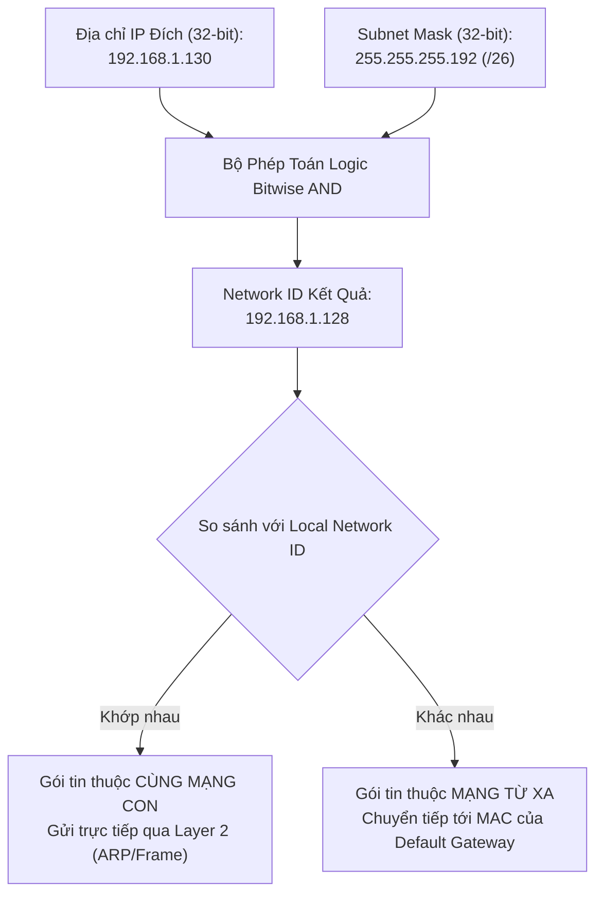

# 2_4_3 Subnet Masking and IP Arithmetic

> **Khóa học**: Cloud DevOps Basic — Networking Core  
> **Phân nhóm**: 2 Domain 2 - Computer Networking Core Fundamentals › 2_4 Network Layer and IP Addressing  
> **Chủ đề**: Kỹ thuật phân chia mạng con (Subnet Masking) & Số học IP: Phép toán Bitwise AND, cấu trúc Network ID / Broadcast ID, công thức tính số host và trường hợp đặc biệt /31, /32  
> **Trạng thái**: Verified (WRITE-CDB-2_4_3, 14-11-2026)  
> **Checklist đối chiếu**: [2_4_3](<../../../CHECKLIST.md#domain-2-computer-networking-core-fundamentals-43-items>)  

---

## 1. Khái Niệm Cốt Lõi & Bản Chất Kỹ Thuật (Core Concepts & Technical Deep Dive)

Trong kiến trúc mạng IPv4, một địa chỉ IP 32-bit không bao giờ đứng độc lập để xác định một giao diện mạng. Để hệ điều hành và các thiết bị định tuyến nhận diện được phạm vi của mạng cục bộ (Local Subnet) và ranh giới định tuyến tới các mạng từ xa (Remote Networks), mỗi địa chỉ IP bắt buộc phải đi kèm với một **Mặt nạ mạng con (Subnet Mask)** hoặc tiền tố CIDR (Prefix Length) tương ứng.

```text
+-----------------------------------------------------------------------+
|                    CẤU TRÚC ĐỊA CHỈ IPV4 CÓ PHÂN MẠNG CON             |
|                                                                       |
|  |<------------------------- 32 BITS ------------------------------>| |
|  +------------------------------------+-------------------------------+
|  |     NETWORK PREFIX (N bits)        |     HOST PORTION (32-N bits)  |
|  +------------------------------------+-------------------------------+
|  |  Xác định danh tính của mạng con   |  Xác định giao diện máy chủ   |
|  |  (Cố định trong cùng một Subnet)   |  (Duy nhất trong Subnet đó)   |
+-----------------------------------------------------------------------+
```

---

### 1.1 Bản Chất Toán Học Của Subnet Mask & Phép Toán Bitwise AND

Theo quy định tại [RFC 4632 Section 3.1](https://datatracker.ietf.org/doc/html/rfc4632#section-3.1) và [RFC 1122 Section 3.3.1.1](https://datatracker.ietf.org/doc/html/rfc1122#section-3.3.1.1):
- **Subnet Mask** là một chuỗi 32-bit gồm một dãy liên tục các bit `1` ở phần đầu (đại diện cho Network Prefix có độ dài $N$) và tiếp nối bởi một dãy liên tục các bit `0` ở phần sau (đại diện cho Host Portion có độ dài $32 - N$).
- Để trích xuất **Network ID (Địa chỉ định danh mạng)** từ một địa chỉ IP bất kỳ, ngăn xếp giao thức mạng của host và router thực hiện phép toán logic **Bitwise AND (VÀ nhị phân từng bit)** giữa địa chỉ IP đích và Subnet Mask.
- Bảng chân lý của phép toán AND:
  - $1 \text{ AND } 1 = 1$
  - $1 \text{ AND } 0 = 0$
  - $0 \text{ AND } 1 = 0$
  - $0 \text{ AND } 0 = 0$
- Nhờ đặc tính này:
  - Mọi bit nằm trong phần Prefix ($N$ bit đầu) khi AND với bit `1` của Mask sẽ giữ nguyên giá trị ban đầu.
  - Mọi bit nằm trong phần Host ($32 - N$ bit sau) khi AND với bit `0` của Mask sẽ bị xóa hoàn toàn về `0`.
  - Kết quả thu được chính xác là **Network ID**.

---

### 1.2 Cấu Trúc Địa Chỉ: Network ID, Broadcast ID và Dải Host Khả Dụng

Trong một mạng con tiêu chuẩn (khi độ dài tiền tố $N < 31$), không gian $32 - N$ bit của phần host xác định kích thước và các địa chỉ đặc biệt của mạng:

1. **Network ID (Địa chỉ mạng)**:
   - Là địa chỉ mà **toàn bộ các bit của phần host đều bằng 0** nhị phân.
   - Địa chỉ này đại diện cho toàn bộ phân đoạn mạng con trong bảng định tuyến và không bao giờ được phép gán cho bất kỳ giao diện máy chủ nào.
2. **Broadcast Address (Địa chỉ quảng bá)**:
   - Là địa chỉ mà **toàn bộ các bit của phần host đều bằng 1** nhị phân.
   - Theo [RFC 1122 Section 3.2.1.3](https://datatracker.ietf.org/doc/html/rfc1122#section-3.2.1.3), địa chỉ quảng bá gồm hai loại:
     - **Directed Broadcast** (có định dạng `{<Network-number>, -1}`): Địa chỉ quảng bá tới một mạng con xác định từ xa (ví dụ: `192.168.1.191` trong subnet `192.168.1.128/26`).
     - **Limited Broadcast** (có định dạng `{-1, -1}` tức `255.255.255.255`): Quảng bá cục bộ tới toàn bộ thiết bị trong cùng liên kết L2 mà không được router định tuyến ra ngoài.
   - **Quy tắc tuyệt đối**: Theo RFC 1122 Section 3.2.1.3, địa chỉ quảng bá **tuyệt đối không bao giờ được sử dụng làm địa chỉ nguồn (`Source IP Address`)** trong bất kỳ gói tin IP datagram nào.
3. **Công Thức Số Học IP**:
   - **Tổng số địa chỉ IP trong mạng con**:
     $$\text{Total IPs} = 2^{(32 - N)}$$
   - **Số lượng địa chỉ IP máy chủ khả dụng (Usable Hosts)**:
     $$\text{Usable Hosts} = 2^{(32 - N)} - 2$$
     *(Phải trừ đi 2 địa chỉ dành riêng: Network ID và Broadcast ID)*.
   - **Dải IP khả dụng**: Bắt đầu từ $\text{Network ID} + 1$ đến $\text{Broadcast Address} - 1$.

---

### 1.3 Các Tiền Tố Ngoại Lệ Đặc Biệt: /31 (RFC 3021) và /32 (RFC 1812)

Công thức trừ 2 địa chỉ $(\text{Usable Hosts} = 2^{(32-N)} - 2)$ chỉ áp dụng cho các mạng con có $N \le 30$. Khi $N = 31$ hoặc $N = 32$, IETF quy định các chuẩn kỹ thuật đặc thù:

1. **Tiền tố `/31` cho liên kết Point-to-Point ([RFC 3021](https://datatracker.ietf.org/doc/html/rfc3021#section-2.1))**:
   - Trong các đường truyền điểm-nối-điểm giữa hai router trung gian (Point-to-Point links), việc sử dụng subnet `/30` trước đây gây lãng phí nghiêm trọng (cung cấp 4 IP nhưng chỉ dùng được 2 IP, tiêu tốn 50% địa chỉ cho Network ID và Broadcast ID).
   - [RFC 3021 Section 2.1](https://datatracker.ietf.org/doc/html/rfc3021#section-2.1) quy định: Trên liên kết point-to-point sử dụng tiền tố `/31`, **cả hai địa chỉ đều được diễn giải là địa chỉ host khả dụng** (2 usable hosts, 0 subtracted).
   - Khái niệm địa chỉ mạng và địa chỉ quảng bá thông thường không áp dụng trên liên kết này, giúp tiết kiệm hàng triệu địa chỉ IPv4 quý giá trên hạ tầng backbone của nhà cung cấp dịch vụ Internet (ISP).
2. **Tiền tố `/32` - Định tuyến Host Route ([RFC 1812](https://datatracker.ietf.org/doc/html/rfc1812#section-5.2.4.3))**:
   - Tiền tố `/32` tương ứng với Subnet Mask `255.255.255.255`.
   - Với $N = 32$, số bit phần host bằng $32 - 32 = 0$.
   - Theo [RFC 1812 Section 5.2.4.3](https://datatracker.ietf.org/doc/html/rfc1812#section-5.2.4.3), tiền tố `/32` chỉ định một tuyến đường cụ thể trỏ trực tiếp tới một máy chủ duy nhất (**Host Route: This is a route to a specific end system**), thường dùng cho giao diện Loopback (`lo`) của router hoặc các quy tắc tường lửa chỉ định một IP độc lập.

---

### 1.4 Bảng Quy Đổi Tiền Tố CIDR, Subnet Mask và Số Lượng Host

| Tiền tố CIDR | Subnet Mask (Dạng thập phân) | Số bit Host ($32-N$) | Tổng số IP ($2^{32-N}$) | Số IP khả dụng | Mục đích sử dụng điển hình |
| :--- | :--- | :--- | :--- | :--- | :--- |
| **/24** | `255.255.255.0` | 8 bits | 256 | 254 | Mạng LAN văn phòng, chi nhánh |
| **/25** | `255.255.255.128` | 7 bits | 128 | 126 | Phân chia phòng ban trung bình |
| **/26** | `255.255.255.192` | 6 bits | 64 | 62 | Phân đoạn nhóm máy chủ cụm |
| **/27** | `255.255.255.224` | 5 bits | 32 | 30 | Phân đoạn Subnet ứng dụng |
| **/28** | `255.255.255.240` | 4 bits | 16 | 14 | Subnet quản trị, DMZ nhỏ |
| **/29** | `255.255.255.248` | 3 bits | 8 | 6 | Dải IP Public gán cho Firewall HA |
| **/30** | `255.255.255.252` | 2 bits | 4 | 2 | Liên kết WAN Point-to-Point cổ điển |
| **/31** | `255.255.255.254` | 1 bit | 2 | **2** (RFC 3021) | Liên kết Router-to-Router hiện đại |
| **/32** | `255.255.255.255` | 0 bits | 1 | **1** (Host Route) | Loopback Interface, Firewall Rule |

---

## 2. Ví Dụ Đời Sống Thực Tế Dễ Hiểu (Intuitive Real-World Analogies)

### Ẩn dụ: "Bản Đồ Phân Lô Khu Phố & Khuôn Bìa Đục Lỗ Quy Hoạch (Masking Stencil)"

Để thấu hiểu bản chất toán học của Subnet Mask mà không bị bối rối bởi các con số nhị phân, hãy tưởng tượng quy trình quy hoạch một khu dân cư:

```text
+-------------------------------------------------------------------------+
|                  KHUÔN BÌA ĐỤC LỖ QUY HOẠCH (SUBNET MASK)               |
|                                                                         |
|  Địa chỉ hoàn chỉnh:  [ Khu Phố 4 ]  -  [ Nhà số 130 ]                 |
|                                                                         |
|  Tấm bìa đục lỗ:     [ ĐỤC THỦNG  ]  -  [ CHE KÍN TOÀN BỘ ]             |
|                       (Bit 111...1)      (Bit 000...0)                  |
|                                                                         |
|  Phép chiếu (AND):   Ánh sáng lọt qua phần đục lỗ cho thấy:             |
|                      ===> TÊN KHU PHỐ LÀ: "KHU PHỐ 4" (Network ID)     |
+-------------------------------------------------------------------------+
```

1. **Subnet Mask là tấm bìa đục lỗ (Masking Stencil)**:
   - Các bit `1` được khoét rỗng để ánh sáng chiếu qua, làm lộ rõ **Tên phân khu (Network ID)** trên tấm bản đồ lớn.
   - Các bit `0` được che kín bằng bìa cứng, làm mờ đi số nhà cụ thể của từng hộ gia đình để hệ thống bưu điện chỉ tập trung tìm đúng địa bàn khu phố trước.
2. **Network ID là biển tên cổng chào của khu phố**:
   - Biển cổng chào đề "Khu phố 4" để bưu tá liên tỉnh biết đường lái xe tải tới. Cổng chào là tài sản công, không một người dân nào được phép xây nhà định cư ngay trên biển cổng chào.
3. **Broadcast ID là hệ thống loa phát thanh của phường**:
   - Loa phường được lắp đặt để khi cán bộ phát thanh thông báo bão, tất cả 62 hộ dân trong khu phố đều nghe thấy đồng thời.
   - Loa phường là thiết bị công cộng nhận tin, không thể đóng vai trò là một người dân cụ thể gửi đơn thư đi (`Broadcast IP tuyệt đối không làm Source IP`).
4. **Các số nhà từ 1 đến 62 (Usable Hosts)**:
   - Là những căn nhà thực tế nằm giữa cổng chào và cột loa phường, được cấp phép cho các hộ dân cư ngụ.

---

## 3. Kiến Trúc, Luồng Hoạt Động & Hình Ảnh Trực Quan (Architecture, Diagrams & Visual Media)

### 3.1 Phân Tách Nhị Phân & Phép Toán Bitwise AND Của Subnet `192.168.1.130/26`

Minh họa chi tiết quá trình tính toán logic nhị phân trích xuất Network ID và xác định ranh giới Broadcast cho địa chỉ `192.168.1.130` với tiền tố `/26`:

```text
Địa chỉ IP: 192.168.1.130
- Octet 1: 192 = 11000000
- Octet 2: 168 = 10101000
- Octet 3:   1 = 00000001
- Octet 4: 130 = 10000010 (Nhị phân)

Subnet Mask: /26 (255.255.255.192)
- Octet 1: 255 = 11111111
- Octet 2: 255 = 11111111
- Octet 3: 255 = 11111111
- Octet 4: 192 = 11000000 (Nhị phân: 26 bit 1 liên tục, 6 bit 0 ở cuối)

========================================================================================
PHÉP TOÁN BITWISE AND (IP & MASK):
  IP:        11000000 . 10101000 . 00000001 . 10 000010  (192.168.1.130)
  MASK:      11111111 . 11111111 . 11111111 . 11 000000  (255.255.255.192)
  --------------------------------------------------------------------------------------
  NETWORK:   11000000 . 10101000 . 00000001 . 10 000000  ==> 192.168.1.128 (Network ID)

TÌM BROADCAST ADDRESS (Giữ nguyên 26 bit Prefix, đặt 6 bit Host = 1):
  BROADCAST: 11000000 . 10101000 . 00000001 . 10 111111  ==> 192.168.1.191 (Broadcast ID)

DẢI MÁY CHỦ KHẢ DỤNG (Usable Host Range):
  First Host (Host bits: 000001): 192.168.1.129
  Last Host  (Host bits: 111110): 192.168.1.190
  Host 192.168.1.130 là host khả dụng thứ 2 trong subnet (Host bits: 000010 nhị phân = 2)!
========================================================================================
```

---

### 3.2 Quy Trình Trích Xuất Ranh Giới Mạng Bằng Bitwise AND



---

## 4. Thực Hành (Hands-on)

### 4.1 Tính Toán Số Học IP Từng Bước Bằng Python Module `ipaddress`

Thư viện chuẩn `ipaddress` của Python (tuân thủ chặt chẽ RFC 4632) là công cụ thẩm định tự động hoàn hảo cho các bài toán phân mạng con trong tự động hóa hạ tầng DevOps.

> ⚠️ Chưa chạy thử (not executed by the squad)

```python
import ipaddress

# Khởi tạo interface với địa chỉ IP và tiền tố /26
iface = ipaddress.ip_interface('192.168.1.130/26')
net = iface.network

print(f"Địa chỉ IP kiểm tra : {iface.ip}")
print(f"Subnet Mask         : {net.netmask}")
print(f"Prefix CIDR         : /{net.prefixlen}")
print(f"Network ID          : {net.network_address}")
print(f"Broadcast Address   : {net.broadcast_address}")
print(f"Tổng số IP trong dải: {net.num_addresses}")
print(f"Số host khả dụng    : {net.num_addresses - 2}")

# Liệt kê địa chỉ IP máy chủ đầu tiên và cuối cùng
hosts = list(net.hosts())
print(f"First Usable Host   : {hosts[0]}")
print(f"Last Usable Host    : {hosts[-1]}")
print(f"Vị trí của 192.168.1.130 trong danh sách host: Thứ {hosts.index(iface.ip) + 1}")
```

> Minh họa kết quả thực thi:

```text
Địa chỉ IP kiểm tra : 192.168.1.130
Subnet Mask         : 255.255.255.192
Prefix CIDR         : /26
Network ID          : 192.168.1.128
Broadcast Address   : 192.168.1.191
Tổng số IP trong dải: 64
Số host khả dụng    : 62
First Usable Host   : 192.168.1.129
Last Usable Host    : 192.168.1.190
Vị trí của 192.168.1.130 trong danh sách host: Thứ 2
```

---

### 4.2 Kiểm Tra Cấu Hình Mạng và Mặt Nạ Mạng Con Trên Linux

Trên hệ điều hành Linux hiện đại, lệnh `ip` thuộc gói `iproute2` hiển thị địa chỉ IP kèm theo tiền tố CIDR và địa chỉ quảng bá tương ứng:

> ⚠️ Chưa chạy thử (not executed by the squad)

```bash
# Xem thông tin địa chỉ IPv4 và Subnet Mask của card mạng eth0
ip -4 addr show eth0
```

> Minh họa kết quả thực thi:

```text
2: eth0: <BROADCAST,MULTICAST,UP,LOWER_UP> mtu 1500 qdisc fq_codel state UP group default qlen 1000
    inet 192.168.1.130/26 brd 192.168.1.191 scope global dynamic eth0
       valid_lft 86340sec preferred_lft 86340sec
```

#### Phân tích các thông số hiển thị:
- `inet 192.168.1.130/26`: Địa chỉ IP của máy chủ kèm theo tiền tố CIDR `/26` (Subnet Mask `255.255.255.192`).
- `brd 192.168.1.191`: Địa chỉ Broadcast tính toán tự động của phân đoạn mạng con này, khớp chính xác với lý thuyết tính toán nhị phân.

---

### 4.3 Kiểm Tra Subnet Mask Trên Hệ Điều Hành Windows

Trên Windows, công cụ dòng lệnh `ipconfig` hiển thị mặt nạ mạng con ở định dạng thập phân có dấu chấm (Dotted-Decimal):

> ⚠️ Chưa chạy thử (not executed by the squad)

```cmd
ipconfig
```

> Minh họa kết quả thực thi:

```text
Ethernet adapter Ethernet0:

   Connection-specific DNS Suffix  . : localdomain
   IPv4 Address. . . . . . . . . . . : 192.168.1.130
   Subnet Mask . . . . . . . . . . . : 255.255.255.192
   Default Gateway . . . . . . . . . : 192.168.1.129
```

---

## 5. Cạm Bẫy Thực Tế & Thực Tiễn Sản Xuất (Production Gotchas & Best Practices)

Trong triển khai hạ tầng mạng doanh nghiệp và điện toán đám mây (AWS VPC, Azure VNet), việc nắm vững số học IP giúp ngăn ngừa các sự cố nghiêm trọng sau:

1. **Lãng Phí Không Gian Địa Chỉ Do Dùng /30 Thay Vì /31 Cho Liên Kết Điểm-Nối-Điểm**:
   - Trước khi RFC 3021 được áp dụng rộng rãi, các kỹ sư thường phân bổ mạng con `/30` (4 IP) cho liên kết giữa 2 router. Điều này làm mất đi $50\%$ địa chỉ (chỉ dùng được 2 IP host, mất 1 Network ID và 1 Broadcast ID).
   - *Best Practice*: Trong kiến trúc mạng backbone hiện đại, luôn áp dụng **RFC 3021 với tiền tố `/31`** (Subnet Mask `255.255.255.254`) cho các liên kết Point-to-Point. Điều này giúp tận dụng trọn vẹn cả 2 địa chỉ IP và tiết kiệm không gian địa chỉ IPv4 công cộng vốn đã cạn kiệt.

2. **Gán Nhầm Địa Chỉ Mạng Hoặc Địa Chỉ Quảng Bá Cho Thiết Bị**:
   - Nếu quản trị viên vô tình gán địa chỉ `192.168.1.128` (Network ID) hoặc `192.168.1.191` (Broadcast ID) cho một máy chủ Linux/Windows trong mạng `/26`, hệ điều hành sẽ từ chối cấu hình hoặc gây ra các hiện tượng dị thường: máy chủ không thể gửi/nhận gói tin unicast thông thường hoặc phản hồi sai lệch với các gói tin quảng bá.

3. **Lỗi Mặt Nạ Mạng Con Bất Đối Xứng (Subnet Mask Mismatch)**:
   - Tình huống Host A cấu hình `192.168.1.10/24` trong khi Host B trên cùng Switch cấu hình `192.168.1.200/26`.
   - Host A gửi gói tin tới Host B: A thực hiện AND với Mask `/24`, thấy B thuộc cùng subnet `192.168.1.0/24` $\rightarrow$ A gửi trực tiếp qua bản tin ARP.
   - Host B nhận được gói tin và muốn phản hồi về Host A (`192.168.1.10`): B thực hiện AND với Mask `/26` của mình, thấy A (`192.168.1.0`) không thuộc subnet của B (`192.168.1.192/26`) $\rightarrow$ B đẩy gói tin phản hồi tới Default Gateway! Nếu Default Gateway không xử lý được, kết nối hai chiều lập tức bị gián đoạn.

---

## 6. Câu Hỏi Củng Cố Kiến Thức (Active Recall Quiz)

<details>
<summary><b>Câu hỏi 1:</b> Một máy chủ có địa chỉ IP <code>10.20.30.75/28</code>. Hãy xác định Network ID, Broadcast Address, số lượng host khả dụng và dải địa chỉ IP có thể gán cho máy chủ trong mạng con này?</summary>

**Đáp án:**
Theo RFC 4632:
- Tiền tố $N = 28$. Số bit host là $32 - 28 = 4$ bits.
- Subnet mask là `255.255.255.240` (bước nhảy block size ở octet thứ 4 là $2^4 = 16$).
- Octet thứ 4 của IP là 75. Vì $75 = 16 \times 4 + 11$, mạng con bắt đầu tại bội số 16 gần nhất bên dưới: $16 \times 4 = 64$.
- **Network ID**: `10.20.30.64`.
- **Broadcast Address**: `10.20.30.79` (với 4 bit host cuối toàn 1: $64 + 15 = 79$).
- **Số lượng host khả dụng**: $2^4 - 2 = 16 - 2 = 14$ host.
- **Dải host khả dụng**: `10.20.30.65` đến `10.20.30.78`.
</details>

<details>
<summary><b>Câu hỏi 2:</b> Tại sao theo chuẩn RFC 1122 Section 3.2.1.3, một gói tin IP tuyệt đối không bao giờ được phép mang địa chỉ Broadcast làm Source IP Address?</summary>

**Đáp án:**
Theo RFC 1122 Section 3.2.1.3:
- Địa chỉ Broadcast (cả Directed Broadcast và Limited Broadcast) được thiết kế đặc thù làm địa chỉ đích để phát tán dữ liệu tới đồng loạt nhiều thiết bị.
- Nếu một gói tin mang Source IP là địa chỉ Broadcast, trạm nhận khi phản hồi lại gói tin đó sẽ buộc phải gửi gói tin trả lời tới địa chỉ broadcast. Điều này kích hoạt hiện tượng khuếch đại lưu lượng vô tận (Broadcast Storm / Smurf Attack), làm tê liệt toàn bộ băng thông và năng lực xử lý của các thiết bị trên mạng L2.
</details>

<details>
<summary><b>Câu hỏi 3:</b> Trong hoàn cảnh nào thì hai địa chỉ IP duy nhất trong một mạng con đều có thể gán hợp lệ cho hai giao diện máy chủ/router mà không cần trừ đi Network ID và Broadcast ID?</summary>

**Đáp án:**
Theo chuẩn **RFC 3021 (Using 31-Bit Prefixes on IPv4 Point-to-Point Links)**:
- Trên các liên kết vật lý điểm-nối-điểm (Point-to-Point links) chỉ kết nối trực tiếp giữa đúng 2 giao diện router, tiền tố `/31` (Subnet mask `255.255.255.254`) được sử dụng.
- Với tiền tố `/31`, không gian host chỉ có 1 bit (mang giá trị 0 hoặc 1). Cả 2 địa chỉ đều được diễn giải là địa chỉ host khả dụng và được gán trực tiếp cho 2 đầu router, không có địa chỉ nào bị trừ cho Network ID hay Broadcast ID.
</details>

---

## 7. 📚 Nguồn Tài Liệu Chính Thống (Tier-1 Official References)

- [RFC 4632: Classless Inter-domain Routing (CIDR): The Internet Address Assignment and Aggregation Plan](https://datatracker.ietf.org/doc/html/rfc4632#section-3.1) - Đặc tả kỹ thuật nền tảng của IETF về phép toán Bitwise AND giữa địa chỉ IP và Subnet Mask để xác định Network Prefix.
- [RFC 1122: Requirements for Internet Hosts -- Communication Layers](https://datatracker.ietf.org/doc/html/rfc1122#section-3.2.1.3) - Tiêu chuẩn máy chủ Internet của IETF, Mục 3.2.1.3 quy định chi tiết định dạng Broadcast Address và lệnh cấm sử dụng Broadcast làm Source IP; Mục 3.3.1.1 quy định phép toán mặt nạ mạng con.
- [RFC 3021: Using 31-Bit Prefixes on IPv4 Point-to-Point Links](https://datatracker.ietf.org/doc/html/rfc3021#section-2.1) - Tiêu chuẩn IETF quy định cơ chế gán tiền tố /31 trên các liên kết điểm-nối-điểm mà không cần trừ Network ID và Broadcast ID.
- [RFC 1812: Requirements for IP Version 4 Routers](https://datatracker.ietf.org/doc/html/rfc1812#section-5.2.4.3) - Tiêu chuẩn bộ định tuyến IPv4, Mục 5.2.4.3 định nghĩa Host Route trỏ tới một trạm cụ thể (route to a specific end system).
- [Python Documentation: ipaddress — IPv4/IPv6 manipulation library](https://docs.python.org/3/library/ipaddress.html) - Tài liệu thư viện chuẩn Python về xử lý, tính toán số học mạng con và trích xuất thông số IP tự động.
