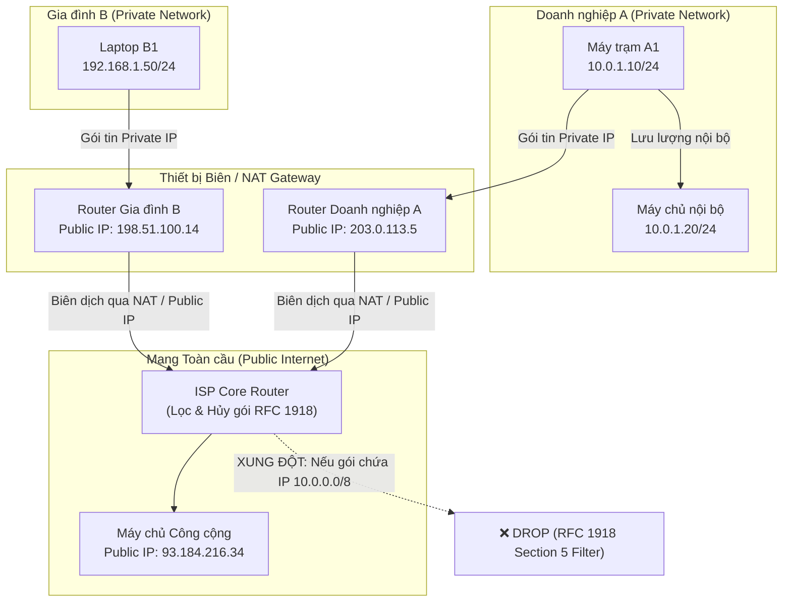
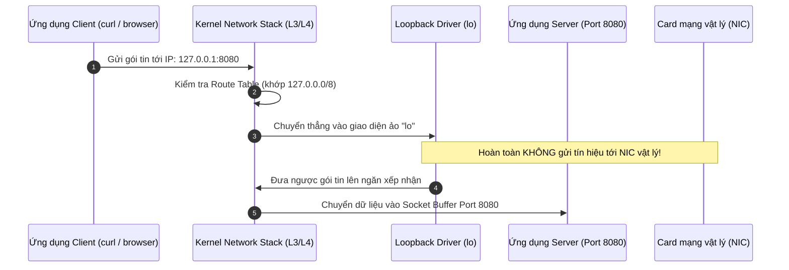

# 2_4_4 Public vs Private IP Ranges

> **Khóa học**: Cloud DevOps Basic — Networking Core  
> **Phân nhóm**: 2 Domain 2 - Computer Networking Core Fundamentals › 2_4 Network Layer and IP Addressing  
> **Chủ đề**: Phân định không gian địa chỉ IP công khai (Public IP) và IP riêng tư cục bộ (RFC 1918 Private IP) cùng các dải địa chỉ đặc biệt  
> **Trạng thái**: Verified (WRITE-CDB-2_4_4, 14-11-2026)  
> **Checklist đối chiếu**: [2_4_4](<../../../CHECKLIST.md#domain-2-computer-networking-core-fundamentals-43-items>)  

---

## 1. Khái Niệm Cốt Lõi & Bản Chất Kỹ Thuật (Core Concepts & Technical Deep Dive)

Trong không gian mạng toàn cầu IPv4 (với tổng giới hạn lý thuyết là $2^{32} = 4.294.967.296$ địa chỉ), việc quản lý và phân cấp định danh đóng vai trò then chốt trong việc duy trì hoạt động định tuyến Internet. Để ngăn chặn nguy cơ cạn kiệt địa chỉ và thiết lập ranh giới bảo mật mạng, IETF đã phân định rõ ràng giữa **Địa chỉ IP Công khai (Public IP)** và **Địa chỉ IP Riêng tư (Private IP)** cùng các dải địa chỉ dành riêng cho mục đích đặc biệt.

```
+-----------------------------------------------------------------------------+
|                      PHÂN CẤP KHÔNG GIAN ĐỊA CHỈ IPV4                       |
|                                                                             |
|  [Public IP Ranges]             [RFC 1918 Private IP]    [Special Reserved] |
|  - Định tuyến toàn cầu Internet - Mạng nội bộ doanh nghiệp - Loopback 127/8 |
|  - Cấp phát duy nhất bởi IANA  - Tái sử dụng độc lập     - APIPA 169.254/16 |
|  - Định tuyến qua ISP           - Bị chặn qua Internet    - CGNAT 100.64/10  |
+-----------------------------------------------------------------------------+
```

---

### 1.1 Khái Niệm Public IP vs Private IP

1. **Địa chỉ IP Công khai (Public IP)**:
   - Là các địa chỉ có tính duy nhất trên toàn bộ mạng Internet toàn cầu, được điều phối và cấp phát bởi IANA (Internet Assigned Numbers Authority) thông qua các Cơ quan Quản lý Internet Khu vực (RIR - Regional Internet Registries như APNIC, ARIN, RIPE NCC).
   - Được định tuyến công khai giữa các nhà mạng viễn thông (ISPs) và các hệ thống tự trị (Autonomous Systems - AS).
   - Mọi thiết bị hoặc máy chủ cung cấp dịch vụ công khai ra Internet (Web server, Public DNS) bắt buộc phải sở hữu hoặc được ánh xạ tới một địa chỉ IP công khai.

2. **Địa chỉ IP Riêng tư (Private IP)**:
   - Được chuẩn hóa theo tài liệu [RFC 1918](https://datatracker.ietf.org/doc/html/rfc1918).
   - Dành riêng cho việc thiết lập mạng nội bộ (Enterprise LANs, Home Networks, Data Centers, Virtual Private Clouds - VPC).
   - Không được đăng ký độc quyền: Bất kỳ tổ chức nào cũng có thể tự do sử dụng các dải địa chỉ này mà không cần xin phép hay trả phí cho IANA.
   - **Quy tắc định tuyến cốt lõi (RFC 1918 Section 5)**: Các gói tin mang địa chỉ nguồn hoặc đích thuộc dải Private IP **tuyệt đối không được phép chuyển tiếp qua mạng Internet công cộng**. Các bộ định tuyến biên (border routers) và nhà cung cấp dịch vụ Internet (ISPs) luôn lọc bỏ và hủy (drop) mọi quảng bá định tuyến cũng như các gói tin chứa địa chỉ Private IP.

---

### 1.2 Ba Khối Địa Chỉ Private IP theo Chuẩn RFC 1918

Theo đặc tả trong [RFC 1918 Section 3](https://datatracker.ietf.org/doc/html/rfc1918#section-3), IANA đã dành riêng 3 khối địa chỉ IPv4 độc lập cho các mạng riêng tư:

| Tên khối (Prefix) | Dải địa chỉ IP (Range) | Độ dài tiền tố | Kích thước khối nhị phân | Tổng số địa chỉ IP | Trường hợp sử dụng điển hình |
| :--- | :--- | :--- | :--- | :--- | :--- |
| **`10.0.0.0/8`** | `10.0.0.0` – `10.255.255.255` | `/8` | Khối 24-bit (`10/8`) | **16.777.216** | Mạng doanh nghiệp quy mô lớn, Data Center, Multi-Region VPC |
| **`172.16.0.0/12`** | `172.16.0.0` – `172.31.255.255` | `/12` | Khối 20-bit (`172.16/12`) | **1.048.576** | Tổ chức, trường học, VPC quy mô vừa |
| **`192.168.0.0/16`** | `192.168.0.0` – `192.168.255.255` | `/16` | Khối 16-bit (`192.168/16`) | **65.536** | Mạng gia đình (SOHO), mạng văn phòng nhỏ, thiết bị mạng gia dụng |

*Phân tích kỹ thuật*:
- Khối `172.16.0.0/12` bao gồm liên tiếp 16 mạng `/16` từ `172.16.0.0/16` đến `172.31.0.0/16`.
- Khối `192.168.0.0/16` bao gồm liên tiếp 256 mạng `/24` từ `192.168.0.0/24` đến `192.168.255.0/24`.

---

### 1.3 Các Dải Địa Chỉ Dành Riêng Đặc Biệt (Special Reserved Ranges)

Bên cạnh RFC 1918, kiến trúc mạng IPv4 quy định một số dải địa chỉ dành riêng cho các chức năng đặc biệt của hệ điều hành và nhà mạng:

#### A. Địa chỉ Vòng lặp Nội bộ (Loopback Address - `127.0.0.0/8`)
- **Quy chuẩn kỹ thuật**: [RFC 1122 Section 3.2.1.3](https://datatracker.ietf.org/doc/html/rfc1122#section-3.2.1.3) và [RFC 1812 Section 5.3.7](https://datatracker.ietf.org/doc/html/rfc1812#section-5.3.7).
- Toàn bộ khối `{127, <any>}` (từ `127.0.0.0` đến `127.255.255.255`, phổ biến nhất là `127.0.0.1` hay `localhost`) được quy hoạch làm địa chỉ nội bộ host (Internal host loopback address).
- **Cơ chế hoạt động**: Khi một tiến trình gửi gói tin đến dải `127.0.0.0/8`, hệ điều hành sẽ xử lý hoàn toàn bên trong ngăn xếp mạng ở tầng kernel (kernel network stack). Gói tin **không bao giờ đi qua phần cứng giao tiếp mạng** (NIC/card mạng vật lý).
- **Bảo vệ định tuyến**: Các bộ định tuyến (routers) **tuyệt đối không được phép chuyển tiếp** bất kỳ gói tin nào có địa chỉ đích hoặc nguồn thuộc dải `127.0.0.0/8` ra ngoài mạng vật lý.

#### B. Địa chỉ Cục bộ Liên kết / APIPA (Link-Local / APIPA - `169.254.0.0/16`)
- **Quy chuẩn kỹ thuật**: [RFC 3927 Section 2.1 & 2.2.1](https://datatracker.ietf.org/doc/html/rfc3927#section-2.1).
- Còn được Microsoft Windows gọi là **APIPA** (Automatic Private IP Addressing). Dải địa chỉ khả dụng để gán cho thiết bị host là từ `169.254.1.0` đến `169.254.254.255`.
- **Cơ chế tự cấp phát (Dynamic Configuration)**: Khi một host được cấu hình nhận IP tự động qua DHCP nhưng không nhận được phản hồi từ bất kỳ máy chủ DHCP nào (do máy chủ sập hoặc đứt cáp mạng), host sẽ tự động chọn ngẫu nhiên một địa chỉ IP trong dải `169.254.0.0/16`.
- **Cơ chế ARP Probe (RFC 3927 Section 2.2.1)**: Trước khi chính thức sử dụng địa chỉ đã chọn, host bắt buộc phải gửi một gói tin **ARP Probe** lên mạng cục bộ để kiểm tra xem địa chỉ đó đã bị máy khác chiếm dụng hay chưa. Điểm đặc biệt: Trường *Sender IP Address* trong gói tin ARP Probe bắt buộc phải đặt bằng toàn số không (`0.0.0.0`) nhằm tránh làm nhiễm bẩn (poison) bộ đệm bảng ARP của các máy tính khác trong cùng phân đoạn mạng.

#### C. Không gian Địa chỉ Chia sẻ Nhà mạng / CGNAT (`100.64.0.0/10`)
- **Quy chuẩn kỹ thuật**: [RFC 6598 Section 7](https://datatracker.ietf.org/doc/html/rfc6598#section-7).
- Khối địa chỉ `100.64.0.0/10` (từ `100.64.0.0` đến `100.127.255.255`, cung cấp tổng cộng **4.194.304** địa chỉ IP) được IANA phân bổ làm **Shared Address Space**.
- **Mục đích**: Triển khai trong hạ tầng mạng của các nhà cung cấp dịch vụ Internet (ISPs) cho công nghệ Carrier-Grade NAT (CGNAT). Dải này giúp ngăn chặn triệt để xung đột định tuyến giữa không gian mạng riêng RFC 1918 của khách hàng (như `192.168.1.0/24`) và hạ tầng mạng chuyển tiếp nội bộ của nhà mạng viễn thông.

---

## 2. Ví Dụ Đời Sống Thực Tế Dễ Hiểu (Intuitive Real-World Analogies)

Để nắm bắt trực giác sự khác biệt giữa các dải IP, hãy liên hệ với hệ thống định danh trong xã hội thực tế:

```
+-----------------------------------------------------------------------------+
|                      MÔ HÌNH SO SÁNH ĐỜI SỐNG THỰC TẾ                       |
|                                                                             |
|  [Public IP]       -->  Số Căn cước Công dân (CCCD) / Hộ chiếu Quốc tế       |
|                         Duy nhất toàn cầu, bưu điện chuyển phát khắp nơi.    |
|                                                                             |
|  [RFC 1918 IP]     -->  Số Phòng / Số Thẻ Nhân viên nội bộ tòa nhà         |
|                         Tòa nhà nào cũng có "Phòng 101" hay "Bàn 12",       |
|                         không sợ trùng vì chỉ có giá trị trong tòa nhà.     |
|                                                                             |
|  [Loopback 127/8]  -->  Cuốn Sổ Tay Nhật Ký cá nhân                         |
|                         Viết để tự nhắc bản thân, không bao giờ gửi ra bưu  |
|                         điện, chỉ lưu hành trong đầu của chính bạn.          |
|                                                                             |
|  [APIPA 169.254/16]-->  Biển Tên Giấy Tạm Thời dán áo                       |
|                         Khi máy in thẻ (DHCP) hỏng, bạn tạm ghi tên lên     |
|                         áo để người đứng ngay cạnh nhìn thấy và gọi nhau.   |
+-----------------------------------------------------------------------------+
```

1. **Public IP vs Private IP**:
   - **Public IP** giống như **Số Căn cước Công dân** hoặc **Hộ chiếu**: Được cấp bởi nhà nước, có tính độc nhất toàn thế giới. Bưu điện quốc tế chỉ có thể chuyển thư tới đích danh số nhà/hộ chiếu này.
   - **Private IP (RFC 1918)** giống như **Số phòng trong khách sạn**: Mọi khách sạn tại Hà Nội, Tokyo hay New York đều có thể có "Phòng 101" hay "Phòng 205". Những số phòng này hoàn toàn độc lập và không bao giờ gây xung đột, miễn là bưu tá không cầm phong bì ghi mỗi chữ "Phòng 101" rồi chạy ra đường cái tìm nhà.
2. **Loopback (`127.0.0.1`)**:
   - Giống như cuốn **Sổ tay nhật ký cá nhân**: Bạn viết suy nghĩ của mình ra giấy rồi tự mắt bạn đọc lại. Việc tự giao tiếp này diễn ra ngay trong phòng của bạn, không cần qua bưu điện hay người vận chuyển.
3. **APIPA (`169.254.x.x`)**:
   - Giống như việc bạn đến tham dự hội thảo nhưng **máy chủ cấp thẻ (DHCP server)** bị mất điện. Để không bị vô danh, ban tổ chức phát cho mọi người một mẩu giấy dán áo tự viết số tạm thời (`169.254.x.x`). Các bạn trong cùng một căn phòng có thể nhìn thấy nhau và nói chuyện cục bộ, nhưng không thể dùng thẻ giấy tạm này để ra ngoài cổng bảo vệ hay vào ngân hàng (Internet).

---

## 3. Kiến Trúc, Luồng Hoạt Động & Hình Ảnh Trực Quan (Architecture, Diagrams & Visual Media)

### 3.1 Ranh Giới Giữa Mạng Private và Public Internet

Sơ đồ dưới đây minh họa ranh giới cách ly định tuyến giữa mạng riêng RFC 1918 và không gian Internet công cộng:



---

### 3.2 Luồng Xử Lý Gói Tin Loopback Trong Kernel

Khi một ứng dụng gửi gói tin tới `127.0.0.1`:



---

## 4. Thực Hành Lệnh Linux & Minh Họa Đầu Ra (Hands-on Linux CLI & Output Simulation)

Để kiểm tra cấu hình giao diện mạng vòng lặp nội bộ (Loopback) và các dải địa chỉ trên Linux, công cụ tiêu chuẩn của bộ `iproute2` là lệnh `ip addr show lo`.

> ⚠️ Chưa chạy thử (not executed by the squad)

```bash
# Hiển thị thông số cấu hình của giao diện loopback (lo)
ip addr show lo
```

Minh họa kết quả đầu ra thực tế trên terminal:

```text
1: lo: <LOOPBACK,UP,LOWER_UP> mtu 65536 qdisc noqueue state UNKNOWN group default qlen 1000
    link/loopback 00:00:00:00:00:00 brd 00:00:00:00:00:00
    inet 127.0.0.1/8 scope host lo
       valid_lft forever preferred_lft forever
    inet6 ::1/128 scope host
       valid_lft forever preferred_lft forever
```

*Phân tích chi tiết các trường kỹ thuật trong kết quả*:
- `lo`: Tên giao diện mạng loopback ảo được nhân Linux khởi tạo sẵn khi khởi động hệ thống.
- `<LOOPBACK,UP,LOWER_UP>`: Các cờ trạng thái (flags) xác nhận thiết bị là giao diện vòng lặp và đang ở trạng thái hoạt động tích cực.
- `mtu 65536`: Kích thước đơn vị truyền tối đa cực lớn (64KB), do dữ liệu chỉ luân chuyển qua bộ nhớ RAM mà không bị giới hạn bởi chuẩn cáp vật lý (như Ethernet 1500 byte).
- `link/loopback 00:00:00:00:00:00`: Địa chỉ MAC của giao diện loopback gồm toàn số không, chứng minh không có phần cứng vật lý nào gắn với giao diện này.
- `inet 127.0.0.1/8 scope host lo`: Địa chỉ IPv4 với tiền tố `/8` chuẩn RFC 1122. Từ khóa `scope host` chỉ định phạm vi gói tin chỉ có hiệu lực bên trong phạm vi máy chủ cục bộ.

---

## 5. Cạm Bẫy Thực Tế & Thực Tiễn Sản Xuất (Production Gotchas & Best Practices)

1. **Cạm bẫy Trùng lặp IP khi Thiết lập VPN / VPC Peering (IP Subnet Overlap Trap)**:
   - Khi thiết kế hạ tầng Cloud (AWS VPC, Azure VNet) hoặc mạng Data Center, nhiều kỹ sư chọn ngẫu nhiên dải mặc định `172.31.0.0/16` hoặc `192.168.1.0/24`.
   - Về sau, khi doanh nghiệp mở rộng kết nối Hybrid Cloud qua AWS Direct Connect, Azure ExpressRoute hoặc VPN Site-to-Site giữa hai văn phòng, các dải địa chỉ trùng nhau sẽ **không thể định tuyến được** do xung đột bảng định tuyến.
   - **Best Practice**: Thiết lập sơ đồ quản lý không gian địa chỉ IP (IPAM - IP Address Management) tập trung từ ban đầu, phân bổ rạch ròi các subnet không chồng lấn thuộc dải `10.0.0.0/8` hoặc `172.16.0.0/12`.

2. **Hiểu Sai Ý Nghĩa của Địa chỉ APIPA (`169.254.x.x`) Trong Vận Hành**:
   - Khi kiểm tra máy chủ hoặc máy trạm và thấy nhận được IP dạng `169.254.x.x`, một số người mới vận hành lầm tưởng hệ thống mạng vẫn đang nhận diện bình thường.
   - **Bản chất thực tế**: Địa chỉ này là dấu hiệu cảnh báo trực tiếp rằng **DHCP Client đã thất bại hoàn toàn** trong việc liên lạc với DHCP Server. Thiết bị đang bị cô lập khỏi mạng nội bộ chính và hoàn toàn không có đường ra Internet.

3. **Rò rỉ Gói tin Private IP ra Đường truyền Công cộng (Route Leakage)**:
   - Nếu quản trị viên cấu hình thiếu sót trên Router biên (Border Router), vô tình để lộ bảng định tuyến nội bộ RFC 1918 ra nhà mạng, các gói tin này sẽ lập tức bị Router của ISP drop không thương tiếc theo chuẩn RFC 1918 Section 5.
   - **Best Practice**: Luôn luôn cấu hình bộ lọc danh sách truy cập (ACL) hoặc cơ chế NAT/PAT tại tường lửa biên trước khi lưu lượng rời khỏi mạng nội bộ.

---

## 6. Câu Hỏi Củng Cố Kiến Thức (Active Recall Quiz)

<details>
<summary><b>Câu hỏi 1:</b> Theo chuẩn RFC 1918, tại sao các tổ chức khác nhau có thể sử dụng cùng một dải địa chỉ IP (ví dụ <code>192.168.1.0/24</code>) cùng lúc mà không xảy ra xung đột địa chỉ trên toàn cầu?</summary>

**Đáp án:**
Theo RFC 1918 (Section 3 & 5):
- Các địa chỉ RFC 1918 được phân bổ dành riêng cho mạng nội bộ và có tính chất cục bộ (locally unique).
- Các gói tin mang địa chỉ Private IP bị nghiêm cấm chuyển tiếp qua mạng Internet công cộng và luôn bị các bộ định tuyến của ISP lọc bỏ (filter and drop).
- Khi các thiết bị trong mạng private muốn giao tiếp ra Internet, chúng phải đi qua thiết bị chuyển đổi địa chỉ mạng (NAT Gateway / Router biên) để biên dịch sang một địa chỉ IP công khai duy nhất toàn cầu. Vì vậy, các dải mạng private có thể được tái sử dụng độc lập vô số lần ở các địa điểm khác nhau.
</details>

<details>
<summary><b>Câu hỏi 2:</b> Khi một máy tính không nhận được phản hồi từ DHCP Server và tự gán địa chỉ APIPA (169.254.0.0/16 theo RFC 3927), tại sao gói tin ARP Probe do máy phát ra bắt buộc phải đặt trường Sender IP Address là <code>0.0.0.0</code>?</summary>

**Đáp án:**
Theo RFC 3927 (Section 2.2.1):
- Gói tin ARP Probe được gửi đi để kiểm tra xem địa chỉ IP mà máy tính định chọn ngẫu nhiên có đang bị một thiết bị khác trên cùng đường truyền mạng sử dụng hay không.
- Nếu máy tính điền địa chỉ IP dự kiến đó vào trường Sender IP, các thiết bị khác nhận được gói ARP broadcast sẽ ngay lập tức cập nhật bộ nhớ đệm bảng ARP (ARP Cache) của chúng với địa chỉ mới này và địa chỉ MAC của máy gửi.
- Nếu địa chỉ đó vốn dĩ đang thuộc về một máy tính khác, hành động này sẽ gây ra hiện tượng **nhiễm bẩn bộ đệm ARP (ARP Cache Poisoning)** làm gián đoạn liên lạc của máy tính hợp pháp đang sử dụng địa chỉ đó. Do đó, RFC 3927 quy định trường Sender IP bắt buộc phải đặt bằng toàn số không (`0.0.0.0`).
</details>

<details>
<summary><b>Câu hỏi 3:</b> Dải địa chỉ Shared Address Space <code>100.64.0.0/10</code> (RFC 6598) được sinh ra nhằm giải quyết vấn đề kỹ thuật nào trong hạ tầng mạng của các nhà cung cấp dịch vụ Internet (ISPs)?</summary>

**Đáp án:**
Theo RFC 6598 (Section 7):
- Khối `100.64.0.0/10` (gồm 4.194.304 địa chỉ) được thiết kế riêng cho công nghệ Carrier-Grade NAT (CGNAT) triển khai tại các ISP.
- Nếu ISP sử dụng các dải địa chỉ Private RFC 1918 (như `10.0.0.0/8` hoặc `192.168.0.0/16`) để kết nối thiết bị của khách hàng tới hạ tầng router của nhà mạng, nguy cơ trùng lặp địa chỉ (address collision) rất cao sẽ xảy ra nếu mạng nội bộ của khách hàng cũng dùng chính dải RFC 1918 đó.
- Việc phân bổ khối `100.64.0.0/10` chuyên biệt giúp phân tách hoàn toàn giữa mạng private của khách hàng và mạng chuyển tiếp CGNAT của nhà mạng, bảo đảm định tuyến hai tầng NAT diễn ra chính xác mà không bị xung đột IP.
</details>

---

## 7. 📚 Nguồn Tài Liệu Chính Thống (Tier-1 Official References)

- [RFC 1918: Address Allocation for Private Internets](https://datatracker.ietf.org/doc/html/rfc1918) - Chuẩn IETF quy định 3 khối địa chỉ IP mạng riêng (10.0.0.0/8, 172.16.0.0/12, 192.168.0.0/16) và nguyên tắc lọc bỏ gói tin qua Internet.
- [RFC 1122: Requirements for Internet Hosts -- Communication Layers (Section 3.2.1.3)](https://datatracker.ietf.org/doc/html/rfc1122#section-3.2.1.3) - Đặc tả tiêu chuẩn Internet về kiến trúc mạng và quy định khối địa chỉ Loopback `127.0.0.0/8`.
- [RFC 1812: Requirements for IP Version 4 Routers (Section 5.3.7)](https://datatracker.ietf.org/doc/html/rfc1812#section-5.3.7) - Chuẩn kỹ thuật quy định router không bao giờ chuyển tiếp các gói tin mang địa chỉ Loopback.
- [RFC 3927: Dynamic Configuration of IPv4 Link-Local Addresses](https://datatracker.ietf.org/doc/html/rfc3927) - Chuẩn quy định dải địa chỉ Link-Local `169.254.0.0/16` (APIPA) và cơ chế thăm dò ARP Probe chống nhiễm bẩn bộ đệm.
- [RFC 6598: IANA-Reserved IPv4 Prefix for Shared Address Space](https://datatracker.ietf.org/doc/html/rfc6598) - Đặc tả dành riêng tiền tố `100.64.0.0/10` cho hạ tầng mạng Carrier-Grade NAT (CGNAT).
- [Linux man-pages: ip-address(8)](https://man7.org/linux/man-pages/man8/ip-address.8.html) - Hướng dẫn chính thức của bộ công cụ iproute2 về hiển thị và quản trị giao diện loopback trên Linux.
