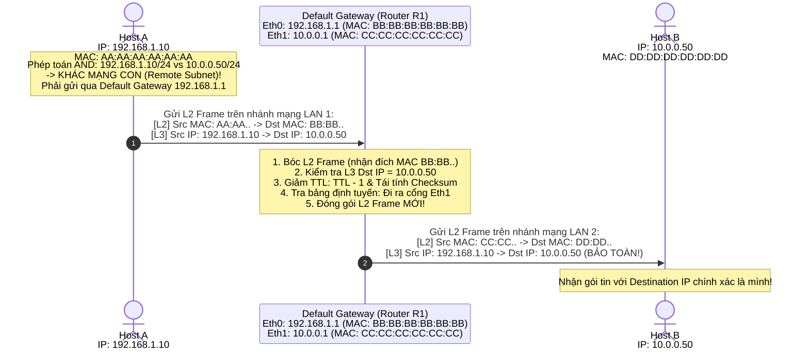

# 2_4_5 Default Gateway and Routing Basics

> **Khóa học**: Cloud DevOps Basic — Networking Core  
> **Phân nhóm**: 2 Domain 2 - Computer Networking Core Fundamentals › 2_4 Network Layer and IP Addressing  
> **Chủ đề**: Cổng mặc định (Default Gateway) & Nguyên lý định tuyến cơ bản: Thuật toán phân định mạng cục bộ vs mạng từ xa, cơ chế chuyển tiếp từng chặng (Hop-by-Hop) và tuyến mặc định 0.0.0.0/0  
> **Trạng thái**: Verified (WRITE-CDB-2_4_5, 14-11-2026)  
> **Checklist đối chiếu**: [2_4_5](<../../../CHECKLIST.md#domain-2-computer-networking-core-fundamentals-43-items>)  

---

## 1. Khái Niệm Cốt Lõi & Bản Chất Kỹ Thuật (Core Concepts & Technical Deep Dive)

Trong kiến trúc liên mạng IPv4, mỗi máy chủ (Host) khi cần truyền tải dữ liệu đều phải đối mặt với một quyết định định tuyến tầng mạng đầu tiên: **Gói tin đích nằm ngay trong phân đoạn mạng cục bộ (Local Subnet) hay thuộc về một mạng từ xa (Remote Network)?** 

Để giải quyết bài toán này mà không đòi hỏi mỗi máy trạm phải lưu trữ toàn bộ bản đồ Internet khổng lồ, ngăn xếp mạng Internet áp dụng cơ chế ủy quyền chuyển tiếp thông qua **Cổng mặc định (Default Gateway)**.

```text
+-----------------------------------------------------------------------+
|                 QUYẾT ĐỊNH ĐỊNH TUYẾN TẠI MÁY TRẠM (HOST)             |
|                                                                       |
|  [Host IP & Netmask]  ==  [Target IP & Netmask]                       |
|           |                                 |                         |
|      (KHỚP NHAU)                      (KHÁC NHAU)                     |
|           v                                 v                         |
|   MẠNG CỤC BỘ (LOCAL)              MẠNG TỪ XA (REMOTE)                |
|   - Phát ARP tìm MAC máy đích      - Gửi khung L2 tới MAC Gateway     |
|   - Truyền trực tiếp L2            - Layer 3 Destination IP giữ nguyên|
+-----------------------------------------------------------------------+
```

---

### 1.1 Thuật Toán Phân Định Cục Bộ vs Từ Xa (Local vs Remote Decision)

Theo chuẩn hóa tại [RFC 1122 Section 3.3.1.1](https://datatracker.ietf.org/doc/html/rfc1122#section-3.3.1.1), trước khi gửi bất kỳ gói tin IP datagram nào xuống tầng liên kết dữ liệu (Data Link Layer - L2), ngăn xếp giao thức mạng của máy chủ nguồn bắt buộc phải thực thi thuật toán kiểm tra logic:

1. Máy chủ lấy **Địa chỉ IP nguồn (`Host IP`)** thực hiện phép toán `Bitwise AND` với **Subnet Mask** của giao diện mạng để xác định `Local Network ID`:
   $$\text{Local NetID} = \text{Host IP} \ \& \ \text{Subnet Mask}$$
2. Máy chủ lấy **Địa chỉ IP đích (`Target IP`)** thực hiện phép toán `Bitwise AND` với chính **Subnet Mask** đó để xác định `Target NetID`:
   $$\text{Target NetID} = \text{Target IP} \ \& \ \text{Subnet Mask}$$
3. Máy chủ tiến hành so sánh hai giá trị:
   - **Nếu $\text{Local NetID} == \text{Target NetID}$ (Cùng mạng con)**:
     - Gói tin đích nằm ngay trên cùng liên kết cục bộ (On-link).
     - Máy chủ tra cứu bảng ARP cache cục bộ hoặc phát sóng bản tin broadcast ARP Request trực tiếp để tìm địa chỉ MAC vật lý của máy đích.
   - **Nếu $\text{Local NetID} \ne \text{Target NetID}$ (Khác mạng con)**:
     - Gói tin đích nằm ở mạng từ xa (Off-link). Máy chủ không thể tiếp cận trực tiếp máy đích bằng khung Ethernet L2.
     - Máy chủ bắt buộc phải chuyển tiếp gói tin tới **Default Gateway** được cấu hình trên giao diện mạng.

---

### 1.2 Vai Trò Của Cổng Mặc Định (Default Gateway) & Tuyến Mặc Định 0.0.0.0/0

- **Default Gateway (Cổng mặc định)**: Là một giao diện của bộ định tuyến (Router) hoặc tường lửa (Firewall) được kết nối trực tiếp vào cùng mạng con với máy trạm. Giao diện này đóng vai trò là "lối thoát hiểm duy nhất" đưa các gói tin rời khỏi mạng LAN nội bộ để vươn ra các mạng khác hoặc Internet.
- **Tuyến đường mặc định (Default Route - `0.0.0.0/0`)**:
  - Trong bảng định tuyến (Routing Table), tuyến mặc định được biểu diễn dưới dạng tiền tố `0.0.0.0/0` (hoặc từ khóa `default`).
  - Địa chỉ `0.0.0.0` với mặt nạ `0.0.0.0` (tiền tố `/0`) mang ý nghĩa toán học: **Khớp với mọi địa chỉ IPv4 đích trên toàn thế giới**.
  - Theo nguyên lý *Longest Prefix Match (Khớp tiền tố dài nhất)*, router hoặc host chỉ sử dụng Default Route khi gói tin đích không khớp với bất kỳ tuyến đường cụ thể nào khác trong bảng định tuyến.

---

### 1.3 Cơ Chế Đóng Gói Khung L2 và Giữ Nguyên Header L3

Đây là một trong những nguyên lý căn bản nhất của kiến trúc mạng Internet được định nghĩa tại [RFC 1122 Section 3.3.1.2](https://datatracker.ietf.org/doc/html/rfc1122#section-3.3.1.2):

Khi máy chủ nguồn gửi một gói tin tới máy đích ở mạng từ xa thông qua Default Gateway:
1. **Tại tầng mạng (Layer 3 - IP Header)**:
   - `Source IP`: Giữ nguyên là địa chỉ IP của máy chủ nguồn.
   - `Destination IP`: **Bắt buộc giữ nguyên là địa chỉ IP của máy chủ đích cuối cùng**. Máy chủ KHÔNG BAO GIỜ thay đổi trường Destination IP thành IP của Gateway!
2. **Tại tầng liên kết dữ liệu (Layer 2 - Ethernet Frame)**:
   - Máy chủ nguồn phát bản tin ARP để tìm địa chỉ MAC của Default Gateway.
   - `Source MAC`: Địa chỉ MAC card mạng của máy chủ nguồn.
   - `Destination MAC`: **Địa chỉ MAC của Default Gateway**.

---

### 1.4 Quy Trình Chuyển Tiếp Từng Chặng (Hop-by-Hop Forwarding Tại Router)

Theo tiêu chuẩn [RFC 1812 Section 5.2.1.2](https://datatracker.ietf.org/doc/html/rfc1812#section-5.2.1.2) và [RFC 1812 Section 5.2.2](https://datatracker.ietf.org/doc/html/rfc1812#section-5.2.2), khi Default Gateway tiếp nhận khung Ethernet:

1. **Bóc tách tầng L2 (Frame Decapsulation)**: Router nhận khung có Destination MAC khớp với MAC giao diện của nó, kiểm tra tính toàn vẹn (FCS trailer) rồi bóc bỏ lớp vỏ Ethernet header.
2. **Thẩm định và xử lý tầng L3 (IP Processing)**:
   - Thẩm định Header Checksum của gói tin IPv4.
   - **Giảm trường Time to Live (TTL) đi ít nhất 1 đơn vị**. Nếu $\text{TTL} \le 0$, router hủy gói tin và gửi bản tin `ICMP Time Exceeded`.
   - Tính toán lại Header Checksum mới do TTL đã bị thay đổi.
3. **Tra bảng định tuyến (Route Lookup)**: Router kiểm tra `Destination IP` gốc trong bảng định tuyến để tìm bước nhảy tiếp theo (Next-Hop Router) hoặc giao diện ra nối với mạng đích.
4. **Tái đóng gói khung L2 mới (Frame Re-encapsulation)**:
   - Router tạo ra một khung Ethernet hoàn toàn mới.
   - `Source MAC` mới = Địa chỉ MAC giao diện cổng ra của chính router.
   - `Destination MAC` mới = Địa chỉ MAC của router chặng tiếp theo (Next-Hop) hoặc của chính máy đích cuối cùng (nếu đã tới mạng đích).
   - **Lưu ý tối thượng**: Gói tin IP bên trong (gồm cả Source IP và Destination IP) được bảo toàn nguyên vẹn xuyên suốt toàn bộ hành trình chuyển tiếp (trừ trường hợp đi qua thiết bị NAT).

---

## 2. Ví Dụ Đời Sống Thực Tế Dễ Hiểu (Intuitive Real-World Analogies)

### Ẩn dụ: "Bưu Cục Xuất Cảnh Của Thị Trấn & Người Giao Thư Quốc Tế"

Để hình dung sự phối hợp giữa L3 IP Address và L2 MAC Address qua Default Gateway, hãy tưởng tượng việc gửi thư tại một thị trấn nhỏ:

```text
+-------------------------------------------------------------------------+
|                  ẨN DỤ GỬI THƯ QUA BƯU CỤC XUẤT CẢNH                    |
|                                                                         |
|  [BÌ THƯ QUỐC TẾ (L3 Datagram)]                                         |
|  Người gửi: Anh Nam (Hà Nội, Việt Nam)     [Source IP]                  |
|  Người nhận: John Smith (London, UK)       [Destination IP - BẤT BIẾN] |
|                                                                         |
|  [TÚI CHUYỂN PHÁT CHẶNG 1 (L2 Frame)]                                   |
|  Người cầm túi: Anh Nam                     [Source MAC]                |
|  Giao tận tay: Bác Trưởng Bưu Cục Thị Trấn [Destination MAC = Gateway] |
|                                                                         |
|  ==> Bác Trưởng Bưu Cục xé túi cũ, kiểm tra hạn gửi (-1 ngày TTL),      |
|      nhét bì thư quốc tế vào TÚI CHUYỂN PHÁT MỚI (L2 Frame chặng 2)     |
|      chuyển cho Sân bay Nội Bài [Next-Hop Gateway].                     |
+-------------------------------------------------------------------------+
```

1. **Gửi thư cùng thôn xóm (Local Subnet)**:
   - Bạn muốn gửi thư cho bác Năm cùng xóm. Bạn liếc nhìn địa chỉ, thấy cùng mã bưu chính thôn xóm $\rightarrow$ Bạn tự chạy bộ sang nhà bấm chuông trao tận tay bác Năm (`ARP tìm MAC trực tiếp`).
2. **Gửi thư ra nước ngoài (Remote Network)**:
   - Bạn muốn gửi thư cho người bạn ở London, nước Anh. Bạn nhận ra bạn không thể tự lái xe máy sang Anh được (không thể gửi thẳng L2 frame qua đại dương).
   - Bạn viết rõ trên phong bì: `To: John Smith, London, UK` (Destination IP).
   - Bạn bỏ phong bì đó vào một chiếc túi bưu gửi nội bộ, ghi tên người nhận chặng này là: **Bác Trưởng Bưu Cục Thị Trấn** (Default Gateway MAC).
3. **Bác Trưởng Bưu Cục làm gì?**:
   - Bác mở túi nội bộ ra, lấy bì thư quốc tế. Bác thấy địa chỉ đích vẫn là `London, UK` (Destination IP không bao giờ bị bôi xóa thành tên Bác Trưởng Bưu Cục!).
   - Bác đóng dấu bưu điện giảm trừ hạn lưu kho 1 ngày (`TTL - 1`), rồi nhét bức thư vào một bao tải hàng không mới gửi tới Sân Bay Quốc Tế (`Next-Hop Router`).

---

## 3. Kiến Trúc, Luồng Hoạt Động & Hình Ảnh Trực Quan (Architecture, Diagrams & Visual Media)

### 3.1 Luồng Dữ Liệu Hoàn Chỉnh Khi Host Truyền Tin Tới Mạng Từ Xa

Sơ đồ thể hiện sự biến đổi của Layer 2 Frame (MAC addresses) và tính bất biến của Layer 3 Packet (IP addresses) khi đi qua Default Gateway:



---

## 4. Thực Hành (Hands-on)

### 4.1 Quản Trị Bảng Định Tuyến & Default Gateway Trên Linux

Trên các bản phân phối Linux hiện đại, bộ công cụ `iproute2` là tiêu chuẩn quản trị bảng định tuyến tầng mạng.

> ⚠️ Chưa chạy thử (not executed by the squad)

```bash
# 1. Hiển thị toàn bộ bảng định tuyến hiện thời của Linux kernel
ip route show

# 2. Kiểm tra đường đi thực tế mà Linux kernel sẽ lựa chọn khi gửi gói tin tới IP từ xa
ip route get 8.8.8.8

# 3. Thêm tuyến đường mặc định (Default Gateway) đi qua IP 192.168.1.1 trên card mạng eth0
sudo ip route add default via 192.168.1.1 dev eth0

# 4. Xóa tuyến mặc định khi cần tái cấu hình
sudo ip route del default via 192.168.1.1 dev eth0
```

> Minh họa kết quả thực thi lệnh `ip route show`:

```text
default via 192.168.1.1 dev eth0 proto dhcp src 192.168.1.10 metric 100
192.168.1.0/24 dev eth0 proto kernel scope link src 192.168.1.10 metric 100
```

> Minh họa kết quả truy vấn đường đi `ip route get 8.8.8.8`:

```text
8.8.8.8 via 192.168.1.1 dev eth0 src 192.168.1.10 uid 1000
    cache
```

#### Phân tích kết quả:
- Tuyến `192.168.1.0/24 dev eth0 scope link`: Tuyến trực tiếp (On-link). Bất kỳ IP đích nào thuộc dải này sẽ được Linux gửi trực tiếp qua card `eth0` bằng bản tin ARP.
- Tuyến `default via 192.168.1.1 dev eth0`: Đại diện cho `0.0.0.0/0`. Mọi IP không thuộc dải `192.168.1.0/24` (như `8.8.8.8`) sẽ được kernel đẩy thẳng tới MAC của gateway `192.168.1.1`.

---

### 4.2 Quản Trị Bảng Định Tuyến Trên Hệ Điều Hành Windows

Trên Windows Server và máy trạm Windows, lệnh `route` quản lý bảng định tuyến IPv4:

> ⚠️ Chưa chạy thử (not executed by the squad)

```cmd
:: Hiển thị bảng định tuyến IPv4 hiện hành
route print -4

:: Thêm tuyến mặc định vĩnh viễn (-p: persistent) qua Default Gateway 192.168.1.1
route add 0.0.0.0 mask 0.0.0.0 192.168.1.1 -p

:: Xóa tuyến mặc định hiện hữu
route delete 0.0.0.0 mask 0.0.0.0
```

> Minh họa kết quả lệnh `route print -4`:

```text
IPv4 Route Table
===========================================================================
Active Routes:
Network Destination        Netmask          Gateway       Interface  Metric
          0.0.0.0          0.0.0.0      192.168.1.1     192.168.1.10     25
      192.168.1.0    255.255.255.0         On-link      192.168.1.10    281
    192.168.1.10  255.255.255.255         On-link      192.168.1.10    281
===========================================================================
```

---

## 5. Cạm Bẫy Thực Tế & Thực Tiễn Sản Xuất (Production Gotchas & Best Practices)

Trong triển khai hạ tầng mạng doanh nghiệp và Cloud DevOps, những sơ suất sau liên quan tới Default Gateway là nguyên nhân gây tê liệt kết nối phổ biến:

1. **Cạm Bẫy Cấu Hình Default Gateway Không Cùng Subnet Với Host**:
   - Nếu Host có IP `192.168.1.10/24` nhưng người quản trị lại cấu hình Default Gateway là `192.168.2.1`:
   - Khi Host muốn gửi gói tin ra Internet, thuật toán kiểm tra thấy Gateway `192.168.2.1` lại nằm ngoài subnet của nó. Để gửi gói tin tới Gateway, Host lại phải hỏi... Gateway!
   - Kết quả: Hệ điều hành báo lỗi *Network is unreachable* hoặc rơi vào tình trạng mất toàn bộ khả năng kết nối ra ngoài.
   - *Quy tắc bất biến*: **Địa chỉ IP của Default Gateway bắt buộc phải là một địa chỉ IP hợp lệ nằm ngay trong cùng mạng con (On-link subnet) với máy chủ**.

2. **Sự Cố Định Tuyến Bất Đối Xứng (Asymmetric Routing) Gây Chặn Kết Nối Tại Stateful Firewall**:
   - Khi mạng doanh nghiệp có 2 Default Gateway: Gói tin gửi đi (Outbound) rời máy chủ qua Firewall A, nhưng gói tin phản hồi (Inbound) quay về qua Router B.
   - Firewall A là tường lửa theo dõi trạng thái phiên (Stateful Inspection). Vì nó không bao giờ nhìn thấy gói tin phản hồi (hoặc Firewall B thấy gói tin SYN-ACK/ACK phản hồi mà không có lượt SYN đi qua nó trước đó), tường lửa sẽ đánh giá đây là gói tin bất hợp lệ và lập tức hủy bỏ (drop). Kết nối TCP bị đứt gãy bí ẩn.

3. **Điểm Lỗi Đơn Yếu (SPOF) Tại Default Gateway & Giao Thức Dự Phòng FHRP**:
   - Nếu hàng trăm máy chủ trong văn phòng hoặc trung tâm dữ liệu đều trỏ Default Gateway vào IP vật lý của một router duy nhất, khi router đó bị sập nguồn, toàn bộ hệ thống bị cô lập khỏi Internet.
   - *Best Practice*: Trong hạ tầng sản xuất, không trỏ trực tiếp vào IP vật lý của thiết bị mà sử dụng các giao thức dự phòng bước nhảy đầu tiên (**First Hop Redundancy Protocol - FHRP**) như **VRRP (Virtual Router Redundancy Protocol, RFC 5798)** hoặc **HSRP**. Hai router sẽ chia sẻ một địa chỉ **Virtual IP (VIP)** và **Virtual MAC** đại diện cho Default Gateway, tự động chuyển đổi dự phòng trong suốt dưới 1 giây nếu một router gặp sự cố.

---

## 6. Câu Hỏi Củng Cố Kiến Thức (Active Recall Quiz)

<details>
<summary><b>Câu hỏi 1:</b> Khi một máy chủ gửi gói tin IP ra Internet xuyên qua Default Gateway, tại sao trường Destination IP trong tiêu đề gói tin không được thay đổi thành IP của Default Gateway?</summary>

**Đáp án:**
Theo RFC 1122 Section 3.3.1.2:
- Tầng Mạng (Layer 3) chịu trách nhiệm định tuyến đầu cuối (End-to-End Delivery) từ máy chủ phát tới máy chủ đích cuối cùng. Do đó, `Destination IP` bắt buộc phải là địa chỉ của máy chủ nhận cuối cùng để các router trung gian trên toàn cầu biết hướng chuyển tiếp.
- Việc chuyển tiếp chặng đầu tiên tới Default Gateway được giải quyết hoàn toàn ở Tầng Liên kết dữ liệu (Layer 2) bằng cách gán `Destination MAC` là địa chỉ MAC của Default Gateway. Nếu thay đổi `Destination IP` thành IP của Gateway, gói tin sẽ bị coi là gửi tới chính Gateway đó và sẽ không bao giờ được chuyển tiếp tới máy chủ thực sự trên Internet.
</details>

<details>
<summary><b>Câu hỏi 2:</b> Một máy trạm có IP <code>10.1.1.50/24</code> muốn gửi dữ liệu tới máy chủ <code>10.1.2.50</code>. Hãy mô tả thuật toán mà máy trạm sử dụng để quyết định gửi trực tiếp qua ARP hay gửi tới Default Gateway?</summary>

**Đáp án:**
Theo RFC 1122 Section 3.3.1.1:
1. Máy trạm lấy IP của nó (`10.1.1.50`) AND với Subnet Mask `/24` (`255.255.255.0`) $\rightarrow$ Thu được `Local NetID = 10.1.1.0`.
2. Máy trạm lấy IP đích (`10.1.2.50`) AND với Subnet Mask `/24` (`255.255.255.0`) $\rightarrow$ Thu được `Target NetID = 10.1.2.0`.
3. So sánh: `10.1.1.0` $\ne$ `10.1.2.0`. Hai địa chỉ mạng khác nhau.
4. Kết luận: Máy chủ đích nằm ở mạng từ xa (Off-link). Máy trạm lập tức tra bảng định tuyến và đẩy gói tin tới địa chỉ MAC của Default Gateway thay vì gửi ARP tìm IP `10.1.2.50`.
</details>

<details>
<summary><b>Câu hỏi 3:</b> Khi router (Default Gateway) tiếp nhận khung Ethernet từ Host và chuẩn bị chuyển tiếp gói tin sang mạng tiếp theo, những trường nào trong tiêu đề L2 và L3 bị thay đổi và những trường nào được giữ nguyên?</summary>

**Đáp án:**
Theo RFC 1812:
- **Các trường bị thay đổi:**
  - `Layer 2 Header`: Toàn bộ L2 header cũ bị bóc bỏ và thay thế bằng header mới: `Source MAC` đổi thành MAC cổng ra của Router, `Destination MAC` đổi thành MAC của trạm tiếp theo (Next-hop hoặc máy đích). Khung FCS trailer L2 cũng được tính lại.
  - `Layer 3 Header`: Trường `Time to Live (TTL)` bị giảm đi ít nhất 1 đơn vị, và trường `Header Checksum` được tính toán lại tương ứng.
- **Các trường được bảo toàn nguyên vẹn:**
  - `Source IP Address` và `Destination IP Address` ở tiêu đề L3 được giữ nguyên vẹn.
  - Toàn bộ dữ liệu tải trọng (Payload Layer 4 TCP/UDP và dữ liệu ứng dụng) được giữ nguyên vẹn.
</details>

---

## 7. 📚 Nguồn Tài Liệu Chính Thống (Tier-1 Official References)

- [RFC 1122: Requirements for Internet Hosts -- Communication Layers](https://datatracker.ietf.org/doc/html/rfc1122#section-3.3.1.1) - Tiêu chuẩn máy chủ IETF, Mục 3.3.1.1 quy định thuật toán phân định On-link vs Off-link và Mục 3.3.1.2 quy định luồng gửi gói tin qua Gateway.
- [RFC 1812: Requirements for IP Version 4 Routers](https://datatracker.ietf.org/doc/html/rfc1812#section-5.2.1.2) - Tiêu chuẩn kỹ thuật IETF cho bộ định tuyến, Mục 5.2.1.2 quy định quy trình chuyển tiếp gói tin từng chặng (Hop-by-Hop Forwarding) và Mục 5.2.2 về cập nhật Checksum.
- [Linux Manual Pages: ip-route(8)](https://man7.org/linux/man-pages/man8/ip-route.8.html) - Hướng dẫn chính thức về quản trị bảng định tuyến kernel Linux, cú pháp cấu hình `default via` và cơ chế `ip route get`.
- [Microsoft Learn: Windows Commands - route](https://learn.microsoft.com/en-us/windows-server/administration/windows-commands/route_ws2008) - Tài liệu kỹ thuật chính thức từ Microsoft về công cụ dòng lệnh quản lý bảng định tuyến và Default Gateway trên Windows.
