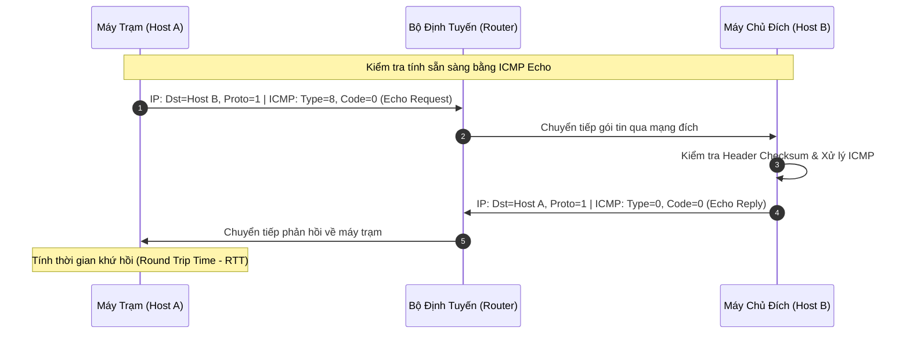
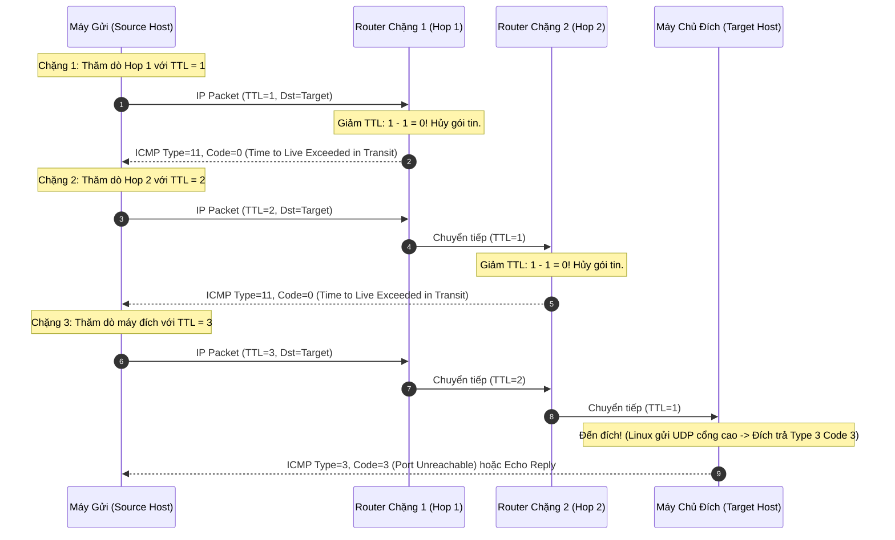

# 2_4_6 ICMP

> **Khóa học**: Cloud DevOps Basic — Networking Core  
> **Phân nhóm**: 2 Domain 2 - Computer Networking Core Fundamentals › 2_4 Network Layer and IP Addressing  
> **Chủ đề**: Giao thức thông điệp điều khiển Internet (ICMP - Internet Control Message Protocol)  
> **Trạng thái**: Verified (WRITE-CDB-2_4_6, 14-11-2026)  
> **Checklist đối chiếu**: [2_4_6](<../../../CHECKLIST.md#domain-2-computer-networking-core-fundamentals-43-items>)  

---

## 1. Khái Niệm Cốt Lõi & Bản Chất Kỹ Thuật (Core Concepts & Technical Deep Dive)

Trong kiến trúc mạng TCP/IP, giao thức **ICMP (Internet Control Message Protocol)**, được chuẩn hóa theo [RFC 792](https://datatracker.ietf.org/doc/html/rfc792), đóng vai trò là "hệ thần kinh phản xạ" của Tầng Mạng (Network Layer - L3). Nếu IP đảm nhận nhiệm vụ chuyển phát gói tin tốt nhất có thể (Best-Effort Delivery) mà không bảo đảm độ tin cậy, thì ICMP là cơ chế chuyên biệt giúp các thiết bị định tuyến (routers) và máy trạm (hosts) thông báo các sự cố xử lý gói tin hoặc thực hiện chẩn đoán liên lạc.

```
+-------------------------------------------------------------------------+
|                  VỊ TRÍ ĐÓNG GÓI VÀ BẢN CHẤT CỦA ICMP                   |
|                                                                         |
|  [IPv4 Header (20 Bytes)] -> [Protocol field = 1 (ICMP)]                |
|  +-----------------------+-------------------------------------------+  |
|  | IPv4 Header           | ICMP Message (Header: Type, Code, Cksum)  |  |
|  +-----------------------+-------------------------------------------+  |
|  - Không phục vụ truyền tải dữ liệu ứng dụng của người dùng             |
|  - Phản ánh trạng thái lỗi mạng, kiểm tra tính khả dụng (ping)          |
|  - Dò vết đường đi gói tin qua từng bước nhảy (traceroute)               |
+-------------------------------------------------------------------------+
```

---

### 1.1 Vị Trí Kiến Trúc và Cấu Trúc Header của ICMP

1. **Vị trí đóng gói**:
   - ICMP được định danh bởi giá trị **Protocol = 1** trong trường Protocol của IPv4 Header.
   - Mặc dù thông điệp ICMP được đóng gói trực tiếp bên trong gói tin IPv4 (giống như một giao thức tầng cao), nhưng ICMP là một thành phần hữu cơ không thể tách rời của chính Tầng Mạng (RFC 792).

2. **Cấu trúc Header chuẩn (RFC 792)**:
   Mọi thông điệp ICMP đều bắt đầu bằng một header tối thiểu 4 octet (32 bit):
   - **Type (8 bits)**: Xác định định dạng và ý nghĩa chung của thông điệp ICMP (ví dụ: Echo Request, Destination Unreachable).
   - **Code (8 bits)**: Bổ sung chi tiết ngữ cảnh cụ thể cho Type (ví dụ: lý do không đến được đích là do mạng, do host hay do cổng dịch vụ).
   - **Checksum (16 bits)**: Mã kiểm tra phần bù 1 (1's complement) tính toán trên toàn bộ thông điệp ICMP bắt đầu từ trường Type.
   - **Data Payload của Thông điệp Báo lỗi**: Khi một thông điệp lỗi ICMP được tạo ra, trường dữ liệu của nó bắt buộc phải chứa **toàn bộ IPv4 Header của gói tin gây lỗi ban đầu + tối thiểu 64 bits (8 octets) đầu tiên của dữ liệu** trong gói tin đó (RFC 792). Nhờ 64 bit dữ liệu này, host gửi ban đầu có thể trích xuất được Port nguồn/đích của TCP/UDP hoặc Sequence Number để định danh chính xác tiến trình hay kết nối nào đã gặp sự cố.

---

### 1.2 Bảng Phân Loại Các Loại Thông Điệp ICMP (Types & Codes) Cốt Lõi

Theo chuẩn [RFC 792](https://datatracker.ietf.org/doc/html/rfc792) và [RFC 1191](https://datatracker.ietf.org/doc/html/rfc1191):

| Type | Code | Tên Thông Điệp (Message Name) | Ý nghĩa Kỹ thuật | Tiện ích / Ứng dụng liên quan |
| :--- | :--- | :--- | :--- | :--- |
| **8** | `0` | **Echo Request** | Yêu cầu máy đích phản hồi để kiểm tra khả năng kết nối mạng. | Lệnh `ping` (chiều đi) |
| **0** | `0` | **Echo Reply** | Thông điệp phản hồi lại Echo Request. | Lệnh `ping` (chiều về) |
| **3** | `0` | **Net Unreachable** | Router không tìm thấy đường định tuyến tới mạng đích. | Định tuyến L3 thất bại |
| **3** | `1` | **Host Unreachable** | Đã đến router chặng cuối nhưng máy trạm đích không phản hồi ARP. | Thiết bị đích tắt/ngắt kết nối |
| **3** | `2` | **Protocol Unreachable** | Ngăn xếp mạng tại host đích không hỗ trợ giao thức tầng trên (L4). | Lỗi hệ điều hành / giao thức lạ |
| **3** | `3` | **Port Unreachable** | Cổng đích (UDP Port) không có ứng dụng nào đang mở lắng nghe. | Lệnh `traceroute` (Linux UDP probe) |
| **3** | `4` | **Fragmentation Needed and DF set** | Gói tin vượt quá MTU của chặng tiếp theo nhưng cờ DF (Don't Fragment) = 1. | Cơ chế Path MTU Discovery (PMTUD) |
| **11**| `0` | **TTL Exceeded in Transit** | Gói tin có trường Time to Live bị giảm về 0 trên đường chuyển tiếp. | Lệnh `traceroute` / Dò vết mạng |
| **11**| `1` | **Fragment Reassembly Time Exceeded**| Hết thời gian chờ mà máy đích không nhận đủ các mảnh để ghép lại. | Lỗi phân mảnh gói tin IPv4 |
| **5** | `0-3`| **Redirect** | Router thông báo cho máy trạm gửi qua một router khác tối ưu hơn. | Tối ưu hóa bảng định tuyến cục bộ |

---

### 1.3 Quy Tắc Ngăn Chặn Vòng Lặp Lỗi Vô Hạn (Infinite Regress Prevention)

Một trong những nguyên lý thiết kế sống còn nhất của ICMP nhằm bảo vệ sự ổn định của mạng Internet là ngăn chặn hiện tượng tạo bão gói tin lỗi vô tận (Storm of error messages). Theo quy định nghiêm ngặt tại [RFC 792](https://datatracker.ietf.org/doc/html/rfc792) và [RFC 1812 Section 4.3.2.7](https://datatracker.ietf.org/doc/html/rfc1812#section-4.3.2.7):

> **Nguyên tắc bất khả xâm phạm**: Một thông điệp báo lỗi ICMP (ICMP Error Message) **TUYỆT ĐỐI KHÔNG ĐƯỢC PHÉP ĐƯỢC TẠO RA** để phản hồi lại:
> 1. Một thông điệp báo lỗi ICMP khác.
> 2. Gói tin gửi tới địa chỉ IP Broadcast hoặc IP Multicast.
> 3. Các mảnh phân mảnh gói tin không phải là mảnh đầu tiên (Non-initial fragments).

*Giải thích kỹ thuật*: Nếu một router gửi thông điệp lỗi ICMP Type 3 cho một thông điệp lỗi ICMP Type 3 khác bị hỏng trên đường đi, hai thiết bị sẽ liên tục bắn các gói báo lỗi qua lại cho nhau đến khi cạn kiệt băng thông và tài nguyên CPU của hệ thống.

---

### 1.4 Nguyên Lý Dò Tuyến của `traceroute` (Incremental TTL Mechanics)

Tiện ích dò vết mạng `traceroute` (hoặc `tracert` trên Windows) khai thác trực tiếp cơ chế xử lý trường **TTL (Time to Live)** trong IPv4 Header và thông điệp **ICMP Type 11 Code 0 (TTL Exceeded)** theo [RFC 1812 Section 5.3.1](https://datatracker.ietf.org/doc/html/rfc1812#section-5.3.1):

```
Chặng 1: Gửi gói có TTL = 1  --> Router 1 giảm TTL về 0  --> Router 1 gửi trả ICMP Type 11 Code 0
Chặng 2: Gửi gói có TTL = 2  --> Vượt qua R1 (TTL=1) -> R2 giảm TTL về 0 -> R2 trả ICMP Type 11 Code 0
Chặng 3: Gửi gói có TTL = 3  --> Vượt qua R1, R2 -> Đến Đích (Type 3 Code 3 hoặc Type 0) -> Hoàn tất!
```

---

## 2. Ví Dụ Đời Sống Thực Tế Dễ Hiểu (Intuitive Real-World Analogies)

```
+-----------------------------------------------------------------------------+
|                      MÔ HÌNH SO SÁNH ĐỜI SỐNG THỰC TẾ                       |
|                                                                             |
|  [IP Thông Thường] --> Đoàn tàu chở hàng hóa của khách hàng                  |
|                         Chở dữ liệu ứng dụng (Web, File, Video).            |
|                                                                             |
|  [ICMP]            --> Hệ thống Còi Hú, Cờ Hiệu và Biên Bản Kiểm Soát       |
|                         Không chở hàng hóa; chỉ cảnh báo đường tắc, cầu     |
|                         sập, hoặc xác nhận trạm kiểm soát còn mở cửa.       |
|                                                                             |
|  [Ping]            --> Tiếng gọi đò: "Bên kia có ai không?" (Echo Request)  |
|                         Đáp lại: "Có tôi đây!" (Echo Reply).                |
|                                                                             |
|  [Traceroute]      --> Thả canô với bình xăng đong đúng từng lít:          |
|                         Bình 1 lít: Chết máy ở trạm gác 1 -> Trạm lập BB.   |
|                         Bình 2 lít: Chết máy ở trạm gác 2 -> Trạm lập BB.   |
|                                                                             |
|  [Chống lặp lỗi]   --> Nguyên tắc thanh tra: Cấm lập biên bản phạt đối với   |
|                         chính một tờ biên bản phạt!                         |
+-----------------------------------------------------------------------------+
```

1. **Bản chất của ICMP**:
   - Nếu dữ liệu IP bình thường giống như đoàn tàu chở hành khách và bưu phẩm qua các nhà ga, thì **ICMP** là chiếc còi báo động, cờ hiệu hoặc biên bản sự cố của nhân viên tuần đường. Nó không chở hàng của hành khách; nhiệm vụ duy nhất của nó là thông báo: *"Đoạn đường phía trước bị sạt lở (Net Unreachable)"* hoặc *"Đoàn tàu quá cao không chui lọt hầm (Fragmentation Needed)"*.
2. **Nguyên lý Traceroute**:
   - Tưởng tượng bạn muốn vẽ bản đồ các trạm gác trên sông nhưng các trạm không chủ động báo vị trí. Bạn cử một chiếc canô chỉ đổ đúng **1 lít xăng (TTL=1)**. Canô vừa chạy tới trạm gác số 1 thì hết xăng; nhân viên trạm gác số 1 buộc phải ký một tờ biên bản hết hạn (ICMP Type 11) gửi về cho bạn, giúp bạn biết tọa độ trạm 1. Tiếp theo, bạn đổ **2 lít xăng (TTL=2)** để canô vượt qua trạm 1 và hết xăng ngay tại trạm gác số 2. Cứ như vậy, bạn vẽ được toàn bộ hành trình.
3. **Quy tắc chống lặp vô hạn (Infinite Regress)**:
   - Trong luật thanh tra: Cảnh sát giao thông lập biên bản vi phạm cho người đi xe máy. Nhưng nếu tờ biên bản đó bị viết sai chính tả, cảnh sát khác không được phép lập biên bản phạt lên chính tờ biên bản đó, nếu không hệ thống hành chính sẽ ngập trong hàng triệu tờ biên bản phạt nhau mà không ai giải quyết được việc gì.

---

## 3. Kiến Trúc, Luồng Hoạt Động & Hình Ảnh Trực Quan (Architecture, Diagrams & Visual Media)

### 3.1 Luồng Thông Điệp ICMP Echo Request & Echo Reply (`ping`)



---

### 3.2 Luồng Dò Vết Đường Đi Bằng `traceroute` Qua Từng Chặng (Incremental TTL)



---

## 4. Thực Hành Lệnh Chẩn Đoán & Minh Họa Đầu Ra (Hands-on CLI & Output Simulation)

Các tiện ích quản trị mạng tiêu chuẩn sử dụng ICMP bao gồm `ping` và `traceroute` (trên Linux) hoặc `tracert` (trên Windows).

> ⚠️ Chưa chạy thử (not executed by the squad)

### 4.1 Kiểm Tra Kết Nối với `ping` trên Linux

```bash
# Gửi chính xác 4 gói tin ICMP Echo Request tới địa chỉ đích
ping -c 4 192.168.1.1
```

Minh họa kết quả đầu ra thực tế:

```text
PING 192.168.1.1 (192.168.1.1) 56(84) bytes of data.
64 bytes from 192.168.1.1: icmp_seq=1 ttl=64 time=0.452 ms
64 bytes from 192.168.1.1: icmp_seq=2 ttl=64 time=0.389 ms
64 bytes from 192.168.1.1: icmp_seq=3 ttl=64 time=0.412 ms
64 bytes from 192.168.1.1: icmp_seq=4 ttl=64 time=0.395 ms

--- 192.168.1.1 ping statistics ---
4 packets transmitted, 4 received, 0% packet loss, time 3074ms
rtt min/avg/max/mdev = 0.389/0.412/0.452/0.024 ms
```

*Phân tích thông số kỹ thuật*:
- `icmp_seq=1`: Số thứ tự tuần tự của thông điệp Echo Request, giúp phát hiện gói tin bị mất hoặc đến sai thứ tự.
- `ttl=64`: Giá trị Time to Live trong gói phản hồi Echo Reply nhận được từ máy đích.
- `time=0.452 ms`: Thời gian trễ khứ hồi (Round-Trip Time - RTT) tính từ lúc gửi Request đến khi nhận được Reply.

---

### 4.2 Dò Vết Đường Đi với `traceroute` trên Linux và `tracert` trên Windows

Trên Linux, tiện ích `traceroute` theo mặc định truyền các gói tin **UDP mang số hiệu cổng cao** (không dùng ICMP Echo Request) và tăng dần TTL để kích hoạt phản hồi ICMP Type 11 Code 0 từ các router trung gian:

> ⚠️ Chưa chạy thử (not executed by the squad)

```bash
# Dò tuyến đường tới IP đích mà không phân giải ngược tên miền DNS (-n)
traceroute -n 203.0.113.50
```

Minh họa kết quả đầu ra:

```text
traceroute to 203.0.113.50 (203.0.113.50), 30 hops max, 60 byte packets
 1  192.168.1.1  0.512 ms  0.488 ms  0.465 ms
 2  198.51.100.1  2.145 ms  2.098 ms  2.112 ms
 3  203.0.113.50  8.324 ms  8.289 ms  8.310 ms
```

Trên hệ điều hành Windows, công cụ `tracert` hoạt động với cơ chế hơi khác: nó truyền trực tiếp các gói tin **ICMP Echo Request** với giá trị TTL tăng dần:

> ⚠️ Chưa chạy thử (not executed by the squad)

```cmd
:: Trên command line của Windows
tracert 203.0.113.50
```

Minh họa kết quả đầu ra:

```text
Tracing route to 203.0.113.50 over a maximum of 30 hops:

  1    <1 ms    <1 ms    <1 ms  192.168.1.1
  2     2 ms     2 ms     2 ms  198.51.100.1
  3     8 ms     8 ms     8 ms  203.0.113.50

Trace complete.
```

---

## 5. Cạm Bẫy Thực Tế & Thực Tiễn Sản Xuất (Production Gotchas & Best Practices)

1. **Cạm bẫy Chặn Toàn bộ ICMP trên Tường lửa (Drop-All ICMP Security Fallacy)**:
   - Nhiều kỹ sư bảo mật cấu hình tường lửa (Firewall / Cloud Security Group) theo chính sách chặn hoàn toàn mọi gói tin ICMP (`iptables -A INPUT -p icmp -j DROP`) với suy nghĩ "để hacker không ping thấy server".
   - **Hậu quả nghiêm trọng**: Việc chặn toàn bộ ICMP sẽ chặn luôn gói tin **ICMP Type 3 Code 4 (Fragmentation Needed and DF set)**. Điều này phá hủy cơ chế Path MTU Discovery (PMTUD), dẫn đến hiện tượng treo cứng kết nối TCP đối với các gói dữ liệu lớn (PMTUD Black Hole).
   - **Best Practice**: Chỉ chặn ICMP Echo Request (Type 8) nếu chính sách yêu cầu ẩn máy chủ, nhưng **bắt buộc phải cho phép ICMP Type 3 Code 4** và **Type 11 Code 0** lưu thông tự do để duy trì chức năng định tuyến và kiểm soát kích thước gói tin.

2. **Sự Khác Biệt Giữa Tiện Ích Traceroute Trên Linux và Windows**:
   - Tiện ích `traceroute` trên Linux mặc định gửi các gói tin **UDP** tới các cổng ngẫu nhiên trong dải $33434–33534$.
   - Tiện ích `tracert` trên Windows lại gửi gói tin **ICMP Echo Request** (Type 8).
   - **Sự cố thực tế**: Khi kiểm tra kết nối qua một tường lửa chỉ mở cổng ICMP nhưng chặn dải UDP cao, lệnh `tracert` của Windows chạy thành công mượt mà, trong khi lệnh `traceroute` trên Linux lại hiển thị toàn dấu sao `* * *` (timeout). Quản trị viên cần nắm rõ bản chất để sử dụng cờ tương ứng (ví dụ trên Linux dùng `traceroute -I` để đổi sang gửi ICMP Echo).

3. **Ngộ Nhận "Ping Được Đồng Nghĩa Ứng Dụng Đang Chạy Tốt"**:
   - Phản hồi ICMP Echo Reply (Type 0) được xử lý trực tiếp bởi nhân hệ điều hành (Kernel Network Stack), hoàn toàn độc lập với các tiến trình chạy ở không gian người dùng (User Space).
   - Một máy chủ web (Nginx/Apache) hoặc Database có thể đã bị treo, sập hoàn toàn hoặc dính deadlock, nhưng hệ điều hành bên dưới vẫn trả lời gói `ping` bình thường.
   - **Best Practice**: Trong giám sát sản xuất (Health Check), không bao giờ dùng ICMP Ping làm tiêu chí duy nhất để khẳng định dịch vụ còn sống; bắt buộc phải kết hợp kiểm tra L4 (TCP port check) hoặc L7 (HTTP 200 OK probe).

---

## 6. Câu Hỏi Củng Cố Kiến Thức (Active Recall Quiz)

<details>
<summary><b>Câu hỏi 1:</b> Tại sao trong cấu trúc thông điệp báo lỗi của ICMP (RFC 792), phần dữ liệu (payload) lại bắt buộc phải trích xuất lại IPv4 Header ban đầu kèm theo tối thiểu 64 bits (8 octets) đầu tiên của dữ liệu gói tin gốc?</summary>

**Đáp án:**
Theo RFC 792:
- Tầng Mạng (IP/ICMP) hoạt động theo nguyên tắc phi trạng thái (stateless) giữa các thiết bị trung gian.
- Khi một máy trạm nhận được thông điệp báo lỗi ICMP (ví dụ Destination Unreachable hoặc Time Exceeded), nếu không có dữ liệu gốc, máy trạm chỉ biết có một sự cố xảy ra nhưng không thể biết tiến trình nào hoặc luồng kết nối nào đã phát sinh lỗi đó.
- Việc trích xuất toàn bộ IPv4 Header gốc kèm 64 bit (8 byte) đầu tiên của payload cho phép host trích xuất được trường Source Port và Destination Port của TCP hoặc UDP (nằm ngay 4 byte đầu tiên của L4 header), hoặc trường Sequence Number. Nhờ đó, nhân hệ điều hành có thể đối chiếu chính xác socket nào trong bảng kết nối để thông báo lỗi cho ứng dụng tương ứng.
</details>

<details>
<summary><b>Câu hỏi 2:</b> Theo chuẩn RFC 792 và RFC 1812 Section 4.3.2.7, hãy nêu hai trường hợp mà một bộ định tuyến bị NGHIÊM CẤM gửi thông điệp báo lỗi ICMP để tránh gây vòng lặp vô hạn (Infinite Regress)?</summary>

**Đáp án:**
Theo RFC 792 và RFC 1812 (Section 4.3.2.7):
1. Router tuyệt đối không được gửi một thông điệp báo lỗi ICMP để phản hồi lại một thông điệp báo lỗi ICMP khác.
2. Router tuyệt đối không được gửi thông điệp báo lỗi ICMP để phản hồi lại các gói tin được gửi tới địa chỉ IP Broadcast hoặc IP Multicast.
(Ngoài ra, cũng không được gửi cho các mảnh phân mảnh gói tin không phải mảnh đầu tiên - non-initial fragments).
</details>

<details>
<summary><b>Câu hỏi 3:</b> Trong tiện ích <code>traceroute</code>, cơ chế kỹ thuật nào làm cho các router trung gian trên đường truyền bắt buộc phải bộc lộ địa chỉ IP của chúng về cho máy gửi?</summary>

**Đáp án:**
Theo RFC 1812 (Section 5.3.1):
- Tiện ích `traceroute` khai thác trường **TTL (Time to Live)** trong IPv4 Header bằng cách gửi các gói tin thăm dò với giá trị TTL tăng dần (chặng 1 gửi TTL=1, chặng 2 gửi TTL=2, v.v.).
- Mỗi khi gói tin đi qua một router trung gian, router bắt buộc phải giảm giá trị TTL đi 1 đơn vị.
- Khi TTL giảm xuống bằng 0, router không được phép chuyển tiếp gói tin tiếp nữa mà phải hủy bỏ (discard) gói tin, đồng thời tạo một thông điệp **ICMP Type 11 Code 0 (Time to Live Exceeded in Transit)** gửi ngược về cho IP nguồn.
- Địa chỉ IP nguồn của gói tin ICMP Type 11 này chính là địa chỉ IP của router trung gian đó, cho phép máy gửi xác định được danh tính và đo độ trễ của từng bước nhảy (hop) trên đường đi.
</details>

---

## 7. 📚 Nguồn Tài Liệu Chính Thống (Tier-1 Official References)

- [RFC 792: Internet Control Message Protocol (ICMP)](https://datatracker.ietf.org/doc/html/rfc792) - Đặc tả gốc của DARPA/IETF về cấu trúc header, mã lỗi Type/Code và quy tắc ngăn chặn lặp lỗi vô hạn.
- [RFC 1191: Path MTU Discovery (Section 4: ICMP Messages)](https://datatracker.ietf.org/doc/html/rfc1191#section-4) - Định nghĩa mã lỗi ICMP Type 3 Code 4 (Fragmentation Needed and DF set) phục vụ PMTUD.
- [RFC 1812: Requirements for IP Version 4 Routers (Section 4.3.2.7 & Section 5.3.1)](https://datatracker.ietf.org/doc/html/rfc1812) - Tiêu chuẩn quy định router xử lý cờ TTL và các trường hợp nghiêm cấm tạo thông điệp báo lỗi ICMP.
- [Linux man-pages: ping(8)](https://man7.org/linux/man-pages/man8/ping.8.html) - Hướng dẫn chính thức về công cụ ping gửi gói ICMP Echo Request trên Linux.
- [Linux man-pages: traceroute(8)](https://man7.org/linux/man-pages/man8/traceroute.8.html) - Tài liệu tiêu chuẩn về nguyên lý hoạt động của traceroute qua trường TTL và phản hồi ICMP Time Exceeded.
- [Microsoft Learn: tracert command reference](https://learn.microsoft.com/en-us/windows-server/administration/windows-commands/tracert) - Hướng dẫn chính thức của Microsoft về tiện ích tracert sử dụng ICMP Echo Requests với TTL tăng dần.
