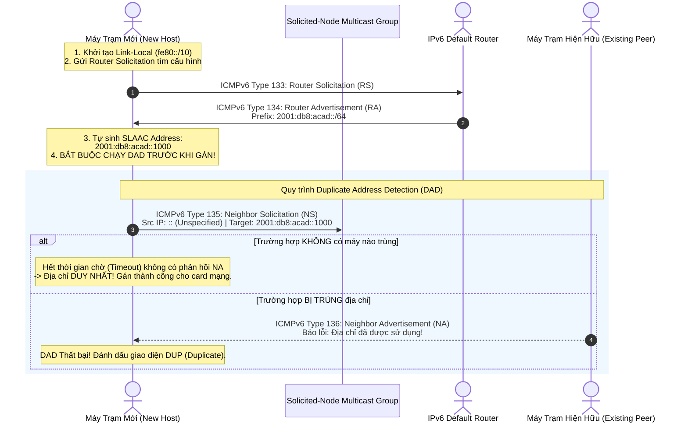

# 2_4_7 IPv6 Architecture

> **Khóa học**: Cloud DevOps Basic — Networking Core  
> **Phân nhóm**: 2 Domain 2 - Computer Networking Core Fundamentals › 2_4 Network Layer and IP Addressing  
> **Chủ đề**: Kiến trúc địa chỉ IPv6: Định dạng 128-bit, tiêu đề cố định 40 byte, khai tử Broadcast, giao thức khám phá láng giềng NDP và tự động cấu hình SLAAC / DAD  
> **Trạng thái**: Draft (WRITE-CDB-2_4_7, 14-11-2026)  
> **Checklist đối chiếu**: [2_4_7](<../../../CHECKLIST.md#domain-2-computer-networking-core-fundamentals-43-items>)  

---

## 1. Khái Niệm Cốt Lõi & Bản Chất Kỹ Thuật (Core Concepts & Technical Deep Dive)

Trước sự cạn kiệt tất yếu của không gian địa chỉ IPv4 32-bit (chỉ cung cấp xấp xỉ 4,29 tỷ địa chỉ), tổ chức IETF đã chuẩn hóa **Internet Protocol Version 6 (IPv6)** thông qua các tiêu chuẩn nền tảng [RFC 8200](https://datatracker.ietf.org/doc/html/rfc8200) và [RFC 4291](https://datatracker.ietf.org/doc/html/rfc4291). IPv6 không chỉ đơn thuần là việc mở rộng không gian địa chỉ lên **128 bits** ($2^{128} \approx 3,4 \times 10^{38}$ địa chỉ) mà còn là một cuộc đại tu kiến trúc mạng: tinh giản tiêu đề gói tin, khai tử hoàn toàn bão quảng bá (Broadcast), và tự động hóa quản trị mạng không trạng thái.

```text
+-------------------------------------------------------------------------+
|                  SỰ ĐỘT PHÁ KIẾN TRÚC GIỮA IPV4 VÀ IPV6                 |
|                                                                         |
|  Đặc tính                 IPv4 (RFC 791)           IPv6 (RFC 8200)       |
|  ---------------------------------------------------------------------  |
|  Độ dài địa chỉ           32 bits (4 bytes)        128 bits (16 bytes)   |
|  Số lượng địa chỉ         ~4,29 x 10^9             ~3,4 x 10^38          |
|  Kích thước Header        Biến thiên (20-60 bytes) CỐ ĐỊNH 40 BYTES      |
|  Header Checksum          Có (tính lại mỗi hop)    LOẠI BỎ HOÀN TOÀN     |
|  Phân mảnh trung gian     Router được phân mảnh    CẤM ROUTER PHÂN MẢNH  |
|  Cơ chế truyền quảng bá   Broadcast (Lãng phí L2)  KHAI TỬ (Dùng Multicast)|
|  Phân giải địa chỉ MAC    ARP (Phát Broadcast)     NDP (Multicast ICMPv6)|
|  Cấu hình địa chỉ IP      Thủ công / DHCP          SLAAC tự động + DAD   |
+-------------------------------------------------------------------------+
```

---

### 1.1 Cấu Trúc Địa Chỉ IPv6 128-bit & Quy Tắc Rút Gọn (RFC 4291)

Theo [RFC 4291 Section 2.2](https://datatracker.ietf.org/doc/html/rfc4291#section-2.2), địa chỉ IPv6 128-bit được biểu diễn dưới dạng **8 nhóm (hextets)**, mỗi nhóm gồm 4 chữ số hệ thập lục phân (hexadecimal), ngăn cách nhau bởi dấu hai chấm (`:`):
$$\text{x:x:x:x:x:x:x:x}$$
*(Mỗi `x` là một giá trị hex 16-bit, từ `0000` đến `ffff`)*.

Để đơn giản hóa quá trình ghi chép và cấu hình, RFC 4291 quy định hai quy tắc rút gọn bắt buộc:
1. **Lược bỏ các số 0 ở đầu (Omit Leading Zeros)**: Trong mỗi nhóm 16-bit, các số `0` đứng đầu được phép bỏ qua. Ví dụ: `0042` rút gọn thành `42`, `0000` rút gọn thành `0`.
2. **Nén dãy số 0 liên tục bằng dấu hai chấm kép (`::`)**:
   - Một chuỗi gồm một hoặc nhiều nhóm `0000` liên tiếp nhau có thể được nén lại thành một ký hiệu `::` duy nhất.
   - **Quy tắc tuyệt đối**: Dấu `::` **chỉ được phép xuất hiện tối đa một lần duy nhất** trong toàn bộ một địa chỉ IPv6. Nếu xuất hiện từ 2 lần trở lên, hệ thống sẽ không thể suy diễn toán học xem mỗi dấu `::` đại diện cho bao nhiêu nhóm số 0 bị thiếu.

*Ví dụ chuyển đổi:*
- Địa chỉ đầy đủ: `2001:0db8:0000:0000:0000:0000:1428:57ab`
- Lược bỏ số 0 đầu: `2001:db8:0:0:0:0:1428:57ab`
- Nén dãy số 0 (`::`): `2001:db8::1428:57ab`

---

### 1.2 Phân Loại Phạm Vi Địa Chỉ (IPv6 Scopes)

Theo RFC 4291 và RFC 4193, không gian địa chỉ IPv6 được phân bổ thành các khối chức năng và phạm vi hoạt động (Scopes) rõ ràng:

| Loại địa chỉ (Address Type) | Tiền tố nhị phân / CIDR | Phạm vi hoạt động (Scope) | Đặc tính kỹ thuật chính |
| :--- | :--- | :--- | :--- |
| **Global Unicast (GUA)** | `2000::/3` (001...) | Toàn cầu (Public Internet) | Địa chỉ định tuyến công cộng trên toàn cầu (tương đương Public IPv4). Được cấp phát theo phân tầng IANA $\rightarrow$ RIR $\rightarrow$ ISP. |
| **Link-Local Address (LLA)** | `fe80::/10` (1111 1110 10...) | Cục bộ liên kết (On-link only) | Tự động tạo trên mọi giao diện IPv6. **Không bao giờ được router định tuyến ra ngoài**. Dùng cho giao thức nội bộ (NDP, OSPFv3). |
| **Unique Local (ULA)** | `fc00::/7` (1111 110...) | Nội bộ doanh nghiệp (Site-local) | Tương đương dải Private RFC 1918 của IPv4. Không định tuyến ra Internet công cộng ([RFC 4193](https://datatracker.ietf.org/doc/html/rfc4193#section-3.1)). |
| **Multicast Address** | `ff00::/8` (1111 1111...) | Nhóm thiết bị (Group) | Gửi 1 gói tin tới đồng thời nhiều thiết bị tham gia nhóm multicast tương ứng. |
| **Loopback Address** | `::1/128` (0...01) | Nội bộ thiết bị (Node-local) | Tương đương `127.0.0.1` của IPv4, dùng cho kiểm thử ngăn xếp mạng cục bộ. |
| **Unspecified Address** | `::/128` (Toàn bit 0) | Chưa xác định | Đại diện cho sự vắng mặt của địa chỉ, dùng làm Source IP khi máy mới khởi động chạy DAD. |

---

### 1.3 Khai Tử Broadcast: Sự Thống Trị Của Multicast & Anycast

Một trong những cải tiến mang tính cách mạng nhất của [RFC 4291 Section 2](https://datatracker.ietf.org/doc/html/rfc4291#section-2) là: **IPv6 hoàn toàn loại bỏ khái niệm địa chỉ quảng bá (Broadcast)**.
- Trong IPv4, các bản tin broadcast (như ARP Request) bắt buộc mọi thiết bị trong cùng mạng L2 phải ngắt quãng CPU, bóc tách khung Ethernet và phân tích gói tin dù gói tin đó hoàn toàn không dành cho chúng. Hiện tượng này dẫn tới nguy cơ bão quảng bá (Broadcast Storm).
- Trong IPv6, toàn bộ chức năng gửi tới mọi thiết bị hoặc tìm kiếm dịch vụ được thay thế hoàn toàn bằng:
  - **Multicast**: Gói tin chỉ được gửi tới các cổng mạng đã đăng ký tham gia nhóm địa chỉ multicast tương ứng (nhờ IGMP/MLD Snooping ở switch L2).
  - **Anycast**: Địa chỉ gán cho nhiều giao diện trên nhiều thiết bị khác nhau; gói tin gửi tới địa chỉ anycast sẽ được mạng định tuyến tới giao diện gần nhất theo bảng định tuyến (Shortest routing metric).

---

### 1.4 Giải Phẫu Tiêu Đề IPv6 Cố Định 40 Byte (RFC 8200)

Để tối ưu hóa tốc độ xử lý phần cứng trên các router lõi, tiêu chuẩn [RFC 8200 Section 3](https://datatracker.ietf.org/doc/html/rfc8200#section-3) ấn định tiêu đề cơ sở của IPv6 có độ dài **cố định chính xác 40 octets (320 bits)**:

```text
 0                   1                   2                   3
 0 1 2 3 4 5 6 7 8 9 0 1 2 3 4 5 6 7 8 9 0 1 2 3 4 5 6 7 8 9 0 1
+-+-+-+-+-+-+-+-+-+-+-+-+-+-+-+-+-+-+-+-+-+-+-+-+-+-+-+-+-+-+-+-+
|Version| Traffic Class |           Flow Label                  |
+-+-+-+-+-+-+-+-+-+-+-+-+-+-+-+-+-+-+-+-+-+-+-+-+-+-+-+-+-+-+-+-+
|         Payload Length        |  Next Header  |   Hop Limit   |
+-+-+-+-+-+-+-+-+-+-+-+-+-+-+-+-+-+-+-+-+-+-+-+-+-+-+-+-+-+-+-+-+
|                                                               |
+                                                               +
|                                                               |
+                         Source Address                        +
|                           (128 bits)                          |
+                                                               +
|                                                               |
+-+-+-+-+-+-+-+-+-+-+-+-+-+-+-+-+-+-+-+-+-+-+-+-+-+-+-+-+-+-+-+-+
|                                                               |
+                                                               +
|                                                               |
+                      Destination Address                      +
|                           (128 bits)                          |
+                                                               +
|                                                               |
+-+-+-+-+-+-+-+-+-+-+-+-+-+-+-+-+-+-+-+-+-+-+-+-+-+-+-+-+-+-+-+-+
```

#### Chi tiết các trường dữ liệu:
1. **Version (4 bits)**: Luôn cố định là `0110` (thập phân: 6).
2. **Traffic Class (8 bits)**: Tương đương ToS/DSCP của IPv4, dùng cho phân loại chất lượng dịch vụ QoS.
3. **Flow Label (20 bits)**: Dấu hiệu nhận diện luồng gói tin chuyên biệt, giúp router duy trì cùng đường đi cho các gói tin thuộc cùng luồng truyền thời gian thực (real-time stream) mà không cần bóc tách kiểm tra L4 header.
4. **Payload Length (16 bits)**: Độ dài của phần tải trọng dữ liệu đi sau 40 byte tiêu đề cơ sở (bao gồm cả các Extension Headers và dữ liệu L4).
5. **Next Header (8 bits)**: Xác định loại tiêu đề ngay kế tiếp. Có thể là giao thức L4 (TCP = 6, UDP = 17, ICMPv6 = 58) hoặc một Tiêu đề Mở rộng (Extension Header).
6. **Hop Limit (8 bits)**: Thay thế trường TTL của IPv4. Mỗi router giảm trường này đi 1. Khi Hop Limit = 0, gói tin bị loại bỏ và router gửi bản tin `ICMPv6 Time Exceeded`.
7. **Source / Destination Address (128 bits each)**: Địa chỉ IPv6 đầy đủ của máy phát và máy nhận.

> **ĐẶC TÍNH SỐNG CÒN**:
> - **Loại bỏ Header Checksum**: Tiêu đề IPv6 không chứa trường Checksum. Router không còn phải tốn chu kỳ CPU tính lại Checksum ở mỗi bước nhảy.
> - **Cấm Router phân mảnh ([RFC 8200 Section 5](https://datatracker.ietf.org/doc/html/rfc8200#section-5))**: Các router trung gian **TUYỆT ĐỐI KHÔNG ĐƯỢC PHÂN MẢNH** gói tin IPv6. Nếu kích thước gói vượt quá MTU đường truyền, router lập tức hủy gói và gửi bản tin `ICMPv6 Packet Too Big` về cho máy nguồn tự hạ kích thước gói (Path MTU Discovery).

---

### 1.5 Giao Thức Khám Phá Láng Giềng (NDP - RFC 4861)

Giao thức **Neighbor Discovery Protocol (NDP - [RFC 4861](https://datatracker.ietf.org/doc/html/rfc4861))** chạy trên nền bản tin ICMPv6 để thay thế hoàn toàn cho giao thức ARP cổ điển của IPv4. NDP sử dụng 4 loại bản tin ICMPv6 cốt lõi:
- **Type 133 - Router Solicitation (RS)**: Host gửi đi để tìm kiếm các router IPv6 trên mạng nội bộ.
- **Type 134 - Router Advertisement (RA)**: Router định kỳ hoặc phản hồi phát đi thông số cấu hình mạng (Prefix, MTU, Default Route).
- **Type 135 - Neighbor Solicitation (NS)**: Tương đương ARP Request, dùng để hỏi địa chỉ MAC của láng giềng hoặc kiểm tra trùng IP (DAD).
- **Type 136 - Neighbor Advertisement (NA)**: Tương đương ARP Reply, chứa địa chỉ MAC vật lý của máy đích.

#### Địa chỉ Solicited-Node Multicast (RFC 4291 Section 2.7.1)
Khi gửi bản tin Neighbor Solicitation (NS) để tìm MAC của một địa chỉ IPv6 đích, máy chủ không phát quảng bá tràn ngập mạng LAN như ARP mà gửi tới địa chỉ **Solicited-Node Multicast** đặc thù:
- Cấu trúc địa chỉ: Tiền tố cố định `FF02:0:0:0:0:1:FF00::/104` kết hợp với **24 bits trọng số thấp nhất** của địa chỉ IPv6 đích.
- Kết quả: Địa chỉ có dạng `FF02::1:FFxx:xxxx`. Chỉ những máy chủ có cùng 24 bit cuối mới lắng nghe trên card mạng, loại bỏ hoàn toàn tải xử lý CPU đối với các máy khác trong cùng VLAN.

---

### 1.6 Tự Động Cấu Hình Phi Trạng Thái (SLAAC - RFC 4862) & Cơ Chế DAD Bắt Buộc

Giao thức **Stateless Address Autoconfiguration (SLAAC - [RFC 4862](https://datatracker.ietf.org/doc/html/rfc4862))** cho phép một thiết bị IPv6 tự tạo địa chỉ IP toàn cầu hợp lệ mà không cần cài đặt máy chủ DHCP:
1. Thiết bị gửi bản tin **Router Solicitation (RS)** để hỏi router trên link.
2. Router phản hồi bản tin **Router Advertisement (RA)** chứa tiền tố mạng con (ví dụ: `2001:db8:1::/64`).
3. Thiết bị ghép 64 bit tiền tố mạng với 64 bit Interface ID của nó (tạo ngẫu nhiên hoặc qua EUI-64) để hình thành địa chỉ IPv6 đầy đủ.

#### Cơ chế DAD (Duplicate Address Detection - RFC 4862 Section 5.4)
Trước khi một địa chỉ Unicast được phép gán chính thức vào giao diện mạng, host **BẮT BUỘC** phải thực thi kiểm tra trùng lặp địa chỉ (DAD):
- Theo [RFC 4862 Section 5.4.2](https://datatracker.ietf.org/doc/html/rfc4862#section-5.4.2), host gửi một bản tin **Neighbor Solicitation (NS)** với:
  - `Source IP`: Địa chỉ chưa xác định `::` (Unspecified Address).
  - `Destination IP`: Địa chỉ Solicited-Node Multicast của chính IP nó dự định dùng.
  - `Target Address`: Địa chỉ IP đang thẩm định trùng.
- Nếu không có bất kỳ thiết bị nào phản hồi bản tin **Neighbor Advertisement (NA)** sau khoảng thời gian chờ, host kết luận địa chỉ này là duy nhất và gán hợp lệ cho card mạng.

---

## 2. Ví Dụ Đời Sống Thực Tế Dễ Hiểu (Intuitive Real-World Analogies)

### Ẩn dụ: "Hệ Thống Số Định Danh Thiên Hà & Trẻ Sơ Sinh Đăng Ký Khai Sinh (SLAAC + DAD)"

Để hiểu rõ tại sao IPv6 loại bỏ Broadcast và tự cấu hình thông minh:

```text
+-------------------------------------------------------------------------+
|                  ẨN DỤ ĐỊNH DANH THIÊN HÀ VÀ THỦ TỤC KHAI SINH          |
|                                                                         |
|  [HỆ THỐNG IPV4 CŨ]                     [HỆ THỐNG IPV6 HIỆN ĐẠI]        |
|  - Số CMND 7 chữ số (nhanh chóng hết)   - Mã số định danh 128-bit       |
|  - Tìm người bằng cách: Bật LOA PHƯỜNG  - Nhắn tin đúng NHÓM HỘ GIA ĐÌNH|
|    chõ vào tai 10.000 hộ dân bắt nghe     có cùng họ tên đệm (Multicast)|
|    (ARP Broadcast bão mạng)               (Solicited-Node Multicast)    |
|                                                                         |
|  [THỦ TỤC KHAI SINH TỰ ĐỘNG - SLAAC & DAD]                             |
|  1. Đứa bé sinh ra, lấy họ của Cha Mẹ từ Trưởng Thôn (Prefix từ Router RA)|
|  2. Ghép với mã vân tay duy nhất của đứa trẻ (Interface ID 64-bit)      |
|  3. Đứa bé hét lên hỏi làng: "Có ai trùng tên này chưa?" (DAD qua NS)   |
|     (Nếu không ai kêu lên -> Tự động nhận tên mà không cần xếp hàng     |
|      chờ máy chủ cấp số DHCP!)                                          |
+-------------------------------------------------------------------------+
```

1. **Header cố định 40 byte như Toa Tàu Cao Tốc Tiêu Chuẩn**:
   - Khác với xe tải IPv4 có thùng xe lúc ngắn lúc dài (20 đến 60 byte do Options), tất cả các toa tàu IPv6 đều dài đúng 40 mét. Băng chuyền quang học tại các nhà ga trung tâm (Core Router) quét qua mà không cần đo đạc lại, đẩy tốc độ xử lý lên mức Terabit/giây.
2. **Khai tử loa phóng thanh (No Broadcast)**:
   - Thay vì dùng loa phường gầm rú cả làng để tìm một người (Broadcast), bưu tá IPv6 chỉ gửi thông báo vào một nhóm Zalo gồm những người có 3 số cuối CMND trùng nhau (`Solicited-Node Multicast`). 99.9% người dân trong làng được ngủ yên không bị đánh thức CPU!

---

## 3. Kiến Trúc, Luồng Hoạt Động & Hình Ảnh Trực Quan (Architecture, Diagrams & Visual Media)

### 3.1 Quy Trình Tự Động Cấu Hình SLAAC và Kiểm Tra Trùng Địa Chỉ (DAD)

Sơ đồ tuần tự thể hiện toàn bộ vòng đời khởi tạo một địa chỉ IPv6 trên máy trạm thông qua NDP, SLAAC và quy trình DAD bắt buộc:



---

## 4. Thực Hành (Hands-on)

### 4.1 Khảo Sát Địa Chỉ IPv6 & Scope Bằng Lệnh `ip`

Trên hệ điều hành Linux, bộ công cụ `iproute2` hỗ trợ cờ `-6` chuyên biệt để truy vấn trạng thái giao thức IPv6.

> ⚠️ Chưa chạy thử (not executed by the squad)

```bash
# 1. Hiển thị toàn bộ địa chỉ IPv6 trên card mạng eth0
ip -6 addr show dev eth0
```

> Minh họa kết quả thực thi:

```text
2: eth0: <BROADCAST,MULTICAST,UP,LOWER_UP> mtu 1500 state UP qlen 1000
    inet6 2001:db8:acad::1000/64 scope global dynamic mngtmpaddr 
       valid_lft 86392sec preferred_lft 14392sec
    inet6 fe80::5054:ff:fe12:3456/64 scope link 
       valid_lft forever preferred_lft forever
```

#### Phân tích kết quả:
- `inet6 2001:db8:acad::1000/64 scope global`: Địa chỉ Global Unicast (GUA) công cộng, được cấp tự động thông qua SLAAC (`dynamic`).
- `inet6 fe80::5054:ff:fe12:3456/64 scope link`: Địa chỉ Link-Local (LLA) cục bộ liên kết, tiền tố `fe80::/10`, tự động khởi tạo trên card mạng để phục vụ liên lạc nội bộ trong cùng switch/link.

---

### 4.2 Kiểm Tra Bảng Láng Giềng NDP Thay Thế Cho Bảng ARP

Trong IPv6, lệnh `arp -a` không còn tác dụng. Thay vào đó, bảng láng giềng NDP được quản lý qua `ip -6 neigh`:

> ⚠️ Chưa chạy thử (not executed by the squad)

```bash
# Xem bảng ánh xạ láng giềng IPv6 sang địa chỉ MAC (NDP Neighbor Cache)
ip -6 neigh show
```

> Minh họa kết quả thực thi:

```text
2001:db8:acad::1 dev eth0 lladdr 52:54:00:11:22:33 router REACHABLE
fe80::1 dev eth0 lladdr 52:54:00:11:22:33 router REACHABLE
```

- `lladdr 52:54:00:11:22:33`: Link-Layer Address (địa chỉ MAC) của Default Gateway thu thập qua bản tin Neighbor Solicitation / Advertisement.
- `REACHABLE`: Trạng thái xác nhận láng giềng đang hoạt động và có thể gửi nhận gói tin hai chiều bình thường.

---

### 4.3 Kiểm Tra Định Tuyến và Kiểm Tra Kết Nối IPv6

> ⚠️ Chưa chạy thử (not executed by the squad)

```bash
# 1. Xem bảng định tuyến IPv6 của hệ thống
ip -6 route show

# 2. Gửi bản tin Echo Request ICMPv6 kiểm tra kết nối tới địa chỉ IPv6
ping -6 -c 3 2001:db8:acad::1
```

> Minh họa kết quả lệnh `ip -6 route show`:

```text
2001:db8:acad::/64 dev eth0 proto ra metric 100 pref medium
fe80::/64 dev eth0 proto kernel metric 256 pref medium
default via fe80::1 dev eth0 proto ra metric 100 pref medium
```

- `default via fe80::1`: Tuyến đường mặc định IPv6 thường trỏ trực tiếp vào địa chỉ **Link-Local của router** (`fe80::1`) học được từ bản tin Router Advertisement (RA), một nét thiết kế đặc sắc giúp đơn giản hóa việc thay đổi địa chỉ IP công cộng của nhà mạng.

---

## 5. Cạm Bẫy Thực Tế & Thực Tiễn Sản Xuất (Production Gotchas & Best Practices)

Trong thiết kế hạ tầng DevOps và quản trị Cloud hỗ trợ Dual-Stack (cả IPv4 lẫn IPv6), cần đặc biệt lưu ý các cạm bẫy sống còn:

1. **Cạm Bẫy Tường Lửa Chặn Nhầm Giao Thức ICMPv6**:
   - Rất nhiều kỹ sư mạng có thói quen từ thời IPv4 là cấu hình tường lửa khóa sạch toàn bộ lưu lượng ICMP để "bảo mật".
   - *Hậu quả thảm khốc*: Trong IPv6, **ICMPv6 là linh hồn của ngăn xếp mạng**. Nếu chặn ICMPv6, các bản tin NDP (NS/NA) bị hủy khiến máy không thể tìm thấy MAC của Gateway, bản tin SLAAC (RS/RA) bị chặn khiến máy không nhận được IP, và cơ chế Path MTU Discovery bị hỏng. Toàn bộ mạng IPv6 sẽ bị tê liệt hoàn toàn!
   - *Best Practice*: Tuyệt đối không chặn các bản tin ICMPv6 thiết yếu (Types 1, 2, 3, 4, 128, 129, 133, 134, 135, 136).

2. **Router Trung Gian Cấm Phân Mảnh (No In-Flight Fragmentation)**:
   - Khác với IPv4 cho phép router trung gian xé nhỏ gói tin nếu gặp liên kết có MTU thấp, trong IPv6 **chỉ có máy chủ nguồn mới được phép phân mảnh** thông qua Extension Header.
   - Nếu gói tin IPv6 vượt quá MTU của chặng giữa và router gửi bản tin `Packet Too Big` nhưng bản tin này bị tường lửa chặn, kết nối TCP IPv6 sẽ bị treo cứng vô hạn (PMTUD Black Hole).
   - *Yêu cầu chuẩn*: MTU tối thiểu bắt buộc trên mọi liên kết IPv6 là **1280 octets** (RFC 8200 Section 5).

3. **Lỗi Cú Pháp Khi Nén Hai Lần Dấu Hai Chấm Kép (`::`)**:
   - Chuỗi địa chỉ như `2001::db8::1` là hoàn toàn bất hợp pháp và sẽ bị mọi phần mềm / router từ chối nạp cấu hình vì vi phạm nguyên tắc toán học suy diễn không gian 128-bit của RFC 4291.

---

## 6. Câu Hỏi Củng Cố Kiến Thức (Active Recall Quiz)

<details>
<summary><b>Câu hỏi 1:</b> Tại sao giao thức IPv6 loại bỏ hoàn toàn trường Header Checksum khỏi tiêu đề 40-byte tiêu chuẩn (RFC 8200)? Điều này mang lại lợi ích gì cho hiệu năng mạng?</summary>

**Đáp án:**
Theo RFC 8200 Section 3:
- Tính toàn vẹn của dữ liệu đã được kiểm tra nghiêm ngặt tại Tầng Liên kết dữ liệu (Layer 2 CRC/FCS) và Tầng Truyền vận (Layer 4 Checksum bắt buộc trong TCP và UDP của IPv6).
- Việc loại bỏ Checksum ở tầng mạng (Layer 3) giúp các router chuyển tiếp không phải tiêu tốn tài nguyên CPU tính toán lại checksum tại mỗi bước nhảy khi giảm giá trị trường Hop Limit. Thiết kế này giải phóng năng lực xử lý phần cứng, giúp các router lõi Internet đạt được thông lượng chuyển gói cực cao.
</details>

<details>
<summary><b>Câu hỏi 2:</b> Trong giao thức IPv6, bản tin Neighbor Solicitation (NS) dùng để làm gì và tại sao nó lại được gửi tới địa chỉ Solicited-Node Multicast thay vì địa chỉ Broadcast?</summary>

**Đáp án:**
Theo RFC 4861 và RFC 4291 Section 2.7.1:
- Bản tin NS dùng để giải quyết địa chỉ MAC từ địa chỉ IPv6 (thay thế ARP Request) hoặc thẩm định trùng lặp IP (DAD).
- IPv6 đã khai tử hoàn toàn địa chỉ Broadcast. Thay vì làm phiền và ép buộc mọi CPU trong cùng phân đoạn L2 phải xử lý gói tin, bản tin NS được gửi tới địa chỉ Solicited-Node Multicast (`FF02::1:FFxx:xxxx`). Địa chỉ này chỉ ánh xạ tới các trạm có cùng 24 bit cuối, đảm bảo card mạng của các thiết bị khác trong cùng VLAN tự động lọc bỏ gói tin ở cấp độ phần cứng mà không gây gián đoạn CPU.
</details>

<details>
<summary><b>Câu hỏi 3:</b> Trong quy trình kiểm tra trùng lặp địa chỉ DAD (Duplicate Address Detection) theo RFC 4862, gói tin Neighbor Solicitation gửi đi mang Source IP Address là gì? Tại sao?</summary>

**Đáp án:**
Theo RFC 4862 Section 5.4.2:
- Gói tin NS gửi đi trong tiến trình DAD bắt buộc phải mang `Source IP Address` là địa chỉ chưa xác định: **`::` (Unspecified Address / All Zeros)**.
- Lý do: Địa chỉ IPv6 mới đang trong quá trình thẩm định tính duy nhất và chưa được phép gán chính thức (ở trạng thái Tentative). Nếu máy chủ sử dụng chính địa chỉ đang thẩm định làm Source IP, các thiết bị khác trên mạng sẽ nhầm tưởng địa chỉ này đã hoạt động hợp lệ, dẫn tới xung đột và làm sai lệch bảng NDP của các máy láng giềng.
</details>

---

## 7. 📚 Nguồn Tài Liệu Chính Thống (Tier-1 Official References)

- [RFC 8200: Internet Protocol, Version 6 (IPv6) Specification](https://datatracker.ietf.org/doc/html/rfc8200#section-3) - Tiêu chuẩn kỹ thuật cốt lõi IETF của IPv6, quy định tiêu đề cố định 40 octets, cơ chế Next Header, loại bỏ Checksum và cấm router trung gian phân mảnh gói tin.
- [RFC 4291: IP Version 6 Addressing Architecture](https://datatracker.ietf.org/doc/html/rfc4291#section-2.2) - Kiến trúc địa chỉ IPv6 của IETF: định dạng 128-bit, quy tắc rút gọn dấu hai chấm, khai tử Broadcast và cấu trúc Solicited-Node Multicast.
- [RFC 4861: Neighbor Discovery for IP version 6 (IPv6)](https://datatracker.ietf.org/doc/html/rfc4861) - Đặc tả kỹ thuật giao thức NDP thay thế ARP, định nghĩa các bản tin Router Solicitation/Advertisement và Neighbor Solicitation/Advertisement.
- [RFC 4862: IPv6 Stateless Address Autoconfiguration](https://datatracker.ietf.org/doc/html/rfc4862#section-5.4) - Đặc tả tiêu chuẩn cơ chế tự cấu hình phi trạng thái SLAAC và quy trình bắt buộc kiểm tra trùng lặp địa chỉ DAD.
- [RFC 4193: Unique Local IPv6 Unicast Addresses](https://datatracker.ietf.org/doc/html/rfc4193#section-3.1) - Quy chuẩn phân bổ dải địa chỉ nội bộ fc00::/7 (ULA) tương đương địa chỉ Private trong IPv6.
- [Linux Manual Pages: ip-neighbour(8)](https://man7.org/linux/man-pages/man8/ip-neighbour.8.html) - Tài liệu Linux về quản trị bảng láng giềng IPv6 Neighbor Cache thay thế bảng ARP.
