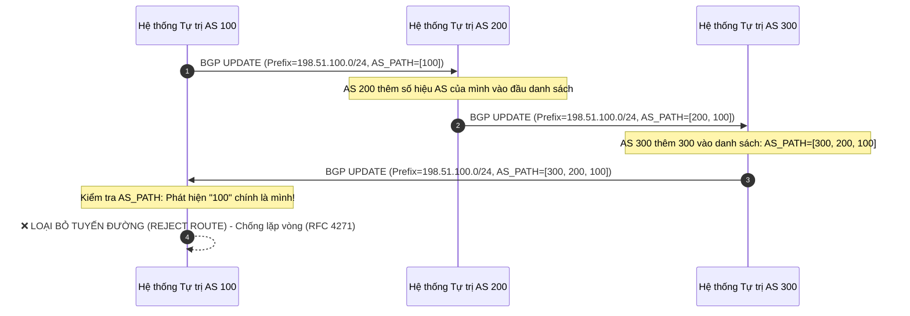

# 2_4_8 Routing Tables and Longest Prefix Match

> **Khóa học**: Cloud DevOps Basic — Networking Core  
> **Phân nhóm**: 2 Domain 2 - Computer Networking Core Fundamentals › 2_4 Network Layer and IP Addressing  
> **Chủ đề**: Cấu trúc Bảng định tuyến (Routing Table), Thuật toán So khớp tiền tố dài nhất (LPM) và Giao thức định tuyến OSPF/BGP  
> **Trạng thái**: Draft (WRITE-CDB-2_4_8, 14-11-2026)  
> **Checklist đối chiếu**: [2_4_8](<../../../CHECKLIST.md#domain-2-computer-networking-core-fundamentals-43-items>)  

---

## 1. Khái Niệm Cốt Lõi & Bản Chất Kỹ Thuật (Core Concepts & Technical Deep Dive)

Trong kiến trúc mạng máy tính, **Bảng định tuyến (Routing Table)** được ví như "bản đồ tác chiến" lưu trữ trong bộ nhớ của mọi thiết bị mạng (từ máy chủ Linux/Windows đến các bộ định tuyến chuyên dụng). Khi một gói tin IPv4 đi vào, thiết bị không chuyển tiếp ngẫu nhiên mà thực hiện tra cứu bảng định tuyến dựa trên nguyên tắc toán học cốt lõi: **So khớp Tiền tố Dài nhất (Longest Prefix Match - LPM)**.

```
+-------------------------------------------------------------------------+
|                  CƠ CHẾ ĐỊNH TUYẾN TẦNG MẠNG (LAYER 3)                  |
|                                                                         |
|  Gói tin đến (Dst IP) ---> [ Bảng Định Tuyến: Routing Table ]          |
|                                    |                                    |
|                      Thuật toán LPM (RFC 1812)                          |
|             Chọn Route có Prefix Length (/N) lớn nhất                   |
|                                    |                                    |
|         +--------------------------+--------------------------+         |
|         | Tuyến chi tiết (/24, /28)| Tuyến mặc định: 0.0.0.0/0|         |
|         | Chuyển tới Next-Hop cụ thể| Chuyển tới Default Gateway|        |
+-------------------------------------------------------------------------+
```

---

### 1.1 Cấu Trúc Thành Phần của Bảng Định Tuyến

Theo các tiêu chuẩn định tuyến [RFC 1812](https://datatracker.ietf.org/doc/html/rfc1812) và hướng dẫn hệ điều hành [ip-route(8)](https://man7.org/linux/man-pages/man8/ip-route.8.html), mỗi mục định tuyến (route entry) bao gồm 4 trường thông tin cơ bản:

1. **Destination Network / Prefix (Tiền tố đích)**: Dải địa chỉ IP mạng đích mà tuyến đường phục vụ, được biểu diễn kèm độ dài tiền tố (ví dụ: `192.168.1.0/24`, `10.0.0.0/8`).
2. **Next Hop / Gateway (Bước nhảy tiếp theo)**: Địa chỉ IP của bộ định tuyến kế tiếp trên đường đi mà gói tin cần được chuyển giao. Đối với các mạng kết nối trực tiếp (Directly Connected), trường này là `onlink` hoặc hiển thị giao diện kết nối trực tiếp.
3. **Outgoing Interface (Giao diện mạng đầu ra)**: Cổng mạng vật lý hoặc logic (ví dụ: `eth0`, `ens33`, `wlan0`) mà gói tin sẽ được bắn ra dây cáp/sóng vô tuyến.
4. **Metric (Chi phí / Độ ưu tiên tuyến đường)**: Giá trị số nguyên thể hiện "chi phí" của tuyến đường. Khi có nhiều tuyến đường đến cùng một dải mạng đích với cùng độ dài tiền tố, hệ điều hành sẽ chọn tuyến có **Metric nhỏ nhất**.

---

### 1.2 Thuật Toán So Khớp Tiền Tố Dài Nhất (Longest Prefix Match - LPM)

Khi router nhận một gói tin có địa chỉ đích $D$, địa chỉ này có thể đồng thời thỏa mãn nhiều dải mạng khác nhau trong bảng định tuyến. Tiêu chuẩn Internet [RFC 1812 Section 5.2.4.3](https://datatracker.ietf.org/doc/html/rfc1812#section-5.2.4.3) quy định thuật toán lựa chọn bắt buộc:

> **Thuật toán LPM (RFC 1812 Section 5.2.4.3)**: Router bắt buộc phải tìm kiếm tuyến đường có **chiều dài tiền tố mạng lớn nhất (maximum prefix length / route.length)** khớp với địa chỉ đích của gói tin. Tuyến đường có tiền tố dài hơn thể hiện mạng con nhỏ hơn, chuyên biệt hơn và có độ chính xác cao hơn.

#### Ví Dụ Phân Tích So Khớp LPM:
Giả sử một bảng định tuyến có các mục sau:
- Tuyến 1: `0.0.0.0/0` via `192.168.1.1` (Prefix length: `0`)
- Tuyến 2: `10.0.0.0/8` via `10.254.0.1` (Prefix length: `8`)
- Tuyến 3: `10.1.0.0/16` via `10.254.1.1` (Prefix length: `16`)
- Tuyến 4: `10.1.2.0/24` via `10.254.2.1` (Prefix length: `24`)

Khi một gói tin có IP đích `10.1.2.55` đi tới:
- `10.1.2.55` khớp với Tuyến 1 (`0.0.0.0/0`) $\rightarrow$ Khớp 0 bit.
- `10.1.2.55` khớp với Tuyến 2 (`10.0.0.0/8`) $\rightarrow$ Khớp 8 bit đầu tiên (`10.x.x.x`).
- `10.1.2.55` khớp với Tuyến 3 (`10.1.0.0/16`) $\rightarrow$ Khớp 16 bit đầu tiên (`10.1.x.x`).
- `10.1.2.55` khớp với Tuyến 4 (`10.1.2.0/24`) $\rightarrow$ Khớp 24 bit đầu tiên (`10.1.2.x`).

**Quyết định**: Router chọn **Tuyến 4** (`10.1.2.0/24`) vì có tiền tố dài nhất ($24 > 16 > 8 > 0$), và chuyển gói tin tới Next-Hop `10.254.2.1`.

---

### 1.3 Tuyến Đường Mặc Định (Default Route: `0.0.0.0/0`)

Theo [RFC 4632 Section 5.1](https://datatracker.ietf.org/doc/html/rfc4632#section-5.1):
- Tuyến đường mặc định được đại diện bởi tiền tố `0.0.0.0/0` (chiều dài tiền tố bằng $0$).
- Do có độ dài tiền tố bằng 0, mặt nạ mạng nhị phân là toàn số 0 (`00000000.00000000.00000000.00000000`), phép toán bitwise AND giữa bất kỳ địa chỉ IPv4 nào với mặt nạ này đều luôn cho ra kết quả `0.0.0.0`.
- Do đó, `0.0.0.0/0` khớp với **tất cả mọi gói tin IPv4**.
- Tuy nhiên, vì tiền tố của nó ngắn nhất ($0$ bit), nó có độ ưu tiên thấp nhất theo luật LPM và chỉ được kích hoạt làm **tuyến đường cứu cánh cuối cùng (route of last resort)** khi không có bất kỳ tuyến đường cụ thể nào khác khớp với địa chỉ đích. Trong mạng gia đình và máy trạm, Next-Hop của tuyến này chính là **Default Gateway**.

---

### 1.4 Phân Loại Định Tuyến: Định Tuyến Tĩnh vs Định Tuyến Động (OSPF & BGP)

Các mục trong bảng định tuyến có thể được thiết lập thủ công bằng tay (**Static Routing**) hoặc được cập nhật tự động thông qua các giao thức định tuyến động (**Dynamic Routing Protocols**):

```
+-----------------------------------------------------------------------------+
|                     PHÂN CẤP GIAO THỨC ĐỊNH TUYẾN ĐỘNG                      |
|                                                                             |
|  [Interior Gateway Protocol - IGP]    [Exterior Gateway Protocol - EGP]     |
|  - Định tuyến NỘI BỘ vùng tự trị      - Định tuyến GIỮA CÁC vùng tự trị (AS)|
|  - Đại diện tiêu biểu: OSPF (RFC 2328)- Đại diện tiêu chuẩn: BGP-4 (RFC 4271|
|  - Thuật toán Link-State (Dijkstra)   - Thuật toán Path-Vector              |
|  - Đồng bộ LSDB toàn vùng             - Thuộc tính AS_PATH chống lặp vòng   |
+-----------------------------------------------------------------------------+
```

1. **OSPF (Open Shortest Path First - RFC 2328)**:
   - Thuộc nhóm **IGP (Interior Gateway Protocol)**: Hoạt động bên trong phạm vi một mạng doanh nghiệp hoặc một Hệ thống Tự trị (Autonomous System - AS).
   - Cơ chế **Link-State**: Mọi router trong cùng một vùng (area) đều trao đổi trạng thái kết nối các liên kết mạng để duy trì một cơ sở dữ liệu trạng thái đường truyền đồng nhất (**Link-State Database - LSDB**).
   - Mỗi router độc lập thực thi thuật toán tìm đường ngắn nhất **Dijkstra (Shortest Path First - SPF)** với chính nó làm gốc (root) để tính toán cây đường đi ngắn nhất đến tất cả các mạng đích.

2. **BGP-4 (Border Gateway Protocol Version 4 - RFC 4271)**:
   - Là giao thức định tuyến liên miền duy nhất vận hành mạng Internet toàn cầu, thuộc nhóm **EGP (Exterior Gateway Protocol)**, kết nối các Hệ thống Tự trị (AS) độc lập của các nhà mạng viễn thông.
   - Cơ chế **Path-Vector**: BGP không tính toán chi tiết từng bước nhảy theo thuật toán Dijkstra mà quảng bá danh sách các hệ thống tự trị mà gói tin sẽ đi qua thông qua thuộc tính bắt buộc **`AS_PATH`**.
   - **Cơ chế chống vòng lặp định tuyến (Loop Prevention - RFC 4271 Section 9.1.2.2)**: Khi một router BGP nhận được một thông điệp quảng bá tuyến đường, nó sẽ quét danh sách các số hiệu mạng trong trường `AS_PATH`. Nếu số hiệu AS nội bộ của chính nó xuất hiện trong danh sách đó, router sẽ **từ chối và loại bỏ ngay lập tức (reject)** tuyến đường đó vì gói tin nếu gửi theo hướng này chắc chắn sẽ bị quay vòng lặp vô tận.

---

## 2. Ví Dụ Đời Sống Thực Tế Dễ Hiểu (Intuitive Real-World Analogies)

```
+-----------------------------------------------------------------------------+
|                      MÔ HÌNH SO SÁNH ĐỜI SỐNG THỰC TẾ                       |
|                                                                             |
|  [0.0.0.0/0]       -->  Biển chỉ dẫn ngã sáu: "Đi khắp mọi miền Tổ Quốc"    |
|                         (Chỉ đi hướng này khi không có biển nào cụ thể hơn) |
|                                                                             |
|  [10.0.0.0/8]      -->  Biển chỉ dẫn: "Đi Miền Bắc"                         |
|  [10.1.0.0/16]     -->  Biển chỉ dẫn: "Đi Tỉnh Ninh Bình"                   |
|  [10.1.2.0/24]     -->  Biển chỉ dẫn: "Đi Thôn 2, Xã Gia Sinh"              |
|                                                                             |
|  [LPM Rule]        -->  Người hỏi đường đến Thôn 2 chắc chắn phải rẽ theo   |
|                         biển "Thôn 2, Xã Gia Sinh" (Biển chi tiết nhất).    |
|                                                                             |
|  [OSPF]            -->  Bản đồ địa chính chi tiết của xã                    |
|                         Tất cả người dân trong xã đều có chung một bản đồ,  |
|                         mỗi người tự nhẩm đường đi ngắn nhất từ nhà mình.    |
|                                                                             |
|  [BGP AS_PATH]     -->  Sổ thông hành qua các cửa khẩu quốc gia             |
|                         Nếu thấy tên nước mình đã đóng dấu trong sổ trước   |
|                         đó, tức là bưu phẩm đang bị gửi quay ngược lại!     |
+-----------------------------------------------------------------------------+
```

1. **Nguyên lý Longest Prefix Match (LPM)**:
   - Hãy tưởng tượng bạn đứng tại ngã sáu giao lộ và tìm đường đến nhà người bạn ở *"Ngõ 15 Phố Tràng Tiền, Hoàn Kiếm, Hà Nội"*.
   - Trước mặt bạn có 4 tấm biển chỉ dẫn:
     - Biển A: *"Đi các tỉnh thành" (tương đương `0.0.0.0/0`)*.
     - Biển B: *"Hướng đi Thành phố Hà Nội" (tương đương `10.0.0.0/8`)*.
     - Biển C: *"Hướng đi Quận Hoàn Kiếm" (tương đương `10.1.0.0/16`)*.
     - Biển D: *"Hướng đi Phố Tràng Tiền" (tương đương `10.1.2.0/24`)*.
   - Dù cả 4 biển đều đúng về mặt địa lý, bạn bắt buộc phải rẽ theo **Biển D** vì đó là chỉ dẫn có độ chi tiết cao nhất, khớp chính xác nhất với nơi bạn muốn đến. Đó chính là bản chất của thuật toán LPM!
2. **OSPF vs BGP**:
   - **OSPF** giống như việc tất cả các lái xe taxi trong một thành phố đều được cấp một bản đồ GPS chi tiết đến từng ngõ ngách (LSDB). Mỗi lái xe tự nhìn vào bản đồ để tính ra đường đi ngắn nhất (Dijkstra) từ vị trí xe của mình đến điểm đón khách.
   - **BGP** giống như hệ thống chuyển phát nhanh quốc tế giữa các quốc gia. Khi một bưu kiện chuyển từ Việt Nam sang Nhật Bản rồi sang Mỹ, trên kiện hàng dán các tem kiểm định cửa khẩu `[VN -> JP -> US]`. Nếu một kiện hàng chuyển tới Mỹ mà trên tem lại thấy chữ `[US]` đã có sẵn ở đằng trước, hải quan Mỹ sẽ từ chối ngay vì kiện hàng này đang bị vận chuyển lòng vòng.

---

## 3. Kiến Trúc, Luồng Hoạt Động & Hình Ảnh Trực Quan (Architecture, Diagrams & Visual Media)

### 3.1 Quy Trình Quyết Định Tuyến Đường Dựa Trên Longest Prefix Match

```mermaid
flowchart TD
    Start["Gói tin đến Router<br/>IP Đích: 10.1.2.55"] --> Lookup["Tra cứu toàn bộ Routing Table"]

    Lookup --> C1{"Khớp 0.0.0.0/0?<br/>(Prefix len = 0)"}
    C1 -->|Có (0 bit)| MatchList["Thêm vào danh sách ứng viên"]

    Lookup --> C2{"Khớp 10.0.0.0/8?<br/>(Prefix len = 8)"}
    C2 -->|Có (8 bit)| MatchList

    Lookup --> C3{"Khớp 10.1.0.0/16?<br/>(Prefix len = 16)"}
    C3 -->|Có (16 bit)| MatchList

    Lookup --> C4{"Khớp 10.1.2.0/24?<br/>(Prefix len = 24)"}
    C4 -->|Có (24 bit)| MatchList

    MatchList --> Decision["Thuật toán LPM (RFC 1812)<br/>So sánh Prefix Length: 24 > 16 > 8 > 0"]
    Decision --> Selected["CHỌN TUYẾN: 10.1.2.0/24"]
    Selected --> Forward["Đẩy gói tin ra Next-Hop 10.254.2.1"]
```

---

### 3.2 Cơ Chế Chống Vòng Lặp Định Tuyến BGP (AS_PATH Loop Detection)



---

## 4. Thực Hành Lệnh Linux & Windows (Hands-on CLI & Output Simulation)

### 4.1 Xem Bảng Định Tuyến và Thử Nghiệm LPM trên Linux

Trên hệ điều hành Linux, bộ công cụ hiện đại `iproute2` cung cấp lệnh `ip route show` để xem toàn bộ bảng định tuyến và `ip route get` để kiểm tra trực tiếp quyết định của nhân kernel đối với một địa chỉ IP đích cụ thể.

> ⚠️ Chưa chạy thử (not executed by the squad)

```bash
# Xem toàn bộ các mục định tuyến trong bảng chính
ip route show
```

Minh họa kết quả đầu ra:

```text
default via 192.168.1.1 dev eth0 proto dhcp metric 100 
10.0.0.0/8 via 10.254.0.1 dev eth1 proto static metric 50 
10.1.0.0/16 via 10.254.1.1 dev eth1 proto static metric 50 
10.1.2.0/24 via 10.254.2.1 dev eth1 proto static metric 50 
192.168.1.0/24 dev eth0 proto kernel scope link src 192.168.1.50 metric 100 
```

Thực hiện kiểm tra thuật toán Longest Prefix Match trong nhân Linux bằng lệnh `ip route get`:

> ⚠️ Chưa chạy thử (not executed by the squad)

```bash
# Yêu cầu nhân Linux mô phỏng quyết định chuyển tiếp cho IP 10.1.2.55
ip route get 10.1.2.55
```

Minh họa kết quả đầu ra:

```text
10.1.2.55 via 10.254.2.1 dev eth1 src 10.254.2.100 uid 1000 
    cache 
```

*Phân tích kết quả*: Nhân kernel đã chọn chính xác Next-Hop `10.254.2.1` tương ứng với tiền tố dài nhất `/24` thay vì đẩy về `default via 192.168.1.1` hay các tuyến `/8`, `/16`.

Thêm một tuyến đường tĩnh thủ công bằng lệnh `ip route add`:

> ⚠️ Chưa chạy thử (not executed by the squad)

```bash
# Thêm một tuyến tĩnh tới dải 172.16.50.0/24 qua gateway 192.168.1.254 với metric 20
sudo ip route add 172.16.50.0/24 via 192.168.1.254 dev eth0 metric 20
```

---

### 4.2 Đối Chiếu Bảng Định Tuyến Trên Linux Cũ (`route -n`) và Windows (`route print`)

Trên Linux sử dụng gói lệnh cũ `route -n`:

> ⚠️ Chưa chạy thử (not executed by the squad)

```bash
route -n
```

Minh họa kết quả đầu ra:

```text
Kernel IP routing table
Destination     Gateway         Genmask         Flags Metric Ref    Use Iface
0.0.0.0         192.168.1.1     0.0.0.0         UG    100    0        0 eth0
10.0.0.0        10.254.0.1      255.0.0.0       UG    50     0        0 eth1
192.168.1.0     0.0.0.0         255.255.255.0   U     100    0        0 eth0
```

*Ý nghĩa cờ (Flags)*:
- `U` (Up): Tuyến đường đang hoạt động.
- `G` (Gateway): Tuyến đường này đi qua một bộ định tuyến trung gian (Next Hop).

Trên hệ điều hành Windows:

> ⚠️ Chưa chạy thử (not executed by the squad)

```cmd
:: Xem bảng định tuyến IPv4 trên Windows
route print
```

Minh họa kết quả đầu ra:

```text
IPv4 Route Table
===========================================================================
Active Routes:
Network Destination        Netmask          Gateway       Interface  Metric
          0.0.0.0          0.0.0.0      192.168.1.1    192.168.1.50      25
        127.0.0.0        255.0.0.0         On-link        127.0.0.1     331
      192.168.1.0    255.255.255.0         On-link     192.168.1.50     281
===========================================================================
```

---

## 5. Cạm Bẫy Thực Tế & Thực Tiễn Sản Xuất (Production Gotchas & Best Practices)

1. **Cạm bẫy BGP Route Hijacking do Khai Thác Nguyên Lý LPM**:
   - Do thuật toán LPM luôn ưu tiên tiền tố có độ dài dài hơn (cụ thể hơn), kẻ tấn công hoặc một nhà mạng bị cấu hình nhầm có thể quảng bá một dải mạng cụ thể hơn (ví dụ quảng bá `/24` trong khi chủ sở hữu hợp pháp chỉ quảng bá dải gộp `/21`).
   - Các router trên toàn thế giới theo chuẩn LPM sẽ tự động chuyển hướng toàn bộ lưu lượng của dải `/24` đó về kẻ tấn công, làm sập dịch vụ của tổ chức bị chiếm đoạt.
   - **Best Practice**: Triển khai cơ chế xác thực nguồn gốc định tuyến RPKI (Resource Public Key Infrastructure) và lọc bộ lọc tiền tố (Prefix Filtering) nghiêm ngặt tại các router biên BGP.

2. **Cạm bẫy Xung Đột Hai Cổng Mạng Mặc Định (Dual Default Gateway Metric Clash)**:
   - Khi một máy chủ cắm cùng lúc 2 card mạng (ví dụ `eth0` nối mạng quản trị nội bộ, `eth1` nối mạng dịch vụ Internet), cả 2 card đều có thể nhận được Default Route `0.0.0.0/0` qua DHCP.
   - Nếu quản trị viên không chỉ định Metric, hệ điều hành có thể đẩy nhầm gói tin Internet ra card quản trị nội bộ hoặc ngược lại, dẫn đến tình trạng mất mạng chập chờn.
   - **Best Practice**: Chỉ duy nhất một card mạng ra Internet được mang Default Route với Metric thấp; các card mạng nội bộ chỉ nên cấu hình Static Route tới các dải mạng RFC 1918 cụ thể.

3. **Cạm bẫy Bỏ Sót Mặt Nạ Mạng Khi Tạo Tuyến Tĩnh**:
   - Khi chạy lệnh thêm route tĩnh, việc nhập thiếu tiền tố (ví dụ nhập `10.0.0.0` thay vì `10.0.0.0/8` hoặc `10.0.0.0/24`) có thể khiến hệ điều hành tự gán tiền tố `/32` (tuyến đường dành riêng cho 1 host duy nhất), dẫn đến các máy khác trong dải mạng không thể liên lạc được.

---

## 6. Câu Hỏi Củng Cố Kiến Thức (Active Recall Quiz)

<details>
<summary><b>Câu hỏi 1:</b> Một router có 3 mục định tuyến sau trong bảng: (1) <code>172.16.0.0/16</code> via 192.168.1.1, (2) <code>172.16.10.0/24</code> via 192.168.1.2, và (3) <code>0.0.0.0/0</code> via 192.168.1.254. Khi có gói tin gửi tới địa chỉ <code>172.16.10.45</code>, router sẽ chuyển tiếp gói tin tới Next Hop nào? Giải thích dựa theo chuẩn RFC 1812.</summary>

**Đáp án:**
Router sẽ chuyển tiếp gói tin tới Next Hop **192.168.1.2** (Tuyến số 2).
Giải thích theo RFC 1812 (Section 5.2.4.3):
- Địa chỉ IP đích `172.16.10.45` thỏa mãn cả 3 mục định tuyến: nó thuộc dải mặc định `/0`, thuộc dải `/16`, và thuộc dải `/24`.
- Tuy nhiên, theo thuật toán So khớp Tiền tố Dài nhất (Longest Prefix Match - LPM), router bắt buộc phải chọn mục định tuyến có chiều dài tiền tố lớn nhất (`route.length`).
- Chiều dài tiền tố của Tuyến 2 là `/24` (24 bit khớp), lớn hơn `/16` (16 bit) và `/0` (0 bit). Do đó, Tuyến 2 giành chiến thắng và gói tin được chuyển tới 192.168.1.2.
</details>

<details>
<summary><b>Câu hỏi 2:</b> Tại sao tiền tố tuyến đường mặc định <code>0.0.0.0/0</code> lại có khả năng khớp với mọi gói tin IPv4, nhưng lại luôn là tuyến đường được chọn cuối cùng?</summary>

**Đáp án:**
Theo RFC 4632 (Section 5.1):
- Tiền tố `0.0.0.0/0` có chiều dài tiền tố bằng $0$, nghĩa là mặt nạ mạng gồm 32 bit `0`. Phép toán logic AND giữa bất kỳ địa chỉ IPv4 32-bit nào với mặt nạ toàn số `0` đều luôn bằng `0.0.0.0`, do đó nó thỏa mãn điều kiện khớp với tất cả mọi địa chỉ IPv4 trên Internet.
- Tuy nhiên, do chiều dài tiền tố bằng $0$ là giá trị nhỏ nhất có thể có trong không gian IPv4, bất kỳ tuyến đường mạng nào khác (ví dụ `/8`, `/16`, `/24`, `/32`) đều có chiều dài tiền tố lớn hơn. Theo luật LPM, các tuyến đường cụ thể hơn sẽ luôn được ưu tiên lựa chọn trước. Tuyến `0.0.0.0/0` chỉ được kích hoạt khi không có bất kỳ tuyến cụ thể nào khác khớp với gói tin.
</details>

<details>
<summary><b>Câu hỏi 3:</b> Trong giao thức định tuyến liên miền BGP-4 (RFC 4271), thuộc tính nào được sử dụng để phát hiện và ngăn chặn hiện tượng vòng lặp định tuyến (Routing Loops) giữa các Hệ thống Tự trị (AS)? Cơ chế phát hiện diễn ra như thế nào?</summary>

**Đáp án:**
Theo RFC 4271 (Section 9.1.2.2):
- Thuộc tính được sử dụng là **`AS_PATH`** (danh sách tuần tự các số hiệu Autonomous System mà thông điệp định tuyến đã đi qua).
- Cơ chế phát hiện: Khi một router biên BGP nhận được một thông điệp quảng bá BGP UPDATE, nó sẽ duyệt qua danh sách các số hiệu AS trong thuộc tính `AS_PATH`. Nếu số hiệu AS nội bộ của chính router đó xuất hiện trong danh sách `AS_PATH`, router sẽ xác định rằng tuyến đường này đã từng đi qua nó và đang quay vòng trở lại. Router bắt buộc phải loại bỏ ngay lập tức (reject/drop) tuyến đường quảng bá này để ngăn chặn triệt để vòng lặp định tuyến toàn cầu.
</details>

---

## 7. 📚 Nguồn Tài Liệu Chính Thống (Tier-1 Official References)

- [RFC 1812: Requirements for IP Version 4 Routers (Section 5.2.4.3: Longest-Match Algorithm)](https://datatracker.ietf.org/doc/html/rfc1812#section-5.2.4.3) - Tiêu chuẩn quy định cấu trúc bảng định tuyến và thuật toán bắt buộc So khớp Tiền tố Dài nhất (LPM).
- [RFC 4632: Classless Inter-domain Routing (CIDR): Section 5.1 Default Route](https://datatracker.ietf.org/doc/html/rfc4632#section-5.1) - Định nghĩa kỹ thuật về tuyến đường mặc định `0.0.0.0/0` và cơ chế phân cấp tiền tố.
- [RFC 2328: OSPF Version 2](https://datatracker.ietf.org/doc/html/rfc2328) - Đặc tả kỹ thuật đầy đủ của giao thức định tuyến nội miền OSPF, cơ sở dữ liệu Link-State và thuật toán Dijkstra.
- [RFC 4271: A Border Gateway Protocol 4 (BGP-4)](https://datatracker.ietf.org/doc/html/rfc4271) - Đặc tả kỹ thuật của giao thức định tuyến liên miền BGP-4 và cơ chế chống vòng lặp qua thuộc tính `AS_PATH`.
- [Linux man-pages: ip-route(8)](https://man7.org/linux/man-pages/man8/ip-route.8.html) - Hướng dẫn chính thức của bộ công cụ iproute2 về quản lý bảng định tuyến và lệnh kiểm tra `ip route get`.
- [Microsoft Learn: route command reference](https://learn.microsoft.com/en-us/windows-server/administration/windows-commands/route_ws2008) - Tài liệu hướng dẫn sử dụng lệnh route print và quản lý bảng định tuyến trên hệ điều hành Windows.
