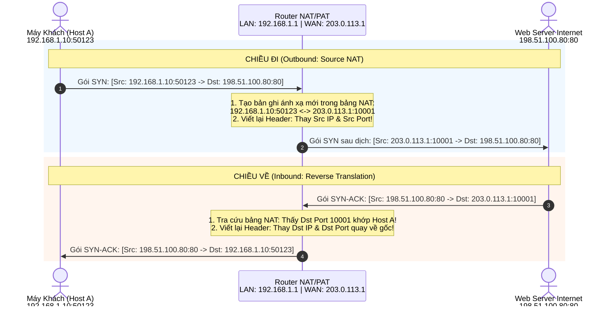

# 2_4_9 Network Address Translation NAT and PAT

> **Khóa học**: Cloud DevOps Basic — Networking Core  
> **Phân nhóm**: 2 Domain 2 - Computer Networking Core Fundamentals › 2_4 Network Layer and IP Addressing  
> **Chủ đề**: Dịch chuyển địa chỉ mạng (NAT & PAT): Phân biệt Static NAT, Dynamic NAT và NAPT/PAT, cơ chế theo dõi phiên (Connection Tracking), Source NAT vs Destination NAT và sự phá vỡ tính toàn vẹn đầu cuối  
> **Trạng thái**: Draft (WRITE-CDB-2_4_9, 14-11-2026)  
> **Checklist đối chiếu**: [2_4_9](<../../../CHECKLIST.md#domain-2-computer-networking-core-fundamentals-43-items>)  

---

## 1. Khái Niệm Cốt Lõi & Bản Chất Kỹ Thuật (Core Concepts & Technical Deep Dive)

Trước nguy cơ cạn kiệt không gian địa chỉ IPv4 toàn cầu vào giữa thập niên 1990, tiêu chuẩn **Biên dịch Địa chỉ Mạng (Network Address Translation - NAT)** và **Biên dịch Địa chỉ và Cổng Mạng (Network Address Port Translation - NAPT)** đã được IETF chuẩn hóa thông qua [RFC 3022](https://datatracker.ietf.org/doc/html/rfc3022) và cập nhật trong [RFC 4787](https://datatracker.ietf.org/doc/html/rfc4787). NAT hoạt động như một cơ chế cứu cánh, cho phép hàng triệu thiết bị trong các mạng riêng tư (Private Networks - RFC 1918) chia sẻ chung một số lượng rất nhỏ địa chỉ IPv4 công cộng (Public IP) để kết nối ra không gian Internet toàn cầu.

```text
+-------------------------------------------------------------------------+
|                    KIẾN TRÚC BIÊN DỊCH ĐỊA CHỈ NAT / PAT                |
|                                                                         |
|  [MẠNG NỘI BỘ (PRIVATE LAN)]           [INTERNET CÔNG CỘNG]             |
|  Host A: 192.168.1.10:54321 -----\                                     |
|  Host B: 192.168.1.20:54321 -------> [ROUTER NAT / PAT] ---> Server Web|
|  Host C: 192.168.1.30:54321 -----/    (Public IP: 203.0.113.1)  (Port 80)|
|                                       - Gán Port công cộng khác nhau:   |
|                                         203.0.113.1:10001 (Host A)      |
|                                         203.0.113.1:10002 (Host B)      |
|                                         203.0.113.1:10003 (Host C)      |
+-------------------------------------------------------------------------+
```

---

### 1.1 Phân Biệt Các Biến Thể Của NAT

Theo đặc tả kỹ thuật trong [RFC 3022 Section 2](https://datatracker.ietf.org/doc/html/rfc3022#section-2), cơ chế biên dịch địa chỉ bao gồm các phân loại chính:

1. **Static NAT (NAT Tĩnh - Ánh xạ 1:1)**:
   - Ánh xạ cố định một địa chỉ IP Private với một địa chỉ IP Public duy nhất.
   - Không làm thay đổi số cổng (Port).
   - Thường sử dụng khi cần công khai một máy chủ quan trọng trong mạng nội bộ (như Web Server, Mail Server) ra bên ngoài Internet với IP tĩnh cố định.
2. **Dynamic NAT (NAT Động - Ánh xạ M:N)**:
   - Sử dụng một dải (Pool) gồm nhiều địa chỉ IP Public.
   - Khi một host nội bộ có nhu cầu truy cập Internet, router sẽ cấp phát động một IP Public còn rảnh trong Pool để ánh xạ tạm thời.
   - Hạn chế: Nếu có 10 IP Public trong Pool thì tại một thời điểm chỉ có tối đa 10 máy nội bộ truy cập được Internet cùng lúc.
3. **NAPT / PAT (Network Address Port Translation / Port Address Translation - Ánh xạ M:1)**:
   - Cho phép **hàng nghìn máy chủ nội bộ chia sẻ chung một địa chỉ IP Public duy nhất**.
   - Thiết bị NAT không chỉ biên dịch địa chỉ IP ở Layer 3 mà còn **biên dịch cả số hiệu cổng (Port Number) ở Layer 4 (TCP/UDP)**.
   - Đây chính là mô hình NAT phổ biến nhất trên toàn thế giới, được áp dụng trong mọi router Wi-Fi gia đình và Cloud NAT Gateway (AWS NAT Gateway, Azure NAT Gateway).

---

### 1.2 Vòng Đời Của Bản Ghi Ánh Xạ Địa Chỉ (Address Binding Lifecycle)

Theo quy định tại [RFC 3022 Section 3.1](https://datatracker.ietf.org/doc/html/rfc3022#section-3.1) và [RFC 3022 Section 3.3](https://datatracker.ietf.org/doc/html/rfc3022#section-3.3):

1. **Khởi tạo liên kết (Address Binding Instantiation)**:
   - Trạng thái biên dịch không tồn tại sẵn trong router.
   - Bản ghi ánh xạ (Binding state) chỉ được tạo ra **ngay khi phiên kết nối đầu tiên xuất phát từ phía bên trong (Outbound Session)** được phát động bởi một máy chủ nội bộ.
   - Router NAT ghi nhận bộ tứ (Tuple) thông tin: `[Private IP : Private Port <-> Public IP : NAT Translated Port]`.
2. **Duy trì phiên (Session Maintenance)**:
   - Router theo dõi liên tục lưu lượng hai chiều thông qua bảng theo dõi kết nối (Connection Tracking Table).
   - Mỗi khi có gói tin thuộc phiên đi qua, bộ định thời gian sống (Session Timeout Timer) được làm mới.
3. **Hủy giải phóng liên kết (Binding Release & Teardown)**:
   - Khi phiên kết nối kết thúc (ví dụ: cờ `FIN`/`RST` trong TCP) hoặc khi hết thời gian chờ không có lưu lượng (Idle Timeout đối với UDP), router NAT sẽ **xóa bỏ bản ghi ánh xạ khỏi bảng dịch**.
   - Số hiệu cổng công cộng (Translated Port) được giải phóng quay trở lại kho tài nguyên rảnh để tái sử dụng cho các phiên tiếp theo.

---

### 1.3 Source NAT (SNAT) vs Destination NAT (DNAT)

Trong quản trị mạng và cấu hình tường lửa Netfilter/iptables, NAT được phân chia thành hai chiều chuyển dịch cốt lõi:

| Đặc tính | Source NAT (SNAT / Masquerade) | Destination NAT (DNAT / Port Forwarding) |
| :--- | :--- | :--- |
| **Bản chất chuyển dịch** | Viết lại **Source IP và Source Port** của gói tin. | Viết lại **Destination IP và Destination Port** của gói tin. |
| **Chiều lưu lượng** | **Outbound** (Từ mạng Private LAN đi ra ngoài Internet). | **Inbound** (Từ ngoài Internet đi vào mạng Private LAN). |
| **Mục đích sử dụng** | Cho phép các máy trạm nội bộ che giấu IP riêng và truy cập tài nguyên Internet. | Cho phép người dùng Internet bên ngoài truy cập vào các máy chủ dịch vụ đặt bên trong LAN. |
| **Vị trí xử lý trong Kernel** | Diễn ra tại chuỗi `POSTROUTING` (sau khi router đã ra quyết định định tuyến). | Diễn ra tại chuỗi `PREROUTING` (trước khi gói tin được đưa vào bộ xử lý định tuyến). |
| **Tên gọi thực tế** | IP Masquerade, Internet Gateway Outbound. | Port Forwarding, Virtual Server Redirection. |

---

### 1.4 Cổng Tầng Ứng Dụng (ALG) & Sự Vi Phạm Tính Toàn Vẹn Đầu Cuối

Mặc dù giải quyết xuất sắc bài toán cạn kiệt địa chỉ IPv4, NAT mang lại cái giá kiến trúc rất đắt được IETF cảnh báo rõ trong [RFC 3022 Section 1](https://datatracker.ietf.org/doc/html/rfc3022#section-1) và [Section 4.4](https://datatracker.ietf.org/doc/html/rfc3022#section-4.4):

1. **Phá vỡ Tính Toàn Vẹn Đầu Cuối (Loss of End-to-End IP Transparency)**:
   - Kiến trúc ban đầu của Internet (End-to-End Principle) giả định rằng mọi trạm đầu cuối đều có thể kết nối bình đẳng và nhận diện trực tiếp IP của nhau.
   - NAT biến các máy trạm nội bộ thành các thực thể "vô hình" từ Internet: Các máy tính bên ngoài không thể chủ động khởi tạo kết nối (Unsolicited Inbound Connection) tới máy trong mạng LAN nếu không có cấu hình Port Forwarding.
2. **Thách thức Cổng Tầng Ứng Dụng (Application Layer Gateway - ALG)**:
   - Các giao thức mạng thông thường chỉ đặt thông tin IP/Port ở tiêu đề L3/L4. Nhưng một số giao thức phức tạp (như **FTP chế độ Active Mode**, giao thức thoại **SIP / H.323**) lại chứa trực tiếp địa chỉ IP và số cổng của máy gửi bên trong phần dữ liệu tải trọng tầng ứng dụng (Application Payload).
   - Khi gói tin đi qua NAT: Router NAT thay đổi IP ở L3 Header, nhưng IP nhúng trong Payload vẫn là IP Private (`192.168.x.x`). Máy chủ bên ngoài khi đọc payload sẽ cố gắng kết nối ngược lại IP Private này và thất bại hoàn toàn!
   - *Giải pháp*: Router NAT bắt buộc phải tích hợp một module **ALG (Application Layer Gateway)**. Module này can thiệp sâu vào Payload tầng ứng dụng (L7 DPI), viết lại chuỗi IP/Port trong dữ liệu, tái tính toán độ dài gói tin, và điều chỉnh cả số thứ tự **TCP Sequence/ACK Numbers** tương ứng (RFC 3022 Section 4.4).

---

## 2. Ví Dụ Đời Sống Thực Tế Dễ Hiểu (Intuitive Real-World Analogies)

### Ẩn dụ: "Tổng Đài Khách Sạn Cao Ốc (PBX Hotel Reception) & Số Máy Lẻ Nội Bộ"

Để hiểu sâu sắc cơ chế NAT/PAT và Port Forwarding, hãy hình dung một khách sạn 5 sao có 1.000 phòng nghỉ:

```text
+-------------------------------------------------------------------------+
|                  ẨN DỤ TỔNG ĐÀI KHÁCH SẠN VÀ SỐ MÁY LẺ                  |
|                                                                         |
|  [PHÒNG KHÁCH SẠN (Private IP)]         [TỔNG ĐÀI KHÁCH SẠN (NAT Router)]|
|  Phòng 501 (192.168.1.10)              Số điện thoại chính công khai:   |
|  Phòng 502 (192.168.1.20)              (024) 38.888.888 (Public IP)     |
|                                                                         |
|  [CUỘC GỌI ĐI (Source NAT / PAT)]:                                      |
|  Khách phòng 501 nhấc máy gọi ra ngoài đặt pizza:                       |
|  Lễ tân chuyển tiếp cuộc gọi bằng số (024) 38.888.888 kèm số máy lẻ     |
|  tạm thời trung kế #1001. Quán pizza thấy cuộc gọi đến từ #1001.       |
|  Khi quán pizza gọi lại số (024) 38.888.888 bấm máy lẻ #1001,          |
|  lễ tân tra sổ ghi chép và nối máy thẳng vào Phòng 501!                 |
|                                                                         |
|  [PORT FORWARDING (Destination NAT)]:                                   |
|  Khách sạn ấn định sẵn: Bất kỳ ai từ bên ngoài gọi tới (024) 38.888.888 |
|  mà bấm máy lẻ #80 (Port 80) thì lập tức chuyển thẳng vào bàn Lễ Tân    |
|  (Web Server nội bộ 192.168.1.100).                                     |
+-------------------------------------------------------------------------+
```

1. **1.000 phòng khách sạn nhưng chỉ có 1 số điện thoại đại diện**:
   - Khách sạn không thể mua riêng 1.000 số điện thoại bưu điện cho từng phòng (quá đắt đỏ và cạn kiệt tài nguyên viễn thông). Số điện thoại đại diện chính là **Public IP**, và các số phòng `501, 502` là các **Private IP**.
2. **Bảng dịch NAT là Sổ tay trực ban của nhân viên Tổng đài**:
   - Khi phòng 501 gọi ra ngoài, nhân viên ghi vào sổ: `Phòng 501 đang nói chuyện với Quán Pizza qua trung kế nhánh #1001`.
   - Nếu không có khách trong phòng nào nhấc máy gọi ra trước, người ngoài phố gọi vào số tổng đài sẽ không thể tự ý nối máy vào phòng 501 vì không biết khách phòng nào cần gặp (`Unsolicited Inbound Drop`).
3. **Khi cuộc gọi kết thúc**:
   - Khách gác máy (`TCP FIN/RST`), nhân viên tổng đài gạch dòng ghi chú trong sổ để nhường nhánh trung kế `#1001` cho khách phòng khác sử dụng (`Binding Teardown`).

---

## 3. Kiến Trúc, Luồng Hoạt Động & Hình Ảnh Trực Quan (Architecture, Diagrams & Visual Media)

### 3.1 Bảng Dịch Phiên NAT / NAPT (Translation Table)

Minh họa bảng trạng thái biên dịch động của router PAT khi phục vụ hai máy trạm nội bộ truy cập cùng một máy chủ Web từ xa:

| Giao thức | IP Nguồn Nội Bộ (LAN) | Cổng Nguồn Nội Bộ | IP Public Sau Dịch (WAN) | Cổng Dịch (NAT Port) | IP Đích (Internet Server) | Cổng Đích |
| :--- | :--- | :--- | :--- | :--- | :--- | :--- |
| **TCP** | `192.168.1.10` | `50123` | `203.0.113.1` | `10001` | `198.51.100.80` | `80` |
| **TCP** | `192.168.1.20` | `50123` | `203.0.113.1` | `10002` | `198.51.100.80` | `80` |

*Nhận xét*: Dù cả hai máy nội bộ đều ngẫu nhiên chọn cổng nguồn giống hệt nhau (`50123`), router PAT phân tách luồng hoàn hảo bằng cách gán hai cổng dịch công cộng khác nhau (`10001` và `10002`).

---

### 3.2 Luồng Dữ Liệu Hai Chiều Qua Router PAT (Source NAT & Reply)



---

## 4. Thực Hành (Hands-on)

### 4.1 Cấu Hình Outbound SNAT / IP Masquerade Bằng `iptables` Trên Linux

Trên các gateway hoặc router chạy Linux, framework Netfilter xử lý NAT thông qua bảng `nat`.

> ⚠️ Chưa chạy thử (not executed by the squad)

```bash
# 1. Bật tính năng chuyển tiếp gói tin IP trong Linux Kernel
sudo sysctl -w net.ipv4.ip_forward=1

# 2. Cấu hình Source NAT (Masquerade) trên card mạng ra ngoài WAN (eth0)
# Mọi lưu lượng từ mạng LAN (192.168.1.0/24) đi ra eth0 sẽ được tự động đổi sang IP public của eth0
sudo iptables -t nat -A POSTROUTING -s 192.168.1.0/24 -o eth0 -j MASQUERADE

# 3. Xem danh sách các quy tắc NAT đã thiết lập
sudo iptables -t nat -L POSTROUTING -v -n --line-numbers
```

> Minh họa kết quả thực thi lệnh kiểm tra:

```text
Chain POSTROUTING (policy ACCEPT 15 packets, 1020 bytes)
num   pkts bytes target     prot opt in     out     source          destination         
1      142  9840 MASQUERADE all  --  *      eth0    192.168.1.0/24  0.0.0.0/0
```

---

### 4.2 Cấu Hình Port Forwarding (Destination NAT) Công Khai Máy Chủ Web Nội Bộ

Khi cần mở cổng `80` từ bên ngoài Internet trỏ vào máy chủ web nội bộ `192.168.1.100`:

> ⚠️ Chưa chạy thử (not executed by the squad)

```bash
# Chuyển hướng lưu lượng TCP cổng 80 từ ngoài vào thẳng máy chủ web nội bộ 192.168.1.100:80
sudo iptables -t nat -A PREROUTING -i eth0 -p tcp --dport 80 -j DNAT --to-destination 192.168.1.100:80

# Xem các quy tắc PREROUTING trong bảng nat
sudo iptables -t nat -L PREROUTING -v -n --line-numbers
```

> Minh họa kết quả thực thi:

```text
Chain PREROUTING (policy ACCEPT 48 packets, 3120 bytes)
num   pkts bytes target prot opt in   out source    destination         
1       30  1800 DNAT   tcp  --  eth0 *   0.0.0.0/0 0.0.0.0/0    tcp dpt:80 to:192.168.1.100:80
```

---

### 4.3 Giám Sát Chi Tiết Bảng Trạng Thái Phiên Bằng Công Cụ `conntrack`

Công cụ `conntrack` cho phép quản trị viên xem trực tiếp các bộ tứ (Tuples) `[ORIGINAL]` và `[REPLY]` đang được Linux kernel quản lý:

> ⚠️ Chưa chạy thử (not executed by the squad)

```bash
# Cài đặt gói conntrack (Debian/Ubuntu: conntrack, RHEL: conntrack-tools)
sudo conntrack -L -p tcp
```

> Minh họa kết quả giám sát bảng phiên:

```text
tcp      6 431998 ESTABLISHED src=192.168.1.10 dst=198.51.100.80 sport=50123 dport=80 src=198.51.100.80 dst=203.0.113.1 sport=80 dport=10001 [ASSURED] mark=0 use=1
```

#### Phân tích cấu trúc dòng trạng thái conntrack:
- `src=192.168.1.10 dst=198.51.100.80 sport=50123 dport=80`: Hướng truyền ban đầu (`[ORIGINAL]`) từ máy client trong mạng LAN tới server.
- `src=198.51.100.80 dst=203.0.113.1 sport=80 dport=10001`: Hướng truyền phản hồi dự kiến (`[REPLY]`). Khi gói tin có Destination IP là `203.0.113.1` và Destination Port là `10001` quay về, kernel sẽ tự động đảo ngược thành IP `192.168.1.10:50123`.
- `[ASSURED]`: Cờ xác nhận kết nối TCP đã hoàn tất bắt tay ba bước thành công và lưu lượng đã được truyền tải hợp lệ theo cả hai hướng. (Nếu máy gửi gói SYN nhưng chưa nhận được phản hồi SYN-ACK, cờ sẽ hiển thị là `[UNREPLIED]`).

---

## 5. Cạm Bẫy Thực Tế & Thực Tiễn Sản Xuất (Production Gotchas & Best Practices)

Trong thiết kế hạ tầng DevOps và quản trị Cloud VPC (AWS, Azure, GCP), các vấn đề sau liên quan tới NAT thường xuyên gây ra sự cố downtime nghiêm trọng:

1. **Cạn Kiệt Cổng Nguồn (SNAT Port Exhaustion / Port Starvation)**:
   - Một địa chỉ IP Public chỉ có tối đa khoảng $65.535$ cổng Layer 4 (thực tế các dải cổng khả dụng của kernel thường nằm từ $1024$ đến $65535$, khoảng $64.000$ cổng).
   - Khi một cụm Kubernetes (K8s) chứa hàng trăm Microservices liên tục tạo các kết nối HTTP/HTTPS ngắn hạn (Short-lived connections) ra bên ngoài qua một NAT Gateway duy nhất mà không dùng HTTP Keep-Alive / Connection Pooling: Kho tài nguyên cổng nguồn sẽ cạn kiệt trong vài giây. Các yêu cầu kết nối tiếp theo lập tức bị rớt (Connection Dropped / Timeout).
   - *Best Practice*: Ánh xạ nhiều địa chỉ IP Public vào NAT Gateway (tăng pool địa chỉ), tinh chỉnh thời gian chờ `tcp_fin_timeout`, và bắt buộc sử dụng Connection Pooling ở tầng ứng dụng.

2. **Sự Cố Hairpinning NAT (NAT Loopback)**:
   - Xảy ra khi một máy trong mạng LAN muốn truy cập một dịch vụ nội bộ (ví dụ: máy chủ Web `192.168.1.100`) nhưng lại gọi thông qua tên miền công khai trỏ tới địa chỉ IP Public của router NAT (`203.0.113.1`).
   - Nếu router NAT không hỗ trợ cơ chế **Hairpin NAT (NAT Reflection)**, router sẽ không biết chuyển tiếp ngược gói tin quay trở lại mạng LAN và kết nối sẽ thất bại hoàn toàn.
   - *Giải pháp*: Cấu hình tính năng Hairpin NAT trên router hoặc áp dụng kiến trúc **Split-Horizon DNS** (DNS nội bộ phân giải tên miền thành IP Private, DNS công cộng phân giải thành IP Public).

3. **Lỗi Giao Thức Nhúng IP Tầng Ứng Dụng Do Thiếu Module ALG**:
   - Khi truyền tải các tệp tin qua FTP chế độ Active (lệnh `PORT`) hoặc thực hiện cuộc gọi VoIP SIP xuyên qua router NAT: Nếu router không được nạp module kernel ALG chuyên dụng (ví dụ: `nf_nat_ftp`, `nf_conntrack_ftp`), router sẽ không thể sửa địa chỉ IP nội bộ bên trong Payload, dẫn tới việc truyền file bị treo cứng ngay khi thiết lập kênh truyền dữ liệu (Data Channel).

---

## 6. Câu Hỏi Củng Cố Kiến Thức (Active Recall Quiz)

<details>
<summary><b>Câu hỏi 1:</b> Phân biệt sự khác nhau căn bản về cơ chế hoạt động và khả năng chia sẻ IP giữa Traditional Static NAT và NAPT (PAT) theo RFC 3022?</summary>

**Đáp án:**
Theo RFC 3022:
- **Static NAT**: Thực hiện ánh xạ tỷ lệ $1:1$ cố định giữa một địa chỉ IP Private và một địa chỉ IP Public. Static NAT chỉ biên dịch địa chỉ ở Layer 3 (IP Header) mà hoàn toàn không can thiệp hay thay đổi số hiệu cổng ở Layer 4. Mỗi IP Public chỉ phục vụ duy nhất 1 host nội bộ.
- **NAPT (PAT)**: Thực hiện ánh xạ tỷ lệ $M:1$, cho phép hàng nghìn máy chủ Private chia sẻ chung một địa chỉ IP Public. NAPT biên dịch đồng thời cả địa chỉ IP ở Layer 3 và số hiệu cổng (Port) ở Layer 4 (TCP/UDP), phân tách các luồng dữ liệu của các máy khác nhau bằng các số cổng công cộng khác nhau.
</details>

<details>
<summary><b>Câu hỏi 2:</b> Tại sao các giao thức như FTP Active Mode hoặc SIP lại thất bại khi đi qua thiết bị NAT tiêu chuẩn nếu không có sự hỗ trợ của Application Layer Gateway (ALG)?</summary>

**Đáp án:**
Theo RFC 3022 Section 4.4:
- Thiết bị NAT thông thường chỉ kiểm tra và biên dịch địa chỉ IP và Port nằm trong các tiêu đề (Headers) Layer 3 và Layer 4.
- Tuy nhiên, FTP Active Mode (qua lệnh `PORT`) và SIP lại nhúng trực tiếp địa chỉ IP Private và Port của máy khách vào bên trong dữ liệu tải trọng (Application Payload ở Layer 7).
- Khi gói tin qua NAT, router thay đổi IP trên Header nhưng bỏ qua Payload. Máy chủ bên ngoài đọc dữ liệu payload sẽ nhận được địa chỉ IP Private và cố gắng kết nối ngược lại IP Private này, dẫn tới kết nối thất bại hoàn toàn. Module ALG bắt buộc phải can thiệp sâu vào Payload để viết lại IP thành IP Public và điều chỉnh lại TCP Sequence Numbers tương ứng.
</details>

<details>
<summary><b>Câu hỏi 3:</b> Trong bảng theo dõi kết nối Netfilter của Linux (conntrack), hai cờ <code>[UNREPLIED]</code> và <code>[ASSURED]</code> phản ánh trạng thái vòng đời nào của phiên NAT?</summary>

**Đáp án:**
Theo tài liệu Netfilter / conntrack:
- Cờ **`[UNREPLIED]`**: Phản ánh phiên kết nối mới được phát động một chiều từ máy khách nội bộ (gói tin gốc `[ORIGINAL]` đã được gửi đi), nhưng router NAT chưa ghi nhận được bất kỳ gói tin phản hồi (`[REPLY]`) nào quay trở về từ máy chủ đích.
- Cờ **`[ASSURED]`**: Phản ánh phiên kết nối đã được xác thực truyền thông hai chiều thành công (đã có lưu lượng phản hồi xác nhận, chẳng hạn hoàn tất bắt tay ba bước TCP). Trạng thái này đảm bảo phiên kết nối sẽ được router bảo vệ duy trì trong bảng NAT và không bị kernel thu hồi sớm khi xảy ra áp lực thiếu hụt bộ nhớ.
</details>

---

## 7. 📚 Nguồn Tài Liệu Chính Thống (Tier-1 Official References)

- [RFC 3022: Traditional IP Network Address Translator (Traditional NAT)](https://datatracker.ietf.org/doc/html/rfc3022#section-1) - Tiêu chuẩn kỹ thuật gốc của IETF về Traditional NAT và NAPT, định nghĩa vòng đời ánh xạ địa chỉ, cơ chế hoạt động của ALG và cảnh báo về vi phạm tính toàn vẹn đầu cuối.
- [RFC 4787: Network Address Translation (NAT) Behavioral Requirements for Unicast UDP](https://datatracker.ietf.org/doc/html/rfc4787) - Tiêu chuẩn IETF quy định các yêu cầu hành vi của NAT đối với lưu lượng UDP và quản lý trạng thái phiên.
- [Linux Manual Pages: iptables(8)](https://man7.org/linux/man-pages/man8/iptables.8.html) - Hướng dẫn chính thức của Linux về công cụ lọc gói và cấu hình các mục tiêu `MASQUERADE`, `DNAT`, `SNAT` trong bảng `nat`.
- [Netfilter Documentation: conntrack-tools](https://netfilter.org/projects/conntrack-tools/) - Tài liệu chính thức từ dự án Netfilter về công cụ truy vấn và quản lý bảng theo dõi kết nối trạng thái (Connection Tracking) trong Linux kernel.
