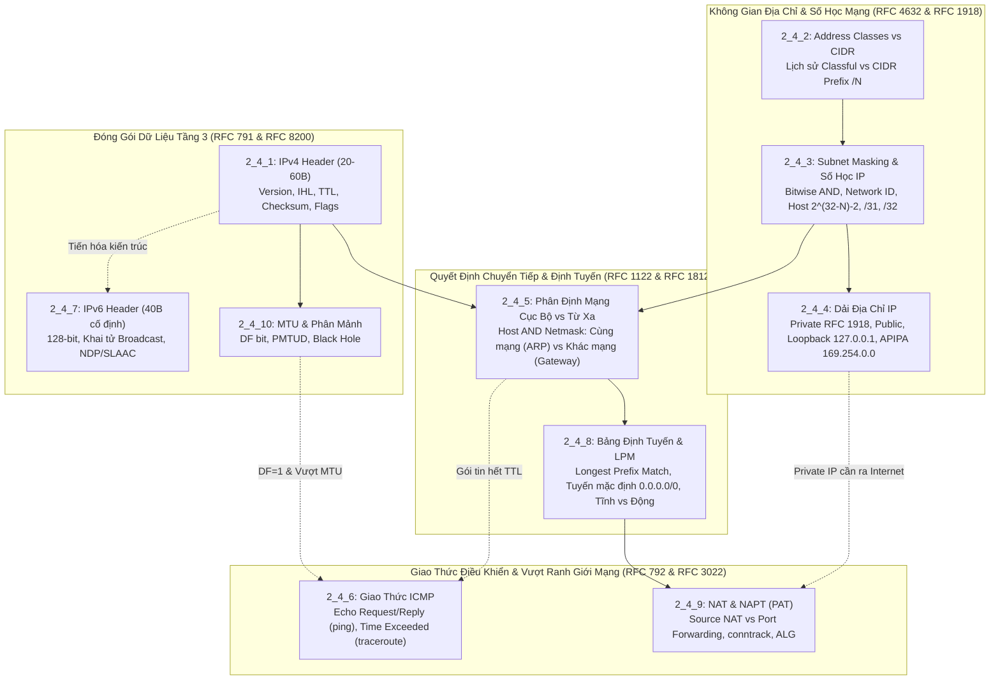

# 2_4 Network Layer and IP Addressing

> **Khóa học**: Cloud DevOps Basic — Networking Core · **Domain**: 2 Domain 2 - Computer Networking Core Fundamentals · **Roadmap gốc**: [network README](<../../README.md#module-4-network-layer-l3-ipv4-header--subnetting-math>)

---

## Module này dạy gì? (What & Why)

Module này cung cấp nền tảng toàn diện và chuyên sâu về Tầng Mạng (Layer 3 - Network Layer) trong ngăn xếp TCP/IP, tầng giao thức giữ vai trò huyết mạch trong việc định danh logic, đóng gói dữ liệu và định tuyến gói tin xuyên suốt các mạng độc lập trên quy mô toàn cầu. Người học sẽ bắt đầu từ việc mổ xẻ giải phẫu cấu trúc 14 trường của tiêu đề IPv4 (20–60 bytes), cơ chế kiểm soát vòng đời tránh lặp vòng bằng Time to Live (TTL) và thẩm định Checksum theo chuẩn RFC 791. Tiếp đó, module làm sáng tỏ bước chuyển mình lịch sử từ kiến trúc phân lớp cứng nhắc (Classful Addressing) sang định tuyến liên miền không phân lớp CIDR (RFC 4632), kết hợp với số học mạng con nhị phân (Subnet Masking qua phép toán Bitwise AND), các quy tắc tính toán số lượng host khả dụng ($2^{32-N}-2$) cùng các tiền tố ngoại lệ /31 cho liên kết điểm-nối-điểm (RFC 3021) và /32 cho Host Route (RFC 1812). Module phân định ranh giới giữa dải địa chỉ riêng tư RFC 1918 với không gian Internet công cộng, phân tích thuật toán phân định cục bộ vs từ xa (On-link vs Off-link) để chuyển tiếp gói tin qua Default Gateway (0.0.0.0/0) mà vẫn bảo toàn nguyên vẹn địa chỉ IP đích đầu cuối. Cuối cùng, module hoàn thiện bức tranh vận hành Tầng 3 hiện đại thông qua giao thức điều khiển ICMP (RFC 792), kiến trúc địa chỉ thế hệ mới IPv6 128-bit với tiêu đề 40 byte cố định và giao thức láng giềng NDP/SLAAC (RFC 8200, RFC 4861, RFC 4862), nguyên lý định tuyến khớp tiền tố dài nhất (LPM), kỹ thuật biên dịch địa chỉ NAT/PAT (RFC 3022) và cơ chế dò tìm kích thước khung truyền cực đại Path MTU Discovery (RFC 1191, RFC 8201).

---

## Lộ trình bài học (Lesson Path)

| Bài học | Mục tiêu cốt lõi | Checklist ID |
| :--- | :--- | :---: |
| [2_4_1 IPv4 Header Anatomy](<./2_4_1 IPv4 Header Anatomy.md>) | Giải phẫu 14 trường tiêu đề IPv4 (20-60 bytes), cơ chế phân mảnh DF/MF, vòng đời giảm TTL và tái tính Header Checksum (RFC 791, RFC 1812). | [2_4_1](<../../../CHECKLIST.md#24-network-layer-l3--ip-addressing>) |
| [2_4_2 IPv4 Address Classes vs CIDR](<./2_4_2 IPv4 Address Classes vs CIDR.md>) | Đối chiếu phân lớp Classful lịch sử (A/B/C/D/E) với CIDR (RFC 4632), cơ chế gộp tuyến Supernetting và triệt tiêu bùng nổ bảng định tuyến toàn cầu. | [2_4_2](<../../../CHECKLIST.md#24-network-layer-l3--ip-addressing>) |
| [2_4_3 Subnet Masking and IP Arithmetic](<./2_4_3 Subnet Masking and IP Arithmetic.md>) | Kỹ thuật chia mạng con, phép toán Bitwise AND trích xuất Network ID, Broadcast ID, công thức tính host ($2^{32-N}-2$) và trường hợp đặc biệt /31 (RFC 3021), /32 (RFC 1812). | [2_4_3](<../../../CHECKLIST.md#24-network-layer-l3--ip-addressing>) |
| [2_4_4 Public vs Private IP Ranges](<./2_4_4 Public vs Private IP Ranges.md>) | Phân định không gian địa chỉ Private RFC 1918 (10.0.0.0/8, 172.16.0.0/12, 192.168.0.0/16) với Public IP, dải Loopback 127.0.0.0/8 và APIPA Link-Local 169.254.0.0/16. | [2_4_4](<../../../CHECKLIST.md#24-network-layer-l3--ip-addressing>) |
| [2_4_5 Default Gateway and Routing Basics](<./2_4_5 Default Gateway and Routing Basics.md>) | Thuật toán so sánh Netmask phân định On-link vs Off-link, vai trò Cổng mặc định (Default Gateway), tuyến mặc định 0.0.0.0/0 và bảo toàn L3 IP khi hoán đổi L2 MAC. | [2_4_5](<../../../CHECKLIST.md#24-network-layer-l3--ip-addressing>) |
| [2_4_6 ICMP](<./2_4_6 ICMP.md>) | Giao thức điều khiển và báo lỗi tầng mạng ICMP (RFC 792), bản tin Echo Request/Reply (ping), Destination Unreachable và Time Exceeded (traceroute). | [2_4_6](<../../../CHECKLIST.md#24-network-layer-l3--ip-addressing>) |
| [2_4_7 IPv6 Architecture](<./2_4_7 IPv6 Architecture.md>) | Kiến trúc 128-bit, tiêu đề cố định 40 byte (RFC 8200), khai tử Broadcast, giao thức láng giềng NDP thay thế ARP (RFC 4861) và tự cấu hình SLAAC kèm kiểm tra trùng lặp DAD (RFC 4862). | [2_4_7](<../../../CHECKLIST.md#24-network-layer-l3--ip-addressing>) |
| [2_4_8 Routing Tables and Longest Prefix Match](<./2_4_8 Routing Tables and Longest Prefix Match.md>) | Đọc bảng định tuyến kernel/router, giải thuật Khớp tiền tố dài nhất (LPM), tuyến mặc định 0.0.0.0/0 và phân biệt định tuyến tĩnh vs định tuyến động (OSPF vs BGP). | [2_4_8](<../../../CHECKLIST.md#24-network-layer-l3--ip-addressing>) |
| [2_4_9 Network Address Translation NAT and PAT](<./2_4_9 Network Address Translation NAT and PAT.md>) | Cơ chế biên dịch địa chỉ Static NAT, Dynamic NAT và NAPT/PAT (RFC 3022), Source NAT vs Destination NAT, theo dõi phiên Netfilter conntrack và cổng tầng ứng dụng ALG. | [2_4_9](<../../../CHECKLIST.md#24-network-layer-l3--ip-addressing>) |
| [2_4_10 MTU Fragmentation and Path MTU Discovery](<./2_4_10 MTU Fragmentation and Path MTU Discovery.md>) | Giới hạn kích thước MTU, cơ chế phân mảnh IPv4, cờ DF bit, cơ chế Path MTU Discovery (RFC 1191, RFC 8201) và phòng chống thảm họa PMTUD Black Hole. | [2_4_10](<../../../CHECKLIST.md#24-network-layer-l3--ip-addressing>) |

---

## Bản đồ khái niệm (Concept Map)

Sơ đồ dưới đây thể hiện sự gắn kết hữu cơ giữa cấu trúc dữ liệu gói tin, không gian địa chỉ hóa, thuật toán định tuyến và các cơ chế tương tác ở Tầng Mạng:

---

## Ẩn dụ xuyên suốt (Module Analogy)

Toàn bộ 10 bài học trong Module 2.4 được liên kết chặt chẽ thông qua câu chuyện thực tế về **Hệ thống Logistics Bưu chính Viễn thông Liên lục địa**:

1. **Vỏ bưu phẩm bọc thép tiêu chuẩn (2_4_1 - IPv4 Header Anatomy)**: Bưu phẩm quốc tế được bảo vệ bằng chiếc bì thư chứa 14 ô thông tin quy chuẩn: mã bưu phẩm (`Identification`), hạn sử dụng qua tối đa bao nhiêu bưu cục (`Time to Live`), cờ cấm bốc dỡ xé lẻ kiện hàng (`DF bit`), và con dấu niêm phong chống sửa đổi (`Header Checksum`).
2. **Quy hoạch từ phân vùng cổ điển sang mã số linh hoạt (2_4_2 - Address Classes vs CIDR)**: Thay vì chính quyền bắt buộc các công ty phải mua toàn bộ một quận lớn (Class A) hoặc toàn bộ một khu phố (Class B) gây bỏ hoang đất đai lãng phí, hệ thống chuyển sang cấp phép diện tích đất theo nhu cầu thực tế đến từng mét vuông (`CIDR tiền tố /N`).
3. **Khuôn đục lỗ quy hoạch và con dấu phân lô (2_4_3 - Subnet Masking and IP Arithmetic)**: Cán bộ địa chính cầm tấm bìa khoét lỗ đục rỗng phần tiền tố (`Subnet Mask`) áp lên địa chỉ nhà để làm lộ rõ tên khu phố (`Network ID`). Biển cổng chào khu phố không ai được xây nhà (`Network ID`), cột loa phát thanh phường không cấp cho hộ gia đình nào ở (`Broadcast Address`), chỉ các số nhà ở giữa mới được phép cư ngụ (`Usable Hosts`). Với những đoạn đường hầm chỉ nối đúng 2 bốt kiểm soát, chính quyền áp dụng quy chế đặc cách dùng trọn vẹn cả 2 số nhà (`RFC 3021 tiền tố /31`).
4. **Khu chung cư nội bộ vs Biển số lưu thông quốc gia (2_4_4 - Public vs Private IP Ranges)**: Các số nhà nội bộ trong khu đô thị khép kín (`Private IP RFC 1918`) có thể trùng lặp giữa các tỉnh thành phố khác nhau mà không sợ xung đột, nhưng khi xe hàng chạy ra đường cao tốc liên tỉnh thì bắt buộc phải mang biển số đăng kiểm quốc gia duy nhất (`Public IP`).
5. **Bưu cục xuất cảnh của thị trấn (2_4_5 - Default Gateway and Routing Basics)**: Khi gửi thư cho hàng xóm cùng xã, bạn tự đạp xe sang nhà bấm chuông (`ARP trực tiếp`). Khi gửi thư sang Anh, bạn ghi địa chỉ đích là London (`Destination IP giữ nguyên`), nhưng nhét phong bì vào túi gửi cho bác Trưởng bưu điện xã (`Default Gateway MAC`) để bác gửi tiếp.
6. **Bộ đàm cứu trợ khẩn cấp và Giấy báo tử bưu phẩm (2_4_6 - ICMP)**: Khi gói hàng bị thất lạc, hỏng hóc hoặc hết hạn lưu kho bưu tá phải vứt bỏ, bưu điện gửi giấy báo tử (`ICMP Time Exceeded / Destination Unreachable`) về cho người gửi. Khi cần kiểm tra xem đường đi tới kho bãi có thông suốt hay không, nhân viên bưu chính phát tín hiệu tít tít hỏi đáp (`ping ICMP Echo`).
7. **Hệ thống định danh thiên hà và Thủ tục khai sinh thông minh (2_4_7 - IPv6 Architecture)**: Để chuẩn bị cho kỷ nguyên liên hành tinh, nhân loại chuyển sang mã số định danh 128-bit khổng lồ. Khai tử hoàn toàn loa phóng thanh làm phiền cả làng (`No Broadcast`), áp dụng nhóm liên lạc chuyên biệt (`Solicited-Node Multicast`). Đứa trẻ sinh ra tự lấy họ bố mẹ từ trưởng thôn (`Prefix từ Router RA`), ghép mã ADN của mình và hô lên hỏi làng xem có trùng ai không (`SLAAC + DAD`). Toa tàu chở thư được thiết kế cố định 40 mét chở hàng siêu tốc.
8. **Bản đồ chỉ đường tại ngã tư và Quy tắc biển báo chi tiết nhất (2_4_8 - Routing Tables and LPM)**: Đứng tại bùng binh trung tâm, bác tài xế nhìn vào bảng biển báo giao thông (`Routing Table`). Nếu có nhiều biển báo cùng chỉ về hướng đi, bác luôn chọn biển báo chỉ dẫn chi tiết và cụ thể nhất (`Longest Prefix Match`). Nếu không có biển nào quen thuộc, bác đi theo hướng mũi tên chỉ đường mặc định (`Default Route 0.0.0.0/0`).
9. **Tổng đài khách sạn cao ốc và Số máy lẻ trung kế (2_4_9 - Network Address Translation NAT/PAT)**: Khách sạn 1.000 phòng dùng chung một số điện thoại bưu điện công khai duy nhất (`Public IP`). Lễ tân trực ban ghi vào sổ tay phiên gọi (`NAT Table conntrack`): khi phòng 501 gọi ra ngoài, lễ tân cấp số máy lẻ trung kế `#1001` (`Source NAT`). Khách bên ngoài gọi vào số bưu điện bấm máy lẻ `#80` thì lễ tân nối thẳng vào bàn trưởng ca (`Port Forwarding / DNAT`).
10. **Kích thước thùng xe tải và Trạm cân bưu chính (2_4_10 - MTU, Fragmentation & PMTUD)**: Thùng xe tải chở bưu phẩm tiêu chuẩn dài 1500 mét (`MTU 1500`). Nếu gặp hầm chui thấp, bưu tá IPv4 có thể dỡ hàng chia nhỏ vào các xe ba gác con (`Fragmentation`). Nhưng nếu gói hàng dán nhãn cấm bốc dỡ (`DF=1`), bưu tá buộc phải quay xe và báo trạm cân giảm bớt trọng tải (`Path MTU Discovery`). Nếu bảo vệ bốt gác chặn luôn cả giấy báo tử, xe hàng sẽ bị tắc nghẽn vĩnh viễn (`PMTUD Black Hole`).

---

## Tự kiểm tra cuối module (Module Review)

<b>Câu hỏi 1:</b> Phân tích quy trình toán học mà máy chủ (Host) thực hiện khi muốn truyền một gói tin: Làm thế nào máy chủ xác định được đích đến là mạng cục bộ (On-link) hay mạng từ xa (Off-link)? Khi truyền gói tin tới mạng từ xa, tại sao trường Destination MAC bị thay đổi thành MAC của Default Gateway trong khi trường Destination IP được giữ nguyên vẹn?

**Đáp án:**
Theo RFC 1122 Section 3.3.1.1 và Section 3.3.1.2:
- **Quy trình toán học phân định On-link vs Off-link**:
  1. Máy chủ thực hiện phép toán `Bitwise AND` giữa `Host IP` và `Subnet Mask` để tìm ra `Local NetID`.
  2. Máy chủ thực hiện phép toán `Bitwise AND` giữa `Target IP` (đích) và chính `Subnet Mask` đó để tìm ra `Target NetID`.
  3. So sánh:
     - Nếu `Local NetID == Target NetID`: Máy đích nằm trên cùng mạng con cục bộ. Máy chủ gửi bản tin ARP trực tiếp để tìm MAC của máy đích và đóng gói khung L2 truyền đi.
     - Nếu `Local NetID != Target NetID`: Máy đích nằm ở mạng từ xa. Máy chủ tra bảng định tuyến và chuyển tiếp gói tin tới MAC của Default Gateway.
- **Lý do Destination MAC đổi thành Gateway MAC còn Destination IP giữ nguyên**:
  - Tầng Mạng (Layer 3) chịu trách nhiệm vận chuyển gói tin từ điểm đầu tới điểm cuối xuyên mạng (End-to-End Delivery). Do đó, `Destination IP` bắt buộc phải được giữ nguyên là IP của máy đích cuối cùng để các router trung gian trên toàn cầu có căn cứ định tuyến.
  - Tầng Liên kết dữ liệu (Layer 2) chỉ chịu trách nhiệm chuyển tiếp từng chặng (Hop-by-Hop Delivery) trên từng liên kết vật lý. Để đưa gói tin ra khỏi mạng LAN cục bộ, khung Ethernet phải được gửi tới cổng của Default Gateway (`Destination MAC = Gateway MAC`). Router Gateway sau khi nhận khung sẽ bóc bỏ L2 cũ, kiểm tra L3 Destination IP, và đóng gói vào một khung L2 mới cho chặng nhảy kế tiếp.

<b>Câu hỏi 2:</b> Một mạng con IPv4 được cấp phát dải mạng <code>172.16.50.64/27</code>. Hãy tính toán chính xác: Subnet Mask dạng thập phân, tổng số địa chỉ IP, Network ID, Broadcast Address, số lượng máy chủ khả dụng và dải địa chỉ IP có thể gán cho máy chủ?

**Đáp án:**
Theo RFC 4632:
- Tiền tố $N = 27$. Số bit dành cho phần host là $32 - 27 = 5$ bits.
- **Subnet Mask**: Octet thứ tư có 3 bit 1 (`11100000` nhị phân = $128 + 64 + 32 = 224$). Subnet Mask là `255.255.255.224`.
- **Tổng số địa chỉ IP**: $2^{32 - 27} = 2^5 = 32$ địa chỉ.
- Bước nhảy (Block size) tại octet thứ tư là $2^5 = 32$. Dải mạng bắt đầu tại bội số 32 là 64.
- **Network ID**: `172.16.50.64` (Toàn bộ 5 bit host bằng 0).
- **Broadcast Address**: `172.16.50.95` (Toàn bộ 5 bit host bằng 1: $64 + 31 = 95$).
- **Số lượng máy chủ khả dụng**: $2^5 - 2 = 32 - 2 = 30$ hosts (trừ Network ID và Broadcast ID).
- **Dải IP gán cho máy chủ**: Bắt đầu từ `172.16.50.65` đến `172.16.50.94`.

<b>Câu hỏi 3:</b> Phân tích nguyên lý giải thuật Khớp tiền tố dài nhất (Longest Prefix Match - LPM). Nếu bảng định tuyến của một router đồng thời chứa 4 tuyến sau: (1) <code>0.0.0.0/0</code>, (2) <code>10.0.0.0/8</code>, (3) <code>10.20.0.0/16</code>, (4) <code>10.20.30.0/24</code>, một gói tin có địa chỉ IP đích là <code>10.20.30.100</code> sẽ được định tuyến theo tuyến nào? Tại sao?

**Đáp án:**
Theo RFC 1812 và RFC 4632:
- **Nguyên lý Longest Prefix Match (LPM)**: Khi một router nhận được gói tin, nó so sánh Destination IP với tất cả các tiền tố mạng trong bảng định tuyến. Nếu có nhiều tuyến đường cùng khớp với địa chỉ đích, router bắt buộc phải chọn tuyến đường có **độ dài tiền tố (Prefix Length / Netmask) lớn nhất** (tức là có số lượng bit `1` liên tục nhiều nhất). Tuyến có tiền tố dài nhất là tuyến cụ thể và chính xác nhất với đích đến.
- **Áp dụng kịch bản**:
  - Cả 4 tuyến đều khớp về mặt logic với IP `10.20.30.100`:
    - Tuyến 1: `/0` (khớp 0 bit).
    - Tuyến 2: `/8` (khớp 8 bit: `10.x.x.x`).
    - Tuyến 3: `/16` (khớp 16 bit: `10.20.x.x`).
    - Tuyến 4: `/24` (khớp 24 bit: `10.20.30.x`).
  - Tuyến số 4 (`10.20.30.0/24`) có độ dài tiền tố lớn nhất ($24 > 16 > 8 > 0$).
  - **Kết luận**: Gói tin được định tuyến chuyển tiếp theo **Tuyến số 4 (`10.20.30.0/24`)**.

<b>Câu hỏi 4:</b> Trình bày ba sự khác biệt kiến trúc mang tính đột phá giữa IPv4 và IPv6 liên quan tới: (a) Tiêu đề gói tin và Checksum, (b) Cơ chế truyền thông quảng bá (Broadcast), và (c) Cơ chế phân mảnh gói tin trên đường truyền?

**Đáp án:**
Theo RFC 8200 và RFC 4291:
1. **Tiêu đề gói tin và Checksum (RFC 8200 Section 3)**:
   - *IPv4*: Kích thước tiêu đề biến thiên từ 20 đến 60 bytes do trường Options. Tiêu đề chứa trường Header Checksum và router bắt buộc phải tính toán lại Checksum ở mỗi bước nhảy khi giảm TTL.
   - *IPv6*: Kích thước tiêu đề **cố định chính xác 40 octets (bytes)**. Tiêu đề IPv6 **loại bỏ hoàn toàn trường Checksum**, đẩy trách nhiệm kiểm tra lỗi xuống L2 CRC và L4 TCP/UDP, giúp router tăng tốc xử lý gói tin ở cấp độ phần cứng.
2. **Cơ chế truyền thông quảng bá (RFC 4291 Section 2)**:
   - *IPv4*: Sử dụng địa chỉ Broadcast (`255.255.255.255` hoặc Directed Broadcast) để gửi tin tới mọi máy, gây tiêu hao tài nguyên CPU của toàn bộ thiết bị trong VLAN (như giao thức ARP).
   - *IPv6*: **Khai tử hoàn toàn địa chỉ Broadcast**. Thay thế bằng **Multicast** (gửi tới nhóm thiết bị lắng nghe, tiêu biểu là Solicited-Node Multicast trong giao thức NDP thay thế ARP) và **Anycast** (gửi tới trạm gần nhất).
3. **Cơ chế phân mảnh gói tin (RFC 8200 Section 5)**:
   - *IPv4*: Cho phép các router trung gian trên đường truyền tự ý xé nhỏ (fragment) gói tin nếu gặp liên kết có MTU nhỏ hơn (trừ khi cờ `DF=1`).
   - *IPv6*: **Nghiêm cấm các router trung gian phân mảnh gói tin**. Phân mảnh chỉ được thực hiện duy nhất bởi máy chủ nguồn phát sinh dữ liệu (thông qua Extension Header). Nếu gói tin vượt quá MTU đường truyền, router lập tức hủy gói và gửi bản tin `ICMPv6 Packet Too Big` yêu cầu nguồn hạ kích thước gói (Path MTU Discovery).

<b>Câu hỏi 5:</b> Cơ chế hoạt động của NAPT (PAT / Source NAT) cho phép hàng nghìn máy trong mạng LAN chia sẻ chung 1 IP Public như thế nào? Bảng theo dõi kết nối (Connection Tracking) lưu trữ những thông tin gì? Hiện tượng SNAT Port Starvation xảy ra trong hoàn cảnh nào và cách phòng tránh trong môi trường DevOps?

**Đáp án:**
Theo RFC 3022 và tài liệu Netfilter:
- **Cơ chế NAPT/PAT**: NAPT biên dịch đồng thời cả địa chỉ IP ở Layer 3 và số hiệu cổng (Port) ở Layer 4 (TCP/UDP). Khi các máy nội bộ gửi gói tin ra ngoài, router NAT ghi lại địa chỉ IP nguồn và cổng nguồn nội bộ, sau đó thay thế bằng địa chỉ IP Public của router kèm một số hiệu cổng dịch ngẫu nhiên rảnh (`Translated Port`). Khi gói tin phản hồi quay về cổng dịch đó, router tra bảng và đổi ngược lại thành IP và cổng của máy nội bộ ban đầu.
- **Thông tin trong bảng theo dõi kết nối (conntrack)**: Bảng lưu trữ bộ thông tin hai chiều (Tuples) gồm:
  - Chiều đi (`[ORIGINAL]`): `(Private Src IP, Src Port, Dst IP, Dst Port)`.
  - Chiều về (`[REPLY]`): `(Dst IP, Dst Port, Public Src IP, Translated Port)` kèm trạng thái cờ phiên (`[UNREPLIED]`, `[ASSURED]`).
- **Hiện tượng SNAT Port Starvation**:
  - Xảy ra khi một số lượng lớn ứng dụng (như các Pod trong cụm Kubernetes) liên tục mở các kết nối TCP/UDP ngắn hạn (short-lived connections) ra ngoài Internet qua một NAT Gateway duy nhất mà không dùng Connection Pooling. Khi toàn bộ ~64.000 cổng L4 khả dụng của IP Public bị chiếm dụng hết, NAT Gateway không còn cổng rảnh để cấp phát cho các kết nối mới, dẫn tới hiện tượng rớt kết nối hoặc treo timeout hàng loạt.
  - *Biện pháp phòng ngừa*:
    1. Bắt buộc kích hoạt HTTP Keep-Alive và Connection Pooling tại các tầng ứng dụng / Microservices.
    2. Gán thêm nhiều địa chỉ IP Public vào NAT Gateway (tăng dung lượng pool địa chỉ nguồn).
    3. Tinh chỉnh rút ngắn thời gian giữ kết nối kết thúc trong kernel (`tcp_fin_timeout`).

---

## 📚 Nguồn chính (Key References)

- [RFC 791: Internet Protocol - DARPA Internet Program Protocol Specification](https://datatracker.ietf.org/doc/html/rfc791) - Đặc tả tiêu chuẩn gốc của DARPA/IETF về Giao thức IPv4, cấu trúc 14 trường dữ liệu, quy tắc IHL, phân mảnh và Header Checksum.
- [RFC 4632: Classless Inter-domain Routing (CIDR): The Internet Address Assignment and Aggregation Plan](https://datatracker.ietf.org/doc/html/rfc4632) - Tiêu chuẩn nền tảng IETF về kiến trúc CIDR, phép toán Bitwise AND trích xuất Network Prefix và gộp tuyến Supernetting.
- [RFC 1918: Address Allocation for Private Internets](https://datatracker.ietf.org/doc/html/rfc1918) - Quy chuẩn phân bổ các dải địa chỉ IPv4 riêng tư (10.0.0.0/8, 172.16.0.0/12, 192.168.0.0/16).
- [RFC 1122: Requirements for Internet Hosts -- Communication Layers](https://datatracker.ietf.org/doc/html/rfc1122) - Tiêu chuẩn máy chủ IETF, Mục 3.2.1.3 quy định địa chỉ Broadcast và Loopback 127.0.0.0/8, Mục 3.3.1.1 quy định thuật toán phân định mạng cục bộ vs Default Gateway.
- [RFC 3927: Dynamic Configuration of IPv4 Link-Local Addresses](https://datatracker.ietf.org/doc/html/rfc3927) - Tiêu chuẩn IETF về dải địa chỉ tự cấu hình Link-Local APIPA (169.254.0.0/16).
- [RFC 792: Internet Control Message Protocol (ICMP)](https://datatracker.ietf.org/doc/html/rfc792) - Đặc tả kỹ thuật tiêu chuẩn giao thức điều khiển ICMP, bản tin Echo Request/Reply (Type 8/0), Destination Unreachable (Type 3) và Time Exceeded (Type 11).
- [RFC 8200: Internet Protocol, Version 6 (IPv6) Specification](https://datatracker.ietf.org/doc/html/rfc8200) - Tiêu chuẩn kỹ thuật cốt lõi IETF của IPv6, định nghĩa tiêu đề cố định 40 octets, cơ chế Next Header, loại bỏ Checksum và cấm router trung gian phân mảnh.
- [RFC 4291: IP Version 6 Addressing Architecture](https://datatracker.ietf.org/doc/html/rfc4291) - Tiêu chuẩn IETF về kiến trúc địa chỉ IPv6 128-bit, quy tắc nén số 0, khai tử Broadcast và cấu trúc Solicited-Node Multicast.
- [RFC 4861: Neighbor Discovery for IP version 6 (IPv6)](https://datatracker.ietf.org/doc/html/rfc4861) - Đặc tả tiêu chuẩn giao thức khám phá láng giềng NDP thay thế ARP trong IPv6.
- [RFC 4862: IPv6 Stateless Address Autoconfiguration (SLAAC)](https://datatracker.ietf.org/doc/html/rfc4862) - Tiêu chuẩn IETF về cơ chế tự cấu hình địa chỉ phi trạng thái và quy trình kiểm tra trùng địa chỉ DAD bắt buộc.
- [RFC 4193: Unique Local IPv6 Unicast Addresses](https://datatracker.ietf.org/doc/html/rfc4193) - Quy chuẩn phân bổ dải địa chỉ nội bộ fc00::/7 (ULA) trong IPv6.
- [RFC 1812: Requirements for IP Version 4 Routers](https://datatracker.ietf.org/doc/html/rfc1812) - Tiêu chuẩn kỹ thuật IETF cho bộ định tuyến IPv4, giải thuật Khớp tiền tố dài nhất (LPM), Host Route /32 và chuyển tiếp gói tin từng chặng.
- [RFC 3021: Using 31-Bit Prefixes on IPv4 Point-to-Point Links](https://datatracker.ietf.org/doc/html/rfc3021) - Tiêu chuẩn kỹ thuật IETF về việc sử dụng tiền tố /31 trên liên kết điểm-nối-điểm mà không cần trừ địa chỉ mạng và quảng bá.
- [RFC 3022: Traditional IP Network Address Translator (Traditional NAT)](https://datatracker.ietf.org/doc/html/rfc3022) - Tiêu chuẩn IETF về Traditional NAT và NAPT (PAT), vòng đời ánh xạ địa chỉ và cổng tầng ứng dụng ALG.
- [RFC 4787: Network Address Translation (NAT) Behavioral Requirements for Unicast UDP](https://datatracker.ietf.org/doc/html/rfc4787) - Tiêu chuẩn IETF quy định các yêu cầu hành vi NAT đối với lưu lượng UDP và quản lý trạng thái phiên.
- [RFC 1191: Path MTU Discovery (IPv4)](https://datatracker.ietf.org/doc/html/rfc1191) - Tiêu chuẩn IETF về cơ chế tự động dò tìm kích thước khung truyền cực đại trên đường truyền IPv4 thông qua cờ DF và ICMP Fragmentation Needed.
- [RFC 8201: Path MTU Discovery for IP version 6](https://datatracker.ietf.org/doc/html/rfc8201) - Tiêu chuẩn IETF về cơ chế dò tìm Path MTU cho IPv6 thông qua bản tin ICMPv6 Packet Too Big.
- [Linux Manual Pages: ip-route(8)](https://man7.org/linux/man-pages/man8/ip-route.8.html) - Hướng dẫn chính thức về quản trị bảng định tuyến kernel Linux, cú pháp cấu hình `default via` và cơ chế `ip route get`.
- [Linux Manual Pages: ip-neighbour(8)](https://man7.org/linux/man-pages/man8/ip-neighbour.8.html) - Tài liệu Linux về quản trị bảng láng giềng IPv6 Neighbor Cache thay thế bảng ARP.
- [Linux Manual Pages: iptables(8)](https://man7.org/linux/man-pages/man8/iptables.8.html) - Hướng dẫn chính thức của Linux về cấu hình các quy tắc NAT (MASQUERADE, DNAT, SNAT) trong Netfilter.
- [Netfilter Documentation: conntrack-tools](https://netfilter.org/projects/conntrack-tools/) - Tài liệu chính thức từ dự án Netfilter về công cụ truy vấn và quản lý bảng theo dõi kết nối trạng thái (Connection Tracking) trong Linux kernel.
