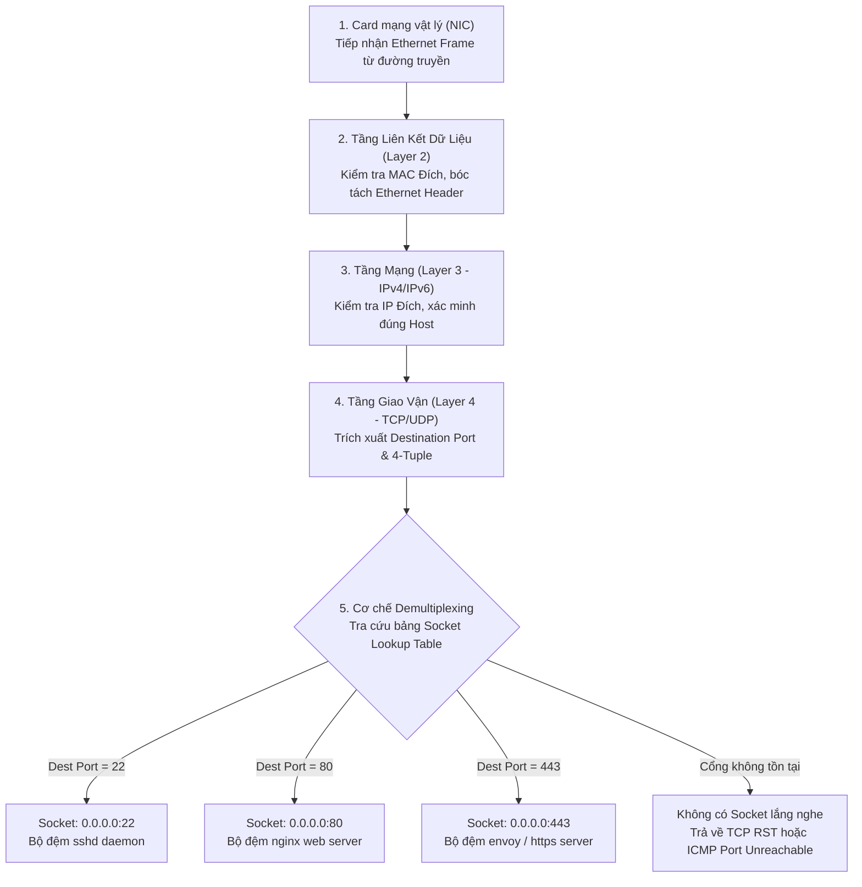
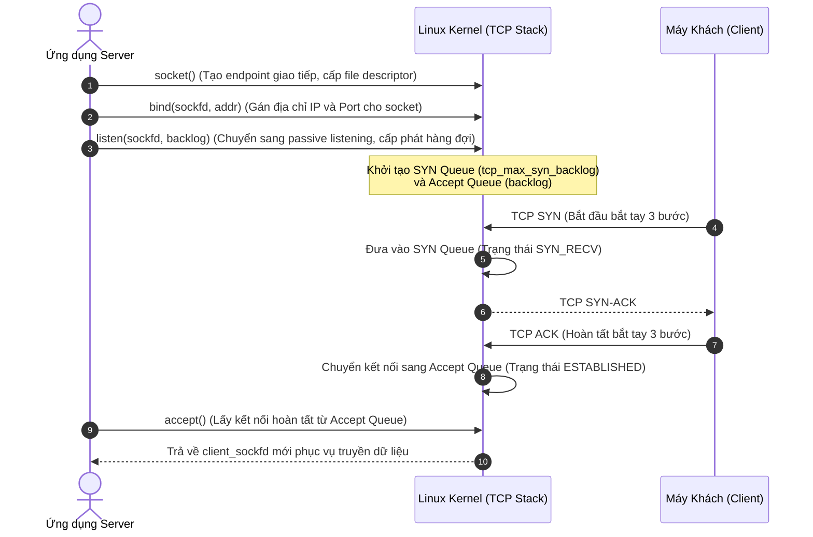

# 2_5_1 Ports and Sockets

> **Khóa học**: Cloud DevOps Basic — Networking Core  
> **Phân nhóm**: 2 Domain 2 - Computer Networking Core Fundamentals › 2_5 Transport Layer TCP and UDP  
> **Chủ đề**: Ports and Sockets: Cơ chế ghép kênh (Multiplexing) và phân kênh (Demultiplexing), Không gian Cổng IANA, và Cấu trúc Socket 4-Tuple  
> **Trạng thái**: Draft (WRITE-CDB-2_5_1, 14-11-2026)  
> **Checklist đối chiếu**: [2_5_1](<../../../CHECKLIST.md#domain-2-computer-networking-core-fundamentals-43-items>)  

---

## 1. Khái Niệm Cốt Lõi & Bản Chất Kỹ Thuật (Core Concepts & Technical Deep Dive)

Trong kiến trúc mạng máy tính, giao thức IP ở **Tầng Mạng (Network Layer - Layer 3)** chịu trách nhiệm chuyển giao các gói tin giữa các máy tính chủ (giao tiếp host-to-host). Tuy nhiên, trên một máy tính chủ thực tế, hệ điều hành đồng thời chạy hàng chục đến hàng trăm tiến trình ứng dụng độc lập cần giao tiếp mạng (như web server, máy khách truy vấn cơ sở dữ liệu, dịch vụ SSH, tiến trình phân giải DNS). Nếu chỉ dựa vào địa chỉ IP, ngăn xếp mạng của hệ điều hành không thể xác định được gói dữ liệu vừa nhận được thuộc về tiến trình ứng dụng nào.

Khoảng trống kỹ thuật từ giao tiếp host-to-host đến giao tiếp tiến trình-tới-tiến trình (process-to-process) được giải quyết triệt để tại **Tầng Giao Vận (Transport Layer - Layer 4)** thông qua hai khái niệm nền tảng: **Số hiệu Cổng (Port Number)** và **Giao diện Ổ cắm mạng (Socket)**.

---

### 1.1 Khái niệm Cổng (Port) và Cơ chế Ghép kênh (Multiplexing) & Phân kênh (Demultiplexing)

Theo đặc tả kỹ thuật chuẩn của Transmission Control Protocol trong [RFC 9293 Section 1.5 & Section 4](https://www.rfc-editor.org/rfc/rfc9293.txt):
- *"TCP uses port numbers to identify application services and to multiplex distinct flows between hosts."* (TCP sử dụng số hiệu cổng để nhận dạng các dịch vụ ứng dụng và ghép kênh các luồng truyền thông riêng biệt giữa các máy tính chủ).
- *"port: The portion of a connection identifier used for demultiplexing connections at an endpoint."* (Cổng: Phần của định danh kết nối được sử dụng để phân kênh các kết nối tại một điểm cuối endpoint).

Cơ chế vận hành của hai tiến trình này diễn ra như sau:
1. **Ghép kênh (Multiplexing - tại máy gửi)**:
   - Nhiều tiến trình ứng dụng khác nhau trên máy chủ đồng thời truyền dữ liệu xuống tầng giao vận.
   - Tầng giao vận thu thập các luồng dữ liệu này, đóng gói thêm tiêu đề giao vận (Transport header chứa số hiệu cổng nguồn - Source Port và cổng đích - Destination Port), sau đó chuyển giao các Segment hoặc Datagram xuống tầng IP để truyền dẫn qua cùng một card mạng vật lý và một địa chỉ IP duy nhất.
2. **Phân kênh (Demultiplexing - tại máy nhận)**:
   - Khi card mạng tiếp nhận các khung tin và tầng IP hoàn tất xử lý địa chỉ IP, dữ liệu được chuyển lên tầng giao vận.
   - Tầng giao vận kiểm tra số hiệu cổng đích (Destination Port) và các trường định danh kết nối trong tiêu đề để chuyển giao chính xác khối dữ liệu vào hàng đợi bộ đệm của tiến trình ứng dụng đang chờ tiếp nhận.

---

### 1.2 Không gian Cổng và Phân cấp Dải Cổng theo Chuẩn IANA (RFC 6335)

Theo quy định chuẩn hóa của IANA và IETF trong [RFC 6335 Section 6](https://www.rfc-editor.org/rfc/rfc6335.txt):
- Các giao thức tầng giao vận (bao gồm TCP, UDP, UDP-Lite, SCTP, và DCCP) sử dụng **không gian tên số nguyên không dấu 16-bit (16-bit unsigned integer namespace)** cho hệ thống đăng ký số hiệu cổng.
- Do đó, số lượng cổng khả dụng trên một giao thức tầng giao vận trải dài từ **0 đến 65535** ($2^{16} - 1 = 65535$).

Tổ chức IANA ([IANA Service Name and Transport Protocol Port Number Registry](https://www.iana.org/assignments/service-names-port-numbers/service-names-port-numbers.xml)) phân chia không gian 16-bit này thành 3 dải cổng rõ rệt:

| Phân loại cổng | Dải số hiệu cổng | Cơ chế quản lý IANA | Đặc quyền hệ thống (Linux / Unix) |
| :--- | :--- | :--- | :--- |
| **System Ports** *(Well Known Ports)* | **`0` – `1023`** | Do IANA phân bổ và chỉ định chính thức cho các dịch vụ cốt lõi. | Yêu cầu đặc quyền quản trị viên (`root` hoặc `CAP_NET_BIND_SERVICE`) để lắng nghe. |
| **User Ports** *(Registered Ports)* | **`1024` – `49151`** | Được IANA liệt kê và đăng ký theo yêu cầu của ứng dụng bên thứ ba. | Các tiến trình người dùng thông thường (unprivileged) có thể tự do mở và lắng nghe. |
| **Dynamic Ports** *(Private / Ephemeral Ports)* | **`49152` – `65535`** | **Không bao giờ được IANA chỉ định hay đăng ký**. | Được hệ điều hành tự động cấp phát làm cổng tạm thời cho các kết nối outbound từ client. |

#### Các cổng hệ thống tiêu biểu đã đăng ký với IANA:
Dựa theo bảng đăng ký chính thức của IANA:
- **Port 22**: `ssh` (Secure Shell - dịch vụ đăng nhập và quản trị máy chủ từ xa an toàn).
- **Port 53**: `domain` (DNS - Domain Name System, hệ thống phân giải tên miền).
- **Port 80**: `http` (Hypertext Transfer Protocol - giao thức truyền tải siêu văn bản không mã hóa).
- **Port 123**: `ntp` (Network Time Protocol - giao thức đồng bộ thời gian mạng).
- **Port 443**: `https` (HTTP over TLS/SSL - giao thức truyền tải siêu văn bản có mã hóa an toàn).

#### Cấu hình dải cổng tạm thời (Ephemeral Ports) trên Linux Kernel:
Mặc dù chuẩn IANA RFC 6335 quy định dải Dynamic Ports bắt đầu từ 49152 đến 65535, Linux Kernel (từ phiên bản Linux 2.2 trở lên) mặc định sử dụng dải cổng tạm thời rộng hơn để đáp ứng nhu cầu kết nối client đồng thời:
- Theo tài liệu Linux [ip(7)](https://man7.org/linux/man-pages/man7/ip.7.html), tham số kernel `ip_local_port_range` chứa hai số nguyên xác định dải cổng cục bộ mặc định cấp phát cho các socket không thực hiện gán cổng tường minh (`bind`):
  ```text
  /proc/sys/net/ipv4/ip_local_port_range
  ```
- Giá trị mặc định của Linux là **`32768 60999`** (tương đương 28,232 cổng tạm thời khả dụng).

---

### 1.3 Bản chất của Socket và Cấu trúc Định danh Kết nối 4-Tuple

Khái niệm Socket được định nghĩa chính thức trong chuẩn truyền thông gốc [RFC 793 Section 1.5](https://www.rfc-editor.org/rfc/rfc793.txt) và được khẳng định lại trong [RFC 9293 Section 4](https://www.rfc-editor.org/rfc/rfc9293.txt):
- *"Concatenated with the network and host addresses from the internet communication layer, this forms a socket. A pair of sockets uniquely identifies each connection. That is, a socket may be simultaneously used in multiple connections."*  
  (Được ghép nối với địa chỉ mạng và host từ tầng truyền thông internet, nó hình thành nên một socket. Một cặp socket định danh duy nhất mỗi kết nối. Nghĩa là, một socket có thể được đồng thời sử dụng trong nhiều kết nối).

Về mặt cấu trúc kỹ thuật:
- **Một Socket** là sự kết hợp giữa một địa chỉ IP và một số hiệu Cổng:
  $$\text{Socket} = (\text{IP Address}, \text{Port Number})$$
- **Một kết nối TCP (TCP Connection)** được định nghĩa và định danh duy nhất bởi một **cặp socket (a pair of sockets)** theo [RFC 9293 Section 3.4.1 & Section 4](https://www.rfc-editor.org/rfc/rfc9293.txt). Cặp socket này tạo nên bộ 4 thành phần bất biến (**4-tuple**):
  $$(\text{Source IP}, \text{Source Port}, \text{Destination IP}, \text{Destination Port})$$

```text
[Client Host: 203.0.113.15]                          [Server Host: 198.51.100.10]
  Client Socket: (203.0.113.15, 52140)                 Server Socket: (198.51.100.10, 443)
           │                                                     │
           └────────────────── Connection Association ───────────┘
               4-Tuple: (203.0.113.15, 52140, 198.51.100.10, 443)
```

Nhờ cơ chế định danh bằng cặp socket 4-tuple:
- Một Web Server lắng nghe trên một socket duy nhất (ví dụ `198.51.100.10:443`) có thể duy trì đồng thời hàng chục nghìn kết nối kết nối TCP với hàng chục nghìn client khác nhau.
- Mỗi kết nối từ một client mới sẽ mang một `Source IP` hoặc `Source Port` khác biệt, tạo nên một 4-tuple hoàn toàn độc nhất trong bảng trạng thái kết nối của hệ điều hành.

---

### 1.4 Cơ chế Gắn địa chỉ (Socket Binding: INADDR_ANY vs Specific IP)

Trong giao diện lập trình Linux Sockets API:
- Theo [bind(2)](https://man7.org/linux/man-pages/man2/bind.2.html): Lời gọi hệ thống `bind()` gán địa chỉ được chỉ định bởi cấu trúc `addr` cho socket được tham chiếu bởi mô tả tệp `sockfd`. Trong thuật ngữ truyền thống của hệ điều hành, thao tác này được gọi là *"assigning a name to a socket"* (gán danh xưng cho một socket).
- Khi tiến trình máy chủ gọi `bind()`, giá trị địa chỉ IP được chọn quyết định phạm vi giao diện mạng mà socket sẽ lắng nghe lưu lượng:
  1. **Gán với `INADDR_ANY` (tương đương `0.0.0.0` trong IPv4)**:
     - Theo [ip(7)](https://man7.org/linux/man-pages/man7/ip.7.html): *"When INADDR_ANY is specified in the bind call, the socket will be bound to all local interfaces."*
     - Khi socket được gán `INADDR_ANY`, tiến trình sẽ tiếp nhận mọi gói tin gửi tới cổng đó trên bất kỳ giao diện mạng cục bộ nào của máy chủ (bao gồm card mạng vật lý kết nối ra ngoài, card mạng nội bộ, giao diện loopback `127.0.0.1`, hay các giao diện mạng ảo container).
  2. **Gán với một Địa chỉ IP Cụ thể (Specific Local IP)**:
     - Khi chỉ định một IP cụ thể (ví dụ `127.0.0.1` hoặc IP card mạng nội bộ `10.0.1.5`), socket bị giới hạn nghiêm ngặt và chỉ tiếp nhận lưu lượng có địa chỉ IP đích trùng khớp chính xác với địa chỉ đó. Lưu lượng gửi tới các giao diện mạng khác sẽ bị kernel từ chối hoặc bỏ qua.

---

### 1.5 Kiến trúc Hàng đợi Kết nối Trên Linux: SYN Backlog Queue vs Accept Queue

Khi một TCP server socket chuyển sang trạng thái lắng nghe thông qua lệnh gọi hệ thống `listen()`, nhân Linux quản lý quá trình thiết lập kết nối thông qua hai cấu trúc hàng đợi riêng biệt:

Theo tài liệu chuẩn của Linux [listen(2) Section NOTES](https://man7.org/linux/man-pages/man2/listen.2.html):
- *"The behavior of the backlog argument on TCP sockets changed with Linux 2.2. Now it specifies the queue length for completely established sockets waiting to be accepted, instead of the number of incomplete connection requests. The maximum length of the queue for incomplete sockets can be set using /proc/sys/net/ipv4/tcp_max_syn_backlog."*

Hai hàng đợi này có vai trò cụ thể:
1. **Hàng đợi nửa kết nối (SYN Queue / Incomplete Connection Queue)**:
   - Chứa các yêu cầu kết nối đang ở trạng thái dở dang (trạng thái `SYN_RECV`), khi server đã nhận gói `SYN` từ client, gửi lại gói `SYN-ACK`, và đang chờ gói `ACK` xác nhận cuối cùng để hoàn tất bắt tay 3 bước.
   - Chiều dài tối đa của hàng đợi này được cấu hình trên toàn hệ thống thông qua tham số kernel:
     ```text
     /proc/sys/net/ipv4/tcp_max_syn_backlog
     ```
2. **Hàng đợi kết nối hoàn tất (Accept Queue / Completely Established Sockets Queue)**:
   - Chứa các kết nối đã hoàn thành trọn vẹn quy trình bắt tay 3 bước (trạng thái `ESTABLISHED`), sẵn sàng chờ tiến trình ứng dụng gọi lệnh `accept()` để tiếp nhận và tạo ra một socket kết nối mới cho việc trao đổi dữ liệu.
   - Chiều dài tối đa của hàng đợi này được ấn định bởi đối số `backlog` truyền vào hàm `listen(int sockfd, int backlog)`.

---

## 2. Ví Dụ Đời Sống Thực Tế Dễ Hiểu (Intuitive Real-World Analogies)

Để hình dung trực quan mối quan hệ giữa IP, Port, Socket và cơ chế ghép/phân kênh, hãy liên tưởng đến một **Tòa Chung Cư Cao Tầng và Hệ Thống Hộp Thư Bưu Điện**:

```text
[Thành Phố Mạng]
       │
       ▼ (IP Routing)
┌────────────────────────────────────────────────────────┐
│ Tòa Nhà Chung Cư: "Số 88 Đường Nguyễn Trãi" (IP Addr)  │
│                                                        │
│   ┌─────────────────── Sảnh Tòa Nhà ───────────────┐   │
│   │  Bưu tá phân loại thư theo Số Phòng            │   │
│   │  (Port Demultiplexing)                         │   │
│   └──────┬──────────────┬──────────────┬───────────┘   │
│          │              │              │               │
│          ▼              ▼              ▼               │
│     [Phòng 22]     [Phòng 80]     [Phòng 443]          │
│      (Phòng An      (Quầy Tiếp     (Phòng Giao         │
│       Ninh SSH)      Tân HTTP)      Dịch HTTPS)        │
└────────────────────────────────────────────────────────┘
```

1. **Địa chỉ IP (IP Address) = Địa chỉ Tòa nhà Chung cư**:
   - Địa chỉ "Số 88 Đường Nguyễn Trãi" định danh chính xác cả một tòa nhà trong thành phố. Xe tải bưu chính (Layer 3 Routing) chỉ cần nhìn địa chỉ này để chở toàn bộ bưu kiện đến đúng sảnh tòa nhà (giao tiếp host-to-host).
2. **Số hiệu Cổng (Port Number) = Số Căn hộ / Số Hộp thư riêng biệt**:
   - Bên trong tòa nhà có hàng ngàn căn hộ độc lập: Căn hộ 22 là phòng an ninh (SSH), Căn hộ 80 là quầy thông tin chung (HTTP), Căn hộ 443 là phòng giao dịch tài chính có cửa kính mã hóa (HTTPS).
   - Nếu một lá thư chỉ ghi "Gửi đến Tòa nhà 88 Nguyễn Trãi" mà không ghi số phòng, bưu tá không biết phải giao thư cho ai và buộc phải hủy thư.
3. **Cơ chế Phân kênh (Port Demultiplexing) = Bưu tá phân phát thư tại sảnh**:
   - Khi xe thư đổ một tải hàng gồm hàng trăm phong bì xuống sảnh, bưu tá nhìn vào số phòng ghi trên từng lá thư (Destination Port) và nhét chính xác từng lá thư vào đúng hòm thư của từng căn hộ (tiến trình ứng dụng).
4. **Cặp Socket 4-Tuple = Bản Hợp Đồng Giao Dịch Song Phương**:
   - Khi Căn hộ 50123 tại Tòa nhà Khách Hàng gửi đơn đặt hàng sang Căn hộ 443 tại Tòa nhà Ngân Hàng, một hợp đồng giao dịch cụ thể được thiết lập.
   - Bản hợp đồng được định danh bằng đủ 4 thông tin: `(Tòa nhà A, Căn hộ 50123, Tòa nhà B, Căn hộ 443)`. Căn hộ 443 tại Tòa nhà B có thể giao dịch cùng lúc với hàng ngàn cư dân ở nhiều tòa nhà khác nhau mà không bao giờ bị lẫn lộn dữ liệu giữa các bên.

---

## 3. Kiến Trúc, Luồng Hoạt Động & Hình Ảnh Trực Quan (Architecture, Diagrams & Visual Media)

### 3.1 Sơ đồ Phân Kênh Gói Tin (Demultiplexing Flow) tại Host Đích

Sơ đồ tuần tự dưới đây minh họa luồng xử lý của gói tin từ khi đến Card mạng vật lý cho tới khi được bàn giao vào Socket Buffer của tiến trình đích dựa trên Port Demultiplexing:



---

### 3.2 Vòng Đời Khởi Tạo Socket và Hai Hàng Đợi Kết Nối Trên Linux



---

### 3.3 Minh Họa Bảng Tra Cứu Socket (Socket Lookup Table) trong Kernel

Khi một máy chủ tiếp nhận nhiều kết nối trên cùng một cổng dịch vụ (ví dụ cổng 443), bảng theo dõi kết nối của kernel phân biệt các luồng dữ liệu dựa trên toàn bộ 4-tuple:

| Trạng thái Socket | Local IP | Local Port | Remote IP | Remote Port | Tiến trình sở hữu (PID/Name) |
| :--- | :--- | :--- | :--- | :--- | :--- |
| `LISTEN` | `0.0.0.0` | `443` | `0.0.0.0` | `*` | `1024/nginx` *(Socket lắng nghe gốc)* |
| `ESTABLISHED` | `198.51.100.10` | `443` | `203.0.113.15` | `52140` | `1024/nginx` *(Kết nối Client A)* |
| `ESTABLISHED` | `198.51.100.10` | `443` | `203.0.113.88` | `49812` | `1024/nginx` *(Kết nối Client B)* |
| `ESTABLISHED` | `198.51.100.10` | `443` | `192.0.2.77` | `52140` | `1024/nginx` *(Client C - trùng Port nhưng khác IP)* |

*Phân tích*: Dù Client A và Client C đều sử dụng số hiệu cổng tạm thời trùng nhau (`52140`), kết nối vẫn hoàn toàn phân biệt vì `Remote IP` khác nhau (`203.0.113.15` vs `192.0.2.77`), đảm bảo tính duy nhất tuyệt đối của bộ 4-tuple.

---

## 4. Thực Hành (Hands-on): Giám Sát và Điều Tra Sockets Trên Linux Thực Chiến

> ⚠️ Lệnh minh họa và phân tích thực nghiệm trên môi trường Linux.

Trong quản trị hệ thống Linux và vận hành hạ tầng Cloud, việc khảo sát trạng thái các socket mạng, nhận diện cổng đang mở và phát hiện tiến trình sở hữu là kỹ năng cơ bản của kỹ sư Systems và DevOps.

---

### 4.1 Khảo sát các socket đang lắng nghe với `ss -tuln`

Theo tài liệu chính thức [ss(8)](https://man7.org/linux/man-pages/man8/ss.8.html), tiện ích `ss` (socket statistics) cung cấp các cờ kiểm tra chi tiết:
- `-t`: `--tcp` (Hiển thị các socket TCP).
- `-u`: `--udp` (Hiển thị các socket UDP).
- `-l`: `--listening` (Chỉ hiển thị các socket đang ở trạng thái lắng nghe `LISTEN`).
- `-n`: `--numeric` (Hiển thị địa chỉ và số hiệu cổng ở dạng số nguyên, không phân giải DNS hay tên dịch vụ qua `/etc/services`).

```bash
# Liệt kê tất cả các socket TCP và UDP đang ở trạng thái LISTEN dưới dạng số nguyên
ss -tuln
```

> 💡 **Minh họa thực thi (Illustrative Output)**:
```text
Netid  State   Recv-Q  Send-Q   Local Address:Port    Peer Address:Port  
udp    UNCONN  0       0              0.0.0.0:53           0.0.0.0:*     
udp    UNCONN  0       0              0.0.0.0:123          0.0.0.0:*     
tcp    LISTEN  0       128            0.0.0.0:22           0.0.0.0:*     
tcp    LISTEN  0       511            0.0.0.0:80           0.0.0.0:*     
tcp    LISTEN  0       511            0.0.0.0:443          0.0.0.0:*     
tcp    LISTEN  0       128          127.0.0.1:3306         0.0.0.0:*     
```

*Phân tích các trường kỹ thuật*:
1. `Netid` & `State`: Giao thức mạng (`tcp`/`udp`) và trạng thái socket (`LISTEN` cho TCP hoặc `UNCONN` cho UDP connectionless).
2. `Recv-Q` (trên socket LISTEN): Số lượng kết nối hiện đã hoàn thành bắt tay 3 bước đang nằm trong Accept Queue chờ ứng dụng gọi `accept()`.
3. `Send-Q` (trên socket LISTEN): Kích thước tối đa của Accept Queue (được ấn định bởi tham số `backlog` trong lệnh gọi `listen(sockfd, backlog)`).
4. `Local Address:Port`:
   - `0.0.0.0:22`: Dịch vụ SSH được bind vào `INADDR_ANY`, tiếp nhận kết nối gửi tới cổng 22 từ mọi card mạng.
   - `127.0.0.1:3306`: Dịch vụ database được bind cụ thể vào loopback interface, chỉ chấp nhận kết nối cục bộ trong nội bộ máy chủ.

---

### 4.2 Nhận diện tiến trình đang sở hữu Socket với `ss -tulpn`

Bổ sung cờ `-p` (`--processes`) để hiển thị thông tin tiến trình và PID sở hữu socket (yêu cầu quyền quản trị viên `sudo` để đọc thông tin tiến trình của người dùng khác):

```bash
# Hiển thị socket kèm thông tin định danh tiến trình (PID và Process Name)
sudo ss -tulpn
```

> 💡 **Minh họa thực thi (Illustrative Output)**:
```text
Netid  State   Recv-Q  Send-Q   Local Address:Port    Peer Address:Port  Process
tcp    LISTEN  0       128            0.0.0.0:22           0.0.0.0:*      users:(("sshd",pid=842,fd=3))
tcp    LISTEN  0       511            0.0.0.0:80           0.0.0.0:*      users:(("nginx",pid=1250,fd=6))
tcp    LISTEN  0       511            0.0.0.0:443          0.0.0.0:*      users:(("nginx",pid=1250,fd=7))
tcp    LISTEN  0       128          127.0.0.1:3306         0.0.0.0:*      users:(("mysqld",pid=1102,fd=21))
```

---

### 4.3 Định vị File mô tả Socket trên Cổng cụ thể với `lsof -i`

Theo tài liệu [lsof(8)](https://man7.org/linux/man-pages/man8/lsof.8.html), cờ `-i [i]` lọc danh sách các file mở tương ứng với địa chỉ mạng Internet. Ta có thể chỉ định trực tiếp số hiệu cổng để tìm nhanh tiến trình chiếm giữ:

```bash
# Liệt kê tiến trình đang mở kết nối hoặc lắng nghe trên cổng 22 (SSH)
sudo lsof -i :22
```

> 💡 **Minh họa thực thi (Illustrative Output)**:
```text
COMMAND  PID USER   FD   TYPE DEVICE SIZE/OFF NODE NAME
sshd     842 root    3u  IPv4  20451      0t0  TCP *:ssh (LISTEN)
sshd    2450 root    4u  IPv4  45120      0t0  TCP 198.51.100.10:ssh->203.0.113.15:52140 (ESTABLISHED)
```

*Phân tích*: Kết quả hiển thị cả socket lắng nghe gốc của daemon `sshd` (PID 842, cổng `*:ssh` ở trạng thái `LISTEN`) và một kết nối phiên làm việc cụ thể đang hoạt động (PID 2450, trạng thái `ESTABLISHED` với 4-tuple giữa IP máy chủ và IP client).

---

### 4.4 Kiểm tra Cấu hình Dải Cổng Tạm Thời (Ephemeral Ports) và Hàng Đợi SYN

Truy vấn trực tiếp các tham số quản lý tầng giao vận của Linux kernel thông qua hệ thống tệp `/proc`:

```bash
# Kiểm tra dải cổng ephemeral mặc định của Linux kernel
cat /proc/sys/net/ipv4/ip_local_port_range

# Kiểm tra độ dài tối đa của hàng đợi nửa kết nối (SYN Queue)
cat /proc/sys/net/ipv4/tcp_max_syn_backlog
```

> 💡 **Minh họa thực thi (Illustrative Output)**:
```text
32768	60999
1024
```

---

## 5. Cạm Bẫy Thực Tế & Thực Tiễn Sản Xuất (Production Gotchas & Best Practices)

Trong vận hành hệ thống phân tán, container và cụm máy chủ dịch vụ, việc không hiểu rõ nguyên lý socket và port dẫn đến nhiều sự cố nghiêm trọng:

### 5.1 Cạn Kiệt Cổng Tạm Thời (Ephemeral Port Exhaustion)

- **Bản chất**: Khi một máy chủ đóng vai trò Client (như API Gateway, Reverse Proxy Nginx, hoặc Service gọi sang Service khác) thiết lập hàng nghìn kết nối TCP ngắn hạn (short-lived connections không dùng Keep-Alive / Connection Pooling) tới cùng **một địa chỉ IP đích và một cổng đích cố định** (ví dụ tới database `10.0.0.5:5432` hoặc backend service `10.0.0.10:8080`).
- **Cơ chế lỗi**:
  - Vì 3 thành phần trong 4-tuple đã cố định: `(Source IP, ?, Dest IP, Dest Port)`, thành phần biến thiên duy nhất là `Source Port`.
  - Kernel chỉ có thể cấp phát số hiệu cổng nguồn trong dải ephemeral ports cấu hình tại `/proc/sys/net/ipv4/ip_local_port_range` (`32768 - 60999`, tức khoảng $28,232$ cổng).
  - Khi tốc độ mở và đóng kết nối quá nhanh, các cổng nguồn đã đóng rơi vào trạng thái giữ kết nối `TIME_WAIT` và chưa kịp giải phóng. Toàn bộ dải cổng tạm thời bị chiếm dụng sạch.
  - Lời gọi hàm tạo kết nối mới sẽ thất bại ngay lập tức với mã lỗi hệ thống:
    ```text
    connect() failed: Cannot assign requested address (errno: 99 / EADDRNOTAVAIL)
    ```
- **Thực tiễn khắc phục**: Bắt buộc kích hoạt tính năng tái sử dụng kết nối HTTP Keep-Alive, thiết lập Connection Pool (ví dụ connection pool trong HTTP client hoặc database pool), thay vì liên tục mở và đóng kết nối TCP cho từng request riêng lẻ.

---

### 5.2 Cạm Bẫy Bảo Mật Khi Gắn Socket Với `INADDR_ANY` (`0.0.0.0`)

- **Bản chất**: Theo [ip(7)](https://man7.org/linux/man-pages/man7/ip.7.html), bind socket với `INADDR_ANY` (`0.0.0.0`) sẽ tiếp nhận lưu lượng từ **tất cả các giao diện mạng** của máy chủ.
- **Rủi ro**: Lập trình viên thường quen tay cấu hình các dịch vụ nội bộ (như Redis, MongoDB, Elasticsearch, Admin metrics endpoint) lắng nghe trên `0.0.0.0` để dễ test. Nếu máy chủ có gắn card mạng Public IP ra ngoài Internet và firewall vô tình bị hở, toàn bộ dịch vụ dữ liệu nội bộ sẽ bị phơi bày trực tiếp ra Internet mà không hề hay biết.
- **Thực tiễn tốt nhất**:
  - Nếu dịch vụ chỉ phục vụ các tiến trình nội bộ trên cùng một máy: Luôn bind tường minh vào `127.0.0.1` (loopback).
  - Nếu dịch vụ phục vụ mạng nội bộ: Bind tường minh vào địa chỉ IP của card mạng Private LAN (ví dụ `10.0.x.x` hoặc `172.16.x.x`), tuyệt đối không bind `0.0.0.0` trừ khi đó là Ingress Gateway công khai tiếp nhận lưu lượng người dùng Internet.

---

### 5.3 Tràn Hàng Đợi Kết Nối: Listen Accept Queue vs SYN Queue Overflow

- **Bản chất**: Theo [listen(2)](https://man7.org/linux/man-pages/man2/listen.2.html), kernel Linux tách biệt hàng đợi Accept Queue (điều khiển bởi tham số `backlog` trong `listen()`) và SYN Queue (điều khiển bởi `/proc/sys/net/ipv4/tcp_max_syn_backlog`).
- **Hiện tượng**: Khi tiến trình ứng dụng gặp tình trạng nghẽn CPU hoặc cạn kiệt thread pool xử lý, nó không thể gọi kịp hàm `accept()` để bốc các kết nối đã hoàn thành bắt tay 3 bước ra khỏi Accept Queue.
- **Hậu quả**:
  - Hàng đợi Accept Queue bị đầy (`Recv-Q` chạm ngưỡng `Send-Q` khi quan sát bằng `ss -l`).
  - Khi Accept Queue bị đầy, kernel mặc định sẽ im lặng bỏ qua (drop) gói tin ACK hoàn tất bắt tay từ client hoặc trả về gói tin TCP Reset (RST), khiến client gặp lỗi connection timeout hoặc connection reset by peer dù hệ điều hành máy chủ vẫn đang chạy bình thường.

---

## 6. Câu Hỏi Củng Cố Kiến Thức (Active Recall Quiz)

<details>
<summary><b>Câu hỏi 1:</b> Tại sao một Web Server (như Nginx) chỉ lắng nghe trên một cổng duy nhất (ví dụ cổng 443) nhưng lại có thể đồng thời duy trì và phân biệt lưu lượng của hàng chục nghìn kết nối TCP từ các máy khách khác nhau mà không bị nhầm lẫn dữ liệu?</summary>

**Đáp án:**
Theo RFC 793 (Section 1.5) và RFC 9293 (Section 3.4.1 & Section 4):
- Một kết nối TCP không được định danh đơn thuần bằng số hiệu cổng đích (Destination Port), mà được định danh duy nhất bởi một **cặp socket (a pair of sockets)** hình thành nên bộ 4 thành phần bất biến (**4-tuple**):
  $$(\text{Source IP}, \text{Source Port}, \text{Destination IP}, \text{Destination Port})$$
- Mặc dù phía Server chỉ có một socket lắng nghe cố định tại `(Server IP, 443)`, mỗi máy khách kết nối tới sẽ sở hữu một `Source IP` riêng biệt (từ máy khách khác nhau) hoặc một `Source Port` tạm thời (ephemeral port) riêng biệt do hệ điều hành máy khách cấp phát.
- Sự khác biệt về `Source IP` hoặc `Source Port` tạo nên các giá trị 4-tuple hoàn toàn độc nhất trong bảng trạng thái kết nối của hệ điều hành, cho phép kernel demultiplex chính xác từng gói tin vào bộ đệm của kết nối tương ứng.
</details>

<details>
<summary><b>Câu hỏi 2:</b> Một dịch vụ Microservice Client liên tục gửi hàng nghìn truy vấn HTTP ngắn hạn (short-lived requests) tới một máy chủ cơ sở dữ liệu duy nhất và bắt đầu phát sinh lỗi hệ thống <code>connect() failed: Cannot assign requested address</code>. Nguyên nhân gốc rễ ở tầng giao vận là gì và dựa vào đâu để giải thích?</summary>

**Đáp án:**
Hiện tượng này là **Cạn kiệt cổng tạm thời (Ephemeral Port Exhaustion)**:
- Theo RFC 6335 và Linux `ip(7)`, khi client mở kết nối outbound mà không chỉ định cổng nguồn, kernel sẽ tự động cấp phát một cổng tạm thời trong dải ephemeral port (mặc định của Linux là từ `32768` đến `60999` tại `/proc/sys/net/ipv4/ip_local_port_range`, tương đương khoảng 28,232 cổng).
- Do client liên tục kết nối tới cùng một máy chủ với IP đích và Port đích cố định, bộ 4-tuple bị cố định 3 thành phần `(Client IP, ?, DB IP, DB Port)`.
- Khi client mở và đóng kết nối liên tục mà không dùng connection pool, các cổng tạm thời sau khi đóng sẽ bị giữ ở trạng thái `TIME_WAIT` và không thể tái sử dụng ngay. Khi toàn bộ dải cổng tạm thời bị sử dụng hết, kernel không thể cấp phát thêm cổng nguồn mới, dẫn tới lời gọi `connect()` thất bại với lỗi `EADDRNOTAVAIL` (Cannot assign requested address).
</details>

<details>
<summary><b>Câu hỏi 3:</b> Trong lập trình socket và quản trị hệ thống Linux, việc thực hiện <code>bind()</code> một socket tới địa chỉ <code>INADDR_ANY</code> (<code>0.0.0.0</code>) khác biệt căn bản như thế nào so với việc bind tới địa chỉ <code>127.0.0.1</code>?</summary>

**Đáp án:**
Theo tài liệu chuẩn Linux `bind(2)` và `ip(7)`:
- **Khi bind tới `INADDR_ANY` (`0.0.0.0`)**: Socket được gắn vào **tất cả các giao diện mạng cục bộ (all local interfaces)** của máy chủ. Tiến trình sẽ tiếp nhận mọi gói tin gửi tới cổng đó từ bất kỳ network interface nào, bao gồm cả card mạng loopback, card mạng nội bộ LAN, và card mạng Public Internet.
- **Khi bind tới `127.0.0.1`**: Socket bị giới hạn nghiêm ngặt chỉ lắng nghe trên giao diện loopback nội bộ. Kernel sẽ chỉ chuyển giao các gói tin có địa chỉ đích là `127.0.0.1` phát sinh từ chính các tiến trình trên cùng máy chủ; mọi gói tin từ các máy tính bên ngoài mạng gửi tới cổng đó qua card mạng vật lý đều bị từ chối.
</details>

---

## 7. 📚 Nguồn Tài Liệu Chính Thống (Tier-1 Official References)

- [RFC 9293: Transmission Control Protocol (TCP) Specification](https://www.rfc-editor.org/rfc/rfc9293.txt) - Tiêu chuẩn kỹ thuật Internet của IETF, Mục 1.5 và Mục 4 định nghĩa nguyên lý phân kênh (Demultiplexing), ghép kênh (Multiplexing), khái niệm Port và định danh kết nối TCP bằng cặp Socket.
- [RFC 793: Transmission Control Protocol - DARPA Internet Program Protocol Specification](https://www.rfc-editor.org/rfc/rfc793.txt) - Đặc tả kỹ thuật gốc của Jon Postel, Mục 1.5 định nghĩa nền tảng về khái niệm Socket được hình thành từ việc ghép nối IP address và Port identifier.
- [RFC 6335: Internet Assigned Numbers Authority (IANA) Procedures for the Management of the Service Name and Transport Protocol Port Number Registry](https://www.rfc-editor.org/rfc/rfc6335.txt) - Tiêu chuẩn IETF định nghĩa không gian số nguyên 16-bit (0-65535) và quy tắc phân chia 3 dải cổng: System Ports, User Ports, Dynamic/Private Ports.
- [IANA Service Name and Transport Protocol Port Number Registry](https://www.iana.org/assignments/service-names-port-numbers/service-names-port-numbers.xml) - Bảng phân bổ và đăng ký số hiệu cổng chính thức toàn cầu của tổ chức IANA (liệt kê Port 22 SSH, Port 53 DNS, Port 80 HTTP, Port 123 NTP, Port 443 HTTPS).
- [Linux Manual Pages: bind(2)](https://man7.org/linux/man-pages/man2/bind.2.html) - Hướng dẫn chính thức về lời gọi hệ thống gán địa chỉ cho socket ("assigning a name to a socket").
- [Linux Manual Pages: listen(2)](https://man7.org/linux/man-pages/man2/listen.2.html) - Hướng dẫn chính thức của Linux Kernel về thiết lập socket ở chế độ thụ động, giải thích cơ chế hàng đợi Accept Queue (backlog) và SYN Queue (`tcp_max_syn_backlog`).
- [Linux Manual Pages: ip(7)](https://man7.org/linux/man-pages/man7/ip.7.html) - Hướng dẫn tầng giao thức IPv4 trong Linux Kernel, quy định cơ chế gán `INADDR_ANY` và dải cổng tạm thời `ip_local_port_range`.
- [Linux Manual Pages: ss(8)](https://man7.org/linux/man-pages/man8/ss.8.html) - Hướng dẫn công cụ khảo sát thống kê socket, giải thích các cờ `-t` (TCP), `-u` (UDP), `-l` (listening), `-p` (processes), `-n` (numeric).
- [Linux Manual Pages: lsof(8)](https://man7.org/linux/man-pages/man8/lsof.8.html) - Hướng dẫn công cụ liệt kê các tệp mở và socket mạng tương ứng với cờ `-i`.
