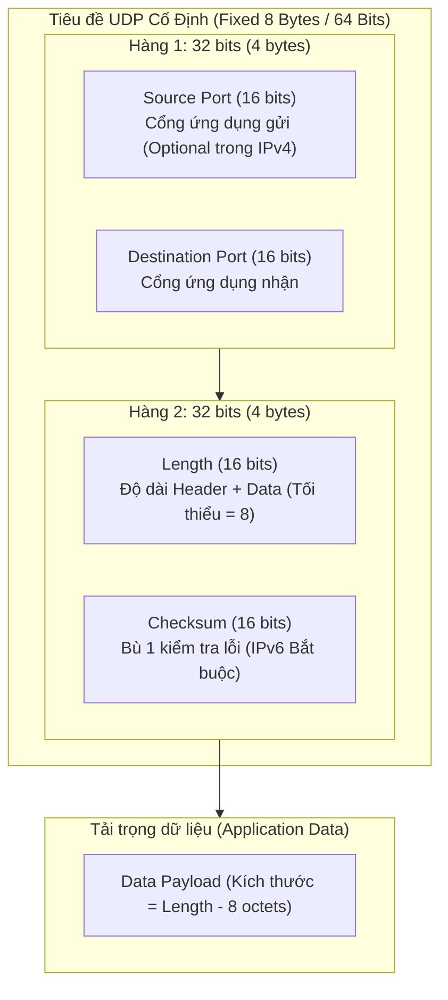
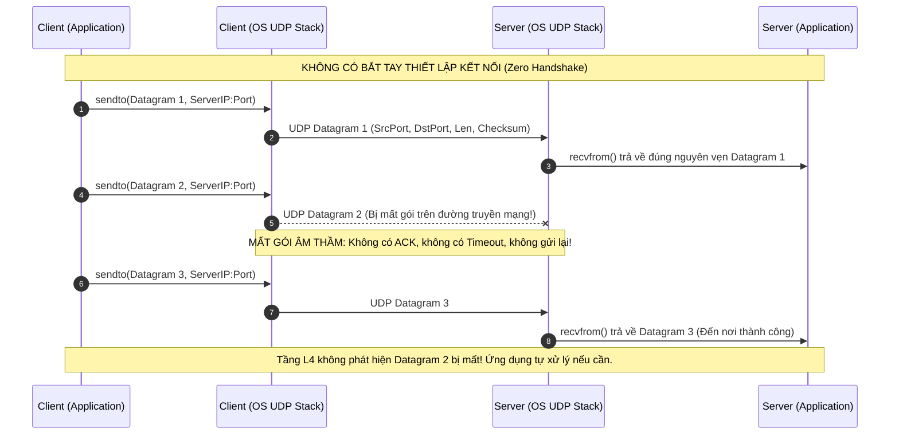

# 2_5_2 User Datagram Protocol

> **Khóa học**: Cloud DevOps Basic — Computer Networking Core  
> **Phân nhóm**: 2 Domain 2 - Computer Networking Core Fundamentals › 2_5 Transport Layer TCP and UDP  
> **Chủ đề**: Giao thức dữ liệu người dùng User Datagram Protocol (UDP, RFC 768): Cấu trúc tiêu đề 8 bytes, tính chất không kết nối, hướng thông điệp và vai trò nền tảng cho QUIC  
> **Trạng thái**: Draft (WRITE-CDB-2_5_2, 14-11-2026)  
> **Checklist đối chiếu**: [2_5_2](<../../../CHECKLIST.md#domain-2-computer-networking-core-fundamentals-43-items>)  

---

## 1. Khái Niệm Cốt Lõi & Bản Chất Kỹ Thuật (Core Concepts & Technical Deep Dive)

Trong mô hình mạng máy tính phân tầng, tầng truyền vận (Transport Layer - L4) đảm nhận vai trò cung cấp kênh giao tiếp tiến trình - tới - tiến trình (process-to-process communication) giữa các ứng dụng chạy trên các máy trạm khác nhau. Bên cạnh giao thức TCP phức tạp và nặng về duy trì kết nối, **User Datagram Protocol (UDP)**, được chuẩn hóa trong tiêu chuẩn Internet **RFC 768** (J. Postel, 1980), đại diện cho triết lý thiết kế tối giản tuyệt đối (minimalism).

```text
+--------------------------------------------------------------------------+
|                  TẦNG TRUYỀN VẬN (L4 TRANSPORT LAYER)                    |
|                                                                          |
|   [ TCP - Transmission Control Protocol ]    [ UDP - User Datagram ]     |
|   - Hướng kết nối (3-Way Handshake)          - Không kết nối (Connectionless)
|   - Tin cậy, truyền lại, kiểm soát luồng     - Không bảo đảm, không ACK  |
|   - Hướng luồng byte (Byte-Stream)           - Hướng thông điệp (Datagram)|
|   - Tiêu đề biến thiên (20 - 60 bytes)       - Tiêu đề cố định (8 bytes)  |
+--------------------------------------------------------------------------+
```

---

### 1.1 Triết lý tối giản và tính chất không kết nối (RFC 768)

Theo đặc tả tại phần mở đầu của **RFC 768**:
> *"This protocol provides a procedure for application programs to send messages to other programs with a minimum of protocol mechanism. The protocol is transaction oriented, and delivery and duplicate protection are not guaranteed. Applications requiring ordered reliable delivery of streams of data should use the Transmission Control Protocol (TCP)."*

Bản chất kỹ thuật của UDP được định hình qua các đặc tính cốt lõi:

1. **Phi kết nối (Connectionless) và Phi trạng thái (Stateless)**:
   - Trước khi gửi dữ liệu, bên gửi hoàn toàn không thực hiện bất kỳ thủ tục bắt tay thiết lập phiên nào (zero handshake overhead).
   - Hệ điều hành và nhân mạng (kernel) không cần cấp phát và duy trì các khối điều khiển kết nối (Transmission Control Block - TCB), không phải lưu trạng thái máy hữu hạn (state machine) như `SYN_SENT`, `ESTABLISHED` hay `TIME_WAIT`.
2. **Không có cơ chế bảo đảm độ tin cậy (Unreliable)**:
   - UDP hoàn toàn thiếu vắng cơ chế xác nhận nhận gói tin (no acknowledgments - ACKs).
   - Không có cơ chế phát hiện mất gói tin và tự động truyền lại (no retransmission mechanisms).
   - Không có cơ chế đánh số thứ tự tuần tự để sắp xếp lại các gói tin đến lệch thứ tự (no packet reordering).
3. **Không kiểm soát luồng và không kiểm soát tắc nghẽn (No Flow / Congestion Control)**:
   - UDP không theo dõi kích thước cửa sổ nhận của trạm đích (no flow control window) và cũng không ước lượng trạng thái nghẽn của đường truyền mạng (no congestion window / slow start).
   - Ứng dụng đẩy dữ liệu vào socket với tốc độ bao nhiêu, kernel sẽ lập tức đóng gói và chuyển xuống tầng mạng (IP) bấy nhiêu, không điều tiết tốc độ phát xạ.
4. **Phù hợp với giao dịch yêu cầu/đáp ứng có chi phí phụ thấp (Low-Overhead Transactions)**:
   - RFC 768 chỉ rõ ứng dụng ban đầu điển hình của UDP là dịch vụ máy chủ phân giải tên miền Internet (**Internet Name Server / DNS**) và giao thức truyền tệp đơn giản (**Trivial File Transfer Protocol / TFTP**). Trong các mô hình này, việc thiết lập và giải phóng kết nối tiêu tốn nhiều gói tin hơn chính bản tin trao đổi thực tế.

---

### 1.2 Hướng thông điệp (Message-Oriented) vs Hướng luồng byte (Stream-Oriented)

Một trong những khác biệt kiến trúc sâu sắc nhất giữa UDP và TCP là phương thức xử lý ranh giới dữ liệu giữa ứng dụng và tầng truyền vận:

| Tiêu chí | UDP (RFC 768) | TCP (RFC 9293) |
| :--- | :--- | :--- |
| **Bản chất trừu tượng** | **Hướng thông điệp (Message-Oriented)** | **Hướng luồng byte (Stream-Oriented)** |
| **Ranh giới dữ liệu (Boundaries)** | **Bảo toàn nguyên vẹn ranh giới datagram** | **Không có ranh giới bản tin** (luồng byte liên tục) |
| **Thao tác đọc/ghi (I/O)** | 1 lệnh gửi (`sendto`) $\rightarrow$ đúng 1 datagram $\rightarrow$ 1 lệnh nhận (`recvfrom`) | 1 lệnh gửi có thể bị ghép (coalesced) hoặc phân mảnh thành nhiều phân đoạn nhận |
| **Trách nhiệm định khung** | Do giao thức UDP tự đảm nhiệm qua trường `Length` | Do tầng ứng dụng tự định nghĩa ký tự phân cách (delimiters) hoặc tiền tố độ dài |

Theo RFC 768, giao diện ứng dụng của UDP trả về chính xác số octet dữ liệu của thông điệp cùng với thông tin địa chỉ IP nguồn và cổng nguồn tương ứng. Tầng ứng dụng gửi đi một gói tin 500 bytes thì bên nhận sẽ nhận được đúng một khối dữ liệu 500 bytes trong một lần gọi hệ thống đọc socket.

---

### 1.3 Cấu trúc tiêu đề UDP cố định 8 Bytes (64 bits)

Tiêu đề của UDP được thiết kế cực kỳ tinh gọn, có kích thước cố định chính xác **8 bytes (64 bits)** và **hoàn toàn không hỗ trợ các trường mở rộng (options)**:

```text
 0                   1                   2                   3
 0 1 2 3 4 5 6 7 8 9 0 1 2 3 4 5 6 7 8 9 0 1 2 3 4 5 6 7 8 9 0 1
+-+-+-+-+-+-+-+-+-+-+-+-+-+-+-+-+-+-+-+-+-+-+-+-+-+-+-+-+-+-+-+-+
|          Source Port          |       Destination Port        |
+-+-+-+-+-+-+-+-+-+-+-+-+-+-+-+-+-+-+-+-+-+-+-+-+-+-+-+-+-+-+-+-+
|            Length             |           Checksum            |
+-+-+-+-+-+-+-+-+-+-+-+-+-+-+-+-+-+-+-+-+-+-+-+-+-+-+-+-+-+-+-+-+
|                             data                              |
+-+-+-+-+-+-+-+-+-+-+-+-+-+-+-+-+-+-+-+-+-+-+-+-+-+-+-+-+-+-+-+-+
```

Tiêu đề bao gồm đúng 4 trường, mỗi trường có độ dài **16 bits (2 bytes)**:

1. **Source Port (16 bits)**:
   - Cổng nguồn của tiến trình gửi gói tin.
   - Theo RFC 768, đây là trường tùy chọn: *"Source Port is an optional field, when meaningful, it indicates the port of the sending process, and may be assumed to be the port to which a reply should be addressed in the absence of any other information. If not used, a value of zero is inserted."*
2. **Destination Port (16 bits)**:
   - Cổng đích trên trạm nhận, có ý nghĩa định tuyến gói tin tới đúng tiến trình socket đích trong phạm vi địa chỉ IP đích.
3. **Length (16 bits)**:
   - Độ dài tính bằng octet (bytes) của toàn bộ user datagram, bao gồm cả tiêu đề 8 bytes và phần tải trọng dữ liệu (data payload).
   - Giá trị nhỏ nhất hợp lệ của trường Length là **8** (trường hợp datagram không mang tải trọng dữ liệu).
4. **Checksum (16 bits)**:
   - Mã kiểm tra lỗi tính theo thuật toán bù 1 của tổng bù 1 16-bit (16-bit one's complement of the one's complement sum) trên pseudo-header IP (chứa IP nguồn, IP đích, mã giao thức và độ dài UDP), tiêu đề UDP và phần tải trọng dữ liệu.

---

### 1.4 Cơ chế Checksum: Tùy chọn trên IPv4 vs Bắt buộc trên IPv6 (RFC 8200)

Cơ chế kiểm tra tính toàn vẹn Checksum của UDP có sự khác biệt mang tính bước ngoặt giữa hai thế hệ giao thức Internet:

```text
IPv4 (RFC 768)                      IPv6 (RFC 8200 Section 8.1)
+-------------------------------+   +-------------------------------+
| Checksum: TÙY CHỌN            |   | Checksum: BẮT BUỘC            |
| - Transmitter có thể gửi 0x000|   | - Transmitter KHÔNG được gửi 0|
| - Receiver bỏ qua kiểm tra    |   | - Receiver PHẢI HỦY gói tin   |
|   nếu nhận được 0x0000        |   |   chứa checksum 0x0000        |
+-------------------------------+   +-------------------------------+
```

- **Trên IPv4 (RFC 768)**:
  - Checksum là trường tùy chọn (optional).
  - Nếu trạm gửi không tạo mã checksum, nó sẽ gán toàn bộ bit 0 vào trường này: *"An all zero transmitted checksum value means that the transmitter generated no checksum (for debugging or for higher level protocols that don't care)."*
  - Nếu quá trình tính toán checksum cho ra kết quả thực tế là toàn bit 0 (`0x0000`), nó sẽ được phát đi dưới dạng toàn bit 1 (`0xFFFF`) trong hệ thống bù 1 để tránh nhầm lẫn với trạng thái tắt checksum.
- **Trên IPv6 (RFC 8200 Section 8.1)**:
  - Không giống IPv4, checksum UDP trên IPv6 là **BẮT BUỘC (mandatory)**.
  - *Lý do kỹ thuật*: Để tối ưu hóa tốc độ chuyển tiếp gói tin của các router trên đường trục, tiêu đề IPv6 đã loại bỏ hoàn toàn trường Header Checksum ở tầng 3 (Network Layer). Do đó, tầng truyền vận (L4) buộc phải đảm nhận trách nhiệm phát hiện lỗi truyền dẫn để bảo vệ dữ liệu và định tuyến cổng.
  - *Hành vi của Receiver*: Theo RFC 8200 mục 8.1, mọi node IPv6 khi nhận được gói tin UDP mang giá trị checksum bằng 0 (`0x0000`) **bắt buộc phải hủy bỏ gói tin đó (must discard)** và nên ghi nhật ký cảnh báo lỗi (should log the error).

---

### 1.5 UDP trong kiến trúc hiện đại: Nền tảng của QUIC và HTTP/3 (RFC 9000)

Trong nhiều thập kỷ, UDP thường chỉ được xem là giao thức phụ trợ cho các dịch vụ mạng đơn giản (DNS, DHCP, NTP) hoặc truyền dẫn media thời gian thực (VoIP, video streaming chấp nhận mất gói). Tuy nhiên, kiến trúc mạng Internet hiện đại đã tạo nên một cuộc cách mạng cho UDP thông qua giao thức **QUIC (RFC 9000)**:

```text
+--------------------------------------------------------------------------+
|                       HTTP/3 APPLICATION LAYER                           |
+--------------------------------------------------------------------------+
|    QUIC (RFC 9000): Multiplexing Streams, TLS 1.3 Crypto, Congestion    |
|                     Control, Loss Recovery, Connection ID                |
+--------------------------------------------------------------------------+
|                   UDP (RFC 768): 8-Byte Minimal Header                   |
+--------------------------------------------------------------------------+
|                              IP (IPv4 / IPv6)                            |
+--------------------------------------------------------------------------+
```

- **Sự hóa đá của thiết bị trung gian (Ossified Middleboxes)**:
  - Trên mạng Internet công cộng, hàng triệu thiết bị trung gian (firewalls, NAT gateways, load balancers, IDS/IPS) chỉ nhận diện và cho phép hai mã giao thức L4 truyền thống là TCP (protocol 6) và UDP (protocol 17). Việc phát triển một giao thức truyền vận L4 mới trực tiếp trên IP (như SCTP) hoàn toàn bất khả thi vì hầu hết middlebox sẽ loại bỏ các gói tin lạ này.
- **Giải pháp đóng gói QUIC trên nền UDP**:
  - Theo RFC 9000: *"QUIC is a UDP-based multiplexed and secure transport protocol... QUIC packets are carried in UDP datagrams [UDP] to better facilitate deployment in existing systems and networks."*
  - Bằng cách đặt toàn bộ cơ chế bảo mật (TLS 1.3), kiểm soát tắc nghẽn, đa luồng không bị chặn đầu hàng đợi (no head-of-line blocking) và cơ chế khôi phục gói tin vào không gian người dùng (user-space) và đóng gói trong các UDP datagrams tiêu chuẩn, QUIC vừa tận dụng được tính nhẹ gọn của UDP vừa dễ dàng xuyên qua mọi hạ tầng middlebox trên toàn cầu.

---

## 2. Ví Dụ Đời Sống Thực Tế Dễ Hiểu (Intuitive Real-World Analogies)

Để thấu hiểu bản chất của giao thức UDP và sự khác biệt căn bản giữa nó với TCP, hãy so sánh phương thức trao đổi qua **Dịch Vụ Gửi Bưu Thiếp (Postcard Service)** so với **Cuộc Gọi Điện Thoại Có Hẹn Trước (Scheduled Phone Call)**.

```text
+----------------------------------------------------------------------------+
|        BƯU ĐIỆN: GỬI BƯU THIẾP (UDP)      |   ĐIỆN THOẠI: HẸN TRƯỚC (TCP)  |
+-------------------------------------------+--------------------------------+
| 1. Viết ngắn gọn lên bưu thiếp            | 1. Bấm số gọi và chờ đổ chuông |
| 2. Dán tem, thả ngay vào hòm thư          | 2. "Alo, nghe rõ không?" - "Có"|
| 3. Không cần biết đối phương có ở nhà     | 3. Hai bên xác nhận kênh thông |
| 4. Bưu điện không có giấy báo phát (ACK)  | 4. Từng câu nói được xác nhận  |
| 5. Thất lạc thì mất luôn, không gửi lại   | 5. Nghe rè thì yêu cầu nhắc lại|
| 6. Bưu thiếp gửi sau có thể đến trước     | 6. Thứ tự lời nói luôn chuẩn xác|
| => Chi phí gửi cực rẻ, tức thì, gọn nhẹ   | => Đảm bảo nội dung, chi phí cao|
+----------------------------------------------------------------------------+
```

### Bản chất của việc gửi Bưu Thiếp (UDP)
1. **Không cần hẹn trước (Zero Handshake)**: Người gửi chỉ cần cầm tấm bưu thiếp, viết địa chỉ người nhận và nội dung ngắn gọn, sau đó thả thẳng vào hòm thư bưu điện. Bạn không cần phải gọi điện trước để hỏi xem đối phương có sẵn sàng nhận thư hay không.
2. **Không có giấy báo phát (No ACK)**: Bưu điện chỉ làm nhiệm vụ tiếp nhận và cố gắng chuyển đi (Best-effort). Họ không cung cấp dịch vụ bưu phẩm bảo đảm có chữ ký hoàn trả (không có thông điệp ACK quay về).
3. **Mất là mất hẳn (No Retransmission)**: Nếu trên đường vận chuyển xe thư gặp sự cố làm rơi bưu thiếp, bưu điện sẽ không tự sao chép bản khác để gửi bù. Người gửi cũng không hề biết bưu thiếp đã bị mất trừ khi người nhận chủ động báo lại qua kênh khác.
4. **Đến lệch thứ tự (Unordered Delivery)**: Nếu bạn gửi tấm bưu thiếp thứ nhất vào sáng Thứ Hai và tấm bưu thiếp thứ hai vào chiều Thứ Hai, do đi qua các tuyến xe bưu chính khác nhau, người nhận hoàn toàn có thể nhận được tấm bưu thiếp thứ hai trước tấm bưu thiếp thứ nhất.
5. **Độc lập và nguyên vẹn (Datagram Boundaries)**: Mỗi tấm bưu thiếp là một thông điệp độc lập, có giới hạn kích thước vật lý rõ ràng. Người nhận đọc từng tấm bưu thiếp riêng biệt, bưu điện không bao giờ tự ý cắt ghép hai tấm bưu thiếp dán thành một tờ thư dài.

---

## 3. Kiến Trúc, Luồng Hoạt Động & Hình Ảnh Trực Quan (Architecture, Diagrams & Visual Media)

### 3.1 Sơ đồ cấu trúc tiêu đề UDP 8 Bytes (RFC 768)

Mỗi trường trong tiêu đề UDP có kích thước đúng 16 bits (2 bytes), tạo nên tổng kích thước tiêu đề cố định là 64 bits (8 bytes):



---

### 3.2 Sơ đồ luồng thông điệp không kết nối và không xác nhận

Sơ đồ tuần tự minh họa cách ứng dụng Client phát các datagram tới Server mà không có bước handshake và không có ACK phản hồi ở tầng truyền vận:



---

## 4. Code Mẫu Trực Quan Hoặc Dòng Lệnh Thực Chiến (Runnable Sample Code / CLI)

Để kiểm tra các socket UDP đang lắng nghe trên hệ thống Linux cũng như thăm dò kết nối UDP thực tế, quản trị viên hệ thống và DevOps engineer sử dụng các công cụ tiêu chuẩn `ss` (Socket Statistics) và `nc` (Ncat/Netcat).

---

### 4.1 Kiểm tra các UDP Socket đang mở với lệnh `ss`

Lệnh `ss` (thuộc gói `iproute2`) là công cụ hiện đại thay thế cho `netstat` để truy vấn trực tiếp trạng thái socket từ Linux kernel.

```bash
# Hiển thị toàn bộ các UDP socket (cả đang nghe và không nghe) dưới dạng số
ss -uan
```

**Giải thích các cờ lệnh (Flags Breakdown)**:
- `-u` (`--udp`): Chỉ hiển thị các socket thuộc giao thức UDP (thay vì mặc định là TCP).
- `-a` (`--all`): Hiển thị tất cả các socket (bao gồm cả các socket đang mở nhận dữ liệu và socket gửi).
- `-n` (`--numeric`): Hiển thị cổng và địa chỉ IP dưới dạng số nguyên (tránh phân giải DNS ngược làm chậm lệnh).

**Đầu ra mẫu quan sát được trên Linux**:
```text
State       Recv-Q   Send-Q     Local Address:Port      Peer Address:Port   Process
UNCONN      0        0              127.0.0.1:53             0.0.0.0:*       users:(("systemd-resolve",pid=789,fd=13))
UNCONN      0        0          192.168.1.100:68             0.0.0.0:*       users:(("NetworkManager",pid=654,fd=10))
UNCONN      0        0                0.0.0.0:123            0.0.0.0:*       users:(("chronyd",pid=542,fd=5))
UNCONN      0        0                  [::]:5353               [::]:*       users:(("avahi-daemon",pid=431,fd=12))
```

**Phân tích các trường thông tin quan trọng**:
- `State: UNCONN`: Viết tắt của *Unconnected*. Do UDP là giao thức phi kết nối, hầu hết các socket UDP trong kernel luôn ở trạng thái `UNCONN` (khác với TCP hiển thị `LISTEN`, `ESTABLISHED`, `TIME_WAIT`).
- `Recv-Q`: Số lượng bytes dữ liệu đã được tầng mạng nhận vào bộ đệm của socket nhưng tiến trình ứng dụng người dùng chưa kịp đọc qua lệnh `recv()`/`recvfrom()`.
- `Send-Q`: Số lượng bytes dữ liệu đang nằm trong bộ đệm gửi của kernel chờ đẩy ra card mạng.
- `Local Address:Port`: Địa chỉ IP và số hiệu cổng 16-bit cục bộ mà dịch vụ đang gắn (bind). Ví dụ `127.0.0.1:53` là dịch vụ DNS resolver nội bộ.
- `Peer Address:Port`: Đối với socket UDP thông thường chưa kết nối (`unconnected socket`), trường này có giá trị `0.0.0.0:*` (hoặc `[::]:*`), nghĩa là socket sẵn sàng tiếp nhận datagram từ bất kỳ địa chỉ nguồn nào trên Internet.

---

### 4.2 Thăm dò trạng thái cổng UDP với `nc` (Ncat / Netcat)

Khác với TCP có thể dễ dàng kiểm tra cổng bằng cờ SYN (`nc -z -v <host> <port>`), việc kiểm tra cổng UDP phức tạp hơn nhiều vì cổng UDP mở thường giữ im lặng (không phản hồi gì nếu gói tin thăm dò không đúng định dạng của ứng dụng).

```bash
# Thăm dò cổng UDP 53 (DNS) ở chế độ Zero-I/O và hiển thị chi tiết
nc -u -z -v 127.0.0.1 53
```

**Giải thích các cờ lệnh**:
- `-u` (`--udp`): Chuyển chế độ hoạt động sang giao thức UDP.
- `-z`: Kích hoạt chế độ **Zero-I/O mode** (chỉ gửi gói tin thăm dò kết nối rồi lập tức đóng, không gửi luồng dữ liệu liên tục).
- `-v` (`--verbose`): Hiển thị chi tiết trạng thái kết quả thăm dò trên console.

**Đầu ra mẫu quan sát được**:
```text
Ncat: Version 7.94 ( https://nmap.org/ncat )
Ncat: Connected to 127.0.0.1:53.
Ncat: UDP packet sent successfully
Ncat: 1 bytes sent, 0 bytes received in 2.01 seconds.
```

> [!NOTE]
> Khi thăm dò UDP bằng `nc -u -z -v`, kết quả `Connected` hoặc `UDP packet sent successfully` chỉ phản ánh việc kernel đã đẩy thành công gói UDP ra giao diện mạng cục bộ mà không nhận lại gói tin báo lỗi ICMP Port Unreachable (Type 3, Code 3). Nó không đảm bảo 100% ứng dụng phía sau đang hoạt động bình thường như bắt tay TCP SYN-ACK.

---

### 4.3 Bắt gói tin và phân tích tiêu đề UDP thực tế với `tcpdump`

Sử dụng lệnh `tcpdump` để bắt trực tiếp các khung dữ liệu chứa gói tin UDP và kiểm tra các trường tiêu đề:

```bash
# Bắt gói tin UDP trên mọi giao diện mạng, hiển thị IP và cổng dạng số
sudo tcpdump -nn -i any udp port 53 -vv
```

**Đầu ra mẫu phân tích tiêu đề**:
```text
14:25:10.123456 IP (tos 0x0, ttl 64, id 41258, offset 0, flags [DF], proto UDP (17), length 68)
    192.168.1.100.54321 > 1.1.1.1.53: [bad udp cksum 0x4a12 -> 0x7b23!] 
    54321+ A? example.com. (40) (UDP length 40)
```

**Phân tích trường dữ liệu hiển thị**:
- `proto UDP (17)`: Định danh số hiệu giao thức tầng truyền vận UDP là **17** trong tiêu đề IP (L3).
- `192.168.1.100.54321 > 1.1.1.1.53`: Cổng nguồn là cổng tạm thời (ephemeral port) `54321`, cổng đích là cổng dịch vụ chuẩn `53` (DNS).
- `UDP length 40`: Độ dài toàn bộ datagram UDP là **40 bytes** (bao gồm 8 bytes UDP header và 32 bytes truy vấn DNS).
- `bad udp cksum`: Hiện tượng phổ biến trên card mạng hiện đại khi tính năng **UDP Checksum Offloading** được kích hoạt; kernel để card mạng (NIC hardware) tính toán checksum trước khi phát sóng nên `tcpdump` bắt gói ở tầng kernel thấy giá trị checksum chưa hoàn tất.

---

## 5. Cạm Bẫy Thực Tế & Thực Tiễn Sản Xuất (Production Gotchas & Best Practices)

Trong thiết kế hệ thống phân tán, hạ tầng vi dịch vụ và DevOps, việc sử dụng UDP đòi hỏi các kỹ sư phải lường trước các vấn đề đặc thù của giao thức phi kết nối:

### 1. Tràn hàng đợi bộ đệm nhận (Socket Receive Buffer Overflow) và mất gói âm thầm
- **Cơ chế**: Do UDP hoàn toàn không có cơ chế kiểm soát luồng (flow control), bên gửi có thể phát xạ hàng triệu gói tin mỗi giây. Dữ liệu đến trạm nhận sẽ được đưa vào hàng đợi `sk_rcvbuf` của socket. Nếu tiến trình ứng dụng (như Logstash, Prometheus pushgateway, Syslog daemon) bị nghẽn CPU hoặc bận xử lý I/O đĩa và không gọi `recvfrom()` kịp thời, hàng đợi nhận sẽ bị lấp đầy 100%.
- **Hậu quả**: Khi bộ đệm đầy, Linux kernel sẽ **lặng lẽ hủy bỏ (drop)** tất cả các gói tin UDP tiếp theo mà không gửi lại bất kỳ thông báo lỗi nào cho bên gửi.
- **Thực tiễn khắc phục**:
  - Tăng kích thước bộ đệm nhận tối đa của hệ thống trong `sysctl`:
    ```bash
    sudo sysctl -w net.core.rmem_max=26214400
    sudo sysctl -w net.core.rmem_default=26214400
    ```
  - Thường xuyên giám sát chỉ số packet drop của UDP thông qua lệnh:
    ```bash
    netstat -s -u | grep "receive errors"
    # hoặc
    nstat -az UdpRcvbufErrors
    ```

### 2. Nguy cơ tấn công khuếch đại phân tán (UDP Amplification & Reflection DDoS Attacks)
- **Cơ chế**: Do UDP là giao thức phi kết nối và không có thủ tục bắt tay để xác minh địa chỉ thực của bên gửi, kẻ tấn công có thể dễ dàng làm giả địa chỉ IP nguồn (IP Spoofing) trong gói tin UDP Request thành địa chỉ IP của nạn nhân. Kẻ tấn công gửi các truy vấn nhỏ tới các dịch vụ công cộng như DNS (ANY query), NTP (monlist), hoặc SNMP.
- **Hậu quả**: Máy chủ dịch vụ phản hồi một gói tin có dung lượng lớn gấp hàng chục đến hàng trăm lần (amplification factor) trực tiếp về địa chỉ IP của nạn nhân, gây nghẽn toàn bộ băng thông hạ tầng mạng của nạn nhân.
- **Thực tiễn bảo vệ**:
  - Không triển khai các dịch vụ UDP mở (open resolvers, open NTP) hướng ra ngoài Internet công cộng nếu không có cơ chế giới hạn tần suất truy vấn (Response Rate Limiting - RRL).
  - Triển khai bộ lọc BCP 38 / Reverse Path Forwarding (uRPF) tại các router biên để ngăn chặn lưu lượng mạng có IP nguồn giả mạo rời khỏi hạ tầng mạng nội bộ.

### 3. Thiếu hụt cơ chế Path MTU Discovery (PMTUD) dẫn đến phân mảnh IP (IP Fragmentation)
- **Cơ chế**: TCP tự động thỏa thuận kích thước phân đoạn tối đa (MSS - Maximum Segment Size) trong quá trình bắt tay 3 bước để đảm bảo kích thước gói tin không vượt quá MTU đường truyền. Ngược lại, UDP không có cơ chế đàm phán kích thước gói tin ở tầng truyền vận.
- **Hậu quả**: Nếu ứng dụng gửi một UDP datagram có kích thước lớn hơn MTU của liên kết mạng (ví dụ gửi datagram 4096 bytes qua mạng Ethernet có MTU chuẩn 1500 bytes), tầng mạng IP buộc phải chia nhỏ datagram thành 3 phân mảnh IP (IP fragments). Nếu chỉ cần một phân mảnh bị thất lạc trên đường truyền, bên nhận sẽ không thể tái cấu trúc toàn bộ datagram và phải hủy bỏ toàn bộ dữ liệu, gây lãng phí nghiêm trọng tài nguyên mạng.
- **Thực tiễn sản xuất**:
  - Giữ kích thước payload của UDP datagram luôn nhỏ hơn Path MTU an toàn (thường duy trì dưới 1280 bytes - kích thước MTU tối thiểu bắt buộc của IPv6 hoặc 512 bytes cho DNS truyền thống theo RFC 1035) để tránh tuyệt đối hiện tượng phân mảnh IP.

---

## 6. Câu Hỏi Củng Cố Kiến Thức (Active Recall Quiz)

<details>
<summary><b>Câu hỏi 1:</b> Phân tích chi tiết cấu trúc tiêu đề UDP 8 bytes theo chuẩn RFC 768. Tại sao giá trị của trường Length trong tiêu đề UDP có giá trị tối thiểu là 8?</summary>

**Đáp án:**
- **Cấu trúc tiêu đề UDP 8 bytes (64 bits)** gồm chính xác 4 trường 16-bit:
  1. `Source Port (16 bits)`: Số hiệu cổng nguồn của tiến trình gửi (tùy chọn trong IPv4, nếu không dùng đặt bằng 0).
  2. `Destination Port (16 bits)`: Số hiệu cổng đích của tiến trình tiếp nhận dữ liệu.
  3. `Length (16 bits)`: Độ dài tính bằng octet (bytes) của toàn bộ user datagram bao gồm cả tiêu đề và tải trọng dữ liệu.
  4. `Checksum (16 bits)`: Bù 1 của tổng bù 1 16-bit kiểm tra tính toàn vẹn dữ liệu.
- **Lý do trường Length có giá trị tối thiểu là 8**:
  Theo định nghĩa tại RFC 768, trường `Length` được tính bằng tổng kích thước của phần tiêu đề UDP cộng với kích thước của phần dữ liệu payload (`Length = Header_Size + Data_Size`). Do tiêu đề UDP có kích thước cố định là 8 octets, trong trường hợp ứng dụng gửi một datagram rỗng không chứa dữ liệu payload (`Data_Size = 0`), độ dài toàn bộ datagram bằng đúng kích thước của tiêu đề là 8 octets. Do đó giá trị hợp lệ nhỏ nhất của trường Length bắt buộc phải là 8.
</details>

<details>
<summary><b>Câu hỏi 2:</b> Phân biệt cơ chế xử lý trường Checksum của giao thức UDP giữa IPv4 (RFC 768) và IPv6 (RFC 8200). Host nhận IPv6 sẽ hành xử như thế nào khi nhận được một gói tin UDP có giá trị Checksum bằng 0?</summary>

**Đáp án:**
- **Trên IPv4 (RFC 768)**:
  - Checksum UDP là **tùy chọn (optional)**.
  - Bên gửi nếu không muốn tính checksum có thể truyền toàn bộ bit 0 (`0x0000`). Trạm nhận khi thấy checksum là 0 sẽ bỏ qua bước xác minh tính toàn vẹn dữ liệu.
- **Trên IPv6 (RFC 8200 Section 8.1)**:
  - Checksum UDP là **bắt buộc (mandatory)**.
  - *Lý do*: Tiêu đề IPv6 đã loại bỏ hoàn toàn trường Header Checksum ở tầng mạng (L3) để tối ưu hóa hiệu năng chuyển tiếp gói tin của router, do đó tầng truyền vận L4 bắt buộc phải tự bảo vệ tính toàn vẹn của địa chỉ và dữ liệu.
- **Hành vi của Host nhận IPv6 đối với gói tin Checksum = 0**:
  Theo quy định bắt buộc tại RFC 8200 mục 8.1, mọi node IPv6 khi nhận được gói tin UDP có trường checksum bằng 0 (`0x0000`) **bắt buộc phải hủy bỏ gói tin đó (must discard the packet)** và nên ghi lại nhật ký cảnh báo lỗi (should log the error).
</details>

<details>
<summary><b>Câu hỏi 3:</b> Trong thiết kế giao thức truyền vận thế hệ mới QUIC (RFC 9000), tại sao IETF lại quyết định đóng gói toàn bộ các luồng dữ liệu bảo mật trên nền UDP datagrams thay vì định nghĩa một mã giao thức L4 hoàn toàn mới trên tầng mạng IP?</summary>

**Đáp án:**
- **Nguyên nhân chính là hiện tượng "hóa đá thiết bị trung gian" (Middlebox Ossification)**:
  - Mạng Internet công cộng chứa vô số thiết bị trung gian phần cứng như Firewall, NAT box, cân bằng tải (Load Balancers) và hệ thống phòng chống xâm nhập (IPS). Các thiết bị này được cấu hình cứng hoặc tối ưu phần cứng để chỉ nhận diện và chuyển tiếp hai giao thức truyền vận L4 phổ biến nhất là TCP (protocol 6) và UDP (protocol 17).
  - Nếu QUIC được thiết kế như một giao thức L4 mới nằm trực tiếp trên IP (ví dụ gán một protocol number mới), phần lớn các thiết bị trung gian này sẽ coi đây là lưu lượng bất thường hoặc không hợp lệ và lập tức hủy bỏ gói tin, khiến giao thức không thể triển khai trên diện rộng trên Internet toàn cầu.
- **Lợi ích khi chọn đóng gói trên UDP**:
  - Gói tin QUIC được bọc trong các UDP datagrams tiêu chuẩn với tiêu đề 8 bytes tối giản, giúp gói tin dễ dàng đi qua mọi hệ thống NAT và Firewall sẵn có trên toàn cầu mà không gặp trở ngại.
  - Toàn bộ các cơ chế phức tạp như thiết lập kết nối nhanh 0-RTT/1-RTT (tích hợp TLS 1.3), đa luồng không bị chặn đầu hàng đợi (Multiplexing without Head-of-Line Blocking), kiểm soát tắc nghẽn và phát hiện mất gói tin được đưa lên không gian người dùng (user-space), cho phép nâng cấp và vá lỗi liên tục mà không cần cập nhật kernel của hệ điều hành.
</details>

---

## 7. 📚 Nguồn Tài Liệu Chính Thống (Tier-1 Official References)

- [RFC 768: User Datagram Protocol](https://www.rfc-editor.org/rfc/rfc768.txt) - Tiêu chuẩn Internet Standard chính thức của IETF đặc tả giao thức UDP, cấu trúc tiêu đề cố định 8 bytes, 4 trường 16-bit (Source Port, Destination Port, Length, Checksum) và triết lý truyền thông điệp không kết nối.
- [RFC 8200: Internet Protocol, Version 6 (IPv6) Specification](https://www.rfc-editor.org/rfc/rfc8200.txt) - Tiêu chuẩn Internet Standard RFC 8200 Mục 8.1 quy định bắt buộc về việc tính toán Checksum UDP trên IPv6 và yêu cầu loại bỏ các gói tin UDP mang giá trị checksum bằng 0.
- [RFC 9000: QUIC: A UDP-Based Multiplexed and Secure Transport Protocol](https://www.rfc-editor.org/rfc/rfc9000.txt) - Tiêu chuẩn IETF RFC 9000 đặc tả giao thức truyền vận hiện đại QUIC đóng gói đa luồng bảo mật trên nền UDP datagrams để vượt qua rào cản middlebox.
- [Linux Manual Pages: ss(8) - Socket Statistics](https://man7.org/linux/man-pages/man8/ss.8.html) - Hướng dẫn chính thức công cụ dòng lệnh `ss` trên Linux, giải thích các tùy chọn `-u` (UDP), `-a` (all sockets) và `-n` (numeric).
- [Linux Manual Pages: ncat(1) - Concatenate and redirect sockets](https://man7.org/linux/man-pages/man1/ncat.1.html) - Hướng dẫn công cụ `nc` / `ncat`, giải thích tùy chọn `-u` (UDP mode) và `-z` (Zero-I/O port scanning mode).
