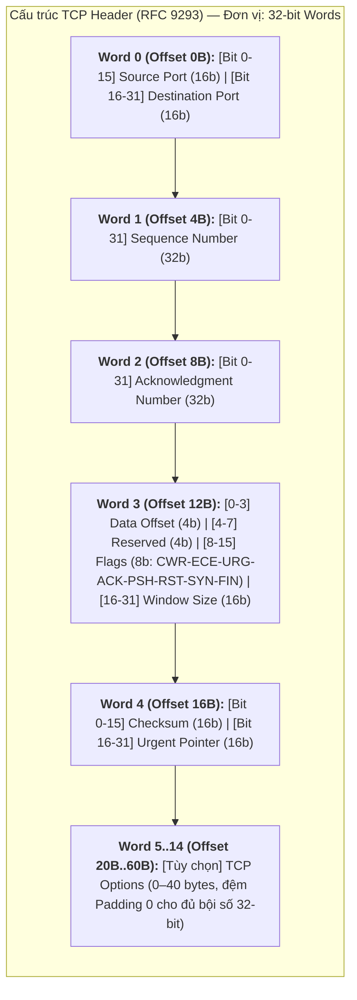

# 2_5_3 TCP Header

> **Khóa học**: Cloud DevOps Basic — Networking Core  
> **Phân nhóm**: 2 Domain 2 - Computer Networking Core Fundamentals › 2_5 Transport Layer TCP and UDP  
> **Chủ đề**: Giải phẫu chi tiết cấu trúc TCP Header (RFC 9293): Byte Stream, Sequence Number, Cumulative ACK, Control Flags, Window Size và các TCP Options quan trọng  
> **Trạng thái**: Draft (WRITE-CDB-2_5_3, 14-11-2026)  
> **Checklist đối chiếu**: [2_5_3](<../../../CHECKLIST.md#domain-2-computer-networking-core-fundamentals-43-items>)  

---

## 1. Khái Niệm Cốt Lõi & Bản Chất Kỹ Thuật (Core Concepts & Technical Deep Dive)

Trong kiến trúc mạng máy tính TCP/IP, nếu giao thức **IP (Internet Protocol)** tại Tầng 3 hoạt động theo cơ chế *best-effort* (không đảm bảo gói tin tới đích, không giữ trật tự và có thể làm rơi rụng gói), thì **Giao thức Điều khiển Truyền vận (Transmission Control Protocol - TCP)** tại Tầng 4 đóng vai trò một giao thức hướng kết nối (connection-oriented), cung cấp kênh truyền dữ liệu tin cậy (reliable), có thứ tự (ordered) và có kiểm soát dòng dữ liệu giữa hai tiến trình ứng dụng đầu cuối.

Toàn bộ các cam kết về độ tin cậy và kiểm soát trạng thái của TCP đều được hiện thực hóa thông qua cấu trúc tiêu đề gói tin — **TCP Header**, được chuẩn hóa toàn diện trong tài liệu **RFC 9293** (thay thế và hợp nhất tiêu chuẩn lịch sử RFC 793).

---

### 1.1 Kích thước TCP Header và Trường Data Offset (RFC 9293)

Theo quy định tại **RFC 9293 Section 3.1**:
- **Kích thước tiêu đề tối thiểu**: Đúng **20 bytes** (khi gói tin TCP không chứa bất kỳ tùy chọn bổ sung nào — No Options).
- **Kích thước tiêu đề tối đa**: Đúng **60 bytes** (khi sử dụng tối đa **40 bytes** dành cho các tùy chọn Options).
- **Trường Data Offset (DOffset - 4 bits)**:
  - Trường Data Offset có độ rộng 4 bits, xác định độ dài của toàn bộ tiêu đề TCP tính theo đơn vị **từ 32-bit (32-bit words hay 4-byte words)**.
  - Trường này chỉ định chính xác vị trí mà dữ liệu ứng dụng (payload data) bắt đầu xuất hiện trong phân đoạn TCP.
  - Khi không có Options, tiêu đề có kích thước 20 bytes, do đó giá trị nhỏ nhất hợp lệ của Data Offset là $20 / 4 = 5$ (biểu diễn nhị phân `0101`). Bất kỳ gói tin TCP nào có trường Data Offset nhỏ hơn 5 đều bị coi là không hợp lệ và bị loại bỏ.
  - Với độ dài 4 bits, giá trị lớn nhất mà trường Data Offset có thể đạt tới là 15 (biểu diễn nhị phân `1111`), tương ứng với chiều dài tiêu đề tối đa là $15 \times 4 = 60\text{ bytes}$.
  - Kích thước của vùng Options được tính toán trực tiếp theo công thức: $\text{size}(\text{Options}) = (\text{DOffset} - 5) \times 32\text{ bits} = (\text{DOffset} - 5) \times 4\text{ bytes}$. Vì vậy, dung lượng tối đa dành cho TCP Options không bao giờ vượt quá $60 - 20 = 40\text{ bytes}$.

---

### 1.2 Độ rộng các trường dữ liệu và Ghi chú về Bit Reserved

Theo **RFC 9293 Section 3.1**, tiêu đề TCP bao gồm các trường dữ liệu cơ bản với độ rộng bit cụ thể như sau:

| Trường dữ liệu (Field Name) | Độ rộng (Bit Width) | Ý nghĩa kỹ thuật |
| :--- | :--- | :--- |
| **Source Port** | 16 bits | Cổng nguồn của tiến trình gửi (0–65535). |
| **Destination Port** | 16 bits | Cổng đích của tiến trình nhận (0–65535). |
| **Sequence Number** | 32 bits | Số thứ tự định danh vị trí byte đầu tiên của phân đoạn trong luồng dữ liệu. |
| **Acknowledgment Number** | 32 bits | Số thứ tự xác nhận byte kế tiếp mà bên gửi ACK đang chờ nhận. |
| **Data Offset (DOffset)** | 4 bits | Số từ 32-bit trong tiêu đề TCP (giá trị từ 5 đến 15). |
| **Reserved (Rsrvd)** | 4 bits | Các bit dự phòng dành cho tương lai; bắt buộc phải thiết lập bằng 0 khi gửi. |
| **Control Bits (Flags)** | 8 bits | 8 cờ điều khiển trạng thái kết nối: CWR, ECE, URG, ACK, PSH, RST, SYN, FIN. |
| **Window** | 16 bits | Kích thước bộ đệm nhận (receive window) của bên gửi gói tin. |
| **Checksum** | 16 bits | Mã kiểm tra lỗi cho toàn bộ tiêu đề TCP, dữ liệu và IP pseudo-header. |
| **Urgent Pointer** | 16 bits | Con trỏ trỏ tới byte dữ liệu khẩn cấp (chỉ có hiệu lực khi cờ URG được bật). |
| **Options** | 0–40 bytes | Các tham số mở rộng được thỏa thuận giữa hai đầu cuối (bội số của 4 bytes). |

> **Ghi chú lịch sử về trường Reserved**:  
> Trong đặc tả trước đây theo RFC 3540 (thử nghiệm), trường Reserved từng được chia thành 3 bits dự phòng cộng với 1 bit cho cờ NS (Nonce Sum) phục vụ cơ chế ECN. Tuy nhiên, RFC 3540 đã bị thu hồi và hạ cấp (demoted), và theo chuẩn chính thức hiện hành **RFC 9293 Section 3.1**, trường **Reserved được chuẩn hóa cố định là 4 bits** (`Reserved: 4 bits`), theo sau là đúng 8 cờ điều khiển (`Control bits: 8 bits`).

---

### 1.3 Cơ chế Đánh số Byte Stream & Khởi tạo ISN (Initial Sequence Number)

Một trong những nguyên lý căn bản nhất của TCP là coi dữ liệu từ ứng dụng là một **luồng byte liên tục (continuous byte stream)**:
- Theo **RFC 9293 Section 3.4**: TCP không truyền tải các bản ghi hay thông điệp rời rạc; mỗi một octet (byte) dữ liệu truyền qua kết nối TCP đều được gắn một số thứ tự duy nhất tuần tự tăng dần. Byte đầu tiên ngay sau tiêu đề TCP sẽ mang số thứ tự nhỏ nhất của phân đoạn đó, và các byte tiếp theo được đánh số liên tiếp.
- **Initial Sequence Number (ISN)**: Khi thiết lập kết nối, số thứ tự bắt đầu không bao giờ được cố định ở số 0 mà phải được sinh ra ngẫu nhiên và độc lập cho mỗi chiều kết nối.
- Theo đặc tả bảo mật trong **RFC 9293 Section 3.4.1**, để ngăn chặn triệt để nguy cơ kẻ tấn công ngoài luồng (off-path attacker) suy đoán số thứ tự để giả mạo phiên làm việc, ISN bắt buộc phải được tạo ra bởi bộ đếm thời gian 32-bit kết hợp với hàm giả ngẫu nhiên mật mã (Cryptographically Secure Pseudorandom Function - PRF) theo công thức chuẩn:

$$\text{ISN} = M + F(\text{localip}, \text{localport}, \text{remoteip}, \text{remoteport}, \text{secretkey})$$

Trong đó:
- $M$: Bộ đếm thời gian đơn điệu (monotonic timer) chu kỳ 4 microsecond.
- $F()$: Hàm giả ngẫu nhiên (PRF) nhận diện 4-tuple của kết nối `(localip, localport, remoteip, remoteport)` cùng một khóa bí mật nội bộ (`secretkey`) của nhân hệ điều hành.
- Chuẩn RFC 9293 quy định bắt buộc (MUST-9) rằng hàm $F()$ tuyệt đối không thể bị tính toán hay suy diễn từ bên ngoài mạng.

---

### 1.4 Cơ chế Xác nhận Tích lũy (Cumulative Acknowledgment)

Theo **RFC 9293 Section 3.1 & Section 3.4**:
- Cơ chế xác nhận của TCP là **Cumulative Acknowledgment (Xác nhận tích lũy)**.
- Trường **Acknowledgment Number (32 bits)** chỉ có ý nghĩa khi cờ điều khiển **ACK** được bật (`ACK = 1`).
- Giá trị chứa trong trường ACK là số thứ tự của **byte tiếp theo mà bên gửi bản tin xác nhận đang mong đợi nhận được**.
- Quy tắc tích lũy quy định: Một gói tin mang số thứ tự xác nhận $X$ (`ACK = X`) đồng nghĩa với việc bên nhận **đã thu thập thành công toàn bộ các byte dữ liệu đứng trước $X$ (từ byte đầu tiên cho đến byte $X - 1$)**.
- Nếu có bất kỳ gói tin nào bị thất lạc giữa chừng tạo ra khoảng trống (gap), bên nhận không thể tăng giá trị ACK vượt qua khoảng trống đó, mà tiếp tục gửi ACK lặp lại (Duplicate ACK) chỉ định byte bị thiếu hụt đầu tiên.

---

### 1.5 Tám Cờ Điều Khiển (8 Control Bits / Flags) theo RFC 9293

Đặc tả chuẩn **RFC 9293 Section 3.1** định nghĩa chính xác 8 cờ điều khiển (mỗi cờ có độ rộng 1 bit):

```text
 0   1   2   3   4   5   6   7
+---+---+---+---+---+---+---+---+
|CWR|ECE|URG|ACK|PSH|RST|SYN|FIN|
+---+---+---+---+---+---+---+---+
```

1. **CWR (Congestion Window Reduced)**: Cờ báo hiệu bên gửi đã giảm cửa sổ tắc nghẽn (Congestion Window) sau khi nhận được phản hồi ECN-Echo.
2. **ECE (ECN-Echo)**: Cờ thông báo tắc nghẽn; khi nhận được gói tin IP có đánh dấu CE (Congestion Experienced), bên nhận bật cờ ECE trong TCP header để báo hiệu cho bên gửi biết mạng đang bị nghẽn.
3. **URG (Urgent Pointer significant)**: Khi bật, chỉ thị rằng trường **Urgent Pointer (16 bits)** trong tiêu đề có giá trị hợp lệ, xác định dữ liệu khẩn cấp cần được chuyển giao ưu tiên.
4. **ACK (Acknowledgment field significant)**: Chỉ thị trường Acknowledgment Number có giá trị hợp lệ. Hầu như mọi gói tin TCP sau bước bắt tay SYN đầu tiên đều có cờ ACK được bật.
5. **PSH (Push Function)**: Yêu cầu bên nhận đẩy ngay lập tức toàn bộ dữ liệu đang có trong bộ đệm lên tiến trình ứng dụng tầng trên mà không cần chờ bộ đệm đầy.
6. **RST (Reset Connection)**: Khởi tạo lại kết nối; cờ này được gửi khi có lỗi bất thường nghiêm trọng, cổng đích không tồn tại, hoặc một bên muốn chấm dứt kết nối ngay lập tức mà không qua quy trình bắt tay 4 bước thông thường.
7. **SYN (Synchronize sequence numbers)**: Đồng bộ hóa số thứ tự; chỉ được sử dụng trong các gói tin bắt tay đầu tiên để khởi tạo kết nối TCP và trao đổi ISN ban đầu.
8. **FIN (No more data from sender)**: Thông báo bên gửi đã truyền xong toàn bộ dữ liệu và yêu cầu đóng chiều gửi của kết nối (kết nối bước vào quá trình đóng lịch sự).

---

### 1.6 Các TCP Options Quan Trọng

Phần mở rộng TCP Options có định dạng chung gồm: trường `Kind` (1 byte), trường `Length` (1 byte) và trường `Value`. Các tùy chọn cốt lõi được sử dụng rộng rãi trong hạ tầng mạng hiện đại bao gồm:

1. **MSS Option (Maximum Segment Size - RFC 9293 Section 3.7.1)**:
   - *Định dạng*: `Kind = 2` (1 byte), `Length = 4` (1 byte), `Value` (16 bits / 2 bytes).
   - *Chức năng*: Thông báo kích thước phân đoạn dữ liệu lớn nhất mà bên nhận có thể tiếp nhận trong một gói tin TCP duy nhất (không tính phần IP header và TCP header).
   - *Quy tắc*: Được gửi trong gói tin có cờ SYN. Nếu một đầu cuối không nhận được tùy chọn MSS trong quá trình thiết lập kết nối, theo chuẩn RFC 9293 (MUST-15), bên gửi bắt buộc phải áp dụng giá trị MSS mặc định là **536 bytes đối với IPv4** ($576 - 40$) hoặc **1220 bytes đối với IPv6** ($1280 - 60$).

2. **Window Scale Option (RFC 7323 Section 2.1 & 2.2)**:
   - *Định dạng*: `Kind = 3` (1 byte), `Length = 3` (1 byte), `Shift Count` (1 byte, giá trị hợp lệ từ 0 đến 14).
   - *Chức năng*: Trường Window Size trong tiêu đề TCP gốc chỉ có 16 bits, giới hạn bộ đệm tối đa là $2^{16} - 1 = 65,535\text{ bytes}$ (64 KB) — quá nhỏ cho các đường truyền băng thông cao có độ trễ lớn (High BDP - Bandwidth-Delay Product).
   - *Cơ chế*: Tùy chọn Window Scale cho phép mở rộng cửa sổ nhận lên tới **30 bits** (dung lượng lên tới 1 Gigabyte). Trường Window 16 bits trong tiêu đề sẽ được dịch trái theo số bit thỏa thuận: $\text{True Window} = \text{Window Header} \times 2^{\text{Shift Count}}$.
   - *Quy tắc bắt buộc*: Tùy chọn này **chỉ được gửi duy nhất trong các phân đoạn `<SYN>`** khi mở kết nối. Hệ số scale factor sẽ được cố định cho mỗi chiều truyền trong suốt vòng đời của kết nối.

3. **SACK-Permitted Option (Selective Acknowledgment - RFC 2018 Section 1 & Section 2)**:
   - *Định dạng*: `Kind = 4` (1 byte), `Length = 2` (1 byte).
   - *Chức năng*: Với Cumulative ACK truyền thống, khi một gói bị rơi, bên gửi phải truyền lại toàn bộ các gói sau đó dù bên nhận đã thu thập được. Tùy chọn SACK-Permitted (gửi trong gói SYN) cho phép hai bên kích hoạt tính năng SACK: bên nhận có thể báo cáo chính xác các khối dữ liệu rời rạc (non-contiguous blocks) đã nhận thành công, giúp bên gửi **chỉ truyền lại đúng những phân đoạn thực sự bị thất lạc**.
   - *Quy tắc*: Tùy chọn SACK-Permitted 2 bytes này **chỉ được gửi trong gói SYN** và tuyệt đối không được xuất hiện trong các phân đoạn non-SYN.

4. **Timestamps Option (RFC 7323 Section 3.1, 4.1, 5.1)**:
   - *Định dạng*: `Kind = 8` (1 byte), `Length = 10` (1 byte), gồm 2 trường: `TSval` (Timestamp Value, 4 bytes) và `TSecr` (Timestamp Echo Reply, 4 bytes).
   - *Chức năng*:
     - **RTTM (Round-Trip Time Measurement)**: Giúp tính toán chính xác độ trễ khứ hồi RTT trên từng gói tin để điều chỉnh timer truyền lại (RTO).
     - **PAWS (Protection Against Wrapped Sequences)**: Trên các đường truyền tốc độ cao (Gigabit/10GbE), không gian số thứ tự 32-bit ($2^{32} \approx 4\text{ GB}$) có thể bị cuộn vòng (wrap-around) chỉ trong vài giây. Timestamps cung cấp dấu thời gian đơn điệu tăng dần để phân biệt các gói tin cũ bị trễ trên mạng với gói tin mới cùng mang chung số Sequence Number.

---

## 2. Ví Dụ Đời Sống Thực Tế Dễ Hiểu (Intuitive Real-World Analogies)

### 2.1 Phiếu Giao Nhận Bưu Chính Siêu Bảo Đảm

Để hình dung trực quan vai trò của TCP Header, hãy tưởng tượng một **dịch vụ vận chuyển bưu chính siêu bảo đảm** chuyên vận chuyển các bản thảo sách quý gồm hàng nghìn trang rời:

1. **Số trang bản thảo (Sequence Number)**:
   - Mỗi bọc thư gửi đi không ghi chung chung "Gói hàng số 1", mà ghi rõ: *"Bọc thư này chứa các trang từ trang số 5,001 đến trang số 6,400"*.
   - Số `5001` chính là **Sequence Number** — vị trí byte bắt đầu của phân đoạn trong toàn bộ cuốn sách.

2. **Biên nhận tích lũy (Cumulative Acknowledgment)**:
   - Người nhận không cần ký nhận riêng cho từng trang lẻ. Thay vào đó, người nhận gửi lại một tấm phiếu ghi: *"Tôi đã nhận đầy đủ tất cả các trang đến trước trang 6,401. Lần tới hãy gửi bắt đầu từ trang 6,401!"*.
   - Số `6401` chính là **Acknowledgment Number**. Nó xác nhận chắc chắn mọi trang từ trang 1 đến trang 6,400 đã nằm an toàn trong tủ sách của người nhận.

3. **Các con tem chỉ thị đặc biệt (Control Flags)**:
   - Người gửi dán các con tem nghiệp vụ lên bì thư:
     - Tem **SYN**: *"Ký kết hợp đồng giao nhận mới, bắt đầu thỏa thuận số trang ban đầu!"*
     - Tem **FIN**: *"Đây là những trang cuối cùng, tôi đã gửi hết cuốn sách và xin đóng hợp đồng gửi!"*
     - Tem **RST**: *"Có sự cố khẩn cấp! Hủy bỏ toàn bộ đơn hàng ngay lập tức!"*
     - Tem **PSH**: *"Giao hỏa tốc! Khi nhận được bọc thư này, hãy đưa ngay cho độc giả đọc, không được chờ gom đủ các bọc khác!"*

4. **Sức chứa kệ sách còn trống (Window Size & Window Scale)**:
   - Trên mỗi biên nhận, người nhận luôn đóng một con dấu: *"Hiện kệ sách của tôi chỉ còn trống chỗ cho 64 cuốn nữa!"*. Người gửi căn cứ vào đó để không gửi ồ ạt làm sập kệ sách (Flow Control).
   - Khi chuyển sang kho bãi công nghiệp quy mô lớn, con số 64 cuốn quá nhỏ bé, hai bên dùng thêm phụ lục mở rộng (**Window Scale**) để quy ước: mỗi đơn vị ghi trên phiếu sẽ được nhân thêm $2^S$ lần (ví dụ nhân lên $2^7 = 128$ lần), cho phép quản lý kho bãi hàng triệu cuốn sách.

---

## 3. Kiến Trúc, Luồng Hoạt Động & Hình Ảnh Trực Quan (Architecture, Diagrams & Visual Media)

### 3.1 Sơ đồ Phân bổ Bit của TCP Header (RFC 9293 32-bit Word Layout)

Tiêu đề TCP được tổ chức chặt chẽ thành từng hàng 32 bits (4 bytes) liên tiếp:



---

### 3.2 Bản đồ Chi tiết Từng Bit trong Tiêu đề TCP

```text
 0                   1                   2                   3
 0 1 2 3 4 5 6 7 8 9 0 1 2 3 4 5 6 7 8 9 0 1 2 3 4 5 6 7 8 9 0 1
+-+-+-+-+-+-+-+-+-+-+-+-+-+-+-+-+-+-+-+-+-+-+-+-+-+-+-+-+-+-+-+-+
|          Source Port          |       Destination Port        |
+-+-+-+-+-+-+-+-+-+-+-+-+-+-+-+-+-+-+-+-+-+-+-+-+-+-+-+-+-+-+-+-+
|                        Sequence Number                        |
+-+-+-+-+-+-+-+-+-+-+-+-+-+-+-+-+-+-+-+-+-+-+-+-+-+-+-+-+-+-+-+-+
|                    Acknowledgment Number                      |
+-+-+-+-+-+-+-+-+-+-+-+-+-+-+-+-+-+-+-+-+-+-+-+-+-+-+-+-+-+-+-+-+
|  Data |           |U|A|P|R|S|F|                               |
| Offset| Reserved  |R|C|S|S|Y|I|            Window             |
| (4b)  |  (4b)     |G|K|H|T|N|N|                               |
|       |           | | | | | | |                               |
+-+-+-+-+-+-+-+-+-+-+-+-+-+-+-+-+-+-+-+-+-+-+-+-+-+-+-+-+-+-+-+-+
|           Checksum            |         Urgent Pointer        |
+-+-+-+-+-+-+-+-+-+-+-+-+-+-+-+-+-+-+-+-+-+-+-+-+-+-+-+-+-+-+-+-+
|                    Options                    |    Padding    |
+-+-+-+-+-+-+-+-+-+-+-+-+-+-+-+-+-+-+-+-+-+-+-+-+-+-+-+-+-+-+-+-+
|                             data                              |
+-+-+-+-+-+-+-+-+-+-+-+-+-+-+-+-+-+-+-+-+-+-+-+-+-+-+-+-+-+-+-+-+
```

*(Lưu ý: Trong hàng Word 3, hai cờ đầu tiên của 8 cờ điều khiển là CWR và ECE nằm ở vị trí bit 8 và bit 9, tiếp theo là 6 cờ truyền thống URG, ACK, PSH, RST, SYN, FIN).*

---

## 4. Code Mẫu Trực Quan Hoặc Dòng Lệnh Thực Chiến (Runnable Sample Code / CLI)

### 4.1 Bắt gói tin và Phân tích TCP Header bằng `tcpdump`

Lệnh `tcpdump` trên Linux cho phép kỹ sư bắt và phân giải trực tiếp các trường trong tiêu đề TCP thực tế.

```bash
# Bắt đúng 2 gói tin TCP, hiển thị chi tiết (verbose level 1) không phân giải tên miền/port (-nn)
sudo tcpdump -nn -v -c 2 'tcp and port 443'
```

#### Kết quả mẫu quan sát được từ phiên bắt gói tin:

```text
15:30:00.123456 IP (tos 0x0, ttl 64, id 54321, offset 0, flags [DF], proto TCP (6), length 60)
    192.168.1.50.49152 > 93.184.216.34.443: Flags [S], cksum 0x7a3b (correct), seq 1000000000, win 64240, options [mss 1460,sackOK,TS val 2891234 ecr 0,nop,wscale 7], length 0

15:30:00.145678 IP (tos 0x0, ttl 56, id 0, offset 0, flags [DF], proto TCP (6), length 60)
    93.184.216.34.443 > 192.168.1.50.49152: Flags [S.], cksum 0x9b1c (correct), seq 3000000000, ack 1000000001, win 65535, options [mss 1460,sackOK,TS val 4912000 ecr 2891234,nop,wscale 9], length 0
```

---

### 4.2 Bóc tách Kỹ thuật Chi tiết Từng Trường Dữ liệu

| Ký hiệu trên `tcpdump` | Trường TCP Header tương ứng | Giá trị phân tích | Ý nghĩa kỹ thuật theo RFC |
| :--- | :--- | :--- | :--- |
| `192.168.1.50.49152` | Source IP & **Source Port** | `49152` (16 bits) | Cổng Ephemeral động do client mở. |
| `93.184.216.34.443` | Dest IP & **Dest Port** | `443` (16 bits) | Cổng chuẩn HTTPS của máy chủ web đích. |
| `Flags [S]` | **Control Bits** | `SYN = 1`, các cờ khác bằng `0` | Gói tin mở kết nối từ Client. |
| `Flags [S.]` | **Control Bits** | `SYN = 1, ACK = 1` | Dấu chấm `.` đại diện cho cờ `ACK = 1` (SYN-ACK từ Server). |
| `seq 1000000000` | **Sequence Number** | `1000000000` (32 bits) | Giá trị ISN ngẫu nhiên do Client sinh ra qua hàm PRF. |
| `ack 1000000001` | **Acknowledgment Number** | `1000000001` (32 bits) | Server xác nhận nhận được byte ISN của Client ($1000000000 + 1$). |
| `win 64240` | **Window** | `64240` (16 bits) | Bộ đệm nhận hiện tại bên gửi công bố. |
| `cksum 0x7a3b` | **Checksum** | `0x7a3b` (16 bits) | Kiểm tra tính toàn vẹn gói tin (đã xác thực hợp lệ). |
| `mss 1460` | **TCP Option: MSS (Kind 2)** | `1460` bytes (16 bits) | Báo hiệu phân đoạn nhận tối đa ($1500\text{ MTU} - 40\text{ IP/TCP header}$). |
| `sackOK` | **TCP Option: SACK Permitted (Kind 4)**| Kích hoạt (2 bytes) | Cho phép gửi selective acknowledgment khi có mất gói. |
| `TS val ... ecr ...` | **TCP Option: Timestamps (Kind 8)**| 10 bytes | TSval gửi đi và TSecr phản hồi để đo RTT và chống PAWS. |
| `wscale 7` | **TCP Option: Window Scale (Kind 3)**| Hệ số dịch bit `7` | Khai báo mở rộng cửa sổ: giá trị Window thực tế sẽ nhân $2^7 = 128$. |
| `length 0` | **Payload Length** | `0` bytes dữ liệu ứng dụng | Gói SYN thuần túy điều khiển, không mang tải trọng ứng dụng. |

---

## 5. Cạm Bẫy Thực Tế & Thực Tiễn Sản Xuất (Production Gotchas & Best Practices)

Trong vận hành hệ thống mạng, hạ tầng Cloud và cụm dịch vụ DevOps, kỹ sư thường xuyên đối mặt với các sự cố bắt nguồn từ cơ chế hoạt động của TCP Header:

1. **Sự cố Middlebox Stripping đối với TCP Options**:
   - *Bản chất*: Nhiều thiết bị tường lửa cũ, thiết bị kiểm duyệt gói tin (Middleboxes), hoặc các thiết bị cân bằng tải kém chất lượng tự ý cắt bỏ (strip) các tùy chọn TCP không nhận diện được nằm sau 20 bytes tiêu đề chuẩn.
   - *Hậu quả*: Nếu Middlebox cắt bỏ tùy chọn `Window Scale` hoặc `SACK Permitted` trong gói SYN, kết nối sẽ buộc phải lùi về cơ chế TCP nguyên thủy: cửa sổ nhận bị kẹt cứng ở mức trần tối đa 64 KB. Trên các đường truyền xuyên quốc gia có độ trễ lớn (High RTT), thông lượng truyền tải (throughput) có thể bị sụt giảm từ hàng trăm Mbps xuống chỉ còn vài Mbps dù đường truyền vật lý hoàn toàn thông suốt.

2. **Cạm bẫy MSS Clamping trên kết nối PPPoE, GRE hoặc VPN (IPsec/WireGuard)**:
   - *Bản chất*: Chuẩn Ethernet thông thường có MTU = 1500 bytes, cho phép MSS tối đa là $1500 - 40 (\text{IP+TCP}) = 1460\text{ bytes}$. Khi lưu lượng đi qua đường truyền đóng gói bổ sung (như PPPoE tốn thêm 8 bytes, hoặc VPN/IPsec/WireGuard tốn từ 40–80 bytes overhead), MTU thực tế của đường truyền bị co lại xuống còn 1420–1492 bytes.
   - *Hiện tượng*: Người dùng vẫn thực hiện được bắt tay TCP bình thường (vì gói SYN/ACK nhỏ), ping vẫn thông, nhưng khi tải trang web lớn hoặc download file, kết nối bị treo hoàn toàn (bị drop âm thầm) do gói tin mang cờ DF (Don't Fragment) vượt quá MTU đường hầm nhưng bản tin lỗi ICMP Fragmentation Needed lại bị tường lửa chặn mất (PMTUD Black Hole).
   - *Giải pháp*: Cấu hình tính năng **TCP MSS Clamping** trên router biên hoặc firewall (ví dụ với `iptables -t mangle -A FORWARD -p tcp --tcp-flags SYN,RST SYN -j TCPMSS --clamp-mss-to-pmtu`). Thiết bị mạng sẽ tự động can thiệp và viết lại (rewrite) trường MSS trong gói SYN xuống giá trị an toàn tương ứng với độ rộng đường hầm.

3. **Lỗ hổng Dự đoán ISN (ISN Prediction & Off-path TCP Spoofing)**:
   - *Bản chất*: Trong những thập niên đầu, nhiều hệ điều hành sinh ISN đơn thuần bằng cách tăng đều theo thời gian một cách tuyến tính. Kẻ tấn công đứng ngoài luồng (off-path) hoàn toàn có thể tính toán trước được số Sequence Number tiếp theo mà máy chủ sẽ sử dụng.
   - *Hậu quả*: Kẻ tấn công có thể giả mạo IP nguồn của một máy chủ tin cậy, gửi gói tin mang số Sequence Number chính xác để bơm dữ liệu độc hại hoặc gửi cờ `RST` để phá vỡ các phiên TCP quan trọng (như phiên BGP giữa các router cốt lõi).
   - *Tiêu chuẩn khắc phục*: Mọi nhân hệ điều hành hiện đại (Linux, Windows, BSD) bắt buộc phải tuân thủ công thức tạo ISN ngẫu nhiên hóa bằng hàm mật mã PRF kết hợp khóa bí mật theo tiêu chuẩn **RFC 9293 Section 3.4.1**.

---

## 6. Câu Hỏi Củng Cố Kiến Thức (Active Recall Quiz)

<details>
<summary><b>Câu hỏi 1:</b> Một phiên kết nối TCP có Client gửi cho Server một phân đoạn dữ liệu chứa 1.000 bytes, bắt đầu bằng Sequence Number là 5000. Nếu Server tiếp nhận trọn vẹn và không có lỗi, giá trị trong trường Acknowledgment Number mà Server gửi trả về cho Client là bao nhiêu? Giải thích cơ chế.</summary>

**Đáp án:**
Theo RFC 9293 (Section 3.1 & 3.4):
- TCP sử dụng cơ chế **Cumulative Acknowledgment (Xác nhận tích lũy)**.
- Trường Acknowledgment Number chứa giá trị là số thứ tự của **byte tiếp theo** mà bên nhận đang mong đợi nhận được.
- Phân đoạn bắt đầu bằng byte `5000` và có độ dài 1.000 bytes sẽ chứa các byte từ `5000` đến `5999` ($5000 + 1000 - 1 = 5999$).
- Do đó, số thứ tự của byte tiếp theo mà Server chờ nhận là $5999 + 1 = 6000$.
- Server sẽ thiết lập cờ `ACK = 1` và đặt giá trị **`Acknowledgment Number = 6000`**, ngầm xác nhận rằng toàn bộ 1.000 bytes từ 5000 đến 5999 đã được nhận trọn vẹn.
</details>

<details>
<summary><b>Câu hỏi 2:</b> Khi bắt gói tin bằng phần mềm phân tích mạng, trường Data Offset trong tiêu đề TCP hiển thị giá trị nhị phân `1000` (giá trị thập phân là 8). Tiêu đề TCP này có chiều dài bao nhiêu byte? Vùng Options trong gói tin này chiếm bao nhiêu byte?</summary>

**Đáp án:**
Theo RFC 9293 (Section 3.1):
- Trường Data Offset có độ rộng 4 bits, biểu thị chiều dài của tiêu đề TCP theo đơn vị **từ 32-bit (32-bit words hay 4 bytes)**.
- Với giá trị Data Offset là 8, chiều dài toàn bộ tiêu đề TCP là:
  $$\text{Chiều dài tiêu đề} = 8 \times 4\text{ bytes} = 32\text{ bytes}$$
- Tiêu đề TCP cơ sở cố định chiếm đúng 20 bytes (ứng với Data Offset = 5). Do đó, dung lượng của vùng Options trong gói tin này là:
  $$\text{Dung lượng Options} = 32 - 20 = 12\text{ bytes (hay } (8 - 5) \times 4 = 12\text{ bytes)}$$
</details>

<details>
<summary><b>Câu hỏi 3:</b> Tùy chọn Window Scale (RFC 7323) giải quyết bài toán gì của chuẩn TCP gốc? Tại sao tùy chọn này chỉ được phép trao đổi trong gói tin SYN, và điều gì sẽ xảy ra nếu một thiết bị middlebox tự ý cắt bỏ tùy chọn này trong gói tin SYN?</summary>

**Đáp án:**
Theo RFC 7323:
- **Bài toán**: Trường Window Size trong tiêu đề TCP gốc chỉ có 16 bits, giới hạn bộ đệm tối đa ở mức 65.535 bytes (64 KB). Trên các mạng băng thông lớn có độ trễ cao (High BDP), giới hạn này khiến đường truyền không thể tận dụng hết băng thông do bên gửi phải dừng chờ ACK. Window Scale giải quyết bài toán này bằng cách mở rộng cửa sổ lên tới 30 bits (tối đa 1 GB) thông qua hệ số dịch bit `shift count` (0–14).
- **Tại sao chỉ gửi trong SYN**: Hệ số dịch bit là một hằng số được áp dụng cho toàn bộ các gói tin sau đó. Nếu cho phép thay đổi động giữa chừng, hai bên sẽ không biết một gói tin đang sử dụng hệ số scale cũ hay mới, dẫn tới tính toán sai kích thước bộ đệm. Vì vậy, RFC 7323 quy định Window Scale chỉ được thương lượng duy nhất trong các phân đoạn `<SYN>` để chốt cố định hệ số cho mỗi chiều truyền.
- **Hậu quả khi middlebox cắt bỏ**: Nếu middlebox lọc bỏ Window Scale trong gói SYN, kết nối sẽ không kích hoạt được cơ chế mở rộng cửa sổ, buộc phải duy trì trần 64 KB gốc, gây sụt giảm nghiêm trọng hiệu năng truyền tải dữ liệu của các ứng dụng mạng hiện đại.
</details>

---

## 7. 📚 Nguồn Tài Liệu Chính Thống (Tier-1 Official References)

- [RFC 9293: Transmission Control Protocol (TCP)](https://www.rfc-editor.org/rfc/rfc9293.txt) - Tiêu chuẩn kỹ thuật Internet chính thức của IETF công bố tháng 8/2022, thay thế RFC 793, chuẩn hóa toàn diện cấu trúc TCP Header, trường Data Offset, 8 cờ điều khiển, thuật toán sinh ISN bảo mật (Section 3.4.1), cơ chế Cumulative ACK và các tùy chọn cơ sở.
- [RFC 7323: TCP Extensions for High Performance](https://www.rfc-editor.org/rfc/rfc7323.txt) - Đặc tả kỹ thuật IETF về các phần mở rộng TCP hiệu năng cao, định nghĩa chi tiết tùy chọn Window Scale mở rộng cửa sổ 30 bits (Section 2) và tùy chọn Timestamps hỗ trợ RTTM và PAWS (Section 3–5).
- [RFC 2018: TCP Selective Acknowledgment Options](https://www.rfc-editor.org/rfc/rfc2018.txt) - Tiêu chuẩn IETF về cơ chế xác nhận chọn lọc SACK, định nghĩa tùy chọn SACK-Permitted trao đổi trong phân đoạn SYN (Section 2) và giải thuật báo cáo các khối dữ liệu ngắt quãng nhằm tối ưu hóa việc truyền lại gói tin thất lạc.
