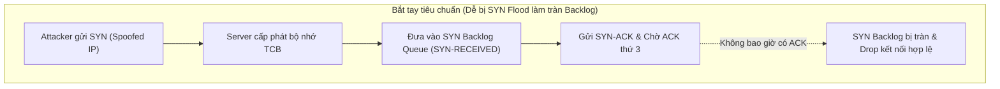
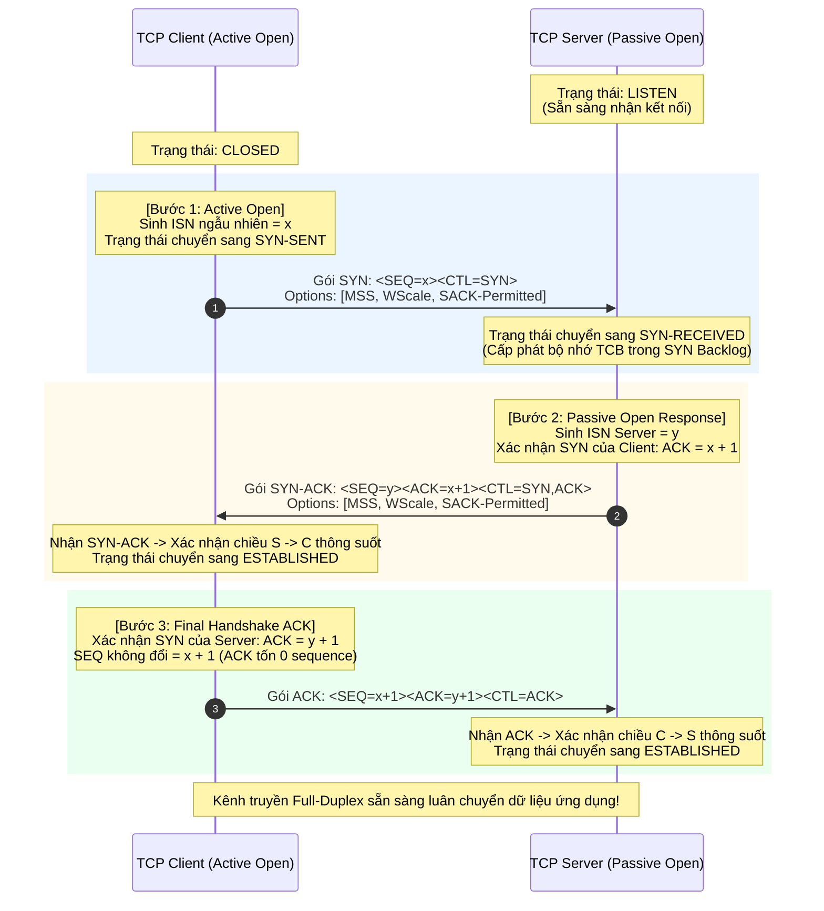
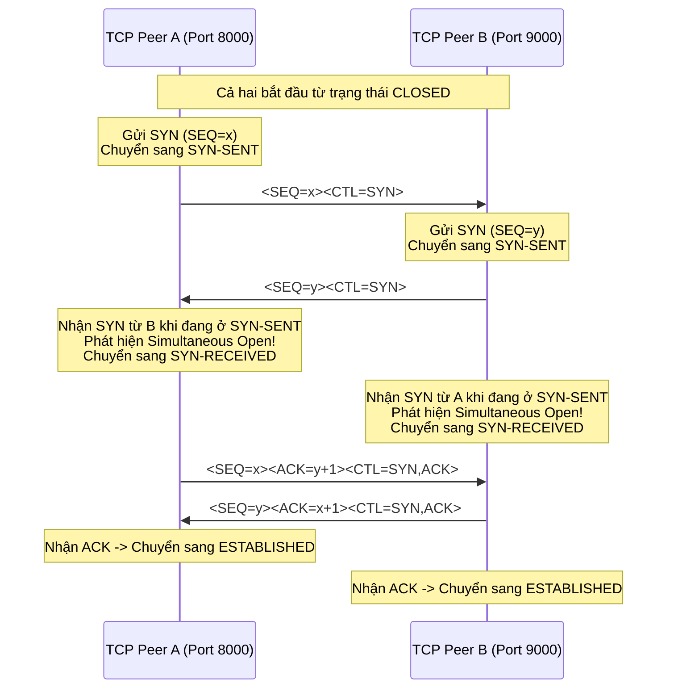

# 2_5_4 TCP Three-Way Handshake

> **Khóa học**: Cloud DevOps Basic — Networking Core  
> **Phân nhóm**: 2 Domain 2 - Computer Networking Core Fundamentals › 2_5 Transport Layer TCP and UDP  
> **Chủ đề**: Bắt tay 3 bước TCP (Three-Way Handshake - RFC 9293): Cơ chế đồng bộ ISN, tiêu thụ Sequence Number, chuyển dịch trạng thái FSM, đàm phán TCP Options và phòng chống tấn công SYN Flood bằng SYN Cookies (RFC 4987)  
> **Trạng thái**: Draft (WRITE-CDB-2_5_4, 14-11-2026)  
> **Checklist đối chiếu**: [2_5_4](<../../../CHECKLIST.md#domain-2-computer-networking-core-fundamentals-43-items>)  

---

## 1. Khái Niệm Cốt Lõi & Bản Chất Kỹ Thuật (Core Concepts & Technical Deep Dive)

Trong kiến trúc truyền thông tin cậy của bộ giao thức TCP/IP, trước khi hai thực thể mạng có thể bắt đầu truyền tải bất kỳ byte dữ liệu ứng dụng nào qua giao thức **TCP (Transmission Control Protocol)**, chúng bắt buộc phải thiết lập một phiên làm việc thông qua quy trình **Bắt tay 3 bước (Three-Way Handshake)**. Quy trình này được chuẩn hóa toàn diện trong tiêu chuẩn kỹ thuật Internet **RFC 9293 Section 3.5** (thay thế và cập nhật từ RFC 793).

---

### 1.1 Mục Tiêu Tối Thượng Của Three-Way Handshake

Nhiều người học lầm tưởng bắt tay 3 bước chỉ đơn thuần là thông báo *"Tôi muốn kết nối"* và *"Tôi đồng ý"*. Tuy nhiên, dưới góc độ kỹ thuật giao thức tầng thấp, quá trình bắt tay 3 bước giải quyết 4 bài toán sống còn:

1. **Đồng bộ hóa số Sequence khởi tạo (Initial Sequence Number - ISN)**:
   - Giao thức TCP là một kênh truyền song công toàn phần (**Full-Duplex**), nghĩa là dữ liệu có thể được gửi và nhận độc lập theo cả hai hướng cùng một lúc.
   - Mỗi bên (Client và Server) phải chọn ra một số thứ tự khởi tạo ngẫu nhiên ($x$ và $y$) cho luồng dữ liệu của riêng mình và bắt buộc phải nhận được xác nhận tường minh từ phía bên kia rằng đối phương đã ghi nhận chính xác con số khởi tạo này.
2. **Ngăn chặn kết nối nhầm lẫn do gói tin cũ bị trễ (Delayed Duplicate Segments)**:
   - Trong không gian mạng định tuyến gói tin (Packet Switching), một gói tin SYN của một phiên kết nối cũ bị kẹt trên router trung gian có thể bất ngờ xuất hiện lại sau một khoảng thời gian dài.
   - Cơ chế bắt tay 3 bước đảm bảo rằng nếu Server nhận được một yêu cầu mở kết nối cũ từ quá khứ, Client có thể phát hiện sự sai lệch về số Sequence Number và lập tức phát cờ `RST` để hủy bỏ, ngăn không cho Server bị mở nhầm kết nối rác.
3. **Đàm phán các tham số mở rộng tối ưu hóa (TCP Options Negotiation)**:
   - Đây là thời điểm **duy nhất** trong toàn bộ vòng đời của kết nối để hai bên đàm phán các đặc tính kết nối như MSS (Maximum Segment Size), Window Scale (mở rộng cửa sổ nhận), và SACK Permitted (xác nhận chọn lọc).
4. **Cấp phát tài nguyên có kiểm soát**:
   - Hai máy tính chuẩn bị sẵn các khối điều khiển kết nối (**Transmission Control Block - TCB**), khởi tạo bộ đệm gửi/nhận (send/receive buffers) và các biến trạng thái mạng.

---

### 1.2 Tiến Trình Trao Đổi Phân Đoạn Chuẩn (RFC 9293 Section 3.5)

Theo quy định tại **RFC 9293 Section 3.5 (Figure 6: Basic 3-Way Handshake for Connection Synchronization)**, tiến trình thiết lập kết nối giữa hai thực thể TCP A (Client - Phía chủ động mở / Active Open) và TCP B (Server - Phía bị động mở / Passive Open) diễn ra tuần tự qua đúng 3 bước:

```text
      TCP Peer A                                           TCP Peer B

 1.  CLOSED                                               LISTEN

 2.  SYN-SENT    --> <SEQ=x><CTL=SYN>                 --> SYN-RECEIVED

 3.  ESTABLISHED <-- <SEQ=y><ACK=x+1><CTL=SYN,ACK>    <-- SYN-RECEIVED

 4.  ESTABLISHED --> <SEQ=x+1><ACK=y+1><CTL=ACK>      --> ESTABLISHED
```

#### Phân tích chi tiết từng bước trao đổi:

- **Bước 1: Client gửi phân đoạn SYN**
  - **Trạng thái**: Client chuyển từ `CLOSED` sang `SYN-SENT`. Server ban đầu đang ở trạng thái `LISTEN` (đã bind và lắng nghe trên một port).
  - **Thông số gói tin**: `<SEQ=x><CTL=SYN>`
    - Cờ `SYN` được bật (`SYN = 1`, các cờ khác bằng 0).
    - Client sinh ra một số thứ tự ngẫu nhiên $x$ làm ISN của Client.
    - Phân đoạn này không chứa dữ liệu ứng dụng (payload length = 0).
- **Bước 2: Server phản hồi phân đoạn SYN-ACK**
  - **Trạng thái**: Server nhận được phân đoạn SYN, cấp phát tài nguyên TCB và chuyển từ `LISTEN` sang `SYN-RECEIVED`.
  - **Thông số gói tin**: `<SEQ=y><ACK=x+1><CTL=SYN,ACK>`
    - Cả hai cờ `SYN` và `ACK` cùng được bật (`SYN = 1, ACK = 1`).
    - Server sinh ra một số thứ tự ngẫu nhiên $y$ làm ISN của Server.
    - Trường Acknowledgment Number mang giá trị $x + 1$: Server xác nhận đã nhận trọn vẹn số Sequence $x$ của Client và thông báo mong đợi nhận byte tiếp theo bắt đầu từ $x + 1$.
- **Bước 3: Client gửi phân đoạn ACK hoàn tất kết nối**
  - **Trạng thái**: Client nhận được SYN-ACK từ Server, chuyển trạng thái từ `SYN-SENT` sang `ESTABLISHED`. Client gửi phân đoạn ACK cuối cùng. Khi Server nhận được phân đoạn ACK này, Server chuyển trạng thái từ `SYN-RECEIVED` sang `ESTABLISHED`.
  - **Thông số gói tin**: `<SEQ=x+1><ACK=y+1><CTL=ACK>`
    - Chỉ cờ `ACK` được bật (`ACK = 1, SYN = 0`).
    - Trường Sequence Number mang giá trị $x + 1$ (ứng với số byte tiếp theo của Client).
    - Trường Acknowledgment Number mang giá trị $y + 1$: Client xác nhận đã nhận trọn vẹn số Sequence $y$ của Server và mong đợi nhận byte dữ liệu tiếp theo từ $y + 1$.
    - Tại thời điểm này, kênh truyền thông suốt hai chiều đã mở hoàn toàn.

---

### 1.3 Quy Tắc Tiêu Thụ Không Gian Sequence Number (Sequence Number Consumption Rule)

Một câu hỏi kinh điển trong giao thức mạng là: *Tại sao gói SYN và FIN không chứa dữ liệu nhưng trường ACK phản hồi lại tăng thêm 1 đơn vị ($x+1$), trong khi gói ACK thuần túy lại không làm tăng số Sequence?*

Theo quy định chuẩn tại **RFC 9293 Section 3.5**:
- **Cờ SYN chiếm đúng 1 đơn vị Sequence Number** (`SYN consumes exactly 1 sequence number space`):  
  Trong mô hình điều khiển dòng dữ liệu của TCP, mọi phân đoạn cần sự bảo đảm tin cậy (cần được phía đối diện gửi gói tin ACK xác nhận) đều phải tiêu tốn không gian Sequence Number. Vì cờ `SYN` mang ý nghĩa thiết lập kết nối sống còn, nếu không tiêu tốn sequence number, phía gửi sẽ không có căn cứ định danh để biết gói ACK phản hồi đang xác nhận cho phân đoạn nào. Do đó, dù không chứa tải trọng dữ liệu, `SYN` được tính tương đương như mang 1 byte dữ liệu ảo và chiếm vị trí số $x$. Vì vậy, gói phản hồi bắt buộc phải xác nhận bằng $x + 1$.
- **Gói ACK thuần túy tiêu thụ 0 Sequence Number** (`ACK alone consumes 0 sequence number space`):  
  Một phân đoạn chỉ mang cờ `ACK` (không mang cờ SYN hoặc FIN) và không mang dữ liệu ứng dụng sẽ **không tiêu tốn bất kỳ số thứ tự nào**. Theo trích dẫn trực tiếp từ RFC 9293 Section 3.5: *"Note that the sequence number of the segment in line 5 is the same as in line 4 because the ACK does not occupy sequence number space"*. Do đó, phân đoạn dữ liệu đầu tiên mà Client gửi sau bước 3 vẫn sẽ bắt đầu bằng số thứ tự $x + 1$.

---

### 1.4 Chuyển Dịch Trạng Thái FSM (Finite State Machine Transitions)

Theo **RFC 9293 Section 3.3.2 & Section 3.5**, vòng đời thiết lập kết nối được điều khiển bởi Máy trạng thái hữu hạn (FSM) với các trạng thái chuẩn hóa sau:

| Tên trạng thái | Định nghĩa kỹ thuật theo RFC 9293 | Thực thể nắm giữ |
| :--- | :--- | :--- |
| **`CLOSED`** | Trạng thái ảo đại diện cho việc socket chưa tồn tại hoặc kết nối đã đóng hoàn toàn, không có tài nguyên TCB nào được cấp phát. | Cả Client và Server |
| **`LISTEN`** | Trạng thái chờ đợi yêu cầu kết nối từ bất kỳ host và cổng TCP từ xa nào (*"represents waiting for a connection request from any remote TCP peer and port"*). | Phía Server (Passive Open) |
| **`SYN-SENT`** | Trạng thái sau khi đã phát đi phân đoạn SYN và đang chờ đợi phân đoạn SYN-ACK hồi đáp tương ứng (*"represents waiting for a matching connection request after having sent a connection request"*). | Phía Client (Active Open) |
| **`SYN-RECEIVED`** | Trạng thái sau khi đã nhận được SYN của đối phương, đã gửi lại SYN-ACK và đang chờ phân đoạn ACK xác nhận cuối cùng (*"represents waiting for a confirming connection request acknowledgment after having both received and sent a connection request"*). | Phía Server |
| **`ESTABLISHED`** | Trạng thái kết nối đã mở hoàn toàn, hai đầu cuối sẵn sàng truyền tải luồng byte dữ liệu hai chiều (*"represents an open connection, data received can be delivered to the user"*). | Cả Client và Server |

#### Bảng tổng hợp chu trình chuyển dịch FSM trong bắt tay chuẩn:

```text
Client (Active Open):  [CLOSED] --(Gửi SYN)--> [SYN-SENT] --(Nhận SYN-ACK, Gửi ACK)--> [ESTABLISHED]
Server (Passive Open): [CLOSED] --(Lắng nghe)--> [LISTEN] --(Nhận SYN, Gửi SYN-ACK)--> [SYN-RECEIVED] --(Nhận ACK)--> [ESTABLISHED]
```

---

### 1.5 Cơ Chế Mở Đồng Thời (TCP Simultaneous Open - RFC 9293 Section 3.5 Figure 7)

Trong các kiến trúc phân tán ngang hàng (Peer-to-Peer) hoặc các giao thức đặc biệt, có thể xảy ra tình huống cả hai máy chủ cùng chủ động phát gói tin `SYN` tới nhau tại cùng một thời điểm trên cùng một cặp IP và Port. Trường hợp này được chuẩn hóa dưới tên gọi **Simultaneous Initiation (Simultaneous Open)**.

Theo **RFC 9293 Section 3.5 Figure 7**:
- Cả hai nút mạng cùng xuất phát từ trạng thái `CLOSED`.
- Cả hai cùng gửi phân đoạn `SYN` (Peer A gửi `<SEQ=x><CTL=SYN>`, Peer B gửi `<SEQ=y><CTL=SYN>`) và cùng chuyển sang trạng thái `SYN-SENT`.
- Khi hai gói SYN gặp nhau trên đường truyền, Peer A nhận được SYN của Peer B (chứ không phải SYN-ACK), và Peer B nhận được SYN của Peer A.
- Khi một nút mạng ở trạng thái `SYN-SENT` nhận được một phân đoạn thuần `SYN`, nút đó hiểu rằng đang xảy ra mở đồng thời. Cả hai nút cùng chuyển trạng thái từ **`SYN-SENT` sang `SYN-RECEIVED`**.
- Tại `SYN-RECEIVED`, mỗi bên gửi một phân đoạn mang cờ `SYN,ACK` (hoặc ACK xác nhận SYN của đối phương: Peer A gửi `<SEQ=x><ACK=y+1><CTL=SYN,ACK>`, Peer B gửi `<SEQ=y><ACK=x+1><CTL=SYN,ACK>`).
- Khi mỗi bên nhận được phân đoạn xác nhận này, cả hai cùng chuyển từ **`SYN-RECEIVED` sang `ESTABLISHED`**.

> **Kết luận FSM cho Simultaneous Open**: Chu trình trạng thái của cả hai bên đều diễn ra đối xứng theo đúng lộ trình: **`CLOSED` $\rightarrow$ `SYN-SENT` $\rightarrow$ `SYN-RECEIVED` $\rightarrow$ `ESTABLISHED`**.

---

### 1.6 Đàm Phán Tùy Chọn TCP (TCP Options Negotiation)

Một trong những vai trò tối quan trọng của Three-Way Handshake là đàm phán các tính năng nâng cao thông qua trường **TCP Options** (nằm sau 20 bytes tiêu đề chuẩn).

Theo các tiêu chuẩn kỹ thuật Internet **RFC 7323 Section 2.1** và **RFC 2018 Section 2**:
- **Bắt buộc trao đổi trong SYN / SYN-ACK**: Các tùy chọn TCP cốt lõi như **MSS (Maximum Segment Size)**, **Window Scale (RFC 7323)**, và **SACK Permitted (RFC 2018)** bắt buộc phải được gửi trong các phân đoạn mang cờ `SYN` (phân đoạn SYN ban đầu hoặc SYN-ACK hồi đáp).
- **Tuyệt đối cấm gửi trên các phân đoạn Non-SYN** (*"It MUST NOT be sent on non-SYN segments"*):  
  Các tùy chọn này xác lập các tham số cố định xuyên suốt cho toàn bộ kết nối. Ví dụ: hệ số tỉ lệ `Window Scale` một khi đã chốt ở pha bắt tay sẽ được áp dụng cố định cho mỗi chiều truyền. Việc gửi các tùy chọn này trong các gói tin ACK dữ liệu thông thường sau khi đã vào trạng thái `ESTABLISHED` là hoàn toàn không hợp lệ và bị bỏ qua.

| TCP Option | Chuẩn RFC | Mục đích kỹ thuật trong Handshake |
| :--- | :--- | :--- |
| **MSS (Maximum Segment Size)** | RFC 9293 Section 3.7.1 | Báo hiệu cho đối phương biết kích thước dữ liệu lớn nhất mà bên gửi có thể tiếp nhận trong một phân đoạn (thường là $\text{MTU} - 40\text{ bytes}$). |
| **Window Scale** | RFC 7323 Section 2 | Thỏa thuận hệ số dịch bit ($2^S$) để mở rộng trường Window 16-bit lên tối đa 30-bit (tối đa 1 GB), giải quyết bài toán mạng băng thông lớn độ trễ cao (High BDP). |
| **SACK Permitted** | RFC 2018 Section 2 | Tùy chọn 2-byte xác nhận hai bên đồng ý sử dụng cơ chế Selective Acknowledgment, cho phép thông báo chính xác các khối dữ liệu bị mất để truyền lại chọn lọc. |

---

### 1.7 Cơ Chế Tấn Công SYN Flood & Phòng Chống Bằng SYN Cookies (RFC 4987)

#### Bản chất kỹ thuật của Tấn công SYN Flood:
Trong quá trình bắt tay thông thường, khi máy chủ nhận được một gói tin `SYN`, hệ điều hành sẽ:
1. Cấp phát một vùng nhớ trong kernel để lưu trữ cấu trúc **TCB (Transmission Control Block)** chứa thông tin socket, timer, bộ đệm.
2. Đặt socket vào hàng đợi các kết nối đang chờ hoàn tất bắt tay (**SYN Backlog Queue**).
3. Đưa socket vào trạng thái `SYN-RECEIVED` và gửi lại gói `SYN-ACK`.

Kẻ tấn công lợi dụng cơ chế này bằng cách gửi liên tục hàng chục ngàn gói tin `SYN` mang **địa chỉ IP nguồn giả mạo (Spoofed IP)**. Do IP nguồn không có thật, các gói tin `SYN-ACK` của máy chủ gửi đi sẽ không bao giờ nhận được gói tin `ACK` phản hồi bước 3. Các kết nối bán mở (Half-open connections) này bị kẹt lại ở trạng thái `SYN-RECEIVED` cho đến khi hết thời gian chờ (timeout). Hậu quả là hàng đợi SYN Backlog bị lấp đầy hoàn toàn, bộ nhớ kernel cạn kiệt, khiến máy chủ từ chối phục vụ (Denial of Service - DoS) tất cả các yêu cầu kết nối hợp lệ mới từ người dùng.



#### Giải pháp Đột phá: SYN Cookies (RFC 4987 Section 1 & Section 3.6):
Để đối phó triệt để với hiểm họa này mà không cần gia tăng tài nguyên phần cứng vô hạn, kỹ thuật **SYN Cookies** đã được phát minh và chuẩn hóa trong **RFC 4987**:

- **Không cấp phát trạng thái ở SYN-RECEIVED** (*"allocate no state at all for connections in SYN-RECEIVED"*):  
  Khi hàng đợi SYN backlog của một socket bị tràn do tấn công hoặc tải đột biến, hệ điều hành kích hoạt thuật toán SYN Cookies. Lúc này, máy chủ **hoàn toàn không cấp phát bất kỳ vùng nhớ TCB nào** và không lưu giữ bất kỳ trạng thái nào trong bảng socket.
- **Mã hóa tham số vào Initial Sequence Number của SYN-ACK**:  
  Máy chủ nén toàn bộ thông tin nhận diện kết nối cần thiết (bao gồm hàm băm mật mã của 4-tuple IP/Port, bộ đếm thời gian thô 3-bit chống tấn công phát lại, và giá trị MSS được mã hóa) vào chính con số **Sequence Number $y$** của gói `SYN-ACK` gửi trả lại cho Client. Con số này được gọi là **SYN Cookie**.
- **Tái tạo trạng thái từ gói ACK thứ 3**:  
  - Nếu gói SYN ban đầu đến từ một kẻ tấn công mạo danh IP, gói SYN-ACK bị gửi vào hư không và máy chủ hoàn toàn không mất một byte bộ nhớ nào.
  - Nếu kết nối đến từ một Client chân chính, Client sẽ phản hồi bằng gói tin ACK với `Acknowledgment Number = y + 1`.
  - Khi nhận được gói ACK này, máy chủ chỉ cần lấy giá trị `Ack - 1` để khôi phục con số Cookie ban đầu, kiểm tra tính toàn vẹn của hàm băm mật mã và giải mã các tham số kết nối.
  - Nếu giá trị hợp lệ, lúc này máy chủ mới chính thức cấp phát khối TCB và đưa kết nối thẳng vào trạng thái **`ESTABLISHED`**.

Nhờ cơ chế này, máy chủ duy trì khả năng sống sót và tiếp tục phục vụ người dùng bình thường ngay cả khi đang hứng chịu những đợt tấn công SYN Flood khổng lồ.

---

## 2. Ví Dụ Đời Sống Thực Tế Dễ Hiểu (Intuitive Real-World Analogies)

Để thấu hiểu sâu sắc bản chất vì sao bắt tay TCP bắt buộc phải có đúng 3 bước mà không thể là 2 bước, hãy liên tưởng tới **Nghi thức chào hỏi qua bộ đàm vô tuyến hai chiều (Two-Way Walkie-Talkie Radio)** giữa Trạm quan sát A trên núi cao và Chỉ huy sở B trong thung lũng.

```text
               Trạm A (Client)                        Chỉ huy B (Server)
                      |                                       |
     [Lượt 1: SYN]    | --- "Trạm A gọi Chỉ huy B, ---------> | (B nghe thấy A)
                      |      nghe rõ trả lời?"                |
                      |                                       |
   [Lượt 2: SYN-ACK]  | <--- "Chỉ huy B nghe rõ Trạm A, ------| (B hỏi ngược lại)
                      |       Trạm A có nghe rõ tôi không?"   |
                      |                                       |
     [Lượt 3: ACK]    | --- "Trạm A nghe Chỉ huy B rất rõ, -->| (B xác nhận cả 2 chiều)
                      |      bắt đầu báo cáo tác chiến!"      |
                      |                                       |
               [ESTABLISHED]                           [ESTABLISHED]
```

### Phân tích từng lượt hội thoại:

1. **Lượt 1 (SYN - seq=x)**: Trạm A bấm mic gọi: *"Trạm A gọi Chỉ huy B, nghe rõ trả lời?"*  
   - Tại thời điểm này, Trạm A mới chỉ biết mình đã phát tín hiệu đi, hoàn toàn chưa rõ Chỉ huy B có bật máy hay kênh sóng có bị nhiễu không. Trạm A ở trạng thái chờ (`SYN-SENT`).
2. **Lượt 2 (SYN-ACK - seq=y, ack=x+1)**: Chỉ huy B nghe tiếng Trạm A, bấm mic trả lời: *"Chỉ huy B nghe rất rõ Trạm A. Trạm A có nghe rõ tôi nói không?"*  
   - Sau lượt này, Chỉ huy B đã kiểm chứng được **chiều truyền từ A sang B hoạt động tốt**. Nhưng Chỉ huy B vẫn chưa hề biết liệu sóng phát từ B có tới được tai của Trạm A hay không (`SYN-RECEIVED`).
3. **Lượt 3 (ACK - seq=x+1, ack=y+1)**: Trạm A nghe thấy tiếng Chỉ huy B, bấm mic chốt hạ: *"Trạm A nghe Chỉ huy B rất rõ, bắt đầu trao đổi nội dung!"*  
   - Nhận được câu này, Trạm A xác nhận **chiều truyền từ B sang A hoạt động tốt**.
   - Khi Chỉ huy B nghe được câu chốt này, Chỉ huy B chính thức xác nhận Trạm A đã nghe được mình. Cả hai bên cùng đồng thuận rằng **kênh truyền hai chiều (Full-Duplex) đã thông suốt 100%**.

### Tại sao không thể là Bắt tay 2 bước (The Fatal Flaw of Two-Way Handshake)?

Hãy tưởng tượng nếu chỉ có 2 bước: Sau khi Chỉ huy B nói *"Tôi nghe rõ Trạm A"*, Chỉ huy B lập tức mở sổ tác chiến và cử người ngồi giữ đường dây (`ESTABLISHED`).
- **Nguy cơ 1: Mất gói tin lượt 2**: Nếu câu trả lời của B bị gió bão làm đứt sóng giữa đường, Trạm A không hề nghe thấy gì nên sẽ không gửi bất kỳ báo cáo nào. Nhưng Chỉ huy B ở nhà tưởng kết nối đã thành công nên cứ ngồi giữ máy chờ đợi, gây lãng phí nhân lực và tài nguyên phòng trực.
- **Nguy cơ 2: Gói tin cũ bị trôi dạt (Delayed Duplicate SYN)**: Giả sử hôm qua Trạm A có gửi một cuộc gọi nhưng bị nghẽn sóng trên núi. Đến hôm nay cuộc gọi cũ đó mới vô tình bay tới Chỉ huy B. Nếu dùng cơ chế 2 bước, Chỉ huy B vừa nghe thấy là lập tức mở sổ trực tác chiến mới, trong khi Trạm A hiện tại đang ngủ và hoàn toàn không có ý định liên lạc!
- **Giải pháp với 3 bước**: Trong mô hình 3 bước, khi Chỉ huy B trả lời gói tin cũ, Trạm A nhận được sẽ nhận ra ngay đây là câu trả lời cho một cuộc gọi từ hôm qua (sai lệch số Sequence) và lập tức phát cờ `RST` (báo hiệu: *"Tôi không hề gọi, hãy hủy ngay!"*). Nhờ bước thứ 3, máy chủ được bảo vệ an toàn tuyệt đối.

---

## 3. Kiến Trúc, Luồng Hoạt Động & Hình Ảnh Trực Quan (Architecture, Diagrams & Visual Media)

### 3.1 Sơ Đồ Bắt Tay 3 Bước Chuẩn (Standard 3-Way Handshake)

Sơ đồ Mermaid dưới đây mô tả chính xác quá trình chuyển dịch trạng thái FSM, cờ điều khiển, số Sequence Number, Acknowledgment Number và việc tiêu thụ không gian sequence theo chuẩn **RFC 9293 Section 3.5**:



---

### 3.2 Sơ Đồ Mở Đồng Thời (TCP Simultaneous Open - RFC 9293 Figure 7)

Khi hai nút mạng ngang hàng cùng gửi gói SYN tới nhau cùng một thời điểm:



---

### 3.3 So Sánh Cơ Chế Cấp Phát Bộ Nhớ: Tiêu Chuẩn vs SYN Cookies (RFC 4987)

```mermaid
flowchart TD
    subgraph ModeA ["1. Chế độ Tiêu chuẩn (Normal Operation)"]
        SYN1["Client gửi gói SYN"] --> CheckQ{"SYN Backlog còn chỗ trống?"}
        CheckQ -- "Có" --> AllocTCB["Cấp phát bộ nhớ TCB cho Socket"]
        AllocTCB --> PutQueue["Đưa Socket vào SYN Backlog Queue<br/>(Trạng thái: SYN-RECEIVED)"]
        PutQueue --> SendSynAck["Gửi lại gói SYN-ACK và kích hoạt Timer"]
        SendSynAck --> WaitAck{"Nhận được ACK thứ 3?"}
        WaitAck -- "Hợp lệ" --> Est["Chuyển sang Accept Queue<br/>(Trạng thái: ESTABLISHED)"]
        WaitAck -- "Timeout (Spoofed SYN)" --> DropTCB["Hết giờ -> Hủy TCB, giải phóng bộ nhớ"]
    end

    subgraph ModeB ["2. Chế độ Bảo vệ SYN Cookies (RFC 4987)"]
        SYN2["Kẻ tấn công gửi bão SYN"] --> CheckFull{"SYN Backlog bị tràn?<br/>(tcp_syncookies = 1)"}
        CheckFull -- "KÍCH HOẠT SYN COOKIES" --> NoTCB["KHÔNG CẤP PHÁT BỘ NHỚ TCB!<br/>(Zero State Allocation)"]
        NoTCB --> GenCookie["Tính toán SYN Cookie:<br/>ISN = Hash(4-tuple, Counter, Key) + MSS"]
        GenCookie --> SendCookieAck["Gửi SYN-ACK mang Sequence = Cookie"]
        SendCookieAck --> RecvAck3{"Client phản hồi ACK?"}
        RecvAck3 -- "Không phản hồi (IP giả mạo)" --> Safe["Không tiêu tốn RAM Server!"]
        RecvAck3 -- "Phản hồi ACK (Client thật)" --> VerifyCookie{"Giải mã Ack-1 và xác thực Cookie?"}
        VerifyCookie -- "Chữ ký hợp lệ" --> NewTCB["Bây giờ mới cấp phát TCB<br/>Trạng thái: ESTABLISHED"]
        VerifyCookie -- "Sai chữ ký" --> DropPkt["Loại bỏ gói tin giả mạo"]
    end
```



---

## 4. Code Mẫu Trực Quan Hoặc Dòng Lệnh Thực Chiến (Runnable Sample Code / CLI)

### 4.1 Giám Sát Trạng Thái Handshake Bằng Lệnh `ss` (Socket Statistics)

Trên các bản phân phối Linux hiện đại, công cụ `ss` (thuộc bộ tiện ích `iproute2`) cho phép kỹ sư hệ thống lọc trực tiếp các socket mạng theo từng trạng thái cụ thể của máy trạng thái TCP FSM.

```bash
# 1. Liệt kê tất cả các kết nối TCP đang ở trạng thái SYN-SENT (Client đang chờ Server phản hồi SYN-ACK)
ss -tan state syn-sent

# 2. Liệt kê tất cả các kết nối TCP đang ở trạng thái SYN-RECV (Server đã gửi SYN-ACK, đang chờ Client gửi ACK)
ss -tan state syn-recv
```

#### Quan sát kết quả mẫu trên hệ thống:

```text
# Khi máy chủ hoạt động bình thường (chỉ xuất hiện vài kết nối bán mở trong tích tắc):
State      Recv-Q Send-Q Local Address:Port               Peer Address:Port
SYN-RECV   0      0      192.168.1.100:443                203.0.113.45:51234

# CẢNH BÁO: Khi máy chủ đang bị tấn công SYN Flood (hàng trăm socket kẹt ở SYN-RECV với IP rác):
State      Recv-Q Send-Q Local Address:Port               Peer Address:Port
SYN-RECV   0      0      192.168.1.100:80                 198.51.100.12:44123
SYN-RECV   0      0      192.168.1.100:80                 198.51.100.89:33211
SYN-RECV   0      0      192.168.1.100:80                 198.51.100.201:55421
```

> **Ý nghĩa phân tích DevOps**: Nếu lệnh `ss -tan state syn-recv | wc -l` trả về con số tăng vọt bất thường chạm ngưỡng trần của hàng đợi kết nối, hệ thống của bạn đang đối mặt với một cuộc tấn công SYN Flood hoặc hiện tượng nghẽn mạng nghiêm trọng.

---

### 4.2 Kiểm Tra Cấu Hình Hạt Nhân Linux (Kernel Sysctl Handshake Tuning)

Nhân Linux quản lý hành vi và giới hạn của quá trình Three-Way Handshake thông qua hệ thống tệp `/proc/sys/net/ipv4/`.

```bash
# Kiểm tra các giá trị cấu hình mặc định của Linux Kernel liên quan đến Handshake
sysctl net.ipv4.tcp_syn_retries net.ipv4.tcp_synack_retries net.ipv4.tcp_syncookies
```

#### Kết quả hiển thị mặc định trên hệ thống Linux chuẩn:

```text
net.ipv4.tcp_syn_retries = 6
net.ipv4.tcp_synack_retries = 5
net.ipv4.tcp_syncookies = 1
```

#### Bóc tách ý nghĩa kỹ thuật theo tài liệu nhân Linux (`ip-sysctl.rst`):

| Tham số Sysctl | Giá trị mặc định | Giải thích kỹ thuật & Tác động thời gian |
| :--- | :--- | :--- |
| **`net.ipv4.tcp_syn_retries`** | **`6`** | Số lần tối đa Client thử gửi lại gói tin `SYN` khi không nhận được `SYN-ACK`. Với thuật toán Exponential Backoff, 6 lần retry tương ứng với tổng thời gian chờ khoảng **67 giây** trước khi hủy kết nối chủ động. |
| **`net.ipv4.tcp_synack_retries`** | **`5`** | Số lần tối đa Server thử gửi lại gói tin `SYN-ACK` cho một kết nối thụ động khi chưa nhận được gói `ACK` bước 3. 5 lần thử lại tương ứng với khoảng **31 giây** duy trì trạng thái `SYN-RECEIVED`. |
| **`net.ipv4.tcp_syncookies`** | **`1`** | Kích hoạt cơ chế gửi **SYN Cookies** khi hàng đợi SYN Backlog của một socket bị tràn (`overflow`). Giá trị mặc định là `1` (bật tính năng bảo vệ tự động). |

---

### 4.3 Bắt và Giải Mã Gói Tin Handshake Thời Gian Thực Bằng `tcpdump`

Sử dụng bộ lọc bitmask trên cờ TCP để bắt chính xác các phân đoạn mang cờ `SYN`:

```bash
# Bắt tất cả các gói tin có cờ SYN được bật trên mọi card mạng, không phân giải DNS (-nn)
sudo tcpdump -nn -i any "tcp[tcpflags] & (tcp-syn) != 0"
```

#### Dữ liệu bắt gói tin thực tế thu được trong quá trình thiết lập kết nối HTTPS:

```text
16:00:01.100200 IP 10.0.0.15.54322 > 93.184.216.34.443: Flags [S], cksum 0x8c12, seq 1000000000, win 64240, options [mss 1460,sackOK,TS val 3120040 ecr 0,nop,wscale 7], length 0

16:00:01.135400 IP 93.184.216.34.443 > 10.0.0.15.54322: Flags [S.], cksum 0x9a44, seq 3000000000, ack 1000000001, win 65535, options [mss 1460,sackOK,TS val 4567890 ecr 3120040,nop,wscale 9], length 0

16:00:01.135500 IP 10.0.0.15.54322 > 93.184.216.34.443: Flags [.], cksum 0x2211, seq 1000000001, ack 3000000001, win 502, length 0
```

#### Phân tích chi tiết từng trường dữ liệu:

1. **Gói tin 1 (Client $\rightarrow$ Server: `Flags [S]`)**:
   - `seq 1000000000`: Client chọn ISN $x = 1000000000$.
   - `options [mss 1460,sackOK,...,wscale 7]`: Client thông báo nhận tối đa 1460 bytes MSS, hỗ trợ SACK, và đề xuất hệ số tỉ lệ cửa sổ $2^7 = 128$.
2. **Gói tin 2 (Server $\rightarrow$ Client: `Flags [S.]`)**:
   - `Flags [S.]`: Ký hiệu của `tcpdump` đại diện cho cờ `SYN` (`S`) kết hợp cờ `ACK` (`.`).
   - `seq 3000000000`: Server chọn ISN $y = 3000000000$.
   - `ack 1000000001`: Server xác nhận đã nhận byte $x$ và chờ byte tiếp theo ($1000000000 + 1$).
3. **Gói tin 3 (Client $\rightarrow$ Server: `Flags [.]`)**:
   - `Flags [.]`: Đại diện cho gói tin chỉ mang cờ `ACK`.
   - `seq 1000000001`: Client gửi tiếp từ số thứ tự $x + 1$.
   - `ack 3000000001`: Client xác nhận đã nhận byte $y$ và chờ byte tiếp theo ($3000000000 + 1$).

---

## 5. Cạm Bẫy Thực Tế & Thực Tiễn Sản Xuất (Production Gotchas & Best Practices)

Trong vận hành hệ thống Cloud và DevOps quy mô lớn, kỹ sư thường xuyên gặp phải 3 cạm bẫy kinh điển liên quan đến Three-Way Handshake:

### 1. Cạn Kiệt SYN Backlog Do Tấn Công SYN Flood Hoặc Tải Đột Biến (Flash Crowds)
- **Bản chất sự cố**: Kích thước của hàng đợi kết nối bán mở bị giới hạn bởi tham số kernel `net.ipv4.tcp_max_syn_backlog` và tham số `backlog` trong hàm gọi hệ thống `listen()` của ứng dụng (như Nginx, Node.js, Go). Khi có một đợt tấn công SYN Flood hoặc lượng truy cập tăng vọt đột biến, hàng đợi này bị lấp đầy hoàn toàn.
- **Hiện tượng**: Khách hàng báo cáo không thể kết nối tới website (bị treo kết nối - connection hanging hoặc timeout), trong khi CPU và RAM của máy chủ vẫn ở mức rất thấp. Lệnh `netstat -s | grep "SYNs to LISTEN"` hoặc `nstat -az TcpExtListenDrops` liên tục tăng cao.
- **Thực tiễn sản xuất**:
  - Luôn đảm bảo tham số `net.ipv4.tcp_syncookies = 1` được kích hoạt trên tất cả máy chủ Linux sản xuất.
  - Nâng giới hạn hàng đợi: tăng `net.ipv4.tcp_max_syn_backlog = 4096` (hoặc cao hơn tùy dung lượng RAM) kết hợp với `net.core.somaxconn = 4096`.
  - Triển khai giải pháp chống DDoS ở tầng biên (Cloudflare, AWS Shield, Azure DDoS Protection) để lọc bỏ các gói SYN giả mạo trước khi chạm tới máy chủ gốc.

### 2. Sự Cố Mở Đồng Thời (Simultaneous Open) Bị Thiết Bị Tường Lửa (Stateful Firewalls) Chặn
- **Bản chất sự cố**: Mặc dù chuẩn RFC 9293 định nghĩa đầy đủ chu trình Simultaneous Open (`CLOSED` $\rightarrow$ `SYN-SENT` $\rightarrow$ `SYN-RECEIVED` $\rightarrow$ `ESTABLISHED`), hầu hết các thiết bị tường lửa kiểm tra trạng thái (Stateful Firewall) hoặc Gateway NAT gia đình được lập trình với giả định bất đối xứng nghiêm ngặt (chỉ chấp nhận SYN-ACK trả về sau khi đã thấy SYN đi ra).
- **Hiện tượng**: Trong các ứng dụng mạng phân tán (như P2P, WebRTC, hoặc các cụm database cluster phân tán đa trung tâm dữ liệu kết nối trực tiếp với nhau), khi hai node cùng bắn SYN tới nhau để đục lỗ NAT (NAT Hole Punching), tường lửa của bên A nhìn thấy gói SYN từ bên B tới trong khi socket A đang ở trạng thái `SYN-SENT`. Tường lửa coi đây là gói tin bất thường không hợp lệ (out-of-state packet) và drop bỏ ngay lập tức, khiến bắt tay bị thất bại hoàn toàn.
- **Thực tiễn sản xuất**: Thiết lập các quy tắc tường lửa cho phép lưu lượng hai chiều giữa các nút trong cụm cluster nội bộ, hoặc sử dụng các giao thức kết nối qua máy chủ trung gian (Relay/TURN) khi triển khai trên hạ tầng mạng có tường lửa khắt khe.

### 3. Tuyến Đường Bất Đối Xứng (Asymmetric Routing) Làm Sập Bắt Tay Trên Tường Lửa Kiểm Tra Trạng Thái
- **Bản chất sự cố**: Trong các kiến trúc mạng doanh nghiệp hoặc hạ tầng Hybrid Cloud có nhiều đường truyền Internet/Direct Connect song song (Multi-homed Routing hoặc ECMP):
  - Gói tin `SYN` từ Client đi qua Tường lửa A (Firewall A) để vào Server. Firewall A ghi nhận phiên kết nối mới vào bảng theo dõi trạng thái (State Table).
  - Tuy nhiên, bảng định tuyến của mạng nội bộ lại điều hướng gói tin phản hồi `SYN-ACK` của Server đi ra ngoài qua Tường lửa B (Firewall B).
- **Hiện tượng**: Do Firewall B chưa từng nhìn thấy gói `SYN` khởi tạo của kết nối này, Firewall B đánh giá gói `SYN-ACK` là vi phạm trạng thái kết nối TCP (TCP State Violation) và lập tức drop gói tin hoặc gửi cờ `RST` phản hồi. Client không bao giờ nhận được SYN-ACK và kết nối bị treo cứng.
- **Thực tiễn sản xuất**:
  - Thiết kế kiến trúc mạng đảm bảo tính đối xứng định tuyến (Symmetric Routing) cho lưu lượng TCP đi qua tường lửa.
  - Sử dụng cơ chế đồng bộ bảng trạng thái (State Synchronization / Cluster Session Sync) giữa các cụm firewall song song chạy ở chế độ Active-Active.

---

## 6. Câu Hỏi Củng Cố Kiến Thức (Active Recall Quiz)

<details>
<summary><b>Câu hỏi 1:</b> Tại sao trong giao thức TCP, phân đoạn SYN và FIN không mang theo bất kỳ byte dữ liệu ứng dụng nào nhưng vẫn tiêu tốn đúng 1 đơn vị Sequence Number, trong khi phân đoạn ACK thuần túy lại tiêu tốn 0 đơn vị Sequence Number?</summary>

**Đáp án:**
Theo tiêu chuẩn RFC 9293 Section 3.5:
- **Cờ SYN và FIN**: Mang tính chất điều khiển trạng thái sống còn của kết nối (mở kết nối và đóng kết nối). Trong cơ chế Cumulative ACK của TCP, một gói tin chỉ có thể được xác nhận một cách tin cậy nếu nó có thể được định danh bằng một số thứ tự. Bằng việc quy ước SYN và FIN tiêu thụ đúng **1 đơn vị Sequence Number**, phía đối diện có thể gửi lại gói tin xác nhận tường minh với giá trị $\text{ACK} = \text{SEQ} + 1$. Nếu không tiêu tốn sequence number, phía nhận sẽ không thể phân biệt gói ACK này đang xác nhận cho sự kiện mở kết nối hay một gói tin khác.
- **Phân đoạn ACK thuần túy**: Không mang theo tải trọng dữ liệu và không yêu cầu phía đối diện phải gửi thêm một gói tin ACK khác để xác nhận cho chính nó (vì nếu ACK lại cần một ACK khác xác nhận thì sẽ dẫn đến vòng lặp xác nhận vô tận - Infinite ACK Ping-Pong). Do đó, phân đoạn ACK đơn thuần **tiêu thụ đúng 0 sequence number** (`ACK does not occupy sequence number space`), và số Sequence của gói dữ liệu kế tiếp vẫn giữ nguyên.
</details>

<details>
<summary><b>Câu hỏi 2:</b> Phân tích kịch bản: Giả sử giao thức TCP chỉ sử dụng cơ chế Bắt tay 2 bước (Two-Way Handshake: Client gửi SYN, Server phản hồi SYN-ACK là kết nối thành công). Điều gì sẽ xảy ra nếu một gói tin SYN cũ từ quá khứ bị trễ trên mạng (Delayed Duplicate SYN) bất ngờ bay tới Server?</summary>

**Đáp án:**
Theo RFC 9293 Section 3.5:
- Nếu chỉ có 2 bước: Ngay khi Server nhận được gói SYN cũ bị trôi dạt từ hôm qua, Server sẽ ngỡ rằng Client đang muốn mở một phiên làm việc mới. Server lập tức cấp phát tài nguyên TCB, chuyển sang trạng thái `ESTABLISHED` và sẵn sàng nhận dữ liệu. Tuy nhiên, Client thực tế đang không hề có nhu cầu kết nối, dẫn tới việc Server bị treo tài nguyên vô ích (Zombie connection).
- Với cơ chế **Bắt tay 3 bước chuẩn**: Khi Server nhận được gói SYN cũ, Server gửi lại gói SYN-ACK mang số xác nhận cho số Sequence cũ đó. Khi gói SYN-ACK này bay tới Client, Client kiểm tra và nhận thấy số Sequence không khớp với bất kỳ phiên làm việc hiện tại nào của mình. Client sẽ lập tức gửi trả lại một phân đoạn mang cờ **`RST` (Reset)**. Khi nhận được gói `RST` này, Server lập tức hủy bỏ kết nối và giải phóng tài nguyên. Như vậy, bước thứ 3 là chốt chặn quyết định giúp hệ thống miễn nhiễm với các gói tin cũ bị trôi dạt.
</details>

<details>
<summary><b>Câu hỏi 3:</b> Trong một cuộc tấn công từ chối dịch vụ SYN Flood quy mô lớn, cơ chế SYN Cookies (RFC 4987) giúp máy chủ phòng thủ như thế nào? Tại sao máy chủ lại không bị cạn kiệt bộ nhớ RAM dù nhận hàng triệu gói SYN mỗi giây?</summary>

**Đáp án:**
Theo RFC 4987 Section 1 & Section 3.6:
- **Trạng thái thông thường**: Mỗi gói SYN đến đều khiến máy chủ phải cấp phát một khối cấu trúc dữ liệu TCB trong bộ nhớ RAM và giữ nó trong hàng đợi `SYN Backlog Queue` ở trạng thái `SYN-RECEIVED` để chờ ACK. Hàng triệu gói SYN giả mạo sẽ làm tràn hàng đợi và cạn kiệt RAM.
- **Cơ chế phòng thủ của SYN Cookies**:
  1. Khi hàng đợi bị tràn (`tcp_syncookies = 1`), máy chủ chuyển sang chế độ **Zero-State**: Hoàn toàn **không cấp phát bất kỳ khối nhớ TCB nào** trong RAM cho các gói SYN đến.
  2. Máy chủ nén toàn bộ thông tin nhận diện kết nối (4-tuple IP/Port, MSS, timestamp) qua một hàm băm mật mã và nhúng trực tiếp giá trị này vào số Sequence Number của gói tin `SYN-ACK` gửi về.
  3. Kẻ tấn công dùng IP giả mạo sẽ không bao giờ phản hồi gói ACK thứ 3. Do máy chủ không lưu giữ bất kỳ trạng thái nào trong RAM, đợt tấn công SYN Flood trở nên hoàn toàn vô hại đối với tài nguyên bộ nhớ máy chủ.
  4. Chỉ khi một Client hợp lệ gửi lại gói `ACK` mang số xác nhận `ack = cookie + 1`, máy chủ mới giải mã và kiểm tra tính hợp lệ của Cookie. Nếu hợp lệ, lúc này máy chủ mới bắt đầu cấp phát khối TCB và đưa kết nối thẳng vào trạng thái `ESTABLISHED`.
</details>

---

## 7. 📚 Nguồn Tài Liệu Chính Thống (Tier-1 Official References)

- [RFC 9293: Transmission Control Protocol (TCP)](https://www.rfc-editor.org/rfc/rfc9293.txt) - Tiêu chuẩn kỹ thuật Internet chính thức của IETF công bố tháng 8/2022 (chuẩn hóa toàn diện quy trình Three-Way Handshake tại Section 3.5 Figure 6, chuyển dịch FSM tại Section 3.3.2, cơ chế Simultaneous Open tại Section 3.5 Figure 7, quy tắc tiêu thụ Sequence Number tại Section 3.5, và đàm phán MSS tại Section 3.7.1).
- [RFC 4987: TCP SYN Flooding Attacks and Common Mitigations](https://www.rfc-editor.org/rfc/rfc4987.txt) - Tài liệu tiêu chuẩn của IETF phân tích chi tiết cơ chế tấn công cạn kiệt tài nguyên SYN Flood (Section 1) và giải pháp kỹ thuật phòng thủ bằng SYN Cookies không lưu trạng thái (Section 3.6).
- [RFC 7323: TCP Extensions for High Performance](https://www.rfc-editor.org/rfc/rfc7323.txt) - Tiêu chuẩn IETF về các phần mở rộng TCP hiệu năng cao, quy định bắt buộc trao đổi tùy chọn Window Scale trong phân đoạn mang cờ SYN (Section 2.1) và cấm gửi trên các phân đoạn non-SYN.
- [RFC 2018: TCP Selective Acknowledgment Options](https://www.rfc-editor.org/rfc/rfc2018.txt) - Tiêu chuẩn IETF về cơ chế xác nhận chọn lọc SACK, quy định tùy chọn SACK-Permitted bắt buộc phải được gửi trong phân đoạn SYN và không được gửi trên non-SYN (Section 2).
- [Linux Kernel Documentation: ip-sysctl.rst](https://www.kernel.org/doc/Documentation/networking/ip-sysctl.rst) - Tài liệu chính thức từ Linux Kernel định nghĩa chi tiết các tham số hạt nhân điều khiển quy trình bắt tay: `tcp_syn_retries` (mặc định 6 ~67s), `tcp_synack_retries` (mặc định 5 ~31s) và `tcp_syncookies` (mặc định 1).
- [Linux Man Pages: ss(8)](https://man7.org/linux/man-pages/man8/ss.8.html) & [pcap-filter(7)](https://man7.org/linux/man-pages/man7/pcap-filter.7.html) - Hướng dẫn tiêu chuẩn Linux về công cụ kiểm tra trạng thái socket (`ss state syn-sent`, `ss state syn-recv`) và cú pháp bộ lọc bitmask gói tin SYN (`tcp[tcpflags] & (tcp-syn) != 0`).
