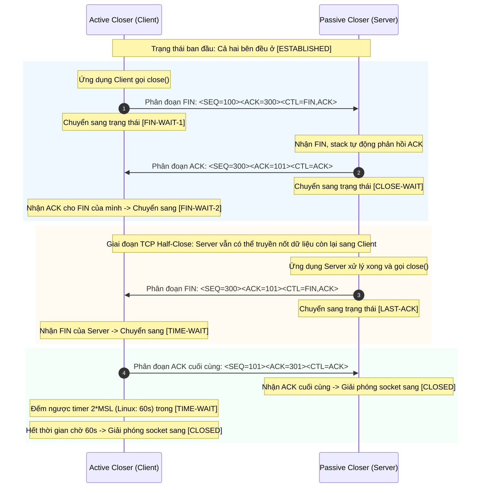
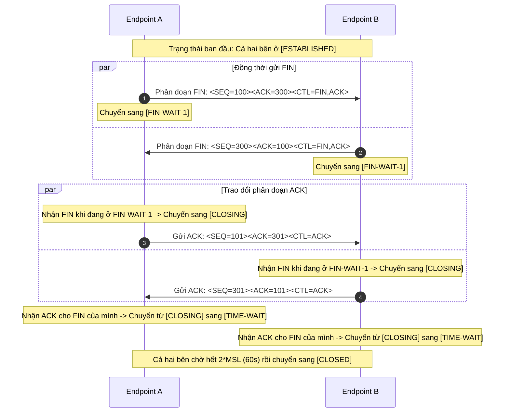

# 2_5_5 TCP Connection Teardown

> **Khóa học**: Cloud DevOps Basic — Networking Core  
> **Phân nhóm**: 2 Domain 2 - Computer Networking Core Fundamentals › 2_5 Transport Layer TCP and UDP  
> **Chủ đề**: Cơ chế giải phóng kết nối TCP (RFC 9293): Trình tự 4-Way Teardown, chu trình chuyển đổi trạng thái FSM, TCP Half-Close, bí ẩn TIME_WAIT (2 MSL vs Linux TCP_TIMEWAIT_LEN) và căn nguyên sự cố kẹt CLOSE_WAIT  
> **Trạng thái**: Draft (WRITE-CDB-2_5_5, 14-11-2026)  
> **Checklist đối chiếu**: [2_5_5](<../../../CHECKLIST.md#domain-2-computer-networking-core-fundamentals-43-items>)  

---

## 1. Khái Niệm Cốt Lõi & Bản Chất Kỹ Thuật (Core Concepts & Technical Deep Dive)

Trong kiến trúc mạng TCP/IP, **Giao thức Điều khiển Truyền vận (Transmission Control Protocol - TCP)** là một giao thức hướng kết nối (connection-oriented) hoạt động theo mô hình **song công toàn phần (Full-Duplex)**. Điều này có nghĩa là một kết nối TCP logic thực chất bao gồm hai kênh truyền dữ liệu byte stream hoàn toàn độc lập và riêng biệt chạy theo hai chiều ngược nhau giữa hai tiến trình đầu cuối.

Chính vì tính chất song công độc lập này, việc kết thúc và giải phóng một phiên làm việc TCP không thể diễn ra đột ngột hay đơn phương trong một bước. Quá trình giải phóng kết nối chuẩn mực — **TCP Connection Teardown** (được chuẩn hóa toàn diện trong tài liệu **RFC 9293**, thay thế RFC 793) — đòi hỏi mỗi bên phải chủ động thông báo khi kết thúc dữ liệu của mình và xác nhận yêu cầu đóng từ phía đối phương.

---

### 1.1 Bản Chất TCP Half-Close & Chi Phí Số Thứ Tự của Cờ FIN

Một kết nối TCP duy trì hai luồng truyền:
1. Luồng dữ liệu từ Endpoint A gửi sang Endpoint B.
2. Luồng dữ liệu từ Endpoint B gửi sang Endpoint A.

Khi một tiến trình (ví dụ bên A) đã truyền tải toàn bộ dữ liệu ứng dụng và không còn dữ liệu mới để gửi tiếp, nó sẽ phát đi một phân đoạn chứa cờ điều khiển **FIN (Finish)** để đóng chiều truyền của mình. 

- **Khái niệm TCP Half-Close**: Sau khi bên A gửi cờ FIN và nhận được gói xác nhận (ACK) từ bên B, chiều gửi từ A sang B chính thức đóng lại. Tuy nhiên, nếu bên B vẫn còn dữ liệu chưa truyền xong, bên B vẫn có toàn quyền tiếp tục đẩy dữ liệu qua kênh truyền từ B sang A. Bên A vẫn giữ trách nhiệm tiếp nhận và gửi ACK phản hồi cho dữ liệu từ B. Tình trạng này được gọi là **TCP Half-Close (Đóng một nửa kết nối)**.
- **Tiêu thụ không gian số thứ tự (Sequence Number Space)**: Căn cứ theo **RFC 9293 Section 3.6 Figure 12**, cờ `FIN` là một tín hiệu điều khiển quan trọng và được gán vị trí số thứ tự logic trong luồng byte. Cờ **FIN tiêu thụ đúng 1 đơn vị không gian Sequence Number** (tương tự cờ SYN). Do đó, phân đoạn ACK phản hồi cho một gói tin FIN mang số thứ tự `<SEQ=u>` bắt buộc phải mang giá trị xác nhận là `<ACK=u+1>`. Ngược lại, một gói tin ACK đứng đơn độc (không mang cờ SYN/FIN và không có payload) tiêu thụ 0 đơn vị sequence number.

---

### 1.2 Trình Tự Bắt Tay 4 Bước (TCP 4-Way Teardown) & Chuyển Đổi Trạng Thái FSM

Trong kịch bản thông thường, quá trình giải phóng kết nối diễn ra qua 4 phân đoạn tin trao đổi giữa **Active Closer** (bên chủ động khởi xướng đóng) và **Passive Closer** (bên tiếp nhận yêu cầu đóng). Căn cứ theo **RFC 9293 Section 3.6 Figure 12** và **Section 3.3.2**, chu trình diễn ra như sau:

```
      Active Closer (Client)                           Passive Closer (Server)
           [ESTABLISHED]                                    [ESTABLISHED]
                 |                                                |
  (1) Gửi FIN    |  <SEQ=100><ACK=300><CTL=FIN,ACK>               |
  --------------->===============================================>| (Nhận FIN)
   [FIN-WAIT-1]  |                                                | [CLOSE-WAIT]
                 |                                                |
                 |  <SEQ=300><ACK=101><CTL=ACK>                   | (2) Gửi ACK
  (Nhận ACK)     |<===============================================|
   [FIN-WAIT-2]  |                                                |
                 |       ... (Server xử lý & gửi nốt dữ liệu) ... |
                 |                                                |
                 |  <SEQ=300><ACK=101><CTL=FIN,ACK>               | (3) Gửi FIN
  (Nhận FIN)     |<===============================================|
   [TIME-WAIT]   |                                                | [LAST-ACK]
                 |                                                |
  (4) Gửi ACK    |  <SEQ=101><ACK=301><CTL=ACK>                   |
  --------------->===============================================>| (Nhận ACK)
                 |                                                | [CLOSED]
     (Chờ 2 MSL) |                                                |
      [CLOSED]   |                                                |
```

Chi tiết 4 bước kỹ thuật:
1. **Bước 1 (Active FIN)**: Ứng dụng phía Active Closer gọi hàm `close()`. TCP stack gửi phân đoạn chứa cờ FIN kết hợp ACK (ví dụ: `<SEQ=100><ACK=300><CTL=FIN,ACK>`). Active Closer rời trạng thái `ESTABLISHED` và bước vào trạng thái **`FIN-WAIT-1`** để chờ xác nhận từ phía đối phương.
2. **Bước 2 (Passive ACK)**: TCP stack của Passive Closer tiếp nhận phân đoạn FIN. Nó lập tức tự động sinh ra một phân đoạn ACK xác nhận (ví dụ: `<SEQ=300><ACK=101><CTL=ACK>`, với `ACK = 100 + 1 = 101`). 
   - Passive Closer chuyển từ trạng thái `ESTABLISHED` sang **`CLOSE-WAIT`** và báo hiệu sự kiện EOF (End-of-File) lên tiến trình ứng dụng cục bộ.
   - Khi Active Closer nhận được gói ACK này, nó chuyển từ `FIN-WAIT-1` sang **`FIN-WAIT-2`**. Tại thời điểm này, chiều truyền từ Active Closer sang Passive Closer đã đóng hoàn toàn.
3. **Bước 3 (Passive FIN)**: Sau khi tiến trình ứng dụng phía Passive Closer xử lý xong các tác vụ còn dang dở và tiến hành gọi lệnh `close()` trên socket, TCP stack của Passive Closer gửi phân đoạn FIN của chính nó (ví dụ: `<SEQ=300><ACK=101><CTL=FIN,ACK>`). Passive Closer chuyển trạng thái từ `CLOSE-WAIT` sang **`LAST-ACK`** để chờ xác nhận cuối cùng.
4. **Bước 4 (Active ACK)**: Active Closer tiếp nhận phân đoạn FIN từ Passive Closer. Nó phản hồi gói tin ACK cuối cùng (ví dụ: `<SEQ=101><ACK=301><CTL=ACK>`, với `ACK = 300 + 1 = 301`). 
   - Active Closer chuyển từ `FIN-WAIT-2` sang trạng thái **`TIME-WAIT`** và kích hoạt bộ đếm thời gian kéo dài $2 \times \text{MSL}$.
   - Khi Passive Closer tiếp nhận gói ACK cuối cùng này, nó chuyển ngay lập tức từ `LAST-ACK` sang trạng thái **`CLOSED`** và thu hồi toàn bộ tài nguyên socket.
   - Sau khi hết thời gian chờ $2 \times \text{MSL}$, Active Closer tự động chuyển từ `TIME-WAIT` sang **`CLOSED`**.

Tóm tắt hai chuỗi chuyển đổi trạng thái hữu hạn (Finite State Machine - FSM):
- **Chuỗi trạng thái Active Closer**: `ESTABLISHED` $\rightarrow$ **`FIN-WAIT-1`** $\rightarrow$ **`FIN-WAIT-2`** $\rightarrow$ **`TIME-WAIT`** $\rightarrow$ **`CLOSED`** (RFC 9293 Section 3.3.2).
- **Chuỗi trạng thái Passive Closer**: `ESTABLISHED` $\rightarrow$ **`CLOSE-WAIT`** $\rightarrow$ **`LAST-ACK`** $\rightarrow$ **`CLOSED`** (RFC 9293 Section 3.3.2).

---

### 1.3 Các Biến Thể Giải Phóng Kết Nối: Đóng Đồng Thời & Tối Giản 3 Bước

Bên cạnh mô hình 4 bước tuần tự, RFC 9293 quy định hai trường hợp ngoại lệ quan trọng:

1. **Đóng đồng thời (Simultaneous Close - RFC 9293 Section 3.6 Figure 13)**:
   - Xảy ra khi cả hai đầu cuối cùng gửi phân đoạn FIN cho nhau tại cùng một thời điểm khi cả hai đang ở trạng thái `ESTABLISHED`.
   - Cả hai bên cùng chuyển sang trạng thái `FIN-WAIT-1`.
   - Khi mỗi bên nhận được phân đoạn FIN từ đối phương (trước khi nhận được ACK cho FIN của chính mình), cả hai bên chuyển từ `FIN-WAIT-1` sang trạng thái **`CLOSING`**.
   - Sau đó, khi mỗi bên nhận được gói ACK xác nhận cho phân đoạn FIN mà mình đã gửi đi, cả hai bên chuyển từ `CLOSING` sang trạng thái **`TIME-WAIT`**, chờ hết thời gian $2 \times \text{MSL}$ trước khi chuyển sang `CLOSED`.
2. **Thu gọn thành 3 phân đoạn (3-Segment Piggybacked Teardown - RFC 9293 Figure 5 Note 2)**:
   - Nếu tại thời điểm tiếp nhận phân đoạn FIN từ Active Closer, Passive Closer cũng đã hoàn tất toàn bộ dữ liệu ứng dụng và gọi `close()` ngay tức khắc, TCP stack của Passive Closer có thể gộp gói ACK của Bước 2 và gói FIN của Bước 3 vào làm **một phân đoạn duy nhất mang cờ `<FIN,ACK>`**.
   - Khi Active Closer nhận được phân đoạn kết hợp này, nó sẽ chuyển **trực tiếp từ `FIN-WAIT-1` sang `TIME-WAIT`** (bỏ qua bước trung gian `FIN-WAIT-2`), gửi gói ACK cuối cùng và kết thúc chu trình chỉ với 3 gói tin trên đường truyền.

---

### 1.4 Bí Ẩn Trạng Thái TIME-WAIT: Tại Sao Bắt Buộc Cần Chờ $2 \times \text{MSL}$?

Trạng thái `TIME-WAIT` thường gây nhiều thắc mắc cho kỹ sư hệ thống: Tại sao khi cả hai bên đã đồng ý đóng kết nối, bên chủ động đóng lại không giải phóng socket ngay mà phải tiếp tục lưu lại trong bộ nhớ một khoảng thời gian dài?

Theo quy định tại **RFC 9293 Section 3.3.2** và **Section 3.4.1**, trạng thái `TIME-WAIT` phục vụ **hai mục đích bảo vệ sống còn**:

1. **Đảm bảo độ tin cậy tuyệt đối cho gói ACK cuối cùng (Reliable Teardown)**:
   - Phân đoạn ACK cuối cùng (Bước 4) do Active Closer gửi đi là một gói ACK đơn thuần và bản thân nó không được xác nhận bởi bất kỳ gói tin nào khác.
   - Nếu gói ACK cuối cùng này bị thất lạc trên mạng do nghẽn, phía Passive Closer (đang ở trạng thái `LAST-ACK`) sẽ kích hoạt bộ đếm thời gian truyền lại (Retransmission Timer) và **gửi lại phân đoạn FIN**.
   - Nhờ Active Closer vẫn đang duy trì trạng thái `TIME-WAIT`, nó có thể nhận diện phân đoạn FIN gửi lại này và lập tức **gửi trả lại một gói ACK khác**.
   - Nếu Active Closer giải phóng socket về `CLOSED` ngay lập tức, khi gói FIN gửi lại bay tới, hệ điều hành sẽ không tìm thấy socket phù hợp và sẽ phản hồi bằng một gói tin **RST (Reset)**. Điều này khiến phía Passive Closer bị ngắt kết nối trong tình trạng lỗi bất thường (ví dụ: `Connection reset by peer`) thay vì hoàn tất phiên làm việc sạch sẽ (clean close).
2. **Quét sạch các phân đoạn dữ liệu trôi nổi trên mạng (Draining Stale Segments)**:
   - Trong quá trình truyền thông trên Internet, các gói tin IP có thể bị định tuyến vòng vèo, mắc kẹt trong hàng đợi của các router và trôi dạt chậm chạp trên mạng.
   - Giả sử một kết nối vừa đóng lập tức được tái sử dụng (reincarnation) bởi một tiến trình mới với cùng bộ định danh 4-tuple: `(Src IP, Src Port, Dst IP, Dst Port)`.
   - Nếu một gói tin dữ liệu cũ của phiên kết nối trước bất ngờ xuất hiện và có số Sequence Number vô tình trùng khớp với cửa sổ nhận của kết nối mới, luồng dữ liệu của kết nối mới sẽ bị **xáo trộn và sai lệch dữ liệu nghiêm trọng**.
   - Bằng cách bắt buộc socket lưu lại trong thời gian $2 \times \text{MSL}$ (Maximum Segment Lifetime), mọi gói tin cũ trôi nổi theo chiều đi (tối đa 1 MSL) và các gói tin phản hồi trôi nổi theo chiều về (tối đa 1 MSL) đều được đảm bảo sẽ bị hủy hoàn toàn trên mạng trước khi bộ 4-tuple đó được phép cấp phát cho một kết nối mới.

---

### 1.5 Đối Chiếu Tiêu Chuẩn RFC 9293 và Thực Tế Linux Kernel (Resolution of Flagged Claim 2)

Có một sự sai lệch kinh điển giữa lý thuyết giao thức chuẩn hóa quốc tế và kiến trúc hiện thực hóa trong các hệ điều hành máy chủ sản xuất mà mọi kỹ sư DevOps cần nắm vững:

| Tiêu chí | Đặc tả Chuẩn IETF (RFC 9293 / RFC 793) | Thực tế Hiện thực trong Linux Kernel |
| :--- | :--- | :--- |
| **Giá trị MSL (Maximum Segment Lifetime)** | **120 giây (2 phút)** theo RFC 9293 Section 3.4.2 & 3.6.1 | **Xấp xỉ 30 giây** (ngầm định) |
| **Thời gian lưu trạng thái TIME-WAIT ($2 \times \text{MSL}$)** | **240 giây (4 phút)** | **Cố định 60 giây** qua hằng số `TCP_TIMEWAIT_LEN` |
| **Vị trí định nghĩa trong mã nguồn** | RFC 9293 Specification | Hardcode tại file `include/net/tcp.h` (dòng 140–141) |
| **Khả năng can thiệp qua tham số sysctl** | Không áp dụng | Không thể can thiệp động qua `/proc/sys/net/` (phải recompile kernel nếu muốn sửa) |
| **Lý do thiết kế kỹ thuật** | Đảm bảo tính toàn vẹn tuyệt đối trên các mạng diện rộng toàn cầu có độ trễ cực cao. | Tối ưu hóa hiệu năng máy chủ, thu hồi bộ nhớ socket và cổng ephemeral nhanh hơn, ngăn ngừa cạn kiệt tài nguyên trước các cuộc tấn công từ chối dịch vụ (DoS). |

Cụ thể, trong mã nguồn nhân Linux (`include/net/tcp.h`):
```c
#define TCP_TIMEWAIT_LEN (60*HZ) /* how long to wait to destroy TIME-WAIT
                                  * state, about 60 seconds */
```
Nhân Linux cố tình phá vỡ (vi phạm có chủ đích) quy định 4 phút của RFC 9293 để ấn định mức chờ 60 giây, giúp hệ thống phục hồi tài nguyên nhanh gấp 4 lần.

Đồng thời, đối với trạng thái **`FIN-WAIT-2`** (khi bên chủ động đã đóng nhưng bên bị động mồ côi không chịu gửi FIN), nhân Linux cung cấp tham số cấu hình:
- **`net.ipv4.tcp_fin_timeout`**: Có giá trị mặc định là **60 giây** (theo tài liệu `man 7 tcp` và `ip-sysctl.rst`). Tham số này xác định thời gian tối đa hệ điều hành duy trì một socket mồ côi (orphaned socket) ở trạng thái `FIN-WAIT-2`. Nếu đối phương không gửi gói FIN trong vòng 60 giây, nhân Linux sẽ cưỡng bức đóng socket và thu hồi tài nguyên để bảo vệ hệ thống khỏi nguy cơ tấn công từ chối dịch vụ treo tài nguyên.

---

### 1.6 Bản Chất Kỹ Thuật & Căn Nguyên Trạng Thái CLOSE-WAIT Kéo Dài

Trạng thái `CLOSE-WAIT` xuất hiện ở phía Passive Closer sau khi nhận được phân đoạn FIN từ phía Active Closer.
- Căn cứ theo **RFC 9293 Section 3.6 Case 2** và **Section 3.10.4**: Khi phân đoạn FIN đến từ mạng, TCP stack của hệ điều hành tự động gửi gói ACK phản hồi và báo hiệu cho ứng dụng tầng người dùng biết kết nối đang đóng (qua tín hiệu EOF, hoặc hàm `read()`/`recv()` trả về giá trị `0`).
- **Căn nguyên kẹt CLOSE-WAIT**: TCP stack không thể tự ý chuyển từ `CLOSE-WAIT` sang `LAST-ACK`. Nó bắt buộc phải chờ lệnh gọi đóng rõ ràng từ phía người dùng cục bộ — tức là **tiến trình ứng dụng phải thực hiện lời gọi hàm `close()` trên socket**.
- Do đó, nếu một socket nằm kẹt ở trạng thái `CLOSE-WAIT` trong nhiều phút hoặc nhiều giờ, **nguyên nhân 100% nằm ở lỗi lập trình của ứng dụng nội bộ (Application-Level Bug / File Descriptor Leak)**:
  - Ứng dụng đọc được EOF từ client nhưng quên không gọi hàm `close()`.
  - Tiến trình bị nghẽn (hang/deadlock) trong luồng xử lý trước khi kịp thực thi câu lệnh đóng kết nối.
  - Khối xử lý ngoại lệ (Exception Handling) không đưa lệnh đóng kết nối vào khối `finally` hoặc khối giải phóng tài nguyên.

---

## 2. Ví Dụ Đời Sống Thực Tế Dễ Hiểu (Intuitive Real-World Analogies)

Để hình dung tường tận bản chất của quá trình 4 bước đóng kết nối, sự độc lập của hai chiều truyền và vai trò của các trạng thái trung gian, hãy liên tưởng tới **Lễ ký kết biên bản thanh lý hợp đồng giữa hai đối tác kinh doanh độc lập**:

```
Bên A (Bên Giao Hàng - Active Closer)            Bên B (Bên Nhận Hàng - Passive Closer)
                 |                                                |
 (1) Gửi thư     | "Tôi đã giao hết hàng, xin thanh lý [FIN]"     |
 --------------->================================================>| (Nhận thư thanh lý)
  [FIN-WAIT-1]   |                                                | [CLOSE-WAIT]
                 |                                                |
                 | "Đã nhận đủ hàng, xác nhận đã hiểu [ACK]"      | (2) Hồi đáp xác nhận
 (Nhận thư)      |<===============================================|
  [FIN-WAIT-2]   |                                                |
                 |  ... (Kế toán Bên B kiểm tra sổ sách &          |
                 |      chuyển nốt công nợ còn lại - Half Close)  |
                 |                                                |
                 | "Tôi cũng đã trả hết tiền, đề nghị đóng [FIN]" | (3) Gửi thư thanh lý
 (Nhận thông báo)|<===============================================|
  [TIME-WAIT]    |                                                | [LAST-ACK]
                 |                                                |
 (4) Ký gửi ACK  | "Đã nhận đủ tiền, chính thức thanh lý [ACK]"   |
 --------------->================================================>| (Nhận thư cuối)
                 |                                                | [CLOSED] (Hủy hồ sơ)
  (Giữ hồ sơ lưu |                                                |
    60 giây)     |                                                |
   [CLOSED]      |                                                |
```

### Các mắt xích so sánh trực quan:
1. **Đóng một chiều (Half-Close)**: Bên A tuyên bố đã giao hết hàng và muốn chấm dứt nghĩa vụ giao hàng (gửi FIN). Bên B gửi thư báo đã nhận được thông tin (gửi ACK). Tuy nhiên, hợp đồng chưa thể hủy bỏ ngay, vì Bên B vẫn còn trách nhiệm thanh toán nốt các hóa đơn tồn đọng cho Bên A (chiều truyền từ B sang A vẫn mở).
2. **Trạng thái CLOSE-WAIT (Bàn làm việc của kế toán)**: Sau khi Bên B nhận thông báo từ Bên A, hồ sơ nằm trên bàn của Bên B ở trạng thái chờ kế toán rà soát công nợ. Nếu kế toán Bên B bận việc khác hoặc đi uống cà phê mà quên không ký duyệt hồ sơ (ứng dụng không gọi `close()`), hồ sơ đó sẽ **nằm kẹt vĩnh viễn ở trạng thái CLOSE-WAIT**.
3. **Trạng thái TIME-WAIT (Lưu trữ hồ sơ phòng ngừa bưu tá làm rơi thư)**: Sau khi nhận được thông báo Bên B đã thanh toán xong (Bên B gửi FIN), Bên A gửi bức thư xác nhận cuối cùng (ACK). Lúc này Bên A **chưa được phép xé hồ sơ ngay**. Bên A phải cất hồ sơ trong ngăn kéo lưu trữ trong vòng 60 giây (tương đương $2 \times \text{MSL}$). Nếu nhân viên bưu tá vô tình làm rơi bức thư ACK cuối cùng, Bên B sẽ sốt ruột gửi lại thư đòi thanh lý. Nhờ hồ sơ còn lưu trong ngăn kéo (TIME-WAIT), Bên A mới có thể photo gửi lại ngay một lá thư ACK khác. Sau 60 giây an toàn, khi chắc chắn thư đã đến tay đối tác, Bên A mới chính thức tiêu hủy hồ sơ (CLOSED).

---

## 3. Kiến Trúc, Luồng Hoạt Động & Hình Ảnh Trực Quan (Architecture, Diagrams & Visual Media)

### Sơ đồ Tuần tự Chi tiết (Sequence Diagram) - 4-Way Teardown

Biểu đồ tuần tự dưới đây thể hiện toàn bộ các phân đoạn tin trao đổi giữa Client và Server, các cờ điều khiển, số Sequence/Acknowledgment number và các trạng thái chuyển đổi tương ứng:



---

### Sơ đồ Đóng Đồng Thời (Simultaneous Close)

Khi cả hai bên cùng chủ động phát lệnh đóng kết nối gần như cùng một lúc:



---

## 4. Code Mẫu Trực Quan Hoặc Dòng Lệnh Thực Chiến (Runnable Sample Code / CLI)

Để giám sát và chẩn đoán trạng thái giải phóng kết nối TCP trên hệ thống Linux phục vụ môi trường DevOps, công cụ hiện đại và tiêu chuẩn là lệnh `ss` (Socket Statistics thuộc gói `iproute2`), kết hợp với lệnh đọc/ghi tham số `sysctl`.

### 4.1 Giám sát Trạng thái Socket bằng lệnh `ss`

Theo tài liệu chuẩn `man 8 ss`, cú pháp lọc theo trạng thái kết nối sử dụng từ khóa `state`:

```bash
# 1. Liệt kê toàn bộ các kết nối TCP đang ở trạng thái TIME-WAIT
ss -tan state time-wait

# 2. Liệt kê các kết nối đang bị treo ở trạng thái CLOSE-WAIT (cần theo dõi khẩn cấp)
ss -tan state close-wait

# 3. Liệt kê các kết nối đang chờ đối phương phản hồi FIN ở trạng thái FIN-WAIT-2
ss -tan state fin-wait-2

# 4. Đếm tổng số lượng socket đang nằm trong trạng thái TIME-WAIT trên hệ thống
ss -tan state time-wait | wc -l
```

**Phân tích output thực tế khi chạy lệnh `ss -tan state time-wait`**:
```text
State       Recv-Q  Send-Q    Local Address:Port      Peer Address:Port   Process
TIME-WAIT   0       0         192.168.1.50:48292      10.0.0.10:443       
TIME-WAIT   0       0         192.168.1.50:48294      10.0.0.10:443       
```
- `Recv-Q` và `Send-Q` bằng `0`: Toàn bộ dữ liệu trên cả hai chiều đã được truyền tải và xác nhận xong.
- `Local Address:Port`: Địa chỉ IP nội bộ cùng cổng tạm thời (ephemeral port `48292`, `48294`) do Active Closer mở ra để kết nối.
- `Peer Address:Port`: Địa chỉ máy chủ đích (ví dụ HTTPS cổng `443`). Cổng tạm thời này sẽ bị khóa trong 60 giây trước khi hệ điều hành cho phép tái cấp phát.

---

### 4.2 Kiểm tra & Điều Chỉnh Các Tham Số Kernel Liên Quan

Theo tài liệu chính thức `Documentation/networking/ip-sysctl.rst`:

```bash
# Kiểm tra số lượng socket TIME-WAIT tối đa mà nhân Linux cho phép lưu giữ đồng thời
sysctl net.ipv4.tcp_max_tw_buckets

# Kiểm tra thời gian timeout tối đa cho socket mồ côi ở trạng thái FIN-WAIT-2 (mặc định 60s)
sysctl net.ipv4.tcp_fin_timeout
```

**Ý nghĩa kỹ thuật của các tham số sysctl**:
- **`net.ipv4.tcp_max_tw_buckets`**: Quy định ngưỡng trần tối đa các socket `TIME-WAIT` mà hệ thống được phép duy trì đồng thời. Nếu lưu lượng kết nối tăng vọt khiến số lượng socket `TIME-WAIT` vượt quá giá trị này, nhân Linux sẽ lập tức tiêu hủy (destroy) các socket vượt ngưỡng và in ra cảnh báo trên nhật ký hệ thống `dmesg` (`TCP: time wait bucket table overflow`).
- **`net.ipv4.tcp_fin_timeout`**: Quy định thời gian tính bằng giây mà nhân Linux sẽ chờ đợi gói tin FIN từ đối phương khi một socket cục bộ đã bị ứng dụng đóng và chuyển sang `FIN-WAIT-2`. Giá trị mặc định là `60` giây. Nếu hết thời gian này đối phương vẫn không đóng, Linux sẽ cưỡng bức giải phóng socket để chống DoS.

---

## 5. Cạm Bẫy Thực Tế & Thực Tiễn Sản Xuất (Production Gotchas & Best Practices)

Trong vận hành hệ sinh thái Cloud và hạ tầng DevOps có lưu lượng truy cập cao, quá trình giải phóng kết nối TCP tiềm ẩn những cạm bẫy nghiêm trọng sau:

### 1. Cạn Kiệt Cổng Ephemeral do Quá Nhiều Socket TIME-WAIT (Port Exhaustion)
- **Bản chất**: Trên các máy chủ API Gateway, Reverse Proxy (Nginx, HAProxy, Envoy) hoặc vi dịch vụ (Microservices) giao tiếp với cơ sở dữ liệu qua giao thức HTTP/1.0 hoặc các kết nối ngắn hạn (short-lived connections), phía Proxy đóng vai trò là bên chủ động đóng kết nối (Active Closer).
- **Hậu quả**: Cứ mỗi kết nối đóng lại, cổng ephemeral đó sẽ bị khóa cứng trong trạng thái `TIME-WAIT` đúng 60 giây. Khi tốc độ tạo kết nối mới vượt quá số lượng cổng tạm thời có sẵn (thường chỉ có khoảng 28.000 đến 60.000 cổng), máy chủ sẽ cạn kiệt cổng cục bộ, dẫn đến lỗi kinh điển: `Cannot assign requested address` (lỗi `EADDRNOTAVAIL`), làm tê liệt khả năng forward request ra bên ngoài.
- **Thực tiễn sản xuất**:
  - Tuyệt đối hạn chế việc mở và đóng liên tục các kết nối ngắn hạn.
  - Thiết lập **HTTP Keep-Alive** và duy trì các **Connection Pools** bền vững giữa các dịch vụ nội bộ (ví dụ: gRPC, HTTP/2 multiplexing, DB connection pool).

---

### 2. Nguy Cơ Nghiêm Trọng Từ Tùy Chọn Cũ `tcp_tw_recycle` (Đã bị Khai Tử từ Linux 4.12)
- **Bản chất**: Trong nhiều bài hướng dẫn cũ trên mạng, người ta thường khuyên bật cờ `net.ipv4.tcp_tw_recycle = 1` để hệ điều hành dọn dẹp các socket `TIME-WAIT` nhanh chóng sau một vài mili-giây thay vì chờ 60 giây.
- **Hậu quả**: Cơ chế `tcp_tw_recycle` hoạt động dựa trên việc lưu lại mốc thời gian (TCP Timestamps) gần nhất của từng địa chỉ IP từ xa. Trong môi trường mạng Internet hiện đại, hàng triệu người dùng di động hoặc doanh nghiệp đứng sau cùng một thiết bị **NAT (Network Address Translation)** hoặc Proxy công cộng. Mỗi thiết bị phía sau NAT lại có đồng hồ phần cứng lệch nhau. Khi một client có timestamp nhỏ hơn vừa gửi gói tin tới, kernel máy chủ sẽ coi đó là gói tin cũ trôi dạt và **âm thầm drop bỏ toàn bộ gói SYN của client đó**. Kết quả là hàng loạt khách hàng phía sau NAT bị rớt mạng hoàn toàn.
- **Quyết định kỹ thuật**: Nhận thấy nguy cơ phá vỡ tính đúng đắn của mạng Internet, cộng đồng phát triển nhân Linux đã **chính thức xóa bỏ hoàn toàn tham số `net.ipv4.tcp_tw_recycle` kể từ phiên bản Linux Kernel 4.12**.

---

### 3. Rò Rỉ Tài Nguyên File Descriptor Khi Kẹt Trạng Thái CLOSE-WAIT
- **Bản chất**: Trong khi socket ở trạng thái `TIME-WAIT` do nhân hệ điều hành tự động kiểm soát và giải phóng sau 60 giây, thì socket ở trạng thái `CLOSE-WAIT` **vẫn đang được sở hữu bởi tiến trình ứng dụng** và giữ chặt một bộ mô tả tệp (File Descriptor - FD) cùng các bộ đệm bộ nhớ kernel liên kết.
- **Hậu quả**: Khi ứng dụng backend gặp lỗi rò rỉ socket (không gọi `close()`), số lượng socket ở trạng thái `CLOSE-WAIT` sẽ tăng dần theo thời gian. Khi số lượng FD mở chạm tới giới hạn hệ thống (`ulimit -n` hoặc `nofile`), tiến trình sẽ không thể mở thêm file, không thể chấp nhận kết nối mới và báo lỗi `Too many open files`, khiến dịch vụ bị sập hoàn toàn.
- **Thực tiễn sản xuất**:
  - Khi phát hiện `ss -tan state close-wait` có số lượng tăng cao, kỹ sư DevOps không được tìm cách cấu hình kernel mà phải báo động ngay cho đội ngũ phát triển ứng dụng (Dev) để rà soát mã nguồn.
  - Bắt buộc kiểm tra việc giải phóng socket trong khối `finally` (Java/C#) hoặc cơ chế `defer` (Golang) / `try...finally` (Python/Node.js).

---

## 6. Câu Hỏi Củng Cố Kiến Thức (Active Recall Quiz)

<details>
<summary><b>Câu hỏi 1:</b> Một kỹ sư vận hành hệ thống phát hiện trên máy chủ backend dịch vụ có hơn 15.000 socket đang nằm ở trạng thái <code>CLOSE-WAIT</code>. Kỹ sư này dự định can thiệp tham số sysctl <code>net.ipv4.tcp_fin_timeout = 10</code> để dọn dẹp nhanh các socket này. Phương án trên có giải quyết được vấn đề không? Tại sao?</summary>

**Đáp án:**
- **Không giải quyết được vấn đề.**
- **Giải thích kỹ thuật**:
  - Căn cứ theo tài liệu Linux `man 7 tcp`, tham số `net.ipv4.tcp_fin_timeout` chỉ có tác dụng kiểm soát thời gian chờ tối đa cho các socket mồ côi đang ở trạng thái **`FIN-WAIT-2`** (phía Active Closer), hoàn toàn không có bất kỳ tác động nào lên trạng thái **`CLOSE-WAIT`** (phía Passive Closer).
  - Trạng thái `CLOSE-WAIT` là trạng thái mà TCP stack của hệ điều hành đã nhận được FIN từ đối phương và đang chờ tiến trình ứng dụng cục bộ gọi hàm `close()` trên socket (theo RFC 9293 Section 3.6 & 3.10.4).
  - Hiện tượng hàng ngàn kết nối kẹt ở `CLOSE-WAIT` là biểu hiện của lỗi rò rỉ tài nguyên từ tầng mã nguồn ứng dụng (Application Bug / File Descriptor Leak). Cách khắc phục duy nhất là sửa mã nguồn phần mềm để đảm bảo ứng dụng luôn gọi `close()` sau khi nhận tín hiệu kết thúc luồng dữ liệu (EOF).
</details>

<details>
<summary><b>Câu hỏi 2:</b> Trong một phiên giải phóng kết nối TCP chuẩn, bên A chủ động gửi phân đoạn FIN mang số thứ tự <code>&lt;SEQ=4000&gt;&lt;ACK=8000&gt;</code> cho bên B. Phân đoạn phản hồi ACK mà bên B gửi lại cho bên A sẽ mang giá trị Acknowledgment Number bằng bao nhiêu? Cờ FIN tiêu thụ bao nhiêu đơn vị trong không gian Sequence Number?</summary>

**Đáp án:**
- Căn cứ theo **RFC 9293 Section 3.6 Figure 12**:
  - Cờ `FIN` tiêu thụ **đúng 1 đơn vị không gian Sequence Number** (tương tự như cờ SYN khi khởi tạo kết nối).
  - Khi bên A gửi phân đoạn FIN với số thứ tự `SEQ = 4000`, phân đoạn này chiếm dụng vị trí số thứ tự `4000`.
  - Bên B khi phản hồi gói ACK xác nhận việc tiếp nhận phân đoạn FIN sẽ thiết lập giá trị Acknowledgment Number là số thứ tự kế tiếp:
    $$\text{Acknowledgment Number} = \text{SEQ} + 1 = 4000 + 1 = 4001$$
  - Do đó, phân đoạn ACK từ bên B sẽ mang giá trị **`ACK = 4001`**.
</details>

<details>
<summary><b>Câu hỏi 3:</b> Chuẩn IETF Internet Standard (RFC 9293) quy định thời gian lưu lại ở trạng thái TIME-WAIT là bao lâu? Tại sao nhân hệ điều hành Linux lại cố tình thiết lập giá trị này là 60 giây qua hằng số <code>TCP_TIMEWAIT_LEN</code>?</summary>

**Đáp án:**
- Căn cứ theo **RFC 9293 Section 3.4.2 & Section 3.6.1**:
  - Tiêu chuẩn IETF quy định thời gian sống tối đa của một phân đoạn trên mạng (Maximum Segment Lifetime - MSL) là **2 phút (120 giây)**.
  - Trạng thái `TIME-WAIT` bắt buộc phải duy trì trong khoảng thời gian là $2 \times \text{MSL} = 2 \times 120\text{s} = 240\text{ giây}$ (**4 phút**).
- **Lý do nhân Linux cố tình thiết lập 60 giây**:
  - Trong mã nguồn Linux kernel (`include/net/tcp.h` lines 140–141), hằng số `TCP_TIMEWAIT_LEN` được ấn định cố định là `60*HZ` (xấp xỉ 60 giây), tương ứng với việc giả định ngầm MSL là 30 giây.
  - Đây là một quyết định kỹ thuật vi phạm có chủ đích (intentional RFC violation) nhằm giải quyết bài toán thực tế: Trên các cụm máy chủ chịu tải cao, việc giữ socket trong suốt 4 phút sẽ khiến tài nguyên bộ nhớ bị khóa chặt và làm cạn kiệt dải cổng tạm thời (ephemeral ports), dễ khiến hệ thống bị tê liệt trước các cuộc tấn công DoS. Việc rút ngắn xuống 60 giây giúp hệ điều hành giải phóng và tái sử dụng cổng nhanh gấp 4 lần trong khi vẫn đảm bảo độ an toàn hợp lý trên hạ tầng mạng hiện đại.
</details>

---

## 7. 📚 Nguồn Tài Liệu Chính Thống (Tier-1 Official References)

- [RFC 9293: Transmission Control Protocol (TCP)](https://www.rfc-editor.org/rfc/rfc9293.txt) - Tiêu chuẩn kỹ thuật Internet IETF chính thức công bố tháng 8/2022, thay thế RFC 793, quy định chi tiết cơ chế Connection Teardown (Section 3.6), chu trình máy trạng thái FSM (Section 3.3.2), cơ chế Half-Close, Simultaneous Close và quy tắc duy trì trạng thái TIME-WAIT trong $2 \times \text{MSL}$ (Section 3.4.2 & Section 3.6.1).
- [man7.org tcp(7) - Linux Programmer's Manual](https://man7.org/linux/man-pages/man7/tcp.7.html) - Tài liệu hệ thống Linux Manual chính thức mô tả các tham số cấu hình giao thức TCP của kernel, bao gồm cơ chế timeout dọn dẹp socket mồ côi `tcp_fin_timeout`.
- [man7.org ss(8) - Linux Programmer's Manual](https://man7.org/linux/man-pages/man8/ss.8.html) - Hướng dẫn tiện ích kiểm tra trạng thái socket `ss` thuộc bộ công cụ iproute2 của Linux, định nghĩa các bộ lọc trạng thái `time-wait`, `close-wait`, `fin-wait-2`.
- [ip-sysctl.rst - Linux Kernel Documentation](https://www.kernel.org/doc/Documentation/networking/ip-sysctl.rst) - Tài liệu tham chiếu chính thức từ kho mã nguồn Linux Kernel về các biến hệ thống mạng: quy định hạn mức `tcp_max_tw_buckets` cho socket TIME-WAIT và cơ chế `tcp_fin_timeout`.
