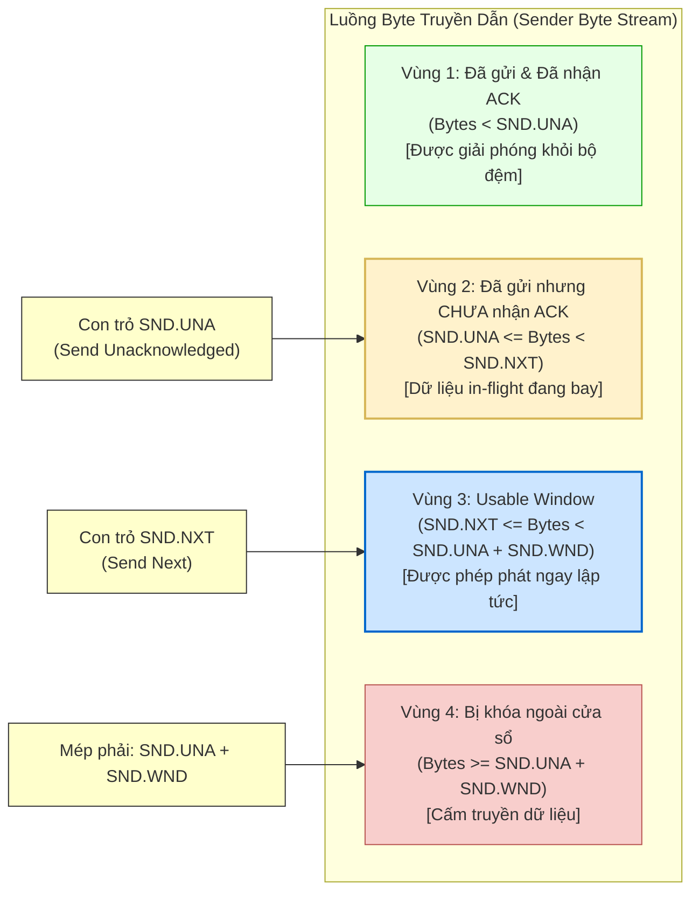
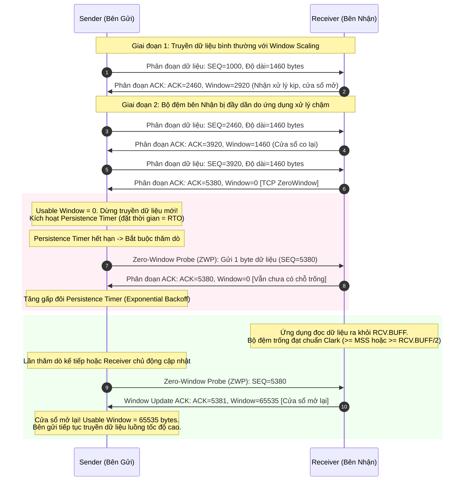

# 2_5_6 TCP Flow Control

> **Khóa học**: Cloud DevOps Basic — Networking Core  
> **Phân nhóm**: 2 Domain 2 - Computer Networking Core Fundamentals › 2_5 Transport Layer TCP and UDP  
> **Chủ đề**: Cơ chế điều khiển luồng TCP (RFC 9293 & RFC 7323): Cửa sổ trượt (Sliding Window), Receive Window (`rwnd`), Window Scaling (16-bit vs 1 GiB), Cửa sổ khả dụng (Usable Window), Zero Window Probing, Silly Window Syndrome (Clark & Nagle), và giám sát socket Linux  
> **Trạng thái**: Draft (WRITE-CDB-2_5_6, 14-11-2026)  
> **Checklist đối chiếu**: [2_5_6](<../../../CHECKLIST.md#domain-2-computer-networking-core-fundamentals-43-items>)  

---

## 1. Khái Niệm Cốt Lõi & Bản Chất Kỹ Thuật (Core Concepts & Technical Deep Dive)

Trong kiến trúc giao thức truyền thông TCP/IP, **Giao thức Điều khiển Truyền vận (Transmission Control Protocol - TCP)** đảm bảo việc truyền tải dữ liệu luồng byte (byte-stream) tin cậy, có thứ tự và không bị mất mát. Tuy nhiên, một hệ thống mạng thực tế luôn tồn tại sự bất đối xứng sâu sắc về năng lực tính toán: một máy chủ gửi dữ liệu (Sender) có thể sở hữu tài nguyên CPU và đường truyền mạng tốc độ cực cao, trong khi máy chủ nhận (Receiver) có thể đang chịu tải nặng hoặc bị giới hạn về bộ nhớ đệm.

Nếu không có cơ chế hãm tốc phù hợp, bên gửi sẽ bơm dữ liệu ồ ạt làm tràn ngập bộ đệm của bên nhận, dẫn đến việc đánh rơi gói tin hàng loạt, lãng phí băng thông và sụp đổ hiệu năng hệ thống. Để giải quyết bài toán này, TCP thiết lập cơ chế **Điều khiển Luồng (Flow Control)** — một trong những trụ cột kỹ thuật cốt lõi được chuẩn hóa toàn diện trong tài liệu **RFC 9293** (thay thế RFC 793) và mở rộng trong **RFC 7323**.

---

### 1.1 Bản Chất Điều Khiển Luồng (Flow Control) vs Điều Khiển Tắc Nghẽn (Congestion Control)

Trước khi đi sâu vào chi tiết giải thuật, kỹ sư hệ thống cần phân biệt rạch ròi hai cơ chế điều tiết tốc độ trong TCP:

| Tiêu chí | Điều Khiển Luồng (Flow Control) | Điều Khiển Tắc Nghẽn (Congestion Control) |
| :--- | :--- | :--- |
| **Phạm vi bảo vệ** | **Đầu cuối - đầu cuối (End-to-End)**: Giữa máy gửi (Sender) và máy nhận (Receiver). | **Toàn mạng truyền dẫn (Network-Wide)**: Giữa máy gửi và các thiết bị định tuyến trung gian (Routers, Switches, Links). |
| **Mục tiêu cốt lõi** | Bảo vệ **bộ đệm nhận (`RCV.BUFF`)** của bên Nhận không bị tràn ngập (buffer overflow) bởi một bên Gửi chạy quá nhanh (RFC 9293 Section 3.1 & 3.8.6). | Ngăn chặn việc bơm quá nhiều dữ liệu vào hạ tầng mạng, làm nghẽn hàng đợi tại các router trên đường đi (Section 2_5_7). |
| **Tín hiệu điều khiển** | Cửa sổ nhận **`rwnd` (Receive Window)** do chính máy nhận tính toán và gửi phản hồi công khai trong trường Window của TCP Header. | Cửa sổ tắc nghẽn **`cwnd` (Congestion Window)** do máy gửi tự tính toán nội bộ dựa trên ước lượng tình trạng mạng (mất gói, RTT, ECN). |
| **Ràng buộc tốc độ** | Bên gửi không được truyền vượt quá `rwnd`. | Bên gửi bị giới hạn bởi: $\min(\text{cwnd}, \text{rwnd})$. |

---

### 1.2 Cơ Chế Cửa Sổ Trượt (Sliding Window) & Công Thức Cửa Sổ Khả Dụng (Usable Window)

Cơ chế điều khiển luồng của TCP được hiện thực hóa thông qua kỹ thuật **Cửa Sổ Trượt (Sliding Window)**:

1. **Quảng bá Cửa Sổ Nhận (`rwnd`)**:
   - Căn cứ theo **RFC 9293 Section 3.1 & Section 3.8.6**: Phân đoạn TCP mang trường **Window có độ dài 16 bits**.
   - Giá trị của trường Window thể hiện số lượng byte dữ liệu (octets), tính từ số thứ tự được chỉ định trong trường Acknowledgment Number (`ACK`), mà bên phát phân đoạn đó (bên nhận dữ liệu) sẵn sàng tiếp nhận.
   - Giá trị này phản ánh trực tiếp không gian bộ đệm còn trống khả dụng tại thời điểm đó của kết nối (`RCV.BUFF`).

2. **Phân vùng bộ đệm tại Bên Gửi**:
   Luồng byte dữ liệu tại bên gửi được chia thành 4 khu vực logic:
   - **Vùng 1 - Đã gửi và đã nhận ACK**: Nằm trước con trỏ `SND.UNA`. Dữ liệu này đã được giải phóng khỏi bộ đệm gửi.
   - **Vùng 2 - Đã gửi nhưng chưa nhận ACK (Data In-Flight)**: Nằm từ `SND.UNA` đến trước `SND.NXT`. Đây là dữ liệu đang bay trên đường truyền hoặc đang chờ ACK từ bên nhận.
   - **Vùng 3 - Được phép gửi ngay nhưng chưa gửi (Usable Window)**: Nằm từ `SND.NXT` đến mép phải của cửa sổ `SND.UNA + SND.WND`.
   - **Vùng 4 - Ngoài cửa sổ (Not Usable)**: Nằm từ `SND.UNA + SND.WND` trở đi. Bên gửi bị cấm tuyệt đối không được phát bất kỳ byte nào thuộc vùng này cho đến khi cửa sổ trượt dịch chuyển sang phải.

```
Luồng Byte Bên Gửi:
...+--------------------+--------------------+--------------------+-------------------...
   | 1. Đã gửi & đã ACK | 2. Đã gửi chưa ACK | 3. Usable Window   | 4. Bị khóa ngoài  |
...+--------------------+--------------------+--------------------+-------------------...
                        ^                    ^                    ^
                     SND.UNA              SND.NXT          SND.UNA + SND.WND
```

3. **Công Thức Tính Cửa Sổ Khả Dụng (Usable Window)**:
   Căn cứ theo **RFC 9293 Section 3.8.6.2.1**, dung lượng dữ liệu mới mà bên gửi được phép phát đi ngay lập tức — gọi là **Cửa sổ Khả dụng (Usable Window - $U$)** — được xác định chính xác theo công thức:

   $$U = \text{SND.UNA} + \text{SND.WND} - \text{SND.NXT}$$

   Trong đó:
   - **`SND.UNA` (Send Unacknowledged)**: Số thứ tự byte nhỏ nhất đã gửi đi nhưng chưa nhận được gói tin xác nhận (ACK).
   - **`SND.WND` (Send Window)**: Kích thước cửa sổ nhận mà đối phương quảng bá (`rwnd`).
   - **`SND.NXT` (Send Next)**: Số thứ tự byte kế tiếp chuẩn bị gửi đi.
   - **Ràng buộc bất biến**: Bên gửi bị giới hạn bởi $U$ và **không thể truyền bất kỳ số thứ tự nào vượt quá $\text{SND.UNA} + \text{SND.WND}$**. Khi $U = 0$, bên gửi bắt buộc phải dừng truyền dữ liệu mới.

---

### 1.3 Giới Hạn Cửa Sổ 16-Bit & Tùy Chọn Mở Rộng Cửa Sổ (Window Scale Option - RFC 7323)

Trong thiết kế ban đầu của TCP:
- **Giới hạn 16-bit (RFC 9293 Section 3.1 & RFC 7323 Section 2.3)**: Do trường Window trong TCP header chỉ có độ rộng **16 bits**, giá trị tối đa của một cửa sổ nhận không dùng kỹ thuật mở rộng (unscaled window) là:
  $$2^{16} - 1 = 65,535\text{ bytes } (\approx 64\text{ KiB})$$

- **Nghẽn cổ chai trên mạng BDP cao (Bandwidth-Delay Product)**:
  Tích số Băng thông - Độ trễ biểu diễn lượng dữ liệu tối đa có thể lấp đầy đường truyền tại một thời điểm:
  $$\text{BDP} = \text{Bandwidth} \times \text{RTT}$$
  Ví dụ, trên một đường truyền cáp quang xuyên lục địa $1\text{ Gbps}$ với thời gian trễ khứ hồi ($\text{RTT}$) là $100\text{ ms}$:
  $$\text{BDP} = 10^9\text{ bps} \times 0.1\text{ s} = 100,000,000\text{ bits} = 12,500,000\text{ bytes } (\approx 12.5\text{ MB})$$
  Nếu kích thước cửa sổ nhận bị khóa cứng ở mức $65,535\text{ bytes}$ ($0.065\text{ MB}$), bên gửi chỉ truyền được 65 KB rồi phải dừng lại chờ gói tin ACK suốt 100 ms. Thông lượng tối đa thực tế thu được chỉ đạt:
  $$\text{Throughput}_{\max} = \frac{65,535\text{ bytes} \times 8}{0.1\text{ s}} \approx 5.24\text{ Mbps}$$
  Đường truyền 1 Gbps đắt đỏ bị lãng phí hơn 99% công suất chỉ vì giới hạn 16-bit của tiêu đề TCP!

- **Giải pháp Window Scale Option (RFC 7323 Section 2.2 & 2.3)**:
  Để tháo gỡ điểm nghẽn này, IETF chuẩn hóa tùy chọn **TCP Window Scale Option**:
  - Tùy chọn này chỉ được thương lượng duy nhất một lần trong pha bắt tay 3 bước (gói SYN và SYN-ACK).
  - Hai bên trao đổi hệ số dịch chuyển bit (Shift count / Scale factor $S$).
  - Giá trị cửa sổ thực tế trên đường truyền sẽ bằng: $\text{Effective Window} = \text{Window Header Value} \times 2^S$.
  - **Giới hạn kỹ thuật nghiêm ngặt (RFC 7323 Section 2.3)**: Hệ số dịch chuyển $S$ **bắt buộc bị giới hạn tối đa là 14** ($S \le 14$).
  - Với $S = 14$, kích thước cửa sổ tiếp nhận tối đa có thể đạt tới:
    $$65,535 \times 2^{14} = 1,073,725,440\text{ bytes } (\approx 1\text{ GiB})$$
  - Lý do toán học: Việc giới hạn $S \le 14$ đảm bảo kích thước cửa sổ tối đa luôn nhỏ hơn $2^{30}$ bytes, ngăn ngừa triệt để hiện tượng trùng lặp và nhầm lẫn số thứ tự trong không gian 32-bit ($2^{32}$) của TCP Sequence Number (cơ chế PAWS - Protection Against Wrapped Sequence Numbers).

---

### 1.4 Trạng Thái Cửa Sổ Bằng Không (Zero Window) & Thăm Dò Cửa Sổ (Zero-Window Probing)

Khi ứng dụng phía bên nhận đọc dữ liệu quá chậm trong khi dữ liệu từ mạng đổ về liên tục, bộ đệm nhận `RCV.BUFF` sẽ bị lấp đầy 100%.

1. **Thông báo Zero Window**:
   - Bên nhận phát một phân đoạn ACK với trường `Window = 0` (thường được Wireshark ghi nhận là `TCP ZeroWindow`).
   - Cửa sổ khả dụng $U$ của bên gửi lập tức sụt về 0. Bên gửi phải ngừng phát dữ liệu mới.

2. **Nguy cơ Deadlock (Bế tắc vĩnh viễn)**:
   - Sau một khoảng thời gian, tiến trình ứng dụng bên nhận thức dậy, gọi hàm `recv()`/`read()` để rút sạch dữ liệu ra khỏi bộ đệm, giải phóng không gian trống.
   - Bên nhận tạo một phân đoạn ACK cập nhật (Window Update ACK) với `Window > 0` gửi sang bên gửi để báo hiệu có thể tiếp tục truyền.
   - **Kịch bản thảm họa**: Các gói tin ACK thuần túy (không mang dữ liệu và không mang cờ SYN/FIN) **không tiêu thụ số thứ tự (Sequence Number) và không được truyền lại (retransmitted) nếu bị thất lạc**.
   - Nếu gói Window Update này bị rơi trên đường truyền do nghẽn mạng:
     - Bên gửi vẫn đinh ninh cửa sổ là 0 và ngồi chờ Window Update.
     - Bên nhận đinh ninh đã mở cửa sổ và ngồi chờ dữ liệu mới từ bên gửi.
     - Hệ thống rơi vào trạng thái bế tắc vô thời hạn (**Deadlock**)!

3. **Cơ chế Thăm dò Cửa sổ (Zero-Window Probing - ZWP)**:
   Căn cứ theo **RFC 9293 Section 3.8.6.1**, để phá vỡ thế bế tắc này:
   - Khi nhận được phân đoạn `rwnd = 0`, bên gửi kích hoạt **Bộ đếm Kiên trì (Persistence Timer / Persist Timer)**.
   - Khi Persistence Timer hết hạn, bên gửi **bắt buộc phải truyền định kỳ ít nhất 1 octet dữ liệu mới (nếu có), hoặc gửi lại 1 octet dữ liệu cũ** sang bên nhận ngay cả khi cửa sổ gửi đang bằng 0. Phân đoạn này được gọi là **Zero-Window Probe (ZWP)**.
   - Theo khuyến nghị chuẩn RFC 9293:
     - Bên gửi nên phát gói Zero-Window Probe đầu tiên sau khoảng thời gian bằng chu kỳ truyền lại (**Retransmission Timeout - RTO**) kể từ lúc cửa sổ bằng 0 xuất hiện.
     - Bên gửi **phải tăng khoảng cách thời gian giữa các lần thăm dò liên tiếp theo cấp số nhân (exponential backoff)** để tránh làm kiệt quệ tài nguyên mạng.
   - Khi gói ZWP đến nơi, bên nhận bắt buộc phải phản hồi một gói tin ACK mang thông tin số Sequence hiện tại cùng giá trị `rwnd` mới nhất. Nhờ vậy, ngay khi bên nhận có khoảng trống bộ đệm, gói ACK phản hồi ZWP sẽ cập nhật trạng thái mở lại cửa sổ (window reopening) một cách tin cậy tuyệt đối.

---

### 1.5 Hội Chứng Cửa Sổ Ngớ Ngẩn (Silly Window Syndrome - SWS) & Thuật Toán Phòng Tránh

Căn cứ theo **RFC 9293 Section 3.8.6.2**, **Hội chứng Cửa sổ Ngớ ngẩn (Silly Window Syndrome - SWS)** là một mô hình ổn định trong đó dữ liệu được trao đổi qua lại dưới dạng các phân đoạn cực kỳ nhỏ giọt (thậm chí chỉ 1 vài byte mỗi lần), dẫn đến sụp đổ thông lượng mạng nghiêm trọng (throughput collapse).

- **Chi phí tiêu đề lãng phí (Header Overhead)**: Một gói tin IPv4 mang tải 1 byte dữ liệu cần tối thiểu 20 byte IP Header + 20 byte TCP Header = 40 byte tiêu đề. Hiệu suất truyền dẫn chỉ đạt $\frac{1}{41} \approx 2.4\%$, lãng phí hơn $97.6\%$ băng thông vào dữ liệu tiêu đề rác.
- SWS có thể bắt nguồn từ phía bên nhận (Receiver SWS) hoặc từ phía bên gửi (Sender SWS).

#### 1.5.1 Receiver SWS & Thuật Toán Clark (Clark's Algorithm)
- **Căn nguyên**: Ứng dụng bên nhận đọc dữ liệu từng byte một. Cứ mỗi khi ứng dụng giải phóng được 1 byte trong bộ đệm, TCP stack của bên nhận lại vội vã phát một gói Window Update với `rwnd = 1`. Bên gửi lập tức chộp lấy cơ hội, gửi sang 1 byte dữ liệu, chu trình lặp đi lặp lại vô tận.
- **Thuật toán Clark (RFC 9293 Section 3.8.6.2.2 & RFC 1122 Section 4.2.3.3)**:
  - Thuật toán khuyến nghị bên nhận **giữ cố định mép phải của cửa sổ nhận (`RCV.NXT + RCV.WND`)**, từ chối quảng bá việc mở rộng cửa sổ cho đến khi khoảng trống bộ đệm giải phóng thỏa mãn điều kiện:
    $$\text{Không gian bộ đệm khả dụng} \ge \min\left(F_r \times \text{RCV.BUFF},\, \text{Eff.snd.MSS}\right)$$
  - Trong đó:
    - $F_r$ là một phân số có giá trị khuyến nghị là **$1/2$ (nửa bộ đệm nhận)**.
    - $\text{Eff.snd.MSS}$ là kích thước phân đoạn tối đa hiệu dụng (Effective Send MSS).
  - Tóm lại, bên nhận chỉ mở cửa sổ khi khoảng trống bộ đệm đạt tối thiểu **nửa dung lượng bộ đệm nhận (`RCV.BUFF / 2`) HOẶC đủ để chứa trọn vẹn một gói tin cực đại (`MSS`)**. Nếu chưa đạt ngưỡng này, bên nhận tiếp tục quảng bá `rwnd = 0`.

#### 1.5.2 Sender SWS & Thuật Toán Nagle (Nagle's Algorithm)
- **Căn nguyên**: Ứng dụng bên gửi đẩy dữ liệu vào socket từng byte một (ví dụ người dùng gõ từng phím trong phiên làm việc Telnet hoặc SSH). Nếu TCP stack đóng gói ngay lập tức, mạng sẽ ngập lụt bởi hàng ngàn gói tin 41-byte tí hon.
- **Thuật toán Nagle (RFC 9293 Section 3.7.4 & RFC 896)**:
  - Quy tắc hoạt động:
    - Nếu bên gửi có dữ liệu đủ để đóng gói thành một phân đoạn đầy đủ kích thước cực đại ($\text{Eff.snd.MSS}$), gửi đi ngay lập tức.
    - Nếu dữ liệu chưa đủ 1 MSS:
      - Kiểm tra xem kết nối có dữ liệu nào đã gửi đi nhưng chưa nhận được ACK hay không (tức $\text{SND.NXT} > \text{SND.UNA}$).
      - **Nếu CÒN dữ liệu đang bay chưa được ACK**: TCP stack **bắt buộc gom và giữ toàn bộ dữ liệu ứng dụng mới vào bộ đệm** (bất kể cờ PSH) cho đến khi nhận được ACK cho dữ liệu cũ, HOẶC cho đến khi lượng dữ liệu gom đủ lấp đầy một phân đoạn cực đại (MSS).
      - **Nếu KHÔNG còn dữ liệu đang bay** (toàn bộ đã được ACK, tức $\text{SND.NXT} = \text{SND.UNA}$): Bên gửi được phép phát ngay phân đoạn nhỏ đó đi mà không cần chờ đợi.

---

## 2. Ví Dụ Đời Sống Thực Tế Dễ Hiểu (Intuitive Real-World Analogies)

Để thấu hiểu bản chất của cơ chế điều khiển luồng, cửa sổ trượt, zero window và hội chứng SWS, hãy hình dung kịch bản **Băng chuyền vận chuyển hàng hóa vào kho trung chuyển**:

```
[Bên Gửi - Nhà Máy] ====== Băng Chuyền Hàng Hóa ======> [Bên Nhận - Cửa Kho]
  Sản xuất & Đẩy hàng                                    Thủ kho dỡ hàng & Xếp vào kho
                                                         
  [Nhà Máy nhìn biển] <---------- Biển báo số chỗ trống: [rwnd = 5 thùng]
```

### Các mối liên hệ kỹ thuật trực quan:

1. **Cửa sổ nhận (`rwnd`) như Biển báo sức chứa của Cửa kho**:
   - Thủ kho đứng ở cửa kho liên tục giơ tấm biển ghi rõ: *"Kho hiện tại còn trống đúng 5 thùng hàng!"* (`rwnd = 5`).
   - Nhà máy sản xuất (Bên gửi) nhìn vào biển báo và biết rằng mình chỉ được phép xếp tối đa 5 thùng hàng lên băng chuyền. Dù nhà máy có thừa sức sản xuất 50 thùng, họ cũng bị cấm đưa thêm thùng thứ 6 lên băng chuyền vì hàng sẽ rơi xuống đất (tràn bộ đệm `RCV.BUFF`).

2. **Cửa sổ trượt (Sliding Window)**:
   - Nhà máy đã đưa 3 thùng lên băng chuyền đang chạy (dữ liệu in-flight). Lúc này số thùng mới được phép đưa lên ngay (Usable Window) chỉ còn $5 - 3 = 2$ thùng.
   - Khi thủ kho nhận được thùng hàng đầu tiên và cất vào kho thành công, thủ kho gửi tin nhắn báo về: *"Đã nhận thùng số 1, kho vẫn còn trống 5 chỗ"* (gửi ACK kèm `rwnd = 5`). Lúc này mép cửa sổ của nhà máy trượt lên phía trước, nhà máy lại được phép sản xuất và gửi thêm các thùng tiếp theo.

3. **Cửa sổ bằng Không (`rwnd = 0`) & Thăm dò kiên trì (Zero Window Probe)**:
   - Đột nhiên nhóm công nhân trong kho đình công hoặc bận kiểm kê, hàng chất đầy lối đi. Thủ kho giơ biển: *"Kho hết chỗ chứa!"* (`rwnd = 0`). Nhà máy lập tức bấm nút dừng băng chuyền.
   - Một lúc sau, công nhân dỡ xong hàng, thủ kho gửi một lá thư thông báo: *"Kho đã dọn trống!"*. Không may lá thư bị gió cuốn bay mất (mất gói Window Update ACK).
   - Nếu không có cơ chế thăm dò, nhà máy sẽ ngồi chờ mãi mãi còn thủ kho cũng ngồi chờ hàng. Nhờ có **Persistence Timer**, sau mỗi khoảng thời gian định kỳ (và nhân đôi thời gian chờ lên nếu chưa thấy hồi âm - exponential backoff), bác quản đốc nhà máy lại cử một chú bưu tá chạy sang gõ cửa kho (**Zero-Window Probe**) hỏi: *"Hôm nay kho đã dọn xong chưa bác?"*. Thủ kho lập tức giật mình trả lời: *"Đã trống 10 chỗ rồi, chạy băng chuyền lại đi!"*. Thế bế tắc bị phá vỡ hoàn toàn!

4. **Hội chứng SWS & Hai vị cứu tinh Nagle / Clark**:
   - **Thảm họa SWS**: Mỗi lần nhà máy sản xuất được đúng 1 cây tăm xỉa răng, người ta lại thuê một chiếc xe container 40 feet (tiêu đề TCP/IP 40 byte) chỉ để chở 1 cây tăm. Đồng thời, thủ kho cứ mỗi khi bán được 1 bao diêm lại gọi điện giục: *"Kho vừa trống 1 bao diêm, chở ngay 1 bao diêm sang đây!"*. Chi phí tiền xăng và tiền xe cộ làm cả hai bên phá sản.
   - **Thuật toán Clark (Thủ kho tỉnh táo)**: Thủ kho quyết định không thèm báo cáo lắt nhắt. Trừ phi kho trống được ít nhất nửa diện tích hoặc đủ chỗ để chất nguyên một kiện hàng pallet khổng lồ (MSS), thủ kho mới giơ biển mời xe hàng tới.
   - **Thuật toán Nagle (Bác tài xế kinh nghiệm)**: Bác tài xế nhà máy quyết định: Trừ phi thùng xe container đã được chất đầy ắp (MSS), còn nếu hàng vẫn còn ít thì bác chỉ xuất bến khi chuyến xe trước đó đã hoàn thành và quay trở về bến an toàn.

---

## 3. Kiến Trúc, Luồng Hoạt Động & Hình Ảnh Trực Quan (Architecture, Diagrams & Visual Media)

### 3.1 Cấu Trúc Bộ Đệm Bên Gửi & Phân Vùng Con Trỏ Số Thứ Tự

Sơ đồ Mermaid dưới đây mô tả chính xác kiến trúc cửa sổ trượt của bên gửi, các con trỏ quản lý byte stream theo đặc tả RFC 9293 và công thức tính cửa sổ khả dụng:



---

### 3.2 Chu Trình Điều Khiển Luồng: Thu Hẹp Cửa Sổ, Zero Window Probing & Reopening

Biểu đồ tuần tự dưới đây thể hiện chi tiết quá trình bên nhận quảng bá cửa sổ hẹp dần về 0, bên gửi kích hoạt Persistence Timer để thăm dò (ZWP), và quá trình khôi phục truyền dữ liệu:



---

## 4. Code Mẫu Trực Quan Hoặc Dòng Lệnh Thực Chiến (Runnable Sample Code / CLI)

Để chẩn đoán và theo dõi hoạt động điều khiển luồng TCP trên môi trường máy chủ Linux thực tế, kỹ sư DevOps sử dụng lệnh `ss` (Socket Statistics thuộc gói `iproute2`) kết hợp với việc kiểm tra các tham số hạt nhân mạng (`sysctl`).

---

### 4.1 Khảo Sát Chi Tiết Thuộc Tính Điều Khiển Luồng Bằng Lệnh `ss -t -i`

Căn cứ tài liệu chuẩn `man 8 ss`, cờ `-i` (internal) cho phép trích xuất các biến số điều khiển luồng nội bộ của TCP stack trong nhân Linux:

```bash
# Giám sát các kết nối TCP đang thiết lập, hiển thị thông số nội bộ TCP (-i)
ss -t -i '( sport = :443 or dport = :443 )'
```

**Mẫu kết quả trích xuất thực tế từ máy chủ sản xuất**:
```text
State      Recv-Q Send-Q Local Address:Port        Peer Address:Port  Process
ESTAB      0      0      192.168.1.50:48292        10.0.0.10:443      
     cubic wscale:7,7 rto:200 rtt:15.2/2.1 ato:40 mss:1460 rcvmss:1460 advmss:1460 
     rcv_space:14600 rcv_wnd:65536 snd_wnd:131072 snd_cwnd:10 bytes_acked:152000
```

**Phân tích kỹ thuật các chỉ số quan trọng liên quan đến Flow Control**:
- **`wscale:7,7`**: Thể hiện hệ số Window Scale được thỏa thuận trong pha bắt tay 3 bước (`snd_wscale:rcv_wscale`). Ở đây, cả chiều gửi và chiều nhận đều dịch chuyển 7 bit ($2^7 = 128$). Giá trị cửa sổ thực tế trên đường truyền sẽ bằng giá trị hiển thị nhân với 128.
- **`rcv_wnd:65536`**: Kích thước cửa sổ nhận hiện tại mà máy chủ địa phương đang quảng bá cho máy chủ từ xa (`rwnd`).
- **`snd_wnd:131072`**: Kích thước cửa sổ gửi hiện tại được cấp phép bởi máy chủ từ xa (đã nhân với hệ số `snd_wscale`). Máy chủ hiện tại chỉ được phép có tối đa 131,072 bytes dữ liệu chưa được xác nhận trên đường truyền.
- **`rcv_space:14600`**: Biến trợ giúp nội bộ của nhân Linux (Linux TCP internal auto-tuning helper variable) dùng để theo dõi không gian đệm tiếp nhận và tự động điều chỉnh kích thước bộ đệm socket theo nhu cầu tải thực tế.

---

### 4.2 Kiểm Tra & Tinh Chỉnh Bộ Đệm Nhận Trong Nhân Linux

Căn cứ tài liệu chính thức của Linux Kernel (`Documentation/networking/ip-sysctl.rst` và `man 7 tcp`):

```bash
# 1. Kiểm tra cấu hình bộ đệm nhận TCP tự động điều chỉnh (tcp_rmem)
sysctl net.ipv4.tcp_rmem

# 2. Kiểm tra giới hạn trần tuyệt đối cho bộ đệm nhận socket toàn hệ thống
sysctl net.core.rmem_max

# 3. Kiểm tra trạng thái bật/tắt của tính năng TCP Window Scaling
sysctl net.ipv4.tcp_window_scaling
```

**Giải thích chi tiết các giá trị cấu hình**:
1. **`net.ipv4.tcp_rmem`**: Là một vector gồm 3 số nguyên `[min, default, max]`:
   - **`min`** (Mặc định: `4096` bytes / 4K): Dung lượng bộ đệm nhận tối thiểu được cấp phát cho mỗi socket TCP, ngay cả khi hệ thống đang chịu áp lực bộ nhớ cực hạn.
   - **`default`** (Mặc định: `131072` bytes / 128 KiB): Dung lượng bộ đệm nhận ban đầu được cấp phát khi một socket TCP vừa khởi tạo. Giá trị này quyết định kích thước cửa sổ nhận ban đầu (Initial Window) thường là 65,535 bytes.
   - **`max`** (Mặc định: thường nằm trong khoảng `131072` đến `33554432` bytes / lên tới 32 MB tùy dung lượng RAM hệ thống): Dung lượng tối đa mà cơ chế auto-tuning của Linux được phép tự động mở rộng cho một socket nhận.
2. **`net.core.rmem_max`**:
   - Theo quy định tại `man 7 tcp`, các lời gọi hàm can thiệp bộ đệm thủ công của ứng dụng thông qua cơ chế `setsockopt(..., SO_RCVBUF, ...)` sẽ bị giới hạn trần tuyệt đối bởi giá trị của `net.core.rmem_max`.
3. **`net.ipv4.tcp_window_scaling`**:
   - Mặc định có giá trị là **`1` (bật/enabled)**. Cho phép hệ điều hành sử dụng tùy chọn mở rộng cửa sổ theo chuẩn RFC 7323. Nếu tắt tham số này (`0`), cửa sổ nhận của máy chủ sẽ bị khóa cứng ở mức tối đa 65,535 bytes.

---

## 5. Cạm Bẫy Thực Tế & Thực Tiễn Sản Xuất (Production Gotchas & Best Practices)

Trong vận hành hệ thống hạ tầng Cloud, Kubernetes và các dịch vụ vi mô có tần suất trao đổi thông điệp cao, kỹ sư DevOps thường xuyên đối mặt với 3 cạm bẫy kinh điển liên quan đến điều khiển luồng:

---

### 1. Hiện Tượng Kẹt Trễ 40ms – 200ms do Tương Tác Giữa Nagle và Delayed ACK

- **Bản chất vấn đề**: Đây là sự tương tác bệnh lý kinh điển (pathological interaction) giữa hai giải thuật độc lập được thiết kế với mục đích tốt:
  - **Delayed ACK (RFC 1122)** phía bên nhận: Để giảm thiểu số lượng gói tin ACK trên mạng, TCP stack bên nhận sẽ trì hoãn việc gửi ACK trong khoảng thời gian từ **40ms đến 200ms** với hy vọng có thể ghép chung (piggyback) gói ACK vào một gói dữ liệu phản hồi ngược lại, hoặc chờ một phân đoạn thứ hai bay tới.
  - **Nagle's Algorithm (RFC 896)** phía bên gửi: Khi ứng dụng gửi một mẩu dữ liệu nhỏ hơn MSS, Nagle khóa chặt bộ đệm gửi và từ chối phát mẩu dữ liệu tiếp theo cho đến khi nhận được ACK xác nhận cho mẩu dữ liệu trước.
- **Kịch bản sự cố**: Ứng dụng client gửi một request gồm 2 phần nhỏ (ví dụ: HTTP header và HTTP body chia làm 2 lệnh `write()`). Phân đoạn 1 bay sang server. Phía server nhận phân đoạn 1 và kích hoạt timer Delayed ACK (40ms). Phía client giữ lại phân đoạn 2 vì Nagle đang chờ ACK. Kết quả: **Cả client và server cùng đứng hình chờ nhau suốt 40ms đến 200ms**, khiến độ trễ API tăng vọt một cách khó hiểu!
- **Thực tiễn sản xuất**:
  - Đối với các dịch vụ backend đòi hỏi độ trễ cực thấp (gRPC, Microservices, Reverse Proxy, Game Server, Message Brokers), lập trình viên và kỹ sư hệ thống bắt buộc phải thiết lập tùy chọn socket **`TCP_NODELAY`** để vô hiệu hóa thuật toán Nagle.

---

### 2. Gán Cứng `SO_RCVBUF` / `SO_SNDBUF` Làm Tê Liệt Cơ Chế Kernel Auto-Tuning

- **Bản chất vấn đề**: Nhiều nhà phát triển có thói quen can thiệp vào mã nguồn ứng dụng để gán cứng kích thước bộ đệm:
  ```c
  int bufsize = 65536; // 64 KB
  setsockopt(sockfd, SOL_SOCKET, SO_RCVBUF, &bufsize, sizeof(bufsize));
  ```
- **Hậu quả**: Khi một ứng dụng thiết lập thủ công `SO_RCVBUF`, nhân Linux sẽ **vô hiệu hóa hoàn toàn cơ chế tự động điều chỉnh bộ đệm động (Dynamic Buffer Auto-Tuning / `rcv_space`)** cho socket đó.
- Trên các kết nối mạng diện rộng hoặc mạng đám mây có độ trễ lớn (High BDP), kích thước bộ đệm 64 KB bị đóng băng sẽ bóp nghẹt thông lượng đường truyền xuống chỉ còn vài megabit mỗi giây, dù đường truyền vật lý đạt tới 10 Gbps.
- **Thực tiễn sản xuất**:
  - Tuyệt đối không can thiệp thủ công `SO_RCVBUF` trong mã nguồn ứng dụng trừ những trường hợp đặc biệt.
  - Hãy để nhân Linux tự động điều chỉnh thông qua tham số `net.ipv4.tcp_rmem` và nâng trần `net.core.rmem_max` trên hệ điều hành khi cần tối ưu cho các luồng truyền tải dữ liệu dung lượng lớn.

---

### 3. Tường Lửa Drop Gói Zero Window Probe Gây Treo Kết Nối

- **Bản chất vấn đề**: Phân đoạn Zero-Window Probe (ZWP) mang tải dữ liệu chỉ 1 byte hoặc sử dụng lại số thứ tự cũ (out-of-window sequence) để kích thích bên nhận phản hồi ACK.
- Một số thiết bị tường lửa (Firewall), bộ cân bằng tải cũ hoặc phần mềm chống tấn công mạng cấu hình quá máy móc sẽ nhận diện phân đoạn ZWP này là "gói tin bất thường" (anomalous packet) và âm thầm hủy bỏ (drop).
- **Hậu quả**: Khi bên nhận đã rơi vào tình trạng Zero Window và gói Window Update bị thất lạc, việc tường lửa drop mất các gói Zero-Window Probe sẽ tước đi cơ hội phá vỡ thế bế tắc, khiến kết nối bị treo cứng (hang) cho đến khi ứng dụng timeout.
- **Thực tiễn sản xuất**: Khi cấu hình các quy tắc Network Security Group hoặc Stateful Firewall, kỹ sư cần đảm bảo các phân đoạn TCP probe hợp lệ không bị chặn lọc.

---

## 6. Câu Hỏi Củng Cố Kiến Thức (Active Recall Quiz)

<details>
<summary><b>Câu hỏi 1:</b> Một máy chủ gửi TCP đang duy trì kết nối với các thông số: <code>SND.UNA = 10,000</code>, <code>SND.NXT = 14,000</code>. Máy chủ nhận vừa gửi một phân đoạn ACK với giá trị cửa sổ quảng bá <code>SND.WND = 8,000</code>. Tính kích thước Cửa sổ Khả dụng (Usable Window - <i>U</i>) hiện tại của bên gửi. Bên gửi được phép truyền tối đa đến số thứ tự (Sequence Number) nào?</summary>

**Đáp án:**
- Căn cứ theo **RFC 9293 Section 3.8.6.2.1**:
  - Công thức tính Cửa sổ Khả dụng:
    $$U = \text{SND.UNA} + \text{SND.WND} - \text{SND.NXT}$$
  - Thay số:
    $$U = 10,000 + 8,000 - 14,000 = 4,000\text{ bytes}$$
- Bên gửi hiện tại được phép phát ngay lập tức thêm **`4,000 bytes`** dữ liệu mới.
- Ranh giới số thứ tự tối đa mà bên gửi không được phép vượt qua:
  $$\text{Số thứ tự tối đa} = \text{SND.UNA} + \text{SND.WND} = 10,000 + 8,000 = 18,000$$
- Do đó, bên gửi bị giới hạn tuyệt đối và không thể phát bất kỳ byte nào có số thứ tự $\ge 18,000$.
</details>

<details>
<summary><b>Câu hỏi 2:</b> Khi bên nhận thông báo cửa sổ nhận bằng 0 (<code>rwnd = 0</code>), tại sao bên gửi không thể đơn giản là ngồi yên chờ đợi gói tin cập nhật mở lại cửa sổ (Window Update ACK) từ bên nhận? Cơ chế nào trong RFC 9293 giải quyết triệt để nguy cơ này?</summary>

**Đáp án:**
- **Nguy cơ bế tắc (Deadlock)**:
  - Các phân đoạn Window Update ACK thông thường là các gói ACK thuần túy (không mang dữ liệu payload và không mang cờ SYN/FIN). Theo đặc tả TCP, các gói tin ACK thuần túy **không tiêu thụ số thứ tự (Sequence Number) và không bao giờ được truyền lại (retransmitted)** nếu bị thất lạc trên mạng.
  - Nếu gói tin Window Update ACK từ bên nhận bị đánh rơi trên đường truyền, bên gửi sẽ tiếp tục chờ thông báo mở cửa sổ, còn bên nhận lại đinh ninh đã mở cửa sổ và ngồi chờ dữ liệu mới. Cả hai bên sẽ rơi vào trạng thái bế tắc vô tận (Deadlock).
- **Cơ chế giải quyết (RFC 9293 Section 3.8.6.1)**:
  - Bên gửi kích hoạt **Bộ đếm Kiên trì (Persistence Timer)** ngay khi nhận được thông báo `rwnd = 0`.
  - Khi timer hết hạn, bên gửi chủ động phát một gói **Zero-Window Probe (ZWP)** chứa 1 byte dữ liệu để thăm dò.
  - Khi nhận được ZWP, bên nhận bắt buộc phải phản hồi một gói ACK chứa thông tin `rwnd` mới nhất.
  - Khoảng thời gian giữa các lần thăm dò ZWP liên tiếp được nhân đôi theo cấp số nhân (**exponential backoff**), đảm bảo vừa phá vỡ thế bế tắc một cách tin cậy, vừa không gây nghẽn mạng.
</details>

<details>
<summary><b>Câu hỏi 3:</b> Tại sao trong tiêu đề TCP chuẩn, trường Window có độ rộng 16 bits nhưng RFC 7323 lại cho phép cửa sổ nhận mở rộng lên tới xấp xỉ 1 GiB? Hệ số dịch chuyển bit (Shift Count) tối đa được phép là bao nhiêu và vì sao lại có giới hạn này?</summary>

**Đáp án:**
- **Giới hạn 16-bit ban đầu**: Căn cứ RFC 9293 Section 3.1, trường Window chỉ có 16 bits nên giá trị tối đa không scale là $2^{16} - 1 = 65,535\text{ bytes}$ (~64 KiB), gây lãng phí nghiêm trọng trên các đường truyền hiện đại có tích số BDP lớn.
- **Cơ chế mở rộng (RFC 7323 Section 2.2 & 2.3)**: Tùy chọn Window Scale Option cho phép hai bên thỏa thuận một hệ số dịch chuyển bit $S$ trong gói SYN/SYN-ACK, nhân giá trị trường Window với $2^S$.
- **Giới hạn tối đa**:
  - RFC 7323 Section 2.3 quy định trần giới hạn bắt buộc cho hệ số dịch chuyển là **$S \le 14$**.
  - Với $S = 14$, kích thước cửa sổ tối đa đạt được là:
    $$65,535 \times 2^{14} = 1,073,725,440\text{ bytes } (\approx 1\text{ GiB})$$
  - Lý do quy định trần $S \le 14$: Nhằm đảm bảo kích thước cửa sổ nhận luôn nhỏ hơn $2^{30}$ bytes, ngăn chặn triệt để hiện tượng xoay vòng và chồng lấn số thứ tự trong không gian 32-bit ($2^{32}$) của TCP Sequence Number (bảo vệ thuật toán PAWS).
</details>

---

## 7. 📚 Nguồn Tài Liệu Chính Thống (Tier-1 Official References)

- [RFC 9293: Transmission Control Protocol (TCP)](https://www.rfc-editor.org/rfc/rfc9293.txt) - Tiêu chuẩn kỹ thuật Internet IETF chính thức công bố tháng 8/2022 (thay thế RFC 793, RFC 1122), quy định chi tiết cơ chế Điều khiển Luồng: định dạng trường Window 16-bit (Section 3.1), thuật toán Nagle (Section 3.7.4), Cửa sổ Trượt và cơ chế Zero-Window Probing với Persistence Timer (Section 3.8.6.1), công thức Cửa sổ Khả dụng (Section 3.8.6.2.1), và giải thuật phòng tránh Silly Window Syndrome của Clark (Section 3.8.6.2.2).
- [RFC 7323: TCP Extensions for High Performance](https://www.rfc-editor.org/rfc/rfc7323.txt) - Tiêu chuẩn IETF chính thức về các phần mở rộng TCP hiệu năng cao, định nghĩa chi tiết tùy chọn TCP Window Scale Option (Section 2), giới hạn hệ số dịch chuyển trần $S \le 14$ cho kích thước cửa sổ tối đa 1 GiB (Section 2.3), và cơ chế bảo vệ chống chồng lấn số thứ tự PAWS.
- [RFC 896: Congestion Control in IP/TCP Internetworks](https://www.rfc-editor.org/rfc/rfc896.txt) - Văn bản gốc của John Nagle (IETF) định nghĩa giải thuật Nagle nhằm phòng tránh hội chứng Silly Window Syndrome phía máy gửi và kiểm soát tình trạng phân mảnh gói tin nhỏ trên mạng IP/TCP.
- [man7.org tcp(7) - Linux Programmer's Manual](https://man7.org/linux/man-pages/man7/tcp.7.html) - Tài liệu hướng dẫn lập trình viên Linux chính thức về các tùy chọn socket TCP, bao gồm `TCP_NODELAY`, cơ chế tự động mở rộng bộ đệm nhận và ràng buộc giới hạn trần `rmem_max`.
- [man7.org ss(8) - Linux Programmer's Manual](https://man7.org/linux/man-pages/man8/ss.8.html) - Tài liệu hướng dẫn tiện ích kiểm tra socket `ss` thuộc bộ công cụ iproute2 của Linux, giải thích ý nghĩa các thuộc tính điều khiển luồng nội bộ `rcv_wnd`, `snd_wnd`, `wscale`, và `rcv_space`.
- [ip-sysctl.rst - Linux Kernel Documentation](https://www.kernel.org/doc/Documentation/networking/ip-sysctl.rst) - Tài liệu kỹ thuật chính thức từ kho mã nguồn Linux Kernel mô tả chi tiết các tham số hạt nhân mạng điều khiển bộ đệm TCP: vector `tcp_rmem` và cơ chế `tcp_window_scaling`.
