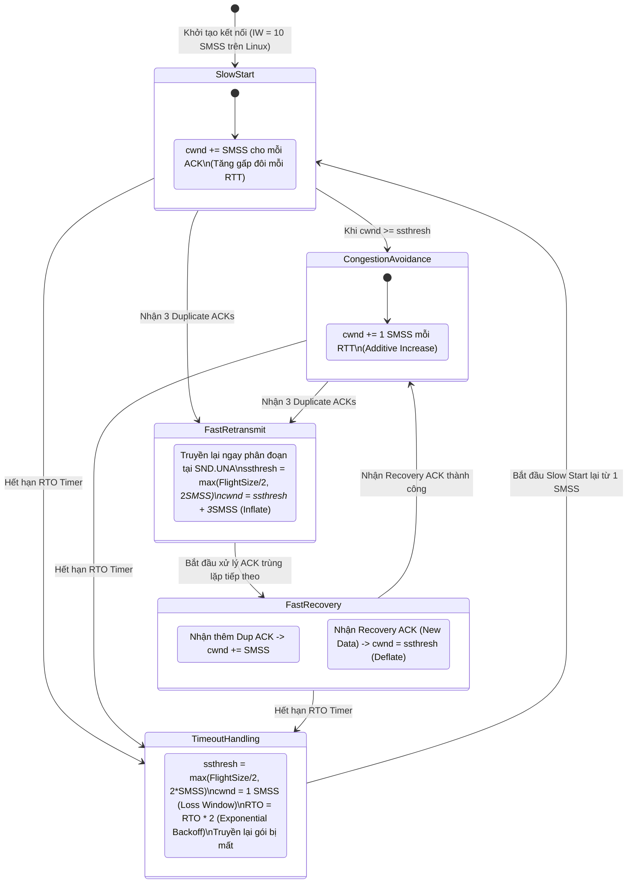

# 2_5_7 TCP Congestion Control

> **Khóa học**: Cloud DevOps Basic — Networking Core  
> **Phân nhóm**: 2 Domain 2 - Computer Networking Core Fundamentals › 2_5 Transport Layer TCP and UDP  
> **Chủ đề**: Kiểm soát tắc nghẽn TCP (RFC 5681, RFC 6928, RFC 6298): Congestion Window (cwnd) vs Flow Control (rwnd), 4 trạng thái cốt lõi (Slow Start, Congestion Avoidance AIMD, Fast Retransmit, Fast Recovery), cơ chế tính RTO & Exponential Backoff, thuật toán CUBIC vs BBR và chẩn đoán Linux với ss  
> **Trạng thái**: Draft (WRITE-CDB-2_5_7, 14-11-2026)  
> **Checklist đối chiếu**: [2_5_7](<../../../CHECKLIST.md#domain-2-computer-networking-core-fundamentals-43-items>)  

---

## 1. Khái Niệm Cốt Lõi & Bản Chất Kỹ Thuật (Core Concepts & Technical Deep Dive)

Trong kiến trúc mạng TCP/IP, **Kiểm soát tắc nghẽn (TCP Congestion Control)** là cơ chế sống còn ở tầng Giao vận (Transport Layer) nhằm ngăn chặn hiện tượng **Sụp đổ do tắc nghẽn (Congestion Collapse)** — trạng thái mà các hàng đợi tại các router trung gian bị quá tải nghiêm trọng, dẫn đến việc hàng loạt gói tin bị drop, các bên gửi ồ ạt gửi lại dữ liệu cũ, và throughput hữu ích của toàn mạng rơi tự do về gần bằng 0.

---

### 1.1 Phân Biệt Cốt Lõi: Flow Control (`rwnd`) vs Congestion Control (`cwnd`)

Nhiều kỹ sư thường nhầm lẫn giữa hai cơ chế điều tiết lưu lượng của TCP:

| Tiêu chí | Điều khiển luồng (Flow Control) | Kiểm soát tắc nghẽn (Congestion Control) |
| :--- | :--- | :--- |
| **Đối tượng bảo vệ** | **Bộ đệm của bên Nhận (Receiver Buffer)** | **Hạ tầng mạng trung gian (Routers, Switches, Links)** |
| **Biến điều phối** | `rwnd` (Receive Window / Advertised Window) | `cwnd` (Congestion Window) |
| **Vị trí tính toán** | Bên Nhận tính và thông báo qua TCP Header | Bên Gửi tự ước tính độc lập thông qua ACK & RTT |
| **Mục tiêu kỹ thuật** | Ngăn bên gửi nhanh làm tràn bộ đệm bên nhận chậm | Ngăn các bên gửi bơm quá tải năng lực của mạng viễn thông |

Căn cứ theo **RFC 5681 Section 3.1**:
- `cwnd` (Congestion Window) là giới hạn từ phía bên gửi quy định lượng dữ liệu tối đa mà bên gửi được phép truyền vào mạng trước khi nhận được gói xác nhận (ACK).
- `rwnd` (Receive Window) là giới hạn do bên nhận quảng bá quy định lượng dữ liệu chưa được xác nhận mà bộ đệm của nó có thể dung nạp.
- **Quy tắc điều phối truyền dẫn tối thượng**:
  $$\text{Effective Window} = \min(\text{cwnd}, \text{rwnd})$$
  Tại mọi thời điểm, lượng dữ liệu đang bay trên đường truyền chưa được xác nhận (**FlightSize**) của bên gửi không bao giờ được phép vượt quá giá trị nhỏ hơn giữa `cwnd` và `rwnd`.

---

### 1.2 Bốn Thuật Toán Cốt Lõi Theo Chuẩn RFC 5681

Để kiểm soát lưu lượng truyền dẫn thích ứng với trạng thái động của mạng, chuẩn **RFC 5681** quy định 4 thuật toán nền tảng:

```
                  ┌──────────────────────────────┐
                  │          Slow Start          │◄────────────────┐
                  │    (Exponential Growth)      │                 │
                  └──────────────┬───────────────┘                 │
                                 │ cwnd >= ssthresh                │
                                 ▼                                 │
                  ┌──────────────────────────────┐                 │
                  │     Congestion Avoidance     │                 │
                  │    (Linear Growth / AIMD)    │                 │
                  └──────────────┬───────────────┘                 │
                                 │                                 │
                 ┌───────────────┴───────────────┐                 │
3 Duplicate ACKs │                               │ Timeout (RTO)   │ Timeout (RTO)
                 ▼                               │                 │
  ┌──────────────────────────────┐               │                 │
  │  Fast Retransmit & Recovery  │               │                 │
  │ (Halve ssthresh, cwnd Inflate│               │                 │
  └──────────────┬───────────────┘               │                 │
                 │ Recovery ACK                  │                 │
                 └───────────────►───────────────┼─────────────────┘
                                                 │
                                                 ▼
                                  ┌──────────────────────────────┐
                                  │       Timeout Recovery       │
                                  │ (cwnd = 1 SMSS, RTO = RTO*2) │
                                  └──────────────────────────────┘
```

#### 1. Slow Start (Khởi Động Chậm) & Giá Trị Cửa Sổ Khởi Tạo (Initial Window - IW)
- **Bản chất**: Khi một kết nối TCP vừa được thiết lập xong (sau 3-way handshake), bên gửi hoàn toàn chưa biết dung lượng khả dụng của đường truyền. Slow Start được thiết kế để bên gửi nhanh chóng thăm dò (probe) băng thông của mạng mà không gây xung đột tức thì.
- **Quy chuẩn Initial Window (IW) — Chuẩn IETF RFC 5681 vs Thực tiễn Linux Kernel**:
  - **Theo chuẩn IETF Standard RFC 5681 (RFC 3390)**: Cửa sổ khởi tạo (Initial Window - IW) bị chặn trên trong khoảng từ 2 đến 4 phân đoạn tùy thuộc vào kích thước phân đoạn tối đa của bên gửi (Sender Maximum Segment Size - SMSS):
    $$\text{IW} \le \min(4 \times \text{SMSS}, \max(2 \times \text{SMSS}, 4380\text{ bytes}))$$
    - Nếu $\text{SMSS} > 2190\text{ bytes}$: $\text{IW} = 2 \times \text{SMSS}$ (tối đa 2 segments).
    - Nếu $1095\text{ bytes} < \text{SMSS} \le 2190\text{ bytes}$: $\text{IW} = 3 \times \text{SMSS}$ (tối đa 3 segments).
    - Nếu $\text{SMSS} \le 1095\text{ bytes}$: $\text{IW} = 4 \times \text{SMSS}$ (tối đa 4 segments).
    *(Với mạng Ethernet có $\text{SMSS} = 1460\text{ bytes}$, chuẩn RFC 5681 ấn định $\text{IW} = 3\text{ segments} = 4380\text{ bytes}$)*.
  - **Thực nghiệm IETF RFC 6928 & Nhân Linux Hiện Đại (Linux 3.0+)**:
    - Năm 2013, tài liệu **RFC 6928 (Experimental)** đề xuất nâng giới hạn trên của Initial Window lên **10 segments** (xấp xỉ $14600\text{ bytes}$ với $\text{SMSS} = 1460\text{ bytes}$). Điều này giúp hầu hết các tài nguyên web hiện đại (vốn thường vượt quá 4 KB) có thể truyền xong trọn vẹn ngay trong 1 chu kỳ RTT đầu tiên.
    - Nhân hệ điều hành Linux kể từ phiên bản 3.0 trở đi đã chính thức áp dụng khuyến nghị của RFC 6928 bằng cách hardcode trực tiếp trong mã nguồn hạt nhân (`include/net/tcp.h` lines 268–269):
      ```c
      /* TCP initial congestion window as per rfc6928 */
      #define TCP_INIT_CWND		10
      ```
- **Tốc độ tăng trưởng trong Slow Start**:
  - Căn cứ RFC 5681 Section 3.1: Với mỗi gói ACK nhận được xác nhận dữ liệu mới tích lũy (cumulative ACK), `cwnd` được cộng thêm tối đa **1 SMSS**.
  - Sau mỗi chu kỳ Round-Trip Time (RTT), khi toàn bộ các gói tin trong cửa sổ hiện tại được ACK, `cwnd` sẽ **tăng gấp đôi (Exponential Growth - Tăng trưởng theo hàm mũ)**:
    $$10 \rightarrow 20 \rightarrow 40 \rightarrow 80\text{ segments (theo Linux)}$$
  - Slow Start kết thúc khi `cwnd` vượt quá hoặc chạm ngưỡng **`ssthresh` (Slow Start Threshold)**, hoặc khi xảy ra mất gói/tắc nghẽn.

---

#### 2. Congestion Avoidance (Tránh Tắc Nghẽn — Additive Increase)
- **Bản chất**: Khi `cwnd >= ssthresh`, TCP nhận biết rằng luồng dữ liệu đang tiến gần tới ngưỡng dung lượng vật lý của tuyến mạng. Nếu tiếp tục nhân đôi, hàng đợi của router sẽ tràn ngay lập tức. TCP chuyển sang chế độ tránh tắc nghẽn thận trọng.
- **Tốc độ tăng trưởng**:
  - Căn cứ RFC 5681 Section 3.1: Trong Congestion Avoidance, `cwnd` tăng xấp xỉ **1 phân đoạn kích thước đầy đủ (1 SMSS) cho mỗi chu kỳ RTT**.
  - Công thức cập nhật gần đúng cho mỗi ACK hợp lệ:
    $$\text{cwnd} \leftarrow \text{cwnd} + \frac{\text{SMSS} \times \text{SMSS}}{\text{cwnd}}$$
  - Đây chính là pha **Additive Increase** (Tăng tuyến tính) trong cơ chế AIMD kinh điển. `cwnd` tiếp tục bò lên chậm rãi cho đến khi xảy ra sự cố mất gói.

---

#### 3. Fast Retransmit (Truyền Lại Nhanh)
- **Hiện tượng Duplicate ACK**: Khi bên gửi truyền các gói tin 1, 2, 3, 4, 5 nhưng gói 2 bị thất lạc, bên nhận vẫn tiếp nhận các gói 3, 4, 5. Vì TCP sử dụng Cumulative ACK (xác nhận liên tục không đứt quãng), bên nhận không thể ACK gói 3, 4, 5 mà liên tục gửi lại các gói ACK yêu cầu byte tiếp theo của gói 1 (`SND.UNA`). Các gói phản hồi lặp lại này gọi là **Duplicate ACKs**.
- **Nguyên lý 3 Duplicate ACKs (RFC 5681 Section 3.2)**:
  - Một gói tin đến muộn hoặc bị đảo thứ tự đường truyền (reordering) có thể sinh ra 1 hoặc 2 Duplicate ACKs.
  - Tuy nhiên, sự xuất hiện của **3 gói Duplicate ACKs liên tiếp** (tổng cộng 4 ACKs có cùng Acknowledgment Number, không có ACK trung gian nào làm dịch chuyển `SND.UNA`) là chỉ dấu tin cậy chứng minh một phân đoạn đã thực sự bị mất.
  - Sau khi nhận đủ 3 Duplicate ACKs, TCP lập tức kích hoạt **Fast Retransmit**: truyền lại phân đoạn bị mất ngay lập tức mà **hoàn toàn không cần chờ bộ định thời Retransmission Timer (RTO) đếm hết giờ**.

---

#### 4. Fast Recovery (Phục Hồi Nhanh)
- **Bản chất**: Việc bên gửi vẫn liên tiếp nhận được Duplicate ACKs chứng tỏ các gói tin phía sau vẫn đang đi qua mạng và tới được đích (mạng chỉ bị nghẽn nhẹ hoặc mất gói cục bộ chứ không bị đứt gãy hoàn toàn). Vì vậy, TCP không hạ `cwnd` về 1 mà kích hoạt **Fast Recovery** (RFC 5681 Section 3.2):
  1. Khi nhận Duplicate ACK thứ 3:
     $$\text{ssthresh} = \max\left(\frac{\text{FlightSize}}{2}, 2 \times \text{SMSS}\right)$$
  2. Truyền lại phân đoạn bị mất tại `SND.UNA`.
  3. **Thổi phồng cửa sổ (Window Inflation)**: Tạm thời đặt:
     $$\text{cwnd} = \text{ssthresh} + 3 \times \text{SMSS}$$
     (Cộng thêm 3 SMSS đại diện cho 3 phân đoạn đã kích hoạt 3 Duplicate ACKs và hiện đã rời khỏi mạng, nằm trong bộ đệm nhận).
  4. Mỗi Duplicate ACK tiếp theo nhận được, tiếp tục tăng $\text{cwnd} \leftarrow \text{cwnd} + \text{SMSS}$.
  5. **Làm xẹp cửa sổ (Window Deflation)**: Khi nhận được gói ACK mới xác nhận dữ liệu chưa từng được ACK trước đó (Recovery ACK), TCP hạ cửa sổ trở lại:
     $$\text{cwnd} = \text{ssthresh}$$
     và tiếp tục phiên truyền dẫn ở trạng thái **Congestion Avoidance**.

---

### 1.3 Retransmission Timeout (RTO) & Exponential Backoff (RFC 6298)

Khi tắc nghẽn mạng quá trầm trọng khiến toàn bộ gói tin hoặc toàn bộ ACK đều bị rơi sạch, bên gửi không thể nhận đủ 3 Duplicate ACKs để kích hoạt Fast Retransmit. Lúc này, TCP phải dựa vào phòng tuyến cuối cùng: **Bộ định thời truyền lại (Retransmission Timer)**.

- **Tính toán RTO động (RFC 6298 Section 2)**:
  - Giá trị RTO được tính toán liên tục dựa trên RTT trung bình làm mượt (**SRTT**) và độ lệch biến thiên RTT (**RTTVAR**):
    $$\text{RTTVAR} \leftarrow (1 - \beta) \times \text{RTTVAR} + \beta \times |\text{SRTT} - R'|$$
    $$\text{SRTT} \leftarrow (1 - \alpha) \times \text{SRTT} + \alpha \times R'$$
    $$\text{RTO} = \text{SRTT} + \max(G, 4 \times \text{RTTVAR})$$
    *(với $\alpha = 1/8$, $\beta = 1/4$, $G$ là độ phân giải clock hệ thống, tối thiểu thông thường là 1 giây theo RFC 6298 Section 2.4).*
- **Xử lý khi RTO Timer hết hạn (RFC 6298 Section 5.5 & RFC 5681 Section 3.1)**:
  1. **Exponential Backoff**: Host bắt buộc phải nhân đôi giá trị RTO:
     $$\text{RTO} \leftarrow \text{RTO} \times 2$$
     (Ví dụ: $1\text{s} \rightarrow 2\text{s} \rightarrow 4\text{s} \rightarrow 8\text{s} \dots$) để giảm tải áp lực cho router trung gian.
  2. **Đặt lại cửa sổ về Loss Window (LW)**: Căn cứ RFC 5681 Section 3.1, `cwnd` bị cưỡng bức hạ sập sàn:
     $$\text{cwnd} = 1\text{ full-sized segment (1 SMSS)}$$
  3. Cập nhật `ssthresh`: $\text{ssthresh} = \max(\text{FlightSize}/2, 2 \times \text{SMSS})$.
  4. Sau khi truyền lại phân đoạn bị mất, bên gửi quay về trạng thái **Slow Start** để tăng `cwnd` từ 1 SMSS lên đến `ssthresh`.

---

### 1.4 Tổng Quan Về Thuật Toán: CUBIC vs BBR

Trên hệ điều hành Linux hiện đại:
- **CUBIC (`net.ipv4.tcp_congestion_control = cubic`)**:
  - Là thuật toán kiểm soát tắc nghẽn mặc định của nhân Linux. Cùng với nó, thuật toán kinh điển **`reno`** luôn có sẵn trong kernel.
  - CUBIC sử dụng một hàm bậc 3 của thời gian thực trôi qua kể từ lần giảm cửa sổ gần nhất ($W_{cubic}(t) = C(t - K)^3 + W_{max}$) thay vì hàm tuyến tính của Reno. Khi cách xa điểm nghẽn trước đó, CUBIC tăng cửa sổ rất nhanh; khi đến gần điểm nghẽn, nó làm phẳng tốc độ tăng để thăm dò ổn định; và nếu vượt qua điểm nghẽn mà mạng vẫn thông thoáng, nó lại bứt tốc mạnh. CUBIC rất tối ưu cho các mạng có BDP lớn (Bandwidth-Delay Product).
  - Bản chất: CUBIC vẫn là thuật toán **Loss-based** — nó chỉ nhận biết tắc nghẽn khi đã có gói tin bị đánh rơi (packet drop).
- **BBR (Bottleneck Bandwidth and RTT)**:
  - Do Google phát minh, BBR là thuật toán thuộc trường phái **Model-based**. Thay vì chờ router tràn bộ đệm và drop gói, BBR liên tục đo lường tốc độ phân phối dữ liệu tối đa (`max bandwidth`) và độ trễ khứ hồi tối thiểu (`min RTT`).
  - BBR duy trì lượng dữ liệu trên mạng xấp xỉ bằng đúng giá trị $\text{BDP} = \text{Bandwidth} \times \text{RTT}$, ngăn ngừa hiện tượng hàng đợi router bị phình to (Bufferbloat).

---

## 2. Ví Dụ Đời Sống Thực Tế Dễ Hiểu (Intuitive Real-World Analogies)

### Phép So Sánh: Trạm Điều Tiết Đèn Giao Thông Vào Tuyến Cao Tốc (Highway Ramp Metering)

Hãy hình dung mạng truyền dẫn giống như một tuyến **Đường Cao Tốc Liên Tỉnh**, bên gửi TCP là **Trạm Đèn Điều Tiết Lối Vào (Ramp Meter)**, và các router trung gian là các làn đường hẹp hoặc trạm thu phí:

```
[Trạm Điều Tiết TCP (Bên Gửi)] =====> [Làn Đường Cao Tốc (Hạ Tầng Mạng)] =====> [Đích Đến (Bên Nhận)]
         │                                      │                                       │
  (Slow Start: 1->2->4->8)                      │                                       │
  (Congestion Avoidance: +1)                    │                                       │
         │                                      │                                       │
  [Nhận 3 Cảnh Báo Xe Hỏng] ────────────────────┼────────── 3 Dup ACKs ─────────────────┤
   -> Cứu hộ ngay (Fast Retransmit)             │                                       │
   -> Giảm nửa xe, đi tiếp (Fast Recovery)      │                                       │
         │                                      │                                       │
  [Đường Tắc Cứng Hết Giờ (RTO)]                │                                       │
   -> Chặn hết, thả 1 xe dò đường (cwnd=1)      │                                       │
   -> Nhân đôi thời gian chờ (RTO * 2)          ▼                                       ▼
```

1. **Slow Start (Thăm dò mở đường bằng cấp số nhân)**:
   - Buổi sáng khi mở tuyến cao tốc, trạm điều tiết không biết phía trước đường thông thoáng hay sạt lở. Trạm không dại gì xả cùng lúc 1.000 xe vào.
   - Trạm cho 1 xe đi thăm dò. Xe tới đích và báo về: *"Đường hoàn toàn thông!"*. Lượt tiếp theo, trạm thả 2 xe. Cả 2 xe về an toàn, trạm thả tiếp 4 xe, rồi 8 xe, 16 xe. Bằng cách nhân đôi sau mỗi lượt phản hồi, trạm nhanh chóng khai thác tối đa năng lực đường chỉ trong thời gian rất ngắn.
2. **ssthresh & Congestion Avoidance (Thận trọng nhích từng bước một)**:
   - Khi lưu lượng đạt ngưỡng an toàn ước lượng `ssthresh` (ví dụ 64 xe), trạm biết rằng mặt đường sắp chạm mật độ tới hạn. Nếu tiếp tục nhân đôi lên 128 xe thì ùn tắc sẽ bùng nổ.
   - Trạm chuyển sang chế độ thận trọng: Cứ mỗi lượt xe lưu thông an toàn trở về, trạm chỉ cho phép tăng thêm đúng **1 xe duy nhất** ($64 \rightarrow 65 \rightarrow 66 \dots$). Đây chính là Additive Increase.
3. **3 Duplicate ACKs & Fast Retransmit / Fast Recovery (Va quẹt nhẹ & Xe cứu thương)**:
   - Bỗng nhiên, có 3 xe liên tiếp cùng chạy về trạm báo một thông điệp: *"Xe số 70 bị nổ lốp nằm chết máy ở km20!"* (3 Duplicate ACKs).
   - Trạm xác định chắc chắn xe số 70 gặp nạn. Trạm lập tức cử xe cứu thương chạy thẳng tới đón đầu xe số 70 (**Fast Retransmit**) mà không cần đợi hết giờ làm việc.
   - Đồng thời, vì các xe phía sau vẫn chạy về được trạm, chứng tỏ đường chưa bị phong tỏa hoàn toàn. Trạm hạ một nửa lưu lượng xe (`ssthresh = FlightSize / 2`), tiếp tục duy trì dòng xe lăn bánh chậm rãi (**Fast Recovery**) chứ không đóng đường.
4. **Hết hạn RTO Timeout & Exponential Backoff (Tắc đường tê liệt & Giới nghiêm)**:
   - Đột ngột một trận sạt lở đất xảy ra. Trạm thả 50 xe đi nhưng quá thời gian tối đa (RTO) mà **không một xe nào trở về, không có lấy một tiếng còi báo động**.
   - Trạm hiểu rằng phía trước đã xảy ra tai nạn thảm khốc làm tuyến đường tắc cứng hoàn toàn (Congestion Collapse).
   - Trạm lập tức hạ barie khẩn cấp: chỉ cho phép đúng **1 xe duy nhất chạy dò đường (`cwnd = 1 SMSS`)**, đồng thời **nhân đôi thời gian chờ (`RTO = RTO * 2`)** để các lực lượng cứu hộ phía trước có đủ thời gian dọn sạch hiện trường.

---

## 3. Kiến Trúc, Luồng Hoạt Động & Hình Ảnh Trực Quan (Architecture, Diagrams & Visual Media)

### 3.1 Sơ Đồ Máy Trạng Thái Kiểm Soát Tắc Nghẽn (TCP Congestion Control FSM)



---

### 3.2 Đồ Thị Diễn Biến Cửa Sổ cwnd Theo Thời Gian (Đồ Thị Hình Răng Cưa TCP Sawtooth)

Dưới cơ chế AIMD (Tăng cộng, Giảm nhân), kích thước `cwnd` của TCP dao động theo chu kỳ hình răng cưa đặc trưng:

```text
 Cửa sổ cwnd (Segments)
   ▲
   │                       (Điểm mất gói: 3 Dup ACKs)
 64│                                 ╭───╮
   │                                ╱     ╲  Fast Retransmit & Recovery
 48│                               ╱       ╲ (ssthresh = 32, cwnd = 32)
   │                              ╱         ╰─────────╮
 32│                     ╭───────╯                    │ ╭───────╮
   │                    ╱ Congestion Avoidance        │╱         ╲
 16│          ╭────────╯  (+1 SMSS mỗi RTT)           │           ╲
   │         ╱                                        │            ╲
  8│        ╱ Slow Start                              │             ╲ (RTO Timeout!)
  4│       ╱  (x2 mỗi RTT)                            │              ╲
  2│      ╱                                           │               │
  1│─────╯                                            │               ╰───► cwnd = 1
───┴──────────────────────────────────────────────────┴───────────────────┴──────────► Thời gian (RTT)
       [Khởi đầu: IW]                                [3 Dup ACKs]      [Timeout]
```

---

## 4. Code Mẫu Trực Quan Hoặc Dòng Lệnh Thực Chiến (Runnable Sample Code / CLI)

Để giám sát và chẩn đoán các thông số kiểm soát tắc nghẽn TCP trên máy chủ Linux trong môi trường Cloud DevOps, kỹ sư sử dụng công cụ cốt lõi `ss` (Socket Statistics thuộc gói `iproute2`) và giao diện cấu hình nhân qua `sysctl`.

### 4.1 Kiểm Tra và Cấu Hình Thuật Toán Tắc Nghẽn Trên Linux

Căn cứ tài liệu Linux Kernel `Documentation/networking/ip-sysctl.rst`:

```bash
# [Chính sách: Read-only / Safe] Kiểm tra thuật toán kiểm soát tắc nghẽn mặc định của hệ thống
sysctl net.ipv4.tcp_congestion_control
```
*Output mẫu thực tế*:
```text
net.ipv4.tcp_congestion_control = cubic
```

```bash
# [Chính sách: Read-only / Safe] Liệt kê các thuật toán đã được nạp và khả dụng trong nhân kernel
sysctl net.ipv4.tcp_available_congestion_control
```
*Output mẫu thực tế*:
```text
net.ipv4.tcp_available_congestion_control = reno cubic
```

---

### 4.2 Giám Sát Chi Tiết cwnd, ssthresh, RTT và RTO Bằng `ss -ti`

Căn cứ tài liệu chuẩn `man 8 ss`, cờ `-t` lọc kết nối TCP và cờ `-i` (Internal TCP Info) trích xuất toàn bộ các chỉ số nội bộ của ngăn xếp mạng:

```bash
# [Chính sách: Read-only / Production-safe] Giám sát chi tiết nội bộ TCP của các kết nối HTTPS
ss -ti '( dport = :https or sport = :https )'
```

**Phân tích output thực tế của lệnh `ss -ti`**:
```text
State      Recv-Q  Send-Q     Local Address:Port        Peer Address:Port   Process
ESTAB      0       0          192.168.1.50:48912        104.16.132.229:443   
	 cubic wscale:7,7 rto:204 rtt:4.125/0.875 ato:40 mss:1460 rcvspace:14600
	 ssthresh:32 cwnd:10 bytes_acked:15420 segs_out:15 segs_in:12
```

**Bảng giải mã các trường thông số cốt lõi**:

| Trường thông số | Giá trị thực tế | Ý nghĩa kỹ thuật chi tiết |
| :--- | :--- | :--- |
| `cubic` | `cong_alg` | Tên thuật toán kiểm soát tắc nghẽn đang điều phối kết nối này (`cubic`). |
| `cwnd:10` | `10 segments` | Kích thước hiện tại của **Congestion Window** (10 phân đoạn $\times 1460\text{B} = 14.6\text{ KB}$, đúng giá trị khởi tạo `TCP_INIT_CWND 10` theo RFC 6928). |
| `ssthresh:32` | `32 segments` | Ngưỡng **Slow Start Threshold**. Vì `cwnd (10) < ssthresh (32)`, kết nối hiện đang nằm trong pha **Slow Start** (tăng gấp đôi mỗi RTT). |
| `rtt:4.125/0.875`| `rtt / rttvar` | Độ trễ khứ hồi ước tính **SRTT là 4.125 ms**, với độ biến thiên **RTTVAR là 0.875 ms**. |
| `rto:204` | `204 ms` | Bộ định thời **Retransmission Timeout** hiện thời của kết nối (tính động từ SRTT và RTTVAR theo chuẩn RFC 6298). |
| `mss:1460` | `1460 bytes` | Kích thước phân đoạn tối đa bên gửi (**SMSS**). |

---

## 5. Cạm Bẫy Thực Tế & Thực Tiễn Sản Xuất (Production Gotchas & Best Practices)

Trong vận hành hệ thống phân tán và hạ tầng Cloud quy mô lớn, các vấn đề liên quan tới kiểm soát tắc nghẽn TCP thường biểu hiện thành những sự cố bí ẩn và nghiêm trọng:

### 1. Hiện Tượng Bufferbloat & Ảo Giác RTT Tăng Vọt (Excessive Queuing Delay)
- **Bản chất**: Trên các router, switch và gateway viễn thông, các nhà sản xuất phần cứng thường trang bị bộ đệm (buffers) dung lượng rất lớn để tránh làm rớt gói.
- **Hậu quả**: Thuật toán Loss-based như CUBIC hay Reno sẽ liên tục bơm dữ liệu cho tới khi nào xảy ra mất gói mới chịu giảm tốc. Vì bộ đệm router quá lớn, các gói tin không bị drop mà bị xếp hàng chờ (queued) hàng ngàn gói. Thời gian chờ trong hàng đợi (**Queuing Delay**) làm độ trễ RTT bị phình to khủng khiếp (từ 10ms có thể vọt lên 2.000ms). Người dùng cảm thấy mạng bị đơ, giật lag nặng nề dù băng thông đường truyền (bandwidth) vẫn đang ở mức cao.
- **Thực tiễn sản xuất**:
  - Kích hoạt các thuật toán quản lý hàng đợi chủ động (Active Queue Management - AQM) như **CoDel** (Controlled Delay) hoặc **FQ-CoDel** trên các thiết bị định tuyến trung gian.
  - Trên các dịch vụ streaming hoặc Web API nhạy cảm với độ trễ, xem xét chuyển đổi sang thuật toán kiểm soát tắc nghẽn **BBR** (Model-based) để điều tiết lưu lượng theo dung lượng ống dẫn thực tế thay vì làm đầy bộ đệm của router.

---

### 2. Sụp Đổ Đồng Bộ Toàn Cục Do Cơ Chế Tail-Drop (Global TCP Synchronization)
- **Bản chất**: Khi bộ đệm hàng đợi của một router trung gian bị đầy 100%, router buộc phải áp dụng chính sách **Tail-Drop** — loại bỏ không phân biệt toàn bộ các gói tin mới đến sau cùng của mọi luồng.
- **Hậu quả**: Hàng trăm kết nối TCP độc lập cùng đi qua router đó đều bị mất gói vào cùng một thời điểm. Tất cả các kết nối này đồng thời nhận 3 Duplicate ACKs hoặc cùng bị RTO Timeout. Hệ quả là hàng trăm kết nối **đồng loạt co cụm `cwnd` lại cùng một lúc**, sau đó lại **đồng loạt tăng dần lưu lượng theo chu kỳ AIMD**. Điều này tạo ra những cơn sóng xung kích dao động lưu lượng khổng lồ trên mạng, lúc thì làm nghẽn router, lúc lại bỏ trống đường truyền, làm suy giảm nghiêm trọng hiệu suất tổng thể của hạ tầng.
- **Thực tiễn sản xuất**:
  - Cấu hình cơ chế **Random Early Detection (RED)** hoặc **WRED** trên switch và router mạng lõi: Thiết bị sẽ chủ động drop ngẫu nhiên một vài gói tin trước khi bộ đệm bị tràn hoàn toàn. Điều này giúp các kết nối TCP giảm tốc lệch pha nhau, triệt tiêu hiện tượng đồng bộ toàn cục.

---

### 3. Nhận Định Sai Mất Gói Trên Mạng Không Dây / WiFi / Liên Kết Cloud Cross-Region
- **Bản chất**: Cả TCP Reno và CUBIC đều vận hành trên giả định nền tảng từ thập niên 1980: *"Mọi hiện tượng mất gói (packet loss) đều do tắc nghẽn mạng gây ra"*.
- **Hậu quả**:
  - Trên các đường truyền không dây (WiFi, 4G/5G) hoặc đường truyền Cloud xuyên lục địa (Cross-Region) qua cáp quang biển, một gói tin có thể bị rớt do nhiễu sóng vô tuyến ngẫu nhiên (random bit errors) hoặc suy hao vật lý, trong khi đường truyền hoàn toàn không hề bị nghẽn.
  - Thuật toán Loss-based khi phát hiện mất gói sẽ lập tức phạt kết nối bằng cách cắt giảm 50% hoặc 30% `cwnd`, khiến tốc độ truyền tải thực tế bị suy sụp nghiêm trọng mặc dù băng thông mạng còn rất dư dả.
- **Thực tiễn sản xuất**:
  - Đối với các dịch vụ phân phối nội dung toàn cầu (CDN, Edge Services), ưu tiên sử dụng giao thức **QUIC / HTTP/3** hoặc triển khai thuật toán **BBR** để tách biệt hiện tượng mất gói ngẫu nhiên với hiện tượng nghẽn mạng thực sự.

---

## 6. Câu Hỏi Củng Cố Kiến Thức (Active Recall Quiz)

<details>
<summary><b>Câu hỏi 1:</b> So sánh dung lượng dữ liệu tối đa (tính theo byte) mà một máy chủ Linux hiện đại (hạt nhân 3.0+, SMSS = 1460 bytes) có thể truyền ngay trong lượt RTT đầu tiên so với một hệ thống chỉ tuân thủ nghiêm ngặt tiêu chuẩn IETF RFC 5681 cũ.</summary>

**Đáp án:**
- **Theo tiêu chuẩn IETF RFC 5681 (RFC 3390)**:
  - Với $\text{SMSS} = 1460\text{ bytes}$ (nằm trong khoảng $1095 < \text{SMSS} \le 2190\text{ bytes}$):
    $$\text{IW} = 3 \times \text{SMSS} = 3 \times 1460 = 4380\text{ bytes (tương đương 3 segments)}$$
  - Hệ thống chỉ được phép truyền tối đa **4.380 bytes** trong chu kỳ RTT đầu tiên trước khi phải dừng lại chờ gói ACK.
- **Theo thực nghiệm RFC 6928 và nhân Linux hiện đại (Linux 3.0+)**:
  - Hạt nhân Linux hardcode hằng số `TCP_INIT_CWND 10` trong `include/net/tcp.h`:
    $$\text{IW} = 10 \times \text{SMSS} = 10 \times 1460 = 14600\text{ bytes (tương đương 10 segments, ~14.6 KB)}$$
  - Hệ thống Linux hiện đại có thể truyền ngay lập tức **14.600 bytes** trong lượt đầu tiên. Điều này giúp tải trọn vẹn phần lớn các trang web nhỏ hoặc tài nguyên REST API chỉ trong đúng 1 chu kỳ RTT thay vì phải tốn 3–4 chu kỳ RTT như thời kỳ áp dụng chuẩn RFC 5681 cũ.
</details>

<details>
<summary><b>Câu hỏi 2:</b> Phân biệt sự khác biệt căn bản trong hành vi của ngăn xếp TCP khi phát hiện mất gói qua cơ chế nhận <b>3 Duplicate ACKs</b> so với khi xảy ra <b>Hết hạn bộ định thời RTO (Retransmission Timeout)</b>. Tại sao TCP lại xử lý hai trường hợp này hoàn toàn khác nhau?</summary>

**Đáp án:**
- **Khi nhận 3 Duplicate ACKs (Fast Retransmit & Fast Recovery)**:
  - Căn cứ RFC 5681 Section 3.2: Ngưỡng $\text{ssthresh} = \max(\text{FlightSize}/2, 2 \times \text{SMSS})$.
  - Cửa sổ `cwnd` được thổi phồng tạm thời ($\text{cwnd} = \text{ssthresh} + 3 \times \text{SMSS}$) và sau đó được đặt về `ssthresh` khi nhận Recovery ACK.
  - TCP **không quay về Slow Start** mà tiếp tục duy trì phiên truyền dẫn ở trạng thái **Congestion Avoidance**.
  - *Lý do*: 3 Duplicate ACKs chứng minh rằng các phân đoạn phía sau vẫn đang thoát khỏi mạng và đến được bộ đệm của bên nhận (mạng vẫn đang truyền được dữ liệu, chỉ bị mất 1 gói đơn lẻ).
- **Khi hết hạn bộ định thời RTO (Timeout Recovery)**:
  - Căn cứ RFC 6298 & RFC 5681: Thực hiện **Exponential Backoff** ($\text{RTO} \leftarrow \text{RTO} \times 2$).
  - Cửa sổ `cwnd` bị cưỡng bức hạ sụp sàn về mức **Loss Window: `cwnd = 1 SMSS`**.
  - Ngưỡng $\text{ssthresh} = \max(\text{FlightSize}/2, 2 \times \text{SMSS})$.
  - TCP bắt buộc phải **quay trở về trạng thái Slow Start từ đầu** để tăng dần từ 1 segment lên đến `ssthresh`.
  - *Lý do*: Hết hạn RTO đồng nghĩa với việc không có bất kỳ gói tin nào qua được và không có gói ACK nào trở về. Tuyến mạng đang bị nghẽn nghiêm trọng (black hole / congestion collapse). TCP phải lập tức dừng toàn bộ luồng truyền để giải tỏa áp lực và chỉ thả 1 gói duy nhất đi thăm dò lại từ đầu.
</details>

<details>
<summary><b>Câu hỏi 3:</b> Một máy chủ backend đang duy trì phiên TCP với client và đo được kích thước cửa sổ tắc nghẽn <code>cwnd = 48 MSS</code>. Tuy nhiên, gói ACK gần nhất nhận được từ client lại thông báo cửa sổ nhận là <code>rwnd = 8 MSS</code>. Máy chủ được phép truyền tối đa bao nhiêu phân đoạn (segments) chưa được xác nhận vào mạng tại thời điểm này? Giải thích tại sao.</summary>

**Đáp án:**
- Máy chủ chỉ được phép truyền tối đa **8 phân đoạn (8 MSS)**.
- **Giải thích kỹ thuật**:
  - Căn cứ theo **RFC 5681 Section 3.1**, lượng dữ liệu tối đa được phép truyền tải vào mạng tại mọi thời điểm luôn bị ràng buộc bởi giá trị nhỏ nhất giữa cửa sổ kiểm soát tắc nghẽn và cửa sổ điều khiển luồng:
    $$\text{Transmission Limit} = \min(\text{cwnd}, \text{rwnd}) = \min(48\text{ MSS}, 8\text{ MSS}) = 8\text{ MSS}$$
  - Mặc dù hạ tầng mạng trung gian hiện tại hoàn toàn thông thoáng và có năng lực dung nạp tới 48 phân đoạn (`cwnd = 48`), nhưng bộ đệm của tiến trình nhận phía client hiện tại đang bị đầy và chỉ còn trống đủ chỗ cho đúng 8 phân đoạn (`rwnd = 8`).
  - Nếu máy chủ gửi vượt quá 8 phân đoạn, bộ đệm của client sẽ bị tràn (Buffer Overflow) và client sẽ buộc phải drop bỏ các phân đoạn dư thừa đó, gây lãng phí tài nguyên và tạo thêm tắc nghẽn giả tạo.
</details>

---

## 7. 📚 Nguồn Tài Liệu Chính Thống (Tier-1 Official References)

- [RFC 5681: TCP Congestion Control](https://www.rfc-editor.org/rfc/rfc5681.txt) - Tiêu chuẩn kỹ thuật IETF Internet Standard chính thức định nghĩa 4 thuật toán kiểm soát tắc nghẽn cốt lõi: Slow Start (Section 3.1), Congestion Avoidance (Section 3.1), Fast Retransmit (Section 3.2), Fast Recovery (Section 3.2) và công thức giới hạn Initial Window (IW).
- [RFC 6928: Increasing TCP's Initial Window](https://www.rfc-editor.org/rfc/rfc6928.txt) - Tài liệu thực nghiệm IETF Experimental đề xuất nâng trần Initial Window (IW) của TCP lên 10 segments (~14.6 KB) nhằm tối ưu hóa hiệu năng truyền tải Web.
- [RFC 6298: Computing TCP's Retransmission Timer](https://www.rfc-editor.org/rfc/rfc6298.txt) - Tiêu chuẩn kỹ thuật IETF quy định thuật toán tính toán bộ định thời truyền lại (RTO), giá trị làm mượt SRTT, biến thiên RTTVAR và cơ chế Exponential Backoff (Section 5.5).
- [Linux Kernel ip-sysctl.rst Documentation](https://www.kernel.org/doc/Documentation/networking/ip-sysctl.rst) - Tài liệu tham chiếu chính thức từ kho mã nguồn Linux Kernel về các biến hệ thống mạng: quy định thuật toán `tcp_congestion_control` và danh sách thuật toán khả dụng `tcp_available_congestion_control`.
- [man7.org ss(8) - Linux Socket Statistics Manual](https://man7.org/linux/man-pages/man8/ss.8.html) - Hướng dẫn công cụ `ss` trong gói iproute2 về cờ `-i` trích xuất thông số TCP nội bộ (`cong_alg`, `cwnd`, `ssthresh`, `rtt`, `rto`).
- [man7.org tcp(7) - Linux Programmer's Manual](https://man7.org/linux/man-pages/man7/tcp.7.html) - Hướng dẫn lập trình viên Linux về giao thức TCP và các tùy chọn cấu hình kernel.
