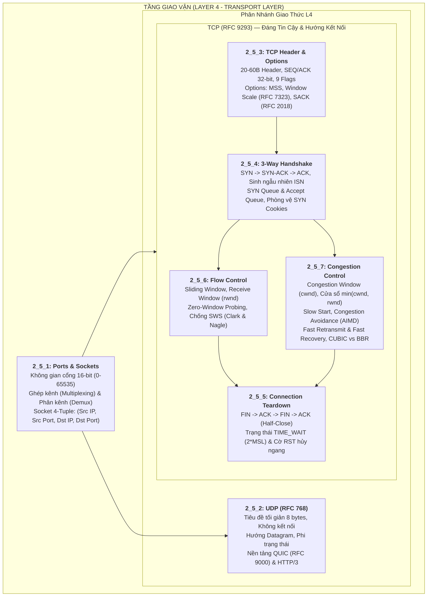

# 2_5 Transport Layer TCP and UDP

> **Khóa học**: Cloud DevOps Basic — Networking Core · **Domain**: 2 Domain 2 - Computer Networking Core Fundamentals · **Roadmap gốc**: [Computer Networking Roadmap](../../README.md#module-5-transport-layer-l4-tcp--udp)

---

## Module này dạy gì? (What & Why)

Module này cung cấp nền tảng toàn diện và chuyên sâu về Tầng Giao Vận (Layer 4 - Transport Layer) trong ngăn xếp TCP/IP, tầng giao thức giữ vai trò huyết mạch trong việc cung cấp kênh truyền thông logic từ tiến trình-tới-tiến trình (process-to-process) xuyên qua hạ tầng mạng máy tính toàn cầu. Người học bắt đầu từ cơ chế ghép kênh (Multiplexing) và phân kênh (Demultiplexing) thông qua không gian số hiệu Cổng 16-bit IANA (0–65535 gồm Well-Known, Registered, Ephemeral) và cấu trúc định danh phiên Socket 4-tuple `(Src IP, Src Port, Dst IP, Dst Port)`, đồng thời đối chiếu trực tiếp với triết lý thiết kế tối giản của giao thức UDP (RFC 768) với tiêu đề cố định 8 bytes, tính chất không kết nối, phi trạng thái và vai trò nền tảng cho các giao thức hiện đại như QUIC (RFC 9000) và HTTP/3. Tiếp theo, module mổ xẻ giải phẫu cấu trúc tiêu đề TCP (20–60 bytes) theo chuẩn RFC 9293, quy trình thiết lập kết nối 3 bước (SYN, SYN-ACK, ACK) với cơ chế sinh số thứ tự ban đầu ISN ngẫu nhiên (RFC 6528) cùng quản lý hàng đợi SYN Queue / Accept Queue và phòng vệ SYN Cookies (RFC 4987), song song với quy trình giải phóng kết nối 4 bước (FIN-ACK-FIN-ACK) với vai trò sống còn của trạng thái `TIME_WAIT` kéo dài $2 \times \text{MSL}$ để cô lập các gói tin cũ thất lạc. Cuối cùng, module làm sáng tỏ hai trụ cột điều tiết tốc độ cốt lõi của TCP: cơ chế Điều khiển Luồng điểm-tới-điểm (Flow Control) sử dụng Cửa sổ trượt (Sliding Window), Receive Window (`rwnd`), Zero-Window Probing và các giải pháp chống hội chứng Silly Window Syndrome (RFC 7323, RFC 896); cùng cơ chế Kiểm soát Tắc nghẽn toàn mạng (Congestion Control theo RFC 5681, RFC 6928, RFC 6298) qua 4 trạng thái cốt lõi (Slow Start, Congestion Avoidance AIMD, Fast Retransmit, Fast Recovery) và bước tiến hóa từ giải thuật mất mát truyền thống (CUBIC) sang giải thuật dựa trên mô hình băng thông - độ trễ (BBR).

---

## Lộ trình bài học (Lesson Path)

| Bài học | Mục tiêu cốt lõi | Checklist ID |
| :--- | :--- | :---: |
| [2_5_1 Ports and Sockets](<./2_5_1 Ports and Sockets.md>) | Cơ chế ghép kênh (Multiplexing) và phân kênh (Demultiplexing), không gian cổng 16-bit IANA (Well-known, Registered, Ephemeral), cấu trúc Socket 4-tuple và giám sát socket Linux bằng ss/lsof (RFC 9293, RFC 6335). | [2_5_1](<../../../CHECKLIST.md#25-transport-layer-l4-ports-tcp--udp>) |
| [2_5_2 User Datagram Protocol](<./2_5_2 User Datagram Protocol.md>) | Giao thức UDP (RFC 768) với tiêu đề tối giản 8 bytes, tính chất không kết nối, phi trạng thái, hướng datagram bảo toàn ranh giới thông điệp, không có bắt tay/ACK hay kiểm soát lưu lượng, và vai trò nền tảng cho QUIC (RFC 9000). | [2_5_2](<../../../CHECKLIST.md#25-transport-layer-l4-ports-tcp--udp>) |
| [2_5_3 TCP Header](<./2_5_3 TCP Header.md>) | Giải phẫu tiêu đề TCP (RFC 9293) từ 20–60 bytes, trường SEQ/ACK 32-bit cho luồng byte liên tục, 9 cờ điều khiển, trường Window 16-bit, Checksum bắt buộc và các tùy chọn TCP Options (MSS, Window Scale RFC 7323, SACK RFC 2018). | [2_5_3](<../../../CHECKLIST.md#25-transport-layer-l4-ports-tcp--udp>) |
| [2_5_4 TCP Three-Way Handshake](<./2_5_4 TCP Three-Way Handshake.md>) | Quy trình bắt tay 3 bước (SYN, SYN-ACK, ACK), sinh ISN ngẫu nhiên (RFC 6528), chuyển dịch trạng thái socket, đàm phán TCP Options, quản lý hàng đợi SYN Queue / Accept Queue và kỹ thuật phòng vệ SYN Cookies (RFC 4987). | [2_5_4](<../../../CHECKLIST.md#25-transport-layer-l4-ports-tcp--udp>) |
| [2_5_5 TCP Connection Teardown](<./2_5_5 TCP Connection Teardown.md>) | Quy trình giải phóng kết nối 4 bước (FIN-ACK-FIN-ACK), cơ chế bán đóng TCP Half-Close, chuỗi trạng thái đóng socket, vai trò sống còn của trạng thái TIME_WAIT ($2 \times \text{MSL}$) và cờ RST hủy ngang kết nối khẩn cấp. | [2_5_5](<../../../CHECKLIST.md#25-transport-layer-l4-ports-tcp--udp>) |
| [2_5_6 TCP Flow Control](<./2_5_6 TCP Flow Control.md>) | Cơ chế điều khiển luồng điểm-tới-điểm bảo vệ bộ đệm bên nhận, giải thuật Cửa sổ trượt (Sliding Window), Receive Window (`rwnd`), Zero-Window Probing với Persistence Timer, Window Scaling mở rộng trần 1 GiB (RFC 7323) và phòng tránh Silly Window Syndrome (Clark & Nagle). | [2_5_6](<../../../CHECKLIST.md#25-transport-layer-l4-ports-tcp--udp>) |
| [2_5_7 TCP Congestion Control](<./2_5_7 TCP Congestion Control.md>) | Cơ chế kiểm soát tắc nghẽn toàn mạng bảo vệ hạ tầng định tuyến, Congestion Window (`cwnd`), cửa sổ hiệu dụng $\min(\text{cwnd}, \text{rwnd})$, 4 trạng thái RFC 5681 (Slow Start, Congestion Avoidance AIMD, Fast Retransmit, Fast Recovery), cơ chế tính RTO (RFC 6298), và đối chiếu Loss-based (CUBIC) vs Model-based (BBR). | [2_5_7](<../../../CHECKLIST.md#25-transport-layer-l4-ports-tcp--udp>) |

---

## Bản đồ khái niệm (Concept Map)

Sơ đồ dưới đây thể hiện kiến trúc phân nhánh và mối quan hệ chặt chẽ giữa các thành phần ở Tầng Giao Vận (Layer 4):



---

## Ẩn dụ xuyên suốt (Module Analogy)

Toàn bộ 7 bài học trong Module 2.5 được xâu chuỗi thông qua câu chuyện thực tế về **Hệ Thống Bưu Chính & Logistics Chuyển Phát Hàng Hóa Quy Mô Lớn**:

1. **Hộp thư căn hộ chung cư cao tầng (2_5_1 - Ports and Sockets)**: Địa chỉ IP giống như số nhà của một tòa nhà chung cư (đưa thư đến đúng tòa nhà). Tuy nhiên, số hòm thư cá nhân của từng hộ gia đình chính là **Số hiệu Cổng (Port)**. Cặp định danh gồm căn hộ gửi và căn hộ nhận hình thành nên **Ổ cắm mạng (Socket 4-tuple)**, giúp ban quản lý tòa nhà phân loại và chuyển phát thư từ chính xác tới từng cư dân (tiến trình ứng dụng) mà không bao giờ bị lẫn lộn giữa hàng trăm người sống cùng một địa chỉ.
2. **Tấm bưu thiếp chuyển phát nhanh gọn (2_5_2 - User Datagram Protocol)**: Tấm bưu thiếp đơn giản chỉ ghi vài dòng tin ngắn gọn, dán tem rồi thả ngay vào hòm thư (`8-byte Header tối giản`). Người gửi không cần gọi điện hẹn trước xem đối phương có nhà hay không (`Connectionless`), không đòi hỏi ký nhận (`No ACK`), chấp nhận nếu gặp rủi ro thời tiết làm ướt hay thất lạc thì thông điệp bị bỏ qua, đổi lại tốc độ chuyển phát tức thì và thủ tục tinh gọn tối đa.
3. **Biên lai chuyển phát bưu phẩm bảo đảm (2_5_3 - TCP Header)**: Trái ngược với bưu thiếp, bưu kiện TCP được đính kèm một bìa hồ sơ bảo đảm dán dày đặc tem phiếu và chỉ mục (`20–60 bytes Header`): số thứ tự chi tiết của từng trang tài liệu đóng gói (`Sequence Number`), mã biên lai đối chiếu xác nhận đã nhận an toàn đến trang nào (`Acknowledgment Number`), các con dấu chỉ thị ưu tiên hoặc lệnh kết thúc (`Control Flags`), cùng kích thước túi chứa tối đa của khách hàng (`TCP Options` như MSS, Window Scale, SACK).
4. **Quy trình đàm thoại bộ đàm kiểm tra sóng (2_5_4 - TCP Three-Way Handshake)**: Trước khi truyền tải các hồ sơ mật quan trọng, hai nhân viên trực ban thực hiện quy trình "Radio Check" chuẩn 3 lượt qua bộ đàm: "Trạm Alpha gọi trạm Bravo, đồng bộ tần số x, nghe rõ trả lời?" (`SYN`) $\rightarrow$ "Bravo nghe rõ Alpha ở mức x+1, đồng bộ tần số của tôi là y, nghe rõ trả lời?" (`SYN-ACK`) $\rightarrow$ "Alpha nghe rõ Bravo ở mức y+1, bắt đầu truyền dữ liệu chính thức!" (`ACK`). Cả hai trạm lúc này mới chính thức mở kênh truyền tin cậy hai chiều (`ESTABLISHED`).
5. **Biên bản thanh lý hợp đồng kinh tế và Két sắt lưu trữ pháp lý (2_5_5 - TCP Connection Teardown)**: Khi một bên hoàn thành nghĩa vụ giao hàng, họ gửi văn bản xin ngừng bàn giao (`FIN`). Bên đối tác ký biên nhận xác nhận đã nhận hết hàng đợt 1 (`ACK`), kiểm tra nốt các nghĩa vụ thanh toán tồn đọng rồi gửi tiếp văn bản xin thanh lý toàn diện (`FIN`). Bên khởi xướng ký xác nhận kết thúc (`ACK`). Bên chủ động thanh lý bắt buộc phải niêm phong hồ sơ trong két sắt đủ thời hạn bảo lưu pháp lý tiêu chuẩn (`TIME_WAIT = 2 \times \text{MSL}`) để sẵn sàng đối soát nếu có giấy tờ thất lạc đến muộn hoặc phát sinh tranh chấp kiện cáo, trước khi tiêu hủy hồ sơ vĩnh viễn (`CLOSED`).
6. **Băng chuyền nhà kho tự động và Cảm biến dung lượng kệ chứa (2_5_6 - TCP Flow Control)**: Hàng hóa được chuyển vào kho qua hệ thống băng chuyền con lăn trượt liên tục (`Sliding Window`). Kho nhận liên tục phát tín hiệu cảm biến báo diện tích sàn còn trống (`Receive Window - rwnd`) về cho đốc công tại trạm cấp liệu. Khi kho đầy ắp hàng, cảm biến bật còi dừng khẩn cấp (`rwnd = 0`). Để tránh việc hai bên ngủ quên vĩnh viễn nếu còi thông báo mở kho bị hỏng trên đường truyền, đốc công bên gửi định kỳ ném một kiện hàng con để thăm dò tín hiệu (`Zero-Window Probe`). Hai bên cùng áp dụng quy chuẩn đóng gói thông minh để không vận chuyển vặt vãnh từng chiếc đinh ốc lẻ tẻ làm tắc nghẽn băng tải (`Phòng tránh Silly Window Syndrome`).
7. **Trạm đèn điều tiết lối vào cao tốc liên tỉnh (2_5_7 - TCP Congestion Control)**: Dù kho nhận có diện tích chứa khổng lồ, toàn bộ xe hàng vẫn phải lưu thông qua tuyến đường cao tốc liên tỉnh dùng chung với hàng triệu xe tải khác. Trạm đèn tín hiệu điều tiết (`Ramp Metering`) tại cửa ngõ do bên gửi kiểm soát (`Congestion Window - cwnd`). Ban đầu xe được thả vào theo cấp số nhân để thăm dò độ thông thoáng của mặt đường (`Slow Start`). Khi chạm ngưỡng cảnh báo (`ssthresh`), đèn chuyển sang chế độ nhích từng xe một cách thận trọng (`Congestion Avoidance - AIMD`). Nếu phát hiện 3 tài xế phía sau cùng báo một điểm nghẽn cục bộ (`3 Duplicate ACKs`), trạm lập tức phanh gấp một nửa tốc độ và thả xe cứu hộ khẩn cấp (`Fast Retransmit & Fast Recovery`). Nhưng nếu cao tốc tê liệt hoàn toàn đến mức mất liên lạc (`RTO Timeout`), toàn bộ lối vào lập tức bị đóng chặn, trạm hạ lưu lượng về mức 1 xe duy nhất và kéo giãn gấp đôi thời gian chờ đợi (`Exponential Backoff`).

---

## Tự kiểm tra cuối module (Module Review)

<details>
<summary><b>Câu hỏi 1:</b> Phân tích chu kỳ sống hoàn chỉnh của một kết nối TCP từ góc độ socket và hệ điều hành: Làm thế nào Socket 4-tuple cho phép một Web Server (lắng nghe cổng cố định 80 hoặc 443) phục vụ đồng thời hàng chục nghìn kết nối từ các client khác nhau? Giải thích sự khác biệt giữa hai hàng đợi SYN Queue và Accept Queue trong quá trình 3-Way Handshake, và vai trò sống còn của trạng thái TIME_WAIT ($2 \times \text{MSL}$) khi kết thúc phiên?</summary>

**Đáp án:**
Theo RFC 9293 Section 1.5, Section 3.4 và tài liệu Linux Kernel (`listen(2)`):
- **Cơ chế định danh bằng Socket 4-Tuple**:
  - Web Server lắng nghe trên một cổng cục bộ cố định (`0.0.0.0:443`). Mọi kết nối đến từ phía Client đều được hệ điều hành định danh duy nhất thông qua bộ 4-tuple: `(Source IP, Source Port, Destination IP, Destination Port)`.
  - Do mỗi Client kết nối đến có địa chỉ IP riêng hoặc được hệ điều hành cấp một cổng tạm thời ngẫu nhiên (Ephemeral Port trong dải 49152–65535 theo RFC 6335), tổ hợp 4-tuple của mỗi kết nối luôn luôn là độc nhất trong bảng phiên (TCP connection table) của kernel. Điều này cho phép một tiến trình Web Server duy nhất ghép kênh và phân kênh (Multiplexing / Demultiplexing) hàng chục nghìn kết nối đồng thời mà không hề xảy ra xung đột hay nhầm lẫn dữ liệu.
- **Phân biệt SYN Queue vs Accept Queue**:
  - **SYN Queue (Hàng đợi kết nối bán mở - Half-Open Connection Queue)**: Lưu trữ các kết nối đã nhận gói `SYN` từ Client, Server đã phản hồi `SYN-ACK` và chuyển sang trạng thái `SYN_RECEIVED`. Kết nối nằm ở đây để chờ gói tin `ACK` hoàn tất bắt tay từ Client. Kích thước hàng đợi này được điều khiển bởi tham số kernel `tcp_max_syn_backlog`. Nếu hàng đợi này bị tràn do tấn công SYN Flood, kernel kích hoạt cơ chế `tcp_syncookies` (RFC 4987) để mã hóa trạng thái kết nối vào số ISN mà không cần cấp phát bộ nhớ.
  - **Accept Queue (Hàng đợi kết nối hoàn tất - Fully Established Connection Queue)**: Lưu trữ các kết nối đã nhận thành công `ACK` từ Client, chuyển sang trạng thái `ESTABLISHED`. Kết nối nằm trong hàng đợi này để chờ tiến trình ứng dụng (như Nginx, Node.js) gọi hàm `accept(2)` để lấy File Descriptor và xử lý luồng dữ liệu. Kích thước hàng đợi này bị giới hạn bởi tham số `backlog` trong lời gọi `listen(sockfd, backlog)` và trần hệ thống `somaxconn`.
- **Vai trò sống còn của trạng thái TIME_WAIT ($2 \times \text{MSL}$)**:
  - Khi một bên chủ động đóng kết nối (Active Closer) gửi gói `ACK` cuối cùng ở bước 4 của quy trình Teardown, socket bắt buộc phải chuyển sang trạng thái `TIME_WAIT` và lưu giữ trong khoảng thời gian bằng 2 lần Thời gian tồn tại tối đa của phân đoạn mạng ($2 \times \text{MSL}$ — quy chuẩn theo RFC 9293, mặc định là 60 giây trên Linux).
  - Trạng thái này phục vụ 2 mục đích sống còn:
    1. **Bảo đảm gói tin ACK cuối cùng đến đích tin cậy**: Nếu gói `ACK` cuối cùng bị thất lạc trên đường truyền, bên bị động (Passive Closer) đang ở trạng thái `LAST_ACK` sẽ gửi lại gói `FIN`. Nhờ còn duy trì ở `TIME_WAIT`, bên chủ động có thể gửi lại `ACK` để đối phương đóng socket an toàn (`CLOSED`). Nếu không có `TIME_WAIT`, cổng đã đóng hoàn toàn sẽ phản hồi gói `RST`, gây ra lỗi bất thường cho ứng dụng phía đối tác.
    2. **Cô lập và làm tiêu biến hoàn toàn các gói tin cũ thất lạc (Stray Segments)**: Ngăn chặn hiện tượng các gói tin của kết nối cũ còn lang thang trên mạng đột ngột đến muộn sau khi kết nối mới được thiết lập lại với cùng bộ Socket 4-tuple, làm hỏng hoặc sai lệch dữ liệu của phiên kết nối mới.
</details>

<details>
<summary><b>Câu hỏi 2:</b> Cửa sổ truyền thực tế của máy gửi TCP được quyết định bởi những yếu tố nào? Phân biệt bản chất kỹ thuật giữa rwnd (Flow Control) và cwnd (Congestion Control). Giả sử máy nhận báo rwnd = 64 KB nhưng mạng xảy ra hiện tượng nghẽn khiến bên gửi tính toán cwnd = 14.6 KB, bên gửi được phép truyền tối đa bao nhiêu dữ liệu chưa được xác nhận? Khi bên nhận báo rwnd = 0, cơ chế nào ngăn chặn xảy ra bế tắc vĩnh viễn (Deadlock)?</summary>

**Đáp án:**
Theo RFC 9293 Section 3.8 và RFC 5681 Section 3:
- **Công thức quyết định cửa sổ truyền thực tế**:
  - Lượng dữ liệu tối đa chưa được xác nhận (Flight Size / Usable Window) mà máy gửi được phép bơm vào mạng được điều khiển bởi công thức:
    $$W = \min(\text{cwnd}, \text{rwnd})$$
- **Phân biệt bản chất kỹ thuật giữa rwnd và cwnd**:
  - **`rwnd` (Receive Window - Điều khiển Luồng)**: Do **Bên Nhận (Receiver)** tính toán dựa trên dung lượng bộ đệm nhận khả dụng còn trống (`rcv_buf - rcv_wnd`). Giá trị này được đóng gói vào trường `Window Size` (16 bits) trong tiêu đề TCP của gói tin phản hồi (kết hợp với `Window Scale` RFC 7323) để gửi cho bên truyền. Mục đích là bảo vệ bộ nhớ đệm của bên nhận không bị tràn ngập (bảo vệ đầu cuối - End-to-End).
  - **`cwnd` (Congestion Window - Kiểm soát Tắc nghẽn)**: Do **Bên Gửi (Sender)** tự ước tính độc lập trong nội bộ kernel dựa trên phản hồi ACK, sự thay đổi thời gian Round-Trip Time (RTT) và hiện tượng mất gói. `cwnd` không bao giờ được gửi qua tiêu đề gói tin. Mục đích là bảo vệ hạ tầng định tuyến trung gian (routers, switches, links) không bị nghẽn mạng trên quy mô toàn hệ thống (Network-Wide).
- **Trường hợp tính toán cụ thể**:
  - Khi bên nhận thông báo `rwnd = 64 KB` nhưng bên gửi ước tính `cwnd = 14.6 KB` (tương đương 10 MSS):
    $$W = \min(14.6\text{ KB}, 64\text{ KB}) = 14.6\text{ KB}$$
  - Bên gửi chỉ được phép duy trì tối đa 14.6 KB dữ liệu đã gửi nhưng chưa nhận được xác nhận (ACK). Dù bên nhận có dung lượng bộ đệm còn rất rộng, bên gửi vẫn phải hãm tốc độ để bảo vệ hạ tầng mạng trung gian đang bị quá tải.
- **Cơ chế chống bế tắc vĩnh viễn khi `rwnd = 0` (Zero Window)**:
  - Khi bên nhận thông báo `rwnd = 0` (bộ đệm nhận đã đầy), bên gửi lập tức dừng truyền dữ liệu mới và khởi động **Bộ định thời bền bỉ (Persistence Timer)**.
  - Khi Persistence Timer hết hạn, bên gửi phát một gói tin thăm dò nhỏ mang 1 byte dữ liệu cũ hoặc mới gọi là **Zero-Window Probe (ZWP)**.
  - Bên nhận nhận được gói ZWP bắt buộc phải phản hồi lại bằng một gói `ACK` mang giá trị `rwnd` hiện tại.
  - Nếu ứng dụng bên nhận đã giải phóng bộ đệm và giá trị `rwnd > 0`, quá trình truyền dữ liệu được nối lại ngay lập tức. Nếu gói tin mở lại cửa sổ (`Window Update`) bị thất lạc trên đường truyền, cơ chế ZWP định kỳ (với Exponential Backoff) sẽ liên tục giải cứu kết nối, triệt tiêu hoàn toàn nguy cơ xảy ra bế tắc vĩnh viễn (Deadlock).
</details>

<details>
<summary><b>Câu hỏi 3:</b> So sánh chuyên sâu giữa TCP và UDP về cấu trúc tiêu đề (Header Overhead), cơ chế toàn vẹn, tính chất kênh truyền và độ trễ. Tại sao các giao thức truyền tải thế hệ mới như QUIC (RFC 9000) và HTTP/3 lại quyết định xây dựng trên nền tảng UDP thay vì nâng cấp trực tiếp giao thức TCP? Những hạn chế cố hữu nào của TCP đã được QUIC giải quyết triệt để?</summary>

**Đáp án:**
Theo RFC 768, RFC 9293, RFC 8200 và RFC 9000:
- **So sánh đối đầu TCP vs UDP**:
  - *Độ phức tạp tiêu đề (Header Overhead)*: UDP sở hữu tiêu đề tối giản cố định 8 bytes gồm 4 trường (Source Port, Destination Port, Length, Checksum) không có trường tùy chọn. TCP sở hữu tiêu đề phức tạp từ 20 đến 60 bytes (chứa SEQ, ACK, Data Offset, 9 Flags, Window, Checksum, Urgent Pointer và mảng Options phong phú).
  - *Tính chất kênh truyền & Độ tin cậy*: UDP là giao thức không kết nối (Connectionless), phi trạng thái (Stateless), hướng thông điệp (Datagram boundaries preserved), không bảo đảm thứ tự và không truyền lại khi mất gói. TCP là giao thức hướng kết nối (Connection-oriented qua 3-Way Handshake), có trạng thái (Stateful), hướng luồng byte liên tục (Byte-stream), bảo đảm tin cậy và thứ tự hoàn hảo thông qua SEQ/ACK và truyền lại.
  - *Cơ chế kiểm tra toàn vẹn*: Checksum của UDP là tùy chọn trên IPv4 (có thể đặt bằng 0) nhưng bắt buộc trên IPv6 (RFC 8200 Section 8.1). Checksum của TCP luôn luôn bắt buộc trên cả IPv4 và IPv6.
  - *Độ trễ khởi tạo kết nối*: UDP truyền dữ liệu ngay lập tức với 0-RTT mà không cần thiết lập trạng thái trước. TCP mất tối thiểu 1-RTT để bắt tay 3 bước, và nếu cộng thêm TLS 1.3 sẽ mất thêm lượt trao đổi khóa trước khi truyền byte ứng dụng đầu tiên.
- **Lý do QUIC và HTTP/3 xây dựng trên nền tảng UDP**:
  1. **Khắc phục hiện tượng hóa đá tầng mạng (Kernel OS & Middlebox Ossification)**: TCP được cài đặt sâu trong nhân hệ điều hành (Kernel) và bị kiểm soát chặt chẽ bởi các thiết bị trung gian (Firewalls, NATs). Việc nâng cấp hoặc thay đổi một tùy chọn mới của TCP trên quy mô toàn cầu mất hàng thập kỷ. Bằng cách đóng gói trên nền UDP, giao thức QUIC được triển khai hoàn toàn ở không gian người dùng (User-space), cho phép các trình duyệt và máy chủ cập nhật tính năng mới nhanh chóng như một bản cập nhật phần mềm thông thường.
  2. **Triệt tiêu tắc nghẽn đầu hàng (Head-of-Line Blocking - HoL)**: Trong TCP, dữ liệu được trừu tượng hóa dưới dạng một luồng byte duy nhất. Khi nhiều request HTTP/2 được ghép kênh trên một kết nối TCP, nếu một phân đoạn gói tin bị rớt, toàn bộ các luồng dữ liệu khác đều bị kernel chặn lại chờ phân đoạn đó được truyền lại thành công. QUIC triển khai các luồng độc lập (Independent Streams) trên cùng một kết nối; việc mất gói ở luồng này hoàn toàn không làm gián đoạn việc truyền tải dữ liệu của các luồng khác.
  3. **Tối ưu hóa độ trễ bắt tay kết nối (0-RTT / 1-RTT Handshake)**: QUIC tích hợp chặt chẽ tầng truyền vận và tầng mã hóa bảo mật (TLS 1.3) vào làm một. Kết nối mới chỉ mất 1-RTT để hoàn tất cả bắt tay mạng và thỏa thuận khóa mật mã, và chỉ mất 0-RTT đối với các kết nối được tái lập với máy chủ đã biết trước (Connection Resumption).
  4. **Chuyển vùng kết nối mượt mà (Connection Migration)**: TCP định danh kết nối bằng Socket 4-tuple `(Src IP, Src Port, Dst IP, Dst Port)`. Khi người dùng chuyển từ mạng Wi-Fi sang 4G/5G, IP thay đổi khiến kết nối TCP bị đứt hoàn toàn và phải bắt tay lại từ đầu. QUIC định danh kết nối bằng một chuỗi số ngẫu nhiên gọi là Connection ID (CID) độc lập với IP và Port, giúp duy trì phiên tải dữ liệu liên tục và trong suốt.
</details>

<details>
<summary><b>Câu hỏi 4:</b> Phân tích cơ chế phát hiện và phục hồi mất gói của TCP: Sự khác biệt bản chất giữa mất gói kích hoạt Fast Retransmit (3 Duplicate ACKs) và mất gói kích hoạt RTO Timeout? Tại sao thuật toán kiểm soát tắc nghẽn truyền thống dựa trên mất gói (Loss-based như Reno, CUBIC) lại gây ra hiện tượng phình bộ đệm (Bufferbloat), và giải thuật BBR đã giải quyết bài toán này như thế nào? Nêu câu lệnh Linux để khảo sát cwnd, ssthresh, rtt thời gian thực của một socket.</summary>

**Đáp án:**
Theo RFC 5681, RFC 6298 và tài liệu Linux Kernel Socket Statistics:
- **Phân biệt Fast Retransmit vs RTO Timeout**:
  - **Fast Retransmit (Kích hoạt bởi 3 Duplicate ACKs - RFC 5681 Section 3.2)**:
    - Khi một phân đoạn dữ liệu bị mất trên đường truyền nhưng các phân đoạn tiếp theo vẫn đến được bên nhận, bên nhận sẽ liên tục gửi lại các bản tin ACK mang cùng một số thứ tự của byte bị thiếu (gọi là Duplicate ACKs).
    - Khi nhận được đủ **3 Duplicate ACKs liên tiếp** (tức là 4 gói ACK có cùng số xác nhận), bên gửi kết luận rằng mạng chỉ bị mất gói cục bộ chứ không bị nghẽn hoàn toàn vì các gói sau vẫn tới đích. Bên gửi lập tức truyền lại ngay phân đoạn bị thiếu mà **không cần chờ hết hạn bộ định thời RTO**.
    - Phản ứng tắc nghẽn: Thiết lập `ssthresh = \max(\text{FlightSize}/2, 2\text{ MSS})`, đặt `cwnd = \text{ssthresh} + 3\text{ MSS}` và bước vào trạng thái Phục hồi nhanh (Fast Recovery) để tiếp tục bơm các gói mới khi nhận được ACK trùng lặp, duy trì thông lượng mạng liên tục.
  - **RTO Timeout (Hết hạn bộ định thời truyền lại - RFC 6298)**:
    - Xảy ra khi mạng bị nghẽn nghiêm trọng, đứt cáp hoặc mất toàn bộ các gói tin cuối cùng trong chuỗi truyền, khiến bên gửi không nhận được bất kỳ ACK nào phản hồi về trước khi Retransmission Timer (RTO) đếm ngược về 0.
    - Phản ứng tắc nghẽn: Đây là tín hiệu báo động đỏ về tình trạng mạng. Bên gửi lập tức hạ `cwnd` về mức tối thiểu ban đầu là **$1\text{ MSS}$**, tính toán lại `ssthresh = \max(\text{FlightSize}/2, 2\text{ MSS})`, quay trở lại trạng thái Khởi động chậm (Slow Start) và kích hoạt cơ chế lùi theo hàm mũ **Exponential Backoff** (nhân đôi giá trị RTO: $RTO = 2 \times RTO$) cho các lần truyền lại tiếp theo để tránh bồi thêm tải vào hạ tầng mạng đang quá tải.
- **Hiện tượng phình bộ đệm (Bufferbloat) và bước đột phá của BBR**:
  - *Hạn chế của Loss-based Congestion Control (Reno, CUBIC)*: Các thuật toán truyền thống xem hiện tượng "mất gói" (Packet Loss) là tín hiệu duy nhất chỉ thị tắc nghẽn mạng. Do đó, chúng liên tục bơm tăng tốc độ truyền (`cwnd`) cho đến khi các hàng đợi bộ đệm (Buffers) trên các router trung gian bị tràn ngập hoàn toàn và bắt đầu đánh rơi gói tin. Điều này dẫn đến việc hàng đợi router luôn ở trạng thái đầy ứ, khiến độ trễ gói tin (RTT) tăng vọt từ vài chục mili-giây lên hàng trăm mili-giây mà không hề làm tăng thêm throughput (hiện tượng Bufferbloat).
  - *Giải pháp của BBR (Bottleneck Bandwidth and RTT)*: Do Google phát triển, BBR không dựa vào hiện tượng mất gói để đo lường tắc nghẽn. Thay vào đó, BBR liên tục thăm dò và ước tính hai thông số vật lý độc lập: **Băng thông khả dụng cực đại của nút thắt cổ chai ($BtlBw$)** và **Độ trễ khứ hồi tối thiểu của đường truyền ($RTprop$)**. BBR điều chỉnh tốc độ gửi sao cho lượng dữ liệu đang bay trên mạng luôn xấp xỉ đúng bằng Tích số Băng thông - Độ trễ (Bandwidth-Delay Product - $BDP = BtlBw \times RTprop$), vừa tối đa hóa thông lượng đường truyền vừa giữ cho các hàng đợi tại router luôn ở mức gần bằng 0, triệt tiêu hoàn toàn hiện tượng Bufferbloat.
- **Câu lệnh Linux kiểm tra thông số socket thời gian thực**:
  - Sử dụng tiện ích `ss` trong gói iproute2 với các cờ `-t` (TCP), `-i` (Internal TCP information), `-n` (Numeric):
    ```bash
    ss -tin
    ```
  - Hoặc lọc theo một cổng dịch vụ cụ thể:
    ```bash
    ss -tin 'sport = :443'
    ```
  - Đầu ra của câu lệnh sẽ trích xuất chi tiết các tham số quản trị kết nối của kernel:
    - `cong_alg`: Thuật toán kiểm soát tắc nghẽn đang hoạt động (ví dụ: `cubic` hoặc `bbr`).
    - `cwnd`: Kích thước cửa sổ tắc nghẽn hiện tại tính theo số lượng gói MSS (ví dụ: `cwnd:10`).
    - `ssthresh`: Ngưỡng chuyển dịch giữa Slow Start và Congestion Avoidance.
    - `rtt`: Thời gian trễ Round-Trip Time đo lường thực tế kèm biến thiên `rttvar`.
    - `wscale`: Hệ số mở rộng cửa sổ (Window Scale) đã đàm phán thành công giữa hai đầu cuối.
</details>

---

## 📚 Nguồn chính (Key References)

- [RFC 9293: Transmission Control Protocol (TCP) Specification](https://www.rfc-editor.org/rfc/rfc9293.txt) - Tiêu chuẩn kỹ thuật Internet IETF chính thức (thay thế RFC 793, RFC 1122), đặc tả chi tiết cấu trúc tiêu đề TCP, cơ chế phân kênh socket, quy trình bắt tay 3 bước, giải phóng kết nối 4 bước, máy trạng thái TCP FSM và điều khiển luồng Cửa sổ trượt.
- [RFC 768: User Datagram Protocol](https://www.rfc-editor.org/rfc/rfc768.txt) - Tiêu chuẩn Internet Standard chính thức của IETF đặc tả giao thức UDP, cấu trúc tiêu đề cố định 8 bytes, 4 trường 16-bit (Source Port, Destination Port, Length, Checksum) và triết lý truyền thông điệp không kết nối.
- [RFC 5681: TCP Congestion Control](https://www.rfc-editor.org/rfc/rfc5681.txt) - Tiêu chuẩn kỹ thuật IETF Internet Standard chính thức định nghĩa 4 thuật toán kiểm soát tắc nghẽn cốt lõi: Slow Start, Congestion Avoidance, Fast Retransmit, Fast Recovery và công thức giới hạn Initial Window (IW).
- [RFC 6928: Increasing TCP's Initial Window](https://www.rfc-editor.org/rfc/rfc6928.txt) - Tài liệu thực nghiệm IETF đề xuất nâng trần Initial Window (IW) của TCP lên 10 segments (~14.6 KB) nhằm tối ưu hóa hiệu năng truyền tải Web.
- [RFC 7323: TCP Extensions for High Performance](https://www.rfc-editor.org/rfc/rfc7323.txt) - Tiêu chuẩn IETF chính thức về các phần mở rộng TCP hiệu năng cao, định nghĩa chi tiết tùy chọn TCP Window Scale Option mở rộng trường Window Size lên tối đa 1 GiB ($S \le 14$), tùy chọn TCP Timestamps và cơ chế bảo vệ chống trùng lặp số thứ tự PAWS.
- [RFC 2018: TCP Selective Acknowledgment Options](https://www.rfc-editor.org/rfc/rfc2018.txt) - Tiêu chuẩn IETF đặc tả tùy chọn SACK (Selective Acknowledgment), cho phép bên nhận thông báo các khối dữ liệu không liền kề nhận thành công để bên gửi chỉ truyền lại đúng phần byte bị mất mát.
- [RFC 8200: Internet Protocol, Version 6 (IPv6) Specification](https://www.rfc-editor.org/rfc/rfc8200.txt) - Tiêu chuẩn Internet Standard RFC 8200 Mục 8.1 quy định bắt buộc tính toán Checksum cho UDP khi chạy trên nền IPv6 và loại bỏ gói tin UDP nếu checksum bằng 0.
- [RFC 6335: Internet Assigned Numbers Authority (IANA) Procedures for the Management of the Service Name and Transport Protocol Port Number Registry](https://www.rfc-editor.org/rfc/rfc6335.txt) - Tiêu chuẩn IETF định nghĩa không gian số nguyên 16-bit (0-65535) và quy tắc phân chia 3 dải cổng: Well-Known Ports (0–1023), Registered Ports (1024–49151), Dynamic/Private/Ephemeral Ports (49152–65535).
- [RFC 6298: Computing TCP's Retransmission Timer](https://www.rfc-editor.org/rfc/rfc6298.txt) - Tiêu chuẩn kỹ thuật IETF quy định thuật toán tính toán bộ định thời truyền lại (RTO), giá trị làm mượt SRTT, độ lệch RTTVAR và cơ chế lùi theo hàm mũ Exponential Backoff.
- [RFC 896: Congestion Control in IP/TCP Internetworks](https://www.rfc-editor.org/rfc/rfc896.txt) - Đặc tả thuật toán Nagle phía bên gửi nhằm gom các gói tin nhỏ và ngăn ngừa hội chứng Silly Window Syndrome trên mạng IP/TCP.
- [RFC 9000: QUIC: A UDP-Based Multiplexed and Secure Transport Protocol](https://www.rfc-editor.org/rfc/rfc9000.txt) - Đặc tả giao thức QUIC vận hành trên nền UDP, khắc phục hiện tượng nghẽn đầu hàng (Head-of-Line Blocking) của TCP và hỗ trợ bắt tay 0-RTT/1-RTT cho HTTP/3.
- [RFC 4987: TCP SYN Flooding Attacks and Common Mitigations](https://www.rfc-editor.org/rfc/rfc4987.txt) - Tài liệu phân tích cơ chế tấn công làm tràn hàng đợi SYN và giải pháp phòng vệ bằng kỹ thuật SYN Cookies phi trạng thái.
- [Linux Kernel Documentation: ip-sysctl.rst](https://www.kernel.org/doc/Documentation/networking/ip-sysctl.rst) - Tài liệu kỹ thuật chính thức từ kho mã nguồn Linux Kernel mô tả chi tiết các tham số hạt nhân mạng: `tcp_syncookies`, `tcp_max_syn_backlog`, vector bộ đệm `tcp_rmem` / `tcp_wmem`, `tcp_window_scaling`, `tcp_fin_timeout` và thuật toán `tcp_congestion_control`.
- [Linux Manual Pages: tcp(7)](https://man7.org/linux/man-pages/man7/tcp.7.html) - Hướng dẫn lập trình viên Linux chính thức về ngăn xếp giao thức TCP, các cờ tùy chọn socket (`TCP_NODELAY`, `TCP_CORK`), cấu trúc điều khiển và cơ chế tự động mở rộng bộ đệm.
- [Linux Manual Pages: ss(8)](https://man7.org/linux/man-pages/man8/ss.8.html) - Hướng dẫn công cụ khảo sát thống kê socket `ss` thuộc bộ công cụ iproute2 của Linux, giải thích các cờ `-t`, `-u`, `-l`, `-p`, `-n` và `-i` để trích xuất các thông số TCP nội bộ (`cwnd`, `ssthresh`, `rtt`, `rto`, `wscale`).
- [Linux Manual Pages: bind(2)](https://man7.org/linux/man-pages/man2/bind.2.html) - Hướng dẫn chính thức về lời gọi hệ thống gán tên địa chỉ IP và số hiệu cổng cho một socket.
- [Linux Manual Pages: listen(2)](https://man7.org/linux/man-pages/man2/listen.2.html) - Hướng dẫn chính thức của Linux Kernel về thiết lập socket ở chế độ thụ động lắng nghe, giải thích cơ chế quản lý hàng đợi SYN Queue và Accept Queue (tham số backlog).
- [Linux Manual Pages: lsof(8)](https://man7.org/linux/man-pages/man8/lsof.8.html) - Hướng dẫn công cụ liệt kê các tệp mở và socket mạng tương ứng với cờ `-i`.
- [IANA Service Name and Transport Protocol Port Number Registry](https://www.iana.org/assignments/service-names-port-numbers/service-names-port-numbers.xml) - Bảng danh mục phân bổ và đăng ký số hiệu cổng chính thức toàn cầu của IANA.
