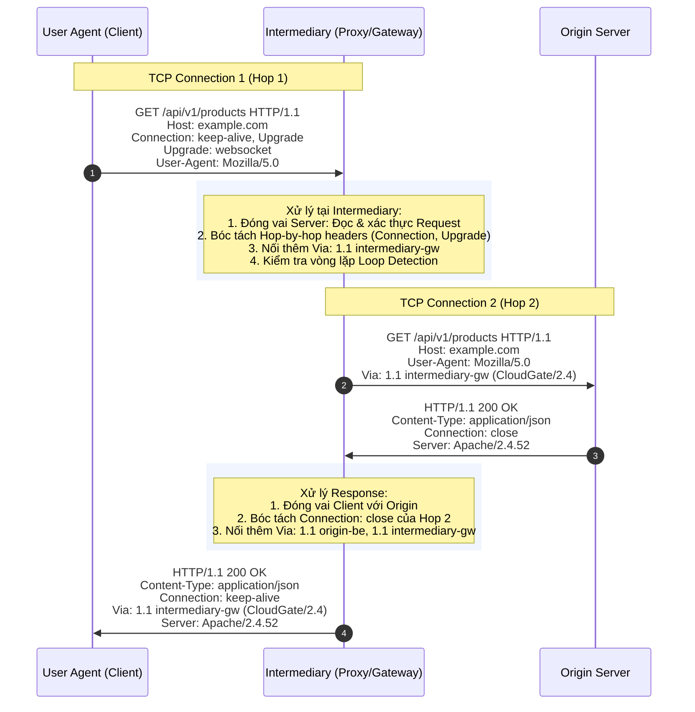

# 2_6_1 What is an Intermediary

> **Khóa học**: Cloud DevOps Basic — Networking Core  
> **Phân nhóm**: 2 Domain 2 - Computer Networking Core Fundamentals › 2_6 Intermediaries and Proxy Architecture  
> **Chủ đề**: Thực thể trung gian trong kiến trúc HTTP (RFC 9110): Phân loại proxy, gateway, tunnel, bản chất vai trò kép và phân tách header hop-by-hop vs end-to-end  
> **Trạng thái**: Draft  
> **Checklist đối chiếu**: [2_6_1](<../../../CHECKLIST.md#domain-2-computer-networking-core-fundamentals-43-items>)  

---

## 1. Khái Niệm Cốt Lõi & Bản Chất Kỹ Thuật (Core Concepts & Technical Deep Dive)

Trong kiến trúc World Wide Web hiện đại, phần lớn các luồng giao tiếp HTTP không diễn ra trực tiếp theo mô hình điểm-tới-điểm (point-to-point) đơn thuần giữa trình duyệt của người dùng (User Agent) và máy chủ gốc lưu trữ nội dung (Origin Server). Thay vào đó, dữ liệu phải đi qua một chuỗi các mắt xích mạng trung gian được gọi chung là **Intermediaries (Thực thể trung gian)**.

Theo đặc tả chuẩn hóa tối cao của HTTP trong [RFC 9110 Section 3.7](https://datatracker.ietf.org/doc/html/rfc9110#section-3.7):
> *"HTTP enables the use of intermediaries to satisfy requests through a chain of connections. There are three common forms of HTTP "intermediary": proxy, gateway, and tunnel. In some cases, a single intermediary might act as an origin server, proxy, gateway, or tunnel, switching behavior based on the nature of each request."*

```text
+-------------+      TCP Hop 1      +----------------+      TCP Hop 2      +---------------+
| User Agent  | ------------------> |  Intermediary  | ------------------> | Origin Server |
|  (Client)   | <------------------ | (Proxy/Gateway)| <------------------ |   (Server)    |
+-------------+                     +----------------+                     +---------------+
```

---

### 1.1 Phân loại 3 hình thái Intermediary chính (RFC 9110 §3.7)

Tiêu chuẩn RFC 9110 phân chia thực thể trung gian thành ba nhóm chức năng dựa trên hành vi kết nối và vị trí đại diện:

1. **Proxy (Forward Proxy)**:
   - Là thực thể trung gian được client chủ động lựa chọn (thông qua cấu hình mạng hoặc trình duyệt) để định tuyến các yêu cầu tới các tài nguyên khác nhau.
   - Thường đứng ở biên mạng lối ra (egress boundary) của mạng nội bộ hoặc client, đại diện cho client gửi yêu cầu ra ngoài Internet.
2. **Gateway (Reverse Proxy)**:
   - Là thực thể trung gian đóng vai trò như một máy chủ gốc (origin server) đối với các kết nối gửi tới từ phía ngoài (outbound connection của client), nhưng sau đó sẽ phiên dịch và chuyển tiếp yêu cầu đi vào trong (inbound) tới một hoặc nhiều máy chủ nội bộ phía sau.
   - Đứng ở biên lối vào (ingress boundary) của hạ tầng máy chủ, đại diện cho máy chủ bảo vệ và điều phối lưu lượng.
3. **Tunnel**:
   - Là thực thể trung gian hoạt động như một điểm chuyển tiếp mù (blind relay) giữa hai kết nối TCP mà không kiểm tra hay biến đổi nội dung của thông điệp (điển hình nhất là cơ chế `HTTP CONNECT` dùng để thiết lập đường hầm truyền TLS/HTTPS qua forward proxy).

Một chương trình phần mềm mạng duy nhất (như NGINX, HAProxy, Envoy, Squid) hoàn toàn có thể kiêm nhiệm và chuyển đổi linh hoạt giữa các vai trò này tùy thuộc vào ngữ cảnh cấu hình.

> [!NOTE] Phân biệt Intermediary Tầng 7 (HTTP) và Proxy Tầng 5 (SOCKS5 - RFC 1928)
> Các thực thể trung gian trong RFC 9110 là các **HTTP-aware intermediaries** hoạt động tại Tầng 7 (Application Layer), có khả năng hiểu và xử lý ngữ nghĩa HTTP (headers, status codes, methods). Ngược lại, **SOCKS5 ([RFC 1928](https://datatracker.ietf.org/doc/html/rfc1928))** là giao thức proxy hoạt động ở Tầng 5 (Session Layer) / Tầng Giao vận, chỉ thực hiện chuyển tiếp mù các luồng byte TCP/UDP thuần túy mà không đọc hay biến đổi dữ liệu ứng dụng (thường được cấu hình qua biến môi trường hệ thống như `all_proxy="socks5://127.0.0.1:1080"` thay vì `http_proxy` / `https_proxy`).

---

### 1.2 Bản chất vai trò kép: "Dual Role" của Intermediary (RFC 9110 §3.3)

Trong mô hình mạng truyền thống, các khái niệm "Client" và "Server" thường bị nhầm lẫn là các cỗ máy phần cứng cố định. Tuy nhiên, theo [RFC 9110 Section 3.3](https://datatracker.ietf.org/doc/html/rfc9110#section-3.3):
- Thuật ngữ "Client" và "Server" **chỉ đề cập đến vai trò mà chương trình đảm nhận cho một kết nối mạng cụ thể** (role for a particular connection).
- Đối với mọi Intermediary xử lý thông điệp HTTP:
  - **Trên kết nối Inbound (với User Agent)**: Intermediary đóng vai trò là một **Server** (lắng nghe kết nối TCP, nhận HTTP Request, gửi HTTP Response).
  - **Trên kết nối Outbound (với Origin Server)**: Intermediary lập tức biến đổi vai trò thành một **Client** (chủ động mở socket kết nối TCP, tạo HTTP Request mới và nhận HTTP Response từ máy chủ đích).

Do đó, một Intermediary là điểm kết thúc (termination point) của một kết nối TCP này, đồng thời là điểm bắt đầu của một kết nối TCP độc lập khác.

---

### 1.3 Giao tiếp Hop-by-Hop vs End-to-End: Quy tắc xử lý Header (RFC 9110 §7.6.1)

Vì chuỗi truyền thông HTTP bao gồm nhiều mắt xích độc lập, các tiêu đề HTTP (HTTP Headers) được phân định rõ ràng thành hai nhóm cơ bản:

1. **End-to-End Headers**:
   - Là các tiêu đề mang ngữ nghĩa dữ liệu hoặc thông tin ứng dụng cần được truyền nguyên vẹn từ User Agent ban đầu tới tận Origin Server cuối cùng (và ngược lại).
   - Ví dụ: `Host`, `User-Agent`, `Accept`, `Authorization`, `Content-Type`, `ETag`, `Cache-Control`.
2. **Hop-by-Hop Headers (Connection-Specific Fields)**:
   - Là các tiêu đề chỉ có hiệu lực duy nhất trên một mắt xích kết nối TCP trực tiếp hiện tại giữa hai node lân cận.
   - Theo quy định bắt buộc tại [RFC 9110 Section 7.6.1](https://datatracker.ietf.org/doc/html/rfc9110#section-7.6.1) và [RFC 7230 Section 6.1](https://datatracker.ietf.org/doc/html/rfc7230#section-6.1): Intermediary **BẮT BUỘC (MUST) phải phân tích trường tiêu đề `Connection` và loại bỏ toàn bộ các trường hop-by-hop trước khi chuyển tiếp (forward) thông điệp sang chặng tiếp theo**.

Danh sách các hop-by-hop header bị cấm chuyển tiếp bao gồm:
- `Connection`: Chỉ định các trường header gắn liền với kết nối hiện tại.
- `Keep-Alive`: Tùy chọn duy trì kết nối persistent cho một hop.
- `Proxy-Connection`: Biến thể cũ không chuẩn của trường Connection khi qua proxy.
- `TE`: Khả năng tiếp nhận mã hóa truyền tải của hop.
- `Transfer-Encoding`: Định dạng đóng gói truyền tải chunked (chỉ kiểm soát hop hiện tại).
- `Upgrade`: Chuyển đổi giao thức kết nối (ví dụ: nâng cấp từ HTTP/1.1 lên WebSocket).
- `Proxy-Authenticate` & `Proxy-Authorization`: Thông tin xác thực dành riêng cho node proxy trung gian.

---

### 1.4 Kiểm soát định tuyến: Chống lặp vô hạn và Header `Via` (RFC 9110 §7.6 & §7.6.3)

#### Cơ chế chống lặp (Loop Detection)
Theo [RFC 9110 Section 7.6](https://datatracker.ietf.org/doc/html/rfc9110#section-7.6):
- Một Intermediary **tuyệt đối không được chuyển tiếp một yêu cầu quay ngược trở lại chính nó** (forward a request to itself) trừ khi có cấu hình đặc biệt.
- Intermediary bắt buộc phải có cơ chế chủ động phát hiện vòng lặp vô tận (infinite request loops) để ngắt kết nối và trả về mã lỗi `508 Loop Detected` hoặc `502 Bad Gateway`.

#### Tiêu đề `Via` (RFC 9110 §7.6.3)
Để giám sát chuỗi chuyển tiếp và phát hiện vòng lặp, tiêu chuẩn quy định sử dụng header `Via`:
- Cú pháp chuẩn: `Via = #( received-protocol RWS received-by [ RWS comment ] )`
- Trong đó `received-protocol` chỉ rõ phiên bản giao thức tiếp nhận (nếu là giao thức HTTP thì tên giao thức có thể được lược bớt, chỉ ghi số phiên bản như `1.1` hoặc `2`).
- `received-by` là định danh tên máy chủ (hostname) hoặc địa chỉ IP kèm cổng của intermediary.
- Khi thông điệp đi qua mỗi intermediary, node đó sẽ nối tiếp (append) định danh của mình vào header `Via`. Nếu một intermediary nhìn thấy định danh của chính mình đã tồn tại trong danh sách `Via` của request nhận được, nó nhận biết ngay lập tức rằng gói tin đã bị lặp vòng và phải dừng chuyển tiếp.

#### Header `Max-Forwards` (RFC 9110 §7.6.2)
Đối với các phương thức chẩn đoán mạng như `TRACE` hoặc `OPTIONS`, client có thể chèn header `Max-Forwards: <n>` (với `n` là số nguyên dương). Mỗi intermediary nhận được sẽ giảm giá trị này đi 1 (`n = n - 1`). Nếu `Max-Forwards` chạm mốc `0`, intermediary không được phép forward tiếp mà phải tự mình phản hồi thông điệp ngay tại mắt xích đó.

---

### 1.5 Cổng mạng mặc định phổ biến của Intermediary

Theo danh bạ cổng dịch vụ chuẩn hóa của IANA ([Service Name and Transport Protocol Port Number Registry](https://www.iana.org/assignments/service-names-port-numbers/service-names-port-numbers.xhtml)):
- **Cổng TCP 3128**: Cổng mặc định được gán cho dịch vụ bộ nhớ đệm web proxy **Squid** (`squid 3128/tcp`).
- **Cổng TCP 8080**: Cổng chuẩn thay thế cho HTTP (`http-alt 8080/tcp Web Cache`), thường được dùng cho proxy cục bộ hoặc dev reverse proxy.
- **Cổng TCP 80 / 443**: Cổng tiêu chuẩn cho HTTP/HTTPS công khai, là cổng lắng nghe phổ biến nhất của các Ingress Gateway / Reverse Proxy sản xuất.

---

## 2. Ví Dụ Đời Sống Thực Tế Dễ Hiểu (Intuitive Real-World Analogies)

### 2.1 Bồi bàn nhà hàng: Hiện thân trực quan của "Dual Role"
Hãy tưởng tượng bạn bước vào một nhà hàng sang trọng:
- **Trước mặt bạn (Khách hàng - Client)**: Người bồi bàn chào đón bạn, đưa thực đơn, lắng nghe món ăn bạn chọn và nhận tiền tip. Lúc này, người bồi bàn đóng vai trò là **nhà hàng (Server)** đại diện tiếp nhận mọi yêu cầu.
- **Sau cánh cửa bếp (Bếp trưởng - Origin Server)**: Người bồi bàn bước vào phòng bếp, cầm danh sách món ăn và hô vang gọi bếp trưởng nấu. Lúc này, người bồi bàn lại biến thành **người đặt hàng (Client)** đối với bếp trưởng.
- Các đầu bếp trong bếp chỉ giao tiếp với người bồi bàn; họ hoàn toàn không cần biết thực khách ngồi ở bàn số mấy, mặc áo màu gì hay đi xe gì. Người bồi bàn chính là một **Intermediary** mang vai trò kép hoàn hảo.

### 2.2 Con dấu bưu bạ trên bưu kiện: Header `Via` và Chống lặp
Khi bạn gửi một thùng hàng từ Hà Nội đi Cà Mau qua đường bưu điện:
- Kiện hàng rời Bưu cục Cầu Giấy (Hà Nội), nhân viên đóng dấu: `Via: 1.1 buucuc-caugiay`.
- Kiện hàng chuyển tiếp qua Trung tâm phân loại Đà Nẵng, nhân viên đóng thêm một con dấu: `Via: 1.1 buucuc-caugiay, 1.1 tt-danang`.
- Đến Trung tâm Tân Bình (TP.HCM), con dấu tiếp tục được nối dài: `Via: 1.1 buucuc-caugiay, 1.1 tt-danang, 1.1 tt-tanbinh`.
- **Nếu xảy ra lỗi phân tuyến**: Giả sử trung tâm Tân Bình gửi nhầm kiện hàng ngược về Đà Nẵng. Khi bưu cục Đà Nẵng quét mã kiện hàng và thấy con dấu `tt-danang` đã nằm sẵn trong danh sách, nhân viên nhận diện ngay kiện hàng đang chạy vòng quanh vô tận (routing loop) và tách ra xử lý khẩn cấp thay vì tiếp tục gửi đi bừa bãi.

### 2.3 Lời dặn riêng với shipper: Hop-by-Hop vs End-to-End
- **End-to-End**: Bưu phẩm gửi cho người nhận có tên món quà, địa chỉ nhà người nhận cuối cùng và hóa đơn mua hàng bên trong. Những thông tin này phải đến tận tay người nhận nguyên vẹn.
- **Hop-by-Hop**: Khi bạn đưa gói hàng cho shipper chặng 1, bạn dặn: *"Nhớ để gói hàng vào thùng giữ nhiệt của xe máy nhé"*. Lời dặn này chỉ có giá trị duy nhất với tài xế xe máy chặng đó. Khi gói hàng được chuyển lên xe tải container đường dài chặng 2, lời dặn "để thùng giữ nhiệt xe máy" hoàn toàn vô nghĩa và phải bị hủy bỏ. Tương tự, các header như `Connection: keep-alive` hay `Transfer-Encoding: chunked` chỉ là thỏa thuận kỹ thuật giữa hai thiết bị đang nối dây với nhau.

---

## 3. Kiến Trúc, Luồng Hoạt Động & Hình Ảnh Trực Quan (Architecture, Diagrams & Visual Media)

### Sơ đồ tuần tự: Vòng đời Request qua Intermediary và Bóc tách Header

Sơ đồ dưới đây mô tả chi tiết cách thức một Intermediary tiếp nhận kết nối từ User Agent, loại bỏ các Hop-by-hop headers, bổ sung định danh `Via`, và mở kết nối mới tới Origin Server:



---

## 4. Thực Hành (Hands-on)

### 4.1 Kiểm tra thông tin Intermediary và Header `Via` bằng `curl`

Khi gửi yêu cầu qua một proxy HTTP hoặc truy vấn một dịch vụ đứng sau CDN/Reverse Proxy, cờ `-v` (verbose) của `curl` cho phép xem chi tiết toàn bộ chuỗi header hop-by-hop và trường `Via`.

#### Lệnh gửi request qua HTTP Proxy:
```bash
# Gửi request tới example.com thông qua proxy trung gian lắng nghe tại port 8080
curl -v -x http://proxy-node.internal:8080 http://example.com/index.html
```

> 💡 Minh họa output lệnh thực tế (Illustrative output)
```text
*   Trying 10.0.1.50:8080...
* Connected to proxy-node.internal (10.0.1.50) port 8080 (#0)
> GET http://example.com/index.html HTTP/1.1
> Host: example.com
> User-Agent: curl/8.5.0
> Accept: */*
> Proxy-Connection: Keep-Alive
> 
< HTTP/1.1 200 OK
< Date: Sat, 14 Nov 2026 08:15:20 GMT
< Content-Type: text/html; charset=UTF-8
< Content-Length: 1256
< Connection: keep-alive
< Via: 1.1 squid-edge-01.internal (squid/5.7), 1.1 vegur
< Server: ECS (dcb/7F3C)
< Cache-Control: max-age=604800
< 
<!doctype html>
<html>
<head>
    <title>Example Domain</title>
...
```

*Phân tích chi tiết*:
- Client gửi `GET http://example.com/index.html` tới socket của proxy `10.0.1.50:8080`.
- Response nhận về có trường `Via: 1.1 squid-edge-01.internal (squid/5.7), 1.1 vegur`. Trường này chứng minh gói tin đã đi qua hai chặng trung gian: đầu tiên là máy chủ ứng dụng `vegur`, sau đó là proxy đệm `squid-edge-01.internal` phiên bản Squid 5.7.

---

### 4.2 Kiểm tra socket và cổng mạng của các tiến trình Intermediary trên Linux

Trên hệ điều hành Linux quản trị máy chủ mạng, lệnh `ss` (Socket Statistics) giúp xác định các tiến trình proxy/intermediary đang lắng nghe trên các cổng tiêu chuẩn (3128, 8080, 80, 443).

```bash
# Kiểm tra các tiến trình TCP đang lắng nghe trên cổng 3128, 8080, 80
ss -tulpn | grep -E ":(3128|8080|80)\b"
```

> 💡 Minh họa output lệnh thực tế (Illustrative output)
```text
tcp   LISTEN 0      128          0.0.0.0:3128       0.0.0.0:*    users:(("squid",pid=1420,fd=11))
tcp   LISTEN 0      511          0.0.0.0:8080       0.0.0.0:*    users:(("nginx",pid=2890,fd=6))
tcp   LISTEN 0      511          0.0.0.0:80         0.0.0.0:*    users:(("haproxy",pid=3102,fd=4))
```

---

## 5. Cạm Bẫy Thực Tế & Thực Tiễn Sản Xuất (Production Gotchas & Best Practices)

### 5.1 Cạm bẫy rò rỉ Header Hop-by-Hop (Hop-by-Hop Header Leakage)
- **Vấn đề**: Khi tự viết module reverse proxy hoặc cấu hình gateway sơ sài, lập trình viên thường chuyển tiếp nguyên xi toàn bộ đối tượng headers của client sang backend origin.
- **Hậu quả**: Nếu client gửi `Connection: close`, và proxy vô tình chuyển header này sang backend, backend server sẽ đóng kết nối TCP ngay sau phản hồi đầu tiên. Điều này phá vỡ hoàn toàn cơ chế duy trì nhóm kết nối tái sử dụng (TCP connection pooling / keep-alive pooling) giữa proxy và backend, khiến CPU backend quá tải do liên tục phải thực hiện 3-way handshake.
- **Giải pháp**: Tuân thủ nghiêm ngặt RFC 9110 §7.6.1, luôn có bộ lọc tự động thanh lọc các header thuộc danh sách hop-by-hop trước khi mở stream kết nối tới origin.

### 5.2 Lỗi cấu hình vòng lặp chuyển tiếp (Self-Forwarding Infinite Loop)
- **Vấn đề**: Trong các kiến trúc đa tầng (Multi-tier proxy) hoặc khi cấu hình DNS split-horizon không chuẩn, proxy nhận request cho `example.com`, thực hiện phân giải DNS lại trỏ trúng chính địa chỉ IP VIP của proxy.
- **Hậu quả**: Proxy gửi request cho chính nó, tiếp tục nhận và tự gửi tiếp. Trong vài mili-giây, hàng nghìn socket TCP ảo được mở ra làm cạn kiệt tài nguyên file descriptor (`epoll` exhaustion), dẫn tới sập toàn bộ gateway.
- **Thực tiễn sản xuất**: Luôn kích hoạt cờ kiểm tra tên miền nội bộ, định cấu hình hostname định danh duy nhất trong trường `Via`, và thiết lập ngưỡng timeout chặt chẽ để phát hiện vòng lặp ngay ở chặng đầu tiên.

### 5.3 Quản trị cẩn trọng với `Max-Forwards` trong microservices
- Các công cụ chẩn đoán hoặc API Gateway khi hỗ trợ phương thức `TRACE` hoặc `OPTIONS` bắt buộc phải kiểm tra và giảm trừ trường `Max-Forwards`. Nếu không kiểm tra giá trị này, kẻ tấn công có thể lợi dụng phương thức `TRACE` để dò quét toàn bộ cấu trúc liên mạng bên trong DMZ (Cross-Site Tracing - XST).

---

## 6. Câu Hỏi Củng Cố Kiến Thức (Active Recall Quiz)

<details>
<summary><strong>Câu 1: Tại sao theo tiêu chuẩn RFC 9110, một phần mềm như NGINX hay HAProxy vừa được coi là Server vừa được coi là Client trong cùng một chu kỳ xử lý request?</strong></summary>

**Đáp án**:  
Theo [RFC 9110 Section 3.3](https://datatracker.ietf.org/doc/html/rfc9110#section-3.3), khái niệm Client và Server không gán cố định cho phần cứng mà xác định theo vai trò trên từng kết nối TCP riêng biệt:
1. Đối với User Agent đang gửi request tới, NGINX đóng vai trò là **Server** (lắng nghe socket, phân giải HTTP request, chuẩn bị phản hồi).
2. Đối với Origin Server nội bộ, NGINX phải đóng vai trò là **Client** (chủ động khởi tạo socket kết nối TCP outbound mới, đóng gói và gửi request tới origin rồi chờ nhận response).  
Do đó, thực thể trung gian sở hữu "vai trò kép" (dual role) nối liền hai chặng kết nối độc lập.
</details>

<details>
<summary><strong>Câu 2: Một kỹ sư DevOps cấu hình một forward proxy nhưng nhận thấy các yêu cầu xác thực bằng header <code>Proxy-Authorization</code> bị máy chủ ứng dụng phía sau từ chối hoặc báo lỗi bảo mật rò rỉ thông tin. Nguyên nhân kỹ thuật là gì?</strong></summary>

**Đáp án**:  
Theo [RFC 9110 Section 7.6.1](https://datatracker.ietf.org/doc/html/rfc9110#section-7.6.1) và RFC 7230 §6.1, `Proxy-Authorization` và `Proxy-Authenticate` là các trường **Hop-by-hop headers**, chỉ có giá trị xác thực giữa User Agent và chính node proxy đó. Proxy trung gian bắt buộc phải bóc tách và xóa bỏ các trường này sau khi hoàn tất xác thực tại hop của mình, tuyệt đối không được chuyển tiếp chúng tới máy chủ gốc (origin server). Việc để rò rỉ header này sang origin server vừa vi phạm chuẩn RFC vừa làm lộ thông tin đăng nhập của client vào hệ thống mạng nội bộ.
</details>

<details>
<summary><strong>Câu 3: Mục đích chính của header <code>Via</code> trong HTTP là gì và nó hỗ trợ hệ thống mạng giải quyết bài toán nguy hiểm nào?</strong></summary>

**Đáp án**:  
Theo [RFC 9110 Section 7.6.3](https://datatracker.ietf.org/doc/html/rfc9110#section-7.6.3), mục đích của header `Via` là ghi lại dấu vết các giao thức và định danh của các node trung gian mà thông điệp đã đi qua dọc theo chuỗi kết nối.  
Nó giúp giải quyết bài toán: **Phát hiện và ngăn chặn vòng lặp chuyển tiếp vô hạn (Infinite Request Loops)**. Khi một intermediary nhận được request mà thấy định danh của chính mình đã xuất hiện trong header `Via`, nó nhận diện ngay nguy cơ lặp và lập tức hủy bỏ request thay vì tiếp tục gửi tiếp, cứu hệ thống khỏi tình trạng cạn kiệt socket và tê liệt tài nguyên.
</details>

---

## 7. 📚 Nguồn Tài Liệu Chính Thống (Tier-1 Official References)

- [RFC 9110: HTTP Semantics - Section 3.7 Intermediaries](https://datatracker.ietf.org/doc/html/rfc9110#section-3.7) - Đặc tả chuẩn IETF về định nghĩa các loại thực thể trung gian (Proxy, Gateway, Tunnel).
- [RFC 9110: HTTP Semantics - Section 7.6.1 Connection](https://datatracker.ietf.org/doc/html/rfc9110#section-7.6.1) - Quy chuẩn phân tách End-to-End và Hop-by-Hop headers.
- [RFC 9110: HTTP Semantics - Section 7.6.3 Via](https://datatracker.ietf.org/doc/html/rfc9110#section-7.6.3) - Cú pháp và cơ chế hoạt động của tiêu đề theo dõi chuỗi trung gian `Via`.
- [RFC 7230: HTTP/1.1 Message Syntax and Routing - Section 6.1 Connection](https://datatracker.ietf.org/doc/html/rfc7230#section-6.1) - Danh mục chuẩn các hop-by-hop fields bắt buộc phải loại bỏ khi forward thông điệp.
- [RFC 1928: SOCKS Protocol Version 5](https://datatracker.ietf.org/doc/html/rfc1928) - Đặc tả chuẩn IETF về giao thức ủy quyền kết nối TCP/UDP tổng quát ở Tầng 5.
- [IANA Service Name and Transport Protocol Port Number Registry](https://www.iana.org/assignments/service-names-port-numbers/service-names-port-numbers.xhtml) - Danh bạ gán cổng mạng chuẩn hóa cho dịch vụ mạng và proxy (Squid port 3128, HTTP-alt port 8080).
