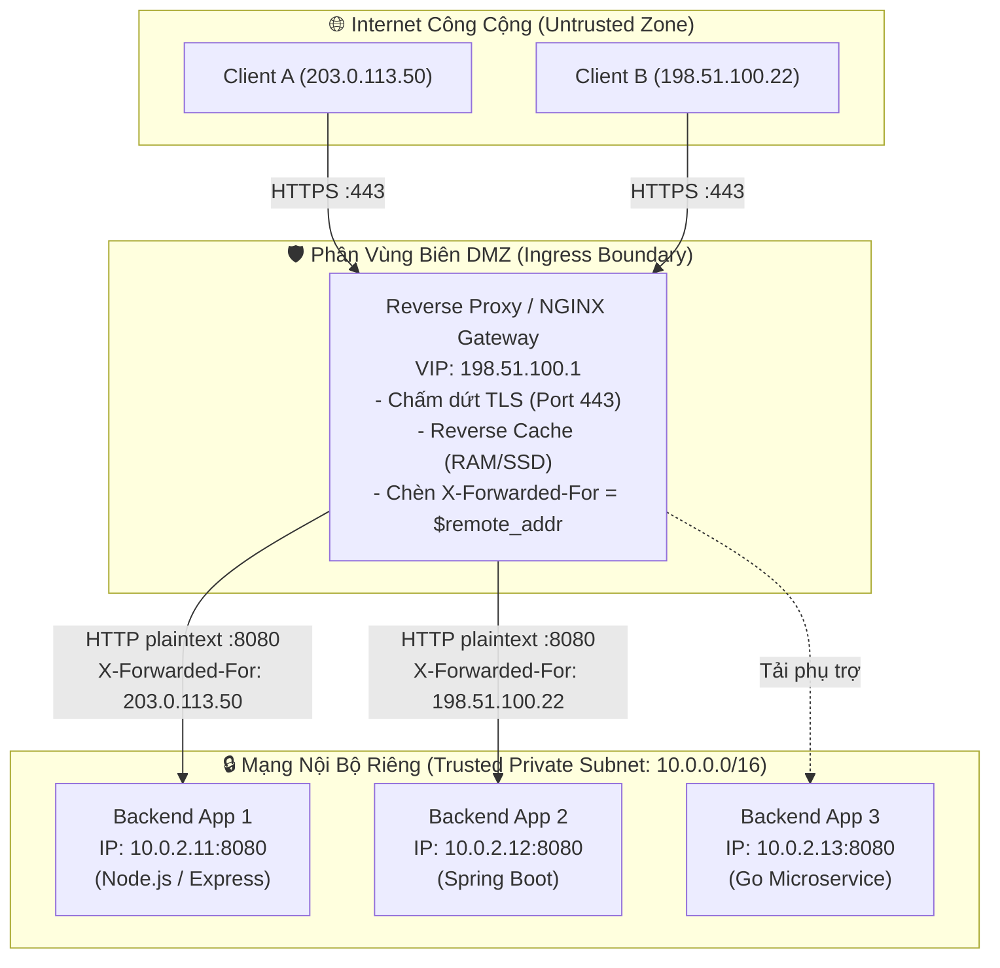
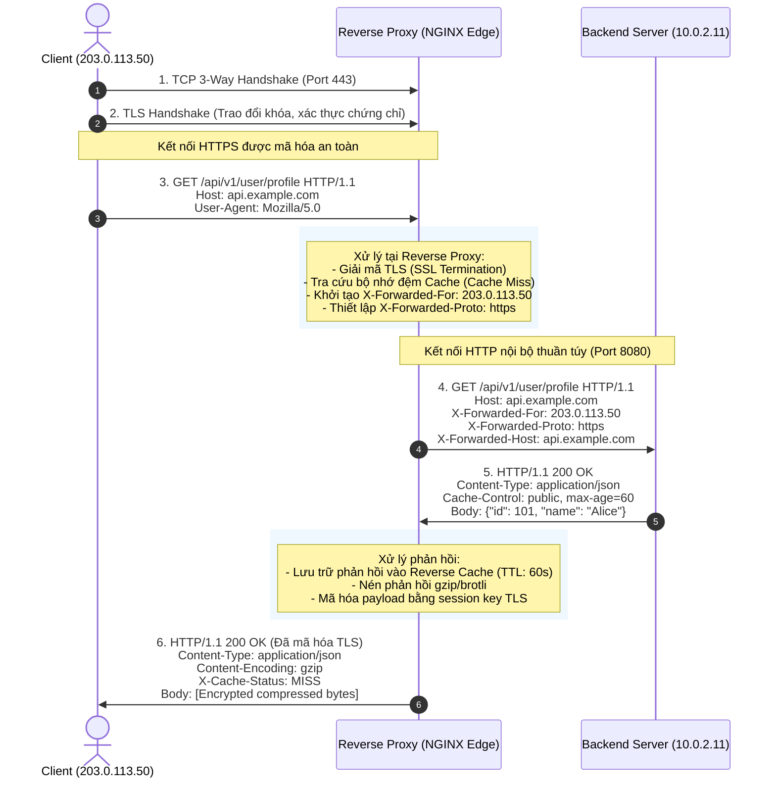

# 2_6_3 Reverse Proxy

> **Khóa học**: Cloud DevOps Basic — Networking Core  
> **Phân nhóm**: 2 Domain 2 - Computer Networking Core Fundamentals › 2_6 Intermediaries and Proxy Architecture  
> **Chủ đề**: Reverse Proxy (Gateway) trong kiến trúc Web & Cloud: Bản chất kỹ thuật, chức năng cốt lõi (TLS Termination, Caching, Load Balancing), tiêu đề chuyển tiếp (RFC 7239 vs X-Forwarded-*) và phòng chống IP Spoofing  
> **Trạng thái**: Draft  
> **Checklist đối chiếu**: [2_6_3](<../../../CHECKLIST.md#domain-2-computer-networking-core-fundamentals-43-items>)  

---

## 1. Khái Niệm Cốt Lõi & Bản Chất Kỹ Thuật (Core Concepts & Technical Deep Dive)

Trong kiến trúc triển khai dịch vụ web và hạ tầng điện toán đám mây (Cloud Infrastructure), **Reverse Proxy (Máy chủ ủy quyền ngược)**—được tiêu chuẩn mạng chính thống IETF gọi với thuật ngữ chính xác là **Gateway (Cổng)**—là một trong những thành phần hạ tầng cốt tử nhất đứng ở ranh giới giữa Internet công cộng và cụm máy chủ nội bộ.

Theo đặc tả chuẩn hóa trong [RFC 9110 Section 3.7](https://datatracker.ietf.org/doc/html/rfc9110#section-3.7):
> *"A 'gateway' (a.k.a. 'reverse proxy') is an intermediary that acts as an origin server for the outbound connection but translates received requests and forwards them inbound to another server or servers."*

Về các yêu cầu quy chuẩn đối với kết nối inbound/outbound của Gateway:
> *"All HTTP requirements applicable to an origin server also apply to the outbound communication of a gateway... an HTTP-to-HTTP gateway that wishes to interoperate with third-party HTTP servers needs to conform to user agent requirements on the gateway's inbound connection."*

```text
+-----------------------+                    +-------------------------------------------------+
|    PUBLIC INTERNET    |                    |             PRIVATE INTERNAL NETWORK            |
|                       |                    |                                                 |
|  [ Client / Browser ] |                    |  +-------------------------------------------+  |
|          |            |                    |  | Backend Server 1 (10.0.2.11:8080)        |  |
|   (Public IP:Port)    |                    |  +-------------------------------------------+  |
|          v            |                    |                                                 |
|  +-----------------+  |   Internal VPC     |  +-------------------------------------------+  |
|  |  REVERSE PROXY  |=====================> |  | Backend Server 2 (10.0.2.12:8080)        |  |
|  | (Edge / Gateway)|  |   Private Network  |  +-------------------------------------------+  |
|  +-----------------+  |                    |                                                 |
|  (VIP: 203.0.113.10)  |                    |  +-------------------------------------------+  |
|                       |                    |  | Backend Server 3 (10.0.2.13:8080)        |  |
+-----------------------+                    |  +-------------------------------------------+  |
                                             +-------------------------------------------------+
```

Khác biệt bản chất so với Forward Proxy (đại diện cho client gửi ra ngoài), **Reverse Proxy đại diện cho các máy chủ backend nhận lưu lượng đi vào**:
- **Đối với External Client**: Reverse Proxy xuất hiện như chính máy chủ gốc (origin server). Client gửi yêu cầu trực tiếp tới địa chỉ IP công khai hoặc FQDN của Reverse Proxy mà không hề biết hoặc quan tâm tới sự tồn tại của các máy chủ nội bộ bên trong.
- **Đối với Backend Origin Server**: Reverse Proxy đóng vai trò như một client gửi request tới, phân bổ tải và cô lập backend khỏi các mối nguy hại trực tiếp từ mạng mở.

---

### 1.1 Các chức năng hạ tầng cốt lõi của Reverse Proxy

Dựa trên tài liệu kỹ thuật của [MDN Web Docs](https://developer.mozilla.org/en-US/docs/Web/HTTP/Overview#proxies) và tài liệu kiến trúc [HAProxy](https://www.haproxy.com/documentation/):

1. **Bảo vệ nguồn gốc (Origin Shielding & Security)**:
   - Che giấu hoàn toàn địa chỉ IP riêng ([RFC 1918](https://datatracker.ietf.org/doc/html/rfc1918): `10.0.0.0/8`, `172.16.0.0/12`, `192.168.0.0/16`), cấu trúc liên mạng, hệ điều hành và số lượng máy chủ backend.
   - Hoạt động như một "bức tường lửa ứng dụng" ngăn chặn các cuộc quét cổng (port scan) và tấn công trực diện vào backend.
2. **Chấm dứt mã hóa SSL/TLS (TLS Termination / SSL Offloading)**:
   - Quá trình bắt tay mật mã TLS (TLS Handshake, trao đổi khóa bất đối xứng RSA/ECDSA) tiêu tốn rất nhiều chu kỳ CPU tính toán. Reverse proxy đứng ở biên mạng thực hiện toàn bộ quá trình mã hóa/giải mã TLS với client.
   - Giao tiếp giữa Reverse Proxy và các Backend Server bên trong mạng riêng nội bộ (Private Subnet) có thể được truyền tải dưới dạng HTTP thuần túy hoặc TLS mã hóa nhẹ (mTLS), giải phóng năng lực xử lý CPU của backend để tập trung 100% vào logic nghiệp vụ ứng dụng.
3. **Cân bằng tải (Load Balancing)**:
   - Tiếp nhận hàng trăm nghìn kết nối đồng thời từ người dùng và phân bổ thông minh tới một nhóm các máy chủ backend (upstream pool) thông qua các thuật toán: Round Robin (xoay vòng), Least Connections (ưu tiên máy chủ ít kết nối nhất), hoặc IP Hash.
4. **Bộ nhớ đệm ngược (Reverse Caching & Web Acceleration)**:
   - Lưu trữ các tệp tĩnh (HTML, CSS, JavaScript, hình ảnh) hoặc các phản hồi API có thể tái sử dụng vào bộ nhớ RAM hoặc SSD tốc độ cao.
   - Khi có request tiếp theo cho cùng một tài nguyên, reverse proxy tự phục vụ ngay lập tức từ bộ nhớ đệm (Cache Hit) với độ trễ cực thấp (< 2ms) mà không cần chuyển tiếp yêu cầu tới backend server.
5. **Nén phản hồi (Response Compression)**:
   - Nén các phản hồi dạng văn bản (JSON, HTML, XML) bằng các giải thuật nén hiệu năng cao như Gzip hoặc Brotli tại biên trước khi gửi qua mạng WAN tới người dùng, giúp tiết kiệm băng thông và tăng tốc độ tải trang.
6. **Chuẩn hóa kết nối TCP và chống tấn công DoS/DDoS (TCP Normalizer)**:
   - Reverse proxy đóng vai trò bộ đệm hấp thụ các cuộc tấn công kết nối chậm như Slowloris hay SYN Flood. Proxy chỉ chuyển tiếp request sang backend khi và chỉ khi nó đã tiếp nhận đầy đủ toàn bộ HTTP request header và body từ phía client.

---

### 1.2 Mất mát danh tính Client (Client Identity Loss) và Các Header chuyển tiếp

Khi Reverse Proxy tiếp nhận một kết nối TCP từ Client và mở một kết nối TCP mới tới Backend Server:
- Kết nối socket giữa Proxy và Backend là kết nối nội bộ.
- Do đó, biến môi trường socket lưu trữ địa chỉ IP từ xa của backend (ví dụ `$remote_addr` trong NGINX hoặc `request.getRemoteAddr()` trong Java/Spring) **chỉ chứa địa chỉ IP mạng nội bộ của chính Reverse Proxy** (ví dụ `10.0.1.5`), thay vì địa chỉ IP thực tế của người dùng ngoài Internet.

Để khôi phục và bảo toàn danh tính nguyên bản của người dùng cho mục đích kiểm toán (audit log), định vị địa lý (GeoIP), giới hạn tần suất (Rate Limiting), và bảo mật, Reverse proxy bắt buộc phải bổ sung các trường tiêu đề chuyển tiếp (Forwarding Headers) vào request trước khi gửi tới backend.

#### Tiêu đề chuẩn hóa IETF: Header `Forwarded` ([RFC 7239](https://datatracker.ietf.org/doc/html/rfc7239))
Tiêu chuẩn IETF RFC 7239 chính thức định nghĩa một tiêu đề duy nhất tổng hợp đầy đủ các tham số định danh:
```http
Forwarded: for=198.51.100.17;proto=https;host=api.example.com;by=203.0.113.10
```
- `for`: Địa chỉ IP hoặc định danh của client khởi tạo request.
- `proto`: Giao thức mạng nguyên bản mà client đã sử dụng để kết nối tới biên (`http` hoặc `https`).
- `host`: Giá trị của tiêu đề `Host` ban đầu mà client đã yêu cầu.
- `by`: Định danh hoặc địa chỉ IP của chính reverse proxy đã tiếp nhận kết nối.
- *Lưu ý kỹ thuật đặc biệt*: Nếu giá trị địa chỉ IP là IPv6, tiêu chuẩn [RFC 7239 Section 4](https://datatracker.ietf.org/doc/html/rfc7239#section-4) bắt buộc địa chỉ IPv6 phải được đặt trong dấu ngoặc vuông và bao quanh bởi dấu ngoặc kép: `for="[2001:db8:cafe::17]"`.

#### Nhóm tiêu đề quy ước thực tế (De-facto Standard Headers)
Trước khi RFC 7239 ra đời, ngành công nghiệp web đã áp dụng rộng rãi nhóm tiêu đề tiền tố `X-Forwarded-*`:
- **`X-Forwarded-For` (XFF)**: Danh sách địa chỉ IP được phân tách bởi dấu phẩy ghi lại hành trình của request qua các proxy:
  ```http
  X-Forwarded-For: <client-ip>, <proxy1-ip>, <proxy2-ip>
  ```
- **`X-Forwarded-Proto`**: Xác định giao thức mà client kết nối tới proxy (`http` hoặc `https`). Giúp backend nhận biết request gốc là an toàn (secure) dù giao tiếp nội bộ giữa proxy và backend là HTTP thông thường.
- **`X-Forwarded-Host`**: Lưu trữ giá trị `Host` gốc của client (ví dụ `shop.example.com`).
- **`X-Forwarded-Port`**: Cổng kết nối ban đầu của client (ví dụ `443` cho HTTPS).

---

### 1.3 Hiểm họa giả mạo địa chỉ IP (IP Spoofing Vulnerability) và Chiến lược Phòng vệ

Theo cảnh báo bảo mật từ [MDN Web Docs: X-Forwarded-For Security Concerns](https://developer.mozilla.org/en-US/docs/Web/HTTP/Headers/X-Forwarded-For#security_and_privacy_concerns):
- Vì HTTP Header là chuỗi văn bản do client gửi lên, một kẻ tấn công ngoài Internet hoàn toàn có thể tự đính kèm header giả mạo vào request trước khi gửi đi:
  ```http
  GET /admin/dashboard HTTP/1.1
  Host: example.com
  X-Forwarded-For: 127.0.0.1, 10.0.0.1
  ```
- **Nguy cơ**: Nếu Reverse Proxy ở tầng biên (Edge Proxy) được cấu hình một cách ngây thơ bằng cách chỉ đơn thuần nối tiếp (append) IP thực của client vào cuối chuỗi header có sẵn (`proxy_set_header X-Forwarded-For "$http_x_forwarded_for, $remote_addr";`), backend nhận được:
  ```http
  X-Forwarded-For: 127.0.0.1, 10.0.0.1, 203.0.113.99
  ```
- Nếu ứng dụng backend hoặc hệ thống xác thực (như lọc IP whitelist để vào trang quản trị) đọc địa chỉ IP đầu tiên bên trái (**leftmost IP**), kẻ tấn công sẽ vượt qua vòng bảo vệ danh tính vì hệ thống tin rằng request xuất phát từ `127.0.0.1` (localhost)!

#### Chiến lược phòng vệ sản xuất (Production Hardening):
1. **Ghi đè tuyệt đối tại Edge Ingress Proxy**:
   Tại mắt xích proxy đầu tiên tiếp xúc với Internet công cộng (vùng không tin cậy), bắt buộc phải **xóa bỏ hoàn toàn giá trị `X-Forwarded-For` do client gửi lên** và khởi tạo header mới với duy nhất địa chỉ IP socket thực tế của client:
   ```nginx
   # Tại Edge Proxy công khai (Public Ingress)
   proxy_set_header X-Forwarded-For $remote_addr;
   ```
2. **Khai báo Proxy tin cậy (Trusted Proxies / Real IP Module)**:
   Nếu hệ thống có nhiều lớp proxy (ví dụ: Cloudflare / AWS CloudFront -> NGINX Ingress -> Backend), backend hoặc proxy lớp trong chỉ được phép tin cậy các proxy nằm trong danh sách IP tin cậy (Trusted IP whitelist), và phân tích chuỗi IP từ **phải sang trái (rightmost to leftmost)**, loại bỏ dần các IP thuộc danh sách proxy tin cậy cho tới khi gặp IP đầu tiên không nằm trong whitelist.

---

## 2. Ví Dụ Đời Sống Thực Tế Dễ Hiểu (Intuitive Real-World Analogies)

### 2.1 Quầy lễ tân kiêm an ninh tại sảnh tòa nhà tập đoàn lớn
Hãy hình dung trụ sở làm việc của một tập đoàn ngân hàng lớn với hàng trăm phòng ban:
- **Khách hàng đến giao dịch (Client)**: Bạn bước qua cửa kính vào sảnh tầng 1. Điểm duy nhất bạn nhìn thấy và được phép tiếp cận là **Quầy lễ tân trung tâm (Reverse Proxy)**. Bạn không được phép tự ý đi thang máy lên các tầng, và bạn hoàn toàn không biết phòng giám đốc hay máy chủ thanh toán đặt ở tầng nào (**Origin Shielding**).
- **Cởi bỏ áo khoác cồng kềnh (TLS Termination)**: Bên ngoài trời mưa tuyết lạnh giá, bạn mặc áo khoác dày cộp và đeo ba lô nặng. Khi đến quầy lễ tân, nhân viên an ninh kiểm tra giấy tờ, quét máy X-quang và nhận giữ áo khoác cho bạn. Sau khi qua cửa an ninh, bạn chỉ cần mang tài liệu mỏng nhẹ vào trong. Reverse Proxy cũng làm điều tương tự: nó tháo gỡ lớp vỏ mã hóa TLS phức tạp ngay tại sảnh, chuyển dữ liệu nhẹ nhàng vào mạng nội bộ.
- **Điều phối khách hàng (Load Balancing)**: Có 10 chuyên viên tài chính ngồi ở các quầy bên trong. Lễ tân quan sát quầy nào đang trống hoặc có ít người đợi nhất để hướng dẫn bạn vào đúng bàn đó.
- **Tài liệu có sẵn (Reverse Caching)**: Nếu bạn chỉ đến xin mẫu biểu mở thẻ tiết kiệm, lễ tân lấy ngay tờ biểu mẫu có sẵn trong ngăn kéo đưa cho bạn trong 2 giây (**Cache Hit**), bạn nhận được tài liệu ngay lập tức mà không cần làm phiền tới các chuyên viên ở các phòng bên trong.
- **Kẹp thẻ tên khách hàng (`X-Forwarded-For`)**: Khi chuyển hồ sơ của bạn vào phòng nghiệp vụ, lễ tân dán một tấm thẻ định danh: *"Khách hàng Nguyễn Văn A, CMND số 012345678"*. Dù hồ sơ do nhân viên lễ tân mang vào, người ngồi trong phòng nghiệp vụ vẫn biết chính xác ai là người gửi yêu cầu.
- **Xử lý kẻ gian mạo danh (Chống IP Spoofing)**: Nếu một kẻ lạ mặt tự dán tấm biển tự in chữ "Tôi là Cảnh sát trưởng" lên ngực áo, lễ tân chuyên nghiệp sẽ lập tức bóc bỏ tấm biển tự chế đó, yêu cầu xuất trình thẻ ngành hợp lệ và chỉ ghi nhận thông tin sau khi xác minh danh tính thực tế.

---

## 3. Kiến Trúc, Luồng Hoạt Động & Hình Ảnh Trực Quan (Architecture, Diagrams & Visual Media)

### 3.1 Sơ đồ kiến trúc phân vùng DMZ và Reverse Proxy



---

### 3.2 Sơ đồ tuần tự: Vòng đời chuyển tiếp Request, SSL Offloading và Caching



---

## 4. Thực Hành (Hands-on)

### 4.1 Cấu hình chuẩn mực NGINX Reverse Proxy với bộ nhớ đệm và bảo vệ IP

Tệp cấu hình NGINX chuẩn mực triển khai Reverse Proxy, bao gồm chấm dứt SSL, định tuyến tải tới cụm backend upstream, thiết lập bộ nhớ đệm proxy, và thiết lập các header chuyển tiếp an toàn theo tài liệu [NGINX ngx_http_proxy_module](https://nginx.org/en/docs/http/ngx_http_proxy_module.html):

```nginx
# Cấu hình vùng đệm lưu trữ bộ nhớ đệm trên đĩa: kích thước key zone 10MB, lưu tối đa 10GB
proxy_cache_path /var/cache/nginx levels=1:2 keys_zone=API_CACHE:10m max_size=10g inactive=60m use_temp_path=off;

# Định nghĩa cụm máy chủ nội bộ (Upstream Pool)
upstream backend_cluster {
    zone backend_cluster 64k;
    server 10.0.2.11:8080 max_fails=3 fail_timeout=10s;
    server 10.0.2.12:8080 max_fails=3 fail_timeout=10s;
    keepalive 32; # Duy trì nhóm kết nối keep-alive tới backend
}

server {
    listen 80;
    server_name api.example.com;
    # Chuyển hướng toàn bộ lưu lượng HTTP sang HTTPS
    return 301 https://$host$request_uri;
}

server {
    listen 443 ssl http2;
    server_name api.example.com;

    # SSL Termination Configuration
    ssl_certificate /etc/ssl/certs/example.crt;
    ssl_certificate_key /etc/ssl/private/example.key;
    ssl_protocols TLSv1.2 TLSv1.3;
    ssl_ciphers HIGH:!aNULL:!MD5;

    location / {
        # Định tuyến yêu cầu tới cụm upstream
        proxy_pass http://backend_cluster;

        # Thiết lập phiên bản HTTP cho kết nối backend
        proxy_http_version 1.1;
        proxy_set_header Connection ""; # Cho phép tái sử dụng keepalive socket

        # === BẢO VỆ DANH TÍNH CLIENT & PHÒNG CHỐNG IP SPOOFING ===
        # Tại Edge Proxy: Gán trực tiếp IP socket thực tế của client, không cộng dồn header giả mạo
        proxy_set_header X-Forwarded-For $remote_addr;
        proxy_set_header X-Forwarded-Proto $scheme;
        proxy_set_header X-Forwarded-Host $host;
        proxy_set_header X-Forwarded-Port $server_port;

        # Tiêu đề chuẩn hóa IETF RFC 7239
        proxy_set_header Forwarded "for=$remote_addr;proto=$scheme;host=$host";

        # === BỘ ĐỆM PHẢN HỒI (REVERSE BUFFERING & CACHING) ===
        proxy_buffering on;
        proxy_buffer_size 4k;
        proxy_buffers 8 16k;

        proxy_cache API_CACHE;
        proxy_cache_valid 200 302 10m;
        proxy_cache_valid 404      1m;
        proxy_cache_use_stale error timeout updating http_500 http_502 http_503 http_504;

        # Bổ sung header kiểm tra trạng thái Cache trong response gửi cho client
        add_header X-Cache-Status $upstream_cache_status always;
    }
}
```

---

### 4.2 Kiểm tra hoạt động của Reverse Proxy bằng `curl`

Gửi truy vấn kiểm tra HTTP Header trả về từ Reverse Proxy nhằm xác minh việc ẩn giấu máy chủ nguồn, chứng thực giao thức chuyển tiếp và trạng thái Cache.

```bash
# Gửi request HTTP HEAD tới Reverse Proxy, hiển thị response header chi tiết
curl -I -H "Host: api.example.com" https://api.example.com/api/v1/status
```

> 💡 Minh họa output lệnh thực tế (Illustrative output)
```text
HTTP/2 200 
server: nginx
date: Sat, 14 Nov 2026 08:25:40 GMT
content-type: application/json; charset=utf-8
content-length: 42
cache-control: public, max-age=600
x-cache-status: HIT
strict-transport-security: max-age=31536000; includeSubDomains
```

*Phân tích phản hồi*:
- Header `server: nginx` đại diện chung ở biên, hoàn toàn không để lộ thông tin máy chủ backend bên trong (như Tomcat, Kestrel, hay Puma).
- Header `x-cache-status: HIT` khẳng định phản hồi được phục vụ trực tiếp từ bộ nhớ đệm của Reverse Proxy với độ trễ tối thiểu, backend không tốn tài nguyên thực thi.

---

## 5. Cạm Bẫy Thực Tế & Thực Tiễn Sản Xuất (Production Gotchas & Best Practices)

### 5.1 Cạm bẫy vòng lặp chuyển hướng bất tận (Redirect Loop / Mixed Content)
- **Vấn đề**: Reverse Proxy tiếp nhận HTTPS từ Client, giải mã TLS và gửi HTTP sang Backend. Khi ứng dụng backend (ví dụ WordPress, Laravel, Spring Security) nhận được request với giao thức `http://`, nó mặc định nghĩ rằng người dùng đang truy cập không an toàn và tự động phát sinh phản hồi `301 Moved Permanently` yêu cầu người dùng chuyển hướng tới `https://api.example.com`.
- **Hậu quả**: Trình duyệt nhận được mã 301, lại gửi request HTTPS tới Proxy. Proxy lại giải mã thành HTTP gửi cho Backend. Backend lại tiếp tục trả về 301. Quá trình này lặp vô tận cho đến khi trình duyệt báo lỗi `ERR_TOO_MANY_REDIRECTS`.
- **Giải pháp**: Luôn cấu hình Reverse Proxy truyền tiêu đề `proxy_set_header X-Forwarded-Proto $scheme;`, đồng thời cấu hình backend server kích hoạt chế độ "Trusted Proxy" (như `server.forward-headers-strategy=native` trong Spring Boot hoặc `trusted_proxies` trong framework web) để backend nhận diện đúng giao thức gốc của người dùng.

### 5.2 Nguy cơ cạn kiệt tài nguyên do vô hiệu hóa `proxy_buffering`
- **Vấn đề**: Một số kỹ sư cấu hình tắt bộ đệm (`proxy_buffering off;`) với mong muốn giảm độ trễ tối đa.
- **Hậu quả**: Khi một client kết nối qua mạng di động 3G/4G chập chờn (slow client), reverse proxy bị buộc phải truyền dữ liệu đồng bộ từng byte một từ backend sang client. Quá trình này giữ chặt worker thread/socket của backend server trong nhiều giây, làm tê liệt khả năng phục vụ của backend khi lượng người dùng tăng đột biến.
- **Thực tiễn sản xuất**: Luôn giữ `proxy_buffering on;` trừ các luồng truyền tải thời gian thực đặc thù như Server-Sent Events (SSE) hoặc WebSocket streaming.

### 5.3 Nguy cơ tấn công giả mạo IP khi đọc Leftmost X-Forwarded-For
- **Vấn đề**: Đội ngũ bảo mật dùng IP trong `X-Forwarded-For` để giới hạn số lần đăng nhập sai hoặc cấp quyền admin. Nếu ứng dụng backend lấy phần tử đầu tiên (`ips[0]`) mà không kiểm tra độ tin cậy của chuỗi proxy, kẻ tấn công có thể dễ dàng vượt qua cơ chế bảo mật bằng cách gửi header tự chế `X-Forwarded-For: 10.0.0.1`.
- **Thực tiễn sản xuất**: Tại biên ngoài cùng, luôn dùng `proxy_set_header X-Forwarded-For $remote_addr;` để triệt tiêu mọi giá trị rác từ client không xác thực.

### 5.4 Bảo toàn IP Client trước Reverse Proxy khi chạy qua L4 TLS Passthrough (PROXY Protocol)
- **Vấn đề**: Khi hệ thống đặt một bộ cân bằng tải Tầng 4 (như AWS NLB hoặc HAProxy mode TCP) phía trước Reverse Proxy (NGINX) và bật chế độ truyền thẳng mã hóa (TLS Passthrough), thiết bị L4 không thể đọc hoặc chèn các tiêu đề HTTP như `X-Forwarded-For` hay RFC 7239 `Forwarded` do toàn bộ gói tin HTTP đã bị mã hóa TLS.
- **Hậu quả**: Khi gói tin đến NGINX Reverse Proxy, socket TCP chỉ ghi nhận địa chỉ IP nguồn (`$remote_addr`) là địa chỉ IP nội bộ của bộ cân bằng tải L4, làm mất hoàn toàn địa chỉ IP gốc của người dùng.
- **Giải pháp**: Kích hoạt **PROXY Protocol** (chuẩn giao thức L4 do HAProxy phát triển) trên Load Balancer L4 và cấu hình chỉ thị `proxy_protocol` tại NGINX (`listen 443 ssl proxy_protocol;` kết hợp module `ngx_http_realip_module`). Nhờ đó, NGINX đọc khối thông tin IP tiền tố ở đầu phiên TCP trước khi giải mã TLS, khôi phục lại địa chỉ IP client thực tế để tiếp tục chuyển tiếp cho các backend phía sau.

---

## 6. Câu Hỏi Củng Cố Kiến Thức (Active Recall Quiz)

<details>
<summary><strong>Câu 1: Điểm khác biệt căn bản nhất về mặt kiến trúc giữa Forward Proxy và Reverse Proxy là gì?</strong></summary>

**Đáp án**:  
Điểm khác biệt căn bản nhất nằm ở **đối tượng mà proxy đại diện và vị trí triển khai**:
- **Forward Proxy (Client-Side)**: Đứng ở biên lối ra (egress boundary) của mạng nội bộ, đại diện cho **Client** gửi yêu cầu ra ngoài Internet. Server đích không biết danh tính thật của Client (Client IP bị ẩn).
- **Reverse Proxy (Server-Side / Gateway)**: Đứng ở biên lối vào (ingress boundary) của hạ tầng dịch vụ, đại diện cho **Cụm máy chủ (Backend Servers)** tiếp nhận yêu cầu từ Internet. Client không hề biết danh tính, địa chỉ IP hay số lượng thật của các máy chủ Backend (Server IP và topology bị ẩn).
</details>

<details>
<summary><strong>Câu 2: Tại sao khi sử dụng Reverse Proxy, máy chủ ứng dụng Backend mặc định chỉ nhìn thấy địa chỉ IP của chính Reverse Proxy trên socket kết nối, và làm thế nào để khắc phục bài toán này một cách chuẩn hóa?</strong></summary>

**Đáp án**:  
Bởi vì Reverse Proxy thực hiện chấm dứt kết nối TCP ban đầu với client và chủ động mở một kết nối TCP độc lập mới tới backend server. Do đó, trên tầng kết nối mạng (Layer 4 socket), địa chỉ nguồn của gói tin IP tới backend chính là địa chỉ IP của Reverse Proxy.  
Để khắc phục:
- Theo quy chuẩn chuẩn hóa IETF: Reverse Proxy phải chèn tiêu đề chuẩn **`Forwarded`** theo [RFC 7239](https://datatracker.ietf.org/doc/html/rfc7239) chứa tham số `for=<client-ip>;proto=<scheme>`.
- Theo quy ước thực tế phổ biến: Reverse Proxy chèn các tiêu đề `X-Forwarded-For` chứa IP thật của client và `X-Forwarded-Proto` chứa giao thức ban đầu.
</details>

<details>
<summary><strong>Câu 3: Một kẻ tấn công ngoài Internet gửi request có kèm header <code>X-Forwarded-For: 192.168.1.100</code>. Làm thế nào một kỹ sư DevOps cấu hình NGINX ở tầng biên (Edge Reverse Proxy) để ngăn chặn hoàn toàn nguy cơ IP Spoofing này?</strong></summary>

**Đáp án**:  
Theo khuyến cáo bảo mật của [MDN Web Docs](https://developer.mozilla.org/en-US/docs/Web/HTTP/Headers/X-Forwarded-For#security_and_privacy_concerns), tại Edge Reverse Proxy (nơi đầu tiên tiếp xúc với Internet công cộng), kỹ sư DevOps bắt buộc phải cấu hình:
```nginx
proxy_set_header X-Forwarded-For $remote_addr;
```
Lệnh này sẽ **ghi đè hoàn toàn** header `X-Forwarded-For` bằng biến `$remote_addr` (địa chỉ IP thực tế từ socket TCP của client), loại bỏ hoàn toàn chuỗi IP giả mạo do kẻ tấn công tự ý chèn vào, đảm bảo backend chỉ nhận được IP nguồn đã được kernel mạng xác thực.
</details>

---

## 7. 📚 Nguồn Tài Liệu Chính Thống (Tier-1 Official References)

- [RFC 9110: HTTP Semantics - Section 3.7 Intermediaries](https://datatracker.ietf.org/doc/html/rfc9110#section-3.7) - Định nghĩa chuẩn hóa của IETF về Gateway và Reverse Proxy.
- [RFC 7239: Forwarded HTTP Extension](https://datatracker.ietf.org/doc/html/rfc7239) - Đặc tả kỹ thuật chuẩn hóa quốc tế cho trường tiêu đề chuyển tiếp danh tính `Forwarded`.
- [MDN Web Docs: X-Forwarded-For](https://developer.mozilla.org/en-US/docs/Web/HTTP/Headers/X-Forwarded-For) - Tài liệu kỹ thuật về cơ chế hoạt động, cú pháp và các cân nhắc an ninh phòng chống IP Spoofing của X-Forwarded-For.
- [MDN Web Docs: X-Forwarded-Proto](https://developer.mozilla.org/en-US/docs/Web/HTTP/Headers/X-Forwarded-Proto) - Tài liệu kỹ thuật về truyền tải giao thức gốc qua Reverse Proxy.
- [NGINX Module ngx_http_proxy_module Documentation](https://nginx.org/en/docs/http/ngx_http_proxy_module.html) - Hướng dẫn chính thức về các chỉ thị `proxy_pass`, `proxy_set_header`, `proxy_cache` trong NGINX.
- [The PROXY Protocol Specification - HAProxy Technologies](https://www.haproxy.org/download/2.8/doc/proxy-protocol.txt) - Đặc tả kỹ thuật truyền tải địa chỉ IP nguồn client ở Tầng 4 khi đi qua bộ cân bằng tải TLS passthrough.
