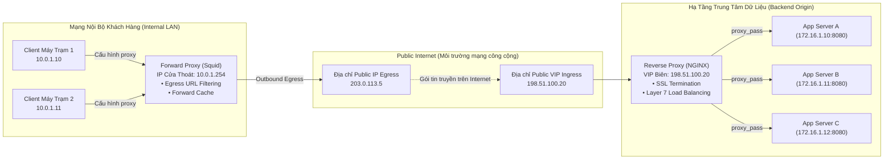
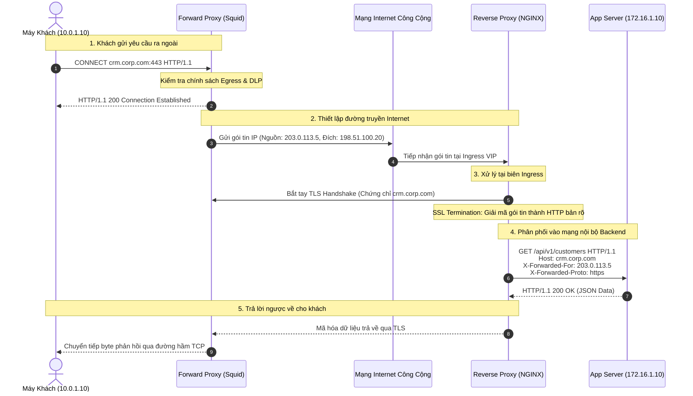

# 2_6_4 Forward vs Reverse Proxy Comparison

> **Khóa học**: Cloud DevOps Basic — Networking Core  
> **Phân nhóm**: 2 Domain 2 - Computer Networking Core Fundamentals › 2_6 Intermediaries and Proxy Architecture  
> **Chủ đề**: So sánh toàn diện kiến trúc Forward Proxy vs Reverse Proxy: Hướng lưu lượng, đối tượng đại diện, che giấu danh tính, cơ chế TLS và bối cảnh công nghệ  
> **Trạng thái**: Draft (WRITE-CDB-2_6_4, 14-11-2026)  
> **Checklist đối chiếu**: [2_6_4](<../../../CHECKLIST.md#domain-2-computer-networking-core-fundamentals-43-items>)  

---

## 1. Khái Niệm Cốt Lõi & Bản Chất Kỹ Thuật (Core Concepts & Technical Deep Dive)

Trong mô hình kiến trúc giao thức HTTP theo [RFC 9110 Section 3.7](https://datatracker.ietf.org/doc/html/rfc9110#section-3.7), các thành phần trung gian (Intermediaries) đóng vai trò điều phối, tối ưu hóa và bảo vệ đường truyền thông điệp giữa máy khách (User Agent) và máy chủ gốc (Origin Server). Hai mô hình trung gian phổ biến và quan trọng nhất trong hạ tầng mạng hiện đại là **Forward Proxy** và **Reverse Proxy** (Gateway).

Về mặt bản chất kỹ thuật, hai khái niệm này tạo nên một **cặp đối xứng gương hoàn hảo (mirror symmetry)** trong không gian mạng: một bên đứng ở phía người dùng nhìn ra ngoài, và một bên đứng ở phía dịch vụ nhìn vào trong.

```
                    MÔ HÌNH ĐỐI XỨNG GƯƠNG TRUNG GIAN MẠNG
                    
   [ CLIENT SIDE ]                                         [ SERVER SIDE ]
   (Egress Boundary)                                       (Ingress DMZ)
   
+---------------------+                               +---------------------+
|    Internal LAN     |                               |   Origin Cluster    |
|                     |                               |                     |
|  [Client 1]         |                               |  [App Server A]     |
|         \           |       PUBLIC INTERNET         |         /           |
|  [Client 2] --------+===> [FORWARD] ===> [REVERSE] =+=======> [App Server B]
|         /   Proxy   |      PROXY           PROXY    | Proxy   \           |
|  [Client 3]         |                               |  Pass    [App Server C]
+---------------------+                               +---------------------+
   Đại diện cho CLIENT                                   Đại diện cho SERVER
   Ẩn danh địa chỉ Client                                Che giấu địa chỉ Server
```

---

### 1.1 Ma Trận So Sánh Kiến Trúc Toàn Diện (Architectural Comparison Matrix)

Bảng phân tích đối chiếu chuyên sâu trên 6 chiều kích thước kỹ thuật cốt lõi:

| Chiều kích thước | Forward Proxy (Client-Side Proxy) | Reverse Proxy (Server-Side Gateway) |
| :--- | :--- | :--- |
| **1. Hướng lưu lượng & Vị trí triển khai** | **Egress Perimeter**: Nằm tại cửa ngõ thoát của mạng client (Internal LAN / Private VPC). Kiểm soát các kết nối đi ra ngoài (**Outbound Traffic**). | **Ingress Perimeter**: Nằm tại cửa ngõ đón của trung tâm dữ liệu hoặc cụm máy chủ (DMZ / Edge Network). Đón nhận các kết nối đi vào (**Inbound Traffic**). |
| **2. Đối tượng đại diện (Whom it represents)** | **Đại diện cho Client**: Đóng vai trò là khách hàng thay mặt người dùng nội bộ đi kết nối với các web server công cộng trên Internet. | **Đại diện cho Origin Server**: Đóng vai trò là máy chủ tiếp nhận, thay mặt toàn bộ cụm máy chủ ứng dụng phía sau đón khách ngoài Internet. |
| **3. Che giấu danh tính & Cấu trúc mạng** | **Ẩn Client IP**: Máy chủ đích trên Internet chỉ thấy địa chỉ IP của Forward Proxy. Cấu trúc mạng LAN và IP máy trạm nội bộ được bảo vệ tuyệt đối. | **Ẩn Server IP & Topology**: Khách hàng trên Internet chỉ thấy địa chỉ IP công khai (VIP) của Reverse Proxy. Toàn bộ dải IP riêng (`10.x.x.x`), cổng dịch vụ và kiến trúc microservices được che giấu. |
| **4. Vị trí cấu hình & Quyền kiểm soát** | **Phía Client**: Bắt buộc cấu hình trên máy trạm (trình duyệt, file PAC, biến môi trường `http_proxy`) hoặc cấu hình chuyển hướng gói tin trên Router/Firewall mạng LAN. | **Phía Server**: Do đội ngũ quản trị hạ tầng máy chủ triển khai và quản lý. Phía Client hoàn toàn **không** cần cấu hình bất kỳ thông tin nào, chỉ truy cập DNS bình thường. |
| **5. Mục tiêu tối thượng & Bên hưởng lợi** | **Bảo vệ tổ chức người dùng (Client-Centric)**:<br>• Thực thi chính sách duyệt web (Egress filtering).<br>• Chống thất thoát dữ liệu (DLP) & rà quét mã độc.<br>• Tiết kiệm băng thông WAN nhờ bộ đệm (Forward Caching). | **Bảo vệ và tối ưu hệ thống dịch vụ (Server-Centric)**:<br>• Cân bằng tải phân phối lưu lượng (Load Balancing).<br>• Giải phóng tải mã hóa (SSL/TLS Offloading).<br>• Tăng tốc ứng dụng với Reverse Caching.<br>• Phòng thủ tấn công phân tán (DDoS Mitigation & WAF). |
| **6. Cơ chế xử lý mã hóa TLS/SSL** | • **Mặc định**: Tạo đường hầm nhị phân mù (**Blind TCP Tunnel**) qua phương thức `HTTP CONNECT` ([RFC 9110 §9.3.6](https://datatracker.ietf.org/doc/html/rfc9110#section-9.3.6)). Proxy không đọc được dữ liệu.<br>• **Mạng nội bộ**: Giải mã qua **SSL Forward Inspection** sử dụng chứng chỉ nội bộ sinh tức thời từ Enterprise Root CA. | • **SSL Termination**: Giải mã TLS trực tiếp tại cửa ngõ biên bằng chứng chỉ SSL/TLS chính thức của tên miền dịch vụ.<br>• Đọc hiểu dữ liệu bản rõ (plaintext) để định tuyến URL/Header, sau đó chuyển tiếp HTTP hoặc thiết lập kết nối mã hóa lại (re-encrypt) vào backend. |

---

### 1.2 Bối Cảnh Công Nghệ Phần Mềm & Cổng Dịch Vụ Chuẩn

Sự phân hóa kiến trúc kéo theo sự khác biệt về các giải pháp phần mềm chuyên dụng:

```
+-----------------------------------+-----------------------------------+
|     FORWARD PROXY ECOSYSTEM       |      REVERSE PROXY ECOSYSTEM      |
+-----------------------------------+-----------------------------------+
| • Squid: Tiêu chuẩn de-facto cho  | • NGINX: Hiệu năng cao, làm proxy |
|   web proxy caching & filtering   |   cửa ngõ cho hầu hết website     |
|   (Mặc định TCP port: 3128)       |   (Mặc định TCP port: 80 / 443)   |
|                                   |                                   |
| • Privoxy: Chuyên lọc nội dung,   | • HAProxy: Chuyên cân bằng tải    |
|   bảo vệ riêng tư cá nhân        |   tầng 4 và tầng 7 cực mạnh       |
|   (Mặc định TCP port: 8118)       |   (Mặc định TCP port: 80 / 443)   |
|                                   |                                   |
| • Tinyproxy: Proxy gọn nhẹ cho    | • Envoy: Thiết kế cho kiến trúc   |
|   mạng nhúng và container nhỏ     |   Cloud-Native & Service Mesh     |
|   (Mặc định TCP port: 8888)       |   (Mặc định TCP port: 10000 / 80) |
+-----------------------------------+-----------------------------------+
```

- Về chuẩn phân bổ cổng dịch vụ và ánh xạ hệ thống:
  - Cổng **3128/tcp** là cổng mặc định trên thực tế (*de-facto default port*) của phần mềm Squid Web Proxy Cache (được liệt kê phổ biến trong `/etc/services` trên Linux là `squid 3128/tcp`), trong khi trên danh bạ chính thức của [IANA Port Registry](https://www.iana.org/assignments/service-names-port-numbers/service-names-port-numbers.xhtml) cổng 3128/tcp được gán cho dịch vụ `ndl-aas`.
  - Cổng **8080/tcp** (`http-alt` theo IANA) và **8118/tcp** thường được sử dụng cho các proxy cục bộ hoặc bộ lọc riêng tư (như Privoxy).
  - Các phần mềm Reverse Proxy hoạt động như các Web Server tiêu chuẩn, luôn tiếp nhận lưu lượng trực tiếp tại cổng chuẩn **80/tcp** (HTTP) và **443/tcp** (HTTPS).

---

### 1.3 Khác Biệt Trọng Yếu Về Rủi Ro Bảo Mật & Nguy Cơ Giả Mạo Địa Chỉ IP (IP Spoofing)

Hai kiến trúc đối mặt với các nguy cơ bảo mật hoàn toàn trái ngược nhau:

1. **Rủi ro trên Forward Proxy**:
   - Mối quan tâm hàng đầu là **nguy cơ thất thoát dữ liệu nội bộ (Data Exfiltration)** và **vượt tường lửa (Bypassing Controls)**. Kẻ tấn công hoặc phần mềm độc hại bên trong mạng cố gắng sử dụng các đường hầm SSH/HTTPS trái phép hoặc DNS tunneling xuyên qua proxy để gửi dữ liệu nhạy cảm ra ngoài.
2. **Rủi ro trên Reverse Proxy — Nguy cơ Giả mạo IP qua `X-Forwarded-For`**:
   - Khi Reverse Proxy tiếp nhận kết nối từ Internet, socket mạng tại các server backend chỉ nhìn thấy địa chỉ IP nội bộ của Reverse Proxy. Để truyền thông tin IP thật của client xuống cho ứng dụng, tiêu đề `X-Forwarded-For` (hoặc chuẩn [RFC 7239 `Forwarded`](https://datatracker.ietf.org/doc/html/rfc7239#section-4)) được sử dụng.
   - **Nguy cơ tấn công**: Theo tài liệu an ninh từ [MDN Web Docs — X-Forwarded-For Security](https://developer.mozilla.org/en-US/docs/Web/HTTP/Headers/X-Forwarded-For#security_and_privacy_concerns), một client xấu ngoài Internet hoàn toàn có thể tự đính kèm tiêu đề giả mạo vào HTTP request:
     ```http
     GET /admin/dashboard HTTP/1.1
     Host: app.example.com
     X-Forwarded-For: 127.0.0.1
     ```
   - Nếu Reverse Proxy ở rìa ngoài cùng (Edge Proxy) chỉ thực hiện việc ghép thêm chuỗi (`append`) thay vì làm sạch dữ liệu, backend server đọc giá trị đầu tiên của danh sách sẽ lầm tưởng rằng request này xuất phát từ chính `127.0.0.1` (localhost) và cho phép vượt qua cơ chế kiểm tra quyền truy cập (IP Whitelist Bypass)!
   - **Nguyên tắc bất biến**: Reverse Proxy ở tầng biên ngoài cùng **bắt buộc phải ghi đè (overwrite)** tiêu đề `X-Forwarded-For` bằng địa chỉ socket thực tế của client (`$remote_addr`).

---

## 2. Ví Dụ Đời Sống Thực Tế Dễ Hiểu (Intuitive Real-World Analogies)

### 2.1 Kính Ngắm Một Chiều và Cửa Bảo Vệ Hai Phía Đối Lập

Hãy tưởng tượng một mô hình đời thực: **Biệt thự ngoại giao nằm giữa một thành phố sầm uất**:

```
+---------------------------------------------------------------------------------------------------+
| ĐỜI THỰC SO SÁNH:                                                                                 |
|                                                                                                   |
|  [ VĂN PHÒNG ĐẠI SỨ QUÁN ]            [ ĐƯỜNG PHỐ CÔNG CỘNG ]            [ HOÀNG CUNG BẢO TẬP ]   |
|                                                                                                   |
|   Nhân viên ngoại giao                  Khu vực giao dịch                    Cụm phòng ban bí mật |
|            |                                    |                                     |           |
|            v                                    |                                     ^           |
|   [Trợ lý mua sắm riêng] =====================> | ============================> [Quầy lễ tân sảnh]|
|     (FORWARD PROXY)                             |                               (REVERSE PROXY)   |
|                                                 |                                                 |
|   * Bảo vệ người bên trong đi chợ.              |               * Đón tiếp và sàng lọc khách lạ.  |
|   * Người bán phố không biết ai ăn.             |               * Khách lạ không biết phòng nào.  |
+---------------------------------------------------------------------------------------------------+
```

1. **Forward Proxy là "Trợ lý bảo vệ nhân viên đi ra ngoài"**:
   - Khi nhân viên trong Đại sứ quán muốn mua sắm đồ ăn hay vật tư từ các cửa hàng trên phố, họ không tự ý ra ngoài mà giao danh sách cho **Trợ lý mua sắm riêng (Forward Proxy)**.
   - Trợ lý này kiểm tra danh sách xem có vật phẩm cấm hay không (Lọc nội dung). Sau đó, trợ lý ra phố mua hàng.
   - Các cửa hàng trên phố chỉ biết mặt vị trợ lý, hoàn toàn không biết món ăn này mua về cho nhân viên nào thưởng thức (Ẩn danh Client).
2. **Reverse Proxy là "Quầy lễ tân và Vệ sĩ tiền sảnh Hoàng cung"**:
   - Khi người dân hoặc khách lạ từ khắp thành phố đến liên hệ công tác tại Hoàng cung (nơi có hàng trăm phòng ban chuyên môn), không một ai được tự do bước thẳng vào các căn phòng phía sau.
   - Toàn bộ khách phải dừng chân tại **Quầy lễ tân tiền sảnh (Reverse Proxy)**.
   - Lễ tân kiểm tra giấy tờ, thẻ căn cước (Xác thực và WAF). Nếu hợp lệ, lễ tân bấm chuông chỉ dẫn khách đến đúng phòng chức năng đang rảnh rỗi (Cân bằng tải - Load Balancing).
   - Khách chỉ biết địa chỉ sảnh chính của tòa nhà, hoàn toàn không được biết sơ đồ ngõ ngách, số phòng hay cấu trúc an ninh bên trong (Origin Shielding).

---

## 3. Kiến Trúc, Luồng Hoạt Động & Hình Ảnh Trực Quan (Architecture, Diagrams & Visual Media)

### 3.1 Sơ Đồ Cấu Trúc Đối Xứng Gương Cạnh Nhau (Side-by-Side Topology)



---

### 3.2 Luồng Đi Của Một Yêu Cầu Xuyên Qua Cả Hai Hệ Thống Proxy

Khi một nhân viên công ty (sau Forward Proxy) truy cập vào một ứng dụng web doanh nghiệp (được bảo vệ bởi Reverse Proxy):



---

## 4. Thực Hành (Hands-on)

### Bài Thực Hành 1: Khảo Sát Sự Khác Biệt Cấu Hình Giữa Squid (Forward) và NGINX (Reverse)

Để hiểu sâu sắc bản chất kiến trúc, hãy đối chiếu hai tệp cấu hình thực tế đại diện cho hai trường phái:

#### 1. Cấu hình Forward Proxy trên Squid (`/etc/squid/squid.conf`)

> 💡 Minh họa cấu hình Squid Forward Proxy thực tế:

```ini
# Lắng nghe tại cổng dịch vụ proxy nội bộ (mặc định 3128)
http_port 3128

# Định nghĩa danh sách điều khiển truy cập (Access Control Lists - ACL)
# Xác định mạng nội bộ được phép sử dụng proxy
acl local_corporate_net src 10.0.1.0/24

# Xác định danh sách tên miền bị cấm truy cập (Egress Filtering)
acl blocked_domains dstdomain .gambling.com .malicious-site.org

# Xác định các cổng SSL được phép mở đường hầm CONNECT
acl SSL_ports port 443
acl Safe_ports port 80          # http
acl Safe_ports port 443         # https
acl CONNECT method CONNECT

# Áp dụng các luật kiểm soát lưu lượng thoát (Egress Rules)
# Từ chối các yêu cầu kết nối tới các cổng không an toàn
http_access deny !Safe_ports
http_access deny CONNECT !SSL_ports

# Từ chối các trang web trong danh sách đen
http_access deny blocked_domains

# Cho phép nhân viên trong mạng nội bộ truy cập ra ngoài
http_access allow local_corporate_net

# Mặc định từ chối tất cả các truy cập lạ khác
http_access deny all
```

*Phân tích*: Cấu hình tập trung hoàn toàn vào việc nhận diện **IP nguồn của máy trạm nội bộ (`src 10.0.1.0/24`)** và quản lý danh mục **các địa chỉ đích ngoài Internet được phép đi ra**.

---

#### 2. Cấu hình Reverse Proxy trên NGINX (`/etc/nginx/conf.d/app_reverse_proxy.conf`)

> 💡 Minh họa cấu hình NGINX Reverse Proxy thực tế:

```nginx
# Định nghĩa cụm máy chủ ứng dụng nội bộ (Upstream Pool)
upstream backend_app_servers {
    least_conn; # Cân bằng tải theo thuật toán Least Connections
    server 172.16.1.10:8080 max_fails=3 fail_timeout=10s;
    server 172.16.1.11:8080 max_fails=3 fail_timeout=10s;
}

server {
    listen 80;
    listen 443 ssl;
    server_name app.example.com;

    # SSL Termination: Cài đặt chứng chỉ công khai của tên miền
    ssl_certificate     /etc/ssl/certs/app_example_com.crt;
    ssl_certificate_key /etc/ssl/private/app_example_com.key;

    location / {
        # Chuyển tiếp yêu cầu inbound vào cụm server backend
        proxy_pass http://backend_app_servers;

        # Chống giả mạo IP: Ghi đè hoặc thiết lập chính xác IP thực tế từ socket
        proxy_set_header Host $host;
        proxy_set_header X-Real-IP $remote_addr;
        proxy_set_header X-Forwarded-For $proxy_add_x_forwarded_for;
        proxy_set_header X-Forwarded-Proto $scheme;

        # Tối ưu hóa bộ đệm kết nối
        proxy_buffering on;
        proxy_buffer_size 8k;
    }
}
```

*Phân tích*: Cấu hình tập trung vào việc tiếp nhận lưu lượng từ mọi IP công cộng bên ngoài tại cổng **80/443**, giải mã SSL và **phân phối tải (Load Balancing)** xuống một cụm máy chủ ứng dụng nội bộ (`upstream`).

---

### Bài Thực Hành 2: Kiểm Tra Nguy Cơ Giả Mạo Địa Chỉ IP (IP Spoofing) Qua `X-Forwarded-For`

Sử dụng lệnh `curl` gửi gói tin kèm tiêu đề tự chế nhằm kiểm tra phản ứng của hệ thống Reverse Proxy:

```bash
# Giả lập kẻ tấn công cố tình gắn thêm header X-Forwarded-For giả mạo IP localhost
curl -v -H "X-Forwarded-For: 127.0.0.1" http://198.51.100.20/api/whoami
```

> 💡 Minh họa output lệnh thực tế (Illustrative output):
```text
*   Trying 198.51.100.20:80...
* Connected to 198.51.100.20 (198.51.100.20) port 80
> GET /api/whoami HTTP/1.1
> Host: 198.51.100.20
> User-Agent: curl/8.5.0
> Accept: */*
> X-Forwarded-For: 127.0.0.1
> 
< HTTP/1.1 200 OK
< Server: nginx/1.24.0
< Date: Sat, 14 Nov 2026 08:35:10 GMT
< Content-Type: application/json
< Content-Length: 142
< Connection: keep-alive
< 
{
  "client_ip_received_by_backend": "172.16.1.254",
  "header_x_forwarded_for": "127.0.0.1, 203.0.113.88",
  "header_x_real_ip": "203.0.113.88"
}
```

*Phân tích kết quả thực tiễn*:
- Nếu cấu hình NGINX sử dụng chỉ thị `$proxy_add_x_forwarded_for`, NGINX sẽ giữ lại chuỗi client gửi lên và **ghép thêm IP thật vào phía cuối**: `"127.0.0.1, 203.0.113.88"`.
- **Cảnh báo bảo mật**: Nếu nhà phát triển ứng dụng backend viết mã:
  ```python
  # MÃ NGUỒN CÓ LỖ HỔNG (VULNERABLE):
  client_ip = request.headers.get("X-Forwarded-For").split(",")[0].strip()
  if client_ip == "127.0.0.1":
      grant_admin_access()  # Kẻ tấn công vượt qua xác thực!
  ```
  Hệ thống sẽ bị xâm nhập!
- **Giải pháp chuẩn hóa**:
  1. Sử dụng biến `X-Real-IP` luôn ghi đè bằng `$remote_addr`.
  2. Hoặc cấu hình module `ngx_http_realip_module` của NGINX để tự động loại bỏ các IP không đáng tin cậy.

---

## 5. Cạm Bẫy Thực Tế & Thực Tiễn Sản Xuất (Production Gotchas & Best Practices)

### Cạm Bẫy 1: Nhầm Lẫn Giữa NAT Gateway (Egress) và Ingress Controller Trong Kubernetes/Cloud

- **Tình huống**: Nhiều kỹ sư mới bắt đầu làm việc với môi trường Cloud (AWS VPC, Azure VNet, Kubernetes) thường nhầm lẫn giữa hai chiều lưu lượng:
  - Cho rằng Kubernetes Ingress Controller (như Ingress-NGINX) có thể sử dụng để quản lý các request mà các Pod trong cụm gọi ra các API bên ngoài Internet.
- **Bản chất kỹ thuật**:
  - **Ingress Controller** là một cụm **Reverse Proxy** chuyên dụng: Nó chỉ đón nhận lưu lượng đi từ bên ngoài vào (Inbound) và điều phối tới các Service/Pod bên trong cluster.
  - Các Pod muốn gọi ra các API dịch vụ bên ngoài (Outbound) phải đi qua cơ chế định tuyến Egress (như Cloud NAT Gateway, Egress Gateway trong Istio Service Mesh, hoặc một cụm Squid Forward Proxy).

---

### Cạm Bẫy 2: Tin Tưởng Tuyệt Đối Vào Phần Tử Đầu Tiên Trong `X-Forwarded-For`

- **Hậu quả sản xuất**: Lỗ hổng cho phép kẻ tấn công vượt qua các giới hạn tần suất gọi API (Rate Limiting) hoặc hệ thống tường lửa ứng dụng (WAF) chỉ bằng cách thay đổi giá trị header gửi lên qua mỗi request:
  ```bash
  for i in {1..1000}; do
    curl -H "X-Forwarded-For: 10.0.0.$i" https://api.example.com/login
  done
  ```
- **Thực tiễn tốt nhất (Best Practice)**:
  - Nếu ứng dụng nằm sau nhiều tầng proxy trung gian (ví dụ: Cloudflare CDN -> AWS ALB -> NGINX Ingress -> App), hệ thống phải thiết lập danh sách **Trusted Proxies**.
  - Ứng dụng chỉ duyệt ngược từ phần tử cuối cùng của mảng `X-Forwarded-For` về trước và dừng lại ngay tại địa chỉ IP đầu tiên không thuộc danh sách Trusted Proxies. Đó mới chính là IP công cộng thực tế của khách hàng.

---

### Cạm Bẫy 3: Nguy Cơ Vòng Lặp Vô Tận Giữa Các Tầng Proxy (Proxy Loops)

- **Nguyên nhân**: Khi hạ tầng mạng phức tạp kết hợp cả Forward Proxy nội bộ và Reverse Proxy định tuyến dịch vụ, việc cấu hình sai DNS hoặc quy tắc chuyển hướng (HTTP Redirect) có thể khiến Forward Proxy chuyển tiếp request tới Reverse Proxy, nhưng Reverse Proxy lại đẩy ngược lại mạng nội bộ đi qua Forward Proxy.
- **Chuẩn hóa giải pháp theo [RFC 9110 Section 7.6](https://datatracker.ietf.org/doc/html/rfc9110#section-7.6)**:
  - RFC 9110 §7.6 quy định các thiết bị trung gian **bắt buộc phải phát hiện vòng lặp yêu cầu (detect request loops)** và không được chuyển tiếp thông điệp tới chính mình.
  - Khi phát hiện vòng lặp bằng tiêu đề `Via` (RFC 9110 §7.6.3)—khi một proxy nhận thấy tên định danh của chính mình xuất hiện trong chuỗi `Via`—thiết bị trung gian lập tức hủy yêu cầu hoặc gửi trả mã trạng thái lỗi thích hợp như **`508 Loop Detected`** (được chuẩn hóa trong [RFC 5842 Section 7.2](https://datatracker.ietf.org/doc/html/rfc5842#section-7.2)) hoặc **`502 Bad Gateway`**.

---

## 6. Câu Hỏi Củng Cố Kiến Thức (Active Recall Quiz)

### Câu 1
Về mặt định hướng lưu lượng mạng và đối tượng đại diện, giải thích sự khác biệt cơ bản nhất giữa Forward Proxy và Reverse Proxy.

<details>
<summary>Đáp án</summary>

- **Forward Proxy**: Được triển khai tại ranh giới thoát (egress boundary) của mạng nội bộ, đại diện cho **phía máy khách (Client)** để kiểm soát, lọc và gửi lưu lượng đi ra ngoài Internet. Máy chủ đích bên ngoài chỉ nhìn thấy IP của Forward Proxy, địa chỉ IP của Client được che giấu.
- **Reverse Proxy**: Được triển khai tại ranh giới đón (ingress boundary) của trung tâm dữ liệu, đại diện cho **phía máy chủ gốc (Origin Servers)** để tiếp nhận lưu lượng từ bên ngoài Internet đi vào. Máy khách bên ngoài chỉ nhìn thấy IP/VIP của Reverse Proxy, toàn bộ cấu trúc mạng và IP riêng của cụm máy chủ nội bộ được che giấu.
</details>

---

### Câu 2
Tại sao trong cấu hình Reverse Proxy ở rìa ngoài cùng (Edge Reverse Proxy), việc tin tưởng mù quáng vào phần tử đầu tiên của tiêu đề `X-Forwarded-For` từ client gửi lên có thể dẫn tới lỗ hổng bảo mật nghiêm trọng? Đâu là giải pháp chuẩn để xử lý?

<details>
<summary>Đáp án</summary>

- **Nguy cơ bảo mật**: Tiêu đề `X-Forwarded-For` trong HTTP request hoàn toàn có thể bị kẻ tấn công bên ngoài giả mạo (ví dụ gắn giá trị `X-Forwarded-For: 127.0.0.1` hoặc dải IP nội bộ đáng tin cậy). Nếu Edge Reverse Proxy chỉ ghép thêm IP mà không ghi đè, ứng dụng backend đọc phần tử đầu tiên sẽ lầm tưởng request đến từ địa chỉ IP đáng tin cậy và cho phép vượt qua cơ chế bảo vệ phân quyền (IP Whitelisting bypass) hoặc bỏ qua kiểm tra giới hạn tần suất (Rate Limiting).
- **Giải pháp**: Edge Reverse Proxy tiếp nhận kết nối đầu tiên bắt buộc phải **ghi đè** tiêu đề này bằng địa chỉ socket thực tế của client (`$remote_addr`) hoặc thiết lập tiêu đề riêng biệt không thể chỉnh sửa như `X-Real-IP: $remote_addr`.
</details>

---

### Câu 3
Xét về cách xử lý lưu lượng HTTPS mã hóa TLS, Forward Proxy thông thường khác biệt như thế nào so với một Reverse Proxy tiêu chuẩn?

<details>
<summary>Đáp án</summary>

- **Forward Proxy (mặc định)**: Thiết lập một đường hầm nhị phân mù (**Blind TCP Tunnel**) qua phương thức `HTTP CONNECT` (RFC 9110 §9.3.6). Proxy không sở hữu chứng chỉ của máy chủ đích, không thể và không giải mã dữ liệu TLS, mà chỉ chuyển tiếp nguyên vẹn các luồng byte nhị phân đã được mã hóa giữa client và origin server.
- **Reverse Proxy (tiêu chuẩn)**: Thực hiện **SSL/TLS Termination** ngay tại cửa ngõ biên. Nó lưu trữ trực tiếp chứng chỉ SSL và khóa bí mật (private key) của tên miền dịch vụ, chủ động giải mã toàn bộ dữ liệu TLS nhận được từ khách hàng thành bản rõ (plaintext) để phân tích URL, kiểm tra header, thực hiện định tuyến và cân bằng tải trước khi chuyển tiếp vào các máy chủ backend.
</details>

---

## 7. 📚 Nguồn Tài Liệu Chính Thống (Tier-1 Official References)

- [RFC 9110 — HTTP Semantics: Section 3.7 Intermediaries](https://datatracker.ietf.org/doc/html/rfc9110#section-3.7) — Đặc tả chuẩn Internet của IETF về định nghĩa kiến trúc Proxy, Gateway (Reverse Proxy) và Tunnel.
- [RFC 9110 — HTTP Semantics: Section 7.6 Intermediary Requirements](https://datatracker.ietf.org/doc/html/rfc9110#section-7.6) — Các nguyên tắc bắt buộc cho thiết bị trung gian trong việc xử lý tiêu đề và phát hiện vòng lặp truyền gói.
- [RFC 5842 — Binding Extensions to Web Distributed Authoring and Versioning (WebDAV): Section 7.2 508 Loop Detected](https://datatracker.ietf.org/doc/html/rfc5842#section-7.2) — Đặc tả chuẩn Internet của IETF về mã trạng thái 508 Loop Detected.
- [RFC 7239 — Forwarded HTTP Extension](https://datatracker.ietf.org/doc/html/rfc7239) — Tiêu chuẩn kỹ thuật IETF cho tiêu đề chuẩn hóa `Forwarded` thay thế cho các tiêu đề de-facto `X-Forwarded-*`.
- [MDN Web Docs — An overview of HTTP: Proxies](https://developer.mozilla.org/en-US/docs/Web/HTTP/Overview#proxies) — Tài liệu tham khảo toàn diện của Mozilla về các mô hình proxy và vai trò của chúng trên môi trường Web.
- [MDN Web Docs — HTTP Headers: X-Forwarded-For](https://developer.mozilla.org/en-US/docs/Web/HTTP/Headers/X-Forwarded-For) — Chi tiết cú pháp, hành vi chuyển tiếp và các cảnh báo an ninh về giả mạo địa chỉ IP qua tiêu đề trung gian.
- [NGINX Official Documentation — Reverse Proxy & ngx_http_proxy_module](https://nginx.org/en/docs/http/ngx_http_proxy_module.html) — Tài liệu kỹ thuật chính thức từ NGINX về các chỉ thị cấu hình Reverse Proxy, chuyển tiếp tiêu đề và tối ưu hóa bộ đệm.
- [HAProxy Official Documentation — Concepts & Architecture](https://www.haproxy.com/documentation/) — Hướng dẫn kiến trúc chính thức về triển khai proxy cân bằng tải tầng 4 và tầng 7 hiệu năng cao.
