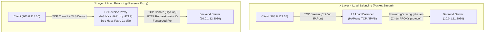
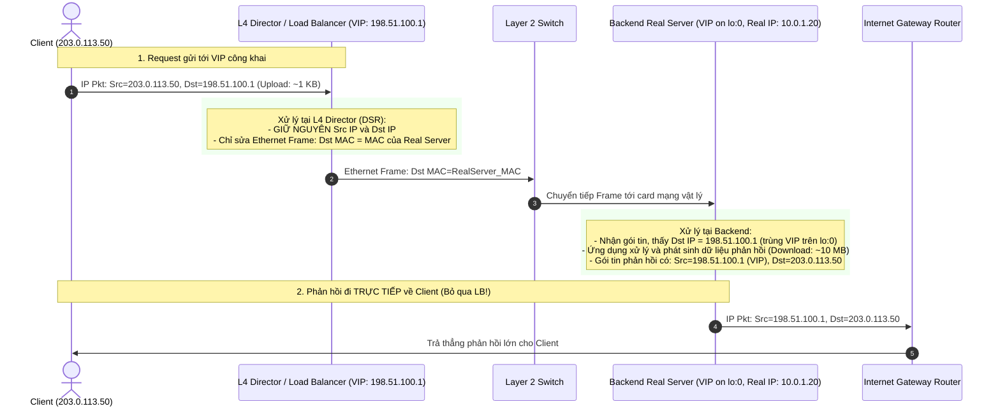

# 2_6_5 Layer 4 vs Layer 7 Load Balancing

> **Khóa học**: Cloud DevOps Basic — Networking Core  
> **Phân nhóm**: 2 Domain 2 - Computer Networking Core Fundamentals › 2_6 Intermediaries and Proxy Architecture  
> **Chủ đề**: So sánh chuyên sâu kiến trúc cân bằng tải Tầng 4 (Transport / TCP-UDP) và Tầng 7 (Application / HTTP): Cơ chế chuyển tiếp (NAT, DSR, PROXY protocol), kiểm tra sức khỏe và duy trì phiên  
> **Trạng thái**: Draft  
> **Checklist đối chiếu**: [2_6_5](<../../../CHECKLIST.md#domain-2-computer-networking-core-fundamentals-43-items>)  

---

## 1. Khái Niệm Cốt Lõi & Bản Chất Kỹ Thuật (Core Concepts & Technical Deep Dive)

Trong hạ tầng kỹ thuật mạng và phân phối dịch vụ quy mô lớn, **Cân bằng tải (Load Balancing)** là thành phần tối quan trọng phân chia lưu lượng truy cập tới cụm máy chủ xử lý. Tùy thuộc vào tầng hoạt động trong mô hình tham chiếu Open Systems Interconnection (OSI), giải pháp cân bằng tải được chia thành hai trường phái kiến trúc chính: **Layer 4 Load Balancing (Cân bằng tải Tầng Giao vận)** và **Layer 7 Load Balancing (Cân bằng tải Tầng Ứng dụng)**.

Theo tài liệu kiến trúc chính thức của [HAProxy 2.8 Intro §2](https://docs.haproxy.org/2.8/intro.html):
> *"Since a layer 7 load balancer may perform a number of complex operations on the traffic (decrypt, parse, modify, match cookies, decide what server to send to, etc), it can definitely cause some trouble..."*

Ở tầng 4, bộ cân bằng tải chỉ làm việc với luồng gói tin TCP/UDP thô (không can thiệp tải trọng dữ liệu); trong khi ở tầng 7, bộ cân bằng tải đóng vai trò như một reverse proxy phân tích sâu toàn bộ nội dung HTTP (headers, cookies, URL path) để đưa ra quyết định định tuyến thông minh.

---

### 1.1 Bảng so sánh bản chất kỹ thuật Layer 4 vs Layer 7

| Tiêu chí kỹ thuật | Layer 4 Load Balancing (Transport) | Layer 7 Load Balancing (Application) |
| :--- | :--- | :--- |
| **Tầng giao thức OSI** | Tầng 4: Giao vận (TCP, UDP). | Tầng 7: Ứng dụng (HTTP, HTTPS, gRPC, WebSocket). |
| **Dữ liệu phân tích** | Chỉ phân tích: IP nguồn/đích, Cổng nguồn/đích, cờ TCP. | Phân tích sâu: URL Path, Host Header, Cookie, HTTP Methods, Header, JSON payload. |
| **Xử lý tải trọng (Payload)** | **Không đọc, không giải mã, không biến đổi**. Tải trọng được coi như luồng byte mờ đục (opaque bytes). | **Đọc, bóc tách và có thể biến đổi** (chèn header, nén gzip, chỉnh sửa cookie). |
| **Kết nối TCP** | Có thể dùng 1 kết nối duy nhất (NAT/DSR) hoặc proxy TCP byte-stream. | **Luôn chấm dứt kết nối TCP**: 1 kết nối client-to-proxy, 1 kết nối proxy-to-backend độc lập. |
| **Giải mã TLS/HTTPS** | Không (Passthrough luồng TLS thô cho backend tự giải mã). | Có (Thực hiện TLS Termination, quản lý chứng chỉ SSL tại biên). |
| **Hiệu năng & Thông lượng** | Cực cao (hàng triệu packet/giây), tiêu tốn rất ít CPU/RAM. | Trung bình - cao, tốn nhiều CPU để giải mã TLS và phân tích chuỗi HTTP. |
| **Bảo toàn IP Client** | DSR (giữ nguyên IP nguồn) hoặc **PROXY Protocol** (v1/v2). | Chèn HTTP Headers: `X-Forwarded-For`, RFC 7239 `Forwarded`. |
| **Duy trì phiên (Persistence)** | Băm địa chỉ IP nguồn (Source IP Hash). | Session Cookie, Cookie insertion, Header-based routing. |
| **Cấu hình Engine** | HAProxy: `mode tcp`<br/>NGINX: Khối `stream { ... }` | HAProxy: `mode http`<br/>NGINX: Khối `http { ... }` |

---

### 1.2 Các mô hình chuyển tiếp gói tin tại Layer 4 (Dựa trên chuẩn IPVS / Linux Virtual Server)

Theo tài liệu chuẩn Linux Virtual Server (IPVS) về [VS-DRouting](http://www.linuxvirtualserver.org/VS-DRouting.html) và [VS-NAT](http://www.linuxvirtualserver.org/VS-NAT.html):

#### 1. VS/NAT (Virtual Server via NAT)
- Bộ cân bằng tải hoạt động như một router NAT hai chiều:
  - Gói tin đến từ client: LB sửa địa chỉ IP đích từ VIP thành IP của Backend Server (DNAT).
  - Gói tin phản hồi từ backend: Bắt buộc phải đi qua LB để sửa địa chỉ IP nguồn từ Backend IP thành VIP trước khi gửi về client (SNAT).
- *Hạn chế*: Cả chiều đi lẫn chiều về đều qua LB, tạo ra điểm nghẽn cổ chai băng thông (bandwidth bottleneck) khi các ứng dụng truyền tải lượng dữ liệu lớn (video, file ảnh).

#### 2. VS/DR hay DSR (Direct Server Return)
- Cơ chế đột phá về mặt hiệu năng trên mạng cục bộ Layer 2 (LAN):
  - Bộ cân bằng tải tiếp nhận gói tin gửi tới địa chỉ VIP công khai.
  - LB **không sửa địa chỉ IP nguồn hay IP đích**, mà chỉ sửa **địa chỉ MAC đích** trong khung tin Ethernet Layer 2 thành địa chỉ MAC của card mạng Backend Server được chọn, rồi đẩy khung tin ra switch.
  - Trên các máy chủ Backend: Địa chỉ VIP được gán vào giao diện mạng ảo Loopback (`lo:0`). Máy chủ nhận diện gói tin có IP đích trùng khớp với VIP nên xử lý bình thường.
  - **Phản hồi trực tiếp (Direct Return)**: Gói tin phản hồi được Backend gửi **trực tiếp qua router gateway để đi về Client ngoài Internet**, hoàn toàn bỏ qua Load Balancer!
- *Giải phóng băng thông*: Do lưu lượng chiều tải về (Download) thường gấp 10 - 100 lần lưu lượng chiều gửi lên (Upload), DSR giúp một cỗ máy LB nhỏ có thể điều phối cụm server phục vụ băng thông hàng trăm Gigabit/giây.
- *Xử lý xung đột ARP (ARP Flux)*: Do nhiều backend server cùng chia sẻ một địa chỉ VIP trên card Loopback, nếu chúng cùng phản hồi bản tin ARP Request từ switch, mạng nội bộ sẽ bị loạn tuyến. Bắt buộc phải cấu hình kernel Linux thông qua [ip-sysctl](https://docs.kernel.org/networking/ip-sysctl.html):
  ```bash
  # Ngăn chặn card mạng vật lý trả lời ARP cho địa chỉ VIP nằm trên loopback
  sysctl -w net.ipv4.conf.all.arp_ignore=1
  sysctl -w net.ipv4.conf.all.arp_announce=2
  ```

#### 3. VS/TUN (Virtual Server via IP Tunneling)
- Tương tự như DSR, gói tin phản hồi cũng đi thẳng từ Backend về Client. Điểm khác biệt là LB đóng gói gói tin IP ban đầu vào một gói tin IP mới (IP-in-IP Encapsulation) để gửi qua mạng định tuyến Layer 3 tới các Backend nằm ở các trung tâm dữ liệu hoặc subnet khác nhau.

---

### 1.3 Cơ chế bảo toàn địa chỉ IP nguồn tại Layer 4: Giao thức PROXY (PROXY Protocol)

Khi cân bằng tải Layer 4 hoạt động ở chế độ TCP proxy thông thường (không phải DSR), kết nối TCP giữa LB và backend sẽ làm mất địa chỉ IP gốc của Client. Vì Layer 4 không hiểu các trường tiêu đề HTTP như `X-Forwarded-For`, [Willy Tarreau](https://www.haproxy.org/download/2.8/doc/proxy-protocol.txt) (tác giả HAProxy) đã thiết kế chuẩn **PROXY Protocol**:
- Bộ cân bằng tải L4 sau khi hoàn tất bắt tay TCP 3-way handshake với backend server sẽ chèn ngay một khối tiêu đề tiền tố chứa thông tin IP nguồn/đích và Port trước khi bắt đầu truyền luồng dữ liệu ứng dụng.

Tiêu chuẩn định nghĩa hai phiên bản:
1. **PROXY Protocol v1 (Human-Readable Text Format)**:
   - Dạng chuỗi ASCII ngắn gọn kết thúc bằng `\r\n`, độ dài tối đa 108 bytes:
   ```text
   PROXY TCP4 198.51.100.15 203.0.113.80 54321 443\r\n
   ```
2. **PROXY Protocol v2 (Binary Format)**:
   - Dạng nhị phân hiệu năng cao, mở đầu bằng 12-byte signature cố định:
   ```text
   \x0D\x0A\x0D\x0A\x00\x0D\x0A\x51\x55\x49\x54\x0A
   ```
   - Đi kèm sau đó là khối nhị phân chứa địa chỉ IPv4/IPv6 và cổng, cho phép phân giải cực nhanh mà không cần parse chuỗi string.
- *Chỉ thị HAProxy*: Sử dụng tham số `send-proxy` (v1) hoặc `send-proxy-v2` (v2) trên dòng cấu hình máy chủ backend.

---

### 1.4 So sánh cơ chế Kiểm tra sức khỏe (Health Checks)

1. **Active L4 Health Check (TCP SYN/ACK)**:
   - Bộ cân bằng tải định kỳ gửi gói tin `TCP SYN` tới cổng dịch vụ của backend. Nếu backend phản hồi `TCP SYN/ACK`, LB lập tức gửi gói tin `TCP RST` để đóng kết nối và đánh dấu backend là **UP**.
   - *Ưu điểm*: Cực nhẹ, không tốn tài nguyên ứng dụng.
   - *Cạm bẫy "Zombie Healthy"*: Nếu tiến trình web server vẫn chạy (cổng 80 mở) nhưng database bị sập hoặc ứng dụng ném lỗi `500 Internal Server Error`, L4 Health Check vẫn báo backend khỏe mạnh và tiếp tục điều phối lưu lượng vào, khiến người dùng liên tục gặp lỗi!
2. **Active L7 Health Check (Application-Level)**:
   - Bộ cân bằng tải mở kết nối HTTP đầy đủ, gửi một request cụ thể (ví dụ `GET /healthz`) và kiểm tra mã trạng thái trả về (phải là `200 OK`) hoặc kiểm tra nội dung JSON trả về (ví dụ `{"status":"UP"}`).
   - *Ưu điểm*: Đảm bảo dịch vụ thực sự sẵn sàng xử lý yêu cầu nghiệp vụ.

---

### 1.5 So sánh cơ chế Duy trì phiên làm việc (Session Persistence / Sticky Sessions)

1. **Duy trì phiên tại Layer 4 (Source IP Hash)**:
   - Sử dụng giải thuật băm địa chỉ IP nguồn của client (`hash(client_ip) % total_servers`) để luôn chuyển tiếp một IP tới một backend cố định.
   - *Nhược điểm nghiêm trọng*: Nếu hàng nghìn nhân viên trong một tòa nhà văn phòng truy cập qua cùng một cổng NAT công cộng (cùng chung 1 Public IP), toàn bộ lưu lượng của họ sẽ bị dồn hết vào một máy chủ backend duy nhất, gây nghẽn cục bộ. Ngoài ra, khi người dùng chuyển từ WiFi sang mạng 4G, IP client đổi khiến session bị mất.
2. **Duy trì phiên tại Layer 7 (Cookie Stickiness)**:
   - Bộ cân bằng tải tự động chèn một cookie định danh vào phản hồi HTTP gửi cho trình duyệt (ví dụ: `Set-Cookie: SERVERID=be_01; Path=/; HttpOnly`).
   - Ở các request tiếp theo, trình duyệt tự gửi lại cookie này. LB chỉ cần đọc giá trị cookie để điều hướng chính xác tới backend `be_01` mà hoàn toàn không phụ thuộc vào địa chỉ IP của client.

> [!TIP] Cookie Stickiness vs Lưu trữ phiên tập trung (Distributed Session Store)
> Mặc dù Cookie Stickiness tại Layer 7 giải quyết tốt bài toán bám dính phiên mà không bị ảnh hưởng bởi NAT Gateway, nó vẫn bộc lộ hạn chế lớn về khả năng chịu lỗi (fault tolerance): nếu pod hoặc máy chủ backend `app01` bị sự cố hoặc tái khởi động (rolling restart / auto-scaling), toàn bộ dữ liệu phiên lưu trên bộ nhớ cục bộ của máy chủ đó sẽ biến mất, khiến người dùng bị văng phiên (bắt buộc phải đăng nhập lại). Do đó, trong các hệ thống Cloud-Native hiện đại, phương pháp tối ưu là xây dựng cụm backend phi trạng thái (**Stateless Backends**) và lưu trữ phiên tập trung tại **Distributed Session Store** (như Redis Cluster hoặc Memcached), giúp lưu lượng có thể chuyển hướng linh hoạt sang bất kỳ node backend nào mà phiên làm việc vẫn được bảo toàn nguyên vẹn.

---

## 2. Ví Dụ Đời Sống Thực Tế Dễ Hiểu (Intuitive Real-World Analogies)

### 2.1 Nhân viên bẻ ghi đường ray (L4) vs Chuyên viên phân loại bưu chính (L7)

Hãy hình dung sự khác biệt giữa hai bộ phận trong ngành vận chuyển:

#### Cân bằng tải Layer 4: Nhân viên bẻ ghi đường ray xe lửa
- Từng đoàn tàu chở hàng hối hả chạy qua nút giao đường sắt.
- Người gác ghi đứng ở đài quan sát, anh ta chỉ nhìn vào **mã số sơn bên ngoài đầu tàu** (Địa chỉ IP và Số hiệu chuyến tàu = Port).
- Nhìn thấy đầu tàu mã số chẵn -> anh gạt cần bẻ ghi sang Ray 1. Đầu tàu mã số lẻ -> gạt cần bẻ ghi sang Ray 2.
- Anh **không bao giờ mở các toa hàng** ra xem bên trong chở kim cương, than đá hay sữa tươi. Thao tác gạt cần diễn ra trong 0.01 giây, đoàn tàu lao qua với vận tốc tối đa mà không hề bị giảm tốc. Đây chính là bản chất của Layer 4: siêu tốc, thô mộc và không can thiệp nội dung.

#### Cân bằng tải Layer 7: Chuyên viên phân loại bưu phẩm bưu chính
- Thư từ và bưu kiện gửi tới trung tâm chia chọn.
- Chuyên viên bưu chính cầm từng phong bì thư, dùng dao rọc giấy bóc phong bì ra và đọc kỹ nội dung bên trong:
  - Nếu lá thư có tiêu đề khiếu nại (`/api/v1/complaint`), chuyển sang phòng Pháp chế.
  - Nếu lá thư yêu cầu xem catalog hình ảnh (`/static/images`), chuyển sang kho ảnh.
  - Nếu phong bì có kẹp tấm thẻ khách hàng thân thiết hạng Vàng (Session Cookie VIP), chuyển sang quầy chăm sóc khách hàng đặc biệt.
- Nếu bức thư chứa nội dung độc hại hoặc từ ngữ thô tục (WAF / SQL Injection), chuyên viên vứt thẳng vào sọt rác ngay tại chỗ.
- Việc bóc phong bì và đọc thư tốn thời gian và công sức hơn rất nhiều, nhưng đổi lại bưu kiện được điều hướng thông minh, chính xác tuyệt đối theo đúng ngữ cảnh nghiệp vụ.

---

## 3. Kiến Trúc, Luồng Hoạt Động & Hình Ảnh Trực Quan (Architecture, Diagrams & Visual Media)

### 3.1 So sánh luồng kết nối TCP: Layer 4 vs Layer 7



---

### 3.2 Luồng định tuyến Direct Server Return (DSR / VS-DR)



---

## 4. Thực Hành (Hands-on)

### 4.1 Cấu hình mẫu HAProxy tích hợp song song Layer 4 và Layer 7

Dưới đây là tệp cấu hình HAProxy mẫu (`haproxy.cfg`) chuẩn mực thể hiện rõ ràng cú pháp cấu hình phân tách giữa `mode tcp` (Layer 4) kèm PROXY Protocol v2 và `mode http` (Layer 7) kèm Cookie Stickiness và HTTP Health Check theo tài liệu chuẩn [HAProxy Configuration Manual](https://docs.haproxy.org/2.8/configuration.html):

```haproxy
global
    log /dev/log local0
    maxconn 50000
    user haproxy
    group haproxy

defaults
    log     global
    timeout connect 5000ms
    timeout client  50000ms
    timeout server  50000ms

# ====================================================================
# 1. LAYER 4 LOAD BALANCING (TCP Stream Proxy cho Database/Raw TCP)
# ====================================================================
frontend tcp_in_l4
    bind :3306
    mode tcp
    option tcplog
    default_backend db_cluster_l4

backend db_cluster_l4
    mode tcp
    balance roundrobin
    # L4 Health Check: Kiểm tra bắt tay TCP SYN/ACK mỗi 2000ms
    # send-proxy-v2: Gửi thông tin IP client qua PROXY Protocol v2 dạng nhị phân
    server db01 10.0.3.11:3306 check inter 2000 fall 3 rise 2 send-proxy-v2
    server db02 10.0.3.12:3306 check inter 2000 fall 3 rise 2 send-proxy-v2

# ====================================================================
# 2. LAYER 7 LOAD BALANCING (HTTP Reverse Proxy với Cookie Stickiness)
# ====================================================================
frontend http_in_l7
    bind :80
    mode http
    option httplog
    default_backend web_cluster_l7

backend web_cluster_l7
    mode http
    balance roundrobin
    # L7 Session Persistence: Chèn cookie định danh máy chủ vào phản hồi HTTP
    cookie SERVERID insert indirect nocache

    # L7 Active Health Check: Gửi yêu cầu HTTP GET /healthz, kỳ vọng HTTP 200 OK
    option httpchk
    http-check send meth GET uri /healthz ver HTTP/1.1 hdr Host health.internal
    http-check expect status 200

    # Khai báo máy chủ kèm cookie định danh và kiểm tra sức khỏe L7
    server app01 10.0.2.21:8080 check inter 2000 fall 3 rise 2 cookie app01
    server app02 10.0.2.22:8080 check inter 2000 fall 3 rise 2 cookie app02
```

---

### 4.2 Kiểm tra hoạt động L7 Cookie Persistence và Header bằng `curl`

Kiểm tra hành vi gán cookie và duy trì phiên của bộ cân bằng tải Layer 7 bằng `curl`:

```bash
# Gửi yêu cầu đầu tiên, lưu trữ cookie nhận được vào file cookie.txt
curl -i -c cookie.txt http://127.0.0.1:80/api/v1/session
```

> 💡 Minh họa output lệnh thực tế (Illustrative output)
```text
HTTP/1.1 200 OK
Date: Sat, 14 Nov 2026 08:32:15 GMT
Content-Type: application/json
Content-Length: 38
Set-Cookie: SERVERID=app01; path=/; HttpOnly
Cache-Control: private

{"status":"connected","server":"app01"}
```

Gửi yêu cầu tiếp theo kèm theo file cookie đã lưu:
```bash
curl -i -b cookie.txt http://127.0.0.1:80/api/v1/session
```

> 💡 Minh họa output lệnh thực tế (Illustrative output)
```text
HTTP/1.1 200 OK
Date: Sat, 14 Nov 2026 08:32:18 GMT
Content-Type: application/json
Content-Length: 38
Cache-Control: private

{"status":"connected","server":"app01"}
```
*Nhận xét*: Ở request thứ hai, cookie `SERVERID=app01` được gửi lên, HAProxy phân tích header Layer 7 và điều hướng chính xác về máy chủ `app01` mà không chuyển sang `app02`.

---

## 5. Cạm Bẫy Thực Tế & Thực Tiễn Sản Xuất (Production Gotchas & Best Practices)

### 5.1 Cạm bẫy "Zombie Healthy" với L4 Health Check
- **Vấn đề**: Đội ngũ kỹ thuật sử dụng cân bằng tải Layer 4 (như AWS Network Load Balancer - NLB) với cơ chế kiểm tra cổng TCP 80 mặc định cho một cụm web app microservices.
- **Hậu quả**: Khi database backend bị ngắt kết nối, tiến trình web server (như Tomcat hay Gunicorn) vẫn lắng nghe trên cổng 80 bình thường và trả về mã lỗi `500 Internal Server Error`. Vì L4 chỉ kiểm tra cổng TCP có bắt tay SYN/ACK thành công hay không, bộ cân bằng tải vẫn coi máy chủ này hoàn toàn "Healthy" và tiếp tục ném 50% lưu lượng người dùng vào máy chủ lỗi.
- **Thực tiễn sản xuất**: Với các ứng dụng web nghiệp vụ, luôn cấu hình kiểm tra sức khỏe ở **Layer 7** gọi trực tiếp vào endpoint kiểm tra phụ thuộc `/healthz` (xác thực cả kết nối database, redis cache) để lập tức cô lập node khi có sự cố logic.

### 5.2 Lệch tải nghiêm trọng khi dùng Source IP Hash tại Layer 4
- **Vấn đề**: Sử dụng thuật toán `balance source` tại L4 để duy trì phiên cho các dịch vụ web công cộng.
- **Hậu quả**: Khi có một sự kiện người dùng truy cập từ mạng doanh nghiệp lớn, trường đại học hoặc các mạng di động 4G/5G (nơi hàng chục nghìn người cùng đi ra ngoài qua một cổng CGNAT / Gateway proxy duy nhất), toàn bộ lưu lượng này có chung một địa chỉ IP nguồn. Kết quả là toàn bộ người dùng bị dồn vào đúng một máy chủ backend duy nhất, khiến máy chủ đó sập vì quá tải, trong khi các máy chủ còn lại trong pool hoàn toàn rảnh rỗi.
- **Thực tiễn sản xuất**: Chỉ dùng Source IP Hash cho các dịch vụ nội bộ (Internal B2B) có dải IP phân bổ đều. Đối với ứng dụng web công khai, bắt buộc phải dùng Layer 7 Cookie Persistence.

### 5.3 Cạm bẫy bão ARP (ARP Flux) khi triển khai Direct Server Return (DSR)
- **Vấn đề**: Triển khai kiến trúc DSR/VS-DR nhưng quên cấu hình tham số `net.ipv4.conf.all.arp_ignore=1` và `net.ipv4.conf.all.arp_announce=2` trên hệ điều hành Linux của các máy chủ backend.
- **Hậu quả**: Khi switch mạng hoặc router phát bản tin ARP Request hỏi: *"Ai đang giữ địa chỉ VIP 198.51.100.1?"*, tất cả các máy chủ backend (do có VIP trên card loopback `lo:0`) đều thi nhau trả lời bản tin ARP Reply. Switch bị ghi đè bảng MAC liên tục (MAC Flapping), lưu lượng từ Internet bị chuyển thẳng vào một backend ngẫu nhiên thay vì đi qua Load Balancer, phá hủy hoàn toàn kiến trúc cân bằng tải.

---

## 6. Câu Hỏi Củng Cố Kiến Thức (Active Recall Quiz)

<details>
<summary><strong>Câu 1: Một công ty thương mại điện tử cần hệ thống định tuyến các yêu cầu có URL bắt đầu bằng <code>/checkout</code> tới một cụm máy chủ cấu hình mạnh, và các yêu cầu <code>/static</code> tới cụm máy chủ lưu trữ đệm. Hệ thống bắt buộc phải chọn Cân bằng tải Layer 4 hay Layer 7? Tại sao?</strong></summary>

**Đáp án**:  
Bắt buộc phải sử dụng **Cân bằng tải Layer 7 (Application Load Balancer)**.  
Bởi vì: Layer 4 chỉ làm việc ở tầng Transport (TCP/UDP), nó chỉ phân tích địa chỉ IP và số hiệu cổng (Port) mà không đọc hay giải mã tải trọng HTTP. Trường URL path (`/checkout`, `/static`) nằm bên trong nội dung HTTP Request. Chỉ có cân bằng tải Layer 7 mới thực hiện chấm dứt kết nối TCP, giải mã TLS và phân tích trường URL để thực hiện định tuyến theo nội dung (Content-Based Routing).
</details>

<details>
<summary><strong>Câu 2: Cơ chế Direct Server Return (DSR) tại Layer 4 mang lại lợi thế vượt trội gì về mặt băng thông mạng so với kiến trúc Reverse Proxy truyền thống?</strong></summary>

**Đáp án**:  
Theo [Linux Virtual Server VS-DRouting](http://www.linuxvirtualserver.org/VS-DRouting.html):  
Trong kiến trúc Reverse Proxy truyền thống (hoặc VS/NAT), cả chiều Request đi vào và Response đi ra đều bắt buộc phải đi qua thiết bị cân bằng tải, dễ gây nghẽn băng thông ở chiều tải dữ liệu về.  
Trong kiến trúc **Direct Server Return (DSR)**, Load Balancer chỉ xử lý gói tin Request đi vào (vốn có dung lượng rất nhỏ, vài KB) và sửa địa chỉ MAC đích để chuyển sang backend trên cùng mạng LAN. Gói tin phản hồi chứa dữ liệu lớn (hàng chục MB hình ảnh, video, HTML) được Backend Server **gửi trực tiếp ra Internet về Client mà không cần quay trở lại Load Balancer**. Điều này giúp loại bỏ hoàn toàn nút thắt cổ chai băng thông tại Load Balancer.
</details>

<details>
<summary><strong>Câu 3: Tại sao tại Layer 4 chúng ta không thể sử dụng header <code>X-Forwarded-For</code> để lưu trữ địa chỉ IP của Client, và giải pháp kỹ thuật chuẩn mực nào được sinh ra để giải quyết vấn đề này?</strong></summary>

**Đáp án**:  
Bởi vì `X-Forwarded-For` là một tiêu đề văn bản thuộc tầng Ứng dụng (Layer 7 HTTP). Cân bằng tải Layer 4 chỉ chuyển tiếp các gói tin TCP/UDP thô mà không hiểu cấu trúc ngữ nghĩa của HTTP để có thể bóc tách và chèn header vào giữa luồng dữ liệu.  
Để giải quyết bài toán này mà vẫn duy trì hiệu năng cao của Layer 4, ngành công nghiệp sử dụng chuẩn **`PROXY Protocol`** (do tác giả HAProxy khởi xướng). Sau khi hoàn tất bắt tay TCP, thiết bị L4 sẽ gửi một tiền tố ngắn (Text v1 hoặc Binary v2) chứa IP nguồn/đích trước khi truyền dữ liệu, giúp máy chủ backend nhận biết được IP thật của người dùng.
</details>

---

## 7. 📚 Nguồn Tài Liệu Chính Thống (Tier-1 Official References)

- [HAProxy 2.8 Official Documentation - Architecture and Operating Modes](https://docs.haproxy.org/2.8/intro.html) - Tài liệu giới thiệu chính thức về sự khác biệt giữa L4 TCP mode và L7 HTTP mode.
- [HAProxy Configuration Manual: mode, cookie, balance](https://docs.haproxy.org/2.8/configuration.html) - Hướng dẫn cú pháp cấu hình phân chia tầng và duy trì phiên.
- [The PROXY Protocol Specification - HAProxy Technologies](https://www.haproxy.org/download/2.8/doc/proxy-protocol.txt) - Đặc tả kỹ thuật chuẩn của giao thức truyền tải IP nguồn tại Layer 4 (v1 và v2).
- [Linux Virtual Server (IPVS) Official Documentation - VS-NAT & VS-DRouting](http://www.linuxvirtualserver.org/VS-DRouting.html) - Nguyên lý kỹ thuật và sơ đồ luồng gói tin của Direct Server Return (DSR).
- [Linux Kernel ip-sysctl Documentation: arp_ignore and arp_announce](https://docs.kernel.org/networking/ip-sysctl.html) - Tài liệu tham số hạt nhân Linux giải quyết vấn đề ARP Flux trong cụm DSR.
