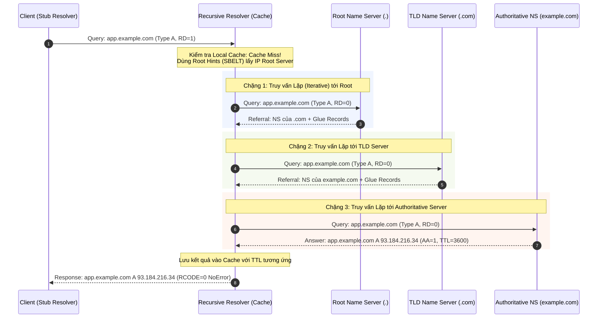

# 2_7_1 Domain Name System

> **Khóa học**: Cloud DevOps Basic — Networking Core  
> **Phân nhóm**: 2 Domain 2 - Computer Networking Core Fundamentals › 2_7 Core Application Layer Protocols  
> **Chủ đề**: Hệ thống phân giải tên miền DNS (RFC 1034 / RFC 1035): Không gian tên phân cấp, Recursive Resolver vs Authoritative Name Server, các bản ghi tài nguyên cốt lõi và cơ chế truyền tải UDP/TCP  
> **Trạng thái**: Verified (WRITE-CDB-2_7_1, 14-11-2026)  
> **Checklist đối chiếu**: [2_7_1](<../../../CHECKLIST.md#27-core-application-layer-protocols>)  

---

## 1. Khái Niệm Cốt Lõi & Bản Chất Kỹ Thuật (Core Concepts & Technical Deep Dive)

Hệ thống phân giải tên miền (**Domain Name System - DNS**) là cơ sở hạ tầng dịch vụ mạng phân tán cốt lõi của Internet. DNS chịu trách nhiệm chuyển dịch các tên miền ký tự định danh con người dễ nhớ (như `api.example.com`) thành các địa chỉ IP số học (IPv4 hoặc IPv6) mà các tầng giao vận (Transport Layer) và mạng (Network Layer) dùng để định tuyến gói tin.

DNS được chuẩn hóa nền tảng qua hai tài liệu kinh điển của IETF là [RFC 1034](https://datatracker.ietf.org/doc/html/rfc1034) và [RFC 1035](https://datatracker.ietf.org/doc/html/rfc1035), sau đó liên tục được bổ sung hoàn thiện qua các RFC chuyên biệt (RFC 3596, RFC 6891, RFC 7766, RFC 7208).

---

### 1.1 Không gian tên miền phân cấp (Hierarchical Domain Name Space - RFC 1034 §3.1)

Theo [RFC 1034 Section 3.1](https://datatracker.ietf.org/doc/html/rfc1034#section-3.1), không gian tên miền được tổ chức thành một cấu trúc cây đảo ngược (**Inverted Tree**), trong đó:
- **Gốc (Root Node)**: Là đỉnh cao nhất của cây, được ký hiệu bằng một nhãn rỗng (null/zero-length label) và thể hiện trực quan bằng một dấu chấm (`.`).
- **Nhãn (Label)**: Mỗi node trên cây có một nhãn có độ dài từ 0 đến 63 octets (bytes). Các ký tự trong nhãn theo quy ước truyền thống không phân biệt chữ hoa, chữ thường.
- **Tên miền đầy đủ (FQDN - Fully Qualified Domain Name)**: Là chuỗi biểu diễn đường dẫn từ một node lá đi ngược lên đỉnh gốc, các nhãn ngăn cách bởi dấu chấm và kết thúc bằng dấu chấm gốc (ví dụ: `app.internal.example.com.`).
- **Giới hạn kích thước**: Tổng độ dài tối đa của toàn bộ một FQDN không được vượt quá 255 octets (bao gồm cả các byte chỉ định độ dài nhãn).

```text
                        . (Root Zone)
                     /     |      \
                  .com    .net    .org   (TLD - Top-Level Domains)
                  /         \
            example          google      (SLD - Second-Level Domains)
            /     \
         api      www                    (Subdomains / Leaf Nodes)
```

---

### 1.2 Mô hình phân giải: Recursive Resolver vs Authoritative Name Server (RFC 1034 §2.4 & §4.3.1)

Một trong những nền tảng quan trọng nhất của DNS là sự phân tách rạch ròi giữa hai thực thể:

```text
+--------+     Truy vấn Đệ quy (Recursive)     +--------------------+
| Client | ---------------------------------> | Recursive Resolver |
| (Stub) | <--------------------------------- | (ISP / 8.8.8.8)    |
+--------+           Trả lời dứt điểm         +--------------------+
                                                        |
                                          Truy vấn Lặp  |  1. Hỏi Root (.) -> Nhận Referral TLD
                                          (Iterative)   |  2. Hỏi .com -> Nhận Referral SLD
                                                        |  3. Hỏi example.com -> Nhận Answer IP
                                                        v
                                              +---------------------+
                                              | Authoritative Name  |
                                              | Servers (. / com / …)|
                                              +---------------------+
```

1. **Authoritative Name Server (Máy chủ có thẩm quyền)**:
   - Nắm giữ cơ sở dữ liệu chính thức (Zone File) của một vùng mạng cụ thể.
   - Theo [RFC 1034 Section 4.3.1](https://datatracker.ietf.org/doc/html/rfc1034#section-4.3.1): Mọi Authoritative Name Server **BẮT BUỘC phải hỗ trợ truy vấn phi đệ quy (Iterative / Non-recursive queries)**. Hỗ trợ truy vấn đệ quy là tùy chọn (optional) và thường bị tắt trên các authoritative server để tránh quá tải và tấn công khuếch đại (amplification attack).
   - Khi nhận truy vấn: Nếu máy chủ nắm giữ dữ liệu, nó trả về câu trả lời chính thức (`AA - Authoritative Answer`). Nếu không, nó trả về thông tin ủy quyền (**Referral**) trỏ tới các Name Server cấp dưới.
2. **Recursive Resolver (Trình phân giải đệ quy)**:
   - Là máy chủ trung gian đứng ra gánh vác toàn bộ quá trình tìm kiếm thông tin thay cho máy trạm (Stub Resolver của client).
   - Nhận một truy vấn đệ quy từ client: Resolver **chỉ được phép trả về kết quả dứt điểm (IP address) hoặc mã lỗi (Error)**, tuyệt đối không bao giờ trả về referral bắt client tự đi hỏi tiếp.
   - Quản lý bộ nhớ đệm (**DNS Cache**) nội bộ để tái sử dụng kết quả, giảm độ trễ và giảm tải cho toàn bộ hệ sinh thái Internet.

---

### 1.3 Khởi tạo phân giải: Root Server Hints (SBELT - RFC 1034 §5.3.3)

Làm thế nào một Recursive Resolver mới khởi động biết bắt đầu tìm kiếm từ đâu khi chưa có bất kỳ bản ghi nào trong cache?
- Theo [RFC 1034 Section 5.3.3](https://datatracker.ietf.org/doc/html/rfc1034#section-5.3.3), resolver sử dụng cấu trúc dữ liệu **SBELT (Safety Belt / Root Hints)**.
- Root Hints chứa danh sách địa chỉ IP tĩnh của 13 định danh máy chủ gốc toàn cầu (từ `a.root-servers.net` đến `m.root-servers.net`).
- Khi gặp cache miss, resolver dựa vào Root Hints để gửi truy vấn lặp đầu tiên tới một trong các Root Server nhằm bắt đầu quá trình duyệt cây.

---

### 1.4 Các loại bản ghi tài nguyên cốt lõi (Core Resource Records)

Mỗi mục dữ liệu trong DNS Zone được lưu trữ dưới dạng một **Resource Record (RR)**. Các loại RR chuẩn hóa bao gồm:

| Loại RR | Mã số (Type ID) | Tiêu chuẩn RFC | Cấu trúc & Ý nghĩa kỹ thuật |
| :--- | :---: | :--- | :--- |
| **A** | `1` | RFC 1035 §3.4.1 | Ánh xạ tên miền sang một địa chỉ **IPv4 32-bit** (dạng chấm thập phân). |
| **AAAA** | `28` | RFC 3596 §2.1 | Ánh xạ tên miền sang một địa chỉ **IPv6 128-bit** (dạng hex). Phân giải ngược IPv6 thực hiện dưới nhánh `ip6.arpa` bằng các nibble đảo ngược phân tách bằng dấu chấm. |
| **NS** | `2` | RFC 1035 §3.3.11 | Khai báo máy chủ tên miền có thẩm quyền (**Authoritative Name Server**) quản trị zone. |
| **CNAME** | `5` | RFC 1034 §3.6.2 | Bản ghi bí danh chuẩn hóa (**Canonical Name**), trỏ một nhãn tên miền sang một tên miền đích khác. |
| **PTR** | `12` | RFC 1035 §3.3.12 | Bản ghi con trỏ phục vụ **phân giải ngược (Reverse DNS)** từ địa chỉ IP sang FQDN trong các vùng đặc biệt `in-addr.arpa` (IPv4) hoặc `ip6.arpa` (IPv6). |
| **MX** | `15` | RFC 1035 §3.3.9 | Định tuyến máy chủ nhận thư điện tử (**Mail Exchange**). Chứa trường độ ưu tiên `PREFERENCE` (số nguyên 16-bit); **giá trị số càng nhỏ thì độ ưu tiên càng cao**. |
| **TXT** | `16` | RFC 1035 §3.3.14 | Lưu trữ các chuỗi văn bản tùy ý. Là loại bản ghi **bắt buộc duy nhất** dùng để công bố các chính sách bảo mật thư điện tử: **SPF** ([RFC 7208 Section 3.1](https://datatracker.ietf.org/doc/html/rfc7208#section-3.1)), khóa ký xác thực **DKIM**, và chính sách **DMARC**. |
| **SOA** | `6` | RFC 1035 §3.3.13 | Bản ghi khởi đầu thẩm quyền (**Start of Authority**) của zone. Xác định các tham số quản trị: `MNAME` (Primary Master), `RNAME` (Email quản trị viên, thay `@` bằng `.`), `SERIAL` (số phiên bản 32-bit), `REFRESH`, `RETRY`, `EXPIRE`, và `MINIMUM TTL` (dùng cho negative caching). |

#### Quy tắc bất biến của CNAME (RFC 1034 §3.6.2 & RFC 1912 §2.4)
> *"If a CNAME RR is present at a node, no other data should be present... In particular, this means that you cannot put a CNAME on the apex of a zone because a zone apex must have an SOA record and at least one NS record."*

- **Quy tắc**: Bản ghi CNAME **tuyệt đối không được phép cùng tồn tại** với bất kỳ bản ghi tài nguyên nào khác (A, AAAA, MX, TXT...) trên cùng một nhãn node tên miền.
- **Hệ quả tại Zone Apex**: Đỉnh gốc của một zone (Zone Apex, ví dụ `example.com`) bắt buộc phải chứa bản ghi `SOA` và ít nhất một bản ghi `NS`. Do đó, **nghiêm cấm cấu hình bản ghi CNAME trực tiếp tại Zone Apex**.

---

### 1.5 Cấu trúc gói tin DNS và Giao thức truyền tải (Wire Format & Transport)

#### Cấu trúc Header 12 bytes (96 bits) (RFC 1035 §4.1.1)
Mọi gói tin thông điệp DNS (cả truy vấn Query và phản hồi Response) đều bắt đầu bằng phần tiêu đề cố định 12 bytes:

```text
 0                   1                   2                   3
 0 1 2 3 4 5 6 7 8 9 0 1 2 3 4 5 6 7 8 9 0 1 2 3 4 5 6 7 8 9 0 1
+-+-+-+-+-+-+-+-+-+-+-+-+-+-+-+-+-+-+-+-+-+-+-+-+-+-+-+-+-+-+-+-+
|                      ID (16 bits)                             |
+-+-+-+-+-+-+-+-+-+-+-+-+-+-+-+-+-+-+-+-+-+-+-+-+-+-+-+-+-+-+-+-+
|QR|   Opcode  |AA|TC|RD|RA|   Z    |   RCODE (4 bits)          |
+-+-+-+-+-+-+-+-+-+-+-+-+-+-+-+-+-+-+-+-+-+-+-+-+-+-+-+-+-+-+-+-+
|                    QDCOUNT (16 bits)                          |
+-+-+-+-+-+-+-+-+-+-+-+-+-+-+-+-+-+-+-+-+-+-+-+-+-+-+-+-+-+-+-+-+
|                    ANCOUNT (16 bits)                          |
+-+-+-+-+-+-+-+-+-+-+-+-+-+-+-+-+-+-+-+-+-+-+-+-+-+-+-+-+-+-+-+-+
|                    NSCOUNT (16 bits)                          |
+-+-+-+-+-+-+-+-+-+-+-+-+-+-+-+-+-+-+-+-+-+-+-+-+-+-+-+-+-+-+-+-+
|                    ARCOUNT (16 bits)                          |
+-+-+-+-+-+-+-+-+-+-+-+-+-+-+-+-+-+-+-+-+-+-+-+-+-+-+-+-+-+-+-+-+
```

- **ID (16 bits)**: Mã định danh ngẫu nhiên do bên hỏi sinh ra để ghép nối chính xác Response nhận về với Query tương ứng.
- **Các cờ (Flags - 16 bits)**:
  - `QR` (1 bit): `0` = Query, `1` = Response.
  - `Opcode` (4 bits): `0` cho truy vấn tiêu chuẩn (Standard Query).
  - `AA` (Authoritative Answer, 1 bit): `1` nếu server trả lời có thẩm quyền đối với zone.
  - `TC` (Truncation, 1 bit): `1` nếu thông điệp bị cắt cụt do kích thước vượt quá giới hạn kênh truyền.
  - `RD` (Recursion Desired, 1 bit): Yêu cầu máy chủ thực hiện phân giải đệ quy.
  - `RA` (Recursion Available, 1 bit): Báo hiệu máy chủ hỗ trợ phân giải đệ quy.
  - `Z` (3 bits): Dành riêng cho tương lai, bắt buộc bằng 0.
  - `RCODE` (Response Code, 4 bits): Mã phản hồi trạng thái:
    - `0` = **NoError**: Không có lỗi.
    - `1` = **FormErr**: Lỗi định dạng thông điệp.
    - `2` = **ServFail**: Máy chủ gặp lỗi nội bộ không thể xử lý.
    - `3` = **NXDomain**: Tên miền không tồn tại (Non-Existent Domain).
    - `5` = **Refused**: Máy chủ từ chối thực hiện truy vấn vì lý do chính sách.
- **QDCOUNT / ANCOUNT / NSCOUNT / ARCOUNT (16 bits mỗi trường)**: Số lượng mục trong các phần Question, Answer, Authority và Additional.

#### Cơ chế truyền tải: UDP vs TCP trên cổng 53
- **UDP Port 53 mặc định**: DNS truyền thống hoạt động chủ yếu trên UDP để tối ưu hiệu năng và độ trễ.
- **Giới hạn 512 bytes (RFC 1035 §4.2.1)**: Thông điệp truyền trên UDP tiêu chuẩn bị giới hạn tối đa 512 octets (chưa tính header IP/UDP). Nếu câu trả lời dài hơn 512 bytes, máy chủ buộc phải cắt bớt dữ liệu và bật cờ **`TC = 1`**. Client khi thấy `TC = 1` bắt buộc phải chuyển sang thiết lập kết nối **TCP port 53** để nhận lại câu trả lời đầy đủ.
- **Mở rộng EDNS0 (RFC 6891 §6.2.3)**: Cơ chế Extension Mechanisms for DNS (EDNS0) sử dụng bản ghi giả lập `OPT` (Pseudo-RR) nhằm mở rộng kích thước bộ đệm UDP cho phép lên **1232 bytes** hoặc **4096 bytes**, hạn chế tình trạng phải chuyển sang TCP hoặc bị phân mảnh IP.
- **Hỗ trợ bắt buộc cả TCP và UDP (RFC 7766 §5 & RFC 5936 §4)**: Mọi hệ thống DNS tuân chuẩn IETF **BẮT BUỘC (MUST)** phải hỗ trợ cả UDP và TCP trên cổng 53. Giao thức TCP ngoài việc tiếp nhận fallback khi `TC=1` còn được sử dụng bắt buộc cho cơ chế đồng bộ chuyển giao toàn bộ dữ liệu zone giữa các máy chủ tên miền (**AXFR - Authoritative Zone Transfer**).

---

## 2. Ví Dụ Đời Sống Thực Tế Dễ Hiểu (Intuitive Real-World Analogies)

### 2.1 Hệ thống bưu chính quốc tế và Người thư ký mẫn cán
Hãy hình dung bạn (Client) muốn gửi một văn kiện khẩn tới văn phòng chi nhánh `chi-nhanh.cong-ty.com`:
- **Bạn (Client / Stub Resolver)**: Bạn không có thời gian và cũng không biết ai giữ địa chỉ của từng chi nhánh trên thế giới. Bạn chỉ cần giao việc cho **Người thư ký tận tụy (Recursive Resolver)**: *"Hãy tìm cho tôi địa chỉ thực tế của văn phòng này"*.
- **Người thư ký (Recursive Resolver)**:
  1. Người thư ký mở cuốn sổ tay an toàn (**Root Hints**) có sẵn địa chỉ của **Tổng đài bưu chính quốc tế (Root Server `.`)**.
  2. Người thư ký chạy tới Tổng đài quốc tế hỏi. Tổng đài trả lời: *"Tôi không giữ sổ địa chỉ chi tiết của công ty đó, nhưng đây là danh bạ của **Bưu cục thương mại quốc gia (TLD Server `.com`)**, bạn hãy đến đó mà hỏi"*. (Đây là một **Referral**).
  3. Người thư ký đến Bưu cục `.com`. Bưu cục nói: *"Hãy đến **Văn phòng quản lý tòa nhà của công ty (Authoritative Name Server `cong-ty.com`)** theo địa chỉ này"*.
  4. Người thư ký đến đúng văn phòng `cong-ty.com`. Ban quản trị tại đây lật cuốn sổ đăng ký chính thức (**Zone File**) ra và đọc chính xác: *"Văn phòng chi nhánh đó đặt tại tầng 5, tòa nhà số 192.0.2.1"*.
  5. Người thư ký ghi lại địa chỉ này vào sổ ghi nhớ tạm thời (**DNS Cache**) của mình, rồi quay về bàn làm việc báo cáo cho bạn. Lần sau nếu bạn hỏi lại, người thư ký chỉ cần liếc vào sổ nhớ tạm và trả lời bạn ngay trong 1 giây mà không cần chạy vòng quanh thế giới nữa.

### 2.2 Biển chỉ đường CNAME và Căn cước công dân Zone Apex
- **Bản ghi A / AAAA**: Giống như tấm Căn cước công dân gắn chip hoặc Giấy chứng nhận quyền sở hữu nhà đất ghi rõ tọa độ địa lý căn nhà.
- **Bản ghi CNAME**: Giống như một tấm biển chỉ đường ghi: *"Văn phòng đại diện ở đây thực chất chuyển giao tiếp nhận hồ sơ theo ông Trưởng phòng `giam-doc.example.com`"*.
- **Tại sao cấm CNAME ở Zone Apex?** Ngôi nhà tổ (Zone Apex `example.com`) bắt buộc phải có Giấy khai sinh của cả gia tộc (bản ghi `SOA`) và danh sách người giám hộ hợp pháp (bản ghi `NS`). Nếu bạn cắm biển CNAME ở cổng ngôi nhà tổ, biển đó tuyên bố: *"Mọi thứ ở đây hoàn toàn là bí danh của một người khác"*. Điều này triệt tiêu tư cách pháp nhân độc lập của ngôi nhà tổ, làm mất hiệu lực của Giấy khai sinh (`SOA`) và Người giám hộ (`NS`), dẫn tới việc các bưu bạ (hệ thống Mail, Web) không thể nhận diện được vùng thẩm quyền.

---

## 3. Kiến Trúc, Luồng Hoạt Động & Hình Ảnh Trực Quan (Architecture, Diagrams & Visual Media)

### Sơ đồ tuần tự: Toàn trình giải quyết truy vấn DNS (Recursive vs Iterative)

Sơ đồ dưới đây minh họa chi tiết luồng xử lý truy vấn đệ quy từ Client tới Resolver, và chuỗi 3 chặng truy vấn lặp (Iterative queries) của Resolver duyệt qua các tầng cây DNS:



---

## 4. Thực Hành (Hands-on)

### 4.1 Phân tích truy vấn DNS chi tiết với `dig` (Domain Information Groper)

Công cụ `dig` là tiện ích chẩn đoán DNS tiêu chuẩn trên môi trường Linux. Cú pháp cơ bản: `dig @<server> <domain> <type>`.

#### 1. Truy vấn bản ghi A cụ thể qua máy chủ đệ quy:
```bash
dig @8.8.8.8 example.com A
```

> 💡 Minh họa output lệnh thực tế (Illustrative output)
```text
; <<>> DiG 9.18.28-0ubuntu0.24.04.1-Ubuntu <<>> @8.8.8.8 example.com A
; (1 server found)
;; global options: +cmd
;; Got answer:
;; ->>HEADER<<- opcode: QUERY, status: NOERROR, id: 48219
;; flags: qr rd ra; QUERY: 1, ANSWER: 1, AUTHORITY: 0, ADDITIONAL: 1

;; OPT PSEUDOSECTION:
; EDNS: version: 0, flags:; udp: 512
;; QUESTION SECTION:
;example.com.			IN	A

;; ANSWER SECTION:
example.com.		3600	IN	A	93.184.216.34

;; Query time: 28 msec
;; SERVER: 8.8.8.8#53(8.8.8.8) (UDP)
;; WHEN: Sat Nov 14 08:20:00 UTC 2026
;; MSG SIZE  rcvd: 56
```

*Phân tích các cờ và chỉ số kỹ thuật*:
- `status: NOERROR`: Mã phản hồi `RCODE = 0`.
- `flags: qr rd ra`: `qr` (đây là Response), `rd` (Client yêu cầu Recursion Desired), `ra` (Server thông báo Recursion Available). Chú ý không có cờ `aa` vì Google DNS 8.8.8.8 là Resolver, không phải Authoritative NS cho domain này.
- `EDNS: udp: 512`: Kích thước payload EDNS0 được đàm phán.
- Cổng kết nối: `8.8.8.8#53(UDP)`.

---

#### 2. Lần vết từng chặng duyệt cây phân giải lặp với cờ `+trace`:
```bash
# Quan sát toàn bộ chuỗi ủy quyền từ Root (.) xuống TLD rồi tới Authoritative NS
dig +trace example.com
```

> 💡 Minh họa output lệnh thực tế (Illustrative output)
```text
.			518400	IN	NS	a.root-servers.net.
.			518400	IN	NS	b.root-servers.net.
;; Received 525 bytes from 127.0.0.53#53 in 4 ms

com.			172800	IN	NS	a.gtld-servers.net.
com.			172800	IN	NS	b.gtld-servers.net.
;; Received 1174 bytes from 198.41.0.4#53(a.root-servers.net) in 32 ms

example.com.		172800	IN	NS	a.iana-servers.net.
example.com.		172800	IN	NS	b.iana-servers.net.
;; Received 815 bytes from 192.5.6.30#53(a.gtld-servers.net) in 45 ms

example.com.		86400	IN	A	93.184.216.34
example.com.		86400	IN	NS	a.iana-servers.net.
;; Received 74 bytes from 199.43.135.53#53(a.iana-servers.net) in 52 ms
```

---

#### 3. Phân giải ngược IPv4 (Reverse DNS) với cờ `-x`:
```bash
# Phân giải ngược IP sang tên miền bằng bản ghi PTR
dig -x 93.184.216.34 +noall +answer
```

> 💡 Minh họa output lệnh thực tế (Illustrative output)
```text
34.216.184.93.in-addr.arpa. 7200 IN	PTR	example.com.
```
*Ghi chú*: Lệnh tự động đảo ngược 4 octets thành `34.216.184.93` và gắn thêm hậu tố `in-addr.arpa.` theo chuẩn [RFC 1035 Section 3.3.12](https://datatracker.ietf.org/doc/html/rfc1035#section-3.3.12).

---

#### 4. Kiểm tra nhanh với `nslookup`:
```bash
nslookup -type=MX example.com 8.8.8.8
```

> 💡 Minh họa output lệnh thực tế (Illustrative output)
```text
Server:		8.8.8.8
Address:	8.8.8.8#53

Non-authoritative answer:
example.com	mail exchanger = 10 mail.example.com.
```

---

## 5. Cạm Bẫy Thực Tế & Thực Tiễn Sản Xuất (Production Gotchas & Best Practices)

### 5.1 Cạm bẫy CNAME tại Zone Apex làm gãy luồng thư điện tử
- **Vấn đề**: Kỹ sư muốn trỏ tên miền gốc `example.com` vào một Cloud Load Balancer hoặc CDN (ví dụ `alb-123.us-east-1.elb.amazonaws.com`) nên đã tạo một bản ghi `CNAME` tại `@` (`example.com`).
- **Hậu quả**: Theo [RFC 1034 Section 3.6.2](https://datatracker.ietf.org/doc/html/rfc1034#section-3.6.2) và [RFC 1912 Section 2.4](https://datatracker.ietf.org/doc/html/rfc1912#section-2.4), khi CNAME xuất hiện, mọi bản ghi khác trên cùng node bị hủy bỏ giá trị. Máy chủ DNS ngoài Internet khi truy vấn bản ghi `MX` hoặc `SOA` của `example.com` sẽ nhận về kết quả CNAME và chuyển hướng toàn bộ tìm kiếm thư điện tử sang tên miền của balancer. Hậu quả là toàn bộ hệ thống email của doanh nghiệp bị từ chối gửi nhận.
- **Thực tiễn sản xuất**: Không bao giờ tạo CNAME tại zone apex. Thay vào đó, sử dụng tính năng **Alias Record** (AWS Route 53), **ANAME** hoặc **CNAME Flattening** (Cloudflare), trong đó DNS server tự phân giải IP của đích và trả về bản ghi `A` trực tiếp cho zone apex mà không vi phạm chuẩn RFC.

### 5.2 Cạm bẫy đóng cổng TCP 53 trên tường lửa (Firewall)
- **Vấn đề**: Quản trị viên mạng chỉ mở cổng `53/UDP` trên firewall vì tin rằng DNS chỉ sử dụng UDP.
- **Hậu quả**: Khi có câu trả lời kích thước lớn (như phản hồi chứa chữ ký DNSSEC hoặc danh sách dài bản ghi TXT xác thực SPF/DKIM) vượt quá kích thước gói UDP, server sẽ đặt cờ `TC=1` (Truncated). Trình phân giải của client lập tức thử kết nối lại qua `53/TCP`, nhưng firewall ngắt kết nối (`RST` hoặc timeout). Kết quả là quá trình phân giải thất bại hoàn toàn.
- **Thực tiễn sản xuất**: Theo [RFC 7766 Section 5](https://datatracker.ietf.org/doc/html/rfc7766#section-5), mọi hạ tầng mạng bắt buộc phải mở đồng thời cả hai giao thức **UDP và TCP trên cổng 53**.

### 5.3 Kích thước đệm EDNS0 và sự cố phân mảnh IP
- **Vấn đề**: Cấu hình kích thước bộ đệm EDNS0 quá lớn (như 4096 octets) có thể khiến các gói UDP vượt qua chỉ số Path MTU của đường truyền mạng (thường là 1500 bytes đối với Ethernet tiêu chuẩn), dẫn tới việc gói tin IP bị phân mảnh (IP Fragmentation). Nếu các thiết bị trung gian chặn gói tin phân mảnh, DNS request sẽ bị drop bí ẩn.
- **Thực tiễn sản xuất**: Theo khuyến nghị cập nhật tại [RFC 6891 Section 6.2.3](https://datatracker.ietf.org/doc/html/rfc6891#section-6.2.3), các nhà vận hành DNS hiện đại thiết lập ngưỡng đệm EDNS0 phổ biến là **1232 octets** để đảm bảo gói tin UDP nằm an toàn bên trong payload của một frame Ethernet MTU 1500 mà không bao giờ bị phân mảnh.

---

## 6. Câu Hỏi Củng Cố Kiến Thức (Active Recall Quiz)

<details>
<summary><strong>Câu 1: Tại sao theo tiêu chuẩn RFC 1034 và RFC 1912, một bản ghi CNAME tuyệt đối không được phép đặt tại Zone Apex (tên miền gốc, ví dụ example.com)?</strong></summary>

**Đáp án**:  
Theo [RFC 1034 Section 3.6.2](https://datatracker.ietf.org/doc/html/rfc1034#section-3.6.2) và RFC 1912 §2.4, quy tắc bất biến của DNS là: **Nếu một node đã có bản ghi CNAME thì không một bản ghi dữ liệu nào khác được phép cùng tồn tại trên node đó**.  
Mặt khác, một Zone Apex bắt buộc phải chứa bản ghi `SOA` (Start of Authority) và tối thiểu một bản ghi `NS` (Name Server) để xác định thẩm quyền của vùng tên miền. Nếu đặt CNAME tại Zone Apex, nó sẽ xung đột trực tiếp với SOA và NS, làm gãy cơ chế quản trị vùng tên miền và khiến các dịch vụ như Email (bản ghi `MX`) không thể phân giải được.
</details>

<details>
<summary><strong>Câu 2: Trong phần cờ (Flags) của DNS Header, cờ TC (Truncation) có ý nghĩa gì và client phải hành xử như thế nào khi nhận được gói tin có cờ TC = 1?</strong></summary>

**Đáp án**:  
Theo [RFC 1035 Section 4.1.1 và Section 4.2.1](https://datatracker.ietf.org/doc/html/rfc1035#section-4.2.1), cờ `TC` (Truncation) báo hiệu rằng kích thước thông điệp phản hồi đã vượt quá giới hạn tải cho phép của kênh truyền UDP (512 bytes đối với DNS truyền thống hoặc kích thước EDNS0 đã đàm phán), buộc máy chủ phải cắt ngắn dữ liệu.  
Khi client nhận được gói tin có `TC = 1`, nó hiểu rằng dữ liệu trả về chưa trọn vẹn và **bắt buộc phải khởi tạo ngay một kết nối TCP port 53** tới máy chủ để gửi lại truy vấn và tiếp nhận toàn bộ dữ liệu phản hồi không bị giới hạn kích thước.
</details>

<details>
<summary><strong>Câu 3: Sự khác biệt cơ bản về mặt trách nhiệm xử lý giữa một Recursive Resolver và một Authoritative Name Server là gì?</strong></summary>

**Đáp án**:  
Theo [RFC 1034 Section 2.4 và Section 4.3.1](https://datatracker.ietf.org/doc/html/rfc1034#section-2.4):
- **Authoritative Name Server**: Chỉ chịu trách nhiệm quản lý dữ liệu gốc của zone được giao ủy quyền. Nó phục vụ các truy vấn phi đệ quy (Iterative queries). Khi không nắm dữ liệu, nó chỉ trả về thông tin ủy quyền (Referral) trỏ sang máy chủ khác chứ không đi hỏi hộ.
- **Recursive Resolver**: Là máy chủ đóng vai trò trung gian phục vụ client. Khi nhận yêu cầu đệ quy từ client, nó gánh vác toàn bộ quy trình đi duyệt cây DNS qua từng cấp (Root $\rightarrow$ TLD $\rightarrow$ Authoritative), quản lý cache dữ liệu, và chỉ trả về cho client kết quả cuối cùng (địa chỉ IP hoặc mã lỗi), không bao giờ trả về referral bắt client tự đi hỏi tiếp.
</details>

---

## 7. 📚 Nguồn Tài Liệu Chính Thống (Tier-1 Official References)

- [RFC 1034: Domain Names - Concepts and Facilities](https://datatracker.ietf.org/doc/html/rfc1034) - Tiêu chuẩn IETF nền tảng về cấu trúc không gian tên miền, vai trò Recursive Resolver và Authoritative Server.
- [RFC 1035: Domain Names - Implementation and Specification](https://datatracker.ietf.org/doc/html/rfc1035) - Quy chuẩn kỹ thuật chi tiết về cấu trúc gói tin DNS 12 bytes, các bản ghi RR (A, NS, CNAME, PTR, MX, SOA, TXT) và truyền tải UDP 512 bytes.
- [RFC 3596: DNS Extensions to Support IP Version 6](https://datatracker.ietf.org/doc/html/rfc3596) - Đặc tả bản ghi AAAA (Type 28) và không gian phân giải ngược `ip6.arpa`.
- [RFC 7766: DNS Transport over TCP - Implementation Requirements](https://datatracker.ietf.org/doc/html/rfc7766) - Tiêu chuẩn bắt buộc triển khai đồng thời cả UDP và TCP trên cổng 53.
- [RFC 6891: Extension Mechanisms for DNS (EDNS(0))](https://datatracker.ietf.org/doc/html/rfc6891) - Đặc tả cơ chế mở rộng bộ đệm UDP và tùy chọn thông điệp DNS.
- [RFC 7208: Sender Policy Framework (SPF) - Section 3.1](https://datatracker.ietf.org/doc/html/rfc7208#section-3.1) - Quy định bắt buộc xuất bản chính sách SPF dưới dạng bản ghi TXT (type 16).
