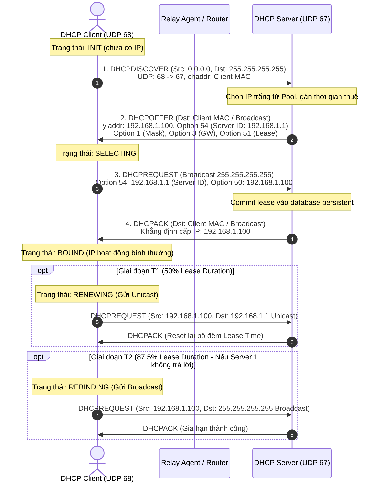
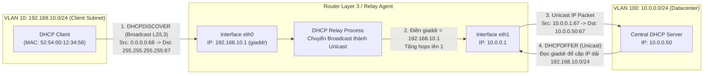

# 2_7_2 Dynamic Host Configuration Protocol

> **Khóa học**: Cloud DevOps Basic — Networking Core  
> **Phân nhóm**: 2 Domain 2 - Computer Networking Core Fundamentals › 2_7 Core Application Layer Protocols  
> **Chủ đề**: Giao thức cấp phát cấu hình máy chủ động (DHCP): Chu trình 4 bước DORA, cấu trúc gói tin RFC 2131/2132, bộ định thời T1/T2, và DHCP Relay Agent  
> **Trạng thái**: Verified (WRITE-CDB-2_7_2, 14-11-2026)  
> **Checklist đối chiếu**: [2_7_2](<../../../CHECKLIST.md#27-core-application-layer-protocols>)  

---

## 1. Khái Niệm Cốt Lõi & Bản Chất Kỹ Thuật (Core Concepts & Technical Deep Dive)

Khi một thiết bị phần cứng (máy chủ vật lý, máy trạm, máy ảo hoặc container) vừa khởi động và cắm cáp vào một mạng cục bộ (LAN), giao diện mạng của nó ban đầu hoàn toàn chưa có danh tính logic: chưa có địa chỉ IP, chưa biết mặt nạ mạng con (Subnet Mask), không biết địa chỉ Gateway để đi ra ngoài và không biết máy chủ DNS để phân giải tên miền.

Để tránh việc quản trị viên phải cấu hình tĩnh thủ công từng tham số mạng trên hàng trăm nghìn máy chủ, **Giao thức Cấu hình Máy chủ Động (DHCP - Dynamic Host Configuration Protocol)** được định nghĩa trong [RFC 2131](https://datatracker.ietf.org/doc/html/rfc2131) và [RFC 2132](https://datatracker.ietf.org/doc/html/rfc2132) nhằm tự động hóa hoàn toàn quá trình phân phối các thông số cấu hình mạng TCP/IP.

---

### 1.1 Cơ chế truyền tải và Cổng mạng (RFC 2131 §4.1)

DHCP hoạt động ở tầng Ứng dụng (Application Layer) dựa trên giao thức tầng Giao vận **UDP (User Datagram Protocol)**:
- **UDP Port 67**: Cổng dịch vụ lắng nghe của **DHCP Server** và **DHCP Relay Agent**.
- **UDP Port 68**: Cổng tiếp nhận phản hồi của **DHCP Client**.

Việc tách biệt hai số cổng riêng biệt giúp tránh xung đột lưu lượng khi nhiều tiến trình máy khách và máy chủ cùng chạy trên cùng một phân đoạn mạng.

---

### 1.2 Chu trình 4 bước DORA (RFC 2131 §3.1)

Quá trình cấp phát một địa chỉ IP mới giữa Client và Server diễn ra qua chu trình kinh điển 4 bước mang tên **DORA**:

```text
 Client (Port 68)                                   Server (Port 67)
       |                                                   |
       | ----- (1) DHCPDISCOVER (Broadcast UDP 67) ------> |
       |                                                   |
       | <---- (2) DHCPOFFER (Unicast/Broadcast UDP 68) -- |
       |                                                   |
       | ----- (3) DHCPREQUEST (Broadcast UDP 67) -------> |
       |                                                   |
       | <---- (4) DHCPACK (Unicast/Broadcast UDP 68) ---- |
       |                                                   |
```

1. **Step 1: DHCPDISCOVER (Khám phá)**:
   - Máy khách gửi một gói tin quảng bá (**Broadcast**) trên toàn phân đoạn mạng cục bộ (địa chỉ IP đích `255.255.255.255`, MAC đích `FF:FF:FF:FF:FF:FF`).
   - Do chưa có IP, trường địa chỉ IP nguồn của client đặt là `0.0.0.0`. Gói tin mang theo địa chỉ MAC phần cứng của client trong trường `chaddr` để định danh.
2. **Step 2: DHCPOFFER (Đề xuất)**:
   - Mọi DHCP Server trên cùng phân đoạn mạng nhận được gói Discover sẽ kiểm tra kho địa chỉ IP khả dụng (IP Pool) của mình.
   - Mỗi server soạn một gói tin đề xuất chứa: địa chỉ IP dự kiến cấp (`yiaddr` - "your IP address"), thời hạn thuê (Lease Time), Subnet Mask, Default Gateway và Server Identifier (Option 54). Server gửi gói Offer này về cho client.
3. **Step 3: DHCPREQUEST (Yêu cầu chính thức)**:
   - Khi client nhận được một hoặc nhiều gói Offer từ các server khác nhau, nó sẽ chọn một server (thường là server phản hồi Offer đầu tiên).
   - Client gửi gói tin **DHCPREQUEST dưới dạng Broadcast** tới toàn mạng. Điểm cốt lõi: Gói tin này **BẮT BUỘC phải chứa Option 54 (Server Identifier)** ghi rõ IP của server được chọn.
   - *Bản chất của việc gửi Broadcast*: Nhằm công khai thông báo cho tất cả các DHCP Server khác biết rằng client đã chọn server nào, từ đó các server không được chọn sẽ lập tức hủy bỏ đề xuất và hoàn trả địa chỉ IP dự kiến về lại pool khả dụng.
4. **Step 4: DHCPACK (Xác nhận & Cam kết)**:
   - Server được chọn nhận gói DHCPREQUEST, lưu thông tin liên kết (binding) giữa MAC của client và IP cấp phát vào bộ lưu trữ lâu bền (persistent storage).
   - Server gửi lại gói tin **DHCPACK (Acknowledgment)** chứa đầy đủ toàn bộ tham số mạng hoàn chỉnh. Khi nhận được DHCPACK, client chính thức gán IP vào card mạng và kích hoạt giao tiếp mạng.

---

### 1.3 Cấu trúc gói tin DHCP (RFC 2131 §2 & RFC 2132 §2)

Gói tin DHCP kế thừa định dạng khung của giao thức tiền nhiệm BOOTP ([RFC 2131 Section 2](https://datatracker.ietf.org/doc/html/rfc2131#section-2)), bao gồm phần tiêu đề cố định **236 bytes** kết hợp với **4 bytes Magic Cookie**, tạo thành khối **240 bytes** chuẩn trước khi bắt đầu phần tùy chọn (Options):

| Trường (Field) | Kích thước | Mô tả kỹ thuật |
| :--- | :--- | :--- |
| `op` | 1 byte | Mã thao tác tin nhắn (Message op code): `1` = BOOTREQUEST (Client gửi), `2` = BOOTREPLY (Server gửi). |
| `htype` | 1 byte | Loại phần cứng mạng (Hardware address type): `1` = Ethernet (10Mb). |
| `hlen` | 1 byte | Độ dài địa chỉ phần cứng (Hardware address length): `6` bytes đối với MAC Ethernet. |
| `hops` | 1 byte | Số chặng chuyển tiếp qua relay agent (khởi tạo bằng 0). |
| `xid` | 4 bytes | Transaction ID: Chuỗi số nguyên ngẫu nhiên do client sinh ra để ghép nối cặp request/response. |
| `secs` | 2 bytes | Số giây trôi qua kể từ khi client bắt đầu quy trình yêu cầu cấp phát. |
| `flags` | 2 bytes | Cờ điều khiển: Bit ngoài cùng bên trái (leftmost bit) là **BROADCAST flag (0x8000)**; 15 bits còn lại dành riêng cho tương lai và **BẮT BUỘC phải là 0**. |
| `ciaddr` | 4 bytes | Client IP address: Địa chỉ IP hiện tại của client (chỉ điền khi client đang ở trạng thái BOUND, RENEWING hoặc REBINDING; điền `0.0.0.0` khi chưa có IP). |
| `yiaddr` | 4 bytes | "Your" (client) IP address: Địa chỉ IP do server cấp cho client. |
| `siaddr` | 4 bytes | Server IP address: Địa chỉ IP của máy chủ tiếp theo (thường dùng trong bootstrap mạng như TFTP server). |
| `giaddr` | 4 bytes | Gateway / Relay IP address: Địa chỉ IP giao diện của DHCP Relay Agent (nếu có trung chuyển). |
| `chaddr` | 16 bytes | Client hardware address: Địa chỉ MAC thực tế của client (chứa 6 bytes MAC, 10 bytes còn lại đệm 0). |
| `sname` | 64 bytes | Server host name tùy chọn (chuỗi null-terminated). |
| `file` | 128 bytes | Tên tệp khởi động boot file (chuỗi null-terminated dùng trong netboot PXE). |
| **Magic Cookie** | **4 bytes** | Giá trị ma thuật chuẩn hóa bắt buộc: `0x63825363` (hệ thập phân: `99, 130, 83, 99`). Đánh dấu điểm bắt đầu của vùng Options. |
| `options` | Biến thiên | Danh sách các tùy chọn cấu hình mở rộng (RFC 2132). |

---

### 1.4 Các tùy chọn DHCP phổ biến (RFC 2132)

Phần Options sử dụng cơ cấu mã hóa **TLV (Type - Length - Value)**:
- **Option 53 (DHCP Message Type)**: Xác định loại bản tin (độ dài 1 byte):
  - `1` = DHCPDISCOVER
  - `2` = DHCPOFFER
  - `3` = DHCPREQUEST
  - `4` = DHCPDECLINE
  - `5` = DHCPACK
  - `6` = DHCPNAK
  - `7` = DHCPRELEASE
  - `8` = DHCPINFORM
- **Option 1 (Subnet Mask)**: Mặt nạ mạng con (ví dụ: `255.255.255.0`).
- **Option 3 (Router)**: Danh sách địa chỉ IP của Default Gateway.
- **Option 6 (Domain Name Server)**: Danh sách địa chỉ IP của các máy chủ DNS.
- **Option 51 (IP Address Lease Time)**: Tổng thời gian cho thuê địa chỉ IP (tính bằng giây).
- **Option 54 (Server Identifier)**: Địa chỉ IP của DHCP Server thực hiện cấp phát.
- **Option 58 (Renewal Time Value T1)**: Mốc thời gian bắt đầu xin gia hạn đơn phương.
- **Option 59 (Rebinding Time Value T2)**: Mốc thời gian bắt đầu phát quảng bá tìm server thay thế.

---

### 1.5 Vòng đời Lease và Bộ định thời T1, T2 (RFC 2131 §4.3.2 & §4.4.5)

Địa chỉ IP do DHCP cấp không mang tính vĩnh viễn mà đi kèm một khoảng thời hạn gọi là **Lease Time**. Vòng đời của hợp đồng thuê gắn liền với hai mốc định thời nội tại:

1. **Mốc T1 (Renewal Timer - Mặc định $0.5 \times \text{Lease Time}$)**:
   - Khi đã sử dụng được **50% thời hạn thuê**, client chuyển sang trạng thái **RENEWING**.
   - Tại mốc này, client chủ động gửi một thông điệp **DHCPREQUEST dạng UNICAST** trực tiếp tới địa chỉ IP của server đã cấp phát (lấy từ Option 54).
   - Nếu server ban đầu còn hoạt động và đồng ý, nó phản hồi gói **DHCPACK** kèm theo bộ đếm lease mới. Client khởi tạo lại toàn bộ chu kỳ.
2. **Mốc T2 (Rebinding Timer - Mặc định $0.875 \times \text{Lease Time}$ hay 87.5%)**:
   - Nếu ở mốc T1 server ban đầu không phản hồi (do sập máy chủ, đứt kết nối mạng), client vẫn tiếp tục dùng địa chỉ IP đó cho tới mốc 87.5% thời hạn.
   - Khi chạm mốc T2, client rơi vào trạng thái **REBINDING**.
   - Client **BẮT BUỘC phải gửi DHCPREQUEST dưới dạng BROADCAST tới `255.255.255.255`** để cầu cứu bất kỳ DHCP Server nào đang hoạt động trên mạng gia hạn hoặc xác nhận quyền sử dụng IP cho mình.
3. **Hết hạn Lease Time ($1.0 \times \text{Lease Time}$)**:
   - Nếu đến thời điểm hết hạn $100\%$ mà client vẫn không nhận được bất kỳ phản hồi DHCPACK nào, client **BẮT BUỘC PHẢI NGỪNG SỬ DỤNG địa chỉ IP đó ngay lập tức (MUST immediately stop using the network address)**. Toàn bộ lưu lượng mạng IP bị ngắt, và client phải quay trở lại trạng thái `INIT` gửi lại DHCPDISCOVER từ đầu.

```text
 0%               50% (T1)                      87.5% (T2)                 100% (Expire)
 |-------------------|------------------------------|---------------------------|
 [    BOUND State   ] [       RENEWING State       ] [      REBINDING State      ] [ EXPIRED ]
                     Unicast DHCPREQUEST             Broadcast DHCPREQUEST        Stop using IP!
                     tới leasing server ban đầu      tới 255.255.255.255          Reset về INIT
```

---

### 1.6 Các loại thông điệp bổ trợ khác (RFC 2131 §3.1 Table 2 & §4.3.3)

Ngoài 4 thông điệp DORA chính, chuẩn RFC 2131 định nghĩa 4 loại thông điệp quan trọng:
- **DHCPDECLINE**: Khi client nhận được DHCPACK, nó sẽ phát một gói tin ARP Probe trên mạng cục bộ để kiểm tra trùng IP. Nếu phát hiện một thiết bị khác đã sử dụng IP này, client gửi DHCPDECLINE báo cho server biết địa chỉ đã bị xung đột để server đánh dấu cách ly.
- **DHCPNAK**: Máy chủ gửi thông báo từ chối tới client khi nhận thấy yêu cầu gia hạn không hợp lệ (ví dụ: client vừa chuyển sang một subnet mạng khác hoặc hợp đồng thuê đã bị thu hồi). Client khi nhận NAK phải lập tức hủy bỏ IP và xin cấp lại từ đầu.
- **DHCPRELEASE**: Được client chủ động gửi dạng Unicast tới server khi máy tính tắt nguồn có trật tự (graceful shutdown) hoặc người dùng ngắt kết nối card mạng, thông báo trả lại IP trước thời hạn.
- **DHCPINFORM**: Được gửi bởi các máy khách **đã được gán sẵn địa chỉ IP tĩnh thủ công**, nhưng muốn truy vấn DHCP Server để lấy bổ sung các tham số cấu hình khác (như danh sách DNS Server, Domain Name, NTP Server) mà không cần cấp phát IP.

---

### 1.7 DHCP Relay Agent & Trường `giaddr` (RFC 2131 §1.1, §4.1 & RFC 3046 §2.0)

Theo nguyên lý mạng cơ bản, các thiết bị định tuyến Layer 3 (Router) **mặc định sẽ chặn đứng và không bao giờ chuyển tiếp các gói tin Broadcast L2/L3** (`255.255.255.255`). Điều này dẫn tới bài toán: Nếu doanh nghiệp có 20 VLAN/Subnet khác nhau, liệu có phải lắp đặt 20 DHCP Server riêng biệt cho từng subnet?

Giải pháp chuẩn hóa là sử dụng **DHCP Relay Agent** (trên thiết bị Cisco thường cấu hình qua lệnh `ip helper-address`):
1. DHCP Relay Agent là một dịch vụ chạy trực tiếp trên Router hoặc Switch Layer 3 tại cổng giao tiếp của mạng con cục bộ.
2. Khi client phát broadcast `DHCPDISCOVER` trên cổng UDP 67, Relay Agent sẽ chặn bắt gói tin này.
3. Relay Agent điền địa chỉ IP của chính giao diện cổng cục bộ mà nó vừa nhận gói tin vào trường **`giaddr` (Gateway IP Address)** trong tiêu đề DHCP.
4. Relay Agent chuyển đổi gói tin từ Broadcast thành **gói tin UNICAST** và định tuyến nó xuyên qua các mạng trung gian tới địa chỉ IP của một cụm DHCP Server tập trung duy nhất.
5. Khi DHCP Server nhận được gói tin, nó đọc trường `giaddr` để xác định chính xác client đang thuộc Subnet/VLAN nào, từ đó trích xuất IP từ đúng dải địa chỉ (Scope/Pool) tương ứng để đề xuất trả về cho Relay Agent.

---

## 2. Ví Dụ Đời Sống Thực Tế Dễ Hiểu (Intuitive Real-World Analogies)

### 2.1 Thủ tục nhận phòng khách sạn và gia hạn chìa khóa phòng (Hotel Check-in & Key Card Lease)

Hãy hình dung quá trình cấp phát IP của DHCP giống như thủ tục thuê phòng tại một khách sạn lớn:

- **Bước vào sảnh khách sạn (DHCPDISCOVER - Broadcast)**: Bạn là khách du lịch vừa đặt chân vào sảnh lớn của khách sạn. Bạn chưa có phòng, chưa biết ai là nhân viên. Bạn đứng giữa sảnh và hô to: *"Tôi cần thuê một phòng trống!"* (Broadcast gửi tới mọi người ở sảnh).
- **Lời chào của các lễ tân (DHCPOFFER)**: Trong sảnh có 2 quầy lễ tân A và B. Cả hai lễ tân đều kiểm tra danh sách phòng trống và giơ tay đề xuất: Lễ tân A báo *"Tôi có phòng 301, giá thuê trong 24 giờ kèm phiếu ăn sáng (Gateway) và bản đồ thành phố (DNS)"*. Lễ tân B cũng báo *"Tôi có phòng 405"*.
- **Lựa chọn công khai (DHCPREQUEST - Broadcast kèm Option 54)**: Bạn quyết định chọn phòng 301 của lễ tân A vì vị trí đẹp. Tuy nhiên, thay vì thì thầm riêng, bạn lại **nói to trước toàn sảnh**: *"Tôi chọn phòng 301 của lễ tân A!"*. Hành động nói to này vừa để lễ tân A chuẩn bị giấy tờ, vừa là lời thông báo lịch sự cho lễ tân B biết bạn đã từ chối phòng 405 để lễ tân B gỡ phòng đó ra cho vị khách khác thuê.
- **Bàn giao chìa khóa (DHCPACK)**: Lễ tân A ghi tên bạn vào sổ lưu trú, trao chìa khóa từ phòng 301 và dặn rõ: *"Hạn phòng là 24 giờ tính từ bây giờ"*.
- **Gia hạn giữa kỳ (T1 = 50% - Unicast)**: Sau khi ở được 12 tiếng (50% thời hạn), bạn không muốn bị gián đoạn. Bạn chủ động đi bộ xuống thẳng quầy của lễ tân A và nhẹ nhàng nói riêng: *"Lễ tân A ơi, cho tôi gia hạn thêm phòng 301 nhé"* (Unicast). Nếu lễ tân A đồng ý, họ đóng dấu gia hạn thêm 24 giờ nữa.
- **Cầu cứu khẩn cấp (T2 = 87.5% - Broadcast)**: Giả sử lúc 12 tiếng, quầy lễ tân A đang đóng cửa sửa chữa. Bạn quay về phòng đợi. Đến mốc 21 tiếng (87.5%), phòng sắp hết hạn mà lễ tân A vẫn chưa mở cửa. Quá lo lắng, bạn phải chạy ra giữa sảnh phát loa khẩn cấp: *"Có bất kỳ nhân viên nào ở đây có quyền gia hạn phòng 301 cho tôi không?"* (Broadcast).
- **Hết giờ thuê (100% Lease Expire)**: Nếu đến đúng 24 tiếng mà không có bất kỳ ai ký gia hạn cho bạn, hợp đồng hết hạn hiệu lực. Bạn **bắt buộc phải trả chìa khóa và rời khỏi phòng ngay lập tức**, không được phép sử dụng bất kỳ dịch vụ nào nữa.

### 2.2 Người quản gia tòa nhà phụ: Hiện thân của DHCP Relay Agent

Khách sạn mở thêm một tòa nhà phụ (VLAN 2) ở cách xa một con phố và không bố trí quầy lễ tân ở đó để tiết kiệm chi phí:
- Khách mới đến tòa nhà phụ hô to ở sảnh tòa phụ (Broadcast). Lễ tân ở tòa chính bên kia đường không thể nghe thấy vì bị bức tường phố ngăn cách (Router chặn broadcast).
- Người quản gia tòa phụ đứng ở sảnh nghe thấy tiếng gọi, liền lấy một tờ giấy, ghi rõ dòng chữ: *"Khách này đang đứng ở Tòa Nhà Phụ (giaddr: 192.168.2.1)"*, rồi đích thân bắt xe sang nộp cho Lễ tân tòa chính (Unicast xuyên mạng).
- Lễ tân tòa chính nhìn thấy giấy của quản gia, biết ngay phải chọn chìa khóa của tòa phụ chứ không lấy nhầm phòng của tòa chính.

---

## 3. Kiến Trúc, Luồng Hoạt Động & Hình Ảnh Trực Quan (Architecture, Diagrams & Visual Media)

### 3.1 Sơ đồ tuần tự: Toàn bộ chu trình DORA và gia hạn T1/T2



---

### 3.2 Sơ đồ chuyển tiếp DHCP Relay Agent qua Router L3



---

## 4. Thực Hành (Hands-on)

### 4.1 Quan sát nhật ký cấp phát DHCP trên Linux bằng `journalctl`

Trên các bản phân phối Linux hiện đại chạy `systemd-networkd` hoặc `NetworkManager`, tiến trình DHCP client tích hợp ghi lại chi tiết các bước giao tiếp DORA vào system journal.

#### Lệnh kiểm tra tiến trình `systemd-networkd`:
```bash
journalctl -u systemd-networkd -b --no-pager | grep -iE "(dhcp|lease)"
```

> ⚠️ Chưa chạy thử (not executed by the squad) — Minh họa output log thực tế:
```text
systemd-networkd[540]: eth0: DHCPv4 client: state changed initial -> discovering
systemd-networkd[540]: eth0: DHCPv4 client: state changed discovering -> requesting
systemd-networkd[540]: eth0: DHCPv4 client: state changed requesting -> bound
systemd-networkd[540]: eth0: DHCPv4 address 192.168.1.105/24, gateway 192.168.1.1 acquired from 192.168.1.1
systemd-networkd[540]: eth0: DHCP: T1 expires in 12h, T2 in 21h, lease in 24h
```

#### Lệnh kiểm tra tiến trình `NetworkManager`:
```bash
journalctl -u NetworkManager -b --no-pager | grep -i "dhcp4"
```

> ⚠️ Chưa chạy thử (not executed by the squad) — Minh họa output log thực tế:
```text
NetworkManager[612]: <info>  [1731572400.120] dhcp4 (eth0): state changed new -> select
NetworkManager[612]: <info>  [1731572400.145] dhcp4 (eth0): state changed select -> bound
NetworkManager[612]: <info>  [1731572400.146] dhcp4 (eth0): option address            => '192.168.1.105'
NetworkManager[612]: <info>  [1731572400.146] dhcp4 (eth0): option subnet_mask        => '255.255.255.0'
NetworkManager[612]: <info>  [1731572400.146] dhcp4 (eth0): option routers            => '192.168.1.1'
NetworkManager[612]: <info>  [1731572400.146] dhcp4 (eth0): option domain_name_servers=> '1.1.1.1 8.8.8.8'
NetworkManager[612]: <info>  [1731572400.146] dhcp4 (eth0): option lease_time         => '86400'
```

---

### 4.2 Kiểm tra file lưu trữ thông tin Lease trên hệ thống tệp

Tùy thuộc vào trình quản lý mạng đang hoạt động trên máy chủ, tệp thông tin hợp đồng thuê (lease file) được ghi lại tại các đường dẫn tiêu chuẩn:
- Đối với `systemd-networkd`: `/run/systemd/netif/leases/`
- Đối với `dhclient`: `/var/lib/dhcp/dhclient.leases`

```bash
# Xem nội dung lease hiện tại trên hệ thống chạy systemd-networkd
cat /run/systemd/netif/leases/*
```

> ⚠️ Chưa chạy thử (not executed by the squad) — Nội dung tệp lease mẫu:
```ini
# This is private data. Do not parse.
ADDRESS=192.168.1.105
NETMASK=255.255.255.0
ROUTER=192.168.1.1
SERVER_ADDRESS=192.168.1.1
DNS=1.1.1.1 8.8.8.8
T1=43200
T2=75600
LIFETIME=86400
CLIENT_ID=01:52:54:00:12:34:56
```

---

### 4.3 Giải phóng và tái cấp phát IP qua tiện ích `dhclient`

Trong các kịch bản khắc phục sự cố mạng (network troubleshooting), quản trị viên có thể sử dụng công cụ `dhclient` để chủ động giải phóng hoặc yêu cầu cấp mới IP:

```bash
# 1. Giải phóng IP hiện tại (Gửi DHCPRELEASE tới server và gỡ IP khỏi interface)
sudo dhclient -r eth0

# 2. Yêu cầu cấp mới IP ở chế độ verbose quan sát chi tiết
sudo dhclient -v eth0
```

> ⚠️ Chưa chạy thử (not executed by the squad) — Minh họa output `dhclient -v`:
```text
Internet Systems Consortium DHCP Client 4.4.3-P1
Listening on LPF/eth0/52:54:00:12:34:56
Sending on   LPF/eth0/52:54:00:12:34:56
Sending on   Socket/fallback
DHCPDISCOVER on eth0 to 255.255.255.255 port 67 interval 3 (xid=0x4b7891a2)
DHCPOFFER of 192.168.1.105 from 192.168.1.1
DHCPREQUEST for 192.168.1.105 on eth0 to 255.255.255.255 port 67 (xid=0x4b7891a2)
DHCPACK of 192.168.1.105 from 192.168.1.1 (xid=0x4b7891a2)
bound to 192.168.1.105 -- renewal in 43200 seconds.
```

---

## 5. Cạm Bẫy Thực Tế & Thực Tiễn Sản Xuất (Production Gotchas & Best Practices)

### 5.1 Cạm bẫy "Rogue DHCP Server" & Tấn công Man-in-the-Middle
- **Hiện tượng**: Một nhân viên cắm nhầm một bộ định tuyến WiFi gia đình vào cổng mạng switch công ty, hoặc một máy ảo do developer dựng lên vô tình chạy dịch vụ DHCP server. Khi các máy trạm khác phát `DHCPDISCOVER`, rogue server này phản hồi nhanh hơn server chính thức và cấp phát IP sai cùng Default Gateway trỏ về chính nó.
- **Hậu quả**: Toàn bộ lưu lượng truy cập của người dùng bị chuyển hướng qua máy của kẻ tấn công (Man-in-the-Middle) hoặc bị mất mạng diện rộng do nhận subnet lạ.
- **Thực tiễn sản xuất**: Luôn kích hoạt tính năng **DHCP Snooping** trên toàn bộ các switch truy cập Layer 2. DHCP Snooping phân định rõ cổng "Trusted" (chỉ cho phép nhận gói DHCPOFFER/ACK từ cổng kết nối tới server chính thức) và cổng "Untrusted" (lập tức drop toàn bộ các gói tin DHCP phản hồi từ client).

### 5.2 Tính toán sai lệch thời gian Lease Time (Lease Exhaustion vs Broadcast Storm)
- **Môi trường luân chuyển cao (High Turnover)**: Tại các mạng Wi-Fi công cộng, hội thảo, hoặc môi trường auto-scaling test runner, nếu cấu hình thời gian thuê quá dài (ví dụ: mặc định 7 ngày), kho IP Pool sẽ nhanh chóng bị cạn kiệt (DHCP Starvation) do giữ chỗ cho những thiết bị chỉ ghé thăm vài phút rồi rời đi. Trong môi trường này, Lease Time nên đặt ngắn (khoảng 30 phút đến 2 giờ).
- **Môi trường máy chủ văn phòng/Data Center**: Nếu cấu hình Lease Time quá ngắn (ví dụ: vài chục giây), khi chạm mốc T1 và T2, hàng nghìn máy chủ sẽ liên tục bắn các gói tin DHCPREQUEST làm quá tải CPU của DHCP server và nghẽn băng thông chuyển mạch (broadcast noise). Giá trị tiêu chuẩn cho môi trường văn phòng cố định thường là từ 24 giờ đến 7 ngày.

### 5.3 Sự cố đứt gãy cấu hình DHCP Relay Agent (Missing IP Helper)
- Khi chia tách một mạng vật lý thành nhiều VLAN riêng rẽ để siết chặt an ninh mạng, các máy trạm ở VLAN mới đột ngột không nhận được địa chỉ IP (hoặc tự gán IP APIPA `169.254.x.x`).
- **Nguyên nhân cốt lõi**: Quản trị viên quên cấu hình chuyển tiếp DHCP Relay trên interface router của VLAN đó. Gói tin broadcast của client bị router chặn lại ngay tại cửa ngõ và không bao giờ đến được DHCP Server trung tâm.

---

## 6. Câu Hỏi Củng Cố Kiến Thức (Active Recall Quiz)

<details>
<summary><strong>Câu 1: Trong bước 3 của chu trình DORA, tại sao máy khách (DHCP Client) bắt buộc phải gửi gói tin DHCPREQUEST dưới dạng Broadcast trên toàn mạng cục bộ, thay vì gửi Unicast trực tiếp tới DHCP Server đã gửi Offer cho nó?</strong></summary>

**Đáp án**:  
Theo [RFC 2131 Section 3.1](https://datatracker.ietf.org/doc/html/rfc2131#section-3.1), khi client gửi DHCPDISCOVER, có thể có nhiều DHCP Server khác nhau cùng nhận được và cùng gửi DHCPOFFER đề xuất các IP khác nhau.  
Khi client quyết định chọn một đề xuất, việc gửi DHCPREQUEST dưới dạng **Broadcast** (kèm theo Option 54 Server Identifier chỉ rõ server được chọn) là lời thông báo công khai tới **tất cả** các DHCP Server trên mạng. Nhờ đó, các server không được chọn nhận biết được rằng đề xuất của mình đã bị từ chối, và lập tức hoàn trả địa chỉ IP dự kiến về lại kho tài nguyên khả dụng (IP pool) để cấp cho các thiết bị khác.
</details>

<details>
<summary><strong>Câu 2: Phân tích sự khác biệt về hành vi mạng và phương thức truyền tải (Unicast vs Broadcast) của DHCP Client khi chạm mốc thời gian T1 (Renewal) và T2 (Rebinding)?</strong></summary>

**Đáp án**:  
Theo [RFC 2131 Section 4.3.2 & Section 4.4.5](https://datatracker.ietf.org/doc/html/rfc2131#section-4.4.5):
1. **Tại mốc T1 ($50\%$ Lease Time)**: Client chuyển sang trạng thái `RENEWING`. Client gửi thông điệp DHCPREQUEST dưới dạng **UNICAST trực tiếp** tới địa chỉ IP của server đã cấp hợp đồng ban đầu nhằm tránh gây nhiễu broadcast trên mạng cục bộ.
2. **Tại mốc T2 ($87.5\%$ Lease Time)**: Nếu server ban đầu không phản hồi sau nhiều lần thử, client chuyển sang trạng thái `REBINDING`. Lúc này, client **BẮT BUỘC phải gửi DHCPREQUEST dưới dạng BROADCAST tới `255.255.255.255`** để tìm kiếm sự cứu trợ từ bất kỳ DHCP Server nào khác trên cùng phân đoạn mạng có khả năng gia hạn hợp đồng thuê.  
Nếu chạm mốc $100\%$ thời gian thuê mà vẫn không nhận được DHCPACK, client buộc phải ngừng sử dụng địa chỉ IP đó ngay lập tức.
</details>

<details>
<summary><strong>Câu 3: Tại sao một máy trạm nằm ở VLAN A không thể nhận được phản hồi trực tiếp từ một DHCP Server đặt tại VLAN B nếu thiếu DHCP Relay Agent? Vai trò kỹ thuật của trường <code>giaddr</code> là gì?</strong></summary>

**Đáp án**:  
1. Gói tin DHCPDISCOVER ban đầu của client được gửi dưới dạng Broadcast Layer 2/3 (`255.255.255.255`). Theo nguyên tắc định tuyến, các router Layer 3 ngăn chặn tuyệt đối broadcast để cô lập broadcast domain giữa các VLAN, do đó gói tin không thể tự đi xuyên qua VLAN B.
2. **Vai trò của DHCP Relay Agent**: Relay Agent đóng vai trò trung gian đứng tại VLAN A, chặn bắt broadcast ở cổng UDP 67, điền địa chỉ IP của chính giao diện cổng VLAN A vào trường **`giaddr` (Gateway IP Address)** của gói tin, rồi chuyển đổi thành gói tin Unicast định tuyến qua router tới DHCP Server tại VLAN B.
3. Khi DHCP Server tại VLAN B nhận được gói tin, nó đọc trường `giaddr` để xác định chính xác client thuộc subnet nào (VLAN A), từ đó trích xuất đúng dải IP của VLAN A để cấp phát, giải quyết triệt để bài toán tập trung hóa dịch vụ DHCP.
</details>

---

## 7. 📚 Nguồn Tài Liệu Chính Thống (Tier-1 Official References)

- [RFC 2131: Dynamic Host Configuration Protocol](https://datatracker.ietf.org/doc/html/rfc2131) - Tiêu chuẩn IETF chính thức quy định chu trình DORA, các loại bản tin và cơ chế định thời T1/T2.
- [RFC 2132: DHCP Options and BOOTP Vendor Extensions](https://datatracker.ietf.org/doc/html/rfc2132) - Đặc tả chi tiết cấu trúc định dạng gói tin và các tùy chọn cấu hình mở rộng (Options 1, 3, 6, 51, 53, 54, 58, 59).
- [RFC 3046: DHCP Relay Agent Information Option](https://datatracker.ietf.org/doc/html/rfc3046) - Đặc tả cơ chế hoạt động và trường thông tin mở rộng của thiết bị DHCP Relay Agent.
- [Debian dhclient Manual Page (man 8 dhclient)](https://manpages.debian.org/dhclient.8) - Hướng dẫn quản trị và vận hành tiến trình DHCP Client trên hệ điều hành Linux.
