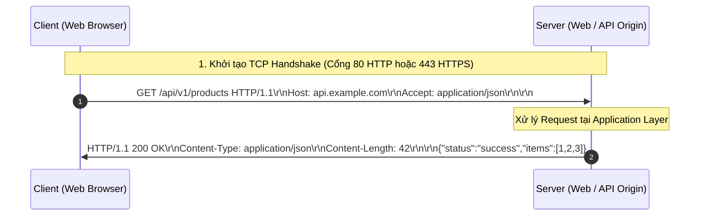
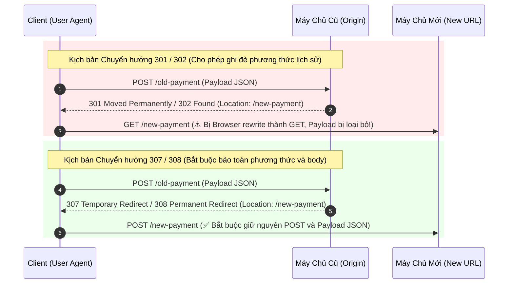

# 2_7_3 HTTP and HTTPS Basics

> **Khóa học**: Cloud DevOps Basic — Networking Core  
> **Phân nhóm**: 2 Domain 2 - Computer Networking Core Fundamentals › 2_7 Core Application Layer Protocols  
> **Chủ đề**: Giao thức HTTP và HTTPS: Kiến trúc Request/Response, Methods & Idempotency, Mã trạng thái, Bảo mật TLS, và Tiến hóa HTTP/1.1 vs HTTP/2 vs HTTP/3  
> **Trạng thái**: Verified (WRITE-CDB-2_7_3, 14-11-2026)  
> **Checklist đối chiếu**: [2_7_3](<../../../CHECKLIST.md#27-core-application-layer-protocols>)

---

## 1. Khái Niệm Cốt Lõi & Bản Chất Kỹ Thuật (Core Concepts & Technical Deep Dive)

Giao thức truyền tải siêu văn bản (**Hypertext Transfer Protocol - HTTP**) là giao thức tầng ứng dụng (Application Layer) nền tảng của mạng toàn cầu (World Wide Web). HTTP hoạt động theo mô hình **Client-Server Request/Response** phi trạng thái (**Stateless**), trong đó máy khách (Client/User Agent) gửi thông điệp yêu cầu (Request) và máy chủ (Server/Origin) xử lý rồi gửi lại thông điệp phản hồi (Response).

HTTP được chuẩn hóa toàn diện qua các tài liệu IETF cốt lõi: ngữ nghĩa giao thức chung trong [RFC 9110](https://datatracker.ietf.org/doc/html/rfc9110), quy cách đóng gói HTTP/1.1 trong [RFC 9112](https://datatracker.ietf.org/doc/html/rfc9112), HTTP/2 trong [RFC 9113](https://datatracker.ietf.org/doc/html/rfc9113), và HTTP/3 trong [RFC 9114](https://datatracker.ietf.org/doc/html/rfc9114) cùng giao vận QUIC trong [RFC 9000](https://datatracker.ietf.org/doc/html/rfc9000).

---

### 1.1 Cổng mặc định và Cấu trúc bản tin HTTP/1.1 (RFC 9110 §4.2 & RFC 9112 §2.1)

Theo quy định phân bổ cổng dịch vụ mặc định:
- **HTTP**: Chạy qua giao vận TCP trên cổng mặc định **TCP port 80** ([RFC 9110 Section 4.2.1](https://datatracker.ietf.org/doc/html/rfc9110#section-4.2.1)).
- **HTTPS**: Chạy qua giao vận TCP với lớp mã hóa TLS trên cổng mặc định **TCP port 443** ([RFC 9110 Section 4.2.2](https://datatracker.ietf.org/doc/html/rfc9110#section-4.2.2)), áp dụng cho HTTP/1.1 và HTTP/2.
- **HTTP/3**: Chạy qua giao vận QUIC trên nền UDP tại cổng mặc định **UDP port 443** ([RFC 9114 Section 3.1](https://datatracker.ietf.org/doc/html/rfc9114#section-3.1)).

Theo [RFC 9112 Section 2.1](https://datatracker.ietf.org/doc/html/rfc9112#section-2.1), một thông điệp HTTP/1.1 hoàn chỉnh được cấu thành tuần tự bởi 4 thành phần định dạng văn bản:
1. **Dòng khởi đầu (Start-line)**:
   - Phía Request: Là dòng yêu cầu (**Request-line**) có cú pháp: `Method SP Request-Target SP HTTP-Version CRLF` (Ví dụ: `GET /index.html HTTP/1.1\r\n`).
   - Phía Response: Là dòng trạng thái (**Status-line**) có cú pháp: `HTTP-Version SP Status-Code SP Reason-Phrase CRLF` (Ví dụ: `HTTP/1.1 200 OK\r\n`).
2. **Các trường tiêu đề (Header Fields)**: Mỗi dòng tiêu đề gồm tên trường theo sau bởi dấu hai chấm và giá trị trường: `Field-Name: Field-Value CRLF`.
3. **Dòng trống phân cách (Empty Line - CRLF)**: Một chuỗi ký tự xuống dòng `\r\n` (CRLF) rỗng đứng độc lập, đóng vai trò ranh giới bất biến báo hiệu kết thúc phần tiêu đề (Header).
4. **Thân bản tin (Message Body - tùy chọn)**: Chứa dữ liệu tải hữu ích (Payload) truyền đi giữa client và server (như nội dung JSON, HTML, hoặc tệp nhị phân).

```text
+-------------------------------------------------------+
|  Start-line: Request-line (hoặc Status-line)   [CRLF] |
+-------------------------------------------------------+
|  Header-Field-1: Value                         [CRLF] |
|  Header-Field-2: Value                         [CRLF] |
+-------------------------------------------------------+
|  [CRLF] (Dòng trống kết thúc Headers)                 |
+-------------------------------------------------------+
|  Message Body (Optional Payload)                      |
+-------------------------------------------------------+
```

---

### 1.2 Phân loại HTTP Methods: Tính chất Safe và Idempotent (RFC 9110 §9.2 & RFC 5789 §2)

Mỗi phương thức HTTP biểu thị một thao tác ngữ nghĩa cụ thể trên tài nguyên máy chủ. Hai thuộc tính hình thức quan trọng nhất chi phối hành vi của các phương thức là tính An toàn (**Safe**) và tính Lũy kế / Bất biến tác động phụ (**Idempotent**):

1. **Phương thức An toàn (Safe Methods - RFC 9110 §9.2.1)**:
   - Định nghĩa: Phương thức được coi là an toàn nếu ngữ nghĩa của nó về bản chất là **chỉ đọc (essentially read-only)**, không gây ra bất kỳ sự thay đổi trạng thái nào trên máy chủ mục tiêu.
   - Các phương thức Safe: `GET`, `HEAD`, `OPTIONS`, `TRACE`.
   - Các phương thức Non-Safe: `POST`, `PUT`, `DELETE`, `PATCH`.
2. **Phương thức Lũy kế (Idempotent Methods - RFC 9110 §9.2.2)**:
   - Định nghĩa: Phương thức được coi là lũy kế nếu tác động dự kiến của **nhiều yêu cầu giống hệt nhau liên tiếp ($N \ge 1$) lên trạng thái máy chủ hoàn toàn tương đương với tác động của một yêu cầu đơn lẻ duy nhất**.
   - Các phương thức Idempotent: `GET`, `HEAD`, `OPTIONS`, `PUT`, `DELETE`.
   - Lưu ý cốt lõi: Mọi phương thức Safe mặc nhiên đều là Idempotent (vì không làm thay đổi trạng thái server nên gọi bao nhiêu lần cũng không thay đổi trạng thái). Tuy nhiên, `PUT` và `DELETE` làm thay đổi trạng thái máy chủ nhưng vẫn là Idempotent vì gọi 1 lần hay $N$ lần thì trạng thái cuối cùng của tài nguyên trên server là như nhau.
3. **Các phương thức Neither Safe nor Idempotent (RFC 9110 §9.2 & RFC 5789 §2)**:
   - `POST`: Thường dùng để tạo mới tài nguyên hoặc kích hoạt quy trình xử lý dữ liệu. Mỗi lần gọi `POST`, máy chủ có thể tạo thêm một bản ghi mới, do đó không an toàn và không lũy kế.
   - `PATCH` ([RFC 5789 Section 2](https://datatracker.ietf.org/doc/html/rfc5789#section-2)): Được thiết kế để cập nhật một phần tài nguyên (partial modification). `PATCH` không an toàn (Non-Safe) và **không đảm bảo tính lũy kế (Non-Idempotent)** (ví dụ: một lệnh PATCH mang thao tác "nối thêm dòng chữ vào văn bản" hoặc "tăng biến đếm thêm 1" thì mỗi lần gửi lại sẽ làm thay đổi trạng thái thêm một lần nữa).

| HTTP Method | Safe (Chỉ đọc, không đổi trạng thái) | Idempotent ($N$ lần gọi = 1 lần gọi) | Mục đích ngữ nghĩa chính |
| :--- | :---: | :---: | :--- |
| `GET` | **Có** | **Có** | Truy xuất thông tin đại diện tài nguyên |
| `HEAD` | **Có** | **Có** | Truy xuất headers giống GET nhưng không lấy body |
| `OPTIONS` | **Có** | **Có** | Truy vấn các phương thức truyền thông được hỗ trợ |
| `TRACE` | **Có** | **Có** | Phản hồi lại thông điệp nhận được để kiểm tra loopback |
| `PUT` | Không | **Có** | Thay thế toàn bộ trạng thái tài nguyên đích |
| `DELETE` | Không | **Có** | Xóa tài nguyên đích chỉ định |
| `POST` | Không | Không | Xử lý dữ liệu, tạo tài nguyên con mới |
| `PATCH` | Không | Không | Sửa đổi một phần trạng thái tài nguyên |

---

### 1.3 Phân loại và phân tích mã trạng thái (HTTP Status Codes - RFC 9110 §15 & RFC 6585 §4)

Mã trạng thái HTTP gồm 3 chữ số, biểu thị kết quả xử lý yêu cầu của máy chủ:

#### 2xx Success (Thành công - RFC 9110 §15.3)
- `200 OK`: Yêu cầu đã thành công và kết quả được trả về trong thân bản tin.
- `201 Created`: Yêu cầu đã hoàn thành và dẫn tới việc một hoặc nhiều tài nguyên mới được tạo thành công trên máy chủ.
- `204 No Content`: Yêu cầu đã được thực hiện thành công và máy chủ không trả về thêm nội dung payload nào trong phần thân (thường dùng sau các thao tác `DELETE` hoặc cập nhật không cần trả dữ liệu).

#### 3xx Redirection (Chuyển hướng - RFC 9110 §15.4)
Sự khác biệt quan trọng giữa các mã chuyển hướng nằm ở việc bảo toàn phương thức và thân yêu cầu:
- `301 Moved Permanently` & `302 Found`: Về mặt lịch sử, các tác nhân người dùng (User Agents / Web Browsers) thường tự ý **chuyển đổi phương thức yêu cầu từ `POST` sang `GET`** và loại bỏ phần body khi thực hiện truy cập sang URL mới được chuyển hướng.
- `307 Temporary Redirect` & `308 Permanent Redirect`: Theo [RFC 9110 Section 15.4](https://datatracker.ietf.org/doc/html/rfc9110#section-15.4), hai mã này được định nghĩa với quy chuẩn nghiêm ngặt: Phương thức HTTP và thân yêu cầu (Body) **BẮT BUỘC PHẢI ĐƯỢC GIỮ NGUYÊN (MUST NOT be altered)** khi client thực hiện yêu cầu chuyển hướng đến URL mới.

#### 4xx Client Error (Lỗi phía máy khách - RFC 9110 §15.5 & RFC 6585 §4)
- `400 Bad Request`: Máy chủ không thể hiểu hoặc xử lý yêu cầu do lỗi cú pháp từ phía client (Malformed syntax).
- `401 Unauthorized`: Client chưa cung cấp thông tin xác thực danh tính hợp lệ. Mã này mang ngữ nghĩa yêu cầu xác thực (**Authentication challenge required**), máy chủ yêu cầu client phải chứng minh danh tính.
- `403 Forbidden`: Máy chủ đã xác thực thành công danh tính của client, nhưng danh tính này **hoàn toàn không có quyền hạn (Authorization)** để truy cập tài nguyên được yêu cầu. Khác với 401, việc gửi lại thông tin đăng nhập trong trường hợp 403 không làm thay đổi kết quả.
- `404 Not Found`: Máy chủ không tìm thấy tài nguyên nào khớp với URL được yêu cầu.
- `405 Method Not Allowed`: Phương thức trong dòng yêu cầu đã được máy chủ nhận diện nhưng không được hỗ trợ đối với tài nguyên chỉ định (ví dụ tài nguyên chỉ cho phép `GET` nhưng client gửi `POST`).
- `429 Too Many Requests` ([RFC 6585 Section 4](https://datatracker.ietf.org/doc/html/rfc6585#section-4)): Client đã gửi quá nhiều yêu cầu trong một khoảng thời gian cho trước (vượt hạn mức Rate Limiting). Máy chủ thường kèm theo tiêu đề `Retry-After` để báo cho client biết thời gian cần chờ trước khi thử lại.

#### 5xx Server Error (Lỗi phía máy chủ - RFC 9110 §15.6)
- `500 Internal Server Error`: Máy chủ gặp tình trạng sự cố bất ngờ khiến nó không thể hoàn thành yêu cầu hợp lệ.
- `502 Bad Gateway`: Máy chủ đóng vai trò Gateway hoặc Reverse Proxy nhận được một phản hồi không hợp lệ (**Invalid response**) từ máy chủ phía sau (Upstream backend).
- `503 Service Unavailable`: Máy chủ hiện tại không sẵn sàng xử lý yêu cầu do đang quá tải tạm thời hoặc đang bảo trì.
- `504 Gateway Timeout`: Máy chủ đóng vai trò Gateway hoặc Reverse Proxy không nhận được phản hồi kịp thời từ máy chủ phía sau (Upstream backend timed out) trong khoảng thời gian cấu hình chờ cho phép.

---

### 1.4 Bảo mật với HTTPS và Lớp TLS (RFC 9110 §4.2.2)

HTTPS (**HTTP Secure**) là việc truyền tải các thông điệp HTTP tiêu chuẩn thông qua một kênh truyền bảo mật được mã hóa bởi giao thức **Transport Layer Security (TLS)**:
- **Bảo mật và Tính riêng tư (Confidentiality)**: Dữ liệu trao đổi được mã hóa bằng thuật toán mã hóa luồng đối xứng (Symmetric stream cipher), ngăn chặn các hành vi nghe lén (Eavesdropping / Packet sniffing).
- **Tính toàn vẹn (Integrity)**: Dữ liệu được bảo vệ chống lại sự can thiệp hoặc sửa đổi trái phép trên đường truyền.
- **Xác thực máy chủ (Server Authentication)**: Client xác thực danh tính thực sự của máy chủ thông qua chứng chỉ số và quy trình trao đổi khóa bất đối xứng, ngăn chặn tấn công giả mạo (Man-in-the-Middle).

---

### 1.5 Tiến hóa Giao thức: HTTP/1.1 vs HTTP/2 vs HTTP/3

| Đặc tính kiến trúc | HTTP/1.1 (RFC 9112) | HTTP/2 (RFC 9113) | HTTP/3 (RFC 9114 & RFC 9000) |
| :--- | :--- | :--- | :--- |
| **Giao vận nền tảng** | TCP (Port 80 / 443) | TCP (Port 443 với TLS) | QUIC trên UDP (Port 443) |
| **Định dạng thông điệp** | Văn bản thuần (Text-based CRLF) | Đóng khung nhị phân (Binary Framing) | Đóng khung nhị phân trên các QUIC streams |
| **Mã hóa tiêu đề** | Văn bản thô, lặp lại tiêu đề | Nén HPACK (RFC 9113 §4.3) | Nén QPACK (dành riêng cho QUIC) |
| **Cơ chế truyền tải** | Persistent Connections (Keep-Alive), Pipelining | Stream Multiplexing trên 1 kết nối TCP | Stream Multiplexing trên các luồng QUIC độc lập |
| **Hiện tượng Head-of-Line** | Nghẽn HoL ở tầng ứng dụng | Nghẽn HoL ở tầng TCP (TCP HoL Blocking) | **Xóa bỏ hoàn toàn** TCP HoL Blocking |

#### 1. HTTP/1.1 và Hiện tượng Application Head-of-Line Blocking (RFC 9112 §9.3)
Theo [RFC 9112 Section 9.3](https://datatracker.ietf.org/doc/html/rfc9112#section-9.3), HTTP/1.1 mặc định kích hoạt kết nối bền vững (**Persistent Connections / Keep-Alive**) để tái sử dụng kết nối TCP cho nhiều request/response liên tiếp mà không phải đóng mở bắt tay liên tục.

Để tối ưu hóa, HTTP/1.1 hỗ trợ kỹ thuật **Pipelining** ([RFC 9112 Section 9.3.2](https://datatracker.ietf.org/doc/html/rfc9112#section-9.3.2)), cho phép client gửi liên tiếp nhiều request mà không cần chờ nhận phản hồi của từng request trước đó. Tuy nhiên, quy chuẩn bắt buộc: **Máy chủ PHẢI gửi phản hồi theo đúng thứ tự mà các yêu cầu được tiếp nhận**. Nếu yêu cầu đầu tiên cần xử lý một tác vụ nặng tốn nhiều thời gian, toàn bộ các phản hồi phía sau dù đã tính toán xong vẫn bị chặn lại không được gửi đi. Đây chính là hiện tượng **Application-level Head-of-Line (HoL) Blocking**.

#### 2. HTTP/2: Binary Framing và TCP Head-of-Line Blocking (RFC 9113 §2, §4.1 & §4.3)
HTTP/2 loại bỏ văn bản thuần và đưa vào tầng đóng khung nhị phân (**Binary Framing Layer**). Mọi thông điệp được chia nhỏ thành các khung (Frames) nhị phân có tiêu đề cố định 9 bytes ([RFC 9113 Section 4.1](https://datatracker.ietf.org/doc/html/rfc9113#section-4.1)):
- **Length (24 bits)**: Độ dài của phần tải (payload) của frame.
- **Type (8 bits)**: Loại frame (như HEADERS, DATA, SETTINGS, RST_STREAM).
- **Flags (8 bits)**: Các cờ điều khiển dành riêng cho từng loại frame (ví dụ END_STREAM, END_HEADERS).
- **R (1 bit)**: Bit dành riêng (Reserved bit, bắt buộc bằng 0).
- **Stream Identifier (31 bits)**: Định danh duy nhất của luồng (Stream ID) mà frame thuộc về.

```text
 0                   1                   2                   3
 0 1 2 3 4 5 6 7 8 9 0 1 2 3 4 5 6 7 8 9 0 1 2 3 4 5 6 7 8 9 0 1
+-+-+-+-+-+-+-+-+-+-+-+-+-+-+-+-+-+-+-+-+-+-+-+-+-+-+-+-+-+-+-+-+
|                 Length (24 bits)              |Type (8 bits)  |
+-+-+-+-+-+-+-+-+-+-+-+-+-+-+-+-+-+-+-+-+-+-+-+-+-+-+-+-+-+-+-+-+
| Flags (8 bits)|R|            Stream Identifier (31 bits)      |
+-+-+-+-+-+-+-+-+-+-+-+-+-+-+-+-+-+-+-+-+-+-+-+-+-+-+-+-+-+-+-+-+
|                     Frame Payload (0...)                    ...
+-+-+-+-+-+-+-+-+-+-+-+-+-+-+-+-+-+-+-+-+-+-+-+-+-+-+-+-+-+-+-+-+
```

Nhờ Stream ID, HTTP/2 có thể truyền xen kẽ các frame của nhiều yêu cầu/phản hồi đồng thời trên **duy nhất một kết nối TCP** (**Stream Multiplexing**), kết hợp cơ chế nén tiêu đề HPACK ([RFC 9113 Section 4.3](https://datatracker.ietf.org/doc/html/rfc9113#section-4.3)).

Tuy nhiên, điểm nghẽn chuyển dịch xuống tầng giao vận: Vì toàn bộ các stream đều dồn chung vào một luồng byte TCP duy nhất, nếu **một gói tin bị rơi (Packet Loss) trên đường truyền TCP**, tầng giao vận của bên nhận sẽ giữ lại toàn bộ các gói tin đến sau trong bộ đệm để chờ gói tin mất được truyền lại thành công nhằm đảm bảo thứ tự byte nghiêm ngặt của TCP. Hậu quả là **TẤT CẢ các stream đang truyền đồng thời đều bị phong tỏa gián đoạn** ([RFC 9114 Section 1.1](https://datatracker.ietf.org/doc/html/rfc9114#section-1.1)). Đây chính là **TCP-level Head-of-Line Blocking**.

#### 3. HTTP/3 và Giải Pháp QUIC trên nền UDP (RFC 9114 §1 & RFC 9000)
Để giải quyết triệt để TCP HoL blocking, HTTP/3 ([RFC 9114](https://datatracker.ietf.org/doc/html/rfc9114)) từ bỏ tầng giao vận TCP và chuyển sang sử dụng giao thức **QUIC** ([RFC 9000](https://datatracker.ietf.org/doc/html/rfc9000)) chạy trên nền tảng **UDP**.

QUIC hiện thực hóa cơ chế **khôi phục mất mát độc lập ở cấp độ từng luồng (Stream-level independent loss recovery)**:
- Mỗi luồng (stream) trong QUIC là một thực thể dữ liệu riêng biệt.
- Khi một gói tin của một luồng cụ thể bị mất trên đường truyền mạng, chỉ duy nhất luồng đó bị tạm dừng chờ nhận lại dữ liệu mất mát.
- Các luồng song song khác hoàn toàn không bị ảnh hưởng và tiếp tục được giao nạp thẳng lên tầng ứng dụng mà không cần chờ đợi.
- Nhờ đó, HTTP/3 triệt tiêu hoàn toàn hiện tượng Head-of-Line blocking ở cả tầng ứng dụng lẫn tầng giao vận.

---

## 2. Ví Dụ Đời Sống Thực Tế Dễ Hiểu (Intuitive Real-World Analogies)

### 2.1 Mẫu Đơn Hành Chính và Con Dấu Công Quyền (Safe & Idempotency)
Hãy hình dung giao thức HTTP như việc người dân đến làm việc tại bộ phận tiếp nhận hồ sơ hành chính một cửa:
- **Phương thức Safe & Idempotent (`GET`)**: Giống như việc bạn đứng đọc bảng niêm yết thủ tục hành chính công khai tại sảnh. Bạn đọc 1 lần hay đọc 100 lần thì thông tin trên bảng vẫn giữ nguyên, và việc bạn đọc bảng không làm phát sinh thêm bất kỳ thủ tục hay thay đổi nào trong cơ sở dữ liệu của ủy ban.
- **Phương thức Idempotent nhưng Không Safe (`PUT`)**: Giống như việc bạn nộp lá đơn đính chính thông tin hộ khẩu: *"Cập nhật số nhà của tôi thành số 123 Đường B"*. Cán bộ tiếp nhận sẽ mở hồ sơ và ghi đè địa chỉ mới vào. Thao tác này làm thay đổi dữ liệu (Không Safe). Nhưng nếu vì lo lắng lá đơn bị thất lạc, bạn nộp tiếp 5 lá đơn y hệt như vậy, cán bộ tiếp nhận chỉ đơn giản ghi đè lại giá trị "123 Đường B". Sau 5 lần nộp, địa chỉ cuối cùng trên hệ thống vẫn chính xác là số 123 Đường B (Idempotent).
- **Phương thức Neither Safe nor Idempotent (`POST`)**: Giống như việc bạn nộp hồ sơ xin cấp mới một chiếc thẻ thư viện. Mỗi lần bạn nộp hồ sơ và nhấn "Xác nhận", cán bộ tiếp nhận lại bấm máy dập một chiếc thẻ nhựa mới tinh với mã thẻ định danh mới. Nếu bạn nộp 3 lần, bạn sẽ làm phát sinh 3 chiếc thẻ khác nhau trong hệ thống kèm 3 khoản phí phát hành (Không Safe và Không Idempotent).
- **Phương thức Neither Safe nor Idempotent (`PATCH`)**: Giống như việc bạn nộp phiếu yêu cầu: *"Cộng thêm 100 điểm tích lũy vào tài khoản hội viên của tôi"*. Lần nộp thứ nhất bạn được cộng 100 điểm; nếu nộp lại lần thứ hai bạn sẽ bị cộng thêm 100 điểm nữa thành 200 điểm. Kết quả cuối cùng bị thay đổi theo số lần gửi yêu cầu (Không Idempotent).

### 2.2 Cuộc Cách Mạng Vận Tải Đường Ống (Tiến hóa HTTP/1.1 $\rightarrow$ HTTP/2 $\rightarrow$ HTTP/3)
- **HTTP/1.1 (Thư tay bàn giấy và tắc nghẽn xếp hàng)**: Bạn gửi từng bức thư tay qua đường bưu điện. Dù kỹ thuật Pipelining cho phép bạn thả liên tiếp 3 lá thư (Thư A, Thư B, Thư C) vào thùng thư, bưu điện vẫn bắt buộc phải đóng dấu và giao trả hồi âm theo đúng thứ tự A rồi mới đến B, C. Nếu Thư A chứa một câu hỏi hóc búa cần 3 ngày điều tra, Thư B và C dù chỉ mất 5 giây giải quyết vẫn phải nằm chết dí trong hòm thư chờ Thư A xong xuôi (Application Head-of-Line Blocking).
- **HTTP/2 (Đường ống khí nén đa luồng)**: Cơ quan lắp đặt một đường ống khí nén nối thẳng giữa hai phòng ban. Các lá thư được cắt nhỏ thành các mảnh nhị phân, cho vào các viên con nhộng đánh số hiệu luồng (Stream ID) và bắn liên tục qua cùng một đường ống duy nhất (Single TCP Connection). Các luồng dữ liệu đan xen nhau mượt mà. Tuy nhiên, vì cả hệ thống chỉ dùng chung một đường ống dẫn, nếu một viên con nhộng bất kỳ bị kẹt ở khúc quanh (Packet Loss trên kết nối TCP), toàn bộ áp suất đường ống bị ngưng trệ, tất cả các viên con nhộng đi sau đều bị dừng khẩn cấp để chờ kỹ thuật viên thông ống (TCP Head-of-Line Blocking).
- **HTTP/3 (Đội xe bay chuyển phát độc lập trên nền QUIC/UDP)**: Cơ quan chuyển sang sử dụng phi đội máy bay không người lái tự hành. Mỗi luồng tài liệu được vận chuyển bởi một chiếc máy bay riêng biệt bay tự do trên không gian mở (UDP). Nếu chiếc máy bay số 1 gặp thời tiết xấu hoặc hỏng cánh quạt, chỉ riêng chuyến bay số 1 bị trễ để cử máy bay khác bay lại, toàn bộ các máy bay của các luồng khác vẫn đáp xuống đích đúng giờ mà không hề bị cản trở (Xóa bỏ hoàn toàn Head-of-Line Blocking).
- **HTTPS (Chiếc cặp khóa mật mã titan)**: Dù chuyển phát bằng thư tay, ống khí nén hay máy bay không người lái, tài liệu mật luôn được đặt trong chiếc cặp kim loại khóa mã hóa lượng tử (TLS). Kẻ đứng giữa chỉ thấy một khối kim loại đen tuyền, không thể mở ra đọc trộm (Confidentiality), không thể nhét tài liệu giả mạo vào trong (Integrity), và chỉ chiếc chìa khóa hợp thức của người nhận mới mở được cặp (Authentication).

---

## 3. Kiến Trúc, Luồng Hoạt Động & Hình Ảnh Trực Quan (Architecture, Diagrams & Visual Media)

### 3.1 Cấu Trúc Bản Tin Request / Response HTTP/1.1



---

### 3.2 So Sánh Cơ Chế Hoạt Động và Hiện Tượng Head-of-Line Blocking

```mermaid
flowchart TD
    subgraph HTTP1["HTTP/1.1 Pipelining (Application HoL Blocking)"]
        direction TB
        REQ1["Request 1 (Xử lý nặng: 5s)"] --> RES1["Response 1 (Bắt buộc gửi đầu tiên)"]
        REQ2["Request 2 (Xử lý nhanh: 0.1s)"] -.->|Bị chặn chờ Response 1| RES2["Response 2"]
        REQ3["Request 3 (Xử lý nhanh: 0.1s)"] -.->|Bị chặn chờ Response 1| RES3["Response 3"]
    end

    subgraph HTTP2["HTTP/2 Stream Multiplexing trên 1 TCP (TCP HoL Blocking)"]
        direction TB
        S1["Stream 1 Frame"] --- TCP_PIPE["1 Kết nối TCP duy nhất"]
        S2["Stream 2 Frame"] --- TCP_PIPE
        S3["Stream 3 Frame"] --- TCP_PIPE
        TCP_LOSS["⚠️ TCP Packet Loss tại gói của Stream 1"] --> TCP_STALL["Tất cả Stream 1, 2, 3 đều bị dừng đệm tại TCP Socket"]
    end

    subgraph HTTP3["HTTP/3 qua QUIC trên UDP (Loại bỏ triệt để HoL Blocking)"]
        direction TB
        Q1["QUIC Stream 1"] --> UDP1["Gói tin UDP độc lập (Rơi gói -> Chỉ Stream 1 truyền lại)"]
        Q2["QUIC Stream 2"] --> UDP2["Gói tin UDP độc lập (Tiếp tục giao nạp bình thường)"]
        Q3["QUIC Stream 3"] --> UDP3["Gói tin UDP độc lập (Tiếp tục giao nạp bình thường)"]
    end
```



---

### 3.3 Ngữ Nghĩa Chuyển Hướng Redirection: 301/302 vs 307/308



---

## 4. Thực Hành (Hands-on)

> ⚠️ Chưa chạy thử (not executed by the squad)

Phần thực hành này cung cấp các lệnh Linux tiêu chuẩn với tiện ích `curl` để kiểm tra phân tích tiêu đề bản tin HTTP/1.1, đàm phán TLS/HTTPS, kiểm tra giao thức HTTP/2 qua cơ chế ALPN, và kiểm tra kết nối HTTP/3 chạy trên nền QUIC/UDP.

---

### 4.1 Lệnh 1: Kiểm tra toàn bộ luồng Request/Response với chế độ Verbose (`curl -v`)

Lệnh `curl -v` cho phép quan sát chi tiết toàn bộ chu trình bắt tay kết nối TCP tới cổng mặc định 80, cấu trúc dòng yêu cầu (Request-line), các trường Header của client, dòng trống `\r\n`, và dòng trạng thái (Status-line) phản hồi từ máy chủ:

```bash
curl -v http://example.com
```

**Dòng lệnh và đầu ra giải thích minh họa:**

```text
*   Trying 93.184.216.34:80...
* Connected to example.com (93.184.216.34) port 80
> GET / HTTP/1.1
> Host: example.com
> User-Agent: curl/8.5.0
> Accept: */*
> 
< HTTP/1.1 200 OK
< Age: 524312
< Cache-Control: max-age=604800
< Content-Type: text/html; charset=UTF-8
< Date: Thu, 14 Nov 2026 08:00:00 GMT
< Etag: "3147526947+gzip"
< Expires: Thu, 21 Nov 2026 08:00:00 GMT
< Last-Modified: Thu, 17 Oct 2024 07:18:26 GMT
< Server: ECS (dcb/7F3A)
< Vary: Accept-Encoding
< X-Cache: HIT
< Content-Length: 1256
< 
<!doctype html>
<html>
... [Nội dung HTML Body] ...
</html>
```

*Giải thích minh họa*:
- Ký tự `>` thể hiện các thông điệp được Client gửi đi: Dòng khởi đầu `GET / HTTP/1.1`, các tiêu đề `Host`, `User-Agent`, `Accept`, và dòng trống kết thúc tiêu đề `> `.
- Ký tự `<` thể hiện thông điệp phản hồi từ máy chủ: Dòng trạng thái `< HTTP/1.1 200 OK`, các tiêu đề chỉ định kiểu nội dung `< Content-Type: text/html`, độ dài tải hữu ích `< Content-Length: 1256`, và khối dữ liệu payload HTML nằm sau dòng trống `< `.

---

### 4.2 Lệnh 2: Truy xuất riêng phần Tiêu đề phản hồi (Head-only Request qua `curl -I`)

Khi cần chẩn đoán mã trạng thái (Status Code), chính sách Cache, hoặc xác minh chuyển hướng mà không muốn tải toàn bộ nội dung body nặng nề, kỹ sư sử dụng cờ `-I` (tương ứng phương thức Safe `HEAD` trên HTTP/1.1 hoặc nhận headers trên HTTPS cổng 443):

```bash
curl -I https://example.com
```

**Dòng lệnh và đầu ra giải thích minh họa:**

```text
HTTP/2 200 
content-type: text/html; charset=UTF-8
etag: "3147526947+ident"
last-modified: Thu, 17 Oct 2024 07:18:26 GMT
cache-control: max-age=604800
date: Thu, 14 Nov 2026 08:05:00 GMT
server: ECAcc (dcb/7F3B)
content-length: 1256
```

*Giải thích minh họa*:
- Lệnh kết nối tới máy chủ qua cổng TCP 443 với lớp mã hóa TLS.
- Máy chủ xử lý phương thức `HEAD` và chỉ trả về phần tiêu đề phản hồi với mã trạng thái `200`, bỏ qua hoàn toàn phần thân bản tin (Body), giúp tiết kiệm tối đa băng thông đường truyền.

---

### 4.3 Lệnh 3: Yêu cầu đàm phán giao thức HTTP/2 (`curl --http2 -I`)

Cờ `--http2` chỉ định `curl` kích hoạt phần mở rộng đàm phán giao thức tầng ứng dụng (**Application-Layer Protocol Negotiation - ALPN**) trong quá trình bắt tay TLS trên cổng TCP 443 nhằm thiết lập phiên truyền thông HTTP/2:

```bash
curl --http2 -I https://example.com
```

**Dòng lệnh và đầu ra giải thích minh họa:**

```text
HTTP/2 200 
content-type: text/html; charset=UTF-8
date: Thu, 14 Nov 2026 08:10:00 GMT
server: ECAcc (dcb/7F3C)
content-length: 1256
```

*Giải thích minh họa*:
- Máy chủ và client thương lượng thành công định danh `h2` trong quá trình bắt tay TLS. Dữ liệu từ thời điểm này được đóng gói thành các khung nhị phân (Binary Frames) có tiêu đề 9 bytes và nén tiêu đề HPACK thay cho văn bản thuần của HTTP/1.1.

---

### 4.4 Lệnh 4: Đàm phán giao thức HTTP/3 chạy trên nền QUIC/UDP (`curl --http3 -I`)

Để kiểm tra máy chủ đã sẵn sàng phục vụ HTTP/3 hay chưa, kỹ sư sử dụng cờ `--http3`. `curl` sẽ khởi tạo kết nối giao vận QUIC thông qua **UDP port 443**:

```bash
curl --http3 -I https://cloudflare.com
```

**Dòng lệnh và đầu ra giải thích minh họa:**

```text
HTTP/3 200 
date: Thu, 14 Nov 2026 08:15:00 GMT
content-type: text/html; charset=UTF-8
server: cloudflare
alt-svc: h3=":443"; ma=86400
```

*Giải thích minh họa*:
- Dòng trạng thái `HTTP/3 200` xác nhận phiên kết nối đã được thiết lập thành công trên nền tảng giao vận QUIC qua cổng UDP 443. Tiêu đề `alt-svc: h3=":443"` cho biết máy chủ quảng bá dịch vụ thay thế hỗ trợ HTTP/3 cho các kết nối kế tiếp.

---

## 5. Cạm Bẫy Thực Tế & Thực Tiễn Sản Xuất (Production Gotchas & Best Practices)

### 5.1 Cạm bẫy vi phạm tính Safe và Idempotent khi thiết kế API RESTful
- **Vấn đề**: Lập trình viên sử dụng phương thức `GET` để thực hiện thao tác xóa hoặc thay đổi dữ liệu trong cơ sở dữ liệu (ví dụ: gửi request `GET /api/users/delete?id=100`).
- **Hậu quả thảm khốc**: Theo [RFC 9110 Section 9.2.1](https://datatracker.ietf.org/doc/html/rfc9110#section-9.2.1), các bộ máy tìm kiếm (Web Crawlers / Googlebot), cơ chế tải trước đường link của trình duyệt (Link Prefetching), hoặc các Proxy Server trung gian đều mặc định coi `GET` là phương thức **Safe (chỉ đọc)**. Khi crawler quét qua trang quản trị có các đường dẫn này, nó tự động gửi hàng loạt request GET và vô tình **xóa sạch toàn bộ dữ liệu người dùng**.
- **Thực tiễn sản xuất**: Tuyệt đối tuân thủ ngữ nghĩa RFC 9110: `GET` chỉ dùng cho truy xuất dữ liệu. Mọi hành vi làm thay đổi trạng thái bắt buộc phải sử dụng `POST`, `PUT`, `DELETE`, hoặc `PATCH`.

### 5.2 Cạm bẫy tự động Retry các phương thức không lũy kế (Non-Idempotent)
- **Vấn đề**: Kỹ sư DevOps cấu hình cơ chế tự động gửi lại yêu cầu (Automatic Retry Policy) trên API Gateway hoặc Service Mesh khi gặp sự cố mạng tạm thời (chập chờn kết nối hoặc timeout).
- **Hậu quả**: Nếu phương thức được retry là `POST` hoặc `PATCH` (không có tính chất Idempotent theo RFC 9110 và RFC 5789), việc gateway tự động retry một request thanh toán thẻ tín dụng bị timeout ở tầng phản hồi có thể khiến máy chủ xử lý trừ tiền của khách hàng 2 lần, tạo ra thảm họa dữ liệu thanh toán trùng lặp.
- **Thực tiễn sản xuất**: Chỉ tự động retry ở tầng mạng đối với các phương thức có tính chất **Idempotent** (`GET`, `PUT`, `DELETE`). Đối với `POST`, ứng dụng bắt buộc phải triển khai cơ chế khóa chống trùng lặp (**Idempotency Key**) ở tầng logic ứng dụng trước khi cho phép client retry.

### 5.3 Cạm bẫy chuyển hướng 301/302 làm mất Body và đổi Method của API
- **Vấn đề**: Khi di dời một API endpoint nhận dữ liệu (ví dụ endpoint tiếp nhận đơn hàng `POST /v1/orders`), đội ngũ hạ tầng cấu hình quy tắc chuyển hướng (Redirect Rule) trên Reverse Proxy trả về mã `301 Moved Permanently` hoặc `302 Found` trỏ sang `/v2/orders`.
- **Hậu quả**: Theo [RFC 9110 Section 15.4](https://datatracker.ietf.org/doc/html/rfc9110#section-15.4), phần lớn các HTTP client và thư viện mạng trong lịch sử sẽ tự động chuyển đổi phương thức từ `POST` sang `GET` và **hủy bỏ toàn bộ phần payload (Body JSON)** khi gửi request sang URL mới. Kết quả là yêu cầu `/v2/orders` bị máy chủ từ chối với lỗi `400 Bad Request` hoặc `405 Method Not Allowed`.
- **Thực tiễn sản xuất**: Khi chuyển hướng các endpoint API yêu cầu bảo toàn phương thức và thân dữ liệu, **bắt buộc phải sử dụng mã `307 Temporary Redirect` hoặc `308 Permanent Redirect`**.

### 5.4 Phân biệt chính xác sự cố Reverse Proxy: 502 Bad Gateway vs 504 Gateway Timeout
- **502 Bad Gateway ([RFC 9110 §15.6.3](https://datatracker.ietf.org/doc/html/rfc9110#section-15.6.3))**: Xảy ra khi Reverse Proxy (Nginx, HAProxy, AWS ALB) kết nối được tới máy chủ upstream backend (NodeJS, Java Spring, Python Gunicorn), nhưng backend trả về một phản hồi không hợp lệ hoặc tiến trình backend bị sập (Crash / Out of Memory) và ngắt kết nối đột ngột (gửi gói TCP RST). Hướng xử lý: Kiểm tra Application Logs và lỗi sập tiến trình tại backend.
- **504 Gateway Timeout ([RFC 9110 §15.6.5](https://datatracker.ietf.org/doc/html/rfc9110#section-15.6.5))**: Xảy ra khi Reverse Proxy gửi yêu cầu tới backend nhưng backend xử lý quá lâu, vượt quá ngưỡng cấu hình thời gian chờ (Upstream read timeout) của proxy. Hướng xử lý: Tối ưu hóa câu truy vấn cơ sở dữ liệu chậm (Slow Queries) hoặc tăng ngưỡng timeout thích hợp trên proxy.

### 5.5 Phân biệt sự cố phân quyền: 401 Unauthorized vs 403 Forbidden
- **401 Unauthorized ([RFC 9110 §15.5.2](https://datatracker.ietf.org/doc/html/rfc9110#section-15.5.2))**: Biểu thị lỗi **Xác thực danh tính (Authentication)**. Request thiếu thông tin nhận diện (Token JWT, Session Cookie) hoặc thông tin cung cấp đã hết hạn/không hợp lệ. Máy chủ phản hồi mã 401 kèm tiêu đề thách thức (Challenge) để yêu cầu client đăng nhập lại.
- **403 Forbidden ([RFC 9110 §15.5.4](https://datatracker.ietf.org/doc/html/rfc9110#section-15.5.4))**: Biểu thị lỗi **Quyền hạn truy cập (Authorization)**. Máy chủ đã biết chính xác người dùng là ai (đã xác thực thành công), nhưng chính sách phân quyền (RBAC) xác định người dùng này không có đặc quyền để xem hoặc chỉnh sửa tài nguyên đó.

### 5.6 Tác động tiêu cực của HTTP/2 trên môi trường mạng suy hao cao (High Packet Loss)
- **Vấn đề**: Triển khai HTTP/2 trên các đường truyền mạng có tỷ lệ mất gói tin cao (mạng di động 3G/4G vùng phủ sóng yếu, mạng vệ tinh hoặc Wi-Fi công cộng nhiễu sóng).
- **Hậu quả**: Do HTTP/2 dồn toàn bộ các luồng (Streams) vào duy nhất một kết nối TCP, khi một gói tin TCP bị mất, cơ chế đảm bảo thứ tự của TCP buộc phải ngừng giao nạp dữ liệu của tất cả các luồng khác cho đến khi gói tin mất được truyền lại thành công. Trong môi trường mất gói 2% - 5%, hiệu năng thực tế của HTTP/2 có thể kém hơn đáng kể so với HTTP/1.1 (vốn mở 6 kết nối TCP độc lập).
- **Thực tiễn sản xuất**: Nâng cấp hạ tầng hỗ trợ **HTTP/3 trên nền QUIC**, cho phép xử lý mất gói độc lập trên từng luồng riêng biệt mà không gây nghẽn toàn bộ kết nối.

---

## 6. Câu Hỏi Củng Cố Kiến Thức (Active Recall Quiz)

<details>
<summary><strong>Câu 1: Một nhóm phát triển di chuyển API tạo đơn hàng từ endpoint <code>/api/v1/orders</code> sang <code>/api/v2/orders</code>. Nếu họ cấu hình Reverse Proxy trả về mã chuyển hướng 301 Moved Permanently, hiện tượng gì sẽ xảy ra với các client gửi dữ liệu POST JSON, và mã trạng thái chuẩn xác bắt buộc phải sử dụng là gì?</strong></summary>

**Đáp án**:  
Theo [RFC 9110 Section 15.4](https://datatracker.ietf.org/doc/html/rfc9110#section-15.4):
- Khi nhận được mã chuyển hướng `301 Moved Permanently` (hoặc `302 Found`), hành vi mang tính lịch sử của phần lớn các tác nhân người dùng (User Agents / Browsers) là **tự ý viết lại (rewrite) phương thức từ `POST` thành `GET`**, đồng thời loại bỏ hoàn toàn phần thân yêu cầu (Payload JSON). Hậu quả là request gửi tới `/api/v2/orders` trở thành phương thức GET rỗng, gây lỗi logic hoặc bị server đích từ chối (`400 Bad Request` hoặc `405 Method Not Allowed`).
- Để giải quyết triệt để, nhóm phát triển bắt buộc phải sử dụng mã **`308 Permanent Redirect`** (hoặc `307 Temporary Redirect` nếu chuyển hướng tạm thời). Theo chuẩn RFC 9110, mã 307 và 308 nghiêm cấm client thay đổi phương thức và bắt buộc phải giữ nguyên toàn vẹn phương thức `POST` cùng toàn bộ nội dung body JSON khi thực hiện yêu cầu chuyển hướng.
</details>

<details>
<summary><strong>Câu 2: Tại sao phương thức <code>PUT</code> được phân loại là Idempotent (Lũy kế) nhưng <code>PATCH</code> lại được chuẩn hóa là Non-Idempotent (Không lũy kế)?</strong></summary>

**Đáp án**:  
Theo [RFC 9110 Section 9.2.2](https://datatracker.ietf.org/doc/html/rfc9110#section-9.2.2) và [RFC 5789 Section 2](https://datatracker.ietf.org/doc/html/rfc5789#section-2):
- **`PUT` (Idempotent)**: Ngữ nghĩa của PUT là thay thế toàn bộ trạng thái tài nguyên đích bằng bản biểu diễn gửi kèm. Dù client gửi yêu cầu PUT 1 lần hay 100 lần liên tiếp với cùng dữ liệu, trạng thái cuối cùng của tài nguyên trên máy chủ vẫn hoàn toàn giống nhau. Do đó, PUT có tính chất lũy kế (Idempotent).
- **`PATCH` (Non-Idempotent)**: Ngữ nghĩa của PATCH là áp dụng một tập hợp các thay đổi (Delta / Partial modification) lên tài nguyên. Bản thân gói tin PATCH có thể chứa các chỉ thị mang tính tích lũy hoặc tương đối, ví dụ: *"nối thêm một chuỗi văn bản vào cuối tài liệu"* hoặc *"tăng trường số lượng thêm 1"*. Nếu gửi lại yêu cầu PATCH này nhiều lần, mỗi lần gửi sẽ làm thay đổi trạng thái máy chủ thêm một lần (tăng thêm 1 đơn vị mỗi lần). Do đó, PATCH về mặt chuẩn hóa không đảm bảo tính lũy kế (Neither Safe nor Idempotent).
</details>

<details>
<summary><strong>Câu 3: Phân tích nguyên nhân sâu xa khiến HTTP/2 vẫn gặp hiện tượng Head-of-Line (HoL) Blocking mặc dù đã hỗ trợ Stream Multiplexing, và giao thức HTTP/3 kết hợp nền tảng QUIC đã khắc phục triệt để vấn đề này như thế nào?</strong></summary>

**Đáp án**:  
Theo [RFC 9113 Section 2](https://datatracker.ietf.org/doc/html/rfc9113#section-2), [RFC 9114 Section 1.1 - 1.2](https://datatracker.ietf.org/doc/html/rfc9114#section-1.1), và [RFC 9000](https://datatracker.ietf.org/doc/html/rfc9000):
- **Điểm nghẽn trong HTTP/2**: HTTP/2 giải quyết thành công Application-level HoL blocking nhờ chia nhỏ thông điệp thành các khung nhị phân (Binary Frames) có Stream ID để truyền xen kẽ đồng thời nhiều luồng trên một kết nối TCP duy nhất. Tuy nhiên, ở **tầng giao vận (Transport Layer)**, TCP chỉ coi dữ liệu là một dòng byte liên tục và bắt buộc phải bàn giao dữ liệu theo đúng thứ tự tuần tự tuyệt đối (In-order delivery). Nếu một gói tin TCP bị mất trên đường truyền mạng, bộ đệm của tầng TCP phía nhận bắt buộc phải giữ lại toàn bộ các gói tin đến sau để chờ gói tin mất được truyền lại. Kết quả là **tất cả các stream đang multiplex trên kết nối TCP đó đều bị đình trệ**, gây ra hiện tượng **TCP-level Head-of-Line Blocking**.
- **Giải pháp triệt để của HTTP/3**: HTTP/3 thay thế TCP bằng giao thức **QUIC** hoạt động trên nền **UDP**. QUIC hiện thực hóa cơ chế truyền tải và khôi phục mất mát độc lập ở cấp độ từng luồng (**Stream-level independent loss recovery**). Khi xảy ra mất gói tin của một luồng cụ thể, chỉ duy nhất luồng đó bị tạm hoãn chờ truyền lại, trong khi các luồng song song khác vẫn tiếp tục được chuyển giao dữ liệu lên tầng ứng dụng ngay lập tức mà không bị gián đoạn, từ đó loại bỏ hoàn toàn hiện tượng Head-of-Line blocking.
</details>

---

## 7. 📚 Nguồn Tài Liệu Chính Thống (Tier-1 Official References)

- [RFC 9110: HTTP Semantics](https://datatracker.ietf.org/doc/html/rfc9110) - Tiêu chuẩn IETF nền tảng quy định kiến trúc client-server, tính chất Safe & Idempotent của các phương thức, mã trạng thái và mô hình bảo mật HTTPS/TLS.
- [RFC 9112: HTTP/1.1](https://datatracker.ietf.org/doc/html/rfc9112) - Tiêu chuẩn quy định cú pháp đóng gói văn bản Start-line, Headers, CRLF, cơ chế Persistent Connections (Keep-Alive) và Pipelining.
- [RFC 9113: HTTP/2](https://datatracker.ietf.org/doc/html/rfc9113) - Đặc tả kỹ thuật về lớp đóng khung nhị phân (Binary Framing Layer), cấu trúc tiêu đề 9-byte frame header, cơ chế Stream Multiplexing và nén tiêu đề HPACK.
- [RFC 9114: HTTP/3](https://datatracker.ietf.org/doc/html/rfc9114) - Đặc tả kỹ thuật giao thức HTTP/3 hoạt động trên nền tảng giao vận QUIC, xóa bỏ hiện tượng TCP Head-of-Line blocking.
- [RFC 9000: QUIC: A UDP-Based Multiplexed and Secure Transport](https://datatracker.ietf.org/doc/html/rfc9000) - Tiêu chuẩn IETF về giao thức giao vận QUIC trên nền UDP hỗ trợ khôi phục mất gói độc lập trên từng luồng.
- [RFC 5789: PATCH Method for HTTP](https://datatracker.ietf.org/doc/html/rfc5789) - Đặc tả phương thức PATCH cho các thao tác sửa đổi một phần tài nguyên với tính chất Non-Safe và Non-Idempotent.
- [RFC 6585: Additional HTTP Status Codes](https://datatracker.ietf.org/doc/html/rfc6585) - Đặc tả mã trạng thái 429 Too Many Requests phục vụ cơ chế Rate Limiting.
- [curl Tool Documentation](https://curl.se/docs/manpage.html) - Hướng dẫn chính thức về các tham số dòng lệnh kiểm tra giao thức mạng HTTP, HTTPS, HTTP/2 và HTTP/3.
