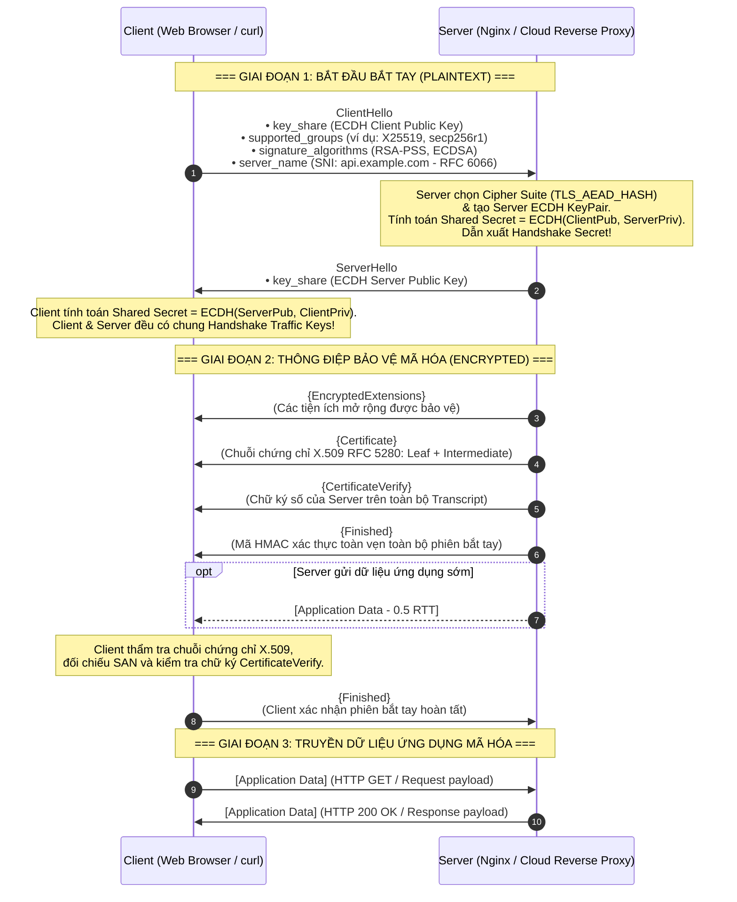
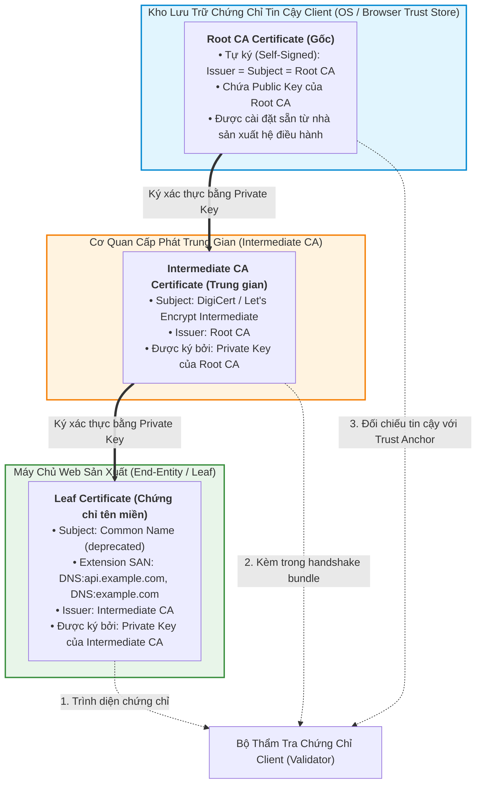

# 2_7_4 TLS 1.3 Handshake and Certificate Chain of Trust

> **Khóa học**: Cloud DevOps Basic — Networking Core  
> **Phân nhóm**: 2 Domain 2 - Computer Networking Core Fundamentals › 2_7 Core Application Layer Protocols  
> **Chủ đề**: Giao thức TLS 1.3 theo RFC 9846: Bắt tay 1-RTT, Cấu trúc chứng chỉ X.509 RFC 5280, Bắt buộc dùng SAN thay thế CN, Chuỗi tin cậy PKI và Tiện ích SNI RFC 6066  
> **Trạng thái**: Verified (WRITE-CDB-2_7_4, 14-11-2026)  
> **Checklist đối chiếu**: [2_7_4](<../../../CHECKLIST.md#27-core-application-layer-protocols>)

---

## 1. Khái Niệm Cốt Lõi & Bản Chất Kỹ Thuật (Core Concepts & Technical Deep Dive)

Bảo mật tầng giao vận (**Transport Layer Security - TLS**) là giao thức mật mã học tiêu chuẩn đóng vai trò bảo vệ an toàn cho dữ liệu truyền tải trên Internet, ngăn chặn các nguy cơ nghe lén (eavesdropping), can thiệp sửa đổi (tampering) và giả mạo danh tính (forgery).

---

### 1.1 Quá trình chuẩn hóa TLS 1.3: RFC 9846

Phiên bản hiện đại nhất của giao thức là **TLS 1.3**, được tổ chức IETF chuẩn hóa chính thức trong [RFC 9846](https://datatracker.ietf.org/doc/html/rfc9846) (Standards Track, công bố tháng 7/2026).
- **Trạng thái kế thừa**: [RFC 9846](https://datatracker.ietf.org/doc/html/rfc9846) thay thế hoàn toàn ([obsoletes](https://datatracker.ietf.org/doc/html/rfc9846)) các tài liệu tiêu chuẩn trước đây, bao gồm:
  - RFC 8446 (TLS 1.3 nguyên bản năm 2018).
  - RFC 5246 (TLS 1.2).
  - RFC 5077 (Stateless Session Resumption).
  - RFC 6961, RFC 7627, RFC 8422.
- **Mục tiêu cải tiến cốt lõi**:
  1. **Tối ưu hóa độ trễ**: Rút ngắn thời gian thiết lập phiên mã hóa từ 2-RTT (trong TLS 1.2) xuống chỉ còn đúng **1-RTT** (Round Trip Time).
  2. **Bảo mật mặc định (Secure by Default)**: Loại bỏ triệt để các thuật toán mật mã yếu, các phương thức trao đổi khóa tĩnh (RSA Key Exchange không có Forward Secrecy) và cơ chế nén dữ liệu dễ bị tấn công (CRIME).
  3. **Mã hóa bắt tay (Encrypted Handshake)**: Toàn bộ thông điệp xác thực sau `ServerHello` (bao gồm chứng chỉ số của server) đều được mã hóa bằng khóa bí mật vừa dẫn xuất, ngăn chặn kẻ trung gian giám sát danh tính dịch vụ.

---

### 1.2 Cơ chế Bắt tay 1-RTT (1-RTT Handshake - RFC 9846 §2 Figure 1)

Trong TLS 1.2 truyền thống, client và server phải trải qua 2 vòng mạng đi-về (2-RTT) trước khi truyền tải dữ liệu ứng dụng: vòng đầu để chào nhau và chọn thuật toán, vòng sau để trao đổi khóa và gửi chứng chỉ dạng bản rõ (plaintext).

Theo [RFC 9846 Section 2 (Figure 1)](https://datatracker.ietf.org/doc/html/rfc9846#section-2), TLS 1.3 thực hiện quy trình bắt tay hoàn chỉnh chỉ trong **1-RTT**:

```text
Client                                                              Server

ClientHello
 + key_share (ECDH Public Key)
 + signature_algorithms
 + supported_groups
 + server_name (SNI)           -------- 1. ClientHello -------->
                                                                    ServerHello
                                                                     + key_share (ECDH Public Key)
                                                                    {EncryptedExtensions}
                                                                    {Certificate}
                                                                    {CertificateVerify}
                                                                    {Finished}
                               <-------- 2. ServerHello --------   [Application Data]
{Finished}                     -------- 3. Finished ----------->
[Application Data]             <------- 4. Encrypted Data ----->   [Application Data]
```

*Ghi chú ký hiệu theo chuẩn RFC 9846*:
- `<Không ngoặc>`: Thông điệp gửi dạng bản rõ (plaintext).
- `{Ngoặc nhọn}`: Thông điệp được mã hóa bằng khóa dẫn xuất tạm thời từ Handshake Secret.
- `[Ngoặc vuông]`: Dữ liệu ứng dụng (Application Data) được mã hóa bằng Application Traffic Secret.

#### Chi tiết các bước thực thi:
1. **ClientHello + `key_share`**: Client gửi thông điệp chào hỏi, chủ động dự đoán trước nhóm đường cong elliptic mà server hỗ trợ và gửi luôn khóa công khai ECDH của mình trong phần mở rộng `key_share`.
2. **ServerHello + `key_share`**: Server chọn một nhóm đường cong chung, phản hồi khóa công khai ECDH tương ứng của mình trong `key_share`.
   - **Dẫn xuất khóa tức thì**: Ngay tại thời điểm này, cả Client và Server đều tính toán được bí mật chung (**Shared Secret**). Toàn bộ các thông điệp tiếp theo của Server được mã hóa ngay lập tức!
3. **Mã hóa thông điệp phía Server**:
   - `{EncryptedExtensions}`: Chứa các tham số mở rộng được mã hóa an toàn.
   - `{Certificate}`: Chứng chỉ X.509 của server (được mã hóa, hoàn toàn bảo vệ danh tính trước kẻ nghe lén trên đường truyền).
   - `{CertificateVerify}`: Chữ ký điện tử của Server trên toàn bộ bản ghi bắt tay (Handshake Transcript) chứng minh Server nắm giữ Private Key tương ứng với Certificate.
   - `{Finished}`: Mã băm toàn vẹn (HMAC) của toàn bộ quá trình bắt tay.
   - `[Application Data]`: Server thậm chí có thể gửi dữ liệu ứng dụng mã hóa ngay sau `{Finished}` mà không cần đợi thêm bất kỳ phản hồi nào từ client.
4. **Client xác thực & Phản hồi**: Client kiểm tra chuỗi chứng chỉ, xác thực chữ ký trong `{CertificateVerify}`, gửi thông điệp `{Finished}` và lập tức truyền tải dữ liệu ứng dụng `[Application Data]`.

---

### 1.3 Đơn giản hóa Bộ mã hóa (Cipher Suites - RFC 9846 Appendix B.4)

Trong các phiên bản TLS cũ (TLS 1.2), Cipher Suite được thiết kế theo cấu trúc nguyên khối rất cồng kềnh, kết hợp 4 thành phần: `TLS_ECDHE_RSA_WITH_AES_128_GCM_SHA256` (Thuật toán trao đổi khóa + Thuật toán xác thực danh tính + Thuật toán mã hóa đối xứng + Thuật toán băm toàn vẹn).

Theo [RFC 9846 Appendix B.4](https://datatracker.ietf.org/doc/html/rfc9846#appendix-B.4), TLS 1.3 đơn giản hóa triệt để cấu trúc Cipher Suite theo định dạng **`TLS_AEAD_HASH`**:
- **Cơ chế tách biệt hoàn toàn**: Thuật toán trao đổi khóa (ECDHE) và thuật toán ký xác thực (RSA-PSS, ECDSA) được thương lượng độc lập thông qua các tiện ích mở rộng (`supported_groups` và `signature_algorithms`).
- **Các Cipher Suite chuẩn mực trong TLS 1.3 (Bảng 4 & 5)**:
  - `TLS_AES_128_GCM_SHA256`
  - `TLS_AES_256_GCM_SHA384`
  - `TLS_CHACHA20_POLY1305_SHA256`
- Mọi cipher suite trong TLS 1.3 đều bắt buộc phải là thuật toán **AEAD** (Authenticated Encryption with Associated Data), đảm bảo đồng thời cả tính bảo mật (Confidentiality) lẫn tính toàn vẹn (Authenticity).

---

### 1.4 Tầng Bản ghi TLS 1.3 (Record Layer - RFC 9846 §5.1)

Tầng bản ghi (**Record Layer**) là đơn vị đóng gói dữ liệu cơ sở của giao thức TLS.

Theo [RFC 9846 Section 5.1](https://datatracker.ietf.org/doc/html/rfc9846#section-5.1):
- **Cấu trúc Header cố định 5 bytes**:
  1. `ContentType` (1 byte): Xác định loại dữ liệu của bản ghi (ví dụ: `23` đại diện cho `application_data`).
  2. `legacy_record_version` (2 bytes): Cố định giá trị `0x0303` (đại diện cho TLS 1.2 / SSL 3.3 theo chuẩn lịch sử). Mục đích giữ cố định giá trị này là nhằm đảm bảo tính tương thích ngược, ngăn các thiết bị mạng trung gian (middleboxes / firewalls cũ) làm rớt gói tin khi thấy phiên bản mới lạ.
  3. `length` (2 bytes): Độ dài của tải trọng bản ghi theo sau (không tính 5 bytes header).
- **Giới hạn kích thước**: Kích thước tải trọng dữ liệu chưa mã hóa (plaintext record payload) tối đa được phép truyền tải trong một bản ghi là **$2^{14}$ bytes (16384 bytes)**.

---

### 1.5 Cấu trúc Chứng chỉ X.509 v3 (RFC 5280 §4.1)

Chứng chỉ số X.509 là văn bản điện tử ràng buộc danh tính của một tổ chức/tên miền với một khóa công khai (Public Key). Cấu trúc của chứng chỉ được chuẩn hóa trong [RFC 5280 Section 4.1](https://datatracker.ietf.org/doc/html/rfc5280#section-4.1) dưới dạng khối dữ liệu ASN.1 **`TBSCertificate` (To Be Signed Certificate)**:

```text
Certificate ::= SEQUENCE {
    tbsCertificate          TBSCertificate,
    signatureAlgorithm      AlgorithmIdentifier,
    signatureValue          BIT STRING
}

TBSCertificate ::= SEQUENCE {
    version          [0]  EXPLICIT Version DEFAULT v1 (v3),
    serialNumber          CertificateSerialNumber,
    signature             AlgorithmIdentifier,
    issuer                Name,
    validity              Validity (notBefore, notAfter),
    subject               Name,
    subjectPublicKeyInfo  SubjectPublicKeyInfo,
    issuerUniqueID   [1]  IMPLICIT UniqueIdentifier OPTIONAL,
    subjectUniqueID  [2]  IMPLICIT UniqueIdentifier OPTIONAL,
    extensions       [3]  EXPLICIT Extensions OPTIONAL
}
```

Các trường thông tin cốt lõi trong `TBSCertificate`:
- **`version`**: Phiên bản chứng chỉ (v3 cho phép hỗ trợ các trường mở rộng extensions).
- **`serialNumber`**: Số nguyên dương định danh duy nhất của chứng chỉ do Certificate Authority (CA) phát hành.
- **`signature`**: Thuật toán mà CA dùng để ký số lên chứng chỉ (ví dụ: SHA256withRSA).
- **`issuer`**: Thông tin danh tính của cơ quan cấp phát chứng chỉ (Certificate Authority).
- **`validity`**: Khung thời gian hiệu lực, xác định bởi hai mốc thời gian:
  - `notBefore`: Thời điểm chứng chỉ bắt đầu có hiệu lực.
  - `notAfter`: Thời điểm chứng chỉ chính thức hết hạn.
- **`subject`**: Danh tính của thực thể sở hữu chứng chỉ (bao gồm Country, Organization, Common Name).
- **`subjectPublicKeyInfo`**: Khóa công khai của chủ thể và định danh thuật toán (RSA hoặc Elliptic Curve).
- **`extensions`**: Danh sách các trường mở rộng bổ sung (quan trọng nhất là `subjectAltName` - SAN, `basicConstraints`, `keyUsage`).

---

### 1.6 Bắt buộc dùng SAN thay thế CN (RFC 6125 §6.4.4 & RFC 9110 §4.3.4)

Trong lịch sử, tên miền của máy chủ thường được đặt trong trường **Common Name (CN)** nằm bên trong thuộc tính `Subject` (ví dụ: `CN=example.com`).

Tuy nhiên, tiêu chuẩn hiện đại đã loại bỏ hoàn toàn cơ chế này:
- Theo **[RFC 6125 Section 6.4.4](https://datatracker.ietf.org/doc/html/rfc6125#section-6.4.4)** và **[RFC 9110 Section 4.3.4](https://datatracker.ietf.org/doc/html/rfc9110#section-4.3.4)**:
  - Trường **Subject Alternative Name (SAN)** với loại định danh `dNSName` (DNS-ID) là **bắt buộc** để xác thực danh tính tên miền của máy chủ HTTPS.
  - Thuộc tính Common Name (CN-ID) đã bị coi là lỗi thời (**deprecated**).
  - Quy tắc xác thực khắt khe: **Client BẮT BUỘC KHÔNG ĐƯỢC PHÉP đối chiếu tên miền với CN nếu chứng chỉ đã chứa trường SAN**. Mọi chứng chỉ web hiện đại đều phải khai báo tên miền (hoặc Wildcard `*.example.com`) trong trường SAN.

---

### 1.7 Tiện ích Server Name Indication (SNI - RFC 6066 §3)

Trong môi trường điện toán đám mây và DevOps, kỹ thuật ảo hóa máy chủ web (Virtual Hosting / Reverse Proxy / Ingress Controller) cho phép hàng trăm website và tên miền độc lập cùng chia sẻ một địa chỉ IP công khai và một cổng duy nhất (TCP 443).

- **Thách thức**: Quá trình bắt tay TLS diễn ra trước khi dữ liệu ứng dụng HTTP được gửi đi. Tại thời điểm bắt tay, máy chủ không thể đọc được HTTP Header `Host: api.example.com` vì kết nối chưa được giải mã! Nếu không biết client đang muốn truy cập website nào, máy chủ không thể biết phải gửi lại chứng chỉ TLS nào.
- **Giải pháp - SNI ([RFC 6066 Section 3](https://datatracker.ietf.org/doc/html/rfc6066#section-3))**:
  - Tiện ích mở rộng **Server Name Indication (SNI)** cho phép client đính kèm tên máy chủ định danh (`server_name`) ngay trong thông điệp `ClientHello` ban đầu.
  - Nhờ SNI, Reverse Proxy hoặc Web Server (Nginx, HAProxy, AWS ALB) có thể nhận biết chính xác tên miền đích ngay từ bước đầu tiên để chọn và trả về đúng chứng chỉ X.509 tương ứng cho client.

---

### 1.8 Chuỗi Tin Cậy PKI & Các Cảnh Báo Lỗi (RFC 5280 §6 & RFC 9846 §6.2)

Hệ thống cơ sở hạ tầng khóa công khai (**Public Key Infrastructure - PKI**) vận hành dựa trên mô hình **Chuỗi tin cậy (Chain of Trust)**:

1. **Leaf Certificate (End-Entity Certificate)**: Chứng chỉ cấp trực tiếp cho tên miền hoặc máy chủ web của bạn.
2. **Intermediate CA Certificate**: Chứng chỉ của các cơ quan cấp phát trung gian. Root CA sử dụng Private Key của mình để ủy quyền ký cho các Intermediate CA nhằm bảo vệ an toàn cho khóa gốc.
3. **Root CA Certificate (Trust Anchor)**: Chứng chỉ gốc tự ký (**Self-Signed**), trong đó `Issuer` trùng khớp với `Subject`. Các Root CA uy tín toàn cầu được cài đặt sẵn vào kho lưu trữ chứng chỉ tin cậy (**Trust Store**) của hệ điều hành (Linux CA bundle, Windows Certificate Store) hoặc trình duyệt (Mozilla NSS).

Quy trình thẩm tra ([RFC 5280 Section 6](https://datatracker.ietf.org/doc/html/rfc5280#section-6)): Client đi ngược từ Leaf Certificate, kiểm tra chữ ký của Intermediate CA, rồi kiểm tra chữ ký của Root CA. Khi chạm tới một Root CA có sẵn trong Trust Store của mình, chuỗi tin cậy được thiết lập thành công.

#### Các cảnh báo lỗi TLS Alert phổ biến ([RFC 9846 Section 6.2](https://datatracker.ietf.org/doc/html/rfc9846#section-6.2)):
- **`certificate_expired`**: Thời gian hệ thống hiện tại vượt quá mốc `notAfter` (hoặc trước mốc `notBefore`) quy định trong trường Validity của chứng chỉ.
- **`unknown_ca`**: Client không thể hoàn thành chuỗi tin cậy tới một Trust Anchor hợp lệ. Nguyên nhân thường gặp nhất là máy chủ quên gửi kèm Intermediate CA certificate trong handshake, hoặc chứng chỉ do một CA nội bộ/tự ký phát hành mà client chưa tin cậy.
- **`bad_certificate`**: Chứng chỉ nhận được bị hỏng, chữ ký số không khớp với khóa công khai của CA, hoặc tên miền truy cập không khớp với bất kỳ giá trị nào trong trường mở rộng SAN.

---

## 2. Ví Dụ Đời Sống Thực Tế Dễ Hiểu (Intuitive Real-World Analogies)

### 2.1 Chiếc hộp khóa Diffie-Hellman và Quy trình nhận phòng 1-RTT

Hãy tưởng tượng bạn đặt một phòng khách sạn cao cấp thông qua một bức thư trao đổi:

- **Thời kỳ TLS 1.2 (2 vòng thư từ - 2-RTT)**:
  - Vòng 1: Bạn gửi thư hỏi: *"Khách sạn có những loại khóa phòng nào?"*. Khách sạn gửi thư phản hồi công khai bằng lái xe của mình và danh sách các loại khóa.
  - Vòng 2: Bạn tạo một mã số bí mật, dùng bằng lái xe của khách sạn để khóa mã số đó gửi lại. Khách sạn mở khóa và gửi thư xác nhận. Lúc này bạn mới có thể bắt đầu nói chuyện nhận phòng. Mọi người đưa thư trên đường đều nhìn thấy bằng lái xe của khách sạn gửi lộ thiên.
- **Thời kỳ TLS 1.3 (Đến là vào việc ngay - 1-RTT)**:
  - Ngay trong bức thư đầu tiên (**ClientHello**), bạn đã đính kèm luôn một nửa chiếc hộp khóa mật mã toán học (**`key_share`**).
  - Khách sạn nhận được thư, lập tức ghép nửa chiếc chìa khóa của khách sạn vào (**ServerHello + `key_share`**). Ngay tức khắc, một chiếc két sắt bảo mật đã được hình thành!
  - Khách sạn kéo rèm kín mít, đặt giấy tờ tùy thân chứng thực (**`Certificate`**, **`CertificateVerify`**) và cả chìa khóa căn phòng (**`[Application Data]`**) vào bên trong két sắt gửi lại cho bạn.
  - Bạn mở két sắt, kiểm tra thẻ căn cước của khách sạn, xác nhận xong là có thể sử dụng phòng ngay lập tức. Toàn bộ quá trình diễn ra chỉ trong đúng 1 vòng đi-về (1-RTT), và người ngoài đường tuyệt đối không xem trộm được bất kỳ giấy tờ nào của khách sạn.

---

### 2.2 Hộ chiếu công chứng giáp lai và Chuỗi tin cậy PKI

Hãy hình dung việc bạn đi qua cửa khẩu quốc tế tại một sân bay nước ngoài:

```text
[Hộ Chiếu Của Bạn - Leaf Certificate]
       ^
       | Được đóng dấu giáp lai bởi
       |
[Phòng Xuất Nhập Cảnh Tỉnh - Intermediate CA]
       ^
       | Được ủy quyền chính thức bởi
       |
[Cục Quản Lý Xuất Nhập Cảnh / Bộ Công An - Root CA]
       ^
       | Đã có sẵn trong danh bạ tin cậy
       |
[Hệ Thống Kiểm Soát Biên Phòng Toàn Cầu - OS / Browser Trust Store]
```

1. **Leaf Certificate (Hộ chiếu)**: Chứa ảnh, thông tin cá nhân và chữ ký của bạn (Subject). Hộ chiếu này chứng minh danh tính của bạn khi xuất trình.
2. **Intermediate CA (Cơ quan địa phương)**: Cục trưởng Cục Xuất nhập cảnh không thể trực tiếp ngồi ký từng cuốn hộ chiếu cho hàng chục triệu công dân. Thay vào đó, Cục cấp giấy chứng nhận ủy quyền và con dấu cho các Phòng Quản lý Xuất nhập cảnh cấp tỉnh để họ ký hộ chiếu thay mặt Cục.
3. **Root CA (Cơ quan quyền lực tối cao)**: Con dấu gốc của Cục Xuất nhập cảnh Trung ương. Sân bay quốc tế nước bạn đã lưu sẵn mẫu con dấu của Cục này trong cuốn danh bạ kiểm soát biên phòng (**Trust Store**) của họ.
4. **Các lỗi xuất nhập cảnh thường gặp**:
   - Nếu bạn xuất trình một cuốn sổ tự vẽ ở nhà không có con dấu ủy quyền (`Self-signed`): Biên phòng lập tức từ chối và báo lỗi **`unknown_ca`**.
   - Nếu bạn chỉ nộp hộ chiếu mà không có giấy ủy quyền con dấu của tỉnh kèm theo (thiếu Intermediate Certificate): Biên phòng không biết cán bộ tỉnh đó là ai nên cũng sẽ từ chối (**`unknown_ca`**).
   - Nếu hộ chiếu của bạn quá hạn ghi trên trang bìa: Biên phòng giơ biển báo **`certificate_expired`**.
   - Nếu hộ chiếu ghi tên Nguyễn Văn A nhưng vé máy bay lại ghi tên Trần Văn B: Biên phòng lập tức giữ lại vì không khớp danh tính (**`bad_certificate`** - SAN Mismatch).

---

## 3. Kiến Trúc, Luồng Hoạt Động & Hình Ảnh Trực Quan (Architecture, Diagrams & Visual Media)

### 3.1 Sơ đồ tuần tự: Bắt tay TLS 1.3 1-RTT (RFC 9846 §2)



---

### 3.2 Sơ đồ kiến trúc: Chuỗi tin cậy PKI (Certificate Chain of Trust)



---

### 3.3 So sánh Cấu trúc Cipher Suite: TLS 1.2 vs TLS 1.3

```text
Mô hình cũ (TLS 1.2): Cấu trúc cồng kềnh, ràng buộc cứng nhắc 4 thuật toán
+---------------------------------------------------------------------------------+
| TLS _ ECDHE _ RSA _ WITH _ AES_128_GCM _ SHA256                                  |
|   |      |      |               |           |                                    |
| Giao  Trao đổi Xác thực     Mã hóa đối xứng  Hàm băm PRF                         |
| thức   khóa   danh tính    (Cipher & Chế độ)                                     |
+---------------------------------------------------------------------------------+

Mô hình mới (TLS 1.3 - RFC 9846): Tinh gọn, chỉ định nghĩa cặp AEAD và Hàm băm
+---------------------------------------------------------------------------------+
| TLS _ AES_128_GCM _ SHA256                                                      |
|   |         |           |                                                       |
| Giao     Thuật toán   Hàm băm                                                   |
| thức     AEAD Cipher  toàn vẹn                                                  |
+---------------------------------------------------------------------------------+
(Trao đổi khóa ECDHE và Ký số RSA-PSS/ECDSA được thương lượng độc lập qua Extensions)
```

---

### 3.4 Cấu trúc Tầng Bản ghi TLS 1.3 (Record Layer Header - RFC 9846 §5.1)

```text
 0                   1                   2                   3
 0 1 2 3 4 5 6 7 8 9 0 1 2 3 4 5 6 7 8 9 0 1 2 3 4 5 6 7 8 9 0 1
+-+-+-+-+-+-+-+-+-+-+-+-+-+-+-+-+-+-+-+-+-+-+-+-+-+-+-+-+-+-+-+-+
|  ContentType  |    legacy_record_version      |    length     |
|    (1 byte)   |      (2 bytes = 0x0303)       |   (2 bytes)   |
+-+-+-+-+-+-+-+-+-+-+-+-+-+-+-+-+-+-+-+-+-+-+-+-+-+-+-+-+-+-+-+-+
|       Tải trọng bản ghi mã hóa (Encrypted Payload) ...        |
|       (Kích thước plaintext tối đa: 2^14 = 16384 bytes)       |
+---------------------------------------------------------------+
```

---

## 4. Thực Hành (Hands-on)

> ⚠️ Chưa chạy thử (not executed by the squad)

Trong phần này, chúng ta sử dụng hai công cụ dòng lệnh tiêu chuẩn là `openssl` và `curl` để phân tích thực chiến quá trình bắt tay TLS 1.3, trích xuất cấu trúc chứng chỉ X.509 v3 và kiểm tra chuỗi tin cậy.

---

### 4.1 Khảo sát bắt tay TLS 1.3 và Chuỗi chứng chỉ với `openssl s_client`

Lệnh `openssl s_client` kết nối tới cổng TLS, gửi SNI và hiển thị chi tiết các bước thương lượng mã hóa.

```bash
# Kết nối kiểm tra bắt tay TLS 1.3, gửi SNI và hiển thị toàn bộ chuỗi chứng chỉ
openssl s_client -connect example.com:443 -servername example.com -showcerts -tls1_3
```

#### Đầu ra chú giải chi tiết minh họa:

```text
CONNECTED(00000003)
---
Certificate chain
 0 s:CN = example.com
   i:C = US, O = DigiCert Inc, CN = DigiCert Global G2 TLS RSA SHA256 2020 CA1
   -----BEGIN CERTIFICATE-----
   MIIF... (Dữ liệu PEM của Leaf Certificate) ...
   -----END CERTIFICATE-----
 1 s:C = US, O = DigiCert Inc, CN = DigiCert Global G2 TLS RSA SHA256 2020 CA1
   i:C = US, O = DigiCert Inc, OU = www.digicert.com, CN = DigiCert Global Root CA
   -----BEGIN CERTIFICATE-----
   MIIE... (Dữ liệu PEM của Intermediate CA Certificate) ...
   -----END CERTIFICATE-----
---
Server certificate
subject=CN = example.com
issuer=C = US, O = DigiCert Inc, CN = DigiCert Global G2 TLS RSA SHA256 2020 CA1
---
No client certificate CA names sent
Peer signing digest: SHA256
Peer signature type: RSA-PSS
Server Temp Key: X25519, 253 bits
---
SSL handshake has read 3142 bytes and written 385 bytes
Verification: OK
---
New, TLSv1.3, Cipher is TLS_AES_128_GCM_SHA256
Server public key is 2048 bit
Secure Renegotiation IS NOT supported
Compression: NONE
Expansion: NONE
No ALPN negotiated
Early data was not sent
Verify return code: 0 (ok)
---
```

**Phân tích các trường thông tin quan trọng**:
- `Certificate chain`: Trình diện cấp độ `0` (Leaf Certificate của domain) và `1` (Intermediate CA). Server không cần gửi Root CA vì Root CA đã có sẵn ở client.
- `Server Temp Key: X25519`: Trao đổi khóa diễn ra tức thì thông qua đường cong Elliptic Curve X25519 trong tiện ích `key_share`.
- `Peer signature type: RSA-PSS`: Thuật toán chữ ký số xác thực chứng chỉ.
- `New, TLSv1.3, Cipher is TLS_AES_128_GCM_SHA256`: Bộ mã hóa được thỏa thuận thành công tuân theo định dạng AEAD tinh gọn của TLS 1.3.
- `Verify return code: 0 (ok)`: Chuỗi tin cậy PKI hợp lệ tuyệt đối.

---

### 4.2 Phân tích chi tiết trường SAN và Cấu trúc chứng chỉ bằng `openssl x509`

Sau khi lưu chứng chỉ máy chủ vào file `cert.crt`, chúng ta phân tích cấu trúc ASN.1 TBSCertificate theo chuẩn RFC 5280:

```bash
# Đọc và giải mã toàn bộ thông số kỹ thuật của chứng chỉ X.509
openssl x509 -in cert.crt -text -noout
```

#### Đầu ra chú giải chi tiết minh họa:

```text
Certificate:
    Data:
        Version: 3 (0x2)
        Serial Number:
            0a:3b:5c:7d:9e:1f:2a:4b:6c:8d:0e:1f:2a:3b:4c:5d
        Signature Algorithm: sha256WithRSAEncryption
        Issuer: C = US, O = DigiCert Inc, CN = DigiCert Global G2 TLS RSA SHA256 2020 CA1
        Validity
            Not Before: Jan 15 00:00:00 2026 GMT
            Not After : Jan 15 23:59:59 2027 GMT
        Subject: CN = example.com
        Subject Public Key Info:
            Public Key Algorithm: rsaEncryption
                Public-Key: (2048 bit)
                Modulus:
                    00:b2:4f:...
                Exponent: 65537 (0x10001)
        X509v3 extensions:
            X509v3 Basic Constraints: critical
                CA:FALSE
            X509v3 Subject Alternative Name: 
                DNS:example.com, DNS:www.example.com, DNS:api.example.com
            X509v3 Key Usage: critical
                Digital Signature, Key Encipherment
```

**Nhận diện kỹ thuật**:
- `Version: 3`: Cho phép chứa các trường mở rộng `X509v3 extensions`.
- `Validity`: Cặp thời gian `Not Before` và `Not After`. Nếu hệ thống nằm ngoài khoảng này, lỗi `certificate_expired` sẽ xảy ra.
- `X509v3 Basic Constraints: CA:FALSE`: Xác định đây là chứng chỉ lá (Leaf/End-Entity), không có quyền ký chứng chỉ khác.
- `X509v3 Subject Alternative Name`: Liệt kê các tên miền hợp lệ (`DNS:example.com`, `DNS:www.example.com`, `DNS:api.example.com`). Theo RFC 6125 và RFC 9110, trình duyệt chỉ căn cứ vào danh sách này để xác thực danh tính.

---

### 4.3 Khảo sát kết nối TLS tổng thể qua `curl -v`

Lệnh `curl` cung cấp góc nhìn toàn diện từ tầng TCP, bắt tay TLS cho tới gửi yêu cầu HTTP:

```bash
# Thực hiện gọi HTTP chi tiết có kiểm tra TLS 1.3
curl -v https://example.com
```

#### Đầu ra chú giải chi tiết minh họa:

```text
*   Trying 93.184.216.34:443...
* Connected to example.com (93.184.216.34) port 443 (#0)
* ALPN: offers h2,http/1.1
* TLSv1.3 (OUT), TLS handshake, Client hello (1):
* TLSv1.3 (IN), TLS handshake, Server hello (2):
* TLSv1.3 (IN), TLS handshake, Encrypted Extensions (8):
* TLSv1.3 (IN), TLS handshake, Certificate (11):
* TLSv1.3 (IN), TLS handshake, CERT verify (15):
* TLSv1.3 (IN), TLS handshake, Finished (20):
* TLSv1.3 (OUT), TLS handshake, Finished (20):
* SSL connection using TLSv1.3 / TLS_AES_128_GCM_SHA256
* Server certificate:
*  subject: CN=example.com
*  start date: Jan 15 00:00:00 2026 GMT
*  expire date: Jan 15 23:59:59 2027 GMT
*  subjectAltName: host "example.com" matched cert's "example.com"
*  issuer: C=US; O=DigiCert Inc; CN=DigiCert Global G2 TLS RSA SHA256 2020 CA1
*  SSL certificate verify ok.
> GET / HTTP/1.1
> Host: example.com
> User-Agent: curl/8.5.0
> Accept: */*
> 
< HTTP/1.1 200 OK
< Content-Type: text/html; charset=UTF-8
...
```

---

## 5. Cạm Bẫy Thực Tế & Thực Tiễn Sản Xuất (Production Gotchas & Best Practices)

### 5.1 Cạm bẫy "Thiếu Intermediate Certificate" (Lỗi `unknown_ca`)
- **Triệu chứng**: Khi cài đặt SSL trên Nginx hoặc Load Balancer, bạn truy cập bằng trình duyệt Chrome trên máy tính cá nhân thì thấy chứng chỉ màu xanh bình thường. Tuy nhiên, khi hệ thống microservices nội bộ hoặc các thiết bị di động Android gọi API qua `curl`, ứng dụng lập tức văng lỗi: `SSL certificate problem: unable to get local issuer certificate` hoặc cảnh báo TLS `unknown_ca`.
- **Bản chất kỹ thuật**: Trình duyệt trên máy tính thường có cơ chế lưu đệm Intermediate CA đã gặp trước đó (hoặc sử dụng trường AIA - Authority Information Access để tự động tải về). Ngược lại, các công cụ tự động (`curl`, Java runtime, Python `requests`, hệ điều hành di động) tuân thủ nghiêm ngặt chuẩn RFC 5280: chúng yêu cầu máy chủ phải gửi đầy đủ chuỗi từ Leaf tới Intermediate trong thông điệp `{Certificate}`.
- **Giải pháp**: Luôn luôn cấu hình file chứng chỉ dạng đầy đủ (**Full Chain Bundle** - ví dụ `fullchain.pem` từ Let's Encrypt). File này phải chứa Leaf Certificate ở đầu tiên, tiếp theo ngay sau đó là Intermediate CA Certificate. Tuyệt đối không chỉ trỏ Nginx tới riêng lẻ file `cert.pem`.

---

### 5.2 Cạm bẫy "Bỏ quên SNI khi kiểm thử hoặc gọi qua IP" (Lỗi `bad_certificate` / Sai chứng chỉ)
- **Triệu chứng**: Trên một máy chủ Nginx hoặc Kubernetes Ingress chạy nhiều website ảo, khi kỹ sư kiểm tra sức khỏe hệ thống (Health Check) hoặc chạy lệnh kết nối trực tiếp bằng IP:
  ```bash
  curl -v https://192.0.2.10
  ```
  Kết nối bị từ chối hoặc trả về chứng chỉ của một website mặc định không liên quan, dẫn tới lỗi sai lệch tên miền (`bad_certificate`).
- **Bản chất kỹ thuật**: Theo RFC 6066, nếu client không truyền phần mở rộng SNI (`server_name`), máy chủ web không thể suy luận được client muốn truy cập tên miền nào trong hàng chục vhost đang chạy, buộc máy chủ phải ném ra chứng chỉ mặc định (Default/Fallback Certificate).
- **Giải pháp**: Trong các script automation hoặc kiểm tra kết nối qua IP, luôn bổ sung cờ chỉ định SNI:
  ```bash
  curl -v --resolve example.com:443:192.0.2.10 https://example.com
  # Hoặc với OpenSSL:
  openssl s_client -connect 192.0.2.10:443 -servername example.com
  ```

---

### 5.3 Cạm bẫy "Cố chấp dùng Common Name (CN) thay vì SAN" (Lỗi xác thực hiện đại)
- **Triệu chứng**: Kỹ sư tự tạo chứng chỉ nội bộ (Internal PKI / Self-Signed) bằng các câu lệnh OpenSSL cũ chỉ khai báo `-subj "/CN=api.internal.local"` mà không định nghĩa phần mở rộng `subjectAltName`. Kết quả là trình duyệt và các ứng dụng hiện đại (Go, Node.js, Java 17+) từ chối kết nối và thông báo lỗi không xác định được danh tính máy chủ.
- **Bản chất kỹ thuật**: Theo [RFC 6125 §6.4.4](https://datatracker.ietf.org/doc/html/rfc6125#section-6.4.4) và [RFC 9110 §4.3.4](https://datatracker.ietf.org/doc/html/rfc9110#section-4.3.4), trường Common Name (CN) đã chính thức bị khai tử đối với việc định danh tên miền. Client hiện đại bắt buộc phải đối chiếu danh tính thông qua trường SAN (`dNSName`).
- **Giải pháp**: Mọi lệnh tạo hoặc ký chứng chỉ (OpenSSL, Terraform, Ansible) đều phải chỉ định trường SAN rõ ràng:
  ```text
  subjectAltName = @alt_names
  [alt_names]
  DNS.1 = api.internal.local
  DNS.2 = *.internal.local
  ```

---

### 5.4 Cạm bẫy "Chứng chỉ hết hạn âm thầm" (Lỗi `certificate_expired`)
- **Triệu chứng**: Toàn bộ hệ thống sập nguồn truy cập, API gateways báo lỗi đồng loạt 502/503 hoặc client ngắt kết nối với cảnh báo TLS `certificate_expired`.
- **Bản chất kỹ thuật**: Mọi chứng chỉ X.509 đều có hai trường thời gian cố định `notBefore` và `notAfter` trong `Validity` ([RFC 5280 §4.1](https://datatracker.ietf.org/doc/html/rfc5280#section-4.1)). Khi đồng hồ hệ thống vượt qua mốc `notAfter`, chứng chỉ bị vô hiệu hóa tức thì về mặt toán học.
- **Giải pháp**: Triển khai cơ chế tự động hóa gia hạn hoàn toàn (như giao thức ACME / Certbot / cert-manager trên Kubernetes) và thiết lập hệ thống giám sát thời hạn chứng chỉ cảnh báo trước ít nhất 30 ngày qua Prometheus/Alertmanager.

---

## 6. Câu Hỏi Củng Cố Kiến Thức (Active Recall Quiz)

### Câu hỏi 1: Tối ưu hóa bắt tay TLS 1.3 so với TLS 1.2
Tại sao bắt tay chuẩn trong TLS 1.3 theo RFC 9846 lại hoàn tất chỉ trong 1-RTT thay vì 2-RTT như TLS 1.2, và danh tính máy chủ (chứng chỉ X.509) được bảo vệ tốt hơn như thế nào trên đường truyền mạng?

<details>
<summary><b>Đáp án chi tiết</b></summary>

1. **Rút ngắn 1-RTT nhờ phỏng đoán trao đổi khóa (`key_share`)**:
   - Trong TLS 1.2, vòng trao đổi đầu tiên (1-RTT) chỉ dùng để gửi thông điệp `ClientHello` và `ServerHello` nhằm thương lượng danh sách thuật toán. Đến vòng trao đổi thứ hai, hai bên mới bắt đầu gửi khóa tạm và chứng chỉ để hoàn thiện việc bắt tay (tổng cộng 2-RTT).
   - Trong TLS 1.3 (RFC 9846 §2), client chủ động gửi ngay khóa công khai ECDH của mình trong phần mở rộng `key_share` ngay tại thông điệp `ClientHello`. Khi Server nhận được, Server chọn thuật toán và gửi lại khóa công khai ECDH của Server trong `key_share`. Lúc này cả hai bên đã tính toán xong bí mật chung (**Shared Secret**), rút ngắn toàn bộ quá trình đàm phán xuống đúng **1-RTT**.
2. **Bảo vệ danh tính chứng chỉ**:
   - Ở TLS 1.2, thông điệp `Certificate` của server được truyền đi dưới dạng bản rõ (plaintext), cho phép bất kỳ ai bắt gói tin (Wireshark, ISP, tin tặc trung gian) đều đọc được tên miền và danh tính dịch vụ.
   - Ở TLS 1.3, vì Shared Secret được tính toán ngay sau khi trao đổi `key_share`, nên toàn bộ các thông điệp phía sau (`{EncryptedExtensions}`, `{Certificate}`, `{CertificateVerify}`, `{Finished}`) đều được **mã hóa hoàn toàn**, ngăn chặn triệt để hành vi nghe lén danh tính trên đường truyền.

</details>

---

### Câu hỏi 2: Xử lý sự cố chuỗi tin cậy PKI trong môi trường Microservices
Một kỹ sư DevOps triển khai dịch vụ mới trên Nginx Ingress. Khi kiểm tra bằng trình duyệt trên laptop, trang web hiện ổ khóa xanh hợp lệ. Tuy nhiên, một container chạy mã nguồn Python/curl trong cụm Kubernetes nội bộ khi gọi tới domain này lại văng lỗi `SSL: CERTIFICATE_VERIFY_FAILED: unable to get local issuer certificate` (TLS Alert `unknown_ca`). Nguyên nhân gốc rễ và cách xử lý chuẩn theo RFC 5280 là gì?

<details>
<summary><b>Đáp án chi tiết</b></summary>

1. **Nguyên nhân gốc rễ**:
   - Máy chủ Nginx chỉ được cấu hình để gửi **Leaf Certificate** (chứng chỉ của domain) mà không gửi kèm **Intermediate CA Certificate**.
   - Trình duyệt trên laptop hiển thị bình thường vì nó đã lưu cache Intermediate CA từ các phiên duyệt web trước đó hoặc tự động tải về qua thuộc tính AIA (Authority Information Access).
   - Container Linux chạy `curl`/Python tuân thủ nghiêm ngặt [RFC 5280 §6](https://datatracker.ietf.org/doc/html/rfc5280#section-6): Kho Trust Store của container chỉ chứa các Root CA. Do không nhận được Intermediate CA từ máy chủ, container không thể xây dựng được cầu nối từ Leaf Certificate tới Root CA, dẫn tới việc không thể xác thực được chữ ký số của đơn vị cấp phát và phát cảnh báo lỗi `unknown_ca`.
2. **Cách khắc phục chuẩn**:
   - Cấu hình Nginx sử dụng file **Full Chain Bundle** (ví dụ `fullchain.pem`).
   - File này phải chứa nội dung của Leaf Certificate ở phía trên, theo sau ngay lập tức bởi Intermediate CA Certificate. Khi đó, trong thông điệp `{Certificate}`, server sẽ gửi trọn vẹn cả hai chứng chỉ để client dễ dàng thẩm tra ngược về Root CA có sẵn trong máy.

</details>

---

### Câu hỏi 3: Quy tắc định danh máy chủ theo RFC 6125 và RFC 9110
Một lập trình viên viết một thư viện client tùy biến để kết nối HTTPS. Thư viện này trích xuất trường `Subject: CN` trong chứng chỉ để so sánh với tên miền trên URL. Khi kết nối tới một API hiện đại, thư viện báo lỗi xác thực danh tính mặc dù chứng chỉ hoàn toàn hợp lệ. Tại sao cách lập trình này vi phạm tiêu chuẩn Internet hiện đại?

<details>
<summary><b>Đáp án chi tiết</b></summary>

1. **Sự lỗi thời của trường Common Name (CN)**:
   - Theo [RFC 6125 Section 6.4.4](https://datatracker.ietf.org/doc/html/rfc6125#section-6.4.4) và [RFC 9110 Section 4.3.4](https://datatracker.ietf.org/doc/html/rfc9110#section-4.3.4), trường Common Name (CN-ID) đã chính thức bị **deprecate** đối với mục đích định danh máy chủ HTTPS.
2. **Quy tắc bắt buộc đối với Client**:
   - Tiêu chuẩn IETF quy định: **Client BẮT BUỘC KHÔNG ĐƯỢC PHÉP đối chiếu tên miền với trường Common Name nếu trong chứng chỉ đã tồn tại trường mở rộng Subject Alternative Name (SAN)**.
   - Các chứng chỉ hiện đại bắt buộc phải đặt toàn bộ danh sách tên miền (bao gồm cả domain chính, subdomains hoặc wildcard) vào trường SAN dưới dạng định danh `dNSName` (DNS-ID).
   - Thư viện client tùy biến nói trên đã áp dụng sai quy chuẩn khi bỏ qua trường SAN và phụ thuộc vào trường CN cũ, dẫn đến việc không thể xác thực các chứng chỉ web hiện đại.

</details>

---

## 7. 📚 Nguồn Tài Liệu Chính Thống (Tier-1 Official References)

- [RFC 9846: The Transport Layer Security (TLS) Protocol Version 1.3](https://datatracker.ietf.org/doc/html/rfc9846) - Tiêu chuẩn IETF Standards Track (công bố tháng 7/2026, thay thế RFC 8446 và RFC 5246), định nghĩa toàn diện về kiến trúc TLS 1.3, bắt tay 1-RTT, bộ mã hóa AEAD và tầng bản ghi.
- [RFC 5280: Internet X.509 Public Key Infrastructure Certificate and Certificate Revocation List (CRL) Profile](https://datatracker.ietf.org/doc/html/rfc5280) - Tiêu chuẩn cấu trúc dữ liệu TBSCertificate, các trường mở rộng Extensions và thuật toán thẩm tra đường dẫn chuỗi tin cậy PKI.
- [RFC 6066: Transport Layer Security (TLS) Extensions: Extension Definitions - Section 3: Server Name Indication](https://datatracker.ietf.org/doc/html/rfc6066#section-3) - Đặc tả tiện ích Server Name Indication (SNI) cho phép client truyền tải hostname định danh để hỗ trợ đa website trên một địa chỉ IP.
- [RFC 6125: Representation and Verification of Domain-Based Application Service Identity within Internet Public Key Infrastructure](https://datatracker.ietf.org/doc/html/rfc6125#section-6.4.4) - Tiêu chuẩn định danh dịch vụ máy chủ, bắt buộc sử dụng Subject Alternative Name (SAN / DNS-ID) và loại bỏ Common Name (CN).
- [RFC 9110: HTTP Semantics - Section 4.3.4 Establishing an HTTPS URI](https://datatracker.ietf.org/doc/html/rfc9110#section-4.3.4) - Quy chuẩn ngữ nghĩa HTTP chỉ định quy tắc xác thực máy chủ HTTPS và cấm đối chiếu CN-ID khi đã có DNS-ID.
- [OpenSSL s_client Documentation](https://www.openssl.org/docs/manmaster/man1/openssl-s_client.html) - Tài liệu hướng dẫn sử dụng công cụ dòng lệnh `openssl s_client` để kết nối, gỡ lỗi và kiểm tra bắt tay TLS/SSL.
