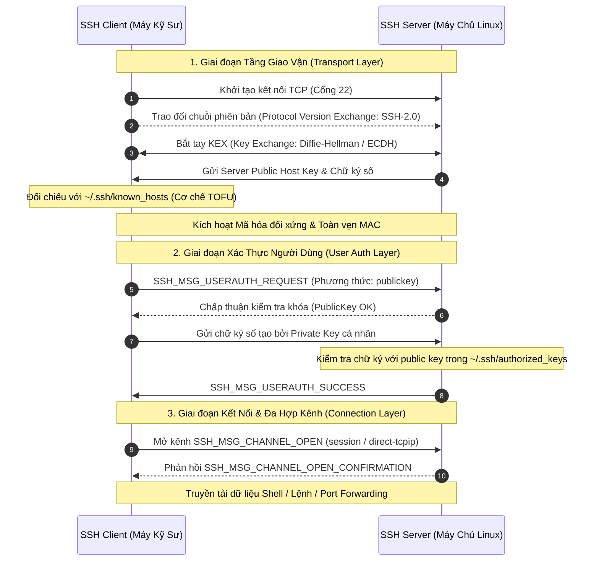

# 2_7_5 SSH Protocol and Port Forwarding

> **Khóa học**: Cloud DevOps Basic — Networking Core  
> **Phân nhóm**: 2 Domain 2 - Computer Networking Core Fundamentals › 2_7 Core Application Layer Protocols  
> **Chủ đề**: Giao thức SSH (RFC 4251–4254): Ba tầng kiến trúc Transport/Auth/Connection, Cơ chế TOFU và known_hosts, Chuyển tiếp cổng Local (-L), Remote (-R), Dynamic (-D), và Jump Host (-J)  
> **Trạng thái**: Verified (WRITE-CDB-2_7_5, 14-11-2026)  
> **Checklist đối chiếu**: [2_7_5](<../../../CHECKLIST.md#27-core-application-layer-protocols>)

---

## 1. Khái Niệm Cốt Lõi & Bản Chất Kỹ Thuật (Core Concepts & Technical Deep Dive)

Giao thức vỏ bọc bảo mật (**Secure Shell - SSH**) là giao thức tầng ứng dụng (Application Layer) được thiết kế để đăng nhập từ xa an toàn, thực thi lệnh và truyền dữ liệu qua các mạng không tin cậy. Phiên bản chuẩn hóa hiện đại là **SSH-2**, được định nghĩa qua bộ tiêu chuẩn IETF nền tảng: kiến trúc tổng thể trong [RFC 4251](https://datatracker.ietf.org/doc/html/rfc4251), tầng xác thực người dùng trong [RFC 4252](https://datatracker.ietf.org/doc/html/rfc4252), tầng giao vận bảo mật trong [RFC 4253](https://datatracker.ietf.org/doc/html/rfc4253), và tầng giao thức kết nối trong [RFC 4254](https://datatracker.ietf.org/doc/html/rfc4254).

Máy chủ SSH mặc định lắng nghe kết nối trên cổng **TCP port 22** ([RFC 4253 Section 4.1](https://datatracker.ietf.org/doc/html/rfc4253#section-4.1)).

---

### 1.1 Ba Tầng Kiến Trúc Của SSH-2 (RFC 4251 §1)

Theo [RFC 4251 Section 1](https://datatracker.ietf.org/doc/html/rfc4251#section-1), kiến trúc SSH-2 được module hóa phân tách thành ba tầng độc lập xếp chồng lên nhau:

```text
+-----------------------------------------------------------------+
|                   SSH Connection Protocol                       |
|   (Kênh đa hợp: Shell, Exec, SFTP, Port Forwarding - RFC 4254)  |
+-----------------------------------------------------------------+
|              SSH User Authentication Protocol                   |
|       (Xác thực người dùng: publickey, password - RFC 4252)     |
+-----------------------------------------------------------------+
|                 SSH Transport Layer Protocol                    |
|    (Mã hóa, toàn vẹn MAC, xác thực Server Host Key - RFC 4253)  |
+-----------------------------------------------------------------+
|                     TCP Layer (Port 22)                         |
+-----------------------------------------------------------------+
```

1. **SSH Transport Layer Protocol ([RFC 4253](https://datatracker.ietf.org/doc/html/rfc4253))**:
   - Vận hành trực tiếp trên nền kết nối TCP cổng 22.
   - Thiết lập kênh truyền bảo mật cung cấp tính bảo mật dữ liệu (**Confidentiality** thông qua thuật toán mã hóa đối xứng), tính toàn vẹn thông điệp (**Integrity** qua mã xác thực MAC), và tính bí mật chuyển tiếp (**Forward Secrecy** qua thuật toán trao đổi khóa Diffie-Hellman/ECDH).
   - Đảm nhiệm việc **xác thực danh tính máy chủ (Server Authentication)** bằng khóa máy chủ công khai (Server Public Host Key).
2. **SSH User Authentication Protocol ([RFC 4252](https://datatracker.ietf.org/doc/html/rfc4252))**:
   - Chạy trên nền kênh truyền đã được mã hóa an toàn bởi Transport Layer.
   - Xác thực danh tính của người dùng máy khách (Client User) đối với máy chủ từ xa.
   - Hỗ trợ các phương thức xác thực chuẩn: `publickey` (khóa công khai bất đối xứng - khuyến nghị hàng đầu), `password` (mật khẩu văn bản), và `hostbased` (dựa trên máy trạm).
3. **SSH Connection Protocol ([RFC 4254](https://datatracker.ietf.org/doc/html/rfc4254))**:
   - Vận hành trên kênh truyền đã được xác thực an toàn.
   - Quản lý cơ chế **đa hợp (Multiplexing)** nhiều kênh liên lạc logic độc lập (**Channels**) thông qua một kết nối mã hóa duy nhất.
   - Mỗi channel phục vụ một mục đích chuyên biệt: phiên làm việc dòng lệnh tương tác (`session` cho Shell), thực thi lệnh từ xa (`exec`), truyền tải tệp tin (`sftp`), hoặc chuyển tiếp cổng mạng (`direct-tcpip` và `forwarded-tcpip` cho Port Forwarding).

---

### 1.2 Cấu Trúc Gói Tin Nhị Phân SSH (Binary Packet Wire Format - RFC 4253 §6)

Tại tầng giao vận, mọi dữ liệu trao đổi trong phiên SSH đều được đóng gói theo định dạng khung nhị phân chuẩn hóa nghiêm ngặt ([RFC 4253 Section 6](https://datatracker.ietf.org/doc/html/rfc4253#section-6)):

```text
 0                   1                   2                   3
 0 1 2 3 4 5 6 7 8 9 0 1 2 3 4 5 6 7 8 9 0 1 2 3 4 5 6 7 8 9 0 1
+-+-+-+-+-+-+-+-+-+-+-+-+-+-+-+-+-+-+-+-+-+-+-+-+-+-+-+-+-+-+-+-+
|                     packet_length (uint32)                    |
+-+-+-+-+-+-+-+-+-+-+-+-+-+-+-+-+-+-+-+-+-+-+-+-+-+-+-+-+-+-+-+-+
| padding_length|                                               |
+-+-+-+-+-+-+-+-+                                               |
|                           payload                             |
|          (packet_length - padding_length - 1 octets)          |
|                                                               |
+-+-+-+-+-+-+-+-+-+-+-+-+-+-+-+-+-+-+-+-+-+-+-+-+-+-+-+-+-+-+-+-+
|                        random padding                         |
|                    (padding_length octets)                    |
+-+-+-+-+-+-+-+-+-+-+-+-+-+-+-+-+-+-+-+-+-+-+-+-+-+-+-+-+-+-+-+-+
|                      mac (Message Auth Code)                  |
|                           (m octets)                          |
+-+-+-+-+-+-+-+-+-+-+-+-+-+-+-+-+-+-+-+-+-+-+-+-+-+-+-+-+-+-+-+-+
```

Các trường trong gói tin nhị phân:
- **`packet_length` (uint32, 4 bytes)**: Độ dài của gói tính bằng byte (không bao gồm chính trường `packet_length` và trường `mac`).
- **`padding_length` (byte, 1 byte)**: Độ dài của vùng đệm ngẫu nhiên (`random padding`).
- **`payload` (byte[$n_1$])**: Tải hữu ích của gói tin, có độ dài bằng $packet\_length - padding\_length - 1$ bytes.
- **`random padding` (byte[$n_2$])**: Chuỗi byte ngẫu nhiên (từ 4 đến 255 bytes) được chèn vào để căn chỉnh tổng kích thước của gói tin (`packet_length + 4`) thành bội số của kích thước khối mã hóa (Cipher block size), đồng thời ngăn chặn các kỹ thuật phân tích độ dài gói tin.
- **`mac` (byte[$m$])**: Mã xác thực thông điệp (Message Authentication Code), được tính toán trên số thứ tự gói (Packet sequence number) và dữ liệu không nén để bảo vệ tính toàn vẹn.

---

### 1.3 Mô Hình Tin Cậy TOFU và Quản Lý `known_hosts` (RFC 4251 §4.1)

Không giống như mô hình PKI phân cấp của web sử dụng chuỗi chứng chỉ số (Certificate Authorities - CA), SSH nguyên bản triển khai mô hình xác thực máy chủ mang tên **Trust On First Use (TOFU)** ([RFC 4251 Section 4.1](https://datatracker.ietf.org/doc/html/rfc4251#section-4.1)):

1. **Lần kết nối đầu tiên (First Use)**:
   - Client chưa từng biết danh tính của server. Server gửi Public Host Key của mình tới client.
   - Client hiển thị chuỗi băm vân tay (**Key Fingerprint**) của khóa và yêu cầu người dùng xác nhận tính tin cậy.
   - Khi người dùng đồng ý, khóa này được lưu trữ vĩnh viễn vào tệp tin cục bộ `~/.ssh/known_hosts`.
2. **Các lần kết nối tiếp theo**:
   - Client tự động đối chiếu Public Host Key mà server gửi với bản ghi đã lưu trong `~/.ssh/known_hosts`.
   - Nếu khớp: Phiên kết nối diễn ra tự động và an toàn.
   - **Nếu khóa máy chủ bị thay đổi**: Client lập tức chặn đứng kết nối, hiển thị thông báo cảnh báo nghiêm trọng màu đỏ:
     ```text
     @@@@@@@@@@@@@@@@@@@@@@@@@@@@@@@@@@@@@@@@@@@@@@@@@@@@@@@@@@@
     @    WARNING: REMOTE HOST IDENTIFICATION HAS CHANGED!     @
     @@@@@@@@@@@@@@@@@@@@@@@@@@@@@@@@@@@@@@@@@@@@@@@@@@@@@@@@@@@
     IT IS POSSIBLE THAT SOMEONE IS DOING SOMETHING NASTY!
     Someone could be eavesdropping on you right now (man-in-the-middle attack)!
     ```
   - Cơ chế bảo vệ của OpenSSH: Khi phát hiện host key thay đổi, OpenSSH **lập tức vô hiệu hóa phương thức xác thực bằng mật khẩu (password authentication)** và từ chối tự động chấp nhận khóa mới, nhằm triệt tiêu nguy cơ người dùng vô tình gửi mật khẩu vào tay kẻ tấn công đứng giữa (Man-in-the-Middle).

---

### 1.4 Cơ Chế Chuyển Tiếp Cổng (SSH Port Forwarding)

Chuyển tiếp cổng (Port Forwarding / SSH Tunneling) là khả năng luồn các luồng dữ liệu TCP bất kỳ xuyên qua đường hầm SSH đã được mã hóa an toàn:

#### 1. Local Port Forwarding (`-L [bind_address:]port:host:hostport`)
- **Bản chất**: SSH Client mở một cổng lắng nghe cục bộ (Local Port) trên máy client. Khi có ứng dụng kết nối vào cổng này, SSH Client đóng gói dữ liệu và chuyển tiếp qua đường hầm SSH tới SSH Server. SSH Server sau đó giải mã và mở một kết nối TCP trực tiếp tới địa chỉ đích (`host:hostport`).
- **Mục đích**: Cho phép máy khách truy cập vào một dịch vụ nội bộ (như Database, Web nội bộ) nằm sau firewall mà chỉ có SSH Server mới kết nối tới được.

#### 2. Remote Port Forwarding (`-R [bind_address:]port:host:hostport`)
- **Bản chất**: SSH Server mở một cổng lắng nghe từ xa trên chính máy chủ. Khi có người kết nối vào cổng đó trên server, SSH Server chuyển tiếp luồng dữ liệu ngược qua đường hầm SSH về máy SSH Client. SSH Client sau đó tạo kết nối tới đích (`host:hostport`) nằm ở mạng nội bộ của client.
- **Mục đích**: Cho phép máy ngoài Internet hoặc máy chủ trên Cloud truy cập ngược vào một dịch vụ đang chạy ngầm trên máy cá nhân của kỹ sư nằm sau lớp tường lửa/NAT nội bộ (ví dụ: chia sẻ webhook server đang phát triển cục bộ).

#### 3. Dynamic Port Forwarding (`-D [bind_address:]port`)
- **Bản chất**: SSH Client mở một cổng lắng nghe và đóng vai trò như một máy chủ proxy chuẩn **SOCKS5**.
- **Mục đích**: Thay vì chỉ chuyển tiếp cố định tới một cổng và máy chủ đích, Dynamic Forwarding biến đường hầm SSH thành một cổng thoát mạng trung chuyển. Trình duyệt hoặc phần mềm cấu hình proxy SOCKS5 có thể định tuyến bất kỳ lưu lượng mạng nào qua SSH Server để đi ra ngoài Internet.

#### 4. Jump Host (`-J destination` / `ProxyJump`)
- **Bản chất**: Thay vì SSH trực tiếp vào máy chủ mục tiêu (Target Host) vốn nằm sâu trong mạng cô lập (Private Subnet), lệnh `ssh -J` thiết lập một phiên SSH trung gian tới máy chủ pháo đài (**Bastion Host / Jump Host**), sau đó tự động tạo một kênh chuyển tiếp trực tiếp (TCP forwarding) xuyên qua Bastion tới Target Host.
- **Ưu thế**: Xác thực khóa riêng tư (Private Key) được thực hiện đầu-cuối giữa máy client và máy đích, khóa bí mật không bao giờ bị lưu lại hay giải mã trên máy Jump Host trung gian.

---

### 1.5 Thuật Toán Khóa Hiện Đại và Quy Định Phân Quyền OpenSSH

#### Các Thuật Toán Khóa Được Khuyến Nghị (Modern Key Algorithms)
Theo tài liệu OpenSSH hiện đại ([ssh-keygen(1)](https://man.openbsd.org/ssh-keygen.1)):
- **Ed25519 (`ssh-ed25519`)**: Thuật toán khóa elliptic curve tiên tiến trên nền đường cong Curve25519. Đây là **lựa chọn mặc định khuyến nghị hàng đầu** nhờ tốc độ xử lý vượt trội, kích thước khóa cực kỳ nhỏ gọn (256 bits) và độ bảo mật cao chống lại tấn công kênh bên (Side-channel attacks).
- **ECDSA**: Khóa Elliptic Curve theo chuẩn NIST (256, 384, 521 bits).
- **RSA**: Tối thiểu phải có độ dài khóa từ 2048, 3072 hoặc 4096 bits và bắt buộc sử dụng chữ ký số SHA-2 hiện đại (`rsa-sha2-256` hoặc `rsa-sha2-512`).
- **Cảnh báo lỗi thời**: Các chữ ký RSA sử dụng hàm băm SHA-1 cũ kỹ (`ssh-rsa`) đã bị bẻ gãy về mặt lý thuyết và **bị loại bỏ khỏi cấu hình mặc định (disabled by default)** trong các phiên bản OpenSSH hiện đại.

#### Yêu Cầu Phân Quyền Hệ Thống Tệp và Cơ Chế `StrictModes`
OpenSSH triển khai cơ chế kiểm tra phân quyền nghiêm ngặt (**`StrictModes yes` mặc định trong [sshd_config(5)](https://man.openbsd.org/sshd_config.5)**):
- Thư mục `~/.ssh`: Bắt buộc phải có quyền **`700` (`drwx------`)**, chỉ chủ sở hữu tài khoản mới có quyền đọc, ghi và thực thi.
- Khóa riêng tư bí mật (Private Key, ví dụ `id_ed25519`): Bắt buộc phải có quyền **`600` (`-rw-------`)**, chỉ duy nhất người dùng được đọc và ghi.
- Tệp khóa được ủy quyền (`~/.ssh/authorized_keys`): Bắt buộc phải có quyền **`600` (`-rw-------`)**.
- Khóa công khai (`*.pub`): Thông thường đặt quyền **`644` (`-rw-r--r--`)**.
- **Cơ chế phòng vệ**: Nếu `StrictModes` phát hiện thư mục `~/.ssh` hoặc tệp `authorized_keys` có quyền ghi cho nhóm (`group-writable`) hoặc cho người ngoài (`world-writable`), dịch vụ `sshd` sẽ **lập tức từ chối xác thực bằng khóa công khai (publickey)** để ngăn ngừa kẻ xấu trên cùng hệ điều hành sửa đổi khóa nhằm chiếm quyền.

---

## 2. Ví Dụ Đời Sống Thực Tế Dễ Hiểu (Intuitive Real-World Analogies)

### 2.1 Đường Hầm Ngoại Giao Bọc Thép và Mạng Lưới Ống Thông Gió Bí Mật
Hãy hình dung giao thức SSH như việc thiết lập một tuyến giao liên ngầm tuyệt mật giữa ngôi nhà của bạn và một khu phức hợp đại sứ quán đặt ở nước ngoài:
- **Tầng Giao Vận (Transport Layer - Nền móng đường hầm bọc thép)**: Ban đầu, hai bên đào một đường hầm sâu dưới lòng đất, bọc giáp titan chống nghe lén và chống xuyên phá (Mã hóa đối xứng và mã toàn vẹn MAC). Trước khi vào hầm, bạn nhìn qua khe kính kiểm tra biển hiệu đại sứ quán (Server Host Key) xem có đúng là trụ sở chính chủ không.
- **Tầng Xác Thực Người Dùng (Authentication Layer - Cổng gác kiểm tra thẻ)**: Khi bạn bước tới cửa đường hầm, lính gác yêu cầu xuất trình chứng minh thư hoặc quét mã vân tay sinh trắc học cá nhân của bạn (Public Key Authentication). Chỉ khi lính gác đối chiếu thấy dấu vân tay của bạn nằm trong danh sách cấp phép (`authorized_keys`), cổng thép mới mở cho bạn đi vào.
- **Tầng Kết Nối (Connection Layer - Các ống thông gió đa năng)**: Khi đã vào bên trong đường hầm bọc thép an toàn, không chỉ có một người đi bộ qua lại (Interactive Shell Session), bạn còn có thể luồn thêm vô số các đường ống khí nén, dây dẫn điện, hoặc ống vận chuyển tài liệu song song (Multiplexed Channels: SFTP, Exec, Port Forwarding) mà không cần phải tốn công đào thêm một đường hầm mới.

### 2.2 Các Cơ Chế Chuyển Tiếp Cổng (Port Forwarding Analogies)
- **Local Port Forwarding (`-L` - Ống hút nước từ ngăn kéo máy chủ)**: Bạn ngồi ở nhà và cần lấy tài liệu từ một chiếc két sắt nội bộ (`192.168.1.50:3306`) nằm sâu trong văn phòng công ty. Bạn dùng SSH tạo một đường ống kết nối từ chiếc hộc bàn của mình (cổng `8080` trên máy bạn) xuyên qua trạm bảo vệ công ty (SSH Bastion) cắm thẳng vào két sắt. Mỗi khi bạn thò tay vào hộc bàn ở nhà, tài liệu trong két sắt công ty tự động chạy về tay bạn.
- **Remote Port Forwarding (`-R` - Đặt loa phóng thanh tại trụ sở công ty)**: Bạn đang lập trình một ứng dụng thử nghiệm trên máy tính cá nhân tại nhà (cổng `3000`). Đối tác ở ngoài Internet không thể kết nối vào máy bạn vì vướng modem mạng gia đình (NAT/Firewall). Bạn thiết lập lệnh `-R` để mở một chiếc loa đón khách (cổng `9000`) trên máy chủ Cloud công cộng. Khi đối tác gửi dữ liệu vào chiếc loa trên Cloud, dữ liệu được truyền ngược qua đường hầm SSH về thẳng máy tính phòng ngủ của bạn.
- **Dynamic Port Forwarding (`-D` - Cửa ngõ thông gió đa hướng SOCKS5)**: Thay vì nối ống tới một máy đích duy nhất, bạn tạo một cổng thông gió đa năng tại nhà (cổng `1080`). Khi trình duyệt của bạn muốn truy cập bất kỳ trang web nào, nó chỉ cần ném yêu cầu vào cổng này; SSH Server ở đầu bên kia sẽ đứng ra làm trung gian tiếp nhận và chuyển phát hộ tới mọi nơi trên thế giới.
- **Jump Host (`-J` - Trạm kiểm soát an ninh trung chuyển)**: Bạn muốn vào kho ngân khố tối mật nằm sâu trong tòa nhà nội bộ mà không có lối đi trực tiếp từ đường phố. Bạn chỉ việc ghé qua trạm bảo vệ tiền sảnh (Jump Host). Người bảo vệ xác nhận danh tính của bạn rồi mở ngay một cửa ngách thông thẳng tới cửa kho ngân khố bên trong, bạn không cần phải để lại chìa khóa riêng tư của mình tại phòng bảo vệ.

---

## 3. Kiến Trúc, Luồng Hoạt Động & Hình Ảnh Trực Quan (Architecture, Diagrams & Visual Media)

### 3.1 Luồng Thiết Lập Phiên SSH và Cơ Chế Xác Thực Public Key



---

### 3.2 Sơ Đồ Kiến Trúc Bốn Kỹ Thuật Chuyển Tiếp Cổng (Port Forwarding)

```mermaid
flowchart TD
    subgraph LocalForward["1. Local Port Forwarding: ssh -L 8080:db.internal:3306 user@bastion"]
        direction LR
        AppLocal["Ứng dụng Local<br/>(kết nối 127.0.0.1:8080)"] --> ClientL["SSH Client"]
        ClientL == "Đường hầm mã hóa SSH" ==> BastionL["SSH Bastion Server"]
        BastionL --> DBL["Database Nội Bộ<br/>db.internal:3306"]
    end

    subgraph RemoteForward["2. Remote Port Forwarding: ssh -R 9000:localhost:3000 user@cloud"]
        direction LR
        ClientExt["Người dùng Internet"] --> CloudR["SSH Cloud Server<br/>(Lắng nghe cổng 9000)"]
        CloudR == "Đường hầm mã hóa SSH" ==> ClientR["SSH Client"]
        ClientR --> AppDev["Web Dev Nội Bộ<br/>localhost:3000"]
    end

    subgraph DynamicForward["3. Dynamic Forwarding: ssh -D 1080 user@bastion"]
        direction LR
        Browser["Trình duyệt Web<br/>(Cấu hình SOCKS5 127.0.0.1:1080)"] --> ClientD["SSH Client (SOCKS5 Proxy)"]
        ClientD == "Đường hầm mã hóa SSH" ==> BastionD["SSH Bastion Server"]
        BastionD --> ExtWeb["Bất kỳ Web / API Endpoint nào ngoài Internet"]
    end

    subgraph JumpHostForward["4. Jump Host (Bastion): ssh -J user@jump user@internal"]
        direction LR
        ClientJ["SSH Client"] == "Đường hầm SSH 1" ==> Jump["Jump Host (Bastion)<br/>Cổng 22 công khai"]
        Jump == "Đường hầm SSH 2 (End-to-End)" ==> InternalHost["Internal Server<br/>Private Subnet (Không có Public IP)"]
    end
```



---

## 4. Thực Hành (Hands-on)

> ⚠️ Chưa chạy thử (not executed by the squad)

Phần thực hành này cung cấp các lệnh OpenSSH tiêu chuẩn trong quản trị hạ tầng Linux: khởi tạo cặp khóa Ed25519 hiện đại, cấu hình phân quyền tệp tin bắt buộc, đẩy khóa lên máy chủ từ xa, và thực thi các biến thể chuyển tiếp cổng mạng.

---

### 4.1 Khởi tạo cặp khóa Ed25519 và cấu hình quyền chuẩn xác

Khởi tạo cặp khóa mật mã bất đối xứng hiện đại sử dụng thuật toán `ed25519` kèm theo chuỗi chú thích định danh (Comment):

```bash
# Khởi tạo cặp khóa Ed25519
ssh-keygen -t ed25519 -C "admin@devops-infra"
```

**Dòng lệnh và đầu ra giải thích minh họa:**

```text
Generating public/private ed25519 key pair.
Enter file in which to save the key (/home/user/.ssh/id_ed25519): 
Enter passphrase (empty for no passphrase): 
Enter same passphrase again: 
Your identification has been saved in /home/user/.ssh/id_ed25519
Your public key has been saved in /home/user/.ssh/id_ed25519.pub
The key fingerprint is:
SHA256:d8f4e2b1a9c3e5f7a2b4c6e8d0f2a4b6c8e0f2a4b6c admin@devops-infra
The key's randomart image is:
+--[ED25519 256]--+
|      .o.        |
|     .  o        |
|    . .  .       |
|     +  o        |
|    . * S .      |
|   . = = =       |
|  . B + * o      |
| . * B O o       |
|  +.+o* E.       |
+----[SHA256]-----+
```

Thiết lập quyền nghiêm ngặt cho thư mục và tệp tin theo yêu cầu của `StrictModes`:

```bash
# Phân quyền thư mục cấu hình SSH (chỉ chủ sở hữu có toàn quyền)
chmod 700 ~/.ssh

# Phân quyền khóa riêng tư (chỉ chủ sở hữu được đọc/ghi)
chmod 600 ~/.ssh/id_ed25519

# Phân quyền khóa công khai
chmod 644 ~/.ssh/id_ed25519.pub
```

---

### 4.2 Triển khai khóa công khai lên máy chủ từ xa (`ssh-copy-id`)

Sao chép khóa công khai của client vào tệp `~/.ssh/authorized_keys` trên máy chủ từ xa một cách an toàn và tự động thiết lập phân quyền `600`:

```bash
ssh-copy-id -i ~/.ssh/id_ed25519.pub -p 22 user@198.51.100.10
```

**Dòng lệnh và đầu ra giải thích minh họa:**

```text
/usr/bin/ssh-copy-id: INFO: Source of key(s) to be installed: "/home/user/.ssh/id_ed25519.pub"
/usr/bin/ssh-copy-id: INFO: attempting to log in with the given key(s) to check if any are already installed
/usr/bin/ssh-copy-id: INFO: 1 key(s) remain to be installed -- confirming remote login
user@198.51.100.10's password: 

Number of key(s) added: 1

Now try logging into the machine, with:   "ssh -p '22' 'user@198.51.100.10'"
and check to make sure that only the key(s) you wanted were added.
```

Đăng nhập xác minh bằng khóa riêng tư qua cổng chỉ định:

```bash
ssh -i ~/.ssh/id_ed25519 -p 22 user@198.51.100.10
```

---

### 4.3 Thực hành Local Port Forwarding (`ssh -L`)

Mở cổng `8080` trên máy trạm cục bộ, chuyển tiếp an toàn xuyên qua máy chủ Bastion (`bastion.example.com`) tới cổng MySQL `3306` của máy chủ cơ sở dữ liệu nội bộ (`db.internal`):

```bash
ssh -L 8080:db.internal:3306 user@bastion.example.com -N -f
```

*Giải thích minh họa*:
- Cờ `-N`: Chỉ định SSH không thực thi bất kỳ lệnh shell từ xa nào (chỉ mở đường hầm chuyển tiếp cổng).
- Cờ `-f`: Đưa tiến trình SSH xuống chạy ngầm (Background) sau khi xác thực thành công.
- Ứng dụng trên máy bạn giờ đây chỉ cần kết nối tới `127.0.0.1:8080` là có thể truy cập thẳng vào database `db.internal:3306`.

---

### 4.4 Thực hành Remote Port Forwarding (`ssh -R`)

Mở cổng `9000` trên máy chủ Cloud công cộng (`cloud.example.com`), chuyển tiếp lưu lượng truy cập ngược về dịch vụ Web đang chạy ở cổng `3000` trên máy phát triển cá nhân:

```bash
ssh -R 9000:localhost:3000 user@cloud.example.com -N
```

*Giải thích minh họa*:
- Mọi người dùng gửi yêu cầu tới `cloud.example.com:9000` sẽ được máy chủ Cloud chuyển ngược qua đường hầm SSH về dịch vụ chạy ở `localhost:3000` trên máy bạn.

---

### 4.5 Thực hành Dynamic Port Forwarding (`ssh -D`)

Khởi tạo một máy chủ SOCKS5 Proxy trên cổng `1080` tại máy cục bộ, định tuyến lưu lượng qua máy chủ Bastion:

```bash
ssh -D 1080 user@bastion.example.com -N
```

*Giải thích minh họa*:
- Cấu hình trình duyệt web sử dụng SOCKS5 Host `127.0.0.1` cổng `1080`. Toàn bộ lưu lượng duyệt web sẽ được mã hóa gửi tới `bastion.example.com` và phát tán ra ngoài Internet từ địa chỉ IP của Bastion.

---

### 4.6 Kết nối xuyên tầng với Jump Host (`ssh -J`)

Truy cập trực tiếp vào máy chủ nội bộ không có IP công cộng (`10.0.1.50`) thông qua trạm kiểm soát trung chuyển Bastion (`jump.example.com`):

```bash
ssh -J user@jump.example.com:22 user@10.0.1.50
```

*Giải thích minh họa*:
- OpenSSH tự động thiết lập kết nối trung chuyển tới `jump.example.com`, sau đó mở đường hầm trực tiếp tới `10.0.1.50`. Quá trình xác thực Public Key cho `10.0.1.50` diễn ra trực tiếp từ máy client mà không làm lộ khóa riêng tư trên `jump.example.com`.

Kiểm tra danh sách và vân tay các host key đã lưu trong cơ sở dữ liệu `known_hosts`:

```bash
ssh-keygen -lf ~/.ssh/known_hosts
```

---

## 5. Cạm Bẫy Thực Tế & Thực Tiễn Sản Xuất (Production Gotchas & Best Practices)

### 5.1 Lỗi quyền hạn tệp tin và cơ chế `StrictModes` từ chối đăng nhập
- **Sự cố kinh điển**: Kỹ sư đưa Public Key vào `authorized_keys` nhưng khi đăng nhập vẫn bị báo lỗi `Permission denied (publickey)`.
- **Nguyên nhân cốt lõi**: Quản trị viên vô tình đặt quyền thư mục người dùng hoặc thư mục `~/.ssh` là `777` hoặc `775` (cho phép các user khác cùng nhóm hoặc ngoài nhóm có quyền ghi). Khi đó, chỉ thị `StrictModes yes` (mặc định bật trong `sshd_config`) sẽ tự động từ chối đọc tệp `authorized_keys` vì lo ngại tệp này có thể đã bị sửa đổi trái phép bởi một tiến trình hoặc tài khoản khác trên máy chủ.
- **Thực tiễn sản xuất**: Luôn đảm bảo phân quyền nghiêm ngặt:
  ```bash
  chmod 700 ~/.ssh
  chmod 600 ~/.ssh/authorized_keys
  chmod 600 ~/.ssh/id_ed25519
  ```

### 5.2 Xử lý cảnh báo `REMOTE HOST IDENTIFICATION HAS CHANGED!`
- **Vấn đề**: Khi kết nối tới một máy chủ quen thuộc, màn hình báo động đỏ rực `REMOTE HOST IDENTIFICATION HAS CHANGED!` và ngắt kết nối.
- **Nguyên nhân**: Máy chủ có thể vừa được cài đặt lại hệ điều hành (làm phát sinh cặp Server Host Key mới), hoặc địa chỉ IP đó vừa được gán cho một máy ảo khác trong hạ tầng Cloud, hoặc hệ thống thực sự đang bị tấn công giả mạo (Man-in-the-Middle).
- **Thực tiễn sản xuất**:
  - Tuyệt đối không sử dụng tùy chọn tắt bảo mật `StrictHostKeyChecking=no` trong môi trường sản xuất.
  - Phải kiểm tra vân tay (Fingerprint) của host key mới với bộ phận quản trị hạ tầng hoặc qua bảng điều khiển Cloud Console (Out-of-band management).
  - Sau khi xác nhận tính hợp lệ, dùng lệnh chuẩn để xóa bản ghi cũ:
    ```bash
    ssh-keygen -R <hostname_hoặc_IP>
    ```

### 5.3 Cạm bẫy Remote Port Forwarding (`-R`) và cấu hình `GatewayPorts`
- **Vấn đề**: Kỹ sư chạy lệnh `ssh -R 9000:localhost:3000 user@cloud`, nhưng các máy ngoài Internet vẫn không thể truy cập vào `http://cloud-ip:9000`.
- **Nguyên nhân**: Theo mặc định bảo mật trong [sshd_config(5)](https://man.openbsd.org/sshd_config.5), dịch vụ `sshd` chỉ bind cổng remote forwarding trên địa chỉ loopback nội bộ của máy chủ (`127.0.0.1`). Mọi kết nối từ các card mạng bên ngoài đều bị chặn lại.
- **Thực tiễn sản xuất**: Nếu muốn mở cổng remote forwarding cho toàn mạng bên ngoài truy cập, quản trị viên bắt buộc phải cấu hình `GatewayPorts yes` (hoặc `clientspecified`) trong tệp `/etc/ssh/sshd_config` trên máy chủ Cloud và reload lại service `sshd`.

### 5.4 Cạm bẫy thuật toán cũ `ssh-rsa` (SHA-1) bị chặn trên Linux mới
- **Vấn đề**: Khi kỹ sư dùng máy trạm Linux/macOS phiên bản mới kết nối tới các thiết bị mạng cũ (Router, Switch) hoặc máy chủ legacy, phiên SSH lập tức thất bại dù mật khẩu/khóa đúng.
- **Nguyên nhân**: Từ phiên bản OpenSSH 8.8 trở lên, thuật toán chữ ký `ssh-rsa` sử dụng hàm băm SHA-1 đã bị vô hiệu hóa mặc định do rủi ro va chạm băm (Hash collision).
- **Thực tiễn sản xuất**: Nâng cấp toàn bộ khóa sang chuẩn hiện đại `ed25519` hoặc tối thiểu là RSA với chữ ký SHA-2 (`rsa-sha2-256`, `rsa-sha2-512`).

### 5.5 Nguy cơ an ninh khi dùng SSH Agent Forwarding (`-A`) thay cho ProxyJump (`-J`)
- **Vấn đề**: Kỹ sư thường có thói quen bật tính năng chuyển tiếp tác tử SSH (`ssh -A`) khi đăng nhập vào máy chủ Bastion để có thể tiếp tục nhảy vào các máy chủ nội bộ.
- **Hiểm họa an toàn**: `ssh -A` tạo ra một socket chuyển tiếp trên máy Bastion. Nếu máy chủ Bastion này bị kẻ tấn công chiếm quyền root, chúng có thể kết nối vào socket của tác tử SSH và mượn danh tính của bạn để truy cập vào mọi máy chủ khác trong toàn bộ hạ tầng doanh nghiệp trong lúc bạn đang kết nối.
- **Thực tiễn sản xuất**: Không bao giờ sử dụng Agent Forwarding (`-A`) trên các máy chủ trung gian dùng chung. Thay vào đó, **luôn sử dụng cơ chế Jump Host (`-J` hoặc chỉ thị `ProxyJump`)**, trong đó Bastion chỉ thuần túy đóng vai trò trung chuyển gói tin TCP ở tầng giao vận mà không có quyền can thiệp vào tiến trình xác thực danh tính.

---

## 6. Câu Hỏi Củng Cố Kiến Thức (Active Recall Quiz)

<details>
<summary><strong>Câu 1: Một kỹ sư DevOps vừa thiết lập khóa Public Key mới cho tài khoản trên máy chủ Ubuntu, nhưng khi dùng lệnh <code>ssh user@server</code> thì hệ thống vẫn bắt nhập mật khẩu và log <code>/var/log/auth.log</code> ghi nhận từ chối publickey. Kiểm tra quyền thấy: thư mục <code>~/.ssh</code> có quyền 775 và tệp <code>authorized_keys</code> có quyền 664. Cơ chế nào của SSH đã can thiệp và cần sửa lại bằng những lệnh cụ thể nào?</strong></summary>

**Đáp án**:  
Theo [RFC 4252](https://datatracker.ietf.org/doc/html/rfc4252) và [sshd_config(5)](https://man.openbsd.org/sshd_config.5):
- Cơ chế **`StrictModes`** (mặc định được bật giá trị `yes` trong cấu hình `sshd_config`) đã can thiệp. Cơ chế này kiểm tra quyền sở hữu và chế độ cấp quyền của thư mục người dùng, thư mục `~/.ssh` và tệp `authorized_keys`. Vì thư mục `~/.ssh` có quyền `775` và tệp `authorized_keys` có quyền `664` (đều có cờ cho phép `group` có quyền ghi), OpenSSH từ chối tin tưởng các tệp này để tránh nguy cơ bị user khác cùng nhóm chỉnh sửa nhằm leo thang đặc quyền.
- Để khắc phục, kỹ sư phải thu hồi quyền ghi của group và người ngoài bằng các lệnh:
  ```bash
  chmod 700 ~/.ssh
  chmod 600 ~/.ssh/authorized_keys
  ```
</details>

<details>
<summary><strong>Câu 2: Phân biệt sự khác biệt về luồng chuyển tiếp dữ liệu giữa Local Port Forwarding (<code>-L</code>) và Remote Port Forwarding (<code>-R</code>) trong OpenSSH? Cho ví dụ thực tế khi nào bắt buộc phải dùng <code>-R</code>?</strong></summary>

**Đáp án**:  
Theo [ssh(1)](https://man.openbsd.org/ssh.1):
- **Local Port Forwarding (`-L`)**: SSH Client đóng vai trò lắng nghe trên một cổng cục bộ (Client-side). Dữ liệu gửi vào cổng này được đóng gói qua đường hầm SSH tới SSH Server, và SSH Server sẽ chuyển tiếp tới máy chủ đích ở phía server. Thường dùng khi client muốn truy cập vào database hoặc web nội bộ nằm sau tường lửa của server.
- **Remote Port Forwarding (`-R`)**: SSH Server đóng vai trò mở một cổng lắng nghe từ xa trên chính nó (Server-side). Khi có lưu lượng kết nối vào cổng đó trên server, dữ liệu được truyền ngược qua đường hầm SSH về SSH Client, và client sẽ chuyển tiếp tới ứng dụng ở mạng nội bộ của client.
- **Ví dụ bắt buộc dùng `-R`**: Kỹ sư đang phát triển một Webhook handler hoặc ứng dụng API trên máy laptop cá nhân ở nhà (cổng 3000) nằm sau mạng NAT gia đình (không có IP tĩnh công khai). Để các dịch vụ bên ngoài Internet (như cổng thanh toán hoặc hệ thống webhook đối tác) có thể gửi request test vào ứng dụng trên laptop, kỹ sư dùng lệnh `ssh -R 9000:localhost:3000 user@cloud-server` để mở cổng 9000 trên một máy chủ Cloud công cộng làm cổng đón request chuyển ngược về laptop.
</details>

<details>
<summary><strong>Câu 3: Mô hình tin cậy TOFU (Trust On First Use) hoạt động như thế nào trong SSH, và tại sao OpenSSH lại vô hiệu hóa hoàn toàn phương thức xác thực bằng mật khẩu (password authentication) khi phát hiện cảnh báo "REMOTE HOST IDENTIFICATION HAS CHANGED!"?</strong></summary>

**Đáp án**:  
Theo [RFC 4251 Section 4.1](https://datatracker.ietf.org/doc/html/rfc4251#section-4.1) và [ssh(1)](https://man.openbsd.org/ssh.1):
- **Cơ chế TOFU**: Trong lần kết nối đầu tiên, client chưa có thông tin về máy chủ nên sẽ tin cậy khóa công khai của server (sau khi người dùng xác nhận chuỗi vân tay fingerprint) và lưu nó vào tệp `~/.ssh/known_hosts`. Ở các lần kết nối sau, client dùng khóa đã lưu để tự động xác thực danh tính server mà không cần thông qua một bên cấp chứng chỉ thứ ba (CA).
- **Lý do vô hiệu hóa Password Auth khi Host Key thay đổi**: Khi phát hiện Host Key của máy chủ không khớp với bản ghi trong `known_hosts`, có nguy cơ cao một kẻ tấn công đứng giữa (Man-in-the-Middle) đang chặn đường truyền và giả lập máy chủ mục tiêu. Nếu OpenSSH cho phép người dùng tiếp tục đăng nhập bằng mật khẩu, người dùng sẽ gõ mật khẩu tài khoản và gửi thẳng cho kẻ tấn công giả mạo. Việc chặn đứng kết nối và vô hiệu hóa phương thức password authentication là chốt chặn an ninh bắt buộc để bảo vệ thông tin xác thực của người dùng không bị đánh cắp.
</details>

---

## 7. 📚 Nguồn Tài Liệu Chính Thống (Tier-1 Official References)

- [RFC 4251: The Secure Shell (SSH) Protocol Architecture](https://datatracker.ietf.org/doc/html/rfc4251) - Tiêu chuẩn IETF nền tảng quy định kiến trúc 3 tầng Transport, User Authentication, Connection và mô hình tin cậy TOFU.
- [RFC 4252: The Secure Shell (SSH) Authentication Protocol](https://datatracker.ietf.org/doc/html/rfc4252) - Đặc tả kỹ thuật các phương thức xác thực người dùng publickey, password và hostbased.
- [RFC 4253: The Secure Shell (SSH) Transport Layer Protocol](https://datatracker.ietf.org/doc/html/rfc4253) - Quy chuẩn cổng TCP mặc định 22, cơ chế trao đổi khóa KEX, cấu trúc gói tin nhị phân và mã xác thực MAC.
- [RFC 4254: The Secure Shell (SSH) Connection Protocol](https://datatracker.ietf.org/doc/html/rfc4254) - Đặc tả kỹ thuật cơ chế đa hợp kênh (Channels) cho Shell tương tác, thực thi lệnh và chuyển tiếp cổng TCP/IP.
- [OpenSSH ssh(1) Manual](https://man.openbsd.org/ssh.1) - Hướng dẫn chính thức về các tùy chọn dòng lệnh SSH: `-L`, `-R`, `-D`, `-J` và quản lý tệp tin `known_hosts`.
- [OpenSSH ssh_config(5) Manual](https://man.openbsd.org/ssh_config.5) - Hướng dẫn cấu hình máy khách OpenSSH, chỉ thị `ProxyJump` và các thuật toán khóa hỗ trợ.
- [OpenSSH sshd_config(5) Manual](https://man.openbsd.org/sshd_config.5) - Tài liệu cấu hình máy chủ SSH daemon, cơ chế bảo vệ `StrictModes` và tùy chọn `GatewayPorts`.
- [OpenSSH ssh-keygen(1) Manual](https://man.openbsd.org/ssh-keygen.1) - Hướng dẫn tạo cặp khóa Ed25519, quản lý vân tay và bảo trì cơ sở dữ liệu `known_hosts`.
- [Linux ssh-copy-id(1) Manual](https://man7.org/linux/man-pages/man1/ssh-copy-id.1.html) - Hướng dẫn tiện ích tự động cài đặt khóa công khai lên máy chủ từ xa.
