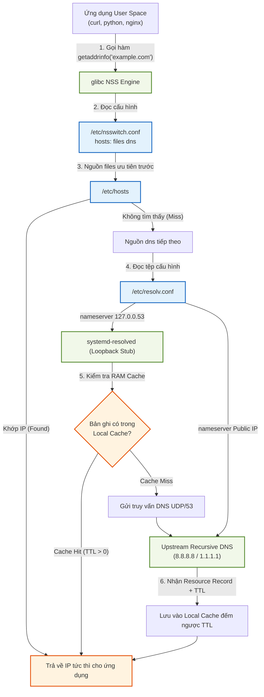
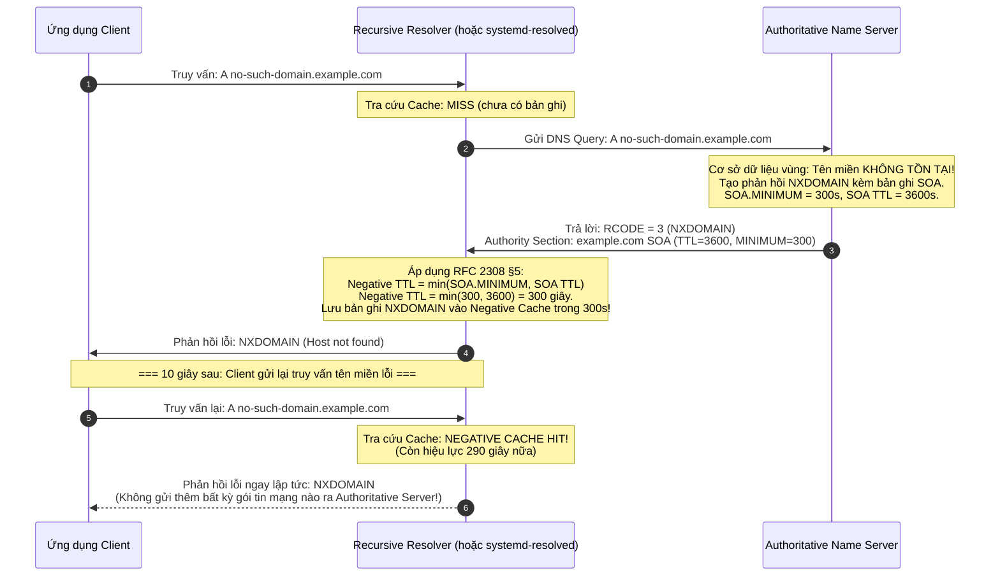

# 2_7_6 Host Name Resolution and DNS Caching

> **Khóa học**: Cloud DevOps Basic — Networking Core  
> **Phân nhóm**: 2 Domain 2 - Computer Networking Core Fundamentals › 2_7 Core Application Layer Protocols  
> **Chủ đề**: Cơ chế phân giải tên máy chủ trên Linux: /etc/nsswitch.conf, /etc/hosts, /etc/resolv.conf, systemd-resolved, TTL và Negative Caching (RFC 2308)  
> **Trạng thái**: Verified (WRITE-CDB-2_7_6, 14-11-2026)  
> **Checklist đối chiếu**: [2_7_6](<../../../CHECKLIST.md#27-core-application-layer-protocols>)

---

## 1. Khái Niệm Cốt Lõi & Bản Chất Kỹ Thuật (Core Concepts & Technical Deep Dive)

Trong hệ điều hành Linux và môi trường hạ tầng máy chủ đám mây, việc chuyển đổi một tên định danh máy chủ (như `api.internal.local` hoặc `db.production.net`) thành địa chỉ IP không phải là một thao tác gửi truy vấn DNS đơn lẻ. Đó là một quy trình phân tầng phức tạp được điều phối bởi thư viện hệ thống C (**glibc**), cơ chế chuyển đổi dịch vụ đặt tên (**Name Service Switch - NSS**), các file cấu hình phân giải tĩnh, bộ nhớ đệm cục bộ và giao thức mạng DNS chuẩn hóa bởi IETF.

---

### 1.1 Cơ chế Name Service Switch và `/etc/nsswitch.conf`

Khi một ứng dụng chạy trên Linux (như `curl`, Python, Nginx, hoặc mã nguồn backend) cần kết nối tới một máy chủ qua tên miền, ứng dụng sẽ gọi hàm thư viện chuẩn POSIX là [`getaddrinfo(3)`](https://man7.org/linux/man-pages/man3/getaddrinfo.3.html).

Hàm `getaddrinfo()` không gửi ngay một gói tin DNS ra mạng. Thay vào đó, nó ủy thác việc tìm kiếm cho hệ thống con **NSS (Name Service Switch)**, được cấu hình trực tiếp trong tệp tin [`/etc/nsswitch.conf`](https://man7.org/linux/man-pages/man5/nsswitch.conf.5.html).
- **Cấu hình dòng `hosts:`**: Dòng này chỉ định thứ tự ưu tiên của các nguồn dữ liệu phân giải tên máy chủ:
  ```text
  hosts:          files dns
  ```
  *(Trên các bản phân phối Linux hiện đại tích hợp systemd, cấu hình thường là `hosts: files resolve [!UNAVAIL=return] dns myhostname`).*
- **Ý nghĩa kỹ thuật của thứ tự**:
  1. **`files`**: Chỉ thị cho NSS kiểm tra cơ sở dữ liệu tệp tin phẳng cục bộ trên máy trước tiên, cụ thể là tệp [`/etc/hosts`](https://man7.org/linux/man-pages/man5/hosts.5.html).
  2. **`dns`**: Nếu không tìm thấy tên miền trong tệp `files`, NSS mới kích hoạt trình phân giải mạng (**Stub Resolver**) để đọc tệp [`/etc/resolv.conf`](https://man7.org/linux/man-pages/man5/resolv.conf.5.html) và gửi truy vấn mạng tới các máy chủ tên miền.
  3. **`resolve`**: Chỉ thị cho NSS truy vấn dịch vụ đệm tên miền cục bộ `systemd-resolved` qua giao diện IPC nội bộ D-Bus.

---

### 1.2 Bảng ánh xạ tĩnh cục bộ: `/etc/hosts`

Tệp tin [`/etc/hosts`](https://man7.org/linux/man-pages/man5/hosts.5.html) là cơ chế định danh máy chủ cổ xưa nhất trên các hệ điều hành họ Unix, tồn tại từ trước khi hệ thống phân cấp DNS toàn cầu ra đời:
- **Cấu trúc cú pháp**: Mỗi dòng đại diện cho một liên kết địa chỉ IP và tên máy chủ, tuân thủ định dạng chuẩn:
  ```text
  IP_address canonical_hostname [aliases...]
  ```
- **Quy tắc phân cách**: Địa chỉ IP và tên máy chủ được phân tách bằng khoảng trắng hoặc ký tự tab (whitespace). Ký tự `#` bắt đầu cho một đoạn chú thích (comment) kéo dài đến hết dòng.
- **Tính chất kỹ thuật**:
  - Tra cứu cục bộ diễn ra tức thời trong bộ nhớ kernel/user-space mà không phát sinh độ trễ mạng hay rủi ro mất kết nối.
  - Các mục trong `/etc/hosts` có hiệu lực vĩnh viễn cho đến khi bị chỉnh sửa thủ công; chúng **hoàn toàn không có khái niệm TTL (Time to Live)**.
  - Là công cụ hữu hiệu để định nghĩa tên miền nội bộ máy chủ ảo, môi trường kiểm thử (staging), hoặc ghi đè (override) tên miền công cộng cho mục đích debug.

---

### 1.3 Cấu hình Stub Resolver truyền thống: `/etc/resolv.conf`

Khi nguồn `files` không tìm thấy kết quả, Linux kích hoạt **Stub Resolver** của thư viện glibc. Hành vi của stub resolver được điều khiển hoàn toàn bởi tệp tin cấu hình [`/etc/resolv.conf`](https://man7.org/linux/man-pages/man5/resolv.conf.5.html).

Các chỉ thị kỹ thuật cốt lõi trong `resolv.conf`:
- **`nameserver <IP_address>`**: Địa chỉ IP của máy chủ DNS (Recursive Resolver) mà máy trạm sẽ gửi truy vấn tới.
  - *Giới hạn kỹ thuật*: glibc giới hạn tối đa **3 máy chủ nameserver** (xác định bởi hằng số `MAXNS = 3`). Bất kỳ dòng `nameserver` thứ 4 trở đi đều bị trình phân giải bỏ qua hoàn toàn.
  - *Cơ chế truy vấn*: Mặc định, stub resolver gửi truy vấn tới `nameserver` đầu tiên trong danh sách. Nó chỉ chuyển sang `nameserver` thứ hai nếu máy chủ đầu tiên bị timeout hoặc không phản hồi.
- **`search <domain_list...>`**: Danh sách các hậu tố (suffix) tên miền tìm kiếm mặc định. Khi ứng dụng yêu cầu phân giải một tên ngắn (bare hostname - không chứa đủ số dấu chấm quy định bởi tham số `ndots`), stub resolver sẽ tự động ghép lần lượt từng hậu tố trong danh sách `search` vào đuôi để tạo thành FQDN hoàn chỉnh trước khi gửi truy vấn ra DNS server.
- **`domain`**: Chỉ thị lịch sử dùng để khai báo một tên miền cục bộ duy nhất; chỉ thị này đã lỗi thời (**obsolete**) và được thay thế hoàn toàn bởi `search`.
- **`options`**: Các cờ tinh chỉnh hành vi của resolver:
  - `timeout:n`: Thời gian chờ (tính bằng giây) trước khi resolver quyết định một nameserver không phản hồi. Mặc định là **5 giây**, giá trị tối đa là **30 giây**.
  - `attempts:n`: Số lần thử gửi lại truy vấn tới mỗi nameserver trước khi từ bỏ. Mặc định là **2 lần**, giá trị tối đa là **5 lần**.
  - `rotate`: Kích hoạt thuật toán Round-Robin lựa chọn ngẫu nhiên/xoay vòng máy chủ nameserver từ danh sách `nameserver` để phân tải truy vấn.
  - `edns0`: Bật phần mở rộng Extension Mechanisms for DNS (RFC 6891) cho phép kích thước gói tin UDP vượt qua giới hạn 512 bytes truyền thống.

---

### 1.4 Trình phân giải đệm hiện đại: `systemd-resolved`

Trên các bản phân phối Linux hiện đại (Ubuntu, Debian, RHEL 9, Fedora), việc quản lý phân giải DNS được chuyển giao cho daemon dịch vụ **`systemd-resolved`**:
- **Địa chỉ Loopback Stub `127.0.0.53:53`**: Để duy trì tính tương thích với các ứng dụng cũ phụ thuộc vào `/etc/resolv.conf`, `systemd-resolved` tạo ra một máy chủ DNS cục bộ lắng nghe tại địa chỉ Loopback đặc biệt `127.0.0.53` trên cổng 53. File `/etc/resolv.conf` thường là một symbolic link trỏ tới `/run/systemd/resolve/stub-resolv.conf` chứa dòng:
  ```text
  nameserver 127.0.0.53
  options edns0 trust-ad
  search internal.net
  ```
- **Vai trò kỹ thuật**:
  1. **In-memory DNS Caching**: Lưu trữ tạm thời kết quả các truy vấn DNS ngay trên máy trạm để phục vụ các yêu cầu tiếp theo với độ trễ gần như bằng 0.
  2. **Per-Link DNS Configuration**: Quản lý máy chủ DNS riêng biệt cho từng card mạng (interface) vật lý hoặc ảo (ví dụ: card Ethernet dùng DNS công cộng của router, trong khi card VPN `tun0` dùng DNS nội bộ doanh nghiệp).
  3. **Công cụ quản trị [`resolvectl(1)`](https://man7.org/linux/man-pages/man1/resolvectl.1.html)**: Thay thế lệnh `systemd-resolve` cũ, cung cấp các tác vụ giám sát cấu hình, thống kê cache và xóa bộ nhớ đệm.

---

### 1.5 Cơ chế DNS Caching & Tuổi thọ bản ghi (TTL - RFC 1035 §3.2.1)

Nhằm tránh việc mọi ứng dụng trên thế giới phải liên tục gửi hàng tỷ truy vấn về các Authoritative Name Server cho mỗi kết nối mạng, DNS thiết lập cơ chế **Caching**:
- **Positive Caching**: Khi một bản ghi tài nguyên (A, AAAA, CNAME, MX) được trả về thành công, máy chủ Authoritative đính kèm một trường số nguyên 32-bit có dấu gọi là **TTL (Time to Live)** theo chuẩn [RFC 1035 Section 3.2.1](https://datatracker.ietf.org/doc/html/rfc1035#section-3.2.1).
- **Bộ đếm thời gian**: Kể từ thời điểm nhận phản hồi, các máy chủ đệm trung gian (Recursive Resolvers, ISP DNS, `systemd-resolved`) lưu bản ghi trong RAM và đếm lùi thời gian TTL từng giây.
- **Tính độc lập của Client**: Mọi ứng dụng hỏi cùng một tên miền trong khoảng thời gian TTL còn lớn hơn 0 sẽ nhận được kết quả ngay từ cache cục bộ mà không tốn bất kỳ tài nguyên mạng nào.

---

### 1.6 Negative Caching (RFC 2308 §4 & §5)

Nếu một tên miền không tồn tại trên đời, hoặc một tên miền tồn tại nhưng không có loại bản ghi được yêu cầu (ví dụ có bản ghi A nhưng không có AAAA), điều gì sẽ xảy ra nếu một vòng lặp phần mềm liên tục truy vấn tên miền đó hàng triệu lần mỗi giây?

Để bảo vệ hạ tầng máy chủ DNS toàn cầu khỏi nguy cơ bị từ chối dịch vụ (DoS), tổ chức IETF đã ban hành tiêu chuẩn **Negative Caching** trong [RFC 2308 Section 4 & Section 5](https://datatracker.ietf.org/doc/html/rfc2308):
- **Đối tượng lưu trữ âm tính (Negative Responses)**:
  1. **`NXDOMAIN` (RCODE = 3 - Name Error)**: Tên miền hoàn toàn không tồn tại trong vùng không gian tên của cơ sở dữ liệu Authoritative.
  2. **`NODATA` (NOERROR nhưng ANCOUNT = 0)**: Tên miền có tồn tại, nhưng loại bản ghi truy vấn cụ thể (RRType) không hiện diện.
- **Công thức tính Negative TTL ([RFC 2308 §5](https://datatracker.ietf.org/doc/html/rfc2308#section-5))**:
  - Khi trả về phản hồi phủ định, Authoritative Server bắt buộc phải gửi kèm bản ghi **SOA (Start of Authority)** trong phần `Authority Section`.
  - Bản ghi SOA chứa một trường số nguyên gọi là `SOA.MINIMUM` (được định nghĩa lại trong RFC 2308 là Negative Caching TTL).
  - Trình phân giải đệm (Resolver) sẽ tính toán thời gian tồn tại của bản ghi negative cache theo công thức:
    $$\text{Negative TTL} = \min(\text{SOA.MINIMUM}, \text{SOA TTL})$$
  - Tiêu chuẩn RFC 2308 khuyến nghị giá trị trần tối đa cho Negative Caching là **1 ngày** (86400 giây), nhưng các resolver hiện đại thường giới hạn ở mức 1-3 giờ để cho phép cập nhật tên miền mới nhanh chóng hơn.

---

### 1.7 Bản chất kỹ thuật của "DNS Propagation Delay" (RFC 1034 §5.3.3 & RFC 1035 §3.2.1)

Trong giới quản trị hệ thống và vận hành hạ tầng Web/Cloud, người ta thường nhắc đến thuật ngữ: *"DNS đang trong quá trình lan truyền (propagation), cần chờ từ 24 đến 48 giờ để cập nhật toàn cầu"*.

**Về mặt bản chất kỹ thuật, từ "Lan truyền" (Propagation) là một ngộ nhận hoàn toàn sai lệch!**
- Theo thiết kế kiến trúc chuẩn mực của [RFC 1034 Section 5.3.3](https://datatracker.ietf.org/doc/html/rfc1034#section-5.3.3) và [RFC 1035 Section 3.2.1](https://datatracker.ietf.org/doc/html/rfc1035#section-3.2.1), DNS hoạt động theo cơ chế **Kéo thụ động (Pull-based Passive Caching)**, tuyệt đối **KHÔNG CÓ CƠ CHẾ ĐẨY CHỦ ĐỘNG (No Active Push)**:
  1. Authoritative Name Server khi bạn cập nhật bản ghi mới (ví dụ đổi IP từ `1.1.1.1` sang `2.2.2.2`) **không hề gửi bất kỳ thông báo cập nhật nào** tới hàng triệu Recursive Resolver (Google 8.8.8.8, Cloudflare 1.1.1.1, Viettel, VNPT) trên thế giới.
  2. Các resolver trên toàn cầu hoàn toàn không biết bạn vừa đổi IP. Chúng tiếp tục trả về địa chỉ IP cũ `1.1.1.1` lấy từ bộ nhớ RAM của chính chúng cho tới khi bộ đếm ngược TTL của bản ghi đó tại từng resolver **chạm mốc 0**.
  3. Chỉ khi bản ghi cũ hết hạn (TTL Expired), nếu có một người dùng gửi truy vấn tiếp theo, resolver đó mới chủ động "kéo" (pull) bản ghi mới `2.2.2.2` từ Authoritative Server về lưu lại vào cache.
- **Vì sao có sự chậm trễ không đồng đều?**: Mỗi resolver lưu cache tại các thời điểm hoàn toàn khác nhau. Một resolver vừa mới lưu cache 5 giây trước khi bạn đổi IP sẽ phải đợi hết 100% thời gian TTL; trong khi một resolver khác đã lưu cache từ lâu và sắp hết hạn chỉ cần 5 giây nữa là sẽ lấy được IP mới.

---

## 2. Ví Dụ Đời Sống Thực Tế Dễ Hiểu (Intuitive Real-World Analogies)

### Sổ tay bỏ túi cá nhân, Lễ tân tòa nhà và Bưu điện thành phố

Hãy hình dung quy trình một nhân viên trong tòa nhà văn phòng muốn tìm số điện thoại của một người bạn tên là **Nam**:

```text
+-----------------------------------------------------------------------------------+
| 1. Sổ tay cá nhân trong túi áo (/etc/hosts)                                       |
|    - Bạn mở sổ tay ra trước tiên. Nếu trong sổ đã ghi: Nam - 0901234567,          |
|      bạn bấm số gọi ngay lập tức mà không cần hỏi thêm bất kỳ ai.                 |
+-----------------------------------------------------------------------------------+
                                         |
                                         | (Nếu trong sổ tay không có tên Nam)
                                         v
+-----------------------------------------------------------------------------------+
| 2. Lễ tân tòa nhà văn phòng (systemd-resolved / Local DNS Cache)                  |
|    - Bạn xuống sảnh hỏi người Lễ tân (127.0.0.53).                                |
|    - Lễ tân có một tấm bảng ghi nhớ tạm (RAM Cache).                              |
|    - Nếu sáng nay có một đồng nghiệp vừa hỏi số của Nam, lễ tân đọc ngay số điện  |
|      thoại trên bảng nhớ cho bạn.                                                 |
+-----------------------------------------------------------------------------------+
                                         |
                                         | (Nếu bảng nhớ của lễ tân chưa có)
                                         v
+-----------------------------------------------------------------------------------+
| 3. Tổng đài Bưu điện trung tâm thành phố (/etc/resolv.conf -> Upstream DNS)       |
|    - Lễ tân gọi điện lên Bưu điện trung tâm để tra danh bạ toàn quốc.             |
|    - Bưu điện cung cấp số điện thoại kèm theo hạn sử dụng:                        |
|      "Số này được xác nhận đúng trong vòng 300 giây (TTL)!"                       |
|    - Lễ tân dán mẩu giấy ghi số của Nam lên bảng nhớ trong 300 giây.              |
+-----------------------------------------------------------------------------------+
```

#### Mẩu giấy đỏ: Negative Caching (RFC 2308)
- Nếu Bưu điện trung tâm tra cứu và thông báo: *"Thành phố này không có ai tên là Nam cả (NXDOMAIN)!"*, Bưu điện gửi kèm quy định: *"Thông tin người này không tồn tại có giá trị ghi nhớ trong 60 giây (Negative TTL từ SOA MINIMUM)"*.
- Lễ tân dán một **mẩu giấy đỏ** lên bảng nhớ: *"Nam: Không tồn tại (hủy sau 60s)"*.
- Nếu 10 giây sau, bạn hoặc một đồng nghiệp khác lại chạy xuống hỏi số của Nam, lễ tân nhìn mẩu giấy đỏ và lập tức trả lời: *"Không có ai tên đó!"* mà không cần tốn công gọi điện thoại lên Bưu điện thành phố một lần nữa.

#### Bản chất "Đổi số điện thoại" (Tại sao DNS không "lan truyền" ngay?)
- Khi anh Nam đổi sang số điện thoại mới trên danh bạ gốc của Bưu điện, Bưu điện trung tâm **không cử người chạy xe máy tới từng tòa nhà trên khắp thế giới** để xé mẩu giấy nhớ của các lễ tân.
- Tòa nhà A đã lưu mẩu giấy từ 290 giây trước: Chỉ 10 giây nữa mẩu giấy tự hủy, lễ tân tòa nhà A sẽ gọi bưu điện và có số mới ngay.
- Tòa nhà B vừa mới xin số cũ 2 giây trước khi anh Nam đổi: Mẩu giấy của họ còn hạn tới 298 giây nữa. Suốt 298 giây đó, mọi nhân viên ở tòa nhà B vẫn tiếp tục gọi vào số cũ của anh Nam. Đó chính là sự chênh lệch thời gian do bộ đệm cục bộ (Passive Cache Expiration), hoàn toàn không phải do sóng mạng bị "nghẽn lan truyền"!

---

## 3. Kiến Trúc, Luồng Hoạt Động & Hình Ảnh Trực Quan (Architecture, Diagrams & Visual Media)

### 3.1 Sơ đồ luồng phân giải tên máy chủ trên Linux



---

### 3.2 Sơ đồ luồng: Negative Caching theo chuẩn RFC 2308



---

### 3.3 So sánh cơ chế: `getent hosts` vs `dig`

Sự khác biệt cốt tử giữa công cụ tra cứu qua thư viện hệ thống NSS và công cụ kiểm tra giao thức mạng:

```text
+-----------------------------------------------------------------------------------------+
| Lệnh: getent hosts <domain>                                                             |
| (Tái hiện chính xác 100% cách nhìn của ứng dụng Linux)                                  |
|                                                                                         |
|  [getent] ---> [glibc getaddrinfo()] ---> [/etc/nsswitch.conf]                          |
|                                                    |                                    |
|                      +-----------------------------+-----------------------------+      |
|                      | 1. Kiểm tra                               | 2. Kiểm tra          |
|                      v                                           v                      |
|                [/etc/hosts]                               [/etc/resolv.conf]            |
|            (Ưu tiên đọc file tĩnh)                     (Gửi mạng tới DNS Server)        |
+-----------------------------------------------------------------------------------------+

+-----------------------------------------------------------------------------------------+
| Lệnh: dig @<server> <domain>                                                            |
| (Công cụ chẩn đoán gói tin mạng DNS thuần túy)                                          |
|                                                                                         |
|  [dig] --- (Mở raw socket mạng UDP/TCP cổng 53) ---> [DNS Server Trực Tiếp]             |
|                                                                                         |
|  * BỎ QUA hoàn toàn /etc/nsswitch.conf!                                                 |
|  * BỎ QUA hoàn toàn /etc/hosts!                                                         |
|  * BỎ QUA hoàn toàn bộ nhớ đệm systemd-resolved (nếu chỉ định @server)!                 |
+-----------------------------------------------------------------------------------------+
```

---

### 3.4 Bảng thời gian thực tế: Cơ chế Pull-based Caching khi thay đổi DNS

Giả sử quản trị viên đổi địa chỉ IP của `app.example.com` từ `198.51.100.1` sang `203.0.113.50` trên Authoritative DNS vào thời điểm **$T = 0$**, với TTL được đặt là **300 giây (5 phút)**:

| Vị trí Resolver | Trạng thái tại thời điểm $T = 0$ | Truy vấn tại $T = 60s$ | Thời điểm cập nhật sang IP mới | Lý do kỹ thuật |
| :--- | :--- | :--- | :--- | :--- |
| **Resolver A (ISP 1)** | Cache đã lưu từ 290s trước (TTL còn 10s) | Nhận IP mới (`203.0.113.50`) | **$T = 10s$** | Bản ghi cũ hết hạn sớm, truy vấn mới kéo bản ghi cập nhật ngay tại $T = 10s$. |
| **Resolver B (Google DNS)** | Vừa mới lưu cache 5s trước (TTL còn 295s) | Vẫn nhận IP cũ (`198.51.100.1`) | **$T = 295s$** | Resolver tiếp tục trả về dữ liệu trong RAM cho tới khi bộ đếm TTL đạt 0. |
| **Resolver C (Client mới)** | Chưa từng truy vấn `app.example.com` | Nhận IP mới (`203.0.113.50`) | **$T = 60s$** | Do cache miss, resolver lập tức truy vấn Authoritative Server và lấy IP mới nhất. |

---

## 4. Thực Hành (Hands-on)

> ⚠️ Chưa chạy thử (not executed by the squad)

Phần thực hành này cung cấp các câu lệnh tiêu chuẩn trên hệ điều hành Linux để kiểm tra cấu hình NSS, truy vấn tên miền qua glibc, giám sát bộ nhớ đệm `systemd-resolved` và phân biệt hành vi của các công cụ chẩn đoán.

---

### 4.1 Kiểm tra cấu hình NSS và tệp hosts cục bộ

```bash
# 1. Kiểm tra thứ tự phân giải tên máy chủ trong nsswitch.conf
cat /etc/nsswitch.conf | grep -E '^hosts:'

# 2. Xem nội dung bảng ánh xạ tĩnh cục bộ /etc/hosts
cat /etc/hosts
```

#### Đầu ra chú giải chi tiết minh họa:

```text
$ cat /etc/nsswitch.conf | grep -E '^hosts:'
hosts:          files dns

$ cat /etc/hosts
# Bảng ánh xạ IP tĩnh theo chuẩn hosts(5)
# Format: IP_address canonical_hostname [aliases...]
127.0.0.1       localhost
::1             localhost ip6-localhost ip6-loopback
192.168.1.10    devbox.internal.local devbox
10.0.0.50       db.internal
```

**Nhận diện kỹ thuật**:
- `hosts: files dns`: glibc bắt buộc tra cứu file tĩnh trước (`files`), nếu không có kết quả mới chuyển sang truy vấn mạng (`dns`).
- `192.168.1.10 devbox.internal.local devbox`: Tên canonical là `devbox.internal.local`, bí danh là `devbox`.

---

### 4.2 Kiểm tra stub resolver trong `/etc/resolv.conf`

```bash
# Kiểm tra cấu hình máy chủ DNS và search list
cat /etc/resolv.conf
```

#### Đầu ra chú giải chi tiết minh họa:

```text
$ cat /etc/resolv.conf
# File được quản lý bởi systemd-resolved
nameserver 127.0.0.53
options edns0 trust-ad timeout:2 attempts:3
search internal.example.com corp.local
```

**Nhận diện kỹ thuật**:
- `nameserver 127.0.0.53`: Trỏ về loopback stub resolver của systemd-resolved.
- `options timeout:2 attempts:3`: Ghi đè thời gian chờ thành 2 giây (mặc định 5s) và thử tối đa 3 lần (mặc định 2).
- `search internal.example.com corp.local`: Khi gõ lệnh `ping server1`, hệ thống tự động thử phân giải `server1.internal.example.com` trước, sau đó tới `server1.corp.local`.

---

### 4.3 Quản trị bộ nhớ đệm với `resolvectl` (systemd-resolved)

```bash
# 1. Xem trạng thái cấu hình DNS per-interface
resolvectl status

# 2. Xem thống kê bộ đệm cache hit / cache miss
resolvectl statistics

# 3. Truy vấn tên miền thông qua systemd-resolved stub
resolvectl query example.com

# 4. Xóa sạch bộ nhớ đệm DNS cục bộ
resolvectl flush-caches
```

#### Đầu ra chú giải chi tiết minh họa:

```text
$ resolvectl statistics
DNSSEC supported by cache: no

Transactions
Total Transactions: 1420
Cache
  Current Cache Size: 34
          Cache Hits: 812
        Cache Misses: 608
Failure Transactions
          Total Timeouts: 4

$ resolvectl query example.com
example.com: 93.184.216.34                     -- link: eth0
             (example.com)

-- Information acquired via protocol DNS in 12.4ms.
-- Data is authenticated: no; algorithm: EDNS0

$ resolvectl flush-caches
$ resolvectl statistics
...
  Current Cache Size: 0
          Cache Hits: 0
        Cache Misses: 0
```

---

### 4.4 Đối chiếu thực nghiệm: `getent hosts` vs `dig`

Tình huống: Ta thêm dòng sau vào `/etc/hosts`:
```text
192.0.2.123 test-override.com
```

Thực hiện hai lệnh tra cứu đối chiếu:

```bash
# 1. Tra cứu thông qua Name Service Switch (NSS)
getent hosts test-override.com

# 2. Tra cứu bằng công cụ DNS mạng thuần túy
dig test-override.com +short
```

#### Đầu ra chú giải chi tiết minh họa:

```text
$ getent hosts test-override.com
192.0.2.123     test-override.com

$ dig test-override.com +short
(Không trả về kết quả nào / NXDOMAIN hoặc trả về IP công cộng nếu tên miền tồn tại trên Internet)
```

**Bài học thực chiến**: 
Lệnh `getent hosts` tôn trọng `/etc/nsswitch.conf` và tìm thấy kết quả ngay trong `/etc/hosts` (`192.0.2.123`). Trong khi đó, `dig` bỏ qua hoàn toàn file `/etc/hosts` và gửi thẳng gói tin mạng ra DNS server nên không thấy địa chỉ IP ghi đè này!

---

## 5. Cạm Bẫy Thực Tế & Thực Tiễn Sản Xuất (Production Gotchas & Best Practices)

### 5.1 Cạm bẫy "Dùng `dig` để debug nhưng ứng dụng vẫn gọi sai IP"
- **Triệu chứng**: Kỹ sư thêm cấu hình IP máy chủ database vào `/etc/hosts` trên máy chủ web. Khi kiểm tra bằng lệnh `dig db.internal`, kỹ sư thấy báo lỗi không tìm thấy tên miền (`NXDOMAIN`). Kỹ sư cho rằng cấu hình bị lỗi, trong khi thực tế ứng dụng Java/Node.js trên máy lại kết nối hoàn toàn bình thường tới database!
- **Bản chất kỹ thuật**: `dig` là công cụ gửi gói tin DNS qua raw socket mạng, nó được thiết kế cho quản trị viên máy chủ DNS nên cố tình **bỏ qua hoàn toàn NSS và file `/etc/hosts`**. Ứng dụng production sử dụng hàm `getaddrinfo(3)`, tuân theo `/etc/nsswitch.conf` nên đọc `/etc/hosts` trước tiên.
- **Thực tiễn tốt nhất**: Để tái hiện đúng 100% cách mà ứng dụng hệ thống phân giải tên miền, **luôn luôn sử dụng `getent hosts <domain>`** thay cho `dig` hoặc `nslookup`.

---

### 5.2 Cạm bẫy "Bão truy vấn DNS do danh sách `search` quá dài"
- **Triệu chứng**: Trong cụm Kubernetes hoặc hệ thống Linux doanh nghiệp, thời gian phản hồi của các lệnh gọi API ra Internet (như `api.stripe.com`, `api.github.com`) bị chậm bất thường từ hàng chục tới hàng trăm mili-giây, máy chủ DNS nội bộ bị quá tải CPU liên tục.
- **Bản chất kỹ thuật**: Khi `/etc/resolv.conf` chứa cấu hình `search default.svc.cluster.local svc.cluster.local cluster.local corp.internal` và tham số mặc định `ndots:5` trong glibc: Khi ứng dụng gọi `api.stripe.com` (chỉ có 2 dấu chấm < 5), resolver sẽ lần lượt gửi truy vấn:
  1. `api.stripe.com.default.svc.cluster.local` (Nhận NXDOMAIN)
  2. `api.stripe.com.svc.cluster.local` (Nhận NXDOMAIN)
  3. `api.stripe.com.cluster.local` (Nhận NXDOMAIN)
  4. `api.stripe.com.corp.internal` (Nhận NXDOMAIN)
  5. Cuối cùng mới gửi truy vấn gốc `api.stripe.com.`!
- **Thực tiễn tốt nhất**: Thêm dấu chấm tuyệt đối vào cuối tên miền trong code/cấu hình (`api.stripe.com.`) để báo hiệu đây là một FQDN hoàn chỉnh, bỏ qua toàn bộ danh sách `search`.

---

### 5.3 Cạm bẫy "Sập bẫy Negative Caching khi cấu hình sớm tên miền"
- **Triệu chứng**: Kỹ sư DevOps triển khai một API mới. Trước khi tạo bản ghi DNS trên Cloud DNS, kỹ sư thử chạy `curl https://api.prod.example.com` và nhận thông báo lỗi không tìm thấy host. Ngay sau đó, kỹ sư vào bảng điều khiển DNS tạo bản ghi A thành công. Tuy nhiên, suốt 15 phút đến 1 giờ tiếp theo, máy chủ của kỹ sư vẫn liên tục báo lỗi không tìm thấy host mặc dù các máy khác đã truy cập được!
- **Bản chất kỹ thuật**: Lệnh `curl` ban đầu đã kích hoạt **Negative Caching ([RFC 2308](https://datatracker.ietf.org/doc/html/rfc2308))**. Recursive Resolver của ISP hoặc `systemd-resolved` đã lưu trạng thái lỗi `NXDOMAIN` với thời hạn tính bằng $\min(\text{SOA.MINIMUM}, \text{SOA TTL})$. Cho dù bản ghi A đã được tạo trên Authoritative DNS, resolver vẫn kiên quyết trả về lỗi từ negative cache cho tới khi hết hạn!
- **Thực tiễn tốt nhất**: Không bao giờ thực hiện các truy vấn kiểm thử tới tên miền production trước khi bản ghi DNS được tạo chính thức. Nếu đã lỡ kích hoạt negative cache trên máy trạm Linux, hãy xóa cache ngay lập tức bằng lệnh `sudo resolvectl flush-caches`.

---

### 5.4 Cạm bẫy "Tắc nghẽn kết nối do cơ chế Timeout tuần tự của nameserver"
- **Triệu chứng**: Khi máy chủ DNS thứ nhất (`nameserver 10.0.0.1`) bị sập hoặc nghẽn mạng, mọi yêu cầu mạng trên toàn bộ hệ thống máy chủ Linux bị treo cứng đúng 5 hoặc 10 giây trước khi hoàn tất.
- **Bản chất kỹ thuật**: glibc Stub Resolver không gửi truy vấn song song (parallel) tới các nameserver. Theo [resolv.conf(5)](https://man7.org/linux/man-pages/man5/resolv.conf.5.html), mặc định resolver thử `nameserver 1` với `timeout: 5s` và `attempts: 2`. Khi máy chủ đầu tiên chết hẳn, resolver phải đợi hết $5 \times 2 = 10\text{s}$ timeout rồi mới chuyển tiếp sang `nameserver 2`!
- **Thực tiễn tốt nhất**: Trong môi trường microservices có yêu cầu độ trễ thấp, luôn cấu hình options rút ngắn timeout trong `/etc/resolv.conf`:
  ```text
  options timeout:1 attempts:2 rotate
  ```

---

## 6. Câu Hỏi Củng Cố Kiến Thức (Active Recall Quiz)

### Câu hỏi 1: Cơ chế phân giải hệ thống vs Phân giải mạng
Một kỹ sư DevOps thêm một mục ánh xạ vào file `/etc/hosts` như sau:
```text
10.0.1.50   cache.redis.internal
```
Khi chạy lệnh `getent hosts cache.redis.internal`, kết quả in ra đúng địa chỉ `10.0.1.50`. Tuy nhiên, khi chạy lệnh `dig cache.redis.internal`, công cụ lại trả về trạng thái lỗi `NXDOMAIN` (hoặc không tìm thấy địa chỉ). Hãy giải thích sự khác biệt sâu xa giữa hai công cụ này dưới góc độ kiến trúc hệ điều hành Linux?

<details>
<summary><b>Đáp án chi tiết</b></summary>

1. **Cơ chế hoạt động của `getent hosts`**:
   - `getent` gọi hàm thư viện chuẩn hệ thống `getaddrinfo(3)` của glibc.
   - Hàm này tuân thủ cấu hình trong [`/etc/nsswitch.conf`](https://man7.org/linux/man-pages/man5/nsswitch.conf.5.html). Với cấu hình mặc định `hosts: files dns`, thư viện NSS sẽ duyệt qua tệp tin phẳng [`/etc/hosts`](https://man7.org/linux/man-pages/man5/hosts.5.html) trước tiên (`files`).
   - Do tên miền đã được định nghĩa trong `/etc/hosts`, `getent` lập tức trả về kết quả `10.0.1.50` mà không cần phát sinh bất kỳ yêu cầu mạng nào. Đây chính là cách mà 99% các ứng dụng người dùng (User Space applications) trên Linux phân giải tên miền.
2. **Cơ chế hoạt động của `dig`**:
   - `dig` (Domain Information Groper) là một công cụ chẩn đoán giao thức mạng tầng ứng dụng thuần túy.
   - `dig` cố tình **không sử dụng** thư viện glibc resolver và **bỏ qua hoàn toàn** `/etc/nsswitch.conf` cũng như `/etc/hosts`.
   - `dig` tạo một network socket trực tiếp gửi các gói tin UDP/TCP cổng 53 tới các máy chủ nameserver được chỉ định (hoặc lấy từ `/etc/resolv.conf`). Do máy chủ DNS bên ngoài không quản lý vùng tên miền nội bộ `cache.redis.internal`, nó trả về phản hồi phủ định `NXDOMAIN`.

</details>

---

### Câu hỏi 2: Cách thức tính toán thời hạn Negative Caching
Một ứng dụng gọi tới tên miền `service-missing.corp.net` và nhận phản hồi `NXDOMAIN`. Trong phần Authority Section của phản hồi DNS, máy chủ Authoritative trả về bản ghi SOA với các thông số:
- SOA Record TTL: `7200` giây (2 giờ).
- Trường `SOA.MINIMUM`: `600` giây (10 phút).
Hỏi theo tiêu chuẩn RFC 2308, bộ nhớ đệm của Recursive Resolver sẽ lưu trạng thái lỗi phủ định này trong bao lâu, và công thức tính toán là gì?

<details>
<summary><b>Đáp án chi tiết</b></summary>

1. **Công thức chuẩn mực theo RFC 2308 Section 5**:
   - Tiêu chuẩn IETF quy định thời gian lưu trữ Negative Cache cho các phản hồi lỗi (`NXDOMAIN` hoặc `NODATA`) được xác định bằng giá trị nhỏ nhất giữa trường TTL của bản ghi SOA và trường `MINIMUM` bên trong nội dung bản ghi SOA:
     $$\text{Negative TTL} = \min(\text{SOA.MINIMUM}, \text{SOA TTL})$$
2. **Áp dụng tính toán**:
   - $\text{Negative TTL} = \min(600, 7200) = 600\text{ giây (10 phút)}$.
3. **Ý nghĩa vận hành**:
   - Suốt 10 phút tiếp theo, bất kỳ ứng dụng nào hỏi resolver về tên miền `service-missing.corp.net` đều sẽ nhận lại thông báo lỗi `NXDOMAIN` tức thì từ cache mà không cần phải truy vấn lại Authoritative Server.

</details>

---

### Câu hỏi 3: Bản chất của khái niệm "DNS Propagation"
Một quản trị viên website vừa chuyển đổi địa chỉ IP của máy chủ web từ nhà cung cấp Cloud A sang Cloud B trên bảng điều khiển DNS và cho rằng: *"Hệ thống DNS của tôi đang đẩy (push) địa chỉ mới đi khắp thế giới nên cần đợi 24 giờ"*. Nhận định này sai ở điểm nào theo chuẩn RFC 1034 / RFC 1035?

<details>
<summary><b>Đáp án chi tiết</b></summary>

1. **Nguyên lý hoạt động kéo thụ động (Pull-based Passive Caching)**:
   - Nhận định "hệ thống DNS đang chủ động đẩy (push) địa chỉ đi khắp thế giới" là hoàn toàn sai.
   - Theo [RFC 1034 Section 5.3.3](https://datatracker.ietf.org/doc/html/rfc1034#section-5.3.3) và [RFC 1035 Section 3.2.1](https://datatracker.ietf.org/doc/html/rfc1035#section-3.2.1), kiến trúc DNS vận hành theo cơ chế **Pull** (kéo thụ động). Authoritative Name Server không gửi bất kỳ thông báo thay đổi nào ra bên ngoài khi dữ liệu vùng (Zone file) được cập nhật.
2. **Nguyên nhân của khoảng thời gian trễ "24 giờ"**:
   - Sự chậm trễ thực chất là do thời gian chờ hết hạn (**TTL Expiration**) của các bản ghi đã được lưu trong bộ nhớ đệm (Cache) của hàng triệu Recursive Resolvers trên toàn thế giới trước thời điểm thay đổi.
   - Các máy chủ cache này tiếp tục phục vụ địa chỉ IP cũ cho người dùng cho đến khi bộ đếm ngược TTL của bản ghi tại từng resolver giảm về đúng bằng 0. Khi đó, nếu có một người dùng mới yêu cầu truy cập, resolver mới chủ động gửi truy vấn "kéo" (pull) địa chỉ IP mới về.

</details>

---

## 7. 📚 Nguồn Tài Liệu Chính Thống (Tier-1 Official References)

- [nsswitch.conf(5) - Linux manual page](https://man7.org/linux/man-pages/man5/nsswitch.conf.5.html) - Tài liệu hệ thống chính thức của Linux về cú pháp và quy chuẩn cấu hình của cơ chế Name Service Switch.
- [resolv.conf(5) - Linux manual page](https://man7.org/linux/man-pages/man5/resolv.conf.5.html) - Đặc tả file cấu hình Resolver của thư viện glibc, các chỉ thị `nameserver`, `search`, `domain` và các cờ `options`.
- [hosts(5) - Linux manual page](https://man7.org/linux/man-pages/man5/hosts.5.html) - Định dạng bảng ánh xạ tĩnh địa chỉ IP và tên máy chủ cục bộ trên hệ điều hành Linux.
- [getaddrinfo(3) - Linux manual page](https://man7.org/linux/man-pages/man3/getaddrinfo.3.html) - API thư viện POSIX tiêu chuẩn cho việc phân giải địa chỉ mạng và dịch vụ.
- [resolvectl(1) - systemd-resolved manual page](https://man7.org/linux/man-pages/man1/resolvectl.1.html) - Tài liệu chính thống điều khiển và giám sát trình phân giải DNS cục bộ `systemd-resolved`.
- [RFC 1034: Domain Names - Concepts and Facilities](https://datatracker.ietf.org/doc/html/rfc1034#section-5.3.3) - Tiêu chuẩn IETF quy định khái niệm căn bản của hệ thống DNS, cấu trúc đệm cache và vai trò của resolver.
- [RFC 1035: Domain Names - Implementation and Specification](https://datatracker.ietf.org/doc/html/rfc1035#section-3.2.1) - Tiêu chuẩn kỹ thuật định dạng bản ghi tài nguyên và trường Time to Live (TTL).
- [RFC 2308: DNS NCACHE - Negative Caching of DNS Queries](https://datatracker.ietf.org/doc/html/rfc2308#section-5) - Đặc tả tiêu chuẩn IETF về cơ chế lưu đệm phản hồi lỗi NXDOMAIN/NODATA và công thức tính Negative TTL từ bản ghi SOA.
