# 2_7 Core Application Layer Protocols

> **Khóa học**: Cloud DevOps Basic — Networking Core · **Domain**: 2 Domain 2 - Computer Networking Core Fundamentals · **Roadmap gốc**: [Computer Networking Roadmap](<../../README.md#module-7-core-application-layer-protocols>)

---

## Module này dạy gì? (What & Why)

Module này trang bị hiểu biết toàn diện về các giao thức tầng ứng dụng (Application Layer - L7) cốt lõi vận hành toàn bộ mạng Internet hiện đại và hạ tầng Cloud DevOps. Người học sẽ nắm vững cách một máy trạm tự động gia nhập mạng và tiếp nhận cấu hình mạng qua chu trình cấp phát DORA của giao thức DHCP, sau đó khám phá kiến trúc phân giải tên miền phân cấp toàn cầu của DNS từ Root Zone, TLD tới Authoritative Server cùng quy trình phân giải nội bộ Linux thông qua NSS (`/etc/nsswitch.conf`), `/etc/hosts` và bộ đệm DNS Caching. Tiếp theo, module phân tích sâu cơ chế thiết lập kênh truyền mã hóa bảo mật tối cao với phiên bản TLS 1.3 hoàn tất trong 1-RTT, cấu trúc chứng chỉ số X.509 và chuỗi tin cậy CA, phương thức quản trị hạ tầng từ xa an toàn qua SSH-2 với cơ chế TOFU và kỹ thuật chuyển tiếp cổng (Port Forwarding: Local, Remote, Dynamic, Jump Host). Cuối cùng, module làm sáng tỏ giao thức Web nền tảng HTTP/HTTPS: phân loại tính chất Safe và Idempotent của các phương thức yêu cầu, quy chuẩn mã trạng thái (2xx, 307/308, 4xx, 5xx) và bước tiến hóa kiến trúc vượt bậc từ văn bản thuần HTTP/1.1 sang đóng khung nhị phân HTTP/2 và giải pháp QUIC trên UDP của HTTP/3 nhằm triệt tiêu hoàn toàn hiện tượng nghẽn Head-of-Line.

---

## Lộ trình bài học (Lesson Path)

| Bài học | Mục tiêu cốt lõi | Checklist ID |
| :--- | :--- | :---: |
| [2_7_1 Domain Name System](<./2_7_1 Domain Name System.md>) | Làm chủ không gian tên miền phân cấp (Root, TLD, SLD), vai trò Recursive Resolver vs Authoritative Name Server, các bản ghi tài nguyên cốt lõi (A, AAAA, CNAME, PTR, MX, TXT) và cấu trúc gói tin DNS 12 bytes chạy trên cổng UDP/TCP 53. | [2_7_1](<../../../CHECKLIST.md#27-core-application-layer-protocols>) |
| [2_7_2 Dynamic Host Configuration Protocol](<./2_7_2 Dynamic Host Configuration Protocol.md>) | Thấu hiểu chu trình cấp phát DORA 4 bước (Discover, Offer, Request, Acknowledge) qua cổng UDP 67/68, vòng đời gia hạn IP Lease ($T_1, T_2$), vai trò DHCP Relay Agent (`giaddr`) và các DHCP Options chuẩn (1, 3, 6, 51, 53, 54). | [2_7_2](<../../../CHECKLIST.md#27-core-application-layer-protocols>) |
| [2_7_3 HTTP and HTTPS Basics](<./2_7_3 HTTP and HTTPS Basics.md>) | Nắm vững kiến trúc Client-Server Stateless, tính chất Safe & Idempotent của HTTP Methods, mã trạng thái (200, 201, 204, 301/302 vs 307/308, 401/403, 429, 502/504) và tiến hóa HTTP/1.1 (Keep-Alive) $\rightarrow$ HTTP/2 (Multiplexing, HPACK) $\rightarrow$ HTTP/3 (QUIC/UDP, xóa bỏ HoL blocking). | [2_7_3](<../../../CHECKLIST.md#27-core-application-layer-protocols>) |
| [2_7_4 TLS 1.3 Handshake and Certificate Chain of Trust](<./2_7_4 TLS 1.3 Handshake and Certificate Chain of Trust.md>) | Phân tích luồng bắt tay TLS 1.3 trong 1-RTT (ClientHello, ServerHello, key_share), định dạng chứng chỉ số X.509 v3, chuỗi tin cậy CA (Leaf $\rightarrow$ Intermediate $\rightarrow$ Root), cơ chế Server Name Indication (SNI) và các lỗi cấu hình chứng chỉ sản xuất. | [2_7_4](<../../../CHECKLIST.md#27-core-application-layer-protocols>) |
| [2_7_5 SSH Protocol and Port Forwarding](<./2_7_5 SSH Protocol and Port Forwarding.md>) | Khảo sát 3 tầng kiến trúc SSH-2 (Transport, User Auth, Connection), mô hình tin cậy TOFU qua `known_hosts`, thuật toán khóa hiện đại Ed25519, phân quyền nghiêm ngặt `StrictModes` và 4 kỹ thuật chuyển tiếp cổng mạng (Local `-L`, Remote `-R`, Dynamic `-D`, Jump Host `-J`). | [2_7_5](<../../../CHECKLIST.md#27-core-application-layer-protocols>) |
| [2_7_6 Host Name Resolution and DNS Caching](<./2_7_6 Host Name Resolution and DNS Caching.md>) | Khám phá quy trình phân giải tên miền trên Linux: luồng chuyển đổi Name Service Switch (`/etc/nsswitch.conf`), tệp `/etc/hosts`, cấu hình `/etc/resolv.conf`, bộ đệm DNS Caching với Positive TTL và Negative Caching (RFC 2308), giải mã hiện tượng trễ lan truyền DNS. | [2_7_6](<../../../CHECKLIST.md#27-core-application-layer-protocols>) |

---

## Bản đồ khái niệm (Concept Map)

Sơ đồ dưới đây minh họa toàn bộ vòng đời truyền thông mạng ở tầng ứng dụng: từ thời điểm máy trạm khởi động gia nhập mạng LAN, phân giải định danh tên miền, thiết lập kênh truyền mã hóa an toàn, cho đến trao đổi dữ liệu ứng dụng Web hoặc quản trị từ xa:

```mermaid
flowchart TD
    subgraph G1 ["1. Khởi Tạo & Gia Nhập Mạng (2_7_2: DHCP)"]
        Boot["Máy trạm Linux khởi động"] --> DHCP_DISC["DHCP Discover (Broadcast UDP 68 -> 67)"]
        DHCP_DISC --> DORA["Chu trình DORA (Discover - Offer - Request - ACK)"]
        DORA --> HostNetConf["Thiết lập: IP Lease, Subnet Mask, Default Gateway, DNS Servers"]
    end

    subgraph G2 ["2. Phân Giải Tên Miền (2_7_6: NSS/Linux & 2_7_1: DNS Phân Cấp)"]
        AppReq["Ứng dụng gọi getaddrinfo('api.example.com')"] --> NSS["Đọc /etc/nsswitch.conf (hosts: files dns)"]
        NSS --> CheckHosts{"Kiểm tra /etc/hosts?"}
        CheckHosts -- "Có" --> ReturnIP["Trả về IP cục bộ"]
        CheckHosts -- "Không" --> ResolvConf["Đọc /etc/resolv.conf (Stub Resolver -> 127.0.0.53 / Recursive)"]
        ResolvConf --> DNSCache{"Kiểm tra DNS Cache<br/>(Positive TTL / Negative RFC 2308)?"}
        DNSCache -- "Hit" --> ReturnIP
        DNSCache -- "Miss" --> RecResolver["Recursive Resolver thực hiện Iterative Query"]
        RecResolver --> RootZone["Hỏi Root Server (.) -> Referral TLD"]
        RootZone --> TLDZone["Hỏi .com Server -> Referral Authoritative"]
        TLDZone --> AuthServer["Hỏi ns.example.com -> Bản ghi A / AAAA chính thức"]
        AuthServer --> ReturnIP
    end

    subgraph G3 ["3. Thiết Lập Kênh Bảo Mật (2_7_4: TLS 1.3 & 2_7_5: SSH)"]
        ReturnIP --> ChooseProtocol{"Mục đích truyền thông?"}
        
        ChooseProtocol -- "Truy cập Web / API HTTPS (Port 443)" --> TLS13["Bắt tay TLS 1.3 (Full Handshake trong 1-RTT)"]
        TLS13 --> SNI["Gửi SNI & key_share trong ClientHello"]
        SNI --> X509["Xác thực chuỗi chứng chỉ X.509:<br/>Leaf -> Intermediate CA -> Root CA (Trust Store)"]
        X509 --> EncryptedSession["Kênh mã hóa đối xứng hoàn tất"]

        ChooseProtocol -- "Quản trị hạ tầng từ xa (Port 22)" --> SSH_KEX["SSH Transport Handshake (Port 22 TCP)"]
        SSH_KEX --> SSH_TOFU["Xác thực Server Host Key qua TOFU (~/.ssh/known_hosts)"]
        SSH_TOFU --> SSH_AUTH["Xác thực User: Public Key (Ed25519) qua ~/.ssh/authorized_keys"]
        SSH_AUTH --> SSH_CHANNELS["SSH Connection Channels:<br/>Interactive Shell / SFTP / Port Forwarding (-L, -R, -D, -J)"]
    end

    subgraph G4 ["4. Truyền Tải Dữ Liệu Ứng Dụng (2_7_3: HTTP/HTTPS Evolution)"]
        EncryptedSession --> HTTP_DATA["Truyền tải HTTP Request / Response"]
        HTTP_DATA --> HTTP_SEMANTICS["Tuân thủ Ngữ nghĩa Methods (Safe/Idempotent)<br/>& Mã trạng thái (200, 201, 204, 307/308, 4xx, 5xx)"]
        HTTP_SEMANTICS --> HTTP_VER["Lựa chọn phiên bản giao thức"]
        HTTP_VER --> H1["HTTP/1.1: Persistent Connections, Pipelining (Nghẽn Application HoL)"]
        HTTP_VER --> H2["HTTP/2: Binary Framing, HPACK, Multiplexing trên 1 TCP (Nghẽn TCP HoL)"]
        HTTP_VER --> H3["HTTP/3: QUIC trên UDP, Khôi phục mất gói độc lập (Xóa bỏ triệt để HoL)"]
    end

    HostNetConf --> AppReq
```

---

## Ẩn dụ xuyên suốt (Module Analogy)

Toàn bộ 6 bài học trong Module 2_7 được kết nối mạch lạc thông qua câu chuyện thực tế về **Thành phố thông minh và Quy trình nhập cảnh công dân toàn cầu**:

1. **Thủ tục đăng ký tạm trú tại Cổng thành phố (2_7_2 - DHCP)**:
   - Một công dân mới chuyển đến thành phố chưa có nhà ở hay giấy tờ nhân thân. Anh ta đứng tại cổng đón tiếp phát tín hiệu tìm ban quản lý (DHCP Discover).
   - Ban quản trị thành phố phản hồi và cấp cho anh ta một căn hộ cho thuê có thời hạn (IP Lease qua chu trình DORA), kèm theo sơ đồ tuyến đường huyết mạch dẫn ra ngoài (Default Gateway), quy chuẩn ranh giới quận (Subnet Mask) và danh bạ liên lạc của Trụ sở Bưu chính thành phố (DNS Server Identifier).
2. **Sổ tay địa chỉ cá nhân và Quầy bưu cục phố (2_7_6 - Host Name Resolution & Caching)**:
   - Khi cần đến thăm một cơ quan đối tác có tên gọi `api.example.com`, công dân mở cuốn sổ tay riêng trong túi áo (`/etc/hosts`) ra tra cứu trước.
   - Nếu không có ghi chú riêng, anh ta bước ra quầy bưu cục đầu phố (`/etc/resolv.conf` / Stub Resolver). Tại quầy bưu cục có một tấm bảng nhớ tạm thời (DNS Cache): địa chỉ nào mới hỏi gần đây thì đọc ngay tọa độ cho công dân (Positive TTL); địa chỉ nào vừa xác nhận không tồn tại (`NXDOMAIN`) thì ghi nhớ tạm để không tốn công hỏi lại nhiều lần (Negative Caching RFC 2308).
3. **Mạng lưới Bưu chính và Thư tịch quốc gia (2_7_1 - DNS)**:
   - Nếu quầy bưu cục phố chưa có thông tin, người bưu tá mẫn cán (Recursive Resolver) sẽ đứng ra gánh vác toàn bộ chuyến đi tìm kiếm cho công dân.
   - Bưu tá bắt đầu hỏi Tòa nhà Quốc hội trung tâm (Root Server `.`), nhận chỉ dẫn sang Bộ Thương mại (TLD Server `.com`), và cuối cùng đến thẳng kho lưu trữ địa bạ chính thức của doanh nghiệp (Authoritative Name Server) để nhận bản đồ tọa độ chính xác (Bản ghi `A` IPv4 hoặc `AAAA` IPv6).
4. **Kiểm tra hộ chiếu ngoại giao và Thẻ căn cước công dân (2_7_4 - TLS 1.3 & Certificate Chain of Trust)**:
   - Khi công dân đến trước cổng tòa nhà đối tác, hai bên tiến hành thủ tục chào hỏi và trao đổi thẻ mật mã một chạm (1-RTT Key Exchange qua ClientHello/ServerHello).
   - Để chứng minh tòa nhà không phải là cơ sở giả mạo, người đại diện xuất trình Thẻ chứng nhận hoạt động (Chứng chỉ Leaf). Tấm thẻ này mang con dấu giáp lai của Trưởng Công an Quận (Intermediate CA), và công an quận lại được Bộ Công an Quốc gia (Root CA nằm sẵn trong ví tin cậy Local Trust Store của công dân) ủy quyền hợp pháp. Khi chuỗi con dấu khớp từ trên xuống dưới, hai bên thiết lập phòng đàm phán cách âm tuyệt mật (Phiên mã hóa đối xứng).
5. **Đường hầm công vụ tối mật và Kênh tiếp vận đa năng (2_7_5 - SSH Protocol & Port Forwarding)**:
   - Dành riêng cho lực lượng kỹ sư bảo trì hạ tầng thành phố. Kỹ sư bước vào một đường hầm ngầm kiên cố bọc thép chống nghe lén (Transport Layer).
   - Kỹ sư dùng dấu vân tay sinh trắc học cá nhân (Private Key) để mở khóa cổng kiểm soát (`authorized_keys`), đồng thời liếc nhìn bảng hiệu nhận diện đường hầm (TOFU / `known_hosts`) để đảm bảo không bị kẻ thù dựng trạm gác giả mạo. Sau khi vào hầm, kỹ sư có thể luồn các ống khí nén chuyên dụng để hút dữ liệu từ két sắt bí mật của thành phố về nhà mình (Local Forwarding `-L`), hoặc mở cổng đón khách xuyên ngược từ phòng ngủ cá nhân ra ngoài (Remote Forwarding `-R`), hoặc đi xuyên qua trạm pháo đài trung chuyển (Jump Host `-J`).
6. **Bộ quy tắc bàn giao bưu kiện và Cuộc cách mạng vận tải (2_7_3 - HTTP & HTTPS)**:
   - Khi hai bên đã ngồi trong phòng đàm phán an toàn, các tài liệu được trao đổi theo bộ quy tắc mẫu đơn chuẩn mực: chỉ xem tài liệu (Safe & Idempotent `GET`), thay thế toàn văn hồ sơ (Idempotent `PUT`), dập thẻ định danh mới phát sinh chi phí (Non-idempotent `POST`), hoặc chuyển đổi văn phòng mà không làm mất hồ sơ (Bảo toàn method và body bằng `307`/`308`).
   - Phương thức vận chuyển cũng liên tục được nâng cấp: từ xe ngựa kéo tay chở từng thùng tài liệu và chịu cảnh tắc đường xếp hàng (HTTP/1.1 Application HoL blocking), đến hệ thống ống khí nén bắn các viên nang nhị phân đa luồng trên một đường ống duy nhất (HTTP/2 Multiplexing trên 1 TCP), và đỉnh cao là phi đội máy bay không người lái tự hành trên không phận mở (HTTP/3 qua QUIC/UDP), nơi một chiếc máy bay gặp gió bão không làm ảnh hưởng tới hàng ngàn chiếc máy bay khác đang bay song song về đích.

---

## Tự kiểm tra cuối module (Module Review)

<strong>Câu 1 (Tình huống tích hợp DHCP - DNS - Linux Resolver): Một máy chủ Linux vừa được khởi động trong cụm mạng nội bộ (LAN). Máy chủ nhận được IP thành công nhưng khi chạy lệnh <code>curl https://internal.corp</code> thì báo lỗi không thể phân giải tên miền. Trình bày các bước kiểm tra theo thứ tự từ tầng cấu hình DHCP đến quy trình phân giải nội bộ của Linux để xác định nguyên nhân?</strong>

**Đáp án**:  
Quy trình chẩn đoán chuẩn xác gồm 3 bước tích hợp:
1. **Kiểm tra thông tin nhận từ DHCP (Bài 2_7_2)**: Kiểm tra xem trong giai đoạn ACK của chu trình DORA, máy chủ DHCP có cung cấp **Option 6 (Domain Name Server)** hay không. Nếu DHCP Server quên cấu hình Option 6, card mạng sẽ không nhận được địa chỉ của Recursive Resolver.
2. **Kiểm tra tệp cấu hình phân giải trên Linux (Bài 2_7_6)**:
   - Kiểm tra `/etc/resolv.conf` (hoặc cấu hình của `systemd-resolved` qua `resolvectl status`). Xem trường `nameserver` có chứa IP DNS Server hợp lệ hay không.
   - Kiểm tra tệp `/etc/nsswitch.conf` tại dòng `hosts:`. Nếu thứ tự cấu hình thiếu từ khóa `dns` (ví dụ chỉ có `hosts: files`), hệ điều hành sẽ chỉ tìm kiếm trong `/etc/hosts` và bỏ qua hoàn toàn việc truy vấn DNS.
3. **Kiểm tra kết nối tới DNS Server (Bài 2_7_1)**:
   - Sử dụng lệnh `dig @<DNS_IP> internal.corp` để kiểm tra máy chủ DNS có phản hồi trên cổng **53/UDP** (hoặc 53/TCP) hay không, nhằm loại trừ khả năng tường lửa chặn cổng 53 hoặc dịch vụ DNS nội bộ bị sập.

<strong>Câu 2 (Tình huống tích hợp TLS 1.3 & Certificate Chain of Trust): Một ứng dụng Web báo lỗi <code>SEC_ERROR_UNKNOWN_ISSUER</code> khi người dùng truy cập qua HTTPS trên thiết bị di động, mặc dù khi truy cập bằng trình duyệt trên máy của kỹ sư thì vẫn hiển thị ổ khóa xanh bình thường. Bản chất kỹ thuật của sự cố này là gì và người quản trị cần khắc phục như thế nào?</strong>

**Đáp án**:  
Theo chuẩn [RFC 5280](https://datatracker.ietf.org/doc/html/rfc5280) và [RFC 9846](https://datatracker.ietf.org/doc/html/rfc9846) (Bài 2_7_4):
- **Bản chất sự cố**: Máy chủ Web đã cấu hình thiếu chứng chỉ trung gian (**Missing Intermediate Certificate**). Web server chỉ gửi duy nhất chứng chỉ máy chủ (Leaf Certificate) trong thông điệp TLS Certificate mà không kèm theo chứng chỉ của Intermediate CA.
- **Lý do máy kỹ sư không lỗi nhưng máy di động bị lỗi**: Trình duyệt trên máy kỹ sư trước đó đã từng truy cập các website khác có cùng Intermediate CA hoặc có bộ đệm chứng chỉ (AIA fetching / Intermediate caching) nên tự động hoàn thiện được chuỗi tin cậy. Trong khi đó, thiết bị di động mới hoàn toàn không có sẵn chứng chỉ trung gian này trong bộ nhớ và Root Trust Store thì chỉ lưu các Root CA gốc. Do chuỗi từ Leaf tới Root CA bị đứt gãy, thiết bị di động không thể xác minh chữ ký của Leaf và báo lỗi `UNKNOWN_ISSUER`.
- **Cách khắc phục**: Quản trị viên phải tạo tệp chuỗi chứng chỉ đầy đủ (**Full Chain Bundle**) theo đúng thứ tự: ghép chứng chỉ Leaf lên đầu, theo sau là chứng chỉ Intermediate CA (và các Intermediate cấp cao hơn nếu có), sau đó cấu hình lại Web server (Nginx/Apache/Envoy) trỏ tới tệp `fullchain.pem` này.

<strong>Câu 3 (Tình huống tích hợp HTTP Redirection & Port Forwarding): Một kỹ sư dùng SSH Remote Port Forwarding (<code>-R</code>) để thử nghiệm một Webhook nhận đơn hàng dạng POST JSON trên máy trạm cá nhân. Tuy nhiên, API Gateway phía trước chuyển hướng request sang URL mới bằng mã 301. Toàn bộ payload JSON bị mất và request thất bại. Giải thích tại sao mã 301 gây mất payload và giải pháp kỹ thuật chuẩn xác ở cả phía SSH lẫn HTTP?</strong>

**Đáp án**:  
Dựa trên kiến thức Bài 2_7_3 (HTTP Semantics) và Bài 2_7_5 (SSH Port Forwarding):
1. **Nguyên nhân mất Payload ở phía HTTP**: Theo [RFC 9110 Section 15.4](https://datatracker.ietf.org/doc/html/rfc9110#section-15.4), các User Agent và client HTTP về mặt lịch sử khi nhận mã chuyển hướng `301 Moved Permanently` (hoặc `302 Found`) sẽ **tự ý chuyển đổi phương thức yêu cầu từ POST thành GET** và hủy bỏ toàn bộ dữ liệu thân bản tin (Body JSON).
2. **Khắc phục phía HTTP**: API Gateway bắt buộc phải chuyển sang sử dụng mã **`307 Temporary Redirect`** hoặc **`308 Permanent Redirect`**. Chuẩn RFC 9110 quy định nghiêm ngặt rằng client nhận mã 307/308 BẮT BUỘC PHẢI giữ nguyên phương thức POST và toàn bộ nội dung body JSON khi gửi yêu cầu chuyển hướng.
3. **Cấu hình phía SSH Remote Forwarding**: Khi dùng `ssh -R`, để các hệ thống ngoài Internet kết nối được vào cổng lắng nghe trên máy chủ Cloud, quản trị viên máy chủ SSH phải kích hoạt chỉ thị `GatewayPorts yes` trong `/etc/ssh/sshd_config`, nếu không `sshd` chỉ bind cổng trên `127.0.0.1` của server Cloud và chặn mọi webhook từ ngoài gửi vào.

<strong>Câu 4 (Tình huống tích hợp HTTP/2 vs HTTP/3 & TCP Architecture): Tại sao trong điều kiện kết nối mạng di động có tỷ lệ mất gói tin 3%, người dùng trải nghiệm tải trang Web qua HTTP/2 lại cảm thấy giật lag hơn cả HTTP/1.1, và HTTP/3 trên nền QUIC giải quyết triệt để nghịch lý này ra sao?</strong>

**Đáp án**:  
Theo [RFC 9113](https://datatracker.ietf.org/doc/html/rfc9113), [RFC 9114](https://datatracker.ietf.org/doc/html/rfc9114), và [RFC 9000](https://datatracker.ietf.org/doc/html/rfc9000) (Bài 2_7_3):
- **Nghịch lý của HTTP/2 trên mạng suy hao**: HTTP/2 dồn toàn bộ các tài nguyên (CSS, JS, hình ảnh) thành các luồng nhị phân (Streams) chạy chung qua **duy nhất một kết nối TCP**. Tuy nhiên, tầng giao vận TCP yêu cầu đảm bảo thứ tự byte nghiêm ngặt (In-order delivery). Khi xảy ra mất gói tin (Packet Loss), bên nhận phải giữ lại toàn bộ các gói tin đến sau trong bộ đệm socket để chờ gói tin mất được truyền lại. Kết quả là **TẤT CẢ các luồng song song trên kết nối TCP đó đều bị phong tỏa** (**TCP Head-of-Line Blocking**). Ngược lại, HTTP/1.1 thường mở 6 kết nối TCP độc lập; khi 1 kết nối bị rơi gói thì 5 kết nối kia vẫn tiếp tục tải dữ liệu bình thường.
- **Giải pháp triệt để của HTTP/3**: HTTP/3 chuyển sang sử dụng giao thức **QUIC** hoạt động trên nền **UDP**. QUIC thiết kế cơ chế khôi phục mất gói độc lập ở cấp độ từng luồng (**Stream-level independent loss recovery**). Khi một gói tin của một luồng tài nguyên bị mất trên đường truyền, chỉ duy nhất luồng đó bị trễ chờ truyền lại; toàn bộ các luồng tài nguyên độc lập khác vẫn được chuyển giao thẳng lên tầng ứng dụng ngay lập tức mà không bị gián đoạn, từ đó loại bỏ hoàn toàn hiện tượng Head-of-Line blocking.

---

## 📚 Nguồn chính (Key References)

- [RFC 1034: Domain Names - Concepts and Facilities](https://datatracker.ietf.org/doc/html/rfc1034) - Tiêu chuẩn IETF nền tảng về không gian tên miền phân cấp, cơ chế ủy quyền và mô hình phân giải DNS.
- [RFC 1035: Domain Names - Implementation and Specification](https://datatracker.ietf.org/doc/html/rfc1035) - Đặc tả kỹ thuật về định dạng gói tin DNS 12 bytes, các bản ghi tài nguyên A, AAAA, CNAME, PTR, MX, TXT và truyền tải UDP/TCP cổng 53.
- [RFC 2131: Dynamic Host Configuration Protocol](https://datatracker.ietf.org/doc/html/rfc2131) - Tiêu chuẩn về chu trình cấp phát DORA, vòng đời IP lease và cơ chế chuyển tiếp DHCP Relay Agent.
- [RFC 2132: DHCP Options and BOOTP Vendor Extensions](https://datatracker.ietf.org/doc/html/rfc2132) - Quy chuẩn các trường tùy chọn DHCP tiêu chuẩn (Subnet Mask, Router, DNS, Lease Time).
- [RFC 9110: HTTP Semantics](https://datatracker.ietf.org/doc/html/rfc9110) - Tiêu chuẩn chung về ngữ nghĩa kiến trúc HTTP, tính chất Safe & Idempotent của các phương thức, và mã trạng thái.
- [RFC 9112: HTTP/1.1](https://datatracker.ietf.org/doc/html/rfc9112) - Đặc tả định dạng thông điệp văn bản Start-line, Headers, CRLF, Persistent Connections và Pipelining.
- [RFC 9113: HTTP/2](https://datatracker.ietf.org/doc/html/rfc9113) - Tiêu chuẩn lớp đóng khung nhị phân (Binary Framing), nén HPACK và Stream Multiplexing trên TCP.
- [RFC 9114: HTTP/3](https://datatracker.ietf.org/doc/html/rfc9114) - Đặc tả giao thức HTTP/3 hoạt động trên nền giao vận QUIC loại bỏ TCP Head-of-Line blocking.
- [RFC 9846: The Transport Layer Security (TLS) Protocol Version 1.3](https://datatracker.ietf.org/doc/html/rfc9846) - Tiêu chuẩn IETF hiện hành về giao thức TLS 1.3 (thay thế RFC 8446) với luồng bắt tay 1-RTT và mã hóa AEAD.
- [RFC 5280: Internet X.509 Public Key Infrastructure Certificate and CRL Profile](https://datatracker.ietf.org/doc/html/rfc5280) - Đặc tả kỹ thuật cấu trúc chứng chỉ số X.509 v3 và chuỗi tin cậy CA.
- [RFC 4251: The Secure Shell (SSH) Protocol Architecture](https://datatracker.ietf.org/doc/html/rfc4251) - Tiêu chuẩn kiến trúc tổng thể SSH-2 và mô hình tin cậy TOFU.
- [RFC 4252: The Secure Shell (SSH) Authentication Protocol](https://datatracker.ietf.org/doc/html/rfc4252) - Đặc tả các phương thức xác thực người dùng SSH.
- [RFC 4253: The Secure Shell (SSH) Transport Layer Protocol](https://datatracker.ietf.org/doc/html/rfc4253) - Quy chuẩn tầng giao vận bảo mật SSH trên cổng TCP 22.
- [RFC 4254: The Secure Shell (SSH) Connection Protocol](https://datatracker.ietf.org/doc/html/rfc4254) - Đặc tả cơ chế đa hợp kênh (Channels) và chuyển tiếp cổng TCP/IP.
- [RFC 2308: Negative Caching of DNS Queries (DNS NCACHE)](https://datatracker.ietf.org/doc/html/rfc2308) - Quy chuẩn bộ nhớ đệm phủ định cho các phản hồi NXDOMAIN và NODATA.
- [nsswitch.conf(5) Manual](https://man7.org/linux/man-pages/man5/nsswitch.conf.5.html) - Hướng dẫn cấu hình chuyển đổi nguồn phân giải tên miền trên Linux.
- [resolv.conf(5) Manual](https://man7.org/linux/man-pages/man5/resolv.conf.5.html) - Hướng dẫn cấu hình Stub Resolver của thư viện C trên Linux.
- [getaddrinfo(3) Manual](https://man7.org/linux/man-pages/man3/getaddrinfo.3.html) - Đặc tả hàm POSIX tiêu chuẩn thực hiện phân giải tên miền và dịch vụ mạng.
- [OpenSSH ssh(1) Manual](https://man.openbsd.org/ssh.1) - Tài liệu hướng dẫn sử dụng dòng lệnh OpenSSH và các cờ chuyển tiếp cổng.
