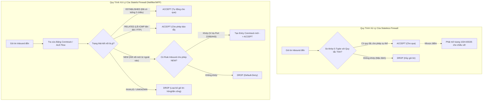
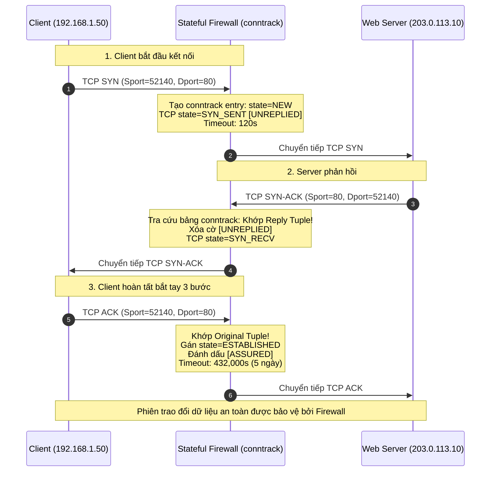
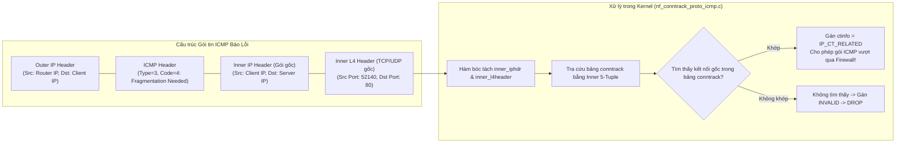

# 2_8_1 Stateless vs Stateful Packet Filtering

> **Khóa học**: Cloud DevOps Basic — Networking Core  
> **Phân nhóm**: 2 Domain 2 - Computer Networking Core Fundamentals › 2_8 Network Security Boundaries Firewalls and VPN Tunnels  
> **Chủ đề**: Lọc gói không trạng thái (Stateless) vs có trạng thái (Stateful), cấu trúc 5-tuple, hệ thống con theo dõi kết nối Netfilter conntrack và Windows Filtering Platform (WFP)  
> **Trạng thái**: Draft (WRITE-CDB-2_8_1, 14-11-2026)  
> **Checklist đối chiếu**: [2_8_1](<../../../CHECKLIST.md#domain-2-computer-networking-core-fundamentals-43-items>)  

---

## 1. Khái Niệm Cốt Lõi & Bản Chất Kỹ Thuật (Core Concepts & Technical Deep Dive)

Trong kiến trúc bảo mật mạng, **Tường lửa lọc gói tin (Packet Filtering Firewall)** đóng vai trò là ranh giới phòng thủ đầu tiên kiểm soát luồng lưu lượng ra/vào giữa các vùng mạng khác nhau hoặc trực tiếp bảo vệ máy chủ (Host-based Firewall). Tùy thuộc vào khả năng ghi nhớ và duy trì ngữ cảnh kết nối, công nghệ lọc gói được phân chia thành hai trường phái kiến trúc nền tảng: **Lọc gói không trạng thái (Stateless Packet Filtering)** và **Lọc gói có trạng thái (Stateful Packet Filtering)**.

---

### 1.1 Khái niệm Lọc gói tin, Cấu trúc 5-Tuple và Chính sách Mặc định (Default-Deny Policy)

Bất kỳ hệ thống lọc gói tin nào ở Tầng Mạng (Layer 3) và Tầng Giao Vận (Layer 4) cũng hoạt động dựa trên việc đối chiếu các trường tiêu đề (header fields) của từng gói tin truyền qua với một tập hợp các quy tắc định sẵn (ruleset).

#### Cấu trúc 5-Tuple chuẩn hóa
Tiêu chí căn bản để nhận diện duy nhất một luồng dữ liệu (network flow) trên môi trường mạng IPv4 là cấu trúc **5-tuple**, được trích xuất trực tiếp từ tiêu đề gói tin:
1. **Source IP Address (32 bits)**: Nằm tại bytes 12–15 trong IPv4 Header theo đặc tả [RFC 791 Section 3.1](https://datatracker.ietf.org/doc/html/rfc791#section-3.1).
2. **Destination IP Address (32 bits)**: Nằm tại bytes 16–19 trong IPv4 Header theo [RFC 791 Section 3.1](https://datatracker.ietf.org/doc/html/rfc791#section-3.1).
3. **Transport Protocol (8 bits)**: Nằm tại byte 9 trong IPv4 Header (chỉ định giao thức tầng trên: `6` cho TCP, `17` cho UDP, `1` cho ICMP) theo [RFC 791 Section 3.1](https://datatracker.ietf.org/doc/html/rfc791#section-3.1).
4. **Source Port (16 bits)**: Nằm tại bytes 0–1 của tiêu đề TCP theo [RFC 9293 Section 3.1](https://datatracker.ietf.org/doc/html/rfc9293#section-3.1) hoặc tiêu đề UDP theo [RFC 768](https://datatracker.ietf.org/doc/html/rfc768).
5. **Destination Port (16 bits)**: Nằm tại bytes 2–3 của tiêu đề TCP theo [RFC 9293 Section 3.1](https://datatracker.ietf.org/doc/html/rfc9293#section-3.1) hoặc tiêu đề UDP theo [RFC 768](https://datatracker.ietf.org/doc/html/rfc768).

| Thành phần 5-Tuple | Vị trí Header | Độ dài | Tiêu chuẩn tham chiếu | Ý nghĩa kỹ thuật |
| :--- | :--- | :--- | :--- | :--- |
| **Source IP** | IPv4 Header (Bytes 12–15) | 32 bits | RFC 791 | Địa chỉ IP của máy chủ phát gói tin |
| **Destination IP** | IPv4 Header (Bytes 16–19) | 32 bits | RFC 791 | Địa chỉ IP của máy chủ đích nhận gói tin |
| **Protocol** | IPv4 Header (Byte 9) | 8 bits | RFC 791 | Mã giao thức L4 (`6`=TCP, `17`=UDP, `1`=ICMP) |
| **Source Port** | TCP/UDP Header (Bytes 0–1) | 16 bits | RFC 9293 / RFC 768 | Cổng dịch vụ hoặc cổng động của tiến trình gửi |
| **Destination Port** | TCP/UDP Header (Bytes 2–3) | 16 bits | RFC 9293 / RFC 768 | Cổng nhận của tiến trình đích |

#### Chính sách chuỗi mặc định (Default-Deny Policy)
Một nguyên tắc bảo mật tối thượng trong thiết kế tường lửa là **chính sách từ chối ngầm định (Default-Deny)** hay còn gọi là Whitelisting. Cụ thể, chuỗi xử lý gói tin (chain) sẽ áp dụng quy tắc mặc định là hủy bỏ (`DROP`) hoặc từ chối (`REJECT`) đối với mọi lưu lượng mạng:
- Trong `nftables`, chính sách này được cấu hình tường minh qua cú pháp: `policy drop` (ví dụ: `chain IN { type filter hook input priority filter; policy drop; }` theo tài liệu [nftables wiki](https://wiki.nftables.org/wiki-nftables/index.php/Matching_connection_tracking_stateful_metainformation#ct_state_-_conntrack_state)).
- Trong `iptables`, chính sách mặc định được thiết lập qua tùy chọn `-P`: `iptables -P INPUT DROP` theo [iptables(8)](https://man7.org/linux/man-pages/man8/iptables.8.html).
- Bất kỳ gói tin nào muốn được phép đi qua đều phải khớp chính xác với ít nhất một quy tắc cho phép (`ACCEPT`) được quản trị viên khai báo rõ ràng.

---

### 1.2 Lọc gói không trạng thái (Stateless Packet Filtering) và Thế tiến thoái lưỡng nan của Chiều về (Return Traffic Dilemma)

**Lọc gói không trạng thái (Stateless Packet Filtering)** là phương pháp kiểm soát lưu lượng thế hệ đầu tiên. Đặc điểm kiến trúc cốt lõi của tường lửa không trạng thái là:
- **Đánh giá độc lập từng gói tin (Packet-by-packet evaluation)**: Tường lửa kiểm tra từng gói tin một cách riêng biệt và cô lập hoàn toàn. Thiết bị không duy trì bất kỳ thông tin bộ nhớ nào về lịch sử các gói tin đã đi qua trước đó, không biết gói tin hiện tại thuộc về phiên kết nối nào, và không lưu trữ trạng thái phiên (session state).
- Theo tài liệu nghiên cứu Netfilter của tác giả Pablo Neira Ayuso ([Netfilter conntrack login.pdf Section 1](https://people.netfilter.org/pablo/docs/login.pdf)), các chính sách lọc chỉ dựa thuần túy trên thông tin tiêu đề gói tin tĩnh đã trở nên lỗi thời đối với các mô hình bảo mật phức tạp hiện đại.

#### Thế tiến thoái lưỡng nan của Chiều về (Return Traffic Dilemma)
Khi một máy khách (client) bên trong mạng nội bộ gửi một yêu cầu HTTP/HTTPS tới một máy chủ Web ngoài Internet:
1. **Chiều đi (Outbound Request)**:
   - Client khởi tạo kết nối TCP tới máy chủ Web `203.0.113.10:80`.
   - Máy khách tự động cấp phát một cổng tạm thời ngẫu nhiên (ephemeral port) trong dải `1024–65535` (hoặc dải động chuẩn IANA `49152–65535`), giả sử là cổng `52140`.
   - Gói tin có 5-tuple: `(Src IP: 192.168.1.50, Dst IP: 203.0.113.10, Proto: TCP, Src Port: 52140, Dst Port: 80)`.
   - Tường lửa stateless có quy tắc: *Cho phép gửi gói TCP ra ngoài cổng đích 80* -> Gói tin được đi qua.
2. **Chiều về (Inbound Response)**:
   - Máy chủ Web phản hồi gói tin với 5-tuple đảo ngược: `(Src IP: 203.0.113.10, Dst IP: 192.168.1.50, Proto: TCP, Src Port: 80, Dst Port: 52140)`.
   - Khi gói tin phản hồi này chạm tới tường lửa stateless tại chiều Inbound, vì tường lửa **hoàn toàn không có trí nhớ** rằng client nội bộ vừa gửi request ra trước đó, nó đánh giá gói phản hồi này như một nỗ lực kết nối mới từ bên ngoài.
   - Dưới chính sách Default-Deny, nếu không có quy tắc cho phép, gói phản hồi sẽ bị **DROP ngay lập tức**, khiến kết nối bị đứt gãy.
3. **Hệ quả rủi ro bảo mật nghiêm trọng**:
   - Để ứng dụng hoạt động được trên tường lửa stateless, quản trị viên bắt buộc phải cấu hình quy tắc mở hai chiều đối xứng (bidirectional rules). Cụ thể, phải mở toàn bộ dải cổng nguồn từ ngoài vào dải cổng đích ephemeral: `ALLOW IN TCP from any:80 to 192.168.1.50:1024-65535`.
   - Kẻ tấn công trên Internet có thể dễ dàng khai thác sơ hở này bằng cách cấu hình công cụ tấn công phát các gói tin có Source Port = 80 hướng tới bất kỳ cổng nào từ 1024 đến 65535 của hệ thống nội bộ. Tường lửa stateless sẽ cho phép toàn bộ các gói tin độc hại này lọt qua vì thỏa mãn điều kiện tiêu đề tĩnh.

---

### 1.3 Lọc gói có trạng thái (Stateful Packet Filtering) & Hệ thống con Netfilter Connection Tracking (`conntrack`)

Để giải quyết triệt để hạn chế của stateless filtering, **Tường lửa có trạng thái (Stateful Firewall)** ra đời với cơ chế theo dõi và lưu giữ ngữ cảnh kết nối (Stateful Connection Tracking).

Trong nhân hệ điều hành Linux, chức năng này được đảm nhiệm bởi hệ thống con **Netfilter Connection Tracking (`conntrack`)**:
- **Cấu trúc Bảng băm conntrack (Conntrack Hash Table Architecture)**:
  Theo tài liệu [Netfilter conntrack login.pdf](https://people.netfilter.org/pablo/docs/login.pdf) phần *"The Connection Tracking Structure"*, hệ thống con `conntrack` duy trì một bảng băm trong bộ nhớ kernel để lưu trữ các mục kết nối (`nf_conn`).
  Mỗi phiên kết nối được định nghĩa bằng **hai cấu trúc tuple đảo ngược** (`nf_conntrack_tuple`):
  - **Tuple chiều khởi tạo (Original Direction - `IP_CT_DIR_ORIGINAL`)**: Đại diện cho thông tin các gói tin xuất phát từ phía bắt đầu kết nối (Source IP, Destination IP, Source Port, Destination Port, Protocol).
  - **Tuple chiều phản hồi (Reply Direction - `IP_CT_DIR_REPLY`)**: Đại diện cho thông tin các gói tin phản hồi quay ngược lại điểm khởi tạo kết nối.
- Khi gói tin phản hồi đầu tiên quay về, kernel tính toán giá trị băm và tra cứu nhanh trong bảng conntrack. Nếu khớp với Reply Tuple của một kết nối đã được phê duyệt, gói tin được tự động gắn nhãn hợp lệ và cho phép đi qua mà không cần mở toang dải cổng ephemeral.

#### 5 Trạng thái gói tin nền tảng trong Linux Netfilter
Theo đặc tả trong trang hướng dẫn hệ thống [man7 iptables-extensions(8)](https://man7.org/linux/man-pages/man8/iptables-extensions.8.html#conntrack) và [nftables wiki](https://wiki.nftables.org/wiki-nftables/index.php/Matching_connection_tracking_stateful_metainformation):

| Trạng thái (Conntrack State) | Định nghĩa kỹ thuật chuẩn man7 | Trường hợp áp dụng thực tế |
| :--- | :--- | :--- |
| **`NEW`** | Gói tin bắt đầu một kết nối mới hoặc chưa từng ghi nhận lưu lượng ở cả hai chiều. | Gói tin TCP `SYN` đầu tiên khởi tạo bắt tay; gói tin UDP đầu tiên gửi tới máy chủ dịch vụ. |
| **`ESTABLISHED`** | Gói tin gắn liền với một kết nối đã nhìn thấy dữ liệu truyền thông hợp lệ ở cả hai chiều (`two-way traffic`). | Gói TCP `SYN-ACK` phản hồi từ server, gói `ACK` xác nhận của client, và toàn bộ các gói tin trao đổi dữ liệu (payload) sau đó. |
| **`RELATED`** | Gói tin đang khởi tạo một kết nối mới, nhưng có mối quan hệ trực tiếp với một kết nối đang hoạt động sẵn có. | Các thông điệp lỗi ICMP (Destination Unreachable, TTL Exceeded) gắn với một luồng TCP/UDP; hoặc kênh truyền dữ liệu phụ trong giao thức FTP (FTP data transfer). |
| **`INVALID`** | Gói tin không gắn với bất kỳ kết nối hợp lệ nào đã biết hoặc vi phạm kiểm tra toàn vẹn ngữ cảnh. | Gói tin chứa cờ TCP bất thường (như `SYN+FIN`), gói tin out-of-window, hoặc gói tin không thể xác định được thuộc tính giao thức. Cần bị `DROP` ngay lập tức. |
| **`UNTRACKED`** | Gói tin hoàn toàn không bị theo dõi bởi hệ thống con connection tracking. | Gói tin được quản trị viên chủ động bỏ qua conntrack bằng target `-j CT --notrack` trong bảng `raw` để tối ưu hóa hiệu năng cực đại. |

---

### 1.4 Máy trạng thái theo dõi TCP (TCP Stateful Tracking State Machine)

Đối với giao thức có hướng kết nối như TCP, hệ thống con `conntrack` theo dõi sát sao từng bước chuyển tiếp trong chu trình bắt tay 3 bước (3-way handshake) và ngắt kết nối 4 bước (4-way teardown) theo tài liệu [conntrack-tools manual Section 5](https://conntrack-tools.netfilter.org/manual.html#conntrack):

1. **Khởi tạo (`SYN_SENT`)**:
   - Khi client gửi gói tin TCP `SYN`, conntrack tạo bản ghi mới với trạng thái gói là `NEW`, trạng thái TCP nội bộ là `SYN_SENT`, kèm thuộc tính `[UNREPLIED]`.
   - Thời gian timeout ban đầu thường là 120 giây.
2. **Phản hồi bắt tay (`SYN_RECV`)**:
   - Khi server gửi lại gói `SYN-ACK`, conntrack ghi nhận lưu lượng phản hồi, loại bỏ cờ `[UNREPLIED]`, chuyển trạng thái TCP sang `SYN_RECV`.
3. **Xác lập hoàn tất (`ESTABLISHED`)**:
   - Khi client gửi gói `ACK` cuối cùng, conntrack chuyển phiên kết nối sang trạng thái `ESTABLISHED` và đánh dấu cờ **`[ASSURED]`**.
   - Cờ `[ASSURED]` đảm bảo rằng phiên kết nối này đã được xác thực hai chiều hoàn chỉnh và sẽ không bị bộ dọn dẹp kernel giải phóng ưu tiên khi bảng băm đầy.
   - **Timeout mặc định**: Theo tài liệu Linux Kernel [nf_conntrack-sysctl.rst Line 135](https://raw.githubusercontent.com/torvalds/linux/master/Documentation/networking/nf_conntrack-sysctl.rst#L135), giá trị sysctl `net.netfilter.nf_conntrack_tcp_timeout_established` có thời gian sống mặc định lên tới **432,000 giây (tương đương 5 ngày)**.
4. **Đóng kết nối (`CLOSE_WAIT` / `TIME_WAIT`)**:
   - Khi các gói `FIN` và `ACK` trao đổi, conntrack chuyển dần qua các trạng thái kết thúc. Trong đó, `net.netfilter.nf_conntrack_tcp_timeout_close_wait` có thời gian chờ mặc định là **60 giây**.

---

### 1.5 Theo dõi các giao thức phi kết nối (UDP & ICMP) bằng Giả kết nối (Pseudo-Connections)

Các giao thức như UDP và ICMP vốn dĩ là phi kết nối (connectionless), không hề có cờ kiểm soát bắt tay hay số tuần tự (sequence numbers). Tuy nhiên, tường lửa stateful vẫn có thể theo dõi chúng một cách thông minh:

#### Cơ chế Pseudo-Connection cho UDP
- Khi một gói UDP xuất phát (ví dụ DNS Query: Client `192.168.1.50:53412` -> DNS Server `8.8.8.8:53`), conntrack ghi nhận tuple ban đầu.
- Kernel tự động thiết lập một tuple đảo ngược dự kiến (`8.8.8.8:53` -> `192.168.1.50:53412`) và áp dụng một bộ đếm thời gian rỗi (idle timer).
- Nếu gói phản hồi DNS Response quay về trong khoảng thời gian này, gói tin được xếp vào trạng thái `ESTABLISHED`.
- Trên nền tảng Windows WFP/ALE theo tài liệu [Microsoft Learn ALE Stateful Filtering](https://learn.microsoft.com/en-us/windows/win32/fwp/ale-stateful-filtering#udp-ale-flow), thời gian chờ rỗi của một luồng UDP unicast ALE flow được cấu hình mặc định là **60 giây** (`idle timeout that defaults to 60 seconds`).

#### Cơ chế Pseudo-Connection và xử lý lỗi ICMP (`RELATED`)
- Đối với gói ping (`ICMP Echo Request`), conntrack tạo pseudo-connection dựa trên cặp IP và trường `Identifier` + `Sequence Number` trong ICMP Header.
- Trong mã nguồn Linux kernel [nf_conntrack_proto_icmp.c lines 143–183](https://raw.githubusercontent.com/torvalds/linux/master/net/netfilter/nf_conntrack_proto_icmp.c), thời gian timeout mặc định cho ICMP được định nghĩa:
  ```c
  static const unsigned int nf_ct_icmp_timeout = 30*HZ;
  ```
  Tức là **30 giây**.
- **Xử lý gói tin lỗi ICMP (Destination Unreachable, TTL Exceeded)**:
  - Khi một router trên đường truyền gặp lỗi (ví dụ gói tin vượt quá MTU nhưng có cờ DF, hoặc hết TTL), router đó sẽ gửi về một gói tin ICMP báo lỗi (`Type 3` hoặc `Type 11`).
  - Gói tin ICMP lỗi này có cấu trúc chứa phần tiêu đề lồng nhau: `iphdr | icmphdr | inner_iphdr | l4header (tcp, udp, ..)`.
  - Trong kernel, hàm xử lý conntrack bóc tách phần tiêu đề IP và L4 bên trong (`inner_hdr`) của gói ICMP lỗi, dùng thông tin này để tra cứu ngược vào bảng băm conntrack của phiên kết nối gốc.
  - Khi tìm thấy phiên kết nối gốc tương ứng, kernel gán thông tin theo dõi trạng thái `ctinfo = IP_CT_RELATED` và cập nhật gói tin: `nf_ct_set(skb, ct, ctinfo)`. Nhờ cơ chế này, gói tin lỗi ICMP được nhận diện là `RELATED` và được phép đi qua tường lửa để báo lỗi kịp thời cho ứng dụng máy gửi!

---

### 1.6 Kiến trúc tường lửa máy chủ trên Windows: Windows Filtering Platform (WFP) & ALE Flows

Trên hệ điều hành Windows (Windows Server và Windows 10/11), **Windows Defender Firewall** được xây dựng dựa trên kiến trúc nền tảng **Windows Filtering Platform (WFP)**:
- Theo tài liệu chính thức từ [Microsoft Learn ALE Stateful Filtering](https://learn.microsoft.com/en-us/windows/win32/fwp/ale-stateful-filtering), tính năng lọc gói có trạng thái được thực thi tại các lớp **Application Layer Enforcement (ALE)**.
- **ALE Flow**: Đơn vị quản lý trạng thái của WFP là một ALE flow, đại diện cho lưu lượng mạng dựa trên phân loại 5-tuple.
- **Cơ chế cho phép tự động chiều về**: Khi một kết nối mạng được ứng dụng khởi tạo và được kiểm tra ủy quyền thành công bởi các bộ lọc tại tầng ALE (ví dụ: cho phép trình duyệt gửi yêu cầu ra ngoài), một ALE flow được kích hoạt trong nhân Windows.
- Kể từ thời điểm đó, chừng nào chính sách không thay đổi, **mọi gói tin thuộc về cùng một ALE flow—bao gồm cả chiều đi (outbound) lẫn chiều phản hồi về (inbound)—đều được tự động cho phép đi qua** mà không cần phải tạo thêm quy tắc cho phép cổng đến thủ công.

---

## 2. Ví Dụ Đời Sống Thực Tế Dễ Hiểu (Intuitive Real-World Analogies)

Để hình dung sự khác biệt căn bản giữa hai cơ chế lọc gói này, hãy so sánh chúng với mô hình kiểm soát ra vào tại một tòa nhà văn phòng cao tầng:

```
+--------------------------------------------------------------------------------------------------+
|                                    MÔ HÌNH SO SÁNH TRỰC QUAN                                     |
+--------------------------------------------------------------------------------------------------+
| 1. Stateless Firewall: Nhân viên bảo vệ mất trí nhớ ngắn hạn                                      |
|    - Khi bạn đi ra ngoài mua cơm: Bảo vệ kiểm tra thẻ nhân viên và mở cửa cho đi (OUTBOUND OK).  |
|    - Khi bạn quay lại: Vì bảo vệ không có trí nhớ, ông ta không biết bạn vừa đi ra.              |
|    - Để bạn vào được: Ban quản lý bắt buộc phải đặt biển báo "Mở toang cửa phụ cho bất kỳ ai     |
|      đến từ bên ngoài bước vào" (Mở toang dải cổng ephemeral 1024-65535).                       |
|    -> Hậu quả: Kẻ gian chỉ cần đóng giả người từ bên ngoài là lẻn vào tòa nhà tự do!             |
+--------------------------------------------------------------------------------------------------+
| 2. Stateful Firewall: Nhân viên lễ tân thông minh có sổ theo dõi (conntrack table)              |
|    - Khi bạn bước ra (SYN / NEW): Lễ tân ghi vào sổ: Họ tên, phòng ban, giờ xuất phát (5-tuple).|
|    - Khi bạn mang cơm trưa quay lại: Lễ tân đối chiếu sổ: "Đúng anh ở phòng 502 vừa đi ra 15     |
|      phút trước, mời anh vào!" (ESTABLISHED / ASSURED).                                          |
|    - Nếu có một người lạ mặt tự ý đòi vào cửa mà trong sổ không hề có dòng ghi nhận vừa đi ra   |
|      trước đó, lễ tân lập tức bấm chuông báo động và đuổi ra ngoài ngay lập tức (Default DROP)!   |
|    - Nếu có anh shipper giao hàng nói "Người phòng 502 vừa gọi pizza" (ICMP error / RELATED),    |
|      lễ tân kiểm tra sổ thấy phòng 502 đang có kết nối thật, cho phép shipper báo tin!          |
+--------------------------------------------------------------------------------------------------+
```

---

## 3. Kiến Trúc, Luồng Hoạt Động & Hình Ảnh Trực Quan (Architecture, Diagrams & Visual Media)

### 3.1 Hình ảnh Kiến trúc Chính thức

Dưới đây là sơ đồ kiến trúc chính thức của hệ thống Windows Filtering Platform (WFP) từ Microsoft Learn và các điểm móc chặn (Hooks) của Netfilter trong Linux Kernel:

[](https://learn.microsoft.com/en-us/windows/win32/fwp/images/wfp-architecture.png)
*Hình 1: Kiến trúc Windows Filtering Platform (WFP) với các tầng Application Layer Enforcement (ALE) thực thi lọc gói có trạng thái. Nguồn: Microsoft Learn.*

[](https://people.netfilter.org/pablo/nf-hooks.png)
*Hình 2: Luồng xử lý gói tin và các điểm móc (Hooks) trong kiến trúc Linux Netfilter. Nguồn: Netfilter.org (Pablo Neira Ayuso).*

---

### 3.2 Sơ đồ Luồng Quyết định: Stateless vs Stateful



---

### 3.3 Chu trình Chuyển dịch Trạng thái Netfilter Conntrack cho TCP Handshake



---

### 3.4 Cơ chế Bóc tách Tiêu đề Lồng nhau của Gói tin ICMP `RELATED`

Khi một router trung gian gửi thông báo lỗi `ICMP Destination Unreachable` (Type 3) về cho máy gửi, gói tin ICMP mang theo toàn bộ phần đầu IP và L4 của gói tin bị lỗi:



---

## 4. Thực Hành (Hands-on)

Phần thực hành này cung cấp các kịch bản cấu hình tường lửa có trạng thái thực chiến trên cả hai nền tảng Linux (`nftables` / `iptables`) và Windows PowerShell, cùng các câu lệnh giám sát bộ nhớ conntrack chuyên sâu.

---

### 4.1 Cấu hình Stateful Firewall với `nftables` (Linux Hiện Đại)

`nftables` là hệ thống con lọc gói tin mặc định hiện đại trong Linux kernel, sử dụng biểu thức `ct state` để khớp thông tin conntrack stateful.

> ⚠️ Chưa chạy thử (not executed by the squad)
```bash
# Tạo một bảng inet có tên stateful_fw_demo
sudo nft add table inet stateful_fw_demo

# Tạo chuỗi IN (Input chain) gắn với hook input, ưu tiên filter, và chính sách mặc định là DROP
sudo nft add chain inet stateful_fw_demo IN '{ type filter hook input priority filter; policy drop; }'

# Quy tắc 1: Cho phép mọi gói tin thuộc kết nối ESTABLISHED và RELATED đi qua tự động
sudo nft add rule inet stateful_fw_demo IN ct state established,related accept

# Quy tắc 2: Hủy bỏ ngay lập tức mọi gói tin mang trạng thái INVALID
sudo nft add rule inet stateful_fw_demo IN ct state invalid drop

# Quy tắc 3: Cho phép kết nối loopback nội bộ
sudo nft add rule inet stateful_fw_demo IN iif "lo" accept

# Quy tắc 4: Cho phép kết nối mới (NEW) tới cổng SSH (TCP 22)
sudo nft add rule inet stateful_fw_demo IN tcp dport 22 ct state new accept
```

> 💡 Minh họa output lệnh thực tế khi kiểm tra ruleset bằng `sudo nft list ruleset`:
```text
table inet stateful_fw_demo {
	chain IN {
		type filter hook input priority filter; policy drop;
		ct state established,related accept
		ct state invalid drop
		iif "lo" accept
		tcp dport 22 ct state new accept
	}
}
```

---

### 4.2 Cấu hình Stateful Firewall với `iptables` (Linux Truyền Thống)

Trên các bản phân phối Linux sử dụng `iptables`, module `conntrack` kết hợp tham số `--ctstate` được dùng để thực thi lọc gói theo trạng thái.

> ⚠️ Chưa chạy thử (not executed by the squad)
```bash
# Thiết lập chính sách chuỗi mặc định (Default Policy) là DROP cho INPUT và FORWARD
sudo iptables -P INPUT DROP
sudo iptables -P FORWARD DROP
sudo iptables -P OUTPUT ACCEPT

# Cho phép lưu lượng trên giao diện loopback (lo)
sudo iptables -A INPUT -i lo -j ACCEPT

# Quy tắc vàng: Tự động chấp thuận lưu lượng đã ESTABLISHED hoặc RELATED
sudo iptables -A INPUT -m conntrack --ctstate ESTABLISHED,RELATED -j ACCEPT

# Loại bỏ triệt để các gói tin hỏng hoặc bất thường (INVALID)
sudo iptables -A INPUT -m conntrack --ctstate INVALID -j DROP

# Chỉ cho phép mở kết nối mới (NEW) cho cổng SSH 22
sudo iptables -A INPUT -p tcp --dport 22 -m conntrack --ctstate NEW -j ACCEPT
```

---

### 4.3 Giám sát và Quản trị Bảng Conntrack với `conntrack-tools`

Gói tiện ích `conntrack-tools` cung cấp công cụ dòng lệnh `conntrack` giao tiếp trực tiếp với bảng theo dõi trong kernel qua giao diện Netlink.

#### 1. Xuất danh sách toàn bộ các kết nối đang theo dõi (`-L` / `--dump`)
> ⚠️ Chưa chạy thử (not executed by the squad)
```bash
sudo conntrack -L
```

> 💡 Minh họa output lệnh thực tế:
```text
tcp      6 431998 ESTABLISHED src=192.168.1.50 dst=93.184.216.34 sport=54210 dport=443 src=93.184.216.34 dst=192.168.1.50 sport=443 dport=54210 [ASSURED] mark=0 use=1
udp      17 28 src=192.168.1.50 dst=8.8.8.8 sport=48912 dport=53 src=8.8.8.8 dst=192.168.1.50 sport=53 dport=48912 mark=0 use=1
```
*Giải thích*:
- Dòng TCP hiển thị rõ 2 tuple: Original (`src=192.168.1.50 dst=93.184.216.34 sport=54210 dport=443`) và Reply (`src=93.184.216.34 dst=192.168.1.50 sport=443 dport=54210`), trạng thái `ESTABLISHED`, cờ `[ASSURED]`, và thời gian timeout đếm lùi từ 432000s.
- Dòng UDP thể hiện một pseudo-connection với idle timer đếm lùi từ 30s.

#### 2. Xem thống kê hiệu năng hệ thống con conntrack (`-S` / `--stats`)
> ⚠️ Chưa chạy thử (not executed by the squad)
```bash
sudo conntrack -S
```

> 💡 Minh họa output lệnh thực tế:
```text
cpu=0	entries=42 searched=1280 found=45020 new=1240 invalid=2 ignore=0 delete=1198 delete_list=1198 insert=1240 insert_failed=0 drop=0 early_drop=0 error=0 search_restart=0
cpu=1	entries=42 searched=1140 found=41200 new=1110 invalid=0 ignore=0 delete=1068 delete_list=1068 insert=1110 insert_failed=0 drop=0 early_drop=0 error=0 search_restart=0
```
*Chỉ số quan trọng*: Trường `drop` và `early_drop`. Nếu hai chỉ số này lớn hơn 0, hệ thống đang bị quá tải hoặc bảng conntrack đã bị đầy!

---

### 4.4 Kiểm tra và Tinh chỉnh Tham số Kernel Sysctl cho Conntrack

> ⚠️ Chưa chạy thử (not executed by the squad)
```bash
# Xem số lượng kết nối đang được kernel theo dõi hiện tại (Read-Only)
sysctl net.netfilter.nf_conntrack_count

# Xem giới hạn dung lượng tối đa của bảng conntrack
sysctl net.netfilter.nf_conntrack_max

# Xem thời gian timeout cho kết nối TCP ESTABLISHED (mặc định 432000s = 5 ngày)
sysctl net.netfilter.nf_conntrack_tcp_timeout_established

# Xem thời gian timeout cho trạng thái CLOSE_WAIT (mặc định 60s)
sysctl net.netfilter.nf_conntrack_tcp_timeout_close_wait
```

> 💡 Minh họa output lệnh thực tế:
```text
net.netfilter.nf_conntrack_count = 148
net.netfilter.nf_conntrack_max = 262144
net.netfilter.nf_conntrack_tcp_timeout_established = 432000
net.netfilter.nf_conntrack_tcp_timeout_close_wait = 60
```

---

### 4.5 Quản trị Stateful Firewall trên Windows với PowerShell NetSecurity

Trên hệ điều hành Windows, PowerShell cung cấp module `NetSecurity` để quản lý Windows Defender Firewall dựa trên nền tảng WFP/ALE.

> ⚠️ Chỉ chạy trên VM thử nghiệm (lab VM only)
```powershell
# 1. Kiểm tra trạng thái các Profile tường lửa (Domain, Private, Public)
Get-NetFirewallProfile | Select-Object Name, Enabled, DefaultInboundAction, DefaultOutboundAction

# 2. Kích hoạt toàn bộ các profile với chính sách Inbound mặc định là Block (Default-Deny)
Set-NetFirewallProfile -Profile Domain,Public,Private -Enabled True

# 3. Tạo quy tắc cho phép kết nối Inbound mới tới cổng SSH (TCP 22)
New-NetFirewallRule -DisplayName "Allow-SSH" -Direction Inbound -Protocol TCP -LocalPort 22 -Action Allow

# 4. Kiểm tra lại thông tin quy tắc vừa tạo
Get-NetFirewallRule -DisplayName "Allow-SSH"
```

> 💡 Minh họa output PowerShell thực tế:
```text
Name                  : {9b2d8329-87c2-4014-9ff2-2c6b450dc768}
DisplayName           : Allow-SSH
Description           : 
DisplayGroup          : 
Group                 : 
Enabled               : True
Profile               : Any
Platform              : {}
Direction             : Inbound
Action                : Allow
EdgeTraversalPolicy   : Block
LooseSourceMapping    : False
LocalOnlyMapping      : False
Owner                 : 
PrimaryStatus         : OK
EnforcementStatus     : NotApplicable
PolicyStoreSource     : PersistentStore
PolicyStoreSourceType : Local
```
*Nhận xét*: Tương tự như Linux, khi máy tính Windows khởi tạo một kết nối ra ngoài (ví dụ duyệt web), tầng ALE tự tạo luồng và cho phép toàn bộ gói tin phản hồi quay về mà không cần bất kỳ quy tắc mở cổng Inbound nào!

---

## 5. Cạm Bẫy Thực Tế & Thực Tiễn Sản Xuất (Production Gotchas & Best Practices)

Trong môi trường hạ tầng DevOps quy mô lớn (High-Traffic Web Gateways, Kubernetes Ingress Nodes, Load Balancers), việc vận hành Stateful Firewall đòi hỏi kỹ sư phải nắm vững các cạm bẫy thực tế sau:

---

### 5.1 Thảm họa Cạn kiệt Bảng Conntrack (The Conntrack Table Full Outage)

Cạm bẫy kinh điển và nguy hiểm nhất đối với Stateful Firewall trên Linux là lỗi **tràn bảng conntrack**:
- **Bản chất kỹ thuật**: Mỗi bản ghi kết nối trong conntrack chiếm một lượng bộ nhớ RAM nhất định trong nhân Linux (thường khoảng 300–400 bytes cấu trúc kernel). Để tránh cạn kiệt RAM hệ thống, kernel áp đặt một ngưỡng tối đa được xác định bởi tham số `net.netfilter.nf_conntrack_max`.
- **Dấu hiệu sự cố**: Khi số lượng kết nối đồng thời `net.netfilter.nf_conntrack_count` chạm tới ngưỡng `nf_conntrack_max`, theo mã nguồn [nf_conntrack_core.c line 1667](https://raw.githubusercontent.com/torvalds/linux/master/net/netfilter/nf_conntrack_core.c#L1667), kernel sẽ ghi cảnh báo vào buffer hệ thống:
  ```text
  nf_conntrack: table full, dropping packet
  ```
  Và ngay lập tức **HỦY BỎ (DROP) TOÀN BỘ CÁC GÓI TIN MỚI**.
- **Hậu quả**: Toàn bộ máy chủ, gateway hoặc node Kubernetes bị tê liệt kết nối mạng hoàn toàn. Khách hàng không thể thiết lập kết nối mới dù CPU và RAM của máy chủ vẫn còn dư thừa rất nhiều!

#### Giải pháp Tinh chỉnh Thực chiến trong Sản xuất:
1. **Tăng kích thước bảng băm (`hashsize`) và giới hạn tối đa (`nf_conntrack_max`)**:
   Nguyên tắc tính toán chuẩn: `nf_conntrack_max = hashsize * 4` (hoặc `* 8`).
   Ví dụ đối với máy chủ 64-bit có 16GB RAM trở lên chịu tải lớn:
   > ⚠️ Chưa chạy thử (not executed by the squad)
   ```bash
   # Tăng số lượng bucket của bảng băm (yêu cầu quyền root ghi vào sysfs)
   echo 262144 | sudo tee /sys/module/nf_conntrack/parameters/hashsize
   
   # Tăng số lượng kết nối tối đa lên 1,048,576
   sudo sysctl -w net.netfilter.nf_conntrack_max=1048576
   ```
2. **Hạ thấp thời gian Timeout cho TCP ESTABLISHED**:
   Giá trị mặc định **432,000 giây (5 ngày)** là quá dài trong môi trường microservices hoặc web public, khiến các kết nối "chết" (dead sockets / silent disconnects) chiếm dụng bảng conntrack vô ích. Cần hạ xuống giá trị hợp lý (ví dụ: 600s đến 1800s):
   > ⚠️ Chưa chạy thử (not executed by the squad)
   ```bash
   sudo sysctl -w net.netfilter.nf_conntrack_tcp_timeout_established=1200
   ```
3. **Bỏ qua theo dõi trạng thái (`NOTRACK`) cho lưu lượng cực lớn**:
   Đối với các dịch vụ stateless thuần túy với lưu lượng hàng trăm nghìn request/giây (như DNS Server cổng 53 hoặc CDN Caching Server), hãy sử dụng target `NOTRACK` trong bảng `raw` để tránh nạp vào bảng conntrack:
   > ⚠️ Chưa chạy thử (not executed by the squad)
   ```bash
   # Bỏ theo dõi kết nối cho lưu lượng DNS port 53 trong iptables raw table
   sudo iptables -t raw -A PREROUTING -p udp --dport 53 -j CT --notrack
   sudo iptables -t raw -A OUTPUT -p udp --sport 53 -j CT --notrack
   ```

---

### 5.2 Cạm bẫy Bảo mật: Mở toang dải cổng Ephemeral trên Stateless Filter

Nhiều kỹ sư khi cấu hình Access Control List (ACL) không trạng thái trên Cloud (như AWS Network ACLs) hoặc router phần cứng đã mắc sai lầm nghiêm trọng:
- Do máy khách nội bộ không nhận được dữ liệu phản hồi, kỹ sư vội vàng mở quy tắc: `Allow Inbound TCP Port 1024-65535`.
- **Rủi ro**: Hành động này vô tình mở toang toàn bộ các dịch vụ nội bộ vô tình bind trên các cổng cao (ví dụ RPC, database test, debug ports, Node.js microservices). Kẻ tấn công từ ngoài có thể quét và khai thác trực tiếp các dịch vụ này mà ACL không thể ngăn chặn.
- **Thực tiễn tốt nhất**: Ở các ranh giới chỉ hỗ trợ stateless filtering, bắt buộc phải giới hạn chặt chẽ phạm vi IP nguồn (Source CIDR), hoặc ủy quyền toàn bộ việc kiểm soát cho Stateful Security Groups / Host Firewalls.

---

### 5.3 Cạm bẫy Chặn Toàn Bộ ICMP làm vỡ Path MTU Discovery (PMTUD Black Hole)

Vì lý do "bảo mật", một số quản trị viên cấu hình tường lửa hủy bỏ toàn bộ gói tin ICMP (`iptables -A INPUT -p icmp -j DROP`).
- **Hệ quả**: Hành động này chặn luôn gói tin `ICMP Destination Unreachable / Fragmentation Needed` (Type 3 Code 4). Khi client gửi gói tin lớn vượt quá MTU của một chặng định tuyến có cờ DF (Don't Fragment), router gửi thông báo ICMP về nhưng bị tường lửa drop mất. Client không biết để hạ kích thước gói, dẫn tới hiện tượng **PMTUD Black Hole**: kết nối TCP handshake thành công nhưng cứ gửi payload dữ liệu là bị treo đơ vĩnh viễn!
- **Giải pháp**: Với Stateful Firewall, luôn cấu hình quy tắc chấp thuận `ct state established,related accept`. Điều này đảm bảo các gói tin ICMP lỗi liên đới tới phiên truyền thông hợp lệ luôn được tự động cho phép đi qua an toàn mà không phải mở toang ping ICMP Echo Request.

---

## 6. Câu Hỏi Củng Cố Kiến Thức (Active Recall Quiz)

Dưới đây là các câu hỏi tình huống thực chiến giúp bạn củng cố bản chất kỹ thuật đã học:

### Câu hỏi 1: Sự cố Chiều về trên Stateless Firewall
Một kỹ sư mạng thiết lập một tường lửa không trạng thái (stateless filter) với chính sách Default-Deny. Kỹ sư thêm quy tắc cho phép chiều ra: `ALLOW OUT TCP from 10.0.0.0/24 to any dport 443`. Tuy nhiên, toàn bộ nhân viên trong mạng `10.0.0.0/24` đều không thể truy cập bất kỳ trang web HTTPS nào.
1. Giải thích chính xác nguyên nhân gốc rễ ở tầng gói tin khiến kết nối bị thất bại.
2. Tại sao việc khắc phục bằng cách mở thêm quy tắc `ALLOW IN TCP from any to 10.0.0.0/24 dport 1024-65535` lại là một sai lầm bảo mật nghiêm trọng?
3. Tường lửa có trạng thái (stateful firewall) giải quyết bài toán này như thế nào mà không cần mở quy tắc trên?

<details>
<summary>👉 Xem đáp án phân tích chi tiết</summary>

1. **Nguyên nhân gốc rễ**: Khi client gửi gói tin HTTPS ra ngoài, gói tin mang một cổng nguồn ngẫu nhiên thuộc dải ephemeral (ví dụ `55420`). Khi máy chủ Web phản hồi, gói tin quay về có Destination Port là `55420`. Do tường lửa là *stateless*, nó không lưu vết rằng client vừa gửi request ra trước đó. Khi gói phản hồi chạm chiều Inbound, nó bị chính sách *Default-Deny* drop ngay lập tức.
2. **Sai lầm bảo mật**: Việc mở toang dải cổng đích `1024–65535` cho chiều Inbound khiến bất kỳ kẻ tấn công nào bên ngoài cũng có thể gửi các gói tin độc hại vào hàng chục nghìn cổng dịch vụ nội bộ của dải IP `10.0.0.0/24`, vô hiệu hóa gần như hoàn toàn năng lực bảo vệ của tường lửa.
3. **Cách giải quyết của Stateful Firewall**: Tường lửa stateful tự động ghi nhận 5-tuple của kết nối vào bảng conntrack/ALE flow ngay khi gói tin chiều ra đi qua. Khi gói tin phản hồi quay về với 5-tuple đảo ngược, tường lửa nhận diện nó thuộc trạng thái `ESTABLISHED` và tự động cho phép đi qua, hoàn toàn không cần mở bất kỳ cổng Inbound tĩnh nào.
</details>

---

### Câu hỏi 2: Xử lý Thảm họa Tràn Bảng Conntrack trong Ngày Siêu Sale
Vào một chiến dịch flash-sale lớn, một cụm Kubernetes Ingress Gateway (Linux) đột ngột không thể tiếp nhận thêm bất kỳ kết nối mới nào từ khách hàng, dù CPU của server chỉ tải 25% và RAM còn trống 60%. Khi kỹ sư kiểm tra nhật ký kernel bằng lệnh `dmesg -T`, xuất hiện hàng loạt dòng thông báo:
```text
nf_conntrack: table full, dropping packet
```
1. Hãy giải thích cơ chế nội tại của Linux Kernel dẫn đến hiện tượng này.
2. Kỹ sư cần kiểm tra những tham số sysctl và sysfs cụ thể nào?
3. Đề xuất 3 giải pháp kỹ thuật cấp sản xuất để xử lý dứt điểm tình trạng trên mà không làm sập server.

<details>
<summary>👉 Xem đáp án phân tích chi tiết</summary>

1. **Cơ chế nội tại**: Hệ thống con Netfilter Connection Tracking duy trì bảng băm theo dõi kết nối với ngưỡng giới hạn tối đa được kiểm soát bởi `net.netfilter.nf_conntrack_max`. Khi số lượng kết nối đồng thời `nf_conntrack_count` đạt tới ngưỡng tối đa này, kernel kích hoạt cơ chế tự bảo vệ bộ nhớ RAM và từ chối cấp phát thêm bản ghi mới, dẫn đến việc gọi hàm `net_warn_ratelimited("nf_conntrack: table full, dropping packet\n")` và drop toàn bộ các gói tin kết nối mới.
2. **Các tham số cần kiểm tra**:
   - `net.netfilter.nf_conntrack_count`: Số lượng phiên đang theo dõi thực tế.
   - `net.netfilter.nf_conntrack_max`: Ngưỡng tối đa hiện tại của bảng.
   - `/sys/module/nf_conntrack/parameters/hashsize`: Kích thước bảng băm (số bucket).
   - `net.netfilter.nf_conntrack_tcp_timeout_established`: Thời gian giữ bản ghi ESTABLISHED (mặc định quá dài: 432,000s).
3. **3 Giải pháp kỹ thuật cấp sản xuất**:
   - **Tăng dung lượng bảng**: Tăng `hashsize` lên 262,144 hoặc 524,288 và nâng `nf_conntrack_max` lên 1,048,576 hoặc 2,097,152 (đảm bảo server đủ dung lượng RAM tương ứng).
   - **Hạ thấp Timeout**: Giảm `nf_conntrack_tcp_timeout_established` từ 432,000s xuống 600s–1200s để kernel nhanh chóng thu hồi các slot của kết nối đã ngắt hoặc không còn hoạt động.
   - **Bật NOTRACK cho lưu lượng tĩnh**: Nếu Ingress Gateway có các cổng chịu tải tĩnh cực lớn không cần NAT hoặc stateful filtering, sử dụng target `NOTRACK` trong bảng `raw` để gói tin bỏ qua connection tracking hoàn toàn.
</details>

---

### Câu hỏi 3: Bản chất Kỹ thuật của Trạng thái `RELATED` đối với Gói tin Lỗi ICMP
Tại sao một gói tin `ICMP Destination Unreachable` (Type 3) được gửi từ một router trung gian trên Internet lại được Linux Netfilter phân loại vào trạng thái **`RELATED`** chứ không phải là `NEW` hay `INVALID`? Kernel Linux bóc tách dữ liệu gói tin như thế nào để đưa ra quyết định này?

<details>
<summary>👉 Xem đáp án phân tích chi tiết</summary>

- **Tại sao không phải `NEW` hay `INVALID`**:
  - Không thể là `NEW` vì gói tin ICMP này xuất phát từ router trung gian (một IP hoàn toàn xa lạ) chứ không phải do máy chủ đích ban đầu gửi, và nó không hề có ý định khởi tạo một phiên giao tiếp ứng dụng mới độc lập.
  - Không thể là `INVALID` vì đây là gói tin báo lỗi mạng hoàn toàn hợp lệ và sống còn đối với hoạt động của ngăn xếp mạng (ví dụ: thông báo Path MTU Discovery).
- **Cơ chế bóc tách của Kernel**:
  - Theo mã nguồn `net/netfilter/nf_conntrack_proto_icmp.c`, gói tin lỗi ICMP mang theo phần tải trọng chứa: `iphdr | icmphdr | inner_iphdr | l4header`.
  - Kernel Linux bóc tách phần `inner_iphdr` và `l4header` (chính là tiêu đề gói tin gốc của client gửi đi trước đó), trích xuất 5-tuple bên trong và tra cứu vào bảng băm conntrack.
  - Khi tìm thấy entry tương ứng với phiên kết nối mà client đang thực hiện, kernel nhận ra gói tin ICMP này có mối quan hệ trực tiếp (*related*) với phiên kết nối đang mở. Do đó, kernel gán nhãn `IP_CT_RELATED` và cho phép gói tin đi qua quy tắc `ct state established,related accept`.
</details>

---

## 7. 📚 Nguồn Tài Liệu Chính Thống (Tier-1 Official References)

Dưới đây là các tài liệu tiêu chuẩn chính thống từ IETF RFCs, Linux Kernel Documentation, Netfilter Organization, và Microsoft Learn được dùng làm căn cứ xác thực cho toàn bộ nội dung bài học:

- [RFC 791 - Internet Protocol Specification](https://datatracker.ietf.org/doc/html/rfc791#section-3.1) - Đặc tả tiêu chuẩn IETF về cấu trúc IPv4 Header, trường Protocol, Source IP và Destination IP.
- [RFC 9293 - Transmission Control Protocol (TCP)](https://datatracker.ietf.org/doc/html/rfc9293#section-3.1) - Đặc tả chuẩn TCP hiện hành, định nghĩa cấu trúc trường Source Port, Destination Port và các cờ trạng thái.
- [RFC 768 - User Datagram Protocol (UDP)](https://datatracker.ietf.org/doc/html/rfc768) - Đặc tả chuẩn IETF về tiêu đề giao thức UDP 8-byte và định dạng cổng giao vận.
- [Pablo Neira Ayuso - Netfilter's Connection Tracking System](https://people.netfilter.org/pablo/docs/login.pdf) - Tài liệu kiến trúc chuyên sâu về hệ thống con Connection Tracking trong Linux Kernel và cấu trúc bảng băm tuple.
- [nftables Official Wiki - Matching Connection Tracking Stateful Metainformation](https://wiki.nftables.org/wiki-nftables/index.php/Matching_connection_tracking_stateful_metainformation#ct_state_-_conntrack_state) - Hướng dẫn chính thức về cú pháp `ct state`, các trạng thái `new`, `established`, `related`, `invalid`, `untracked` và thiết lập `policy drop`.
- [Linux man-pages: iptables-extensions(8)](https://man7.org/linux/man-pages/man8/iptables-extensions.8.html#conntrack) - Hướng dẫn tra cứu chuẩn Linux man7 về module `conntrack` và định nghĩa 5 trạng thái gói tin.
- [Linux man-pages: iptables(8)](https://man7.org/linux/man-pages/man8/iptables.8.html) - Hướng dẫn quản trị tường lửa Linux iptables và tùy chọn thiết lập chính sách `-P`.
- [Debian manpages: nft(8)](https://manpages.debian.org/testing/nftables/nft.8.en.html) - Hướng dẫn chuẩn hệ thống về công cụ dòng lệnh quản trị bảng và chuỗi `nftables`.
- [Linux Kernel Documentation: nf_conntrack-sysctl.rst](https://raw.githubusercontent.com/torvalds/linux/master/Documentation/networking/nf_conntrack-sysctl.rst#L32) - Tài liệu chính thức từ Linux Kernel về các tham số sysctl của conntrack (`nf_conntrack_count`, `nf_conntrack_max`, `nf_conntrack_tcp_timeout_established`).
- [Linux Kernel Source: nf_conntrack_core.c](https://raw.githubusercontent.com/torvalds/linux/master/net/netfilter/nf_conntrack_core.c#L1667) - Mã nguồn Linux Kernel minh chứng cảnh báo `table full, dropping packet` khi chạm ngưỡng giới hạn.
- [Linux Kernel Source: nf_conntrack_proto_icmp.c](https://raw.githubusercontent.com/torvalds/linux/master/net/netfilter/nf_conntrack_proto_icmp.c) - Mã nguồn Linux Kernel hiện thực cơ chế bóc tách inner header và gán trạng thái `IP_CT_RELATED` cho ICMP.
- [conntrack-tools Official Manual](https://conntrack-tools.netfilter.org/manual.html#conntrack) - Hướng dẫn chính thức của Netfilter về công cụ dòng lệnh `conntrack` và vòng đời trạng thái TCP handshake.
- [Debian manpages: conntrack(8)](https://manpages.debian.org/testing/conntrack/conntrack.8.en.html) - Hướng dẫn sử dụng tùy chọn `-L` (dump entries) và `-S` (stats) của tiện ích `conntrack`.
- [Microsoft Learn: ALE Stateful Filtering](https://learn.microsoft.com/en-us/windows/win32/fwp/ale-stateful-filtering) - Tài liệu chính thức từ Microsoft về cơ chế lọc gói có trạng thái ALE flow và thời gian chờ rỗi UDP trên Windows Filtering Platform.
- [Microsoft Learn: New-NetFirewallRule Cmdlet](https://learn.microsoft.com/en-us/powershell/module/netsecurity/new-netfirewallrule?view=windowsserver2022-ps) - Hướng dẫn chính thức về tạo quy tắc tường lửa qua PowerShell NetSecurity trên Windows.
- [Microsoft Learn: Set-NetFirewallProfile Cmdlet](https://learn.microsoft.com/en-us/powershell/module/netsecurity/set-netfirewallprofile?view=windowsserver2022-ps) - Hướng dẫn cấu hình thuộc tính và trạng thái hoạt động của các Firewall Profile trên Windows.
