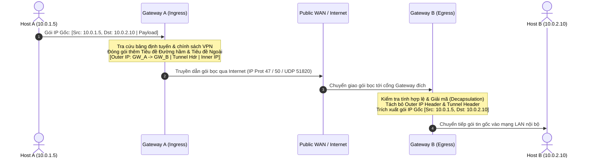
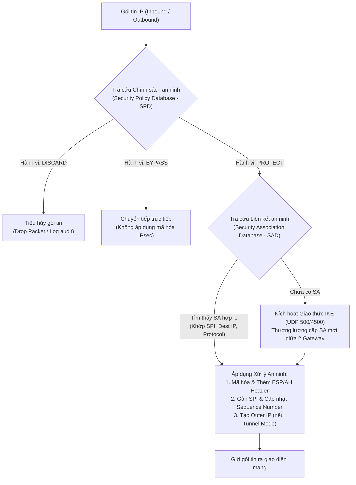
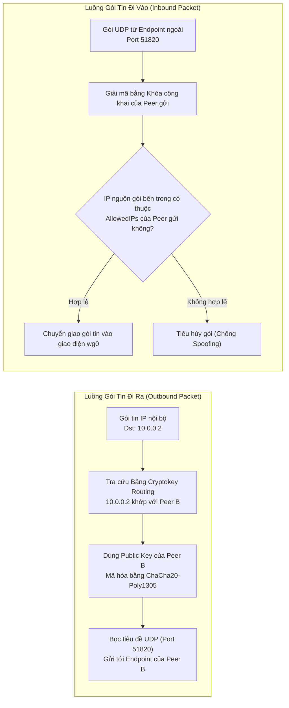
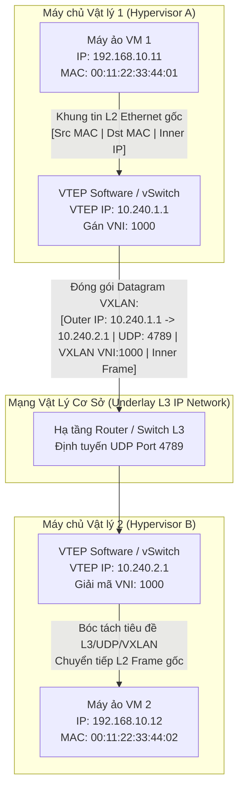

# 2_8_2 VPNs and IP Tunneling

> **Khóa học**: Cloud DevOps Basic — Networking Core  
> **Phân nhóm**: 2 Domain 2 - Computer Networking Core Fundamentals › 2_8 Network Security Boundaries Firewalls and VPN Tunnels  
> **Chủ đề**: Kỹ thuật đóng gói đường hầm gói tin (Packet Tunneling) và Mạng riêng ảo (VPN): Cơ chế GRE, IPsec, WireGuard, VXLAN Overlay và tác động suy hao MTU / TCP MSS Clamping  
> **Trạng thái**: Draft (WRITE-CDB-2_8_2, 14-11-2026)  
> **Checklist đối chiếu**: [2_8_2](<../../../CHECKLIST.md#domain-2-computer-networking-core-fundamentals-43-items>)  

---

## 1. Khái Niệm Cốt Lõi & Bản Chất Kỹ Thuật (Core Concepts & Technical Deep Dive)

Trong kiến trúc mạng máy tính hiện đại, **Đóng gói đường hầm gói tin (Packet Tunneling)** và **Mạng riêng ảo (Virtual Private Network - VPN)** là các kỹ thuật then chốt cho phép truyền tải dữ liệu giữa các vùng mạng độc lập, vượt qua các ranh giới định tuyến, mạng con chồng lấn (overlapping subnets) hoặc các hạ tầng WAN công cộng không tin cậy.

Bản chất kỹ thuật của mọi giao thức đường hầm (tunneling protocol) là cơ chế **đóng gói lồng nhau (encapsulation)**: một gói tin dữ liệu nguyên bản (Inner Packet) được xem như phần tải trọng (payload) thuần túy và được bao bọc bên trong một tiêu đề phân phát mới (Outer Delivery Header) để vận chuyển xuyên qua mạng trung gian.

```text
+-------------------------------------------------------------------------+
| Outer IP Delivery Header | Tunnel Header | Inner Packet (IP / L2 Frame) |
+-------------------------------------------------------------------------+
|<------- Vận chuyển trên mạng trung gian ------>|<--- Dữ liệu gốc payload --->|
```

---

### 1.1 Kỹ thuật Đóng gói Đường hầm (Packet Tunneling) & GRE (RFC 2784, RFC 2890)

Theo đặc tả trong [IETF RFC 2784 Section 2](https://datatracker.ietf.org/doc/html/rfc2784#section-2) và [RFC 4459 Section 1](https://datatracker.ietf.org/doc/html/rfc4459#section-1):
- **Cơ chế tổng quát**: Một gói tin GRE bao gồm: `Delivery Header | GRE Header | Payload packet`. Điểm đầu đường hầm (tunnel ingress) nhận gói tin gốc, bọc thêm tiêu đề đường hầm và tiêu đề mạng ngoài, định tuyến qua mạng trung gian, và điểm cuối đường hầm (tunnel egress) thực hiện giải mã bóc tách (decapsulation) để đưa gói tin gốc vào mạng đích.
- **GRE (Generic Routing Encapsulation)**: Là giao thức đường hầm phi trạng thái (stateless) được gán số hiệu giao thức tầng mạng **IP Protocol = 47**. GRE cho phép đóng gói đa dạng các giao thức tầng mạng bất kỳ (arbitrary network layer protocols) chạy trên nền IP.
- **Cấu trúc tiêu đề GRE cơ bản (Base GRE Header - 4 bytes)**:
  - Cờ và phiên bản: Trường *Version Number* bắt buộc phải bằng 0 (`0x00`).
  - Trường *Protocol Type* (2 octets / 16 bits): Chứa giá trị EtherType của gói tin tải trọng bên trong (ví dụ `0x0800` cho IPv4, `0x86DD` cho IPv6).
- **Phần mở rộng tùy chọn của GRE ([RFC 2890 Section 2](https://datatracker.ietf.org/doc/html/rfc2890#section-2))**:
  - Tiêu đề GRE có thể mở rộng từ 4 bytes lên tối đa **16 bytes** khi kích hoạt các trường tùy chọn:
    - *Checksum field* (2 bytes) kèm *Reserved1* (2 bytes): Kiểm tra tính toàn vẹn bit của tiêu đề GRE và payload.
    - *Key field* (4 bytes): Định danh phiên kết nối hoặc phân đoạn luồng dữ liệu logic.
    - *Sequence Number field* (4 bytes): Thiết lập số thứ tự gói tin để phát hiện gói đến sai trật tự tại đầu nhận.
- **Hạn chế bảo mật của GRE thuần túy**: Tiêu đề GRE thuần túy **hoàn toàn không có cơ chế mã hóa (cryptographic encryption)** và **không có xác thực nguồn gốc dữ liệu**. Toàn bộ gói tin payload bên trong GRE được truyền tải dưới dạng văn bản rõ (cleartext) trên mạng công cộng.

---

### 1.2 Kiến Trúc IPsec (IP Security - RFC 4301, RFC 4302, RFC 4303)

[IETF RFC 4301 Section 4](https://datatracker.ietf.org/doc/html/rfc4301#section-4) chuẩn hóa kiến trúc bảo mật tầng IP nhằm cung cấp dịch vụ bảo mật thông tin trên mạng Internet thông qua các thành phần cốt lõi:

#### 1. Cơ sở dữ liệu chính sách và liên kết bảo mật (SPD & SAD)
- **Security Policy Database (SPD)**: Chứa các quy tắc phân loại lưu lượng dựa trên bộ chọn (selectors như IP nguồn/đích, Port, Protocol). Đối với mỗi gói tin IP đi vào (inbound) hoặc đi ra (outbound), ngăn xếp IPsec thực hiện 1 trong 3 hành vi xử lý cơ bản ([RFC 4301 Section 4.4.1](https://datatracker.ietf.org/doc/html/rfc4301#section-4.4.1)):
  1. `DISCARD`: Tiêu hủy gói tin không được phép truyền dẫn.
  2. `BYPASS IPsec`: Cho phép gói tin đi qua trực tiếp mà không cần đóng gói hay áp dụng các xử lý IPsec.
  3. `PROTECT using IPsec`: Bắt buộc áp dụng xử lý bảo mật IPsec (thêm AH hoặc ESP header).
- **Security Association (SA)**: Là một kết nối logic đơn công (simplex - một chiều) cung cấp các dịch vụ bảo mật cho lưu lượng đi qua nó ([RFC 4301 Section 4.1](https://datatracker.ietf.org/doc/html/rfc4301#section-4.1)). Để duy trì liên lạc hai chiều giữa 2 hệ thống IPsec, hệ thống bắt buộc phải thiết lập **một cặp SA điều phối (SA pair)** (mỗi chiều một SA), được thương lượng động thông qua giao thức quản lý khóa Internet Key Exchange (IKE).
- **Security Association Database (SAD)**: Lưu trữ các tham số hoạt động của các SA đang hiệu lực (thuật toán mã hóa, khóa chia sẻ, số tuần tự chống gửi lại). Đối với lưu lượng Unicast, mỗi SA trong SAD được định danh duy nhất bởi chỉ số tham số bảo mật **SPI (Security Parameters Index - 32 bits)**, kết hợp cùng địa chỉ IP đích và loại giao thức bảo mật (AH hoặc ESP).

#### 2. Chế độ hoạt động: Transport Mode vs Tunnel Mode
Theo [RFC 4301 Section 4.1 & 4.2](https://datatracker.ietf.org/doc/html/rfc4301#section-4.1):
- **Transport Mode (Chế độ truyền tải)**: Áp dụng bảo vệ trực tiếp lên các giao thức tầng kế tiếp (như TCP/UDP payload), giữ nguyên tiêu đề IP gốc (original IP header). Thường triển khai trong kết nối bảo mật giữa hai máy chủ đầu cuối (host-to-host).
- **Tunnel Mode (Chế độ đường hầm)**: Đóng gói toàn bộ gói tin IP bên trong (gồm cả tiêu đề IP gốc và payload) vào bên trong một tiêu đề IP mới bên ngoài (Outer IP Header). **Đặc tả RFC 4301 quy định bắt buộc: Bất cứ khi nào một trong hai đầu mút của SA là Cổng bảo mật (Security Gateway / Router / Firewall), liên kết SA bắt buộc phải hoạt động ở Tunnel Mode**.

#### 3. Hai giao thức cốt lõi: AH vs ESP
- **Authentication Header (AH - [RFC 4302](https://datatracker.ietf.org/doc/html/rfc4302#section-1), IP Protocol = 51)**:
  - Cung cấp tính toàn vẹn phi kết nối (connectionless integrity), xác thực nguồn gốc dữ liệu (data origin authentication), và dịch vụ chống gửi lại gói tin (anti-replay).
  - **Không cung cấp tính bí mật (confidentiality)**: Dữ liệu bên trong không được mã hóa. Vì AH tính toán mã băm xác thực trên cả tiêu đề IP ngoài, AH sẽ bị phá vỡ hoàn toàn khi đi qua thiết bị NAT (do NAT thay đổi IP/Port).
- **Encapsulating Security Payload (ESP - [RFC 4303](https://datatracker.ietf.org/doc/html/rfc4303#section-1), IP Protocol = 50)**:
  - Cung cấp đầy đủ: **Tính bảo mật (mã hóa dữ liệu payload)**, xác thực nguồn gốc dữ liệu, tính toàn vẹn và chống gửi lại (anti-replay).
  - Cấu trúc gói tin ESP ([RFC 4303 Section 2](https://datatracker.ietf.org/doc/html/rfc4303#section-2)):
    - *ESP Header (8 bytes)*: Gồm SPI (4 bytes) và Sequence Number (4 bytes).
    - *Payload Data & IV*: Dữ liệu mã hóa và vector khởi tạo Initialization Vector (ví dụ 8 bytes cho AES-GCM).
    - *ESP Trailer*: Padding (0–255 bytes nhằm căn chỉnh khối dữ liệu), Pad Length (1 byte), Next Header (1 byte).
    - *Integrity Check Value (ICV)*: Mã xác thực dữ liệu (thường là 16 bytes đối với thuật toán xác thực hiện đại).

#### 4. NAT-Traversal (NAT-T, RFC 3948)
Khi ESP Tunnel Mode đi qua thiết bị NAT công cộng, do ESP là giao thức L4 độc lập (IP Protocol 50) không chứa số hiệu cổng L4 (không có TCP/UDP port), thiết bị NAT/PAT không thể tạo bảng ánh xạ dịch cổng. Theo [RFC 3948 Section 2.1](https://datatracker.ietf.org/doc/html/rfc3948#section-2.1):
- Gói tin ESP được bọc thêm tiêu đề **UDP với cổng đích 4500 (UDP port 4500)**.
- Giao thức bắt tay quản lý khóa IKE sử dụng **cổng UDP 500**. Khi phát hiện thiết bị NAT dọc đường truyền (NAT Discovery), IKE tự động chuyển đổi phiên sang UDP port 4500 để vận chuyển an toàn qua các bộ định tuyến NAT gia đình và doanh nghiệp.

#### 5. Phân loại Mô hình Triển khai VPN: Site-to-Site vs Remote-Access
- **Site-to-Site VPN ([RFC 4301 Section 3.3](https://datatracker.ietf.org/doc/html/rfc4301#section-3.3))**: Kết nối cố định giữa hai mạng LAN riêng biệt thông qua 2 cổng bảo mật (Security Gateway / Firewall) đặt tại mỗi văn phòng qua môi trường WAN công cộng. Toàn bộ quá trình mã hóa/giải mã diễn ra trong suốt đối với các máy chủ nội bộ.
- **Remote-Access VPN**: Kết nối giữa các thiết bị cá nhân của người dùng di động (roaming client hosts) đến cổng bảo mật trung tâm của doanh nghiệp. Gateway trung tâm xác thực người dùng và cấp phát động địa chỉ IP nội bộ (Virtual IP) cho máy khách.

---

### 1.3 WireGuard & Cơ chế Cryptokey Routing

[WireGuard](https://www.wireguard.com/#cryptokey-routing) là một giao thức VPN hiện đại được thiết kế hoạt động trực tiếp trong nhân hệ điều hành Linux (Linux Kernel module), mang lại hiệu năng cao và loại bỏ sự phức tạp cồng kềnh của IKE/IPsec.

Theo công bố khoa học chính thức của Jason A. Donenfeld ([WireGuard Paper Section 2](https://www.wireguard.com/papers/wireguard.pdf)):
- **Cryptokey Routing (Định tuyến bằng Khóa mật mã)**:
  - Khái niệm nền tảng của WireGuard là liên kết trực tiếp **Khóa công khai (Public Key)** của từng nút mạng với một danh sách các địa chỉ IP nội bộ được phép đi qua đường hầm (**Allowed IPs**).
  - Khi gửi gói tin (outbound): Danh sách `AllowedIPs` hoạt động như một **bảng định tuyến (routing table)**. WireGuard căn cứ vào IP đích của gói tin để tra cứu public key tương ứng của peer, dùng khóa đó mã hóa dữ liệu rồi gửi ra mạng ngoài.
  - Khi nhận gói tin (inbound): Danh sách `AllowedIPs` hoạt động như một **danh sách kiểm soát truy cập (Access Control List - ACL)**. Sau khi giải mã thành công bằng public key của peer, WireGuard kiểm tra xem IP nguồn bên trong có nằm trong danh sách `AllowedIPs` được gán cho peer đó hay không. Nếu không trùng khớp, gói tin bị tiêu hủy ngay lập tức để ngăn chặn IP spoofing.
- **Giao thức và Định dạng Gói tin ([WireGuard Paper Section 5.4.6](https://www.wireguard.com/papers/wireguard.pdf))**:
  - WireGuard hoạt động hoàn toàn trên tầng truyền tải **UDP**, mặc định lắng nghe tại cổng **UDP port 51820**.
  - Không duy trì trạng thái kết nối ảo (stateless/connectionless user experience): nếu không có dữ liệu cần truyền, giao diện hoàn toàn im lặng, không phát sinh lưu lượng thăm dò liên tục.
  - Cấu trúc gói dữ liệu vận chuyển (Transport Data Message):
    - *WireGuard Header (16 bytes)*: Gồm Message Type (1 byte = `0x04`), Reserved (3 bytes = `0x00`), Receiver Index (4 bytes), Counter (8 bytes).
    - *Encapsulated UDP Header*: 8 bytes.
    - *Poly1305 Authentication Tag*: 16 bytes.
  - **Tổng chi phí đóng gói tiêu đề WireGuard**: Cố định **40 bytes** (chưa tính tiêu đề IP ngoài).
    - Chạy trên IPv4: Tiêu đề IPv4 ngoài (20B) + WireGuard overhead (40B) = **60 bytes overhead**. Mặc định MTU giao diện là **1440 bytes**.
    - Chạy trên IPv6: Tiêu đề IPv6 ngoài (40B) + WireGuard overhead (40B) = **80 bytes overhead**. Mặc định MTU giao diện là **1420 bytes**.

---

### 1.4 Mạng Phủ Ảo Hóa VXLAN (RFC 7348)

Trong các trung tâm dữ liệu điện toán đám mây và hạ tầng ảo hóa, công nghệ **VXLAN (Virtual eXtensible Local Area Network - [RFC 7348](https://datatracker.ietf.org/doc/html/rfc7348#section-5))** là giải pháp mạng phủ (Overlay Network) hàng đầu giải quyết giới hạn 4094 VLAN cổ điển của chuẩn IEEE 802.1Q:
- **Cơ chế hoạt động**: Đóng gói toàn bộ khung tin Ethernet Layer 2 của máy ảo (Inner Ethernet Frame) bên trong một gói tin Layer 3 UDP/IP datagram trên mạng vật lý cơ sở (Underlay Network).
- **VTEP (VXLAN Tunnel Endpoint)**: Điểm mút đường hầm đóng vai trò khởi tạo và giải mã gói tin VXLAN, có thể triển khai trên phần mềm ảo hóa (hypervisor/vSwitch) hoặc thiết bị chuyển mạch vật lý (top-of-rack switch).
- **Cấu trúc tiêu đề VXLAN (8 bytes)**:
  - Cờ báo (Flags - 8 bits): Cờ **I flag** bắt buộc phải thiết lập bằng 1 để biểu thị sự hiện diện của định danh VNI hợp lệ.
  - **VNI (VXLAN Segment ID / Network Identifier - 24 bits)**: Cung cấp không gian định danh lên tới $2^{24} =$ **16,777,216 phân đoạn mạng độc lập**, cho phép cô lập hàng triệu mạng khách hàng đa người dùng (multi-tenant) trên cùng một hạ tầng vật lý.
- **Cổng giao tiếp mạng**: IANA chỉ định cổng nhận chính thức cho VXLAN là **UDP port 4789** (một số phiên bản Linux kernel cũ sử dụng cổng nội bộ không chính thức 8472).
- **Suy hao đóng gói (Overhead)**:
  - Tiêu đề ngoài trên nền IPv4: Outer IP (20B) + Outer UDP (8B) + VXLAN Header (8B) = **36 bytes tiêu đề L3/L4**.
  - Cộng thêm tiêu đề khung tin Ethernet nội bộ (14 bytes): Tổng mức suy hao lên tải trọng payload IP bên trong là **50 bytes**.

---

## 2. Ví Dụ Đời Sống Thực Tế Dễ Hiểu (Intuitive Real-World Analogies)

### 2.1 Ẩn dụ 1: IP Tunneling / VPN — Dịch Vụ Thư Tín Tuyệt Mật Đóng Trong Phong Bì Bưu Điện Mới

Hãy tưởng tượng bạn làm việc tại trụ sở công ty ở Hà Nội và muốn gửi một tập tài liệu nội bộ tuyệt mật cho đồng nghiệp tại chi nhánh TP.HCM:
- **Bức thư bên trong (Inner IP Packet)**: Bức thư này được ghi rõ địa chỉ gửi từ phòng kế toán Hà Nội (IP nội bộ RFC 1918: `10.0.1.5`) đến phòng kiểm toán TP.HCM (`10.0.2.10`). Nếu bạn đem bức thư nội bộ này ném thẳng vào hòm thư bưu điện công cộng ngoài phố (Mạng Internet toàn cầu), nhân viên bưu tá sẽ lập tức vứt bỏ hoặc hủy thư vì hệ thống chuyển phát công cộng không thể hiểu và không định tuyến cho các địa chỉ phòng ban cục bộ riêng tư!
- **Đóng phong bì bưu điện bảo mật (Outer Delivery Header)**: Để bức thư đến đích an toàn, nhân viên bảo vệ trụ sở Hà Nội (Cổng VPN Gateway) nhận bức thư nội bộ, cho toàn bộ bức thư này vào bên trong một **chiếc phong bì tiêu chuẩn của bưu điện quốc gia** (Outer IP Header). Mặt ngoài của phong bì mới này mang địa chỉ bưu điện công cộng rõ ràng: Người gửi là Tòa nhà Hà Nội (IP công cộng `198.51.100.1`) và Người nhận là Tòa nhà TP.HCM (IP công cộng `203.0.113.2`).
- **Tem niêm phong bảo mật (Mã hóa IPsec ESP / WireGuard Poly1305)**: Để chống việc nhân viên bưu điện mở trộm tài liệu trên đường vận chuyển, bảo vệ dán tem niêm phong chống giả mạo bằng mật mã, khóa kín tài liệu bên trong. Bưu tá ngoài đường chỉ nhìn thấy chiếc phong bì ngoài và chuyển giao nó xuyên qua mạng lưới bưu chính công cộng.
- **Bóc tách đường hầm tại đích (Decapsulation)**: Khi phong bì tới chi nhánh TP.HCM, nhân viên bảo vệ cổng TP.HCM kiểm tra tem niêm phong còn nguyên vẹn, bóc bỏ phong bì bên ngoài, rút bức thư nội bộ ban đầu ra và chuyển giao tận tay cho phòng kiểm toán nội bộ `10.0.2.10`.

---

### 2.2 Ẩn dụ 2: MTU & MSS Clamping — Chiếc Hòm Thư Cân Nặng Tối Đa 1500 Gram

- **Hạn mức trọng lượng bưu phẩm (Ethernet MTU 1500 bytes)**: Chiếc hòm thư tiêu chuẩn ngoài đường (Mạng Ethernet truyền thống) chỉ cho phép nhét các bưu phẩm có trọng lượng tối đa **1500 gram**. Nếu bưu phẩm nặng quá 1500 gram, nó không thể chui lọt qua khe hòm thư.
- **Sự cố vượt cân do vỏ bọc (Encapsulation Overhead)**: Bình thường, khi gửi thư thông thường không dùng VPN, bức thư của bạn dày đúng 1500 gram và gửi đi trơn tru. Nhưng khi chuyển sang gửi qua dịch vụ bảo vệ VPN, nhân viên bảo vệ phải bọc thêm chiếc phong bì dày cộp bằng bìa cứng và gắn tem niêm phong chì (Overhead của GRE/IPsec/WireGuard nặng từ 40 đến 80 gram). Kết quả là tổng gói hàng nặng tới 1560 gram—vượt quá giới hạn 1500 gram của hòm thư!
- **Hố đen PMTUD (PMTUD Black Hole)**: Khi gói hàng bị tắc ở trạm bưu điện trung gian do quá nặng, nhân viên trạm gửi một giấy thông báo về cho người gửi: *"Bưu phẩm quá khổ, hãy chia nhỏ ra"* (Thông điệp ICMP Fragmentation Needed - Type 3 Code 4). Nhưng trớ trêu thay, tường lửa tại cơ quan người gửi lại hiểu nhầm tờ giấy thông báo này là thư rác và tiêu hủy nó! Người gửi cứ ngồi đợi xác nhận, trong khi bưu phẩm đã bị vứt bỏ, gây ra hiện tượng **kết nối bị treo đơ vĩnh viễn (hang/freeze)**!
- **Giải pháp TCP MSS Clamping**: Để giải quyết triệt để vấn đề này, người gửi chủ động dùng một chiếc kéo, cắt bớt số trang thư bên trong ngay từ khâu viết lách ban đầu (Clamping giá trị MSS của gói TCP SYN xuống còn 1400 hoặc 1360 gram). Nhờ đó, ruột thư nhẹ đi, khi bảo vệ bọc thêm vỏ phong bì dày của VPN vào thì tổng trọng lượng vừa vặn đạt chuẩn 1500 gram, giúp bưu phẩm lướt qua mọi hòm thư trung gian mà không bao giờ bị nghẽn hay rách!

---

## 3. Kiến Trúc, Luồng Hoạt Động & Hình Ảnh Trực Quan (Architecture, Diagrams & Visual Media)

### 3.1 Hình Ảnh Kiến Trúc Chính Thức từ WireGuard

Dưới đây là hình ảnh biểu trưng chính thức và công cụ quản trị giao diện của dự án WireGuard:

[](https://www.wireguard.com/img/wireguard.svg)

*Hình 1: Biểu trưng chính thức của dự án WireGuard (Nguồn: wireguard.com).*

[](https://www.wireguard.com/img/wg-tool.png)

*Hình 2: Minh họa kiến trúc công cụ cấu hình giao diện `wg` và cơ chế xác thực khóa trong WireGuard (Nguồn: wireguard.com).*

---

### 3.2 Quy Trình Đóng Gói và Giải Mã Gói Tin Đường Hầm Tổng Quát

Sơ đồ tuần tự minh họa dòng dữ liệu từ trạm nguồn cục bộ, xuyên qua đường hầm logic (GRE, IPsec, WireGuard) trên mạng Internet công cộng đến trạm đích:



---

### 3.3 Kiến Trúc Xử Lý Gói Tin IPsec: Cơ Chế SPD và SAD

Theo [RFC 4301 Section 4.4.1](https://datatracker.ietf.org/doc/html/rfc4301#section-4.4.1), quy trình phân loại và thực thi chính sách an ninh của IPsec diễn ra theo lưu đồ sau:



---

### 3.4 Cơ Chế Cryptokey Routing Của WireGuard

WireGuard tích hợp chặt chẽ việc định tuyến và kiểm soát quyền truy cập mật mã thông qua cấu trúc dữ liệu `AllowedIPs`:



---

### 3.5 Kiến Trúc Mạng Phủ Ảo Hóa VXLAN (RFC 7348)

Sơ đồ chuyển giao khung tin Ethernet L2 giữa hai máy ảo (VM) nằm ở hai cụm máy chủ vật lý khác nhau thông qua mạng Underlay L3:



---

## 4. Thực Hành (Hands-on): Khảo Sát Tunneling, Cấu Hình Linux CLI & Tính Toán Suy Hao MTU / MSS Clamping

> ⚠️ Chưa chạy thử (not executed by the squad)  
> *Lưu ý*: Các kịch bản tạo giao diện mạng và can thiệp bảng lọc gói tin yêu cầu quyền quản trị viên cao nhất (`root` hoặc `sudo`). Khuyến nghị thực thi trong môi trường máy ảo lab thử nghiệm.

---

### 4.1 Bảng Tính Toán Suy Hao Tiêu Đề Chi Tiết & Tác Động MTU / MSS

Giả định chuẩn hạ tầng mạng Ethernet phổ thông có kích thước khung tin truyền tải tối đa **Standard Underlay MTU = 1500 bytes**.
- Tiêu đề IPv4 cơ bản: 20 bytes.
- Tiêu đề TCP cơ bản: 20 bytes.
- Kích thước TCP MSS khả dụng ban đầu trên mạng trực tiếp:
  $$\text{MSS}_{\text{chuẩn}} = \text{MTU} - (\text{IP Header} + \text{TCP Header}) = 1500 - (20 + 20) = 1460\text{ bytes}$$

Khi áp dụng đóng gói đường hầm, tổng mức suy hao tiêu đề (Encapsulation Overhead) làm thu hẹp kích thước MTU và MSS tối đa của gói tin bên trong theo các bước tính toán chi tiết:

#### Các bước tính toán suy hao từng giao thức (Step-by-Step Calculations):

1. **Chuẩn Ethernet trực tiếp (Base Standard Ethernet)**:
   - Underlay MTU = $1500\text{ bytes}$.
   - Inner IPv4 Header = $20\text{ bytes}$, Inner TCP Header = $20\text{ bytes}$.
   - $\text{Inner TCP MSS} = \text{Inner MTU} - (\text{IPv4 Header} + \text{TCP Header}) = 1500 - 40 = 1460\text{ bytes}$.

2. **GRE over IPv4 (RFC 2784 / RFC 2890)**:
   - GRE cơ bản: Outer IP ($20\text{B}$) + Base GRE ($4\text{B}$) = **$24\text{ bytes}$ overhead**.
     - $\text{Inner MTU} = 1500 - 24 = 1476\text{ bytes}$.
     - $\text{Inner TCP MSS} = 1476 - 40 = 1436\text{ bytes}$.
   - GRE mở rộng (đầy đủ tùy chọn Checksum + Key + Sequence): Outer IP ($20\text{B}$) + Extended GRE ($16\text{B}$) = **$36\text{ bytes}$ overhead**.
     - $\text{Inner MTU} = 1500 - 36 = 1464\text{ bytes}$.
     - $\text{Inner TCP MSS} = 1464 - 40 = 1424\text{ bytes}$.

3. **IPsec ESP Tunnel Mode (AES-GCM)**:
   - Gói tin ESP Tunnel Mode thuần túy: Outer IP ($20\text{B}$) + ESP Header ($8\text{B}$) + IV ($8\text{B}$) + ESP Trailer ($2\text{B}$) + ICV ($16\text{B}$) = **$54\text{ bytes}$ overhead** (cộng $0$–$2\text{ bytes}$ padding căn chỉnh khối 4-byte).
     - $\text{Inner MTU} = 1500 - (54 + 2) = 1442\text{ bytes}$ / $1440\text{ bytes}$ (an toàn).
     - $\text{Inner TCP MSS} = 1442 - 40 = 1402\text{ bytes}$ / $1400\text{ bytes}$.
   - IPsec ESP over NAT-T (UDP port 4500, RFC 3948): Bổ sung thêm Outer UDP Header ($8\text{B}$) $\rightarrow$ Tổng overhead = **$62\text{ bytes}$** (kèm padding thành $64\text{ bytes}$).
     - $\text{Inner MTU} = 1500 - 62 = 1438\text{ bytes}$ / $1434\text{ bytes}$.
     - $\text{Inner TCP MSS} = 1438 - 40 = 1398\text{ bytes}$ / $1394\text{ bytes}$.

4. **WireGuard (ChaCha20-Poly1305)**:
   - Chạy trên nền IPv4: Outer IP ($20\text{B}$) + UDP Header ($8\text{B}$) + WireGuard Header ($16\text{B}$) + Poly1305 MAC tag ($16\text{B}$) = **$60\text{ bytes}$ overhead**.
     - $\text{Inner MTU} = 1500 - 60 = 1440\text{ bytes}$ (MTU mặc định trên IPv4).
     - $\text{Inner TCP MSS} = 1440 - 40 = 1400\text{ bytes}$.
   - Chạy trên nền IPv6: Outer IPv6 ($40\text{B}$) + UDP ($8\text{B}$) + WireGuard Header ($16\text{B}$) + Poly1305 tag ($16\text{B}$) = **$80\text{ bytes}$ overhead**.
     - $\text{Inner MTU} = 1500 - 80 = 1420\text{ bytes}$ (MTU mặc định trên IPv6).
     - $\text{Inner TCP MSS} = 1420 - 40 = 1380\text{ bytes}$ (với inner IPv4) hoặc $1420 - 60 = 1360\text{ bytes}$ (inner IPv6).

5. **VXLAN over IPv4 (RFC 7348)**:
   - Suy hao tiêu đề L3/L4: Outer IP ($20\text{B}$) + Outer UDP ($8\text{B}$) + VXLAN Header ($8\text{B}$) = **$36\text{ bytes}$**.
   - Bổ sung tiêu đề khung tin Ethernet nội bộ (Inner Ethernet Frame Header = $14\text{ bytes}$) $\rightarrow$ Tổng overhead lên tải trọng Inner IP Payload = **$50\text{ bytes}$**.
     - $\text{Inner Ethernet MTU} = 1500 - 50 = 1450\text{ bytes}$.
     - $\text{Inner TCP MSS} = 1450 - 40 = 1410\text{ bytes}$.

| Giao thức Đường Hầm (Tunneling Protocol) | Chi tiết các thành phần Tiêu đề Đóng gói (Overhead Breakdown) | Tổng Overhead suy hao (bytes) | Kích thước MTU hữu hiệu của Payload (bytes) | Kích thước TCP MSS tối đa (bytes) |
| :--- | :--- | :--- | :--- | :--- |
| **Chuẩn Ethernet trực tiếp (Không Tunnel)** | Không có | 0 | **1500** | **1460** |
| **GRE cơ bản (RFC 2784) over IPv4** | Outer IPv4 (20B) + Base GRE Header (4B) | 24 | $1500 - 24 =$ **1476** | $1476 - 40 =$ **1436** |
| **GRE mở rộng (RFC 2890) over IPv4** | Outer IPv4 (20B) + Extended GRE (16B: Checksum + Key + Seq) | 36 | $1500 - 36 =$ **1464** | $1464 - 40 =$ **1424** |
| **IPsec ESP Tunnel Mode (AES-GCM)** | Outer IPv4 (20B) + ESP Header (8B: SPI 4B, Seq 4B) + IV (8B) + Trailer (2B) + ICV (16B) | 54–56 (kèm 0–2B padding) | $1500 - 54/56 =$ **1442–1440** | $1442/1440 - 40 =$ **1402–1400** |
| **IPsec ESP over NAT-T (UDP 4500)** | Outer IPv4 (20B) + Outer UDP (8B) + ESP Header & Crypto Overhead (34B) | 62–64 (kèm 0–2B padding) | $1500 - 62/64 =$ **1438–1434** | $1438/1434 - 40 =$ **1398–1394** |
| **WireGuard over IPv4 (RFC standard MTU)**| Outer IPv4 (20B) + Outer UDP (8B) + WireGuard Hdr (16B) + Poly1305 MAC (16B) | 60 | $1500 - 60 =$ **1440** | $1440 - 40 =$ **1400** |
| **WireGuard over IPv6** | Outer IPv6 (40B) + Outer UDP (8B) + WireGuard Hdr (16B) + Poly1305 MAC (16B) | 80 | $1500 - 80 =$ **1420** | $1420 - 40 =$ **1380** (inner IPv4) / **1360** (inner IPv6) |
| **VXLAN over IPv4 (RFC 7348)** | Outer IPv4 (20B) + Outer UDP (8B) + VXLAN Hdr (8B) = 36B L3/L4 (+ 14B Inner Ethernet) | 50 (cho payload IP trong) | $1500 - 50 =$ **1450** | $1450 - 40 =$ **1410** |

> 📌 **Quy tắc thực tế cho Trung tâm Dữ liệu (VXLAN Best Practice)**:  
> Để các máy ảo (VM) và container trên mạng phủ VXLAN hoạt động với kích thước MTU 1500 bytes tiêu chuẩn mà không bị phân mảnh gói tin, các kỹ sư mạng bắt buộc phải kích hoạt tính năng **Jumbo Frames** trên hạ tầng chuyển mạch vật lý (Underlay Network Switches/NICs) với **MTU underlay $\ge$ 1600 bytes** (thông dụng là **9000 bytes**).

---

### 4.2 Cấu Hình Đường Hầm Bằng Công Cụ Linux `iproute2`

#### 1. Khởi tạo đường hầm GRE thuần túy (Point-to-Point GRE Tunnel)
Theo tài liệu [Linux ip-tunnel(8)](https://man7.org/linux/man-pages/man8/ip-tunnel.8.html):

```bash
# Tạo giao diện đường hầm GRE kết nối giữa IP công cộng 198.51.100.1 và 203.0.113.2
sudo ip tunnel add gre1 mode gre remote 203.0.113.2 local 198.51.100.1 ttl 255

# Gán địa chỉ IP nội bộ cho giao diện tunnel và kích hoạt
sudo ip addr add 10.10.10.1/30 dev gre1
sudo ip link set dev gre1 up

# Kiểm tra thông số giao diện và MTU đã tự động co về 1476 bytes
ip -d link show dev gre1
```

> 💡 Minh họa output lệnh thực tế:
```text
3: gre1@NONE: <POINTOPOINT,NOARP,UP,LOWER_UP> mtu 1476 qdisc noqueue state UNKNOWN mode DEFAULT group default qlen 1000
    link/gre 198.51.100.1 peer 203.0.113.2 promiscuity 0 minmtu 46 maxmtu 65511 
    gre remote 203.0.113.2 local 198.51.100.1 ttl 255 ikey 0.0.0.0 okey 0.0.0.0
```

#### 2. Khởi tạo giao diện mạng phủ VXLAN
Theo tài liệu [Linux ip-link(8)](https://man7.org/linux/man-pages/man8/ip-link.8.html):

```bash
# Tạo giao diện vxlan10 với VNI 10, gắn với card vật lý eth0 và cổng UDP chuẩn 4789
sudo ip link add dev vxlan10 type vxlan id 10 dev eth0 dstport 4789

# Kích hoạt giao diện và gán IP mạng phủ
sudo ip link set dev vxlan10 up
sudo ip addr add 192.168.100.1/24 dev vxlan10
```

#### 3. Cấu hình giao diện WireGuard qua công cụ `wg`
Theo tài liệu [Linux wg(8)](https://man7.org/linux/man-pages/man8/wg.8.html):

```bash
# Tạo giao diện WireGuard
sudo ip link add dev wg0 type wireguard

# Gán IP nội bộ và kích hoạt giao diện (MTU mặc định sẽ là 1420 bytes hoặc cấu hình 1440)
sudo ip addr add 10.0.0.1/24 dev wg0
sudo ip link set mtu 1440 dev wg0
sudo ip link set dev wg0 up

# Cấu hình khóa bí mật, cổng lắng nghe và thông số Peer (Cryptokey Routing)
sudo wg set wg0 \
    listen-port 51820 \
    private-key /etc/wireguard/private.key \
    peer aB3dE...[Peer_Public_Key]...= \
    allowed-ips 10.0.0.2/32 \
    endpoint 203.0.113.2:51820
```

> 💡 Minh họa output lệnh thực tế:
```text
interface: wg0
  public key: xK9fL...[Local_Public_Key]...=
  private key: (hidden)
  listening port: 51820

peer: aB3dE...[Peer_Public_Key]...=
  endpoint: 203.0.113.2:51820
  allowed ips: 10.0.0.2/32
  latest handshake: 1 minute, 12 seconds ago
  transfer: 4.12 MiB received, 18.45 MiB sent
```

---

### 4.3 Kỹ Thuật TCP MSS Clamping Trên Linux Firewall

Theo đặc tả [IETF RFC 4459 Section 3.2](https://datatracker.ietf.org/doc/html/rfc4459#section-3.2), khi các bộ định tuyến hoặc tường lửa trung gian chặn gói tin báo lỗi ICMP (gây ra sự cố PMTUD Black Hole), kỹ thuật hiệu quả nhất để ép hai đầu mút TCP không gửi gói dữ liệu vượt kích thước đường hầm là **bóp nghẽn trường MSS trong gói bắt tay TCP SYN (TCP MSS Clamping)**.

#### 1. Cấu hình qua Linux `iptables`
Theo tài liệu [iptables-extensions(8)](https://man7.org/linux/man-pages/man8/iptables-extensions.8.html):
Tùy chọn `--clamp-mss-to-pmtu` tự động tính toán giá trị MSS tối đa cho phép dựa trên MTU đường đi (`Path_MTU - 40` đối với IPv4 hoặc `- 60` đối với IPv6):

```bash
# Tự động ghim MSS khớp hoàn hảo với MTU của giao diện mạng đi ra
sudo iptables -t mangle -A FORWARD -p tcp --tcp-flags SYN,RST SYN \
    -j TCPMSS --clamp-mss-to-pmtu

# Hoặc thiết lập giá trị MSS cố định an toàn (ví dụ: 1360 bytes cho mọi VPN phức tạp)
sudo iptables -t mangle -A FORWARD -p tcp --tcp-flags SYN,RST SYN \
    -j TCPMSS --set-mss 1360
```

#### 2. Cấu hình qua Linux `nftables`
Theo tài liệu chuẩn [Debian nftables nft(8)](https://manpages.debian.org/unstable/nftables/nft.8.en.html):

```bash
# Can thiệp trường maxseg trong gói SYN trên chuỗi forward để khớp với MTU của tuyến định tuyến
sudo nft add rule inet filter forward tcp flags syn tcp option maxseg size set rt mtu
```

---

## 5. Cạm Bẫy Thực Tế & Thực Tiễn Sản Xuất (Production Gotchas & Best Practices)

### 5.1 Cạm bẫy 1: Sự cố "Hố đen PMTUD" (PMTUD Black Hole) và Triệu Chứng Treo Đơ Kết Nối Kỳ Lạ

- **Hiện tượng**: Bạn thiết lập VPN Site-to-Site hoặc kết nối qua WireGuard. Khi kiểm tra đường truyền bằng lệnh `ping` hoặc truy vấn SSH dòng lệnh đơn giản, mọi thứ phản hồi tức thì và rất mượt mà. Tuy nhiên, khi người dùng thực hiện tải tập tin lớn qua HTTP, thực hiện lệnh `git clone`, hoặc truy cập các trang web HTTPS có chứng chỉ SSL/TLS phức tạp, kết nối **bị treo đơ vô hạn (hang indefinitely)** ngay sau bước bắt tay TCP ban đầu.
- **Bản chất nguyên nhân**:
  1. Gói tin `ping` và phím gõ SSH có kích thước rất nhỏ (< 100 bytes), hoàn toàn không chạm tới giới hạn MTU.
  2. Khi trao đổi chứng chỉ số TLS (TLS Certificate Exchange) hoặc tải khối dữ liệu lớn, máy chủ phát ra các gói tin dữ liệu có kích thước đầy tải (1500 bytes với cờ Don't Fragment - DF bit được bật).
  3. Khi gói tin chạm tới cổng VPN, việc bọc thêm tiêu đề bảo mật khiến kích thước gói vượt quá 1500 bytes. Cổng VPN buộc phải loại bỏ gói tin và gửi lại thông điệp ICMP Type 3, Code 4 (*Destination Unreachable, Fragmentation Needed and DF set*).
  4. Nếu các thiết bị tường lửa trung gian dọc đường truyền mạng Internet cấu hình sai lầm (chặn toàn bộ lưu lượng ICMP), thông điệp cảnh báo này không bao giờ quay về được máy chủ gửi. Máy chủ tiếp tục truyền lại (retransmit) gói tin 1500 bytes cũ cho đến khi hết thời gian chờ (timeout).
- **Thực tiễn sản xuất**: Luôn kích hoạt **TCP MSS Clamping** trên cổng VPN Gateway hoặc cho phép thông điệp ICMP Type 3 Code 4 lưu thông qua các chính sách bảo mật mạng.

---

### 5.2 Cạm bẫy 2: IPsec ESP Không Thể Lưu Thông Qua NAT Nếu Thiếu NAT-Traversal (NAT-T)

- **Nguyên nhân**: ESP là giao thức tầng mạng độc lập (IP Protocol 50) nằm trực tiếp trên tiêu đề IP, không có tiêu đề TCP hay UDP, do đó không có khái niệm số hiệu cổng (Port Number). Khi đi qua một bộ định tuyến gia đình hoặc văn phòng thực hiện cơ chế PAT (Port Address Translation / NAT quá tải), bộ định tuyến không có thông tin Port để ánh xạ gói phản hồi về đúng máy khách trong mạng nội bộ.
- **Giải pháp**: Bắt buộc cấu hình tính năng **NAT-T (RFC 3948)** trên toàn bộ các cổng VPN Gateway. Khi đó, lưu lượng ESP được bọc gọn gàng bên trong tiêu đề UDP với cổng đích **UDP 4500**, cho phép các bảng trạng thái NAT của thiết bị định tuyến theo dõi và chuyển tiếp gói tin trơn tru.

---

### 5.3 Cạm bẫy 3: Nghẽn CPU Do Phân Mảnh Gói Tin Trong Hạ Tầng Mạng Phủ VXLAN

- **Thực trạng**: Nhiều kỹ sư triển khai cụm Kubernetes CNI hoặc OpenStack sử dụng VXLAN Overlay trên nền phần cứng mạng vật lý có MTU 1500 bytes mà quên cấu hình tăng MTU cho các switch vật lý.
- **Hậu quả**: Mỗi khi các máy ảo hoặc container gửi khung tin 1500 bytes, thiết bị VTEP trên máy chủ ảo hóa bị buộc phải băm nhỏ gói tin VXLAN thành hai phân mảnh IP (IP Fragmentation). Quá trình phân mảnh và ghép gói (reassembly) tiêu tốn năng lực xử lý CPU khổng lồ của hypervisor, làm sụt giảm nghiêm trọng thông lượng mạng và tăng độ trễ (latency jitter).
- **Thực tiễn chuẩn**: Luôn đồng bộ cấu hình **Jumbo Frames (MTU 9000 bytes)** xuyên suốt toàn bộ các card mạng máy chủ vật lý, switch ToR (Top of Rack) và router Core trong Data Center trước khi kích hoạt các giải pháp mạng phủ VXLAN.

---

## 6. Câu Hỏi Củng Cố Kiến Thức (Active Recall Quiz)

### Câu hỏi 1: Hiện Tượng Treo Đơ Kết Nối TLS Qua Kênh Truyền VPN
Một kỹ sư DevOps thiết lập một kênh truyền VPN Site-to-Site kết nối giữa trung tâm dữ liệu on-premises và môi trường đám mây bằng giao thức IPsec ESP Tunnel Mode. Khi tiến hành kiểm tra nghiệm thu, các lệnh `ping` qua lại giữa hai dải mạng IP nội bộ đều trả về kết quả tốt (độ trễ < 10ms, không rớt gói). Tuy nhiên, khi một ứng dụng nội bộ thực hiện lệnh gọi API HTTPS (`curl https://api.internal/v1/data`) tới máy chủ đám mây, kết nối bị treo đơ ở trạng thái `Client Hello` / `Server Certificate` và kết thúc bằng lỗi Timeout.
Nguyên nhân gốc rễ kỹ thuật là gì, và giải pháp triệt để nhất cần thực hiện trên tường lửa Gateway là gì?

<details>
<summary>👉 Xem Phân Tích & Đáp Án</summary>

**Phân tích nguyên nhân:**
1. Gói tin `ping` sử dụng thông điệp ICMP Echo Request có kích thước rất nhỏ (thường chỉ 64 đến 84 bytes), khi bọc thêm tiêu đề IPsec ESP (suy hao ~56-64 bytes) thì tổng kích thước vẫn nhỏ hơn nhiều so với MTU 1500 bytes, do đó không xảy ra phân mảnh và truyền dẫn thành công.
2. Quá trình bắt tay bảo mật TLS tải chuỗi chứng chỉ số (Certificate Chain) từ máy chủ về máy khách thường tạo ra các gói tin dữ liệu TCP có dung lượng lớn tối đa (chạm mốc MTU 1500 bytes) với cờ Don't Fragment (DF) được bật.
3. Khi gói tin này đến cổng IPsec Gateway, việc đóng gói thêm tiêu đề IP ngoài (20B), tiêu đề ESP (8B), IV (8B), Trailer và ICV (18B) đẩy tổng kích thước gói lên vượt quá 1550 bytes. Gói tin bị loại bỏ tại cổng Gateway và rơi vào hiện tượng **PMTUD Black Hole** (do tường lửa dọc đường chặn các gói tin ICMP Type 3 Code 4).

**Giải pháp triệt để:**
Cấu hình kỹ thuật **TCP MSS Clamping** trên tường lửa/bộ định tuyến Gateway ở cả hai đầu VPN (ví dụ: dùng iptables `--clamp-mss-to-pmtu` hoặc đặt giá trị MSS tối đa cố định là `1360` bytes). Thao tác này sẽ tự động can thiệp vào các gói tin TCP SYN khi thiết lập kết nối, ép các máy chủ chỉ truyền tải payload TCP tối đa 1360 bytes, đảm bảo sau khi bọc thêm toàn bộ tiêu đề IPsec thì gói tin vẫn nằm trọn vẹn trong giới hạn 1500 bytes của mạng Internet.
</details>

---

### Câu hỏi 2: So Sánh Cơ Chế Cryptokey Routing (WireGuard) vs SPD/SAD (IPsec)
So sánh nguyên lý vận hành giữa kiến trúc an ninh IPsec cổ điển (dựa trên SPD và SAD theo RFC 4301) và cơ chế Cryptokey Routing của WireGuard. Điểm đột phá nào giúp WireGuard duy trì trải nghiệm người dùng dạng "phi kết nối" (stateless-like) và loại bỏ được sự phức tạp của giao thức IKE?

<details>
<summary>👉 Xem Phân Tích & Đáp Án</summary>

**So sánh nguyên lý:**
1. **Kiến trúc IPsec (RFC 4301)**:
   - Tách biệt thành hai cơ sở dữ liệu độc lập: **SPD (Security Policy Database)** quyết định xem gói tin có cần bảo vệ hay không dựa trên các bộ chọn (selectors), và **SAD (Security Association Database)** lưu trữ các tham số mã hóa của các kênh SA đang hoạt động được định danh bằng chỉ số SPI 32-bit.
   - Để thiết lập SA, IPsec bắt buộc phải dựa vào một giao thức tầng ứng dụng đồ sộ là IKE (Internet Key Exchange - UDP port 500) để thực hiện bắt tay xác thực đa giai đoạn (Phase 1 & Phase 2), dẫn đến lượng mã nguồn phức tạp và trạng thái kết nối nhạy cảm.
2. **Cơ chế Cryptokey Routing của WireGuard**:
   - Loại bỏ hoàn toàn sự phân tách giữa bảng chính sách và bảng mã hóa. Thay vào đó, WireGuard liên kết trực tiếp **Khóa công khai (Public Key)** của trạm đối tác với danh sách các địa chỉ IP được phép lưu thông (`AllowedIPs`).
   - `AllowedIPs` vừa đóng vai trò là **Bảng định tuyến (Routing Table)** khi gửi gói tin đi (dùng IP đích để chọn public key tương ứng mã hóa), vừa đóng vai trò là **Danh sách kiểm soát quyền truy cập (ACL)** khi nhận gói tin về (chỉ cho phép gói tin có IP nguồn nằm trong danh sách đã khai báo).

**Điểm đột phá mang lại trải nghiệm phi kết nối:**
WireGuard sử dụng giao thức bắt tay mật mã tĩnh 1-RTT cực nhanh dựa trên Noise Protocol Framework và trao đổi dữ liệu hoàn toàn trên nền **UDP port 51820**. Khi không có lưu lượng cần truyền, giao diện mạng hoàn toàn im lặng, không gửi gói tin duy trì kết nối (keepalive ping) liên tục. Khi xuất hiện gói tin cần gửi, WireGuard kích hoạt quá trình trao đổi khóa và mã hóa gần như tức thì mà không cần duy trì các phiên đàm phán phức tạp như IKE.
</details>

---

### Câu hỏi 3: Tối Ưu Hóa Mạng Phủ VXLAN Trong Hạ Tầng Ảo Hóa
Trong một cụm hạ tầng trung tâm dữ liệu ảo hóa, các máy ảo (VM) trao đổi lưu lượng qua mạng phủ VXLAN (RFC 7348) được triển khai trên nền mạng vật lý (Underlay Network). Nếu card mạng của các máy chủ vật lý và thiết bị chuyển mạch mạng Underlay chỉ hỗ trợ kích thước khung tin MTU tiêu chuẩn là 1500 bytes, chuyện gì sẽ xảy ra đối với các gói tin của máy ảo có MTU 1500 bytes? Biện pháp chuẩn kỹ thuật của trung tâm dữ liệu là gì?

<details>
<summary>👉 Xem Phân Tích & Đáp Án</summary>

**Hiện tượng xảy ra:**
1. Tiêu đề đóng gói VXLAN trên nền IPv4 bổ sung thêm **50 bytes suy hao** (Outer IP 20B + Outer UDP 8B + VXLAN Header 8B + Inner Ethernet Frame Header 14B).
2. Khi máy ảo truyền một khung tin dữ liệu đầy tải (Payload IP 1500 bytes), điểm mút VTEP đóng gói thành một gói tin có tổng kích thước lên tới **1550 bytes**.
3. Do hạ tầng chuyển mạch vật lý chỉ cho phép MTU tối đa 1500 bytes, gói tin VXLAN bắt buộc phải bị **phân mảnh IP (IP Fragmentation)** tại tầng Underlay thành 2 gói tin IP nhỏ hơn.
4. Hiện tượng phân mảnh này khiến VTEP nhận phải tốn tài nguyên bộ nhớ đệm và chu kỳ CPU để ghép nối lại khung tin trước khi bàn giao cho máy ảo đích, làm gia tăng đột biến độ trễ gói tin (latency), giảm thông lượng mạng (throughput degradation) và tăng nguy cơ mất gói nếu một phân mảnh bị thất lạc.

**Biện pháp kỹ thuật chuẩn trong Data Center:**
Kích hoạt tính năng **Jumbo Frames** trên toàn bộ hạ tầng mạng vật lý cơ sở (bao gồm Switch ToR, Core Switch, Router và card mạng vật lý NIC của hypervisor) với kích thước **MTU $\ge$ 1600 bytes (khuyến nghị chuẩn 9000 bytes)**. Khi MTU mạng vật lý là 9000 bytes, gói tin VXLAN kích thước 1550 bytes của máy ảo sẽ được chuyển tiếp nguyên vẹn ở tốc độ phần cứng (wire-speed) mà không bao giờ xảy ra tình trạng phân mảnh gói tin.
</details>

---

## 7. 📚 Nguồn Tài Liệu Chính Thống (Tier-1 Official References)

- [IETF RFC 2784 - Generic Routing Encapsulation (GRE)](https://datatracker.ietf.org/doc/html/rfc2784) - Tiêu chuẩn kỹ thuật chính thức của IETF về cấu trúc tiêu đề và nguyên lý đóng gói đường hầm GRE.
- [IETF RFC 2890 - Key and Sequence Number Extensions to GRE](https://datatracker.ietf.org/doc/html/rfc2890) - Tiêu chuẩn đặc tả các trường mở rộng Checksum, Key và Sequence Number của giao thức GRE.
- [IETF RFC 4301 - Security Architecture for the Internet Protocol](https://datatracker.ietf.org/doc/html/rfc4301) - Kiến trúc an ninh tổng thể cho giao thức IP, đặc tả chi tiết cơ chế hoạt động của SPD, SAD, Transport Mode và Tunnel Mode.
- [IETF RFC 4302 - IP Authentication Header (AH)](https://datatracker.ietf.org/doc/html/rfc4302) - Đặc tả tiêu chuẩn kỹ thuật của giao thức xác thực nguồn gốc và toàn vẹn dữ liệu IP AH (Protocol 51).
- [IETF RFC 4303 - IP Encapsulating Security Payload (ESP)](https://datatracker.ietf.org/doc/html/rfc4303) - Đặc tả chi tiết cấu trúc tiêu đề, mã hóa bí mật và xác thực toàn vẹn của giao thức IPsec ESP (Protocol 50).
- [IETF RFC 3948 - UDP Encapsulation of IPsec ESP Packets](https://datatracker.ietf.org/doc/html/rfc3948) - Tiêu chuẩn kỹ thuật NAT-Traversal (NAT-T), đóng gói ESP bên trong UDP port 4500 để lưu thông qua thiết bị định tuyến NAT.
- [WireGuard: Next Generation Kernel Network Tunnel (Jason A. Donenfeld)](https://www.wireguard.com/papers/wireguard.pdf) - Tài liệu khoa học chính thức đặc tả cơ chế Cryptokey Routing, giao thức trao đổi khóa Noise Protocol và định dạng gói tin của WireGuard.
- [WireGuard Technical Documentation](https://www.wireguard.com/#cryptokey-routing) - Hướng dẫn kiến trúc kỹ thuật chính thức và tổng quan cơ chế hoạt động của WireGuard.
- [IETF RFC 7348 - Virtual eXtensible Local Area Network (VXLAN)](https://datatracker.ietf.org/doc/html/rfc7348) - Tiêu chuẩn mạng phủ ảo hóa Layer 2 qua Layer 3 UDP/IP datagram sử dụng định danh 24-bit VNI.
- [IETF RFC 4459 - MTU and Fragmentation Issues with In-the-Network Tunneling](https://datatracker.ietf.org/doc/html/rfc4459) - Khảo sát toàn diện về các vấn đề suy hao MTU, phân mảnh IP và giải pháp xử lý gói tin trong các giao thức đường hầm mạng.
- [Linux Man Pages: ip-tunnel(8)](https://man7.org/linux/man-pages/man8/ip-tunnel.8.html) - Hướng dẫn cú pháp và tham số quản trị các giao diện đường hầm mạng trên hệ điều hành Linux.
- [Linux Man Pages: ip-link(8)](https://man7.org/linux/man-pages/man8/ip-link.8.html) - Hướng dẫn tạo lập và cấu hình các giao diện mạng ảo hóa (VXLAN, WireGuard, GRE).
- [Linux Man Pages: iptables-extensions(8)](https://man7.org/linux/man-pages/man8/iptables-extensions.8.html) - Đặc tả chi tiết mục tiêu mở rộng TCPMSS và tùy chọn `--clamp-mss-to-pmtu` trong Linux Netfilter.
- [Debian Man Pages: nftables nft(8)](https://manpages.debian.org/unstable/nftables/nft.8.en.html) - Hướng dẫn cú pháp can thiệp gói tin và ghim kích thước MSS cho TCP trong công cụ nftables hiện đại.
- [Linux Man Pages: wg(8)](https://man7.org/linux/man-pages/man8/wg.8.html) - Hướng dẫn cấu hình và quản trị giao diện mạng WireGuard trên Linux.
