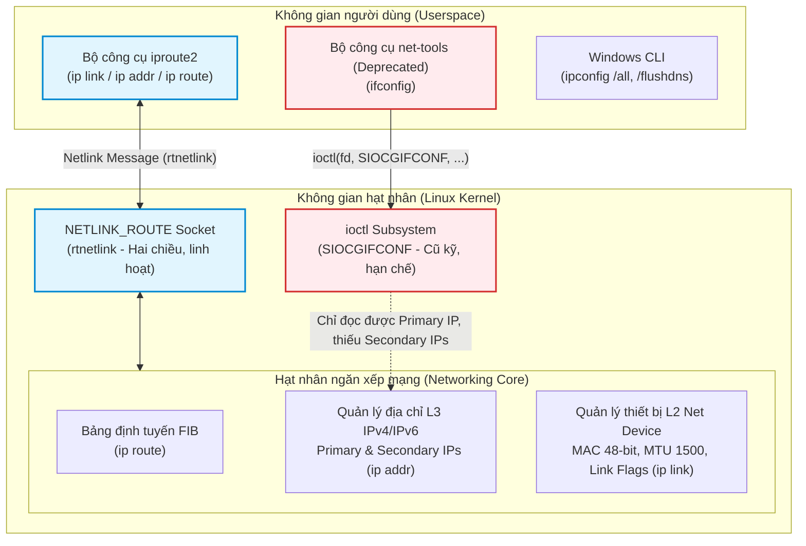
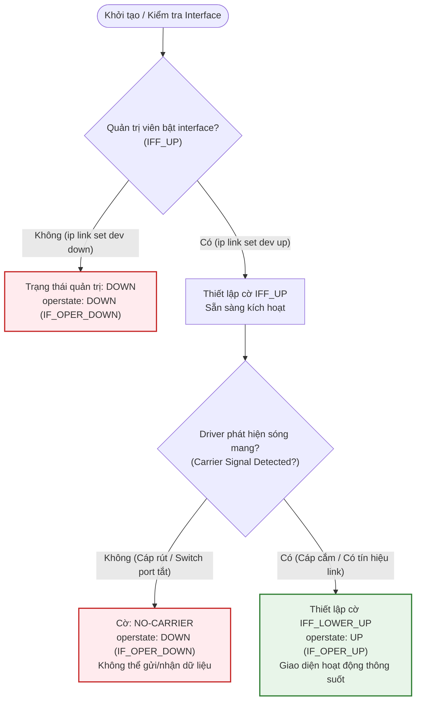

# 5_1_1 Network Interface Inspection

> **Khóa học**: Cloud DevOps Basic — Wire-Level Diagnostics  
> **Phân nhóm**: 5 Domain 5 - Wire-Level Network Inspection and Diagnostics › 5_1 Wire-Level Inspection and Diagnostic Toolkit  
> **Chủ đề**: Khảo sát trạng thái và cấu hình network interface: L2 MAC, L3 IP, Routing và so sánh iproute2 (ip link / ip addr / ip route) với ifconfig / ipconfig  
> **Trạng thái**: Draft  
> **Checklist đối chiếu**: [5_1_1](../../../CHECKLIST.md#51-wire-level-inspection-and-diagnostic-toolkit)  

---

## 1. Khái Niệm Cốt Lõi & Bản Chất Kỹ Thuật (Core Concepts & Technical Deep Dive)

Trong kiến trúc mạng Linux và hệ điều hành hiện đại, giao diện mạng (Network Interface) là điểm giao thoa giữa ngăn xếp giao thức mạng của hệ điều hành và phần cứng mạng vật lý hoặc bộ điều hợp mạng ảo (vNIC). Để vận hành và chẩn đoán sự cố wire-level chính xác, kỹ sư hệ thống cần hiểu rõ cách thức nhân hệ điều hành (Kernel) phân tách các lớp quản lý và theo dõi trạng thái của từng giao diện.

```
+-----------------------------------------------------------------------------------+
|               Kiến trúc phân tách quản trị ngăn xếp mạng Linux                    |
|                                                                                   |
|  [Tầng 3 - Network]      ip addr  --> Quản lý IPv4 / IPv6, Primary & Secondary    |
|  [Bảng định tuyến FIB]   ip route --> Quản lý Kernel Routing Table, Gateway       |
|  [Tầng 2 - Data Link]    ip link  --> Quản lý MAC (48-bit), MTU (1500), Link Flags|
+-----------------------------------------------------------------------------------+
```

---

### 1.1 Tách Biệt Trạng Thái Quản Trị và Trạng Thái Hoạt Động (RFC 2863)

Hạt nhân Linux quản lý trạng thái của một network interface bằng cách tách biệt rành mạch giữa **ý chí quản trị** của người dùng và **tín hiệu vật lý thực tế** trên đường truyền, tuân thủ tiêu chuẩn **RFC 2863 (The Interfaces Group MIB)**:

1. **Trạng thái quản trị (Administrative State — `IFF_UP`)**:
   - Được thiết lập bởi người quản trị hệ thống thông qua lệnh `ip link set <dev> up` hoặc `down`.
   - Khi cờ `IFF_UP` xuất hiện trong danh sách cờ của interface, nó chỉ biểu thị rằng kernel đã cho phép giao diện này được kích hoạt và sẵn sàng tiếp nhận hoặc truyền gói tin.
2. **Trạng thái sóng mang / vật lý (Carrier / Physical State — `IFF_LOWER_UP`)**:
   - Được điều khiển bởi trình điều khiển thiết bị (device driver) và phần cứng card mạng.
   - Khi phát hiện có tín hiệu sóng mang vật lý trên đường truyền (`carrier detected` — ví dụ cáp mạng đã cắm vào switch và switch port đang bật), driver sẽ kích hoạt cờ `IFF_LOWER_UP`.
3. **Trạng thái hoạt động thực tế (Operational State — `operstate`)**:
   - Tuân theo các định nghĩa trạng thái của RFC 2863: `IF_OPER_UP`, `IF_OPER_DOWN`.
   - Một giao diện chỉ đạt trạng thái hoạt động thực tế là `UP` (`operstate UP` / `IF_OPER_UP`) khi và chỉ khi **cả hai điều kiện** cùng thỏa mãn: quản trị viên đã bật giao diện (`IFF_UP`) VÀ phần cứng đã nhận diện được sóng mang kết nối (`IFF_LOWER_UP`).
   - Nếu quản trị viên bật giao diện (`IFF_UP`) nhưng cáp mạng bị rút hoặc cổng switch bị tắt, interface sẽ rơi vào trạng thái `NO-CARRIER` và có `operstate DOWN` (`IF_OPER_DOWN`).

---

### 1.2 Phân Tách Kiến Trúc 3 Công Cụ Của `iproute2`

Bộ công cụ tiêu chuẩn hiện đại `iproute2` trên Linux phân tách rõ ràng trách nhiệm quản lý theo từng tầng chức năng của mạng:

| Công cụ | Tầng chức năng | Đối tượng quản lý | Phạm vi kỹ thuật |
| :--- | :--- | :--- | :--- |
| **`ip link`** | **Layer 2 (Data Link)** | Network Device, Link State, MAC, MTU | Quản lý thiết bị mạng vật lý và ảo, cờ trạng thái (`IFF_UP`, `IFF_LOWER_UP`), địa chỉ vật lý MAC 48-bit (6 octets theo IEEE 802 / RFC 894), đơn vị truyền tối đa MTU (chuẩn 1500 bytes, không tính 14-byte Ethernet header và 4-byte CRC/FCS). |
| **`ip addr`** | **Layer 3 (Network)** | Protocol Addresses (IPv4 / IPv6) | Quản lý việc gán, xóa và kiểm tra địa chỉ IP trên giao diện; hỗ trợ đầy đủ gán nhiều địa chỉ IP phụ (secondary IP addresses) trên cùng một interface vật lý hoặc logic. |
| **`ip route`** | **Routing / FIB** | Kernel Routing Table (FIB) | Quản lý bảng định tuyến hạt nhân (Forwarding Information Base), xác định đường đi của gói tin qua cổng ngõ mặc định (Default Gateway) hoặc các mạng con trực tiếp. |

- Cờ `-br` (viết tắt của `-brief`): Khi kết hợp với các lệnh trên (`ip -br link`, `ip -br addr`), hệ thống sẽ xuất kết quả dưới dạng bảng tóm tắt ngắn gọn, giúp quản trị viên nắm bắt nhanh trạng thái kết nối mà không bị ngập trong các thông tin chi tiết.

---

### 1.3 Bản Chất Suy Thoái Của `ifconfig` và Ưu Thế Vượt Trội Của `iproute2`

Tiện ích truyền thống `ifconfig` (thuộc bộ công cụ cổ điển `net-tools`) hiện nay đã chính thức bị khai tử (deprecated) trên tất cả các bản phân phối Linux hiện đại vì những hạn chế cố hữu trong thiết kế kiến trúc:

- **Hạn chế của `ifconfig` qua `ioctl (SIOCGIFCONF)`**:
  - `ifconfig` tương tác với kernel thông qua các lời gọi hệ thống `ioctl` cũ kỹ, cụ thể là lệnh gọi `SIOCGIFCONF`.
  - Cơ chế này không có khả năng hiển thị nhiều địa chỉ IP phụ (secondary IPs) được gán trên cùng một network interface. Khi người quản trị gán thêm địa chỉ IP bằng cấu trúc hiện đại, `ifconfig` hoàn toàn không nhìn thấy các địa chỉ này.
  - Đồng thời, `ifconfig` không hỗ trợ các tính năng mạng nâng cao của nhân Linux hiện đại như định tuyến theo chính sách (Policy-Based Routing) hay không gian tên mạng (Network Namespaces).
- **Ưu thế của `iproute2` qua `NETLINK_ROUTE` (`rtnetlink`)**:
  - `iproute2` thay thế hoàn toàn `ioctl` bằng cơ chế giao tiếp qua socket Netlink, cụ thể là họ socket `NETLINK_ROUTE` (`rtnetlink`).
  - Giao thức Netlink cho phép tiến trình không gian người dùng (userspace) trao đổi thông điệp hai chiều với nhân Linux (kernel) một cách linh hoạt, hỗ trợ cập nhật cấu hình mạng theo thời gian thực, đọc chính xác mọi địa chỉ IP phụ, quản lý bảng định tuyến đa dạng và hoạt động độc lập trong từng network namespace.

---

### 1.4 Công Cụ Chẩn Đoán Tương Đương Trên Hệ Điều Hành Microsoft Windows

Trên môi trường Microsoft Windows, tiện ích dòng lệnh tiêu chuẩn `ipconfig` cung cấp khả năng khảo sát và điều khiển ngăn xếp TCP/IP:

- **`ipconfig /all`**: Hiển thị toàn diện cấu hình mạng tầng 2 và tầng 3 trên mọi bộ điều hợp mạng (Network Adapters), bao gồm địa chỉ MAC (Physical Address), trạng thái kích hoạt DHCP, địa chỉ IPv4/IPv6, Subnet Mask, Default Gateway và các máy chủ DNS được cấu hình.
- **`ipconfig /release`**: Gửi thông điệp giải phóng địa chỉ IP hiện tại về DHCP server, đưa cấu hình mạng về trạng thái chưa gán địa chỉ IP.
- **`ipconfig /renew`**: Khởi tạo tiến trình bắt tay với DHCP server để xin cấp mới hoặc gia hạn hợp đồng thuê (DHCP lease) địa chỉ IP.
- **`ipconfig /flushdns`**: Xóa sạch toàn bộ bộ nhớ đệm phân giải tên miền cục bộ (DNS resolver cache), buộc hệ thống phải gửi truy vấn mới tới DNS server khi phân giải tên miền.

---

## 2. Ví Dụ Đời Sống Thực Tế Dễ Hiểu (Intuitive Real-World Analogies)

### Ẩn dụ: "Trạm Gác Cổng Cơ Quan và Biển Số Nhà Bưu Chính"

Để hình dung cách hệ điều hành quản lý giao diện mạng, hãy tưởng tượng một **Trạm gác cổng cơ quan** đóng vai trò là card mạng (Network Interface):

1. **`IFF_UP` vs `IFF_LOWER_UP`: Mở barie và Con đường trước cổng**:
   - `IFF_UP` giống như việc người chỉ huy ra lệnh: *"Mở khóa thanh chắn barie cổng để đón xe!"* (Ý chí quản trị).
   - `IFF_LOWER_UP` giống như việc con đường nhựa từ ngoài quốc lộ dẫn vào cổng có thông xe hay không (Tín hiệu sóng mang vật lý — carrier).
   - Nếu thanh chắn barie đã được kéo lên sẵn sàng (`IFF_UP`), nhưng đoạn đường trước cổng bị sụt lún hoặc chưa thông xe (chưa cắm cáp mạng, `NO-CARRIER`), thì xe cộ từ bên ngoài vẫn hoàn toàn không thể đi vào cơ quan. Khi đó, trạm gác cổng vẫn ở trạng thái đóng đối với lưu thông thực tế (`operstate DOWN`). Cổng chỉ thực sự đi vào hoạt động (`operstate UP`) khi barie vừa mở (`IFF_UP`) và con đường phía trước vừa thông suốt (`IFF_LOWER_UP`).
2. **`ip link`, `ip addr`, `ip route`: Khung sắt, Tấm biển tên và Bản đồ điều hướng**:
   - `ip link` (Tầng 2): Kiểm tra kết cấu cơ khí của cánh cổng: số hiệu khung sắt được khắc chìm cố định khi xuất xưởng (Địa chỉ MAC 48-bit) và chiều rộng tối đa của lối vào cổng là 1.5 mét (MTU tiêu chuẩn 1500 bytes).
   - `ip addr` (Tầng 3): Kiểm tra các tấm biển số nhà logic treo trên cổng. Trên cùng một cánh cổng cơ quan, người ta có thể treo một biển số nhà chính đại diện cho tòa nhà, đồng thời treo thêm 2 tấm biển số phụ cho các đơn vị trực thuộc thuê chung trụ sở (Secondary IPs).
   - `ip route`: Tấm bản đồ điều hướng lớn dựng ngay trong sân cổng: xe muốn đi giao hàng sang Tòa nhà B thì rẽ lối nào, xe muốn đi ra các tỉnh ngoài thì bắt buộc phải chạy qua Trạm thu phí ngã ba trung tâm nào (Default Gateway).
3. **`ifconfig` vs `iproute2`: Người gác cổng thời xưa và Hệ thống giám sát số hóa**:
   - `ifconfig`: Giống như một nhân viên gác cổng lớn tuổi nhìn ra ngoài qua một khe cửa sổ hẹp (`ioctl SIOCGIFCONF`). Người này chỉ có thể đọc được tấm biển số nhà đầu tiên treo trên cổng; nếu cơ quan gắn thêm 3 biển tên phụ, người gác cổng này hoàn toàn không thấy và báo cáo sai rằng cơ quan chỉ có duy nhất một tên gọi.
   - `iproute2`: Giống như một hệ thống camera thông minh kết nối cáp quang trực tiếp về trung tâm điều khiển (`Netlink socket NETLINK_ROUTE`), lập tức hiển thị đầy đủ mọi biển tên chính phụ, trạng thái cảm biến barie và toàn bộ sơ đồ lưu thông xe cộ.

---

## 3. Kiến Trúc, Luồng Hoạt Động & Hình Ảnh Trực Quan (Architecture, Diagrams & Visual Media)

### Kiến Trúc Giao Tiếp Kernel: `iproute2` (`rtnetlink`) vs `ifconfig` (`ioctl`)



---

### Sơ Đồ Đánh Giá Trạng Thái Hoạt Động Của Giao Diện (RFC 2863)



---

## 4. Thực Hành (Hands-on)

> ⚠️ Lệnh và đầu ra mẫu minh họa hệ thống Linux/Windows

### 4.1 Khảo Sát Tầng Liên Kết (L2) Bằng `ip link`

Tiện ích `ip link` cung cấp khả năng kiểm tra trực tiếp trạng thái phần cứng, cờ liên kết và địa chỉ vật lý tầng 2.

#### Bước 1: Liệt kê chi tiết cấu hình tầng liên kết
```bash
ip link show eth0
```
*Đầu ra mẫu minh họa:*
```text
2: eth0: <BROADCAST,MULTICAST,UP,LOWER_UP> mtu 1500 qdisc fq_codel state UP mode DEFAULT group default qlen 1000
    link/ether 52:54:00:12:34:56 brd ff:ff:ff:ff:ff:ff
```

*Phân tích các trường thông tin kỹ thuật:*
- `<BROADCAST,MULTICAST,UP,LOWER_UP>`: Tập hợp các cờ trạng thái của interface.
  - `UP`: Cờ quản trị `IFF_UP`, giao diện đã được bật bởi quản trị viên.
  - `LOWER_UP`: Cờ tầng vật lý `IFF_LOWER_UP`, driver đã phát hiện tín hiệu sóng mang cáp mạng.
- `mtu 1500`: Đơn vị truyền tải tối đa Ethernet tiêu chuẩn là 1500 bytes (chưa bao gồm 14-byte Ethernet header và 4-byte CRC/FCS).
- `state UP`: Trạng thái hoạt động (`operstate`) tuân theo RFC 2863 đang ở mức `IF_OPER_UP`.
- `link/ether 52:54:00:12:34:56`: Địa chỉ MAC phần cứng 48-bit (gồm 6 octets) tuân thủ tiêu chuẩn IEEE 802 / RFC 894.

#### Bước 2: Hiển thị nhanh dạng bảng tóm tắt với cờ `-br` (`-brief`)
```bash
ip -br link
```
*Đầu ra mẫu minh họa:*
```text
lo               UNKNOWN        00:00:00:00:00:00 <LOOPBACK,UP,LOWER_UP> 
eth0             UP             52:54:00:12:34:56 <BROADCAST,MULTICAST,UP,LOWER_UP> 
eth1             DOWN           52:54:00:ab:cd:ef <NO-CARRIER,BROADCAST,MULTICAST,UP> 
```
*(Giao diện `eth1` minh họa tình huống quản trị viên đã bật `UP` nhưng dây cáp chưa cắm nên cờ là `NO-CARRIER` và trạng thái thực tế là `DOWN`).*

---

### 4.2 Khảo Sát Tầng Mạng (L3) Bằng `ip addr`

Tiện ích `ip addr` quản lý các địa chỉ giao thức logic (IPv4/IPv6) được gắn vào giao diện.

#### Bước 1: Kiểm tra cấu hình địa chỉ IP chi tiết
```bash
ip addr show eth0
```
*Đầu ra mẫu minh họa:*
```text
2: eth0: <BROADCAST,MULTICAST,UP,LOWER_UP> mtu 1500 qdisc fq_codel state UP group default qlen 1000
    link/ether 52:54:00:12:34:56 brd ff:ff:ff:ff:ff:ff
    inet 192.168.1.50/24 brd 192.168.1.255 scope global dynamic eth0
       valid_lft 86320sec preferred_lft 86320sec
    inet 192.168.1.200/24 scope global secondary eth0
       valid_lft forever preferred_lft forever
    inet6 fe80::5054:ff:fe12:3456/64 scope link 
       valid_lft forever preferred_lft forever
```

*Phân tích các trường thông tin kỹ thuật:*
- `inet 192.168.1.50/24`: Địa chỉ IPv4 chính (Primary IP) cùng độ dài tiền tố mạng `/24` (Subnet Mask tương đương `255.255.255.0`).
- `inet 192.168.1.200/24 secondary eth0`: Địa chỉ IP phụ (Secondary IP) được gán trên cùng interface `eth0`. Đây chính là đặc tính mà công cụ cổ điển `ifconfig` không thể nhận diện được qua `ioctl`.
- `inet6 fe80::.../64 scope link`: Địa chỉ IPv6 Link-Local tự động cấu hình.

#### Bước 2: Hiển thị nhanh bảng địa chỉ IP với cờ `-br`
```bash
ip -br addr
```
*Đầu ra mẫu minh họa:*
```text
lo               UNKNOWN        127.0.0.1/8 ::1/128 
eth0             UP             192.168.1.50/24 192.168.1.200/24 fe80::5054:ff:fe12:3456/64 
```

---

### 4.3 Khảo Sát Bảng Định Tuyến Hạt Nhân Bằng `ip route`

Tiện ích `ip route` cho phép quan sát trực tiếp bảng chuyển tiếp gói tin (FIB) trong nhân Linux.

#### Kiểm tra các tuyến định tuyến hiện hành
```bash
ip route show
```
*Đầu ra mẫu minh họa:*
```text
default via 192.168.1.1 dev eth0 proto dhcp src 192.168.1.50 metric 100 
192.168.1.0/24 dev eth0 proto kernel scope link src 192.168.1.50 metric 100 
```

*Phân tích các thành phần định tuyến:*
- `default via 192.168.1.1 dev eth0`: Tuyến đường mặc định (Default Route). Mọi gói tin có địa chỉ đích không nằm trong mạng cục bộ sẽ được chuyển tiếp tới Default Gateway có địa chỉ `192.168.1.1` thông qua giao diện `eth0`.
- `192.168.1.0/24 dev eth0 proto kernel scope link src 192.168.1.50`: Tuyến đường kết nối trực tiếp (Directly Connected Route) cho dải mạng nội bộ L2.

---

### 4.4 Khảo Sát và Điều Khiển TCP/IP Trên Microsoft Windows Bằng `ipconfig`

Trên hệ điều hành Windows, tiện ích `ipconfig` là công cụ hàng đầu để kiểm tra và xử lý sự cố mạng.

#### Bước 1: Khảo sát toàn diện cấu hình L2 và L3
```cmd
ipconfig /all
```
*Đầu ra mẫu minh họa:*
```text
Windows IP Configuration

   Host Name . . . . . . . . . . . . : WIN-DESKTOP
   Primary Dns Suffix  . . . . . . . : 
   Node Type . . . . . . . . . . . . : Hybrid
   IP Routing Enabled. . . . . . . . : No
   WINS Proxy Enabled. . . . . . . . : No

Ethernet adapter Ethernet0:

   Connection-specific DNS Suffix  . : localdomain
   Description . . . . . . . . . . . : Intel(R) 82574L Gigabit Network Connection
   Physical Address. . . . . . . . . : 00-15-5D-01-AA-BB
   DHCP Enabled. . . . . . . . . . . : Yes
   Autoconfiguration Enabled . . . . : Yes
   IPv4 Address. . . . . . . . . . . : 192.168.1.100(Preferred) 
   Subnet Mask . . . . . . . . . . . : 255.255.255.0
   Lease Obtained. . . . . . . . . . : Saturday, November 14, 2026 8:00:00 AM
   Lease Expires . . . . . . . . . . : Sunday, November 15, 2026 8:00:00 AM
   Default Gateway . . . . . . . . . : 192.168.1.1
   DHCP Server . . . . . . . . . . . : 192.168.1.1
   DNS Servers . . . . . . . . . . . : 192.168.1.1
                                       8.8.8.8
```

#### Bước 2: Giải phóng và xin cấp lại DHCP Lease khi chuyển mạng
Khi máy trạm chuyển đổi vùng mạng hoặc gặp xung đột IP:
```cmd
:: Giải phóng địa chỉ IP hiện thời
ipconfig /release

:: Yêu cầu máy chủ DHCP cấp phát lại địa chỉ mới
ipconfig /renew
```

#### Bước 3: Xóa sạch bộ nhớ đệm DNS cục bộ (Flush DNS Cache)
Khi máy chủ đích thay đổi IP nhưng máy trạm vẫn truy cập địa chỉ IP cũ do DNS cache còn lưu:
```cmd
ipconfig /flushdns
```
*Đầu ra mẫu minh họa:*
```text
Windows IP Configuration

Successfully flushed the DNS Resolver Cache.
```

---

## 5. Cạm Bẫy Thực Tế & Thực Tiễn Sản Xuất (Production Gotchas & Best Practices)

### 5.1 Cạm Bẫy "Cờ UP nhưng mạng sập": Phân biệt `IFF_UP` và `operstate DOWN`
- **Bản chất sự cố**: Khi kiểm tra bằng lệnh `ip link`, nhiều kỹ sư thấy chữ `UP` nằm trong khối cờ `<NO-CARRIER,BROADCAST,MULTICAST,UP>` và vội vàng kết luận interface đã hoạt động bình thường. Tuy nhiên, gói tin truyền qua interface này vẫn bị rụng hoàn toàn.
- **Nguyên nhân**: Chữ `UP` nằm trong ngoặc nhọn thực chất chỉ là cờ quản trị `IFF_UP` (quản trị viên đã chạy lệnh kích hoạt). Khi nhìn sang trường `state`, giá trị thực tế lại là `DOWN` kèm theo cờ `NO-CARRIER` (do cáp mạng bị lỏng, chưa cắm, hoặc vSwitch port của máy ảo bị ngắt kết nối).
- **Thực tiễn sản xuất**: Luôn kiểm tra trường `state UP` (tương ứng `operstate UP` theo RFC 2863) và sự hiện diện của cờ `LOWER_UP` trước khi khẳng định tầng vật lý đã sẵn sàng. Sử dụng `ip -br link` để quan sát nhanh cột trạng thái rõ ràng (`UP` vs `DOWN`).

### 5.2 Cạm Bẫy Sử Dụng `ifconfig` Trong Script Tự Động Hóa
- **Bản chất sự cố**: Các script bash hoặc hệ thống giám sát cũ sử dụng câu lệnh `ifconfig eth0` để bóc tách địa chỉ IP máy chủ nhằm đăng ký vào Service Discovery hoặc cấu hình Nginx/HAProxy.
- **Hậu quả**: Khi hạ tầng triển khai nhiều địa chỉ IP phụ (secondary IPs) trên cùng một interface bằng `ip addr add 192.168.1.200/24 dev eth0`, `ifconfig` do sử dụng `ioctl (SIOCGIFCONF)` sẽ hoàn toàn không nhìn thấy địa chỉ thứ hai này. Hậu quả là dịch vụ không thể bind vào secondary IP hoặc script báo cáo thiếu IP máy chủ.
- **Thực tiễn sản xuất**: Tuyệt đối loại bỏ `ifconfig` khỏi toàn bộ mã nguồn DevOps, tài liệu vận hành và Dockerfile. Thay thế hoàn toàn bằng `ip -br addr show` hoặc `ip -json addr show` kết hợp công cụ phân tích JSON (`jq`) để đảm bảo tính chính xác và nhất quán.

### 5.3 Sự Cố Lệch MTU (MTU Mismatch) So Với Chuẩn Ethernet 1500 Bytes
- **Bản chất sự cố**: Đơn vị truyền tải tối đa tiêu chuẩn của khung Ethernet theo RFC 894 là 1500 bytes (chưa bao gồm 14-byte Ethernet header và 4-byte CRC/FCS trailer). Trong các hệ thống mạng overlay (như VXLAN, Geneve) hoặc kết nối VPN, nếu kỹ sư không tính toán phần overhead đóng gói thêm của header mà vẫn để MTU là 1500 bytes, hoặc cấu hình không đồng nhất giữa hai đầu router/host, gói tin vượt kích thước sẽ bị phân mảnh hoặc bị drop âm thầm nếu cờ DF (Don't Fragment) được bật.
- **Thực tiễn sản xuất**: Luôn kiểm tra trường `mtu` trong đầu ra của `ip link show` trên tất cả các interface tham gia vào chuỗi truyền dẫn mạng để đảm bảo tính đồng nhất trên toàn tuyến.

---

## 6. Câu Hỏi Củng Cố Kiến Thức (Active Recall Quiz)

### Câu hỏi 1:
Khi kiểm tra một máy chủ Linux sau sự cố mạng, kỹ sư nhận được dòng kết quả sau từ lệnh `ip link show eth1`:
```text
3: eth1: <NO-CARRIER,BROADCAST,MULTICAST,UP> mtu 1500 qdisc fq_codel state DOWN mode DEFAULT group default qlen 1000
    link/ether 52:54:00:88:99:aa brd ff:ff:ff:ff:ff:ff
```
Hãy phân tích sự khác nhau giữa từ khóa `UP` trong cặp ngoặc nhọn `<...>` và từ khóa `state DOWN` theo tiêu chuẩn RFC 2863. Nguyên nhân thực tế nào dẫn tới hiện tượng này?

<details>
<summary>Đáp án chi tiết</summary>

- **Phân tích kỹ thuật**:
  - Từ khóa `UP` nằm trong cặp ngoặc nhọn đại diện cho cờ quản trị **`IFF_UP`** (Administrative State). Điều này chứng minh quản trị viên đã thực hiện lệnh bật giao diện mạng (`ip link set eth1 up`).
  - Từ khóa `state DOWN` đại diện cho trạng thái hoạt động thực tế (**Operational State — `operstate`**) tuân theo tiêu chuẩn **RFC 2863** (`IF_OPER_DOWN`).
  - Sự xuất hiện của cờ **`NO-CARRIER`** và sự vắng mặt của cờ `LOWER_UP` chỉ ra rằng driver card mạng không phát hiện được tín hiệu sóng mang vật lý trên đường truyền (`carrier detected`).
- **Nguyên nhân thực tế**: Cáp mạng vật lý chưa được cắm vào cổng card mạng, cáp bị đứt, cổng switch kết nối phía đối diện đang ở trạng thái shutdown, hoặc trên môi trường ảo hóa (VMware/KVM) cáp mạng ảo của vNIC đang bị ngắt kết nối (unplugged/disconnected).

</details>

---

### Câu hỏi 2:
Tại sao tiện ích `ifconfig` thuộc gói `net-tools` bị khai tử (deprecated) và không còn được khuyến nghị sử dụng trên các hệ thống Linux hiện đại? Hãy chỉ ra một tình huống cụ thể trong quản trị hệ thống mà việc sử dụng `ifconfig` sẽ dẫn đến sai lệch thông tin cấu hình mạng.

<details>
<summary>Đáp án chi tiết</summary>

- **Bản chất kiến trúc**: `ifconfig` sử dụng cơ chế giao tiếp cũ thông qua các lệnh gọi hệ thống `ioctl` (cụ thể là `SIOCGIFCONF`). Cơ chế này không hỗ trợ kiến trúc mạng hiện đại của nhân Linux như Network Namespaces, Policy-Based Routing, và đặc biệt là không thể hiển thị nhiều địa chỉ IP phụ (secondary IPs) cùng tồn tại trên một network interface. Ngược lại, bộ công cụ `iproute2` (`ip link`, `ip addr`, `ip route`) giao tiếp với kernel qua kênh socket **`NETLINK_ROUTE` (`rtnetlink`)**, phản ánh trung thực và toàn diện toàn bộ ngăn xếp mạng của nhân Linux.
- **Tình huống sai lệch thực tế**: Khi người quản trị gán thêm một địa chỉ IP thứ hai lên giao diện bằng lệnh `ip addr add 192.168.1.200/24 dev eth0`, nếu một script tự động hóa chạy lệnh `ifconfig eth0`, kết quả xuất ra sẽ chỉ hiển thị địa chỉ IP ban đầu (primary IP) mà hoàn toàn bỏ qua địa chỉ `192.168.1.200`, gây sai sót nghiêm trọng cho các ứng dụng bóc tách IP tự động.

</details>

---

### Câu hỏi 3:
Một nhân viên văn phòng sử dụng máy tính Windows vừa di chuyển từ tầng 2 (sử dụng dải mạng `192.168.2.0/24`) xuống làm việc tại tầng 1 (sử dụng dải mạng `192.168.1.0/24`). Mặc dù đã cắm cáp mạng LAN tại tầng 1, máy tính vẫn không thể vào được mạng Internet và khi truy cập hệ thống kế toán nội bộ `acc.corp.local` thì trình duyệt vẫn cố kết nối tới địa chỉ IP cũ ở tầng 2. Bạn sẽ sử dụng chuỗi lệnh `ipconfig` nào để xử lý triệt để sự cố này và giải thích tác dụng của từng lệnh?

<details>
<summary>Đáp án chi tiết</summary>

Chuỗi lệnh cần thực hiện trong Command Prompt (hoặc PowerShell):

1. **`ipconfig /release`**:
   - *Tác dụng*: Giải phóng địa chỉ IP cũ (`192.168.2.x`) và các thông số mạng của hợp đồng thuê DHCP cũ tại tầng 2, đưa adapter về trạng thái chưa gán cấu hình IP.
2. **`ipconfig /renew`**:
   - *Tác dụng*: Gửi thông điệp yêu cầu DHCP Discover/Request tới máy chủ DHCP tại tầng 1 để xin cấp phát địa chỉ IP mới thuộc dải `192.168.1.0/24`, đồng thời nhận lại Default Gateway và DNS Server chính xác của tầng 1.
3. **`ipconfig /flushdns`**:
   - *Tác dụng*: Xóa sạch toàn bộ bộ nhớ đệm phân giải tên miền cục bộ (DNS Resolver Cache) trên Windows. Thao tác này loại bỏ bản ghi phân giải cũ của `acc.corp.local` đang trỏ tới IP cũ, buộc hệ thống phải gửi truy vấn mới tới DNS server để lấy địa chỉ IP chính xác hiện tại.
4. **`ipconfig /all`**:
   - *Tác dụng*: Kiểm tra lại toàn bộ cấu hình mạng sau khi làm mới để xác nhận địa chỉ IP, Subnet Mask, Gateway và DNS Server đã được cập nhật chuẩn xác.

</details>

---

## 7. 📚 Nguồn Tài Liệu Chính Thống (Tier-1 Official References)

- [RFC 894: A Standard for the Transmission of IP Datagrams over Ethernet Networks](https://datatracker.ietf.org/doc/html/rfc894) — Tiêu chuẩn chính thức của IETF về đóng gói gói tin IP trên mạng Ethernet và quy định MTU 1500 bytes.
- [RFC 2863: The Interfaces Group MIB](https://datatracker.ietf.org/doc/html/rfc2863) — Tiêu chuẩn định nghĩa trạng thái quản trị (`ifAdminStatus`) và trạng thái hoạt động thực tế (`ifOperStatus`) của các giao diện mạng.
- [Linux Kernel Manual - ip(8)](https://man7.org/linux/man-pages/man8/ip.8.html) — Hướng dẫn tra cứu cú pháp và kiến trúc tổng thể của bộ công cụ quản trị mạng `iproute2`.
- [Linux Kernel Manual - ip-link(8)](https://man7.org/linux/man-pages/man8/ip-link.8.html) — Hướng dẫn chi tiết về cấu hình thiết bị mạng tầng 2, cờ liên kết và MTU.
- [Linux Kernel Manual - ip-address(8)](https://man7.org/linux/man-pages/man8/ip-address.8.html) — Tài liệu quản lý địa chỉ giao thức L3 IPv4/IPv6 và các địa chỉ IP phụ (secondary IPs).
- [Linux Kernel Manual - ip-route(8)](https://man7.org/linux/man-pages/man8/ip-route.8.html) — Tài liệu quản trị bảng định tuyến hạt nhân Linux và Default Gateway.
- [Linux Kernel Documentation - Operational States](https://docs.kernel.org/networking/operstates.html) — Tài liệu chính thức từ Linux Kernel giải thích cơ chế chuyển đổi các trạng thái hoạt động `operstate`.
- [Linux Kernel Manual - netlink(7)](https://man7.org/linux/man-pages/man7/netlink.7.html) — Đặc tả giao thức Netlink socket trong nhân Linux dùng cho giao tiếp hai chiều kernel/userspace.
- [Linux Kernel Manual - rtnetlink(7)](https://man7.org/linux/man-pages/man7/rtnetlink.7.html) — Tài liệu chi tiết về gói tin và subsystem rtnetlink (NETLINK_ROUTE).
- [Microsoft Learn: ipconfig command reference](https://learn.microsoft.com/en-us/windows-server/administration/windows-commands/ipconfig) — Tài liệu chính thức từ Microsoft Learn hướng dẫn cú pháp và các tham số điều khiển của tiện ích `ipconfig` trên Windows Server.
