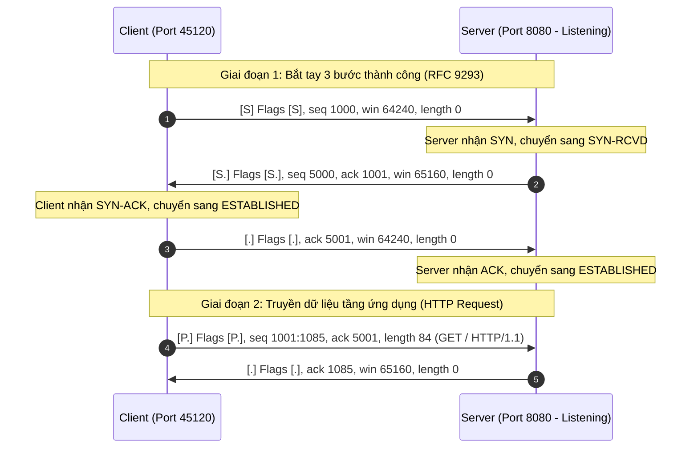
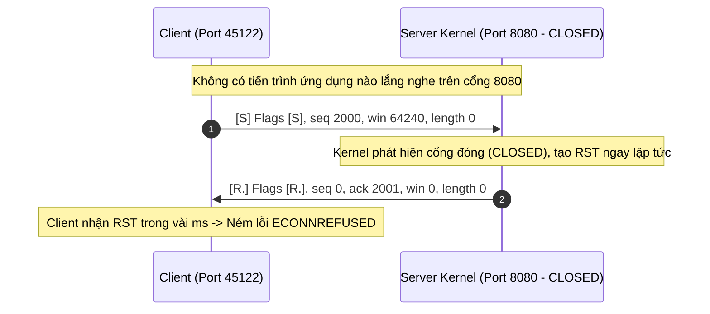
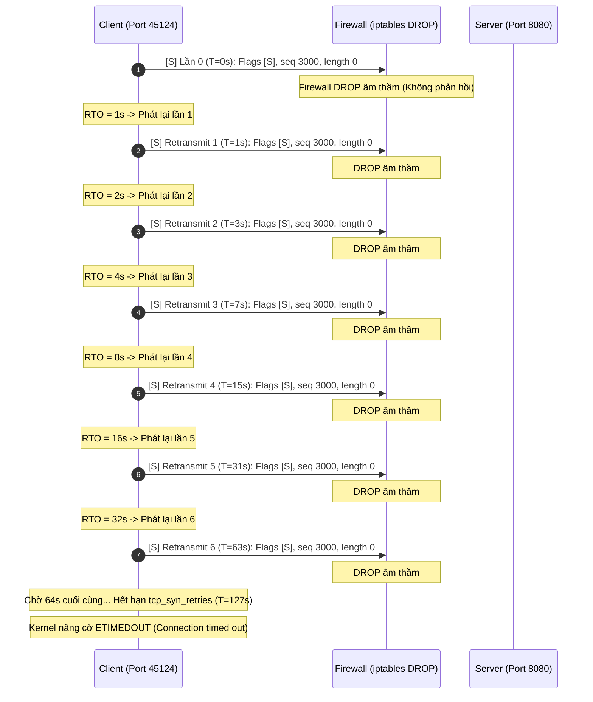

# 5_1_10 Wire-Level Troubleshooting Scenarios

> **Khóa học**: Cloud DevOps Basic — Wire-Level Diagnostics  
> **Phân nhóm**: 5 Domain 5 - Wire-Level Network Inspection and Diagnostics › 5_1 Wire-Level Inspection and Diagnostic Toolkit  
> **Chủ đề**: Kịch bản xử lý sự cố mạng wire-level: Bắt gói bắt tay 3 bước, phân biệt triệt để Connection Refused (RST) vs Connection Timed Out (Firewall DROP) và No Route to Host  
> **Trạng thái**: Draft  
> **Checklist đối chiếu**: [5_1_10](../../../CHECKLIST.md#51-wire-level-inspection-and-diagnostic-toolkit)  

---

## 1. Khái Niệm Cốt Lõi & Bản Chất Kỹ Thuật (Core Concepts & Technical Deep Dive)

Trong vận hành hệ thống phân tán và hạ tầng Cloud, sự cố kết nối mạng giữa các dịch vụ (microservices, database, caching layer, API gateway) thường biểu hiện ở tầng ứng dụng qua các thông báo lỗi kinh điển:
- `Connection refused` (`ECONNREFUSED`)
- `Connection timed out` (`ETIMEDOUT`)
- `No route to host` (`EHOSTUNREACH` hoặc `ENETUNREACH`)

Nếu chỉ dựa vào log ứng dụng cấp cao, kỹ sư vận hành sẽ rất dễ rơi vào bế tắc hoặc chẩn đoán sai lệch. Bằng cách quan sát trực tiếp dòng khung tin trên card mạng (Wire-Level Inspection), ta có thể giải mã chính xác bản chất ngăn xếp mạng TCP/IP đang diễn ra ở tầng liên kết dữ liệu (L2), tầng mạng (L3) và tầng giao vận (L4).

---

### 1.1 Quá Trình Bắt Tay 3 Bước TCP (TCP 3-Way Handshake) & Quy Ước Cờ Trong tcpdump

Theo tiêu chuẩn **RFC 9293** (Transmission Control Protocol), thủ tục tiêu chuẩn để thiết lập một kết nối TCP tin cậy giữa hai tiến trình là quá trình bắt tay 3 bước (Three-Way Handshake):

```
+-------------------------------------------------------------------------------+
|                       TCP 3-Way Handshake (RFC 9293)                          |
|                                                                               |
|       Client                                                 Server           |
|         |                                                      |              |
|         |  (1) SYN [S], Seq=X                                  |              |
|         |----------------------------------------------------->| (SYN-RCVD)   |
|         |                                                      |              |
|         |  (2) SYN-ACK [S.], Seq=Y, Ack=X+1                    |              |
|         |<-----------------------------------------------------|              |
|         |                                                      |              |
|         |  (3) ACK [.], Seq=X+1, Ack=Y+1                       |              |
|         |----------------------------------------------------->| (ESTABLISHED)|
|         |                                                      |              |
|   (ESTABLISHED)                                                |              |
+-------------------------------------------------------------------------------+
```

1. **Bước 1 (SYN)**: Máy khách (Client) khởi tạo kết nối bằng cách truyền một segment mang cờ `SYN` (Synchronize) với một số thứ tự khởi tạo ngẫu nhiên (Initial Sequence Number — `ISN = X`). Socket phía client chuyển sang trạng thái `SYN-SENT`.
2. **Bước 2 (SYN-ACK)**: Máy chủ (Server), khi đang có tiến trình lắng nghe trên cổng đích (trạng thái `LISTEN`), tiếp nhận yêu cầu và phản hồi bằng một segment mang đồng thời hai cờ `SYN` và `ACK`. Segment này chứa số thứ tự của server (`ISN = Y`) và trường xác nhận (`Acknowledgment = X + 1`). Socket phía server chuyển sang trạng thái `SYN-RECEIVED`.
3. **Bước 3 (ACK)**: Máy khách nhận được SYN-ACK, chuyển socket sang trạng thái `ESTABLISHED`, và gửi lại gói tin xác nhận mang cờ `ACK` với trường xác nhận (`Acknowledgment = Y + 1`). Khi máy chủ nhận được gói ACK này, socket phía máy chủ cũng chuyển sang trạng thái `ESTABLISHED`. Từ thời điểm này, hai bên bắt đầu trao đổi dữ liệu tầng ứng dụng (Application Data).

#### Bảng Ký Hiệu Cờ TCP (TCP Flags Notation) Trong tcpdump

Khi thu thập gói tin bằng tiện ích `tcpdump`, các cờ điều khiển trong trường 16-bit của TCP Header (byte offset 13) được mã hóa theo các ký tự đại diện chuẩn hóa:

| Ký hiệu tcpdump | Tên Cờ TCP | Ý Nghĩa Kỹ Thuật (RFC 9293 / tcpdump Manual) |
| :--- | :--- | :--- |
| **`[S]`** | **SYN** (Synchronize) | Khởi tạo yêu cầu đồng bộ số thứ tự kết nối TCP mới. |
| **`[S.]`** | **SYN-ACK** | Phản hồi từ máy chủ: Vừa đồng bộ số thứ tự của server (`S`), vừa xác nhận đã nhận gói SYN của client (`.`). |
| **`[.]`** | **ACK** (Acknowledgment) | Gói xác nhận độc lập (không kèm SYN, FIN hay RST). Dấu chấm `.` đại diện cho cờ ACK. |
| **`[P.]`** | **PSH-ACK** (Push + ACK) | Báo hiệu cho ngăn xếp TCP lập tức đẩy toàn bộ dữ liệu trong bộ đệm lên tiến trình ứng dụng mà không cần chờ đầy buffer. |
| **`[F.]`** | **FIN-ACK** (Finish + ACK) | Khởi tạo thủ tục đóng một chiều kết nối TCP (Graceful Termination) kèm xác nhận. |
| **`[R]`** | **RST** (Reset) | Hủy bỏ kết nối ngay lập tức do lỗi bất thường hoặc từ chối kết nối. |
| **`[R.]`** | **RST-ACK** (Reset + ACK) | Gói tin Reset kèm cờ xác nhận, thường dùng khi từ chối một gói tin không hợp lệ hoặc cổng đóng. |

---

### 1.2 Phân Biệt Bản Chất: "Connection Refused" (TCP RST) vs "Connection Timed Out" (Firewall DROP)

Đây là ranh giới kỹ thuật quan trọng nhất trong chẩn đoán mạng wire-level. Hai lỗi này thể hiện hai trạng thái hạ tầng hoàn toàn trái ngược nhau:

```
+-------------------------------------------------------------------------------+
|         Phân Biệt Wire-Level: Connection Refused vs Connection Timed Out      |
|                                                                               |
|  KỊCH BẢN A: CONNECTION REFUSED (Cổng đích đóng - Host đích phản hồi RST)     |
|                                                                               |
|  Client                                           Server (Port Not Listening) |
|    |                                                          |               |
|    |  (1) SYN [S]                                             |               |
|    |--------------------------------------------------------->| (Kernel Stack)|
|    |                                                          | (No Socket!)  |
|    |  (2) RST [R] hoặc RST-ACK [R.] (Tức thì ~1-2ms)          |               |
|    |<---------------------------------------------------------|               |
|    v                                                                          |
|  [Lỗi ECONNREFUSED lập tức!]                                                  |
|                                                                               |
|  ---------------------------------------------------------------------------  |
|                                                                               |
|  KỊCH BẢN B: CONNECTION TIMED OUT (Tường lửa DROP - Hố đen âm thầm)           |
|                                                                               |
|  Client                         Firewall / Security Group         Server      |
|    |                                    |                           |         |
|    |  (1) SYN [S]                       |                           |         |
|    |----------------------------------->| (DROP / Black hole)       |         |
|    |                                    X (Biến mất âm thầm)        |         |
|    |  ... chờ RTO (1s) ...              |                           |         |
|    |  (2) SYN Retransmit [S]            |                           |         |
|    |----------------------------------->| (DROP)                    |         |
|    |  ... chờ RTO (2s, 4s, 8s, 16s...)  |                           |         |
|    |  (3) SYN Retransmit lần 3, 4, 5, 6 |                           |         |
|    |----------------------------------->|                           |         |
|    v                                                                          |
|  [Hết tcp_syn_retries (~127 giây) -> Báo lỗi ETIMEDOUT]                       |
+-------------------------------------------------------------------------------+
```

#### 1. Kịch bản "Connection Refused" (`ECONNREFUSED`):
- **Cơ chế**: Máy khách gửi gói tin `SYN` tới địa chỉ IP đích. Gói tin đi qua toàn bộ hạ tầng mạng thông suốt, vượt qua mọi tường lửa và tới được card mạng của máy chủ đích.
- **Hành vi của Kernel**: Ngăn xếp mạng nhân Linux (TCP Stack) của máy chủ đích tiếp nhận gói tin và kiểm tra bảng tra cứu socket nội bộ. Do **không có tiến trình nào đang mở socket ở trạng thái `LISTEN`** trên cổng đích đó (trạng thái `CLOSED` theo RFC 9293 mục 3.5), nhân hệ điều hành ngay lập tức tự động sinh ra một gói tin mang cờ **`RST`** hoặc **`RST-ACK`** gửi ngược lại cho client.
- **Kết quả**: Client nhận được gói RST trong thời gian chỉ tính bằng Round-Trip Time (vài mili-giây). Socket của client bị hủy ngay tức khắc và hàm hệ thống `connect()` trả về mã lỗi `-1` với `errno = ECONNREFUSED`.
- **Kết luận chẩn đoán**: **Hạ tầng mạng hoàn toàn thông suốt, máy chủ đích đang hoạt động bình thường**, nhưng dịch vụ ứng dụng (Nginx, MySQL, API Daemon...) chưa được khởi chạy hoặc đang bind sai cổng/sai địa chỉ IP.

#### 2. Kịch bản "Connection Timed Out" (`ETIMEDOUT`):
- **Cơ chế**: Máy khách phát gói tin `SYN`. Trên hành trình di chuyển, gói tin gặp phải một thiết bị lọc gói (Tường lửa iptables, nftables, AWS Security Group, Azure Network Security Group, Hardware Firewall) có chính sách áp dụng hành động **`DROP`**.
- **Hành vi của Tường lửa**: Thiết bị tường lửa âm thầm tiêu hủy gói tin (silently discard) vào "hố đen" mà không hề tạo ra bất kỳ gói tin phản hồi nào gửi ngược lại máy khách.
- **Hành vi của Client**: Ngăn xếp TCP của máy khách rơi vào trạng thái chờ đợi. Không thấy gói `SYN-ACK` và cũng không thấy gói `RST`, client giả định gói tin bị thất lạc trên đường truyền và kích hoạt bộ đếm thời gian phát lại (Retransmission Timer) theo cơ chế lùi lũy thừa (Exponential Backoff).
- **Kết quả**: Client liên tục phát lại gói SYN sau các khoảng thời gian tăng dần gấp đôi. Cho đến khi số lần thử lại chạm giới hạn tối đa của hệ điều hành, hàm `connect()` mới chịu đầu hàng và trả về lỗi `errno = ETIMEDOUT`. Quá trình này thường kéo dài từ vài chục giây đến hơn hai phút.
- **Kết luận chẩn đoán**: **Gói tin bị chặn đứng trên đường truyền hoặc máy chủ đích bị sập nguồn hoàn toàn** không kịp phản hồi.

---

### 1.3 Cơ Chế Phát Lại Gói Tin SYN & Tham Số Hạt Nhân `tcp_syn_retries`

Trong nhân Linux, hành vi và thời gian chờ của quá trình bắt tay được kiểm soát chặt chẽ bởi hệ thống tham số sysctl của ngăn xếp mạng IPv4:

- **Đường dẫn tham số**: `/proc/sys/net/ipv4/tcp_syn_retries` (hoặc lệnh `sysctl net.ipv4.tcp_syn_retries`).
- **Ý nghĩa kỹ thuật** (theo tài liệu Linux Kernel `ip-sysctl.html`): Số lần tối đa mà nhân Linux sẽ phát lại gói tin `SYN` khởi tạo ban đầu cho một kết nối TCP chiều đi (Active Connection Attempt) trước khi từ bỏ và trả về lỗi `ETIMEDOUT`.
- **Giá trị mặc định**: Giá trị mặc định trên hầu hết các bản phân phối Linux (Ubuntu, Debian, RHEL, Rocky Linux) là **`6`**.

#### Chuỗi Thời Gian Chờ Lũy Thừa (Exponential Backoff Progression)

Theo chuẩn RFC 9293 mục 3.8.1, khoảng thời gian chờ phát lại (Retransmission Timeout — RTO) cho các gói SYN ban đầu tuân theo thuật toán nhân đôi thời gian chờ sau mỗi lần thất bại:

| Lần Gửi | Bản Tin Trên Wire | Thời Gian Chờ (RTO) | Tổng Thời Gian Tích Lũy Kể Từ Khởi Tạo |
| :---: | :--- | :---: | :---: |
| **0** | Gói `SYN` khởi tạo ban đầu | 1 giây | 0 giây |
| **1** | Gói `SYN` Retransmit lần 1 | 2 giây | ~1 giây |
| **2** | Gói `SYN` Retransmit lần 2 | 4 giây | ~3 giây (1 + 2) |
| **3** | Gói `SYN` Retransmit lần 3 | 8 giây | ~7 giây (1 + 2 + 4) |
| **4** | Gói `SYN` Retransmit lần 4 | 16 giây | ~15 giây (1 + 2 + 4 + 8) |
| **5** | Gói `SYN` Retransmit lần 5 | 32 giây | ~31 giây (1 + 2 + 4 + 8 + 16) |
| **6** | Gói `SYN` Retransmit lần 6 (Cuối cùng) | 64 giây | ~63 giây (1 + 2 + 4 + 8 + 16 + 32) |
| **Timeout** | Ngừng thử lại — Trả về `ETIMEDOUT` | Hết 64 giây | **~127 giây (khoảng 2 phút 7 giây)** |

Khi ứng dụng backend của bạn thực hiện một lệnh gọi HTTP client hoặc database query mà bị treo chính xác **khoảng 127 giây** trước khi báo lỗi timeout, bạn có thể khẳng định ngay lập tức trên phương diện wire-level: Gói tin SYN đang bị tường lửa DROP âm thầm và nhân Linux đang kiên trì phát lại đủ 6 lần theo chu kỳ lũy thừa của `tcp_syn_retries`.

---

### 1.4 Kịch Bản "No Route to Host" / Destination Unreachable (ICMP Type 3)

Một tình huống lỗi kinh điển thứ ba là `No route to host` (`EHOSTUNREACH` hoặc `ENETUNREACH`). Khác với `Connection Refused` (diễn ra ở L4 qua gói TCP RST) hay `Connection Timed Out` (không có phản hồi L4), lỗi này xảy ra ở **Tầng Mạng (Layer 3)** thông qua giao thức thông điệp điều khiển **ICMP (RFC 792)**.

```
+-------------------------------------------------------------------------------+
|             Kịch Bản Wire-Level: No Route to Host (ICMP Type 3)               |
|                                                                               |
|  Client                           Router Trung Gian                   Đích    |
|    |                                      |                             |     |
|    |  (1) IP Packet mang TCP SYN          |                             |     |
|    |------------------------------------->| (Tra cứu Routing Table)     |     |
|    |                                      X (Không có route tới dải đích)|     |
|    |                                      |                             |     |
|    |  (2) ICMP Type 3 (Dest Unreachable)  |                             |     |
|    |      Code 0 (Net) hoặc Code 1 (Host) |                             |     |
|    |<-------------------------------------|                             |     |
|    v                                                                          |
|  [Nhân Linux nhận ICMP Type 3 -> Báo lỗi EHOSTUNREACH / ENETUNREACH lập tức!] |
+-------------------------------------------------------------------------------+
```

1. **Cơ chế phát sinh**:
   - Khi client gửi gói tin IP mang TCP SYN tới một địa chỉ đích, gói tin được chuyển tiếp tới một bộ định tuyến trung gian (Default Gateway hoặc Core Router).
   - Router trung gian tiến hành tra cứu bảng định tuyến (FIB/Routing Table). Nếu router phát hiện **hoàn toàn không có mục định tuyến nào (No matching route entry)** khớp với địa chỉ mạng đích, hoặc cổng ra (egress interface) bị down, router không thể tiếp tục chuyển tiếp gói tin.
2. **Thông điệp phản hồi ICMP (RFC 792)**:
   - Thay vì im lặng như firewall DROP, router chủ động tiêu hủy gói tin và tạo một thông điệp **ICMP Type 3 (Destination Unreachable)** gửi ngược lại địa chỉ IP nguồn của client.
   - Các mã chỉ thị lỗi (Code) phổ biến:
     - **Code 0 (`net unreachable`)**: Không tìm thấy tuyến đường đến mạng đích (Net Unreachable -> mã lỗi `ENETUNREACH`).
     - **Code 1 (`host unreachable`)**: Đã tới được mạng đích nhưng không tìm thấy máy chủ đích cụ thể (Host Unreachable -> mã lỗi `EHOSTUNREACH`).
3. **Phản ứng của máy khách**:
   - Ngay khi nhận được gói ICMP Type 3, nhân máy khách lập tức hủy yêu cầu kết nối TCP đang treo và thông báo lỗi tới ứng dụng mà không cần chờ đợi timeout.

---

## 2. Ví Dụ Đời Sống Thực Tế Dễ Hiểu (Intuitive Real-World Analogies)

Để ghi nhớ bản chất của các kịch bản bắt gói wire-level, hãy hình dung kỹ sư DevOps như một **bác sĩ đang đọc kết quả điện tâm đồ (ECG) của hệ thống mạng**:

```
+-------------------------------------------------------------------------------+
|                Ẩn Dụ: 4 Trạng Thái "Điện Tâm Đồ Mạng" (Network ECG)           |
|                                                                               |
|  1. Nhịp Tim Khỏe Mạnh (3-Way Handshake)                                      |
|     - Khách gõ cửa hỏi: "Phòng 8080 có ai không?" (SYN)                       |
|     - Nhân viên mở cửa: "Có tôi đây, mời vào!" (SYN-ACK)                      |
|     - Khách bước vào: "Vâng, tôi vào ngay!" (ACK)                             |
|                                                                               |
|  2. Bị Từ Chối Thẳng Thừng (Connection Refused - TCP RST)                     |
|     - Khách gõ cửa phòng 8080.                                                |
|     - Ban quản lý tòa nhà mở cửa báo ngay: "Phòng này chưa có ai thuê!" (RST) |
|     -> Khách quay xe về ngay lập tức, không tốn 1 giây chờ đợi.               |
|                                                                               |
|  3. Rơi Vào Hố Đen Lò Thiêu (Connection Timed Out - Firewall DROP)            |
|     - Khách gửi thư bảo đảm tới phòng 8080.                                   |
|     - Bảo vệ cổng chặn thư ném thẳng vào lò thiêu rác (DROP) không hồi âm.    |
|     -> Khách mòn mỏi: 1 ngày gửi lại, 2 ngày gửi lại, 4 ngày, 8 ngày...       |
|     -> Sau 127 ngày mỏi mòn mới tuyệt vọng bỏ cuộc!                           |
|                                                                               |
|  4. Chặn Đầu Ngã Ba Đường (No Route to Host - ICMP Type 3)                    |
|     - Khách lái xe trên cao tốc tìm đến địa chỉ.                              |
|     - Trạm kiểm soát báo: "Đoạn đường phía trước cụt, không có lối đi!"       |
|     -> Khách nhận thông báo chính thức và quay đầu ngay tức thì.              |
+-------------------------------------------------------------------------------+
```

---

## 3. Kiến Trúc, Luồng Hoạt Động & Hình Ảnh Trực Quan (Architecture, Diagrams & Visual Media)

### 3.1 Sơ Đồ Trình Tự Bắt Gói Tin: Healthy 3-Way Handshake



---

### 3.2 Sơ Đồ Trình Tự Bắt Gói Tin: Connection Refused (TCP RST Tức Thì)



---

### 3.3 Sơ Đồ Trình Tự Bắt Gói Tin: Connection Timed Out (Firewall DROP & Backoff)



---

### 3.4 Bảng Tổng Hợp So Sánh 3 Kịch Bản Sự Cố Wire-Level

| Tiêu Chí Kỹ Thuật | Connection Refused | Connection Timed Out | No Route to Host |
| :--- | :--- | :--- | :--- |
| **Mã Lỗi Hệ Điều Hành** | `ECONNREFUSED` (111) | `ETIMEDOUT` (110) | `EHOSTUNREACH` (113) / `ENETUNREACH` (101) |
| **Tầng Giao Thức Gây Lỗi** | Layer 4 (TCP) | Layer 4 (TCP Timer) / Layer 3 Filter | Layer 3 (IP / ICMP) |
| **Gói Tin Trả Về Trên Wire** | TCP segment mang cờ **`[R]`** hoặc **`[R.]`** | **Không có gói tin nào** (Im lặng tuyệt đối) | Gói tin **ICMP Type 3** (Code 0 hoặc Code 1) |
| **Thực Thể Phản Hồi** | Kernel TCP Stack của máy đích | Không ai phản hồi (Firewall DROP âm thầm) | Router hoặc Gateway trung gian |
| **Thời Gian Báo Lỗi Cho App** | Ngay lập tức (~1 Round-Trip Time, vài ms) | Kéo dài ~127 giây (mặc định Linux kernel) | Ngay lập tức (sau khi nhận gói ICMP, vài ms) |
| **Hành Vi Phát Lại (Retransmit)**| Không phát lại (kết thúc ngay khi có RST) | Phát lại gói SYN liên tục theo lùi lũy thừa | Không phát lại gói SYN |
| **Bản Chất Sự Cố Thực Tế** | Máy chủ đích chạy tốt; ứng dụng chưa bật hoặc sai cổng. | Tường lửa chặn gói, Security Group thiếu rule Inbound, hoặc máy sập nguồn. | Sai bảng định tuyến, thiếu default gateway, hoặc router đứt kết nối. |

---

## 4. Thực Hành (Hands-on)

Trong phần này, chúng ta sẽ trực tiếp thiết lập một phòng thí nghiệm thu nhỏ trên máy Linux để quan sát, bắt gói và giải phẫu cả 3 kịch bản lỗi mạng bằng `tcpdump`, `curl`, `nc` và `iptables`.

---

### 4.1 Thực Hành 1: Bắt và Phân Tích Gói Tin TCP 3-Way Handshake Thành Công

Mục tiêu: Quan sát chuỗi cờ `[S]`, `[S.]`, `[.]` và sự tăng tiến của số thứ tự sequence number trên đường truyền thực tế.

#### Bước 1: Khởi động tcpdump để lắng nghe lưu lượng trên cổng 8080
Mở Terminal thứ nhất và thực thi:
```bash
sudo tcpdump -nn -i any 'tcp port 8080'
```
*Giải thích*:
- `-nn`: Vô hiệu hóa phân giải DNS máy chủ và tên dịch vụ cổng để bảo đảm hiển thị số nguyên vẹn.
- `-i any`: Bắt gói tin trên mọi interface (bao gồm cả loopback `lo` và card mạng vật lý).
- `'tcp port 8080'`: Bộ lọc BPF chỉ bắt các khung tin TCP liên quan đến cổng 8080.

#### Bước 2: Tạo một máy chủ socket lắng nghe bằng Netcat
Mở Terminal thứ hai và chạy:
```bash
nc -l -p 8080
```

#### Bước 3: Khởi tạo kết nối bằng curl từ Terminal thứ ba
```bash
curl http://127.0.0.1:8080
```

#### Bước 4: Giải phẫu kết quả bắt gói tin trên Terminal thứ nhất
Bạn sẽ quan sát thấy 3 dòng log kinh điển tương ứng với 3 bước bắt tay:
```text
16:15:01.100234 IP 127.0.0.1.48210 > 127.0.0.1.8080: Flags [S], seq 2391029141, win 65495, options [mss 65495,sackOK,TS val 2189381 ecr 0], length 0
16:15:01.100256 IP 127.0.0.1.8080 > 127.0.0.1.48210: Flags [S.], seq 1847192842, ack 2391029142, win 65483, options [mss 65495,sackOK,TS val 2189381 ecr 2189381], length 0
16:15:01.100271 IP 127.0.0.1.48210 > 127.0.0.1.8080: Flags [.], ack 1847192843, win 65495, length 0
```
- **Dòng 1 (`Flags [S]`)**: Client gửi cờ SYN với số chuỗi ban đầu `seq 2391029141`.
- **Dòng 2 (`Flags [S.]`)**: Server phản hồi SYN-ACK với số chuỗi riêng `seq 1847192842` và xác nhận `ack 2391029142` (chính là seq của client + 1).
- **Dòng 3 (`Flags [.]`)**: Client xác nhận lại bằng cờ ACK với `ack 1847192843` (chính là seq của server + 1). Quá trình bắt tay 3 bước hoàn tất!

---

### 4.2 Thực Hành 2: Giả Lập & Bắt Gói Kịch Bản "Connection Refused" (TCP RST)

Mục tiêu: Chứng minh rằng khi không có dịch vụ lắng nghe, nhân hệ điều hành sẽ chủ động gửi gói tin `RST` lập tức.

#### Bước 1: Đảm bảo không có tiến trình nào lắng nghe trên cổng 8080
Đóng tiến trình `nc` ở Thực hành 1 (nhấn `Ctrl + C`). Kiểm tra lại bằng lệnh:
```bash
ss -tulpn | grep 8080
```
*(Đầu ra trống nghĩa là cổng 8080 hoàn toàn đóng).*

#### Bước 2: Duy trì tcpdump bắt gói tin trên cổng 8080
```bash
sudo tcpdump -nn -i any 'tcp port 8080'
```

#### Bước 3: Gửi yêu cầu kết nối bằng curl
```bash
curl -v http://127.0.0.1:8080
```
Ngay lập tức, `curl` trả về mã lỗi trong vòng 1-2 mili-giây:
```text
*   Trying 127.0.0.1:8080...
* connect to 127.0.0.1 port 8080 failed: Connection refused
* Failed to connect to 127.0.0.1 port 8080: Connection refused
* Closing connection 0
curl: (7) Failed to connect to 127.0.0.1 port 8080: Connection refused
```

#### Bước 4: Giải phẫu kết quả bắt gói tin trên tcpdump
```text
16:18:10.512301 IP 127.0.0.1.48220 > 127.0.0.1.8080: Flags [S], seq 402194812, win 65495, length 0
16:18:10.512322 IP 127.0.0.1.8080 > 127.0.0.1.48220: Flags [R.], seq 0, ack 402194813, win 0, length 0
```
- **Dòng 1**: Client phát gói `Flags [S]`.
- **Dòng 2**: Chỉ 21 microsecond sau (`.512301` -> `.512322`), máy chủ phản hồi gói `Flags [R.]` (RST-ACK) với `ack 402194813`.
- **Kết luận**: Kernel máy chủ không im lặng, mà chủ động bắn gói Reset để thông báo: *"Tôi không có socket nào nhận lưu lượng này, hãy hủy kết nối ngay!"*.

---

### 4.3 Thực Hành 3: Giả Lập & Bắt Gói Kịch Bản "Connection Timed Out" (iptables DROP)

Mục tiêu: Quan sát hiện tượng "hố đen" im lặng tuyệt đối, cơ chế phát lại SYN lũy thừa và đo lường thời gian timeout thực tế.

#### Bước 1: Kiểm tra cấu hình số lần phát lại SYN của nhân Linux
```bash
cat /proc/sys/net/ipv4/tcp_syn_retries
```
*(Kết quả thông thường là `6`).*

#### Bước 2: Thiết lập luật tường lửa iptables để âm thầm tiêu hủy gói tin tới cổng 8080
```bash
sudo iptables -A INPUT -p tcp --dport 8080 -j DROP
```
*Lưu ý*: Hành động `-j DROP` sẽ loại bỏ gói tin mà không gửi lại bất kỳ thông điệp ICMP hay TCP RST nào.

#### Bước 3: Chạy tcpdump để theo dõi chuỗi phát lại trên cổng 8080
```bash
sudo tcpdump -nn -i any 'tcp port 8080'
```

#### Bước 4: Thực hiện kết nối tới cổng 8080
Mở một terminal khác và chạy:
```bash
curl -v http://127.0.0.1:8080
```

#### Bước 5: Quan sát hiện tượng trên terminal curl và tcpdump
Lệnh `curl` sẽ bị treo đơ hoàn toàn. Quan sát trên terminal `tcpdump`, bạn sẽ thấy chuỗi gói tin phát lại theo chu kỳ lùi lũy thừa:
```text
16:20:00.000000 IP 127.0.0.1.48230 > 127.0.0.1.8080: Flags [S], seq 1100223344, length 0
16:20:01.012015 IP 127.0.0.1.48230 > 127.0.0.1.8080: Flags [S], seq 1100223344, length 0   <-- Retransmit 1 (+1s)
16:20:03.028020 IP 127.0.0.1.48230 > 127.0.0.1.8080: Flags [S], seq 1100223344, length 0   <-- Retransmit 2 (+2s)
16:20:07.060018 IP 127.0.0.1.48230 > 127.0.0.1.8080: Flags [S], seq 1100223344, length 0   <-- Retransmit 3 (+4s)
16:20:15.124021 IP 127.0.0.1.48230 > 127.0.0.1.8080: Flags [S], seq 1100223344, length 0   <-- Retransmit 4 (+8s)
16:20:31.252030 IP 127.0.0.1.48230 > 127.0.0.1.8080: Flags [S], seq 1100223344, length 0   <-- Retransmit 5 (+16s)
16:21:03.508025 IP 127.0.0.1.48230 > 127.0.0.1.8080: Flags [S], seq 1100223344, length 0   <-- Retransmit 6 (+32s)
```
Sau khoảng thời gian chờ đợi xấp xỉ 127 giây kể từ thời điểm ban đầu, `curl` mới thoát ra và in lỗi:
```text
*   Trying 127.0.0.1:8080...
* connect to 127.0.0.1 port 8080 failed: Connection timed out
* Failed to connect to 127.0.0.1 port 8080: Connection timed out
* Closing connection 0
curl: (28) Failed to connect to 127.0.0.1 port 8080: Connection timed out
```

#### Bước 6: Dọn dẹp quy tắc iptables thử nghiệm
```bash
sudo iptables -D INPUT -p tcp --dport 8080 -j DROP
```

---

### 4.4 Thực Hành 4: Quan Sát Thông Điệp ICMP Trong Kịch Bản "No Route to Host"

Mục tiêu: Bắt gói tin ICMP Type 3 khi địa chỉ mạng đích không thể tiếp cận được trên bảng định tuyến.

#### Bước 1: Khởi động tcpdump để lắng nghe gói tin ICMP
```bash
sudo tcpdump -nn -i any 'icmp'
```

#### Bước 2: Tạo một lệnh ping hoặc kết nối tới một dải IP không có định tuyến
Gửi thử nghiệm tới một dải IP chưa được cấp tuyến đường trên mạng nội bộ hoặc một subnet giả lập:
```bash
ping -c 1 192.0.2.1
```
*(Dải 192.0.2.0/24 là TEST-NET-1 dành cho thử nghiệm tài liệu).*

#### Bước 3: Quan sát gói tin ICMP Type 3 trên tcpdump
```text
16:25:40.112940 IP 192.168.1.1 > 192.168.1.100: ICMP host 192.0.2.1 unreachable, length 68
```
- Bạn sẽ quan sát thấy rõ ràng chuỗi `ICMP host ... unreachable` hoặc `ICMP net ... unreachable`, đại diện trực tiếp cho **ICMP Type 3 Code 1** hoặc **Code 0** theo RFC 792.

---

## 5. Cạm Bẫy Thực Tế & Thực Tiễn Sản Xuất (Production Gotchas & Best Practices)

Trong môi trường vận hành hạ tầng Cloud và Kubernetes production, có ba cạm bẫy kỹ thuật nghiêm trọng thường gây chẩn đoán sai lệch:

---

### 5.1 Cạm Bẫy 1: Tường Lửa Cấu Hình `REJECT --reject-with tcp-reset` Gây Ngộ Nhận
- **Hiện tượng**: Khi viết luật tường lửa trên Linux iptables, một số kỹ sư sử dụng tùy chọn:
  ```bash
  iptables -A INPUT -p tcp --dport 3306 -j REJECT --reject-with tcp-reset
  ```
- **Hậu quả**: Khi client kết nối tới cổng 3306, tường lửa lập tức sinh ra một gói tin `TCP RST` giả lập và gửi về cho client.
- **Hậu quả tai hại**: Ở phía client, lập trình viên nhận được thông báo lỗi `Connection refused`. Lập trình viên lập tức kết luận sai: *"Dịch vụ MySQL đang bị tắt hoặc sập, tôi phải vào restart MySQL container!"*. Thực tế, container MySQL đang chạy hoàn toàn bình thường, nhưng kết nối bị chặn bởi chính sách bảo mật của tường lửa!
- **Thực tiễn chuẩn (Best Practice)**:
  - Khi chẩn đoán, không được kết luận dịch vụ tắt chỉ dựa vào `Connection refused`. Phải kết hợp kiểm tra trạng thái socket bằng `ss -tulpn` trực tiếp trên máy chủ đích.
  - Về mặt thiết kế bảo mật: Sử dụng `DROP` (để kẻ tấn công không quét được cổng nào mở/đóng) hoặc nếu sử dụng `REJECT`, cần phân định rõ giữa chính sách an ninh và trạng thái ứng dụng.

---

### 5.2 Cạm Bẫy 2: Tinh Chỉnh `tcp_syn_retries` Quá Thấp Trong Môi Trường Mạng Cloud / WAN
- **Sai lầm**: Một số kỹ sư vì muốn ứng dụng "fail-fast" (thất bại nhanh để chuyển sang node dự phòng) đã vội vã hạ tham số kernel:
  ```bash
  sysctl -w net.ipv4.tcp_syn_retries=1
  ```
- **Hậu quả**: Với `tcp_syn_retries=1`, client chỉ gửi 1 gói SYN gốc và 1 gói retransmit duy nhất (chờ đúng 1 giây + 2 giây = tổng cộng 3 giây) trước khi ném lỗi `ETIMEDOUT`.
- **Rủi ro**: Trong môi trường mạng phân tán qua đường truyền WAN, VPN Site-to-Site hoặc Hybrid Cloud (nối on-premises với AWS/Azure), hiện tượng trễ biến thiên (Jitter) hoặc rớt gói tin thoáng qua (micro-burst congestion) là điều bình thường. Việc hạ retry xuống quá thấp sẽ khiến hàng loạt microservices bị ngắt kết nối oan uổng (False Positive Outage) dù hạ tầng chỉ bị nghẽn mạng trong 2 giây.
- **Thực tiễn chuẩn (Best Practice)**:
  - Giữ nguyên `tcp_syn_retries` ở mức mặc định (5 hoặc 6) cho toàn hệ điều hành.
  - Nếu muốn kiểm soát timeout ở tầng ứng dụng, hãy thiết lập tham số `Connect Timeout` cục bộ ngay trong cấu hình HTTP Client (ví dụ `curl --connect-timeout 5`, connection pool của database driver) thay vì ép toàn bộ hệ điều hành phải chịu rủi ro.

---

### 5.3 Cạm Bẫy 3: Nhầm Lẫn Giữa Lỗi Định Tuyến Vật Lý (ICMP Code 0/1) Và Tường Lửa Lọc Gói (ICMP Code 13)
- **Bản chất**: Theo RFC 792, ICMP Type 3 Code 0 (`Net Unreachable`) và Code 1 (`Host Unreachable`) chỉ thị lỗi bảng định tuyến (Routing Table) hoặc phần cứng liên kết L2/L3 bị mất kết nối vật lý.
- **Điểm khác biệt**: Nhiều thiết bị tường lửa thế hệ mới (Next-Gen Firewall) hoặc router doanh nghiệp khi chặn lưu lượng sẽ phản hồi gói tin **ICMP Type 3 Code 13 (Communication Administratively Filtered)**.
- **Thực tiễn chuẩn**: Khi phân tích file PCAP bằng Wireshark hoặc tcpdump, luôn kiểm tra trường `Code` của gói ICMP. Nếu là Code 13, đó không phải lỗi đứt cáp hay hỏng route, mà là kết nối bị cấm bởi Access Control List (ACL) của quản trị viên mạng.

---

## 6. Câu Hỏi Củng Cố Kiến Thức (Active Recall Quiz)

---

### Câu hỏi 1: Phân tích sự cố Microservice bị treo chính xác 127 giây rồi sập
Trong một hệ thống Kubernetes triển khai trên hạ tầng hybrid cloud, một dịch vụ thanh toán (Payment Service) gọi sang máy chủ cơ sở dữ liệu Oracle nội bộ. Khi máy chủ Oracle gặp sự cố cập nhật cấu hình bảo mật, log của Payment Service ghi nhận: Toàn bộ các request gọi tới database đều bị "đóng băng" chính xác **127 giây**, sau đó đồng loạt ném ngoại lệ `java.net.ConnectException: Connection timed out`.

Kỹ sư DevOps thực hiện bắt gói tin bằng `tcpdump` trên máy chủ chứa Payment Service và quan sát thấy: Có 1 gói SYN ban đầu được phát đi, sau đó là 6 gói SYN phát lại với các khoảng cách thời gian tăng dần, và hoàn toàn không có bất kỳ phản hồi nào từ phía máy chủ Oracle.

Hãy giải thích:
1. Tại sao con số thời gian treo lại là 127 giây? Tham số hệ điều hành nào quy định con số này?
2. Bản chất sự cố ở mức wire-level là gì? Tường lửa đã thực hiện hành vi gì (DROP hay REJECT)?

<details>
<summary>Đáp án chi tiết</summary>

1. **Cơ chế thời gian 127 giây**:
   - Con số 127 giây là kết quả của thuật toán lùi lũy thừa (Exponential Backoff) quy định bởi tham số hạt nhân Linux: `/proc/sys/net/ipv4/tcp_syn_retries` (giá trị mặc định là **6**).
   - Khi gói SYN gốc phát đi không nhận được phản hồi, client thử lại 6 lần theo chu kỳ RTO: 1s, 2s, 4s, 8s, 16s, 32s và chờ lần cuối 64s. Tổng thời gian tích lũy trước khi ném lỗi `ETIMEDOUT` là:
     $$1 + 2 + 4 + 8 + 16 + 32 + 64 = 127\text{ giây}$$
2. **Bản chất wire-level**:
   - Gói tin SYN đã rơi vào "hố đen" do thiết bị tường lửa (Firewall / Network Security Group / iptables) áp dụng chính sách **`DROP`** âm thầm.
   - Nếu tường lửa cấu hình `REJECT`, client đã nhận được TCP RST hoặc ICMP Destination Unreachable ngay trong vài mili-giây thay vì phải chờ hết 127 giây.
</details>

---

### Câu hỏi 2: Sự cố "Ghost Service" — curl báo Connection Refused nhưng dịch vụ đích đang chạy
Một quản trị viên triển khai dịch vụ API trên cổng 8443. Để tăng cường bảo mật, quản trị viên cấu hình luật tường lửa Linux:
```bash
sudo iptables -A INPUT -p tcp --dport 8443 -s 10.0.0.0/8 -j ACCEPT
sudo iptables -A INPUT -p tcp --dport 8443 -j REJECT --reject-with tcp-reset
```
Một kỹ sư kiểm thử từ dải mạng văn phòng `192.168.1.50` truy cập vào API và nhận được lỗi:
```text
curl: (7) Failed to connect to api.internal port 8443: Connection refused
```
Kỹ sư kiểm thử liền thông báo lên kênh vận hành rằng dịch vụ API trên máy chủ đã bị crash và không hoạt động.

Hãy chỉ ra sai lầm của kỹ sư kiểm thử và giải thích cơ chế wire-level tạo ra gói `TCP RST` trong kịch bản này.

<details>
<summary>Đáp án chi tiết</summary>

1. **Sai lầm của kỹ sư kiểm thử**:
   - Kỹ sư kiểm thử đã ngộ nhận rằng mã lỗi `Connection refused` chỉ xuất hiện khi tiến trình ứng dụng không lắng nghe trên cổng (service down).
   - Thực tế, dịch vụ API vẫn đang hoạt động bình thường và lắng nghe trên cổng 8443 để phục vụ dải mạng `10.0.0.0/8`.
2. **Cơ chế wire-level**:
   - Khi client `192.168.1.50` gửi gói tin TCP SYN tới cổng 8443, gói tin không khớp với luật cho phép đầu tiên và chạm vào luật thứ hai: `-j REJECT --reject-with tcp-reset`.
   - Module Netfilter/iptables trong nhân Linux chủ động tạo ra một gói tin TCP mang cờ **`[R]` (RST)** gửi ngược lại máy khách.
   - Nhận được gói RST, ngăn xếp TCP của client lập tức trả về lỗi `ECONNREFUSED` (`Connection refused`), khiến client không thể phân biệt được bằng mắt thường giữa "ứng dụng bị tắt" và "bị tường lửa chặn bằng lệnh reject-with tcp-reset".
</details>

---

### Câu hỏi 3: Phân biệt sự khác biệt cốt lõi giữa `Connection Refused` và `No Route to Host`
Trong một buổi phỏng vấn kỹ sư Cloud DevOps cấp cao, người phỏng vấn đưa ra tình huống: *"Một ứng dụng Web Frontend nhận được lỗi `Connection refused` khi gọi API-A, và nhận được lỗi `No route to host` khi gọi API-B. Hãy so sánh sự khác nhau giữa hai lỗi này ở các góc độ: Tầng mạng OSI, giao thức gửi gói tin báo lỗi, và thực thể tạo ra gói tin đó trên đường truyền."*

<details>
<summary>Đáp án chi tiết</summary>

| Tiêu chí so sánh | Connection Refused (Gọi tới API-A) | No Route to Host (Gọi tới API-B) |
| :--- | :--- | :--- |
| **Tầng mạng (OSI Layer)** | **Layer 4 (Transport Layer)** | **Layer 3 (Network Layer)** |
| **Giao thức báo lỗi** | Giao thức **TCP** (qua gói tin TCP segment) | Giao thức **ICMP** (qua gói tin ICMP datagram) |
| **Đặc điểm gói tin trên Wire** | Gói tin TCP mang cờ **`[R]`** (RST) hoặc **`[R.]`** (RST-ACK) | Gói tin **ICMP Type 3** (Destination Unreachable) với **Code 0** (Net Unreachable) hoặc **Code 1** (Host Unreachable) |
| **Thực thể tạo ra gói tin** | **Ngăn xếp TCP trong nhân của máy chủ đích**: Máy chủ đích còn sống, card mạng nhận được gói, nhưng không có tiến trình nào lắng nghe tại cổng đích. | **Router hoặc Gateway trung gian**: Thiết bị định tuyến tra cứu Routing Table nhưng không tìm thấy tuyến đường chuyển tiếp cho địa chỉ IP đích. |
</details>

---

## 7. 📚 Nguồn Tài Liệu Chính Thống (Tier-1 Official References)

- [RFC 9293: Transmission Control Protocol (TCP) Specification](https://www.rfc-editor.org/rfc/rfc9293.html#section-3.4) — Đặc tả kỹ thuật chuẩn IETF về quá trình bắt tay 3 bước (Section 3.4), cơ chế tạo gói Reset RST (Section 3.5 & Section 3.10.7.4), và thuật toán lùi lũy thừa Exponential Backoff cho SYN Retransmissions (Section 3.8.1).
- [RFC 792: Internet Control Message Protocol (ICMP)](https://www.rfc-editor.org/rfc/rfc792.html#page-4) — Đặc tả kỹ thuật chuẩn IETF về thông điệp lỗi Destination Unreachable (Type 3) cùng các mã Code 0 (Net Unreachable) và Code 1 (Host Unreachable).
- [The Tcpdump Group: tcpdump(1) Manual Page](https://www.tcpdump.org/manpages/tcpdump.1.html) — Tài liệu tham chiếu chính thức giải thích chi tiết quy chuẩn hiển thị các cờ TCP (`Flags [S]`, `[S.]`, `[.]`, `[P.]`, `[F.]`, `[R]`, `[R.]`) và cú pháp dòng lệnh bắt gói tin.
- [Linux Kernel Networking Documentation: IP Sysctl](https://docs.kernel.org/networking/ip-sysctl.html) — Tài liệu chính thức từ Linux Kernel Documentation về tham số `/proc/sys/net/ipv4/tcp_syn_retries` và cơ chế tính toán tổng thời gian timeout kết nối TCP (~127 giây).
