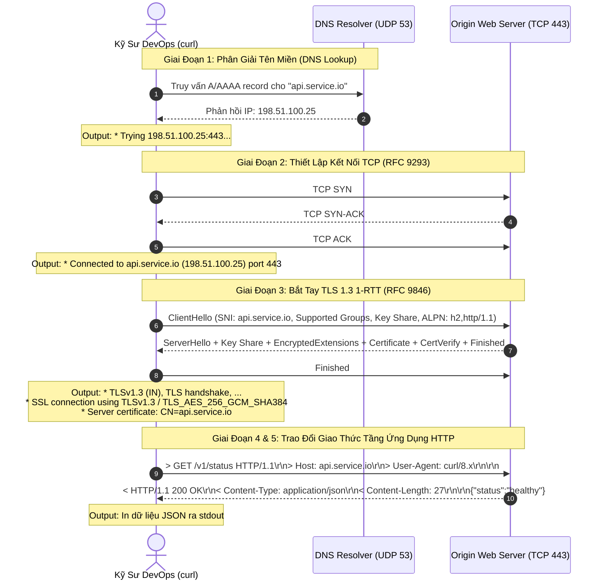
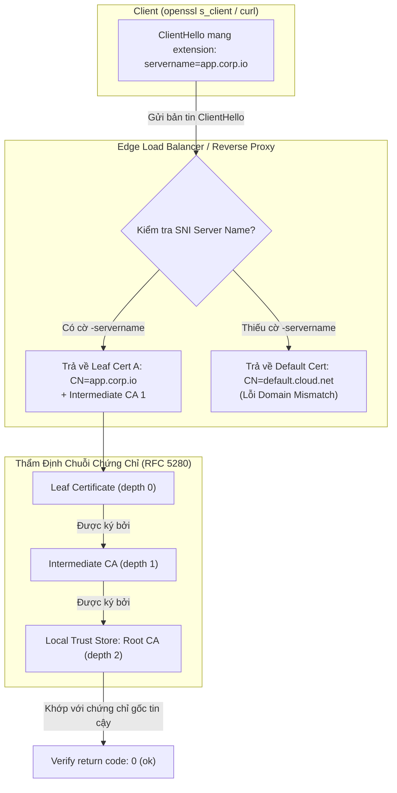

# 5_1_11 HTTP and TLS Inspection with curl and openssl

> **Khóa học**: Cloud DevOps Basic — Wire-Level Diagnostics  
> **Phân nhóm**: 5 Domain 5 - Wire-Level Network Inspection and Diagnostics › 5_1 Wire-Level Inspection and Diagnostic Toolkit  
> **Chủ đề**: Khảo sát ứng dụng HTTP và bảo mật TLS: Phân tích chi tiết vòng đời kết nối với curl (-v / --resolve / -x), xác thực chuỗi chứng chỉ số X.509 với openssl s_client và chuẩn TLS 1.3 (RFC 9846)  
> **Trạng thái**: Draft  
> **Checklist đối chiếu**: [5_1_11](../../../CHECKLIST.md#51-wire-level-inspection-and-diagnostic-toolkit)  

---

## 1. Khái Niệm Cốt Lõi & Bản Chất Kỹ Thuật (Core Concepts & Technical Deep Dive)

Trong kiến trúc hệ thống hiện đại (Cloud Native, Microservices, API Gateways, Service Mesh), hầu hết lưu lượng giao tiếp giữa người dùng với máy chủ hoặc giữa các dịch vụ nội bộ đều vận hành trên nền tảng giao thức **HTTP/HTTPS**. Khi xảy ra sự cố như độ trễ cao, lỗi bắt tay mã hóa, sai lệch tên miền hoặc rớt kết nối qua tường lửa/proxy, log của ứng dụng cấp cao (Java, Node.js, Python, Go) thường chỉ đưa ra các ngoại lệ chung chung như `SSLHandshakeException` hoặc `Connection Reset`.

Để bóc tách và định vị chính xác nguyên nhân gốc rễ, kỹ sư DevOps sử dụng hai công cụ dòng lệnh tiêu chuẩn công nghiệp: **`curl`** (kiểm tra giao thức HTTP và vòng đời kết nối từ L3 đến L7) và **`openssl s_client`** (kiểm tra trực tiếp tầng mật mã TLS và chuỗi chứng chỉ số X.509).

---

### 1.1 Vòng Đời Kết Nối Toàn Diện Qua Góc Nhìn `curl -v`

Khi thực thi lệnh `curl -v` (Verbose mode), cURL bóc tách toàn bộ quá trình thiết lập kết nối mạng thành 5 giai đoạn liên tục theo thứ tự thời gian:

```
+-----------------------------------------------------------------------------------+
|                        5 Giai Đoạn Kết Nối Trong curl -v                          |
|                                                                                   |
|  [1. DNS Lookup]        --> [2. TCP Handshake]     --> [3. TLS 1.3 Handshake]     |
|  * Trying 93.184.215.14     * Connected to host        * ALPN / Cipher / Cert     |
|                                                                                   |
|                                 |                                                 |
|                                 v                                                 |
|                         [4. HTTP Request]          --> [5. HTTP Response]         |
|                         > GET / HTTP/1.1               < HTTP/1.1 200 OK          |
|                         > Host: example.com            < Content-Type: text/html  |
+-----------------------------------------------------------------------------------+
```

#### Ý Nghĩa Các Ký Hiệu Tiền Tố (Prefix Notations)
Khi đọc output ở chế độ verbose của `curl`, mỗi dòng được phân loại bằng một ký tự đầu dòng quy chuẩn:
- **`*` (Asterisk)**: Thông tin chẩn đoán và quản lý trạng thái nội bộ do engine `libcurl` cung cấp. Bao gồm: địa chỉ IP phân giải từ DNS, thời gian thiết lập socket TCP, chi tiết bắt tay TLS/SSL, phiên bản HTTP đàm phán qua ALPN, và trạng thái đóng kết nối.
- **`>` (Right Angle Bracket)**: Dữ liệu giao thức mà client (cURL) gửi đi tới máy chủ từ xa. Bao gồm: HTTP Request Line (Method, Path, HTTP Version), các Request Headers (`Host`, `User-Agent`, `Accept`), và payload (nếu là POST/PUT).
- **`<` (Left Angle Bracket)**: Dữ liệu giao thức mà client nhận về từ máy chủ từ xa. Bao gồm: HTTP Status Line (`HTTP/1.1 200 OK`), các Response Headers (`Date`, `Content-Type`, `Server`, `Set-Cookie`), phân cách bằng dòng trống trước khi chuyển sang phần thân dữ liệu (Response Body).

---

### 1.2 Kiến Trúc Giao Thức Bảo Mật TLS 1.3 (RFC 9846)

Giao thức bảo mật tầng giao vận TLS 1.3 được chuẩn hóa tại tài liệu tiêu chuẩn **RFC 9846** (được IETF ban hành chính thức vào tháng 7 năm 2026, kế thừa và thay thế toàn diện hai bản RFC cũ là **RFC 8446** và **RFC 5246**).

So với phiên bản tiền nhiệm TLS 1.2, TLS 1.3 mang lại những cải tiến mang tính cách mạng về cả tốc độ lẫn tính an toàn mật mã:

| Đặc tính kỹ thuật | TLS 1.2 (RFC 5246 - Cũ) | TLS 1.3 (RFC 9846 - Tiêu Chuẩn Hiện Tại) |
| :--- | :--- | :--- |
| **Thời gian bắt tay (Handshake Latency)** | **2-RTT** (Cần 2 lượt Round-Trip Time trước khi truyền dữ liệu HTTP đầu tiên). | **1-RTT** (Chỉ cần đúng 1 lượt RTT để hoàn tất bắt tay và thỏa thuận khóa). Hỗ trợ **0-RTT Resumption** (Early Data). |
| **Cơ chế trao đổi khóa (Key Exchange)** | Hỗ trợ Static RSA Key Transport (không có tính chất Forward Secrecy) hoặc DHE/ECDHE. | **Bắt buộc Ephemeral Diffie-Hellman (ECDHE hoặc DHE)**. Loại bỏ hoàn toàn Static RSA. |
| **Bí mật chuyển tiếp (Perfect Forward Secrecy - PFS)** | Tùy chọn (phụ thuộc vào cipher suite được cấu hình). | **Mặc định 100% bắt buộc**. Nếu Private Key của server bị lộ trong tương lai, dữ liệu quá khứ vẫn an toàn. |
| **Các thuật toán bị loại bỏ (Deprecated)** | Hỗ trợ CBC mode, RC4, 3DES, MD5, SHA-1 (tiềm ẩn nguy cơ tấn công BEAST, Lucky13, POODLE). | **Khai tử toàn bộ CBC ciphers, RC4, 3DES, MD5, SHA-1**. Chỉ giữ lại các thuật toán AEAD hiện đại (AES-GCM, ChaCha20-Poly1305). |
| **Bảo vệ thông điệp bắt tay** | Chứng chỉ số của server và các extension được truyền dưới dạng plain text. | **Mã hóa toàn bộ các thông điệp bắt tay sau gói `ServerHello`**, bao gồm cả chứng chỉ số của server. |
| **Cơ chế nén & Đàm phán lại** | Hỗ trợ TLS Compression và Renegotiation (nguy cơ tấn công CRIME). | **Loại bỏ hoàn toàn TLS Compression và Renegotiation**. |

---

### 1.3 Chuỗi Xác Thực Chứng Chỉ Số X.509 (RFC 5280) & Cơ Chế SNI (RFC 6066)

Xác thực danh tính máy chủ trong HTTPS dựa trên tiêu chuẩn chứng chỉ số công cộng **X.509 v3** (RFC 5280).

#### Mô Hình Phân Cấp Chuỗi Tin Cậy (Hierarchical Trust Chain)
Khi một client thiết lập kết nối an toàn với máy chủ, quá trình xác thực không chỉ kiểm tra một chứng chỉ đơn lẻ mà duyệt qua toàn bộ một chuỗi mắt xích phân cấp:

```
+-----------------------------------------------------------------------------------+
|               Chuỗi Xác Thực Chứng Chỉ Số X.509 (RFC 5280)                        |
|                                                                                   |
|  [Root CA Certificate]          (Depth 2 - Nằm sẵn trong Trust Store của OS/JVM)  |
|          |                                                                        |
|          | Ký số phát hành (Digital Signature)                                     |
|          v                                                                        |
|  [Intermediate CA Certificate]  (Depth 1 - Cơ quan chứng thực số trung gian)      |
|          |                                                                        |
|          | Ký số phát hành (Digital Signature)                                     |
|          v                                                                        |
|  [Leaf / End-Entity Certificate] (Depth 0 - Chứng chỉ gắn với Domain máy chủ)      |
+-----------------------------------------------------------------------------------+
```

1. **Leaf Certificate (Depth 0)**: Chứng chỉ cấp phát riêng cho FQDN của máy chủ (ví dụ `api.example.com`). Chứa Public Key của máy chủ và trường Subject Alternative Name (SAN).
2. **Intermediate CA Certificate (Depth 1..N)**: Chứng chỉ của tổ chức phát hành trung gian do Root CA ủy quyền. Máy chủ BẮT BUỘC phải gửi kèm chứng chỉ trung gian này trong quá trình TLS handshake.
3. **Root CA Certificate (Depth N+1 / Trust Anchor)**: Chứng chỉ gốc tự ký (Self-signed) của các tổ chức kiểm toán độc lập uy tín (DigiCert, Let's Encrypt, Sectigo...). Chứng chỉ này **không** được tải từ mạng về trong phiên kết nối mà phải nằm sẵn trong kho lưu trữ tin cậy (Local Trust Store) của máy client.

#### Vai Trò Cốt Lõi Của Server Name Indication (SNI - RFC 6066)
Trong hạ tầng Cloud và Reverse Proxy hiện đại, một địa chỉ IP duy nhất (hoặc một Ingress Controller / CDN Edge) thường tiếp nhận lưu lượng cho hàng nghìn tên miền khác nhau (Name-based Virtual Hosting).

- **Vấn đề phát sinh**: Ở tầng TCP, máy chủ chỉ nhận được gói tin gửi tới IP và Port 443, hoàn toàn không biết client muốn truy cập tên miền nào. Phần HTTP Header `Host: example.com` chỉ được gửi đi **sau khi** kênh mã hóa TLS đã thiết lập xong!
- **Giải pháp SNI (RFC 6066 Section 3)**: Client gửi tên miền mong muốn ngay trong phần mở rộng (extension) `server_name` của gói tin **`ClientHello`** mở đầu phiên TLS. Nhờ đó, máy chủ xác định đúng tên miền để chọn đúng Leaf Certificate tương ứng trả về cho client trước khi mã hóa diễn ra.

---

### 1.4 Phương Thức HTTP CONNECT & Cơ Chế Hoạt Động Của Forward Proxy (RFC 9110)

Khi client hoạt động trong mạng nội bộ bị cô lập (Private Subnet) và phải truy cập Internet thông qua một Forward Proxy:

Nếu đích đến là HTTP không mã hóa (Port 80), proxy có thể đọc trực tiếp request và forward tiếp. Nhưng nếu đích đến là **HTTPS (Port 443)**, client không thể gửi yêu cầu trực tiếp cho proxy vì proxy không có Private Key của máy chủ đích để giải mã TLS.

Để giải quyết bài toán này, chuẩn **RFC 9110 (Section 9.3.6)** định nghĩa phương thức **`CONNECT`**:

```
Client                  Forward Proxy (Port 8080)              Origin Server (Port 443)
  |                               |                                      |
  | (1) TCP Handshake to Proxy    |                                      |
  |------------------------------>|                                      |
  |                               |                                      |
  | (2) CONNECT target:443 HTTP/1.1                                     |
  |------------------------------>| (3) TCP Handshake to Origin          |
  |                               |------------------------------------->|
  |                               |<-------------------------------------|
  | (4) HTTP/1.1 200 Connection Established                              |
  |<------------------------------|                                      |
  |                               |                                      |
  | ==================== KÊNH TUNNEL BYTE MÙ (BLIND TUNNEL) ============ |
  |                               |                                      |
  | (5) TLS ClientHello --------->|====== (Chuyển tiếp byte nguyên thủy) ====>|
  | (<========= TLS ServerHello ===|====== (Chuyển tiếp byte nguyên thủy) =====|
  |                               |                                      |
  | (6) Trao đổi dữ liệu mã hóa end-to-end xuyên qua Proxy                |
  |<=============================>|<====================================>|
```

1. **Khởi tạo kết nối**: Client thiết lập socket TCP tới Forward Proxy.
2. **Gửi lệnh CONNECT**: Client gửi bản tin HTTP:
   ```http
   CONNECT api.service.io:443 HTTP/1.1
   Host: api.service.io:443
   ```
3. **Mở kết nối ra ngoài**: Forward Proxy thiết lập một socket TCP độc lập tới máy chủ đích `api.service.io:443`.
4. **Xác lập đường hầm**: Proxy phản hồi về cho client mã trạng thái:
   ```http
   HTTP/1.1 200 Connection Established
   ```
5. **Chế độ Blind Forwarding Tunnel**: Kể từ thời điểm nhận mã 200, Forward Proxy từ bỏ vai trò xử lý HTTP và chuyển thành một **ống dẫn byte mù hai chiều (Blind Byte Tunnel)**. Mọi gói tin bắt tay TLS (ClientHello, Certificate, Key Exchange) và payload HTTP mã hóa được proxy chuyển tiếp nguyên vẹn giữa hai đầu mút mà proxy không cần và không thể giải mã nội dung.

---

## 2. Ví Dụ Đời Sống Thực Tế Dễ Hiểu (Intuitive Real-World Analogies)

---

### 2.1 Trợ Lý Ngoại Giao Ghi Biên Bản Cuộc Họp (`curl -v`)
Hãy tưởng tượng bạn cử một **trợ lý ngoại giao** đi làm việc với một tòa đại sứ nước ngoài:
1. **Tìm địa chỉ (DNS lookup - `* Trying...`)**: Trợ lý tra cứu sổ bạ địa chỉ để biết tòa đại sứ nằm ở con đường nào, số nhà bao nhiêu.
2. **Nghi thức gõ cửa (TCP Handshake - `* Connected to...`)**: Trợ lý tới cổng và thực hiện đúng thủ tục chào hỏi 3 bước của bảo vệ (chào hỏi, xác nhận, mở cổng).
3. **Thỏa thuận phòng họp kín (TLS Handshake - `* TLSv1.3...`)**: Trợ lý và đại diện tòa sứ quán bước vào phòng cách âm, xuất trình thẻ căn cước ngoại giao, và thống nhất sử dụng một bộ mật mã đặc biệt chỉ hai người giải mã được.
4. **Trao công văn (HTTP Request - `>`)**: Trợ lý mở cặp, đọc to và trao tận tay bức thư yêu cầu công việc.
5. **Nhận công văn hồi đáp (HTTP Response - `<`)**: Đối tác lắng nghe, ghi nhận và trao lại văn bản đóng dấu chấp thuận cùng các điều khoản phúc đáp.

Nhờ có chế độ ghi chép tường tận (`-v`), bạn không chỉ biết kết quả cuối cùng mà nhìn thấy trọn vẹn từng cử chỉ và lời nói diễn ra từ lúc bước tới cổng cho tới khi ra về.

---

### 2.2 Sĩ Quan Kiểm Tra Hộ Chiếu Tại Cửa Khẩu Sân Bay (`openssl s_client -servername ... -showcerts`)
Khi bạn nhập cảnh vào một quốc gia phát triển:
- **Cuốn hộ chiếu cá nhân (Leaf Certificate - depth 0)**: Có ảnh và tên của bạn (tương tự như tên miền máy chủ).
- **Con dấu của cơ quan quản lý xuất nhập cảnh cấp tỉnh/thành (Intermediate CA - depth 1)**: Chứng minh hộ chiếu này được cấp bởi cơ quan thẩm quyền hợp lệ của nước bạn.
- **Sổ bộ quốc gia lưu trữ mẫu dấu của Bộ Ngoại giao (Root CA Trust Store - depth 2)**: Sĩ quan hải quan lật cuốn sổ gốc lưu sẵn tại bàn làm việc để đối chiếu xem con dấu trên có đúng là do cơ quan quốc gia chuẩn mực bảo lãnh hay không.

Nếu hộ chiếu của bạn hoàn toàn hợp pháp nhưng bạn làm mất tờ giấy chứng thực trung gian (Intermediate CA), sĩ quan hải quan tại cửa khẩu sẽ không thể liên kết bạn với sổ bộ quốc gia và lập tức từ chối nhập cảnh (`Verification error: unable to verify the first certificate`)!

Còn tham số **`-servername` (SNI)** giống như việc bạn bước vào một nhà ga quốc tế khổng lồ phục vụ 50 hãng hàng không khác nhau. Bạn phải nói rõ ngay tại cửa đón: *"Tôi muốn làm thủ tục với Hãng Hàng Không Quốc Gia"* để nhân viên điều phối dẫn bạn vào đúng quầy, thay vì bị dẫn vào quầy mặc định dẫn đến việc vé của bạn bị báo sai hãng!

---

### 2.3 Nhân Viên Giao Bưu Phẩm Lắp Đường Ống Niêm Phong (HTTP CONNECT Proxy)
Bạn làm việc trong một viện nghiên cứu bảo mật nghiêm ngặt có tường lửa ngăn cách với bên ngoài. Bạn muốn trao đổi tài liệu tối mật với viện nghiên cứu đối tác:
- Bạn gọi nhân viên chuyển phát (Forward Proxy): *"Hãy giúp tôi lắp một đường ống kim loại xuyên qua tường dẫn thẳng sang bàn làm việc của Viện Đối Tác trên cổng 443"* (`CONNECT partner.org:443`).
- Nhân viên chuyển phát nối ống xong và gõ cửa báo: *"Đường ống đã thông suốt!"* (`HTTP/1.1 200 Connection Established`).
- Từ thời điểm này, bạn đặt tài liệu vào hộp sắt khóa số (TLS Encryption) rồi đẩy trượt qua lòng ống.
- Nhân viên chuyển phát chỉ đứng giữ đường ống. Người này **hoàn toàn không biết** và **không thể mở** hộp sắt ra xem bên trong chứa tài liệu gì, vì chỉ có bạn và đối tác ở đầu bên kia nắm giữ mật mã mở khóa.

---

## 3. Kiến Trúc, Luồng Hoạt Động & Hình Ảnh Trực Quan (Architecture, Diagrams & Visual Media)

---

### 3.1 Sơ Đồ Tuần Tự: Vòng Đời Kết Nối Toàn Diện Với `curl -v`

Sơ đồ thể hiện tiến trình bóc tách từng chặng từ phân giải DNS, bắt tay TCP 3 bước, bắt tay TLS 1.3 theo chuẩn **RFC 9846**, truyền tải yêu cầu HTTP và tiếp nhận phản hồi:



---

### 3.2 Sơ Đồ Kiểm Tra Chuỗi Chứng Chỉ X.509 Với Server Name Indication (SNI)

Sơ đồ mô tả cơ chế máy chủ đa tên miền (Multi-tenant Reverse Proxy) căn cứ vào SNI để lựa chọn chứng chỉ số chính xác:



---

### 3.3 Hình Ảnh Kiến Trúc: Cơ Chế Ủy Thác Forward Proxy

Dưới đây là sơ đồ kiến trúc tiêu chuẩn của một Forward Proxy trung gian tiếp nhận lưu lượng từ các máy trạm nội bộ và thực hiện thiết lập đường hầm chuyển tiếp ra ngoài:

[](https://upload.wikimedia.org/wikipedia/commons/1/19/Forward_proxy_h2g2bob.svg)  
*Mô hình Forward Proxy: Các máy khách trong mạng cục bộ điều hướng lưu lượng qua máy chủ Proxy trung gian để kiểm soát truy cập và tạo đường hầm kết nối ra Internet.*

---

## 4. Thực Hành (Hands-on)

---

### 4.1 Khảo Sát Toàn Diện Kết Nối HTTPS Với `curl -v`

Chạy lệnh kiểm tra kết nối chi tiết tới một dịch vụ web:

```bash
curl -v https://example.com
```

#### Phân Tích Output Thực Tế Từng Dòng:

```text
* Host example.com:443 was resolved.
* IPv6: 2606:2800:1f7:1:248:1893:25c8:1946
* IPv4: 93.184.215.14
*   Trying 93.184.215.14:443...
* Connected to example.com (93.184.215.14) port 443
* ALPN: curl offers h2,http/1.1
* TLSv1.3 (OUT), TLS handshake, Client hello (1):
* TLSv1.3 (IN), TLS handshake, Server hello (2):
* TLSv1.3 (IN), TLS handshake, Encrypted Extensions (8):
* TLSv1.3 (IN), TLS handshake, Certificate (11):
* TLSv1.3 (IN), TLS handshake, CERT verify (15):
* TLSv1.3 (IN), TLS handshake, Finished (20):
* TLSv1.3 (OUT), TLS handshake, Finished (20):
* SSL connection using TLSv1.3 / TLS_AES_256_GCM_SHA384 / X25519 / RSASSA-PSS
* ALPN: server accepted h2
* Server certificate:
*  subject: CN=example.com
*  start date: Jan 15 00:00:00 2026 GMT
*  expire date: Apr 15 23:59:59 2026 GMT
*  issuer: C=US; O=DigiCert Inc; CN=DigiCert Global G2 TLS RSA SHA256 2020 CA1
*  SSL certificate verify ok.
* using HTTP/2
> GET / HTTP/2
> Host: example.com
> User-Agent: curl/8.5.0
> Accept: */*
> 
< HTTP/2 200 
< content-type: text/html; charset=UTF-8
< etag: "3147526947"
< last-modified: Thu, 17 Oct 2024 07:18:26 GMT
< date: Sat, 14 Nov 2026 09:00:00 GMT
< server: ECS (dcb/7F3A)
< content-length: 1256
< 
<!doctype html>
<html>
... (Nội dung HTML phản hồi) ...
</html>
* Connection #0 to host example.com left intact
```

- Dòng `* Trying...` xác nhận kết nối tới địa chỉ IPv4/IPv6 cụ thể.
- Dòng `* Connected to...` báo hiệu quá trình bắt tay TCP 3 bước hoàn tất thành công.
- Dòng `* SSL connection using TLSv1.3` xác nhận phiên làm việc bảo mật đạt chuẩn **RFC 9846**.
- Các dòng `>` minh chứng request header đã gửi đi, và `<` là response header trả về kèm mã trạng thái `200`.

---

### 4.2 Kỹ Thuật `curl --resolve`: Ghim Cứng IP Kiểm Thử Không Cần Sửa `/etc/hosts`

Trong vận hành DevOps, khi bạn vừa dựng một cụm máy chủ Web mới hoặc chuyển đổi địa chỉ IP máy chủ Backend nhưng chưa muốn cập nhật bản ghi Public DNS, cờ `--resolve` cho phép bạn ghi đè bản ghi phân giải DNS cục bộ chỉ trong phạm vi của lệnh curl:

```bash
# Cú pháp: curl -v --resolve <hostname>:<port>:<target-ip> https://<hostname>/
curl -v --resolve example.com:443:127.0.0.1 https://example.com
```

#### Phân Tích Output:
```text
* Added example.com:443:127.0.0.1 to internal DNS cache!
* Hostname example.com was found in DNS cache
*   Trying 127.0.0.1:443...
* Connected to example.com (127.0.0.1) port 443
* ALPN: curl offers h2,http/1.1
...
> GET / HTTP/1.1
> Host: example.com
```

- **Ưu điểm vượt trội**: cURL vẫn gửi extension SNI `example.com` và Request Header `Host: example.com`, nhưng gói tin TCP được điều hướng trực tiếp tới IP `127.0.0.1`. Điều này giúp kiểm thử toàn diện Virtual Hosting và chứng chỉ TLS mà không làm ô nhiễm file `/etc/hosts` của toàn hệ thống và không yêu cầu quyền `sudo`!

---

### 4.3 Kiểm Tra Nhanh Tiêu Đề HTTP Với `curl -I` (HEAD Request)

Khi muốn kiểm tra mã trạng thái HTTP, máy chủ web (Nginx/Apache), chính sách bảo mật HSTS, hoặc định dạng `Content-Type` mà không muốn tốn băng thông tải về toàn bộ nội dung file (ví dụ file ISO dung lượng lớn):

```bash
curl -I https://example.com
```

#### Output:
```http
HTTP/2 200 
content-type: text/html; charset=UTF-8
etag: "3147526947"
last-modified: Thu, 17 Oct 2024 07:18:26 GMT
date: Sat, 14 Nov 2026 09:00:00 GMT
server: ECS (dcb/7F3A)
content-length: 1256
```

Lệnh phát một HTTP request với phương thức **`HEAD`**, yêu cầu server chỉ trả về status line và headers, sau đó ngắt kết nối mà không gửi response body.

---

### 4.4 Định Tuyến Lưu Lượng Qua Forward Proxy Với `curl -x`

Khi kiểm tra khả năng định tuyến của ứng dụng từ mạng nội bộ qua cổng Proxy máy chủ doanh nghiệp:

```bash
curl -v -x http://proxy.corp.internal:8080 https://api.service.io
```

#### Phân Tích Output Quan Sát Đường Hầm `CONNECT`:

```text
*   Trying 10.0.10.50:8080...
* Connected to proxy.corp.internal (10.0.10.50) port 8080
* allocate connect buffer
* Establish HTTP proxy tunnel to api.service.io:443
> CONNECT api.service.io:443 HTTP/1.1
> Host: api.service.io:443
> User-Agent: curl/8.5.0
> Proxy-Connection: Keep-Alive
> 
< HTTP/1.1 200 Connection Established
< Proxy-Agent: Corporate-Proxy/2.4
< 
* Proxy replied 200 to CONNECT request
* CONNECT phase completed
* ALPN: curl offers h2,http/1.1
* TLSv1.3 (OUT), TLS handshake, Client hello (1):
* TLSv1.3 (IN), TLS handshake, Server hello (2):
...
```

Nhật ký xác nhận rõ ràng: Client gửi lệnh `CONNECT api.service.io:443` tới proxy, proxy phản hồi `200 Connection Established`, và ngay sau đó quá trình bắt tay TLS 1.3 diễn ra xuyên suốt trong đường hầm.

---

### 4.5 Kiểm Tra Chuỗi Chứng Chỉ Số Với `openssl s_client`

Để thẩm định trực tiếp chuỗi chứng chỉ mà không bị phụ thuộc vào tầng ứng dụng HTTP, ta sử dụng công cụ chuẩn `openssl s_client`. Luôn ghi nhớ truyền cờ **`-servername`** để gửi kèm phần mở rộng SNI:

```bash
openssl s_client -connect example.com:443 -servername example.com -showcerts
```

#### Trích Xuất Các Đoạn Output Then Chốt:

```text
CONNECTED(00000003)
---
Certificate chain
 0 s:CN = example.com
   i:C = US, O = DigiCert Inc, CN = DigiCert Global G2 TLS RSA SHA256 2020 CA1
   a:PKEY: rsaEncryption, 2048 (bit); sigalg: RSA-SHA256
   v:NotBefore: Jan 15 00:00:00 2026 GMT; NotAfter: Apr 15 23:59:59 2026 GMT
-----BEGIN CERTIFICATE-----
MIIFajCCBFKgAwIBAgIQD... (Khối mã PEM của Leaf Certificate)
-----END CERTIFICATE-----
 1 s:C = US, O = DigiCert Inc, CN = DigiCert Global G2 TLS RSA SHA256 2020 CA1
   i:C = US, O = DigiCert Inc, OU = www.digicert.com, CN = DigiCert Global Root G2
   a:PKEY: rsaEncryption, 2048 (bit); sigalg: RSA-SHA256
   v:NotBefore: Aug  1 00:00:00 2020 GMT; NotAfter: Aug  1 00:00:00 2030 GMT
-----BEGIN CERTIFICATE-----
MIIEtjCCA56gAwIBAgIQB... (Khối mã PEM của Intermediate CA)
-----END CERTIFICATE-----
---
Server certificate
subject=CN = example.com
issuer=C = US, O = DigiCert Inc, CN = DigiCert Global G2 TLS RSA SHA256 2020 CA1
---
No client certificate CA names sent
Peer signing digest: SHA256
Peer signature type: RSA-PSS
Server Temp Key: X25519, 253 bits
---
SSL handshake has read 3142 bytes and written 398 bytes
Verification: OK
---
New, TLSv1.3, Cipher is TLS_AES_256_GCM_SHA384
Server public key is 2048 bit
Secure Renegotiation IS NOT supported
Compression: NONE
Expansion: NONE
No ALPN negotiated
Early data was not sent
Verify return code: 0 (ok)
---
```

- Mục `Certificate chain` thể hiện cả hai cấp độ chứng chỉ: `depth 0` (Leaf) và `depth 1` (Intermediate).
- Dòng `Verify return code: 0 (ok)` minh chứng toàn bộ chuỗi mắt xích đã được xác thực thành công nối tới Root CA trong hệ điều hành.

---

### 4.6 Trích Xuất Thời Hạn Chứng Chỉ Qua Pipe Với `openssl x509`

Trong kịch bản giám sát tự động (Monitoring/Alerting), bạn có thể kết hợp `openssl s_client` và `openssl x509` qua đường ống dẫn lệnh (pipe) để lấy ngay ngày hết hạn của chứng chỉ:

```bash
echo | openssl s_client -connect example.com:443 -servername example.com 2>/dev/null \
  | openssl x509 -noout -dates -subject -issuer
```

#### Output Nhận Được:
```text
notBefore=Jan 15 00:00:00 2026 GMT
notAfter=Apr 15 23:59:59 2026 GMT
subject=CN = example.com
issuer=C = US, O = DigiCert Inc, CN = DigiCert Global G2 TLS RSA SHA256 2020 CA1
```

- Cờ `-dates` in ra thời điểm kích hoạt (`notBefore`) và thời điểm hết hạn (`notAfter`).
- Cờ `-noout` ngăn không in chuỗi Base64 PEM dài dòng.
- Cờ `-subject` và `-issuer` hiển thị trực tiếp danh tính chủ thể và tổ chức cấp phát.

---

## 5. Cạm Bẫy Thực Tế & Thực Tiễn Sản Xuất (Production Gotchas & Best Practices)

---

### 5.1 Cạm Bẫy 1: Quên Truyền Tham Số `-servername` Khi Dùng `openssl s_client`
- **Hiện tượng**: Khi bạn kiểm tra một website chạy trên Cloud/CDN (ví dụ `myportal.internal.company.com`), bạn gõ lệnh:
  ```bash
  openssl s_client -connect 10.20.30.40:443
  ```
  Kết quả trả về hiển thị:
  ```text
  depth=0 CN = default-ingress-fallback.corp.net
  verify error:num=20:unable to get local issuer certificate
  ```
  Kỹ sư kết luận vội vàng rằng máy chủ đã bị gán nhầm chứng chỉ và tiến hành thay thế lại, gây tốn thời gian.
- **Bản chất**: Nếu không có cờ `-servername <host>`, OpenSSL sẽ phát bản tin `ClientHello` trống không có trường mở rộng SNI (RFC 6066). Khi không biết client cần tên miền nào, Ingress Controller buộc phải trả về chứng chỉ mặc định (Default Fallback Certificate).
- **Thực tiễn chuẩn**: Luôn luôn chỉ định `-servername <hostname>` khi kiểm tra bất kỳ máy chủ HTTPS nào:
  ```bash
  openssl s_client -connect 10.20.30.40:443 -servername myportal.internal.company.com
  ```

---

### 5.2 Cạm Bẫy 2: Lỗi Thiếu Chứng Chỉ Trung Gian (Incomplete Certificate Chain)
- **Hiện tượng "kỳ lạ"**: Người dùng mở trang web bằng trình duyệt Google Chrome hoặc Safari trên máy tính cá nhân thì vào bình thường, ổ khóa xanh/an toàn hiển thị đầy đủ. Nhưng khi một container chạy microservice (Java/Spring Boot, Python requests, hoặc Golang) hoặc lệnh `curl` gọi vào domain đó thì lập tức phát sinh lỗi:
  ```text
  curl: (60) SSL certificate problem: unable to get local issuer certificate
  ```
- **Bản chất**: Quản trị viên máy chủ web (Nginx/Apache) khi cấu hình TLS chỉ nạp file `cert.pem` (chỉ chứa riêng Leaf Certificate) mà quên không dùng file `fullchain.pem` (chứa cả Leaf Cert lẫn Intermediate CA Certs).
  - Trình duyệt Chrome/Safari có cơ chế tự động tải chứng chỉ trung gian qua trường mở rộng AIA (Authority Information Access - RFC 5280) hoặc đã lưu sẵn Intermediate Cert trong bộ nhớ đệm (Browser Cache) từ các phiên duyệt web trước.
  - Ngược lại, các công cụ dòng lệnh (`curl`, OpenSSL) và thư viện HTTP trong container Docker tuân thủ nghiêm ngặt tiêu chuẩn RFC: Chúng chỉ dựa vào những gì máy chủ gửi về và kho chứng chỉ cục bộ. Do máy chủ không gửi Intermediate CA, chuỗi xác thực bị đứt gãy.
- **Thực tiễn chuẩn**: Trong Nginx, luôn trỏ cấu hình tới file chuỗi đầy đủ:
  ```nginx
  ssl_certificate /etc/letsencrypt/live/domain.com/fullchain.pem;
  ```

---

### 5.3 Cạm Bẫy 3: Nguy Cơ Man-In-The-Middle Khi Lạm Dụng Cờ `-k` (`--insecure`)
- **Sai lầm phổ biến**: Khi gặp lỗi xác thực chứng chỉ TLS trong môi trường nội bộ hoặc môi trường phát triển (Dev/Staging), nhiều lập trình viên đưa ngay cờ `-k` hoặc `--insecure` vào trong script tự động hóa, Dockerfile hoặc CI/CD pipeline:
  ```bash
  # NGUY HIỂM: Tuyệt đối không dùng trong kịch bản sản xuất
  curl -k https://internal-vault.corp.net/v1/secrets
  ```
- **Hậu quả**: Cờ `-k` làm cho cURL bỏ qua hoàn toàn bước thẩm định tính hợp lệ của chứng chỉ máy chủ. Bất kỳ kẻ tấn công nào đứng trong cùng phân đoạn mạng (ARP Spoofing, DNS Hijacking, Rouge Access Point) đều có thể dựng một chứng chỉ giả mạo để chặn bắt (Man-in-the-Middle - MITM), đánh cắp toàn bộ token xác thực, mật khẩu, và dữ liệu nhạy cảm mà cURL không hề đưa ra cảnh báo.
- **Thực tiễn chuẩn**: Thay vì bỏ qua bảo mật bằng `-k`, hãy xuất chứng chỉ CA nội bộ (Private CA Root Cert) và truyền qua cờ `--cacert`:
  ```bash
  curl --cacert /etc/ssl/certs/corp-internal-ca.crt https://internal-vault.corp.net/v1/secrets
  ```

---

### 5.4 Cạm Bẫy 4: Nhầm Lẫn Giữa Forward Proxy Chuẩn Và SSL Deep Packet Inspection (DPI)
- **Bản chất**: Khi đi qua Forward Proxy chuẩn sử dụng phương thức `CONNECT`, proxy hoạt động như một đường hầm byte mù (không thể đọc được dữ liệu HTTPS).
- **Tuy nhiên**: Tại một số doanh nghiệp có chính sách bảo mật khắt khe, thiết bị tường lửa/proxy áp dụng cơ chế **SSL Interception / Deep Packet Inspection**. Proxy sẽ chủ động ngắt kết nối TLS của client, đóng vai trò như một máy chủ giả mạo tạo chứng chỉ on-the-fly ký bởi **Corporate CA**, đồng thời mở một kết nối TLS thứ hai tới máy chủ gốc bên ngoài.
- **Xử lý sự cố**: Khi làm việc sau mạng doanh nghiệp này, các container hoặc công cụ curl sẽ báo lỗi `unable to get local issuer certificate` trừ khi bạn nạp chứng chỉ Corporate Root CA đó vào file cấu hình Trust Store của hệ thống (`/etc/pki/ca-trust/source/anchors/` trên RHEL hoặc `/usr/local/share/ca-certificates/` trên Ubuntu).

---

## 6. Câu Hỏi Củng Cố Kiến Thức (Active Recall Quiz)

---

### Câu hỏi 1: Xử lý sự cố Microservice bị lỗi SSL Handshake trong khi trình duyệt vẫn truy cập bình thường
Một kỹ sư DevOps triển khai một Pod chạy microservice Java Spring Boot trên cụm Kubernetes nội bộ. Khi microservice gọi API bên ngoài tại địa chỉ `https://partner.payments.com/charge`, ứng dụng lập tức ném ngoại lệ:
```text
javax.net.ssl.SSLHandshakeException: PKIX path building failed: 
sun.security.provider.certpath.SunCertPathBuilderException: unable to find valid certification path to requested target
```
Tuy nhiên, khi lập trình viên dùng máy tính cá nhân mở đường dẫn đó trên trình duyệt Google Chrome thì trang web vẫn hiển thị ổ khóa an toàn, chứng chỉ hợp lệ.

Kỹ sư sử dụng lệnh gì của OpenSSL để xác thực chính xác nguyên nhân wire-level? Nguyên nhân sâu xa của hiện tượng này là gì?

<details>
<summary>Đáp án chi tiết</summary>

1. **Lệnh OpenSSL chẩn đoán wire-level**:
   ```bash
   openssl s_client -connect partner.payments.com:443 -servername partner.payments.com -showcerts
   ```
2. **Nguyên nhân sâu xa**:
   - Đây là sự cố kinh điển: **Thiếu chứng chỉ trung gian (Incomplete Certificate Chain)** trên máy chủ đối tác.
   - Khi quan sát output `Certificate chain`, ta chỉ thấy máy chủ trả về `depth=0` (Leaf Certificate) mà không kèm theo `depth=1` (Intermediate CA).
   - Trình duyệt Chrome vượt qua được nhờ tính năng tự động tải chứng chỉ trung gian qua trường mở rộng AIA (Authority Information Access) hoặc đã lưu sẵn Intermediate CA trong bộ nhớ đệm từ trước.
   - Máy ảo Java (JVM) bên trong container không có cơ chế tự động tải AIA ngoài luồng, và kho chứng chỉ `cacerts` mặc định chỉ chứa các Root CA. Do thiếu mắt xích trung gian, thuật toán xây dựng đường dẫn tin cậy (PKIX path building) bị đứt đoạn và ném ngoại lệ.
   - **Giải pháp**: Yêu cầu đối tác cấu hình máy chủ Web phục vụ toàn bộ chuỗi chứng chỉ (`fullchain.pem`), hoặc tạm thời bổ sung Intermediate CA của đối tác vào TrustStore của Java container.
</details>

---

### Câu hỏi 2: Chiến lược kiểm thử Zero-Downtime Migration với `curl --resolve`
Hệ thống thanh toán của công ty chuẩn bị chuyển đổi từ nhà cung cấp dịch vụ hạ tầng cũ sang một cụm Kubernetes Ingress mới. Địa chỉ IP của Ingress mới là `203.0.113.88`. Tên miền dịch vụ là `api.fintech.corp`.

Để đảm bảo an toàn tuyệt đối, đội ngũ QA cần kiểm thử toàn diện khả năng đàm phán TLS và phản hồi của API trên cụm máy chủ mới trước khi cập nhật bản ghi Public DNS.
1. Tại sao kỹ sư không nên chỉnh sửa file `/etc/hosts` trên máy chủ CI/CD Runner để thực hiện bài test này?
2. Hãy viết câu lệnh `curl` thực hiện kiểm thử chính xác IP mới mà không gây ảnh hưởng tới toàn hệ thống.

<details>
<summary>Đáp án chi tiết</summary>

1. **Tại sao không nên sửa `/etc/hosts`**:
   - File `/etc/hosts` có phạm vi ảnh hưởng toàn cục (global scope) lên toàn bộ hệ điều hành của CI/CD Runner.
   - Nếu nhiều tiến trình build chạy đồng thời trên cùng runner (concurrent jobs), việc sửa `/etc/hosts` sẽ gây xung đột làm sai lệch các tác vụ khác.
   - Thao tác sửa file yêu cầu quyền `root`/`sudo`, tạo ra rủi ro an ninh và để lại trạng thái "rác" nếu kịch bản test bị crash giữa chừng trước khi kịp khôi phục file gốc.
2. **Câu lệnh `curl --resolve` chuẩn xác**:
   ```bash
   curl -v --resolve api.fintech.corp:443:203.0.113.88 https://api.fintech.corp/v1/healthz
   ```
   - Lệnh này nạp IP `203.0.113.88` vào bộ đệm DNS nội bộ chỉ của riêng phiên `curl`.
   - Kết nối TCP sẽ trỏ thẳng tới IP mới, trong khi phần mở rộng SNI (TLS) và Request Header `Host: api.fintech.corp` vẫn được bảo toàn nguyên vẹn 100%, không yêu cầu quyền root và hoàn toàn biệt lập giữa các tiến trình.
</details>

---

### Câu hỏi 3: Phân tích bảo mật của phương thức HTTP `CONNECT` qua Forward Proxy
Một kỹ sư DevOps cấu hình chuyển tiếp toàn bộ lưu lượng ra Internet của cụm máy chủ thông qua một HTTP Forward Proxy của công ty bằng lệnh:
```bash
curl -v -x http://squid.corp.internal:3128 https://api.stripe.com/v1/tokens
```
Quản trị viên an ninh mạng muốn giám sát lưu lượng này và dự định đặt bộ lọc (sniffer) ngay tại proxy để đọc payload dữ liệu HTTP nhằm phát hiện rò rỉ mã thẻ tín dụng.

Liệu quản trị viên có thể đọc được nội dung thanh toán gửi tới Stripe bằng phương pháp này không? Hãy giải thích bản chất kỹ thuật của phương thức HTTP `CONNECT` theo chuẩn RFC 9110.

<details>
<summary>Đáp án chi tiết</summary>

1. **Khả năng đọc trộm dữ liệu của Proxy**:
   - **Hoàn toàn KHÔNG**. Quản trị viên proxy chỉ thấy được địa chỉ IP và tên miền đích (`api.stripe.com:443`), hoàn toàn không thể đọc được URL path (`/v1/tokens`), HTTP Headers hay Payload chứa mã thẻ tín dụng.
2. **Bản chất kỹ thuật theo RFC 9110 (Section 9.3.6)**:
   - Khi client yêu cầu truy cập một URL `https://`, client gửi lệnh `CONNECT api.stripe.com:443 HTTP/1.1` tới proxy.
   - Sau khi proxy kết nối TCP tới Stripe và gửi lại `HTTP/1.1 200 Connection Established`, proxy lập tức kích hoạt chế độ **Blind Byte Forwarding Tunnel** (đường hầm byte mù hai chiều).
   - Quá trình bắt tay TLS (ClientHello, Key Exchange) và mã hóa đối xứng được thực hiện trực tiếp (End-to-End Encryption) giữa máy khách cURL và máy chủ của Stripe.
   - Do proxy không sở hữu Private Key của Stripe và TLS 1.3 bắt buộc dùng cơ chế trao đổi khóa Ephemeral Diffie-Hellman (RFC 9846), dữ liệu đi qua proxy chỉ là một chuỗi các byte mã hóa ngẫu nhiên không thể giải mã.
</details>

---

## 7. 📚 Nguồn Tài Liệu Chính Thống (Tier-1 Official References)

- [RFC 9846: The Transport Layer Security (TLS) Protocol Version 1.3](https://datatracker.ietf.org/doc/html/rfc9846) — Đặc tả kỹ thuật chuẩn IETF của giao thức TLS 1.3 (ban hành tháng 7/2026, thay thế chính thức RFC 8446 và RFC 5246), quy định kiến trúc bắt tay 1-RTT, mã hóa thông điệp sau ServerHello, và bắt buộc cơ chế trao đổi khóa bí mật chuyển tiếp hoàn hảo (PFS).
- [RFC 9110: HTTP Semantics — Section 9.3.6: CONNECT](https://www.rfc-editor.org/rfc/rfc9110.html#section-9.3.6) — Tiêu chuẩn kỹ thuật IETF quy định phương thức đường hầm `CONNECT` của HTTP và nguyên tắc vận hành chuyển tiếp byte mù (Blind Forwarding Tunnel) của Forward Proxy.
- [RFC 5280: Internet X.509 Public Key Infrastructure Certificate and CRL Profile](https://www.rfc-editor.org/rfc/rfc5280.html#section-6.1) — Đặc tả cấu trúc chứng chỉ số công cộng X.509 v3 và thuật toán thẩm định đường dẫn phân cấp tin cậy (Certificate Path Validation).
- [RFC 6066: Transport Layer Security (TLS) Extensions — Section 3: Server Name Indication](https://www.rfc-editor.org/rfc/rfc6066.html#section-3) — Tiêu chuẩn kỹ thuật IETF về phần mở rộng SNI cho phép máy khách chỉ định tên miền cần kết nối ngay trong bản tin ClientHello.
- [curl.se: curl(1) Manual Page](https://curl.se/docs/manpage.html) — Tài liệu hướng dẫn chính thức từ dự án cURL về các cờ chẩn đoán hệ thống: `-v` (verbose), `-I` (head), `-x` (proxy), `--resolve` (DNS override), và `-k` (insecure).
- [OpenSSL Documentation: openssl-s_client(1)](https://docs.openssl.org/master/man1/openssl-s_client/) — Tài liệu tham chiếu dòng lệnh chính thức của OpenSSL về tiện ích `s_client` để kết nối, gỡ lỗi và kiểm tra chuỗi chứng chỉ SSL/TLS từ xa.
- [OpenSSL Documentation: openssl-x509(1)](https://docs.openssl.org/master/man1/openssl-x509/) — Tài liệu tham chiếu chính thức của OpenSSL về tiện ích `x509` để trích xuất metadata, ngày hết hạn và cấu trúc chứng chỉ số X.509.
