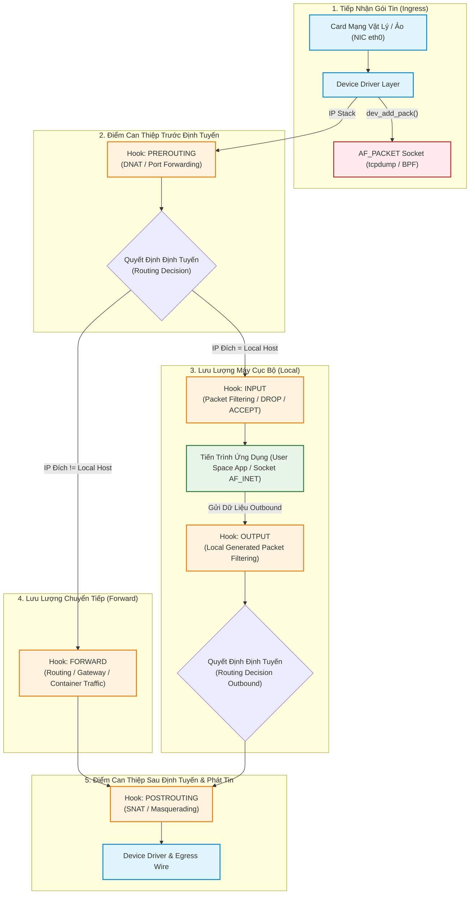
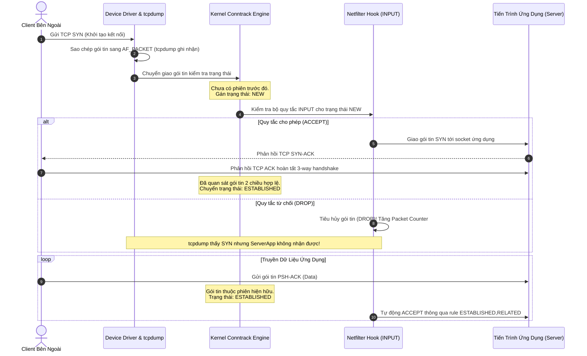
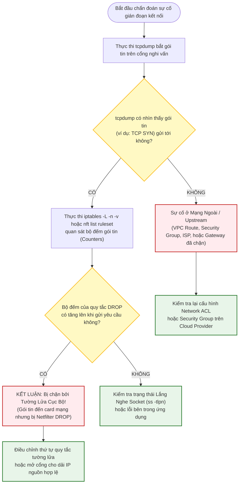

# 5_1_12 Firewall and NAT State Inspection

> **Khóa học**: Cloud DevOps Basic — Wire-Level Diagnostics  
> **Phân nhóm**: 5 Domain 5 - Wire-Level Network Inspection and Diagnostics › 5_1 Wire-Level Inspection and Diagnostic Toolkit  
> **Chủ đề**: Khảo sát trạng thái Firewall và NAT: Kiến trúc Netfilter hooks, bảng conntrack (NEW/ESTABLISHED/RELATED/INVALID), và kỹ thuật đối chiếu tcpdump với bộ đếm quy tắc iptables / nftables  
> **Trạng thái**: Draft  
> **Checklist đối chiếu**: [5_1_12](../../../CHECKLIST.md#51-wire-level-inspection-and-diagnostic-toolkit)  

---

## 1. Khái Niệm Cốt Lõi & Bản Chất Kỹ Thuật (Core Concepts & Technical Deep Dive)

Trong môi trường điện toán đám mây và hệ thống phân tán, các sự cố gián đoạn kết nối giữa các dịch vụ (như máy chủ web không kết nối được tới cơ sở dữ liệu, hoặc yêu cầu từ ngoài Internet bị ngắt quãng không rõ lý do) thường bắt nguồn từ các rào chắn an ninh mạng tầng máy chủ (Host-based Firewalls) và các quy tắc biên dịch địa chỉ mạng (Network Address Translation - NAT). Để chẩn đoán chính xác nguyên nhân gốc rễ mà không phỏng đoán, kỹ sư Cloud & DevOps bắt buộc phải nắm vững kiến trúc xử lý gói tin ngầm trong nhân hệ điều hành.

---

### 1.1 Kiến Trúc Netfilter Trong Nhân Linux & 5 Hook Points Chuẩn Hóa

Trong nhân Linux (Linux Kernel), toàn bộ cơ chế lọc gói tin (filtering), sửa đổi tiêu đề (packet mangling), và biên dịch địa chỉ (NAT) được điều phối thông qua hệ thống con **Netfilter** (Netfilter Subsystem). 

Theo tài liệu chính thức từ Netfilter Project và nftables documentation, nhân Linux định nghĩa 5 điểm can thiệp chuẩn hóa (**Hook Points**) trên đường truyền của các giao thức mạng IPv4 và IPv6:

```
+---------------------------------------------------------------------------------------------------+
|                                 5 Hook Points Trong Nhân Linux                                    |
|                                                                                                   |
|  [Đường Mạng / NIC]                                                                               |
|         |                                                                                         |
|         v                                                                                         |
|   +---------------+           +-------------------+           +---------------+                   |
|   |  PREROUTING   | --------> | Routing Decision  | --------> |     INPUT     | ----> [Local App] |
|   +---------------+           +-------------------+           +---------------+            |      |
|                                         |                                                  v      |
|                                         | (Gói tin chuyển tiếp)                     [Local App]   |
|                                         v                                                  |      |
|                               +-------------------+           +---------------+            v      |
|                               |      FORWARD      |           |    OUTPUT     | <----------+      |
|                               +-------------------+           +---------------+                   |
|                                         |                             |                           |
|                                         +--------------+--------------+                           |
|                                                        |                                          |
|                                                        v                                          |
|                                               +-------------------+                               |
|                                               | Routing Decision  |                               |
|                                               +-------------------+                               |
|                                                        |                                          |
|                                                        v                                          |
|                                               +-------------------+                               |
|                                               |   POSTROUTING     | --------> [Đường Mạng / NIC]  |
|                                               +-------------------+                               |
+---------------------------------------------------------------------------------------------------+
```

Chi tiết chức năng của từng điểm can thiệp:
1. **`PREROUTING` (`NF_INET_PRE_ROUTING`)**:
   - Được kích hoạt ngay khi gói tin vừa được card mạng và trình điều khiển (device driver) nhận vào, **trước khi** ngăn xếp mạng đưa ra bất kỳ quyết định định tuyến (Routing Decision) nào.
   - Điểm can thiệp này thường được sử dụng để thực thi Destination NAT (DNAT) hoặc chuyển hướng cổng (Port Forwarding), thay đổi địa chỉ IP đích trước khi kernel kiểm tra xem gói tin thuộc về máy cục bộ hay cần chuyển tiếp.
2. **`INPUT` (`NF_INET_LOCAL_IN`)**:
   - Được kích hoạt sau khi quyết định định tuyến xác định rằng địa chỉ IP đích của gói tin chính là một trong các địa chỉ IP của máy chủ cục bộ (Local Host).
   - Mọi quy tắc kiểm soát lưu lượng đi vào các tiến trình ứng dụng cục bộ (như bảo vệ tiến trình Nginx, SSH, cơ sở dữ liệu) được thực thi tại hook này.
3. **`FORWARD` (`NF_INET_FORWARD`)**:
   - Được kích hoạt khi quyết định định tuyến xác định gói tin không hướng tới máy cục bộ mà cần được định tuyến chuyển tiếp (routed) sang một giao diện mạng (network interface) khác để đi tới đích cuối cùng.
   - Điểm can thiệp này là trái tim của các máy chủ đóng vai trò Gateway, Router, VPN Server, hoặc Docker / Kubernetes Host điều phối lưu lượng giữa các container network.
4. **`OUTPUT` (`NF_INET_LOCAL_OUT`)**:
   - Được kích hoạt đối với các gói tin do chính các tiến trình ứng dụng chạy trên máy cục bộ tạo ra và gửi đi, **trước khi** ngăn xếp mạng đưa ra quyết định định tuyến đường truyền ra.
   - Điểm can thiệp này cho phép kiểm soát lưu lượng outbound xuất phát từ máy chủ.
5. **`POSTROUTING` (`NF_INET_POST_ROUTING`)**:
   - Được kích hoạt sau khi quyết định định tuyến đã hoàn tất và gói tin chuẩn bị được chuyển giao cho trình điều khiển card mạng để phát ra dây dẫn vật lý hoặc card ảo.
   - Điểm can thiệp này là nơi duy nhất thực thi Source NAT (SNAT) hoặc Masquerading, nhằm thay thế địa chỉ IP nguồn nội bộ bằng địa chỉ IP công khai của máy chủ trước khi rời khỏi hệ thống.

---

### 1.2 Bảng Trạng Thái Kết Nối Connection Tracking (conntrack) & 4 Trạng Thái Cốt Lõi

Khác với tường lửa phi trạng thái (Stateless Firewall) chỉ kiểm tra từng gói tin đơn lẻ dựa trên cờ TCP hoặc địa chỉ IP/port, tường lửa có trạng thái (Stateful Firewall) trong Linux dựa trên phân hệ theo dõi kết nối **`conntrack`** (Connection Tracking System). 

Hệ thống `conntrack` ghi nhớ ngữ cảnh giao tiếp hai chiều giữa các máy chủ và phân loại mọi gói tin đi qua Netfilter vào 4 trạng thái cốt lõi (theo đặc tả kỹ thuật `iptables-extensions(8)`):

| Trạng thái | Tên tiếng Anh | Bản chất kỹ thuật trong nhân Linux | Kịch bản thực tế |
| :--- | :--- | :--- | :--- |
| **Mới** | `NEW` | Gói tin khởi tạo một luồng giao tiếp mới hoặc là gói tin đầu tiên được quan sát thấy trong một phiên kết nối mà chưa từng thấy gói tin phản hồi theo chiều ngược lại. | Gói tin TCP chứa cờ `SYN` gửi từ client tới server; hoặc gói tin UDP đầu tiên gửi tới một dịch vụ. |
| **Đã thiết lập** | `ESTABLISHED` | Gói tin thuộc về một luồng kết nối đang hoạt động đã ghi nhận thành công các gói tin trao đổi hợp lệ theo cả hai chiều (two-way communication). | Sau khi quá trình bắt tay TCP 3 bước hoàn tất, tất cả các gói tin mang dữ liệu (`ACK`, `PSH-ACK`) trao đổi qua lại giữa hai đầu mút đều mang trạng thái `ESTABLISHED`. |
| **Liên đới** | `RELATED` | Gói tin khởi tạo một kết nối mới độc lập nhưng có quan hệ logic phụ thuộc trực tiếp vào một kết nối đang tồn tại (`ESTABLISHED`). | Kênh dữ liệu truyền file của giao thức FTP (Data Channel được mở ra sau khi lệnh được gửi trên Control Channel); hoặc các gói tin báo lỗi ICMP (như `Destination Unreachable` hay `TTL Expired`) phản hồi cho một gói tin TCP/UDP đang truyền. |
| **Không hợp lệ** | `INVALID` | Gói tin không thể liên kết với bất kỳ phiên kết nối hợp lệ nào trong bộ nhớ kernel, hoặc tiêu đề gói tin chứa thông số kỹ thuật vi phạm trạng thái giao thức (như số tuần tự TCP nằm ngoài cửa sổ cho phép, cờ TCP bất thường). | Gói tin quét mạng độc hại (như FIN scan, NULL scan), gói tin rác sót lại sau khi phiên kết nối đã đóng hoàn toàn, hoặc gói tin bị nghẽn mạng đến quá trễ. |

Cơ chế này mang lại lợi ích hiệu năng vượt trội: các quy tắc an ninh chỉ cần kiểm tra chi tiết các gói tin `NEW`, sau đó một quy tắc duy nhất cho phép trạng thái `ESTABLISHED,RELATED` sẽ tự động cấp quyền cho toàn bộ luồng dữ liệu hai chiều tiếp theo mà không cần phải viết riêng từng quy tắc mở cổng ngược lại.

---

### 1.3 Kỹ Thuật Chẩn Đoán Đối Chiếu Wire-Level: tcpdump (AF_PACKET) vs Netfilter Drop Counters

Một trong những bài toán hóc búa nhất khi chẩn đoán mạng là xác định: *Gói tin bị chặn ở đâu? Do mạng upstream, do Cloud Provider Network Security Group, hay do chính tường lửa cục bộ trên máy chủ?*

Để trả lời câu hỏi này một cách khoa học, kỹ sư phải hiểu rõ sự phân tầng giữa thư viện bắt gói tin `tcpdump` và hệ thống tường lửa Netfilter:

```
+---------------------------------------------------------------------------------------------------+
|                        Đường Đi Của Gói Tin Ingress: AF_PACKET vs Netfilter                       |
|                                                                                                   |
|                                       [Trình Ứng Dụng (User Space)]                               |
|                                                    ^                                              |
|                                                    | Giao thức tầng 4 (AF_INET Socket)            |
|       [tcpdump (User Space)]              +-----------------+                                     |
|                 ^                         |  INPUT Hook     | <--- Netfilter Drop Rule            |
|                 |                         +-----------------+      (Gói tin bị DROP tại đây)      |
|                 | AF_PACKET (mmap)                 ^                                              |
|       +-------------------+               +-----------------+                                     |
|       | Device Driver     | ------------> | PREROUTING Hook |                                     |
|       | (dev_add_pack)    |               +-----------------+                                     |
|       +-------------------+                        ^                                              |
|                 ^                                  | Ngăn xếp IP Kernel                           |
|                 +------------------+---------------+                                              |
|                                    |                                                              |
|                      [Card Mạng Vật Lý / Giao Diện eth0]                                          |
+---------------------------------------------------------------------------------------------------+
```

Theo đặc tả `packet(7)` trong Linux Manual Pages:
1. `tcpdump` bắt gói tin thông qua giao tiếp socket nguyên bản **`AF_PACKET`** được gắn trực tiếp vào tầng trình điều khiển thiết bị (Device Driver Layer / Layer 2).
2. Khi card mạng nhận được khung tin (frame), trình điều khiển lập tức nhân bản gói tin gửi lên hook `AF_PACKET` cho `tcpdump` **trước khi** gói tin được chuyển giao lên ngăn xếp IP để đi vào hook `PREROUTING` và `INPUT` của Netfilter.
3. **Quy tắc suy luận chẩn đoán đối chiếu**:
   - Nếu `tcpdump` **nhìn thấy** gói tin (ví dụ: cờ `[S]` của TCP SYN) đi vào giao diện mạng `eth0`, nhưng tiến trình ứng dụng lắng nghe trên cổng không bao giờ nhận được dữ liệu, đồng thời bộ đếm gói tin (packet counters) và byte counters của quy tắc `DROP` trong `iptables -L -n -v` hoặc `nft list ruleset` **tăng dần lên liên tục**:
   - **Kết luận tuyệt đối**: Gói tin đã truyền tới card mạng an toàn, nhưng đã bị chính cơ chế tường lửa Netfilter cục bộ của máy chủ tiêu hủy (DROP). Sự cố không nằm ở nhà mạng hay hạ tầng ngoài.

---

### 1.4 Kiến Trúc Quản Lý Tường Lửa Trên Windows: PowerShell NetSecurity Module

Trong hệ điều hành Windows và Windows Server, tường lửa nâng cao (Windows Defender Firewall with Advanced Security) được tích hợp sâu vào ngăn xếp mạng thông qua kiến trúc Windows Filtering Platform (WFP). 

Để kiểm tra trạng thái và chẩn đoán cấu hình tường lửa bằng dòng lệnh tự động hóa, quản trị viên sử dụng module PowerShell **`NetSecurity`** (theo chuẩn tài liệu Microsoft Learn):
- **`Get-NetFirewallRule`**: Truy xuất danh sách các quy tắc lọc gói tin, chỉ rõ hướng lưu lượng (`Inbound` / `Outbound`), hành vi áp dụng (`Allow` / `Block`), và trạng thái kích hoạt (`Enabled`).
- **`Get-NetFirewallProfile`**: Kiểm tra trạng thái hoạt động của 3 hồ sơ mạng chuẩn hóa: `Domain` (mạng gia nhập miền Active Directory), `Private` (mạng nội bộ tin cậy), và `Public` (mạng công cộng không tin cậy).
- **`Get-NetFirewallPortFilter`**: Truy xuất các điều kiện lọc liên quan tới số hiệu cổng nguồn/đích và giao thức (TCP/UDP) đi kèm với từng quy tắc cụ thể.

---

## 2. Ví Dụ Đời Sống Thực Tế Dễ Hiểu (Intuitive Real-World Analogies)

Để ghi nhớ bản chất kỹ thuật của Netfilter, conntrack, và kỹ thuật chẩn đoán đối chiếu, hãy liên tưởng tới hệ thống kiểm soát an ninh tại một tòa đại sứ quán quốc tế:

---

### 2.1 Trạm Kiểm Soát An Ninh 5 Cửa Khẩu (Netfilter Hooks)

Hãy tưởng tượng bưu phẩm và khách đến tòa đại sứ quán phải đi qua 5 trạm gác chuyên biệt:
1. **Trạm kiểm soát cổng ngoài (`PREROUTING`)**: Bưu phẩm vừa chuyển từ xe bưu chính xuống cổng tòa nhà, trước khi biết gửi cho ai, nhân viên an ninh tại đây sẽ soi quét xem địa chỉ trên bì thư có cần sửa đổi chuyển tiếp phòng ban hay không (Destination NAT).
2. **Cửa vào phòng làm việc (`INPUT`)**: Sau khi xác định bưu phẩm gửi cho nhân viên trong tòa nhà, bảo vệ tại cửa kiểm tra quy chế: Nếu người gửi không nằm trong danh sách được tiếp đón, bưu phẩm lập tức bị tịch thu và vứt vào thùng rác (`DROP`).
3. **Cửa hành lang chuyển tiếp (`FORWARD`)**: Nếu bưu phẩm chỉ mượn đường qua khuôn viên tòa đại sứ quán để chuyển sang tòa lãnh sự lân cận, nó được chuyển thẳng qua cửa này mà không được phép đi vào phòng làm việc nội bộ.
4. **Cửa xuất phát từ văn phòng (`OUTPUT`)**: Nhân viên tòa nhà viết thư gửi ra ngoài, thư được kiểm duyệt tại cửa văn phòng trước khi chọn đường vận chuyển.
5. **Cổng xuất bưu phẩm ra ngoài (`POSTROUTING`)**: Bưu phẩm chuẩn bị rời khỏi khuôn viên tòa nhà, trạm gác cổng ngoài cùng sẽ dán nhãn địa chỉ chung của cơ quan ngoại giao lên bì thư để che giấu danh tính phòng ban cụ thể bên trong (Source NAT / Masquerading).

---

### 2.2 Sổ Trực Nhật Ghi Nhận Khuôn Mặt Khách Quen (conntrack States)

Hệ thống theo dõi trạng thái `conntrack` hoạt động như một cuốn **sổ trực nhật an ninh thông minh**:
- **Khách lạ xuất hiện lần đầu (`NEW`)**: Khách bấm chuông cổng trình diện giấy tờ căn cước. Bảo vệ phải kiểm tra từng dòng quy tắc nghiêm ngặt xem khách có được phép vào hay không.
- **Khách quen đang trao đổi (`ESTABLISHED`)**: Khi bảo vệ đã đồng ý cho khách vào và khách bắt đầu ngồi đàm thoại trong phòng khách, bảo vệ ghi nhận vào sổ trực nhật. Khi khách đi qua đi lại lấy nước hoặc nói chuyện tiếp, bảo vệ chỉ cần liếc nhìn cuốn sổ thấy tên quen là cho qua ngay, không cần xét duyệt lại giấy tờ từ đầu.
- **Người quen đi kèm phát sinh (`RELATED`)**: Khách chính đang ở trong phòng cần gọi thêm kỹ thuật viên phụ trợ vào hỗ trợ trình chiếu file. Do kỹ thuật viên này được bảo lãnh trực tiếp từ phiên làm việc đã xác thực, trạm gác tự động cho phép vào mà không cần mở một cuộc xét duyệt độc lập mới.
- **Đối tượng khả nghi, cải trang (`INVALID`)**: Một người leo qua hàng rào, không có giấy tờ, đeo mặt nạ hoặc hành tung kỳ lạ không có tên trong bất kỳ phiên đón tiếp nào lập tức bị bảo vệ tống khứ ra ngoài.

---

### 2.3 Camera Cổng Ngoài vs Bảo Vệ Tịch Thu Thư (tcpdump vs Firewall Correlation)

- **`tcpdump` là camera giám sát gắn ở cổng ngoài hàng rào**: Camera ghi lại hình ảnh chiếc xe chuyển phát thư mang bức thư đến đặt vào hộp tiếp nhận trước cổng (AF_PACKET). Camera xác nhận 100%: *"Thư đã thực sự được giao đến tận cổng tòa nhà"*.
- **`iptables / nftables DROP` là bảo vệ đứng trực tại bàn lễ tân**: Bảo vệ cầm bức thư, đối chiếu với danh sách cấm, thấy người gửi bị chặn nên xé bỏ bức thư và vứt vào thùng rác tiêu hủy. Đồng thời bảo vệ bấm nút đếm trên tay một lần (bộ đếm packet counter tăng lên +1).
- **Hành vi chẩn đoán**: Người nhận trong phòng (tiến trình ứng dụng) than phiền: *"Tôi đợi mãi mà không nhận được thư"*. Bạn kiểm tra camera thấy thư đã tới cổng (`tcpdump` bắt được SYN), sau đó nhìn sang bảng số đếm của bảo vệ thấy số thư bị tiêu hủy vừa nhảy lên (`iptables -nvL` DROP counters tăng). Bạn có bằng chứng không thể chối cãi: Bưu tá giao đúng, nhưng bảo vệ nội bộ đã chặn đứng bức thư!

---

## 3. Kiến Trúc, Luồng Hoạt Động & Hình Ảnh Trực Quan (Architecture, Diagrams & Visual Media)

---

### 3.1 Sơ Đồ Luồng Xử Lý Gói Tin Netfilter & Vị Trí Trích Xuất AF_PACKET

Sơ đồ Mermaid dưới đây mô tả chi tiết đường đi của gói tin từ khi chạm card mạng, qua điểm phân nhánh bắt gói của `tcpdump`, đến các điểm can thiệp Netfilter và quyết định định tuyến:



---

### 3.2 Vòng Đời Trạng Thái Kết Nối Trong conntrack (conntrack State Machine)

Sơ đồ tuần tự thể hiện quá trình chuyển dịch trạng thái kết nối trong phân hệ `conntrack` khi một phiên TCP bắt đầu và trao đổi dữ liệu:



---

### 3.3 Quy Trình Chẩn Đoán Đối Chiếu Cô Lập Điểm Nghẽn Tường Lửa

Quy trình quyết định logic giúp phân lập sự cố mạng dựa trên kỹ thuật đối chiếu hai chiều giữa `tcpdump` và `iptables / nftables`:



---

## 4. Thực Hành (Hands-on)

Phần này cung cấp toàn bộ các câu lệnh thực chiến chuẩn hóa để khảo sát tường lửa, bảng NAT, và trạng thái phiên kết nối trên cả hai hệ điều hành Linux và Windows.

---

### 4.1 Khảo Sát Quy Tắc Tường Lửa Và Bộ Đếm Gói Tin Bằng iptables

Lệnh `iptables` cho phép liệt kê toàn bộ các chuỗi lọc (`INPUT`, `OUTPUT`, `FORWARD`) cùng số lượng gói tin và dung lượng byte đã đi qua từng quy tắc.

```bash
# Liệt kê tất cả quy tắc trong bảng filter (mặc định)
# -L: Liệt kê danh sách quy tắc
# -n: Xuất địa chỉ IP và số cổng dạng số nguyên (Numeric), không giải mã DNS để tránh treo terminal
# -v: Hiển thị chi tiết (Verbose) kèm bộ đếm gói tin (pkts) và dung lượng (bytes)
# --line-numbers: Hiển thị số thứ tự từng dòng quy tắc (phục vụ việc xóa hoặc chèn rule)
sudo iptables -L -n -v --line-numbers
```

**Đầu ra mẫu tiêu biểu trong môi trường sản xuất:**
```text
Chain INPUT (policy DROP 452 packets, 27120 bytes)
num   pkts bytes target     prot opt in     out     source               destination         
1    1250K  890M ACCEPT     all  --  lo     *       0.0.0.0/0            0.0.0.0/0           
2    3420K 2450M ACCEPT     all  --  *      *       0.0.0.0/0            0.0.0.0/0            ctstate RELATED,ESTABLISHED
3      850 44200 ACCEPT     tcp  --  eth0   *       192.168.1.0/24       0.0.0.0/0            tcp dpt:22
4       15   900 DROP       tcp  --  eth0   *       0.0.0.0/0            0.0.0.0/0            tcp dpt:22
5     4500  270K ACCEPT     tcp  --  eth0   *       0.0.0.0/0            0.0.0.0/0            tcp dpt:80
6     8900  534K ACCEPT     tcp  --  eth0   *       0.0.0.0/0            0.0.0.0/0            tcp dpt:443

Chain FORWARD (policy DROP 0 packets, 0 bytes)
num   pkts bytes target     prot opt in     out     source               destination         

Chain OUTPUT (policy ACCEPT 1890K packets, 420M bytes)
num   pkts bytes target     prot opt in     out     source               destination         
```

**Giải thích các cột thông tin:**
- `pkts`: Tổng số gói tin đã khớp với quy tắc này.
- `bytes`: Tổng số byte dữ liệu đã đi qua quy tắc.
- `target`: Hành động thực thi (`ACCEPT`, `DROP`, `REJECT`).
- `prot`: Giao thức áp dụng (`tcp`, `udp`, `icmp`, `all`).
- `in / out`: Giao diện mạng đầu vào (`in`) và đầu ra (`out`).
- `ctstate`: Trạng thái kết nối conntrack (`RELATED,ESTABLISHED`).

---

### 4.2 Khảo Sát Quy Tắc Biên Dịch Địa Chỉ Mạng (NAT) Bằng iptables -t nat

Để kiểm tra các quy tắc đổi địa chỉ IP (SNAT/DNAT) trên các máy chủ đóng vai trò Gateway, Router, hoặc máy chủ chạy Docker, sử dụng tùy chọn `-t nat`:

```bash
# Khảo sát toàn bộ quy tắc bảng NAT với bộ đếm chi tiết
# Bảng NAT bao gồm các chuỗi: PREROUTING, INPUT, OUTPUT, POSTROUTING
sudo iptables -t nat -L -n -v --line-numbers
```

**Đầu ra mẫu:**
```text
Chain PREROUTING (policy ACCEPT 142 packets, 8520 bytes)
num   pkts bytes target     prot opt in     out     source               destination         
1       84  5040 DNAT       tcp  --  eth0   *       0.0.0.0/0            203.0.113.10         tcp dpt:8080 to:10.0.0.5:80

Chain INPUT (policy ACCEPT 58 packets, 3480 bytes)
num   pkts bytes target     prot opt in     out     source               destination         

Chain OUTPUT (policy ACCEPT 210 packets, 12600 bytes)
num   pkts bytes target     prot opt in     out     source               destination         

Chain POSTROUTING (policy ACCEPT 12 packets, 720 bytes)
num   pkts bytes target     prot opt in     out     source               destination         
1      198 11880 MASQUERADE  all  --  *      eth0    10.0.0.0/24          0.0.0.0/0           
```

**Ý nghĩa:**
- Quy tắc 1 trong chuỗi `PREROUTING`: Mọi gói tin đến cổng `8080` của IP công khai `203.0.113.10` được biên dịch đích (`DNAT`) chuyển hướng vào máy chủ nội bộ `10.0.0.5:80`.
- Quy tắc 1 trong chuỗi `POSTROUTING`: Toàn bộ lưu lượng xuất phát từ dải mạng riêng `10.0.0.0/24` đi ra ngoài Internet qua card `eth0` được thực thi `MASQUERADE` (tự động thay thế IP nguồn bằng IP của `eth0`).

---

### 4.3 Khảo Sát Toàn Bộ Tập Quy Tắc Netfilter Bằng nftables (nft list ruleset)

Trên các bản phân phối Linux hiện đại (Debian 10+, RHEL/CentOS 8+, Ubuntu 20.04+), `nftables` là hệ thống thay thế kế thừa cho `iptables`, gom toàn bộ cấu hình vào một bộ quy tắc thống nhất:

```bash
# Xuất toàn bộ quy tắc tường lửa và cấu hình bảng trong nftables
sudo nft list ruleset
```

**Đầu ra mẫu:**
```text
table inet filter {
    chain input {
        type filter hook input priority filter; policy drop;
        ct state established,related accept
        iif "lo" accept
        tcp dport 22 ip saddr 192.168.1.0/24 accept
        tcp dport 80 accept
        tcp dport 443 accept
    }

    chain forward {
        type filter hook forward priority filter; policy drop;
    }

    chain output {
        type filter hook output priority filter; policy accept;
    }
}
```

---

### 4.4 Khảo Sát Bảng Trạng Thái Kết Nối Bằng conntrack

Công cụ dòng lệnh `conntrack` (thuộc gói `conntrack-tools`) cho phép truy vấn trực tiếp vào bộ nhớ kernel để xem các luồng kết nối đang được theo dõi:

```bash
# 1. Liệt kê toàn bộ các kết nối đang được kernel theo dõi
sudo conntrack -L

# 2. Liệt kê các phiên kết nối lọc riêng cho giao thức TCP
sudo conntrack -L -p tcp
```

**Đầu ra mẫu của lệnh `conntrack -L -p tcp`:**
```text
tcp      6 431998 ESTABLISHED src=192.168.1.50 dst=10.0.0.10 sport=52344 dport=443 src=10.0.0.10 dst=192.168.1.50 sport=443 dport=52344 [ASSURED] mark=0 use=1
tcp      6 118 SYN_SENT    src=10.0.0.10 dst=93.184.216.34 sport=48920 dport=80 [UNREPLIED] src=93.184.216.34 dst=10.0.0.10 sport=80 dport=48920 mark=0 use=1
```

**Giải thích các thành phần của một mục conntrack:**
- `tcp`: Tên giao thức tầng vận chuyển (Layer 4).
- `431998`: Thời gian sống còn lại (TTL tính bằng giây) trước khi mục này tự động hết hạn và bị giải phóng khỏi bảng nhớ nếu không có dữ liệu mới.
- `ESTABLISHED` / `SYN_SENT`: Trạng thái TCP hiện thời.
- `src=192.168.1.50 dst=10.0.0.10 sport=52344 dport=443`: Bộ tứ thông số nhận dạng theo chiều đi (Original Direction: Source IP, Destination IP, Source Port, Destination Port).
- `src=10.0.0.10 dst=192.168.1.50 sport=443 dport=52344`: Bộ thông số kỳ vọng ở chiều phản hồi (Reply Direction). Trong trường hợp có NAT, các giá trị này sẽ phản ánh địa chỉ sau khi biên dịch.
- `[ASSURED]`: Báo hiệu rằng lưu lượng trao đổi đã diễn ra thành công theo cả hai chiều, phiên kết nối sẽ không bị kernel thu hồi sớm khi bảng nhớ chịu áp lực tải.

---

### 4.5 Khảo Sát Cấu Hình Tường Lửa Trên Windows Với PowerShell NetSecurity

Trong môi trường Windows Server, sử dụng PowerShell với quyền Administrator để kiểm tra hồ sơ và quy tắc tường lửa:

```powershell
# 1. Kiểm tra trạng thái hoạt động của các Profile tường lửa (Domain, Private, Public)
Get-NetFirewallProfile | Select-Object Name, Enabled, DefaultInboundAction, DefaultOutboundAction

# 2. Liệt kê 10 quy tắc tường lửa đang được kích hoạt (Enabled = True)
Get-NetFirewallRule -Enabled True | Select-Object -First 10 Name, DisplayName, Direction, Action

# 3. Lọc quy tắc tường lửa kết hợp với bộ lọc cổng (Port Filter) cho giao thức TCP cổng 80 và 443
Get-NetFirewallRule -Enabled True -Direction Inbound | Where-Object {
    $rule = $_
    $portFilter = $rule | Get-NetFirewallPortFilter
    $portFilter.Protocol -eq 'TCP' -and ($portFilter.LocalPort -contains '80' -or $portFilter.LocalPort -contains '443')
} | Select-Object Name, DisplayName, Action
```

**Đầu ra mẫu của lệnh kiểm tra Profile:**
```text
Name    Enabled DefaultInboundAction DefaultOutboundAction
----    ------- -------------------- ---------------------
Domain     True Block                Allow                
Private    True Block                Allow                
Public     True Block                Allow                
```

---

## 5. Cạm Bẫy Thực Tế & Thực Tiễn Sản Xuất (Production Gotchas & Best Practices)

Trong vận hành thực tế ở quy mô lớn, kỹ sư thường xuyên đối mặt với 3 sự cố kinh điển liên quan đến tường lửa và trạng thái kết nối:

---

### 5.1 Cạm Bẫy Tràn Bảng Connection Tracking (nf_conntrack Table Full)

- **Hiện tượng**: Hệ thống máy chủ tải cao (như Reverse Proxy Nginx, API Gateway, Kubernetes Ingress Controller, hoặc Node chịu tấn công từ chối dịch vụ DoS/DDoS) đột ngột làm rơi toàn bộ các kết nối mới. Ứng dụng không nhận được yêu cầu, mặc dù CPU và RAM còn rất dư dả.
- **Log hệ thống**: `dmesg` hoặc `/var/log/messages` liên tục xuất hiện dòng cảnh báo nghiêm trọng:
  ```text
  nf_conntrack: table full, dropping packet
  ```
- **Bản chất kỹ thuật**:
  - Mọi gói tin đi qua tường lửa có trạng thái đều tiêu tốn một vùng nhớ trong bảng `nf_conntrack`. Bảng này có kích thước giới hạn được xác định bởi tham số hạt nhân (kernel parameter) `net.netfilter.nf_conntrack_max`.
  - Khi số lượng kết nối đồng thời vượt quá ngưỡng này, kernel không thể cấp phát thêm bản ghi cho phiên mới và bắt buộc phải tiêu hủy toàn bộ các gói tin mới đến (`DROP`).
- **Thực tiễn xử lý chuẩn sản xuất**:
  1. Kiểm tra dung lượng hiện thời và giới hạn trần:
     ```bash
     # Xem số lượng phiên đang theo dõi
     cat /proc/sys/net/netfilter/nf_conntrack_count
     
     # Xem ngưỡng trần tối đa cho phép
     cat /proc/sys/net/netfilter/nf_conntrack_max
     ```
  2. Nâng ngưỡng trần phù hợp với dung lượng RAM máy chủ thông qua cấu hình `sysctl`:
     ```bash
     sudo sysctl -w net.netfilter.nf_conntrack_max=1048576
     ```
  3. Bỏ theo dõi (Bypass / NOTRACK) cho các dịch vụ stateless tải cực lớn: Đối với các cổng tiếp nhận hàng chục nghìn kết nối/giây không cần lọc trạng thái (như bộ cân bằng tải hoặc DNS cache), cấu hình bảng `raw` để tắt conntrack:
     ```bash
     sudo iptables -t raw -A PREROUTING -p tcp --dport 80 -j NOTRACK
     sudo iptables -t raw -A OUTPUT -p tcp --sport 80 -j NOTRACK
     ```

---

### 5.2 Sai Lầm Về Thứ Tự Quy Tắc Tường Lửa (Rule Ordering & First-Match Traps)

- **Hiện tượng**: Kỹ sư thực hiện câu lệnh mở cổng 8080 cho dịch vụ mới, nhưng bên ngoài vẫn không thể kết nối tới được:
  ```bash
  sudo iptables -A INPUT -p tcp --dport 8080 -j ACCEPT
  ```
- **Bản chất kỹ thuật**:
  - `iptables` hoạt động theo nguyên lý **First-Match-Wins** (Quy tắc nào khớp trước sẽ được thực thi ngay lập tức, các quy tắc nằm sau bị bỏ qua).
  - Tùy chọn `-A` (Append) sẽ nối quy tắc mới vào **cuối cùng** của danh sách. Nếu trước đó trong chuỗi `INPUT` đã tồn tại một quy tắc chặn toàn bộ (ví dụ: `DROP all` ở dòng 4), thì quy tắc vừa thêm ở dòng 5 sẽ không bao giờ được chạm tới.
- **Thực tiễn chuẩn hóa**:
  - Luôn kiểm tra danh sách có đánh số dòng trước khi thao tác: `sudo iptables -L -n -v --line-numbers`.
  - Sử dụng tùy chọn chèn `-I` (Insert) kèm chỉ số dòng cụ thể để đặt quy tắc lên trước quy tắc chặn tổng:
    ```bash
    # Chèn quy tắc cho phép cổng 8080 vào dòng số 3
    sudo iptables -I INPUT 3 -p tcp --dport 8080 -j ACCEPT
    ```

---

### 5.3 Ngộ Nhận Khi Bắt Được Gói Tin Bằng tcpdump (tcpdump Packet Ingress Fallacy)

- **Ngộ nhận phổ biến**: Nhiều kỹ sư mới bắt đầu chẩn đoán sự cố mạng thường lý luận: *"Tôi đã bật `tcpdump` và thấy rõ ràng gói tin SYN đi vào card eth0, như vậy chắc chắn tường lửa không chặn và cổng mạng đã mở thành công, lỗi chắc chắn nằm ở code ứng dụng không chịu phản hồi!"*.
- **Sự thật kỹ thuật**:
  - Như đã phân tích ở Mục 1.3, `tcpdump` bắt gói tin ở tầng trình điều khiển thiết bị (`AF_PACKET`) **trước khi** gói tin chạm vào các hook của Netfilter.
  - Việc `tcpdump` thấy gói tin chỉ chứng minh rằng gói tin đã đến được card mạng vật lý. Sau khoảnh khắc đó, gói tin hoàn toàn có thể bị quy tắc tường lửa tiêu hủy ngay tại hook `PREROUTING` hoặc `INPUT` mà không bao giờ tới được socket của ứng dụng.
- **Quy tắc vàng chẩn đoán**: Không bao giờ dựa đơn độc vào `tcpdump` để khẳng định tường lửa đã thông. Bắt buộc phải đối chiếu đồng thời với bộ đếm quy tắc `iptables -L -n -v` hoặc `nft list ruleset`.

---

## 6. Câu Hỏi Củng Cố Kiến Thức (Active Recall Quiz)

---

### Câu hỏi 1: Phân tích hiện tượng gói tin hiển thị trên tcpdump nhưng ứng dụng không nhận được
Một kỹ sư DevOps thiết lập dịch vụ gRPC chạy trên cổng TCP `50051`. Khi client gọi tới, kết nối lập tức bị treo và báo lỗi `ETIMEDOUT`. Kỹ sư thực thi lệnh bắt gói tin:
```bash
sudo tcpdump -i eth0 -nn 'port 50051'
```
Kết quả hiển thị:
```text
10:15:02.120450 IP 192.168.1.100.45672 > 10.0.0.5.50051: Flags [S], seq 389201928, win 64240, length 0
10:15:03.122105 IP 192.168.1.100.45672 > 10.0.0.5.50051: Flags [S], seq 389201928, win 64240, length 0
10:15:05.124200 IP 192.168.1.100.45672 > 10.0.0.5.50051: Flags [S], seq 389201928, win 64240, length 0
```
Tuy nhiên, tiến trình gRPC hoàn toàn không ghi nhận bất kỳ kết nối nào và lệnh `ss -tlpn` xác nhận cổng 50051 đang ở trạng thái `LISTEN`. Dựa vào kiến trúc gói tin trong nhân Linux, giải thích tại sao `tcpdump` vẫn nhìn thấy gói tin `[S]` và chỉ ra phương pháp kiểm tra để xác nhận gói tin bị hủy bởi Netfilter.

<details>
<summary>Đáp án chi tiết</summary>

1. **Bản chất kiến trúc**:
   - `tcpdump` hoạt động ở tầng `AF_PACKET`, gắn trực tiếp vào trình điều khiển card mạng (Device Driver). Do đó, khi khung tin từ client truyền tới card `eth0`, `AF_PACKET` sao chép ngay gói tin đưa lên user space cho `tcpdump` hiển thị.
   - Sau bước này, gói tin mới đi tiếp vào ngăn xếp IP và đi qua điểm can thiệp `PREROUTING` rồi tới `INPUT` của Netfilter.
   - Nếu trong chuỗi `INPUT` có quy tắc `DROP` (hoặc chính sách mặc định Policy là `DROP` mà không có quy tắc mở cổng 50051), nhân Linux sẽ âm thầm tiêu hủy gói tin SYN này, khiến gói tin không bao giờ được chuyển giao cho socket của tiến trình gRPC. Client không nhận được phản hồi nên tiếp tục retransmit gói tin SYN (sau 1s, 2s).
2. **Phương pháp kiểm chứng**:
   - Kỹ sư cần thực thi lệnh:
     ```bash
     sudo iptables -L INPUT -n -v
     ```
   - Quan sát xem bộ đếm `pkts` của quy tắc `DROP` hoặc `Chain INPUT (policy DROP ...)` có tăng thêm tương ứng mỗi khi gói tin SYN gửi tới hay không. Nếu bộ đếm tăng lên đồng nhịp với mỗi gói tin SYN xuất hiện trên `tcpdump`, điều đó chứng minh 100% gói tin đã bị Netfilter chặn lại.
</details>

---

### Câu hỏi 2: Sự cố tràn bảng connection tracking dưới áp lực lưu lượng lớn
Trong đợt Black Friday, máy chủ cổng API Gateway của một doanh nghiệp thương mại điện tử đột ngột từ chối hàng loạt yêu cầu của khách hàng. Quản trị viên kiểm tra tải hệ thống thì thấy CPU chỉ ở mức 25%, RAM còn trống 40GB. Tuy nhiên, nhật ký `dmesg` ghi nhận hàng nghìn thông báo:
```text
nf_conntrack: table full, dropping packet
```
Hãy giải thích nguyên nhân kỹ thuật ngầm và đề xuất giải pháp xử lý ngắn hạn (tức thời) cũng như dài hạn chuẩn kiến trúc sản xuất.

<details>
<summary>Đáp án chi tiết</summary>

1. **Nguyên nhân kỹ thuật**:
   - Phân hệ `conntrack` của Netfilter lưu giữ thông tin trạng thái của mọi phiên kết nối trong một bảng băm (hash table) trong bộ nhớ hạt nhân. Dung lượng tối đa của bảng này bị giới hạn bởi giá trị `net.netfilter.nf_conntrack_max`.
   - Trong các sự kiện tải tăng đột biến, số lượng kết nối đồng thời từ khách hàng vượt qua ngưỡng trần cấu hình. Khi bảng bị đầy, kernel không thể phân bổ thêm ô nhớ để theo dõi phiên mới, dẫn đến hành vi bắt buộc là hủy bỏ (`DROP`) mọi gói tin mới (`NEW`) ngay tại tầng mạng.
2. **Giải pháp xử lý tức thời**:
   - Tăng trần kích thước bảng conntrack qua `sysctl`:
     ```bash
     sudo sysctl -w net.netfilter.nf_conntrack_max=1048576
     ```
3. **Giải pháp kiến trúc dài hạn**:
   - Đối với các dịch vụ proxy quy mô lớn, áp dụng cơ chế `NOTRACK` trong bảng `raw` của Netfilter để tắt hoàn toàn việc theo dõi trạng thái đối với lưu lượng cổng vào công khai, chuyển các cổng này sang chế độ lọc phi trạng thái (Stateless Filtering).
   - Tối ưu hóa thời gian chờ (timeout) của các trạng thái kết nối TCP để kernel thu hồi bộ nhớ nhanh hơn, ví dụ giảm `net.netfilter.nf_conntrack_tcp_timeout_established`.
</details>

---

### Câu hỏi 3: Phân tích xung đột thứ tự quy tắc tường lửa trong iptables
Một kỹ sư thực thi lệnh sau để chặn một địa chỉ IP độc hại liên tục gửi request:
```bash
sudo iptables -A INPUT -s 203.0.113.50 -j DROP
```
Sau khi thực thi lệnh, quản trị viên quan sát thấy IP `203.0.113.50` vẫn tiếp tục gửi dữ liệu thành công tới máy chủ web cổng 80. Khi kiểm tra cấu hình bằng `sudo iptables -L INPUT -n -v --line-numbers`, kỹ sư nhìn thấy:
```text
num   pkts bytes target     prot opt in     out     source               destination         
1     950K  450M ACCEPT     tcp  --  eth0   *       0.0.0.0/0            0.0.0.0/0            tcp dpt:80
2        0     0 DROP       all  --  *      *       203.0.113.50         0.0.0.0/0           
```
Tại sao quy tắc `DROP` không có tác dụng (bộ đếm pkts vẫn là 0) và cần thực thi câu lệnh nào để sửa lỗi triệt để?

<details>
<summary>Đáp án chi tiết</summary>

1. **Nguyên nhân cốt lõi**:
   - `iptables` xử lý gói tin tuần tự từ trên xuống dưới theo nguyên lý **First-Match-Wins**.
   - Do kỹ sư dùng tùy chọn `-A` (Append), quy tắc chặn IP `203.0.113.50` bị đặt ở dòng số 2, sau quy tắc số 1 (`ACCEPT tcp dpt:80` cho toàn bộ dải mạng `0.0.0.0/0`).
   - Khi gói tin từ IP `203.0.113.50` gửi tới cổng 80, nhân Linux kiểm tra dòng 1 thấy khớp điều kiện (`dport 80`), ngay lập tức thực thi hành động `ACCEPT` và kết thúc quá trình duyệt chuỗi `INPUT`. Gói tin không bao giờ được kiểm tra tới dòng số 2, khiến bộ đếm của dòng 2 mãi mãi bằng 0.
2. **Cách khắc phục chuẩn**:
   - Xóa quy tắc ở dòng số 2 và chèn lại lên trước dòng số 1 bằng tùy chọn `-I` (Insert):
     ```bash
     # Xóa quy tắc ở dòng 2
     sudo iptables -D INPUT 2
     
     # Chèn quy tắc DROP IP độc hại lên vị trí đầu tiên (dòng 1)
     sudo iptables -I INPUT 1 -s 203.0.113.50 -j DROP
     ```
   - Khi đó, gói tin từ IP độc hại sẽ bị chặn ngay tại dòng 1 trước khi được xét duyệt quyền truy cập cổng 80 ở dòng tiếp theo.
</details>

---

## 7. 📚 Nguồn Tài Liệu Chính Thống (Tier-1 Official References)

- [Netfilter Project: Netfilter Hooks Technical Architecture](https://wiki.nftables.org/wiki-nftables/index.php/Netfilter_hooks) — Đặc tả kỹ thuật chính thức về 5 điểm can thiệp (`PREROUTING`, `INPUT`, `FORWARD`, `OUTPUT`, `POSTROUTING`) và kiến trúc định tuyến gói tin trong nhân Linux.
- [Linux Manual Pages: iptables-extensions(8) - Connection Tracking State Extension](https://man7.org/linux/man-pages/man8/iptables-extensions.8.html) — Tài liệu tham chiếu chuẩn xác về module theo dõi kết nối conntrack và định nghĩa 4 trạng thái cốt lõi `NEW`, `ESTABLISHED`, `RELATED`, `INVALID`.
- [Linux Manual Pages: packet(7) - Packet Interface On Device Driver Level](https://man7.org/linux/man-pages/man7/packet.7.html) — Đặc tả kỹ thuật chính thức về cơ chế socket `AF_PACKET`, giải thích luồng nhận gói tin ở tầng trình điều khiển thiết bị trước khi đi vào Netfilter.
- [Linux Manual Pages: iptables(8) - Administration Tool for IPv4/IPv6 Packet Filtering and NAT](https://man7.org/linux/man-pages/man8/iptables.8.html) — Hướng dẫn tham chiếu chính thức về cú pháp lệnh `iptables`, các tùy chọn hiển thị `-L`, `-n`, `-v`, `-t nat` và cơ chế bộ đếm gói tin.
- [Debian Manual Pages: nft(8) - nftables Ruleset Administration](https://manpages.debian.org/testing/nftables/nft.8.en.html) — Tài liệu chính thức về công cụ quản trị quy tắc hợp nhất `nft` và lệnh truy xuất `nft list ruleset`.
- [Debian Manual Pages: conntrack(8) - Connection Tracking Userspace Tool](https://manpages.debian.org/testing/conntrack/conntrack.8.en.html) — Hướng dẫn thao tác công cụ người dùng `conntrack`, cú pháp liệt kê bảng trạng thái `-L` và lọc theo giao thức `-p tcp`.
- [Microsoft Learn: NetSecurity PowerShell Module Reference](https://learn.microsoft.com/en-us/powershell/module/netsecurity/) — Tài liệu kỹ thuật chính thức từ Microsoft về quản trị tường lửa nâng cao trên Windows Server thông qua các cmdlet `Get-NetFirewallRule`, `Get-NetFirewallProfile`, và `Get-NetFirewallPortFilter`.
