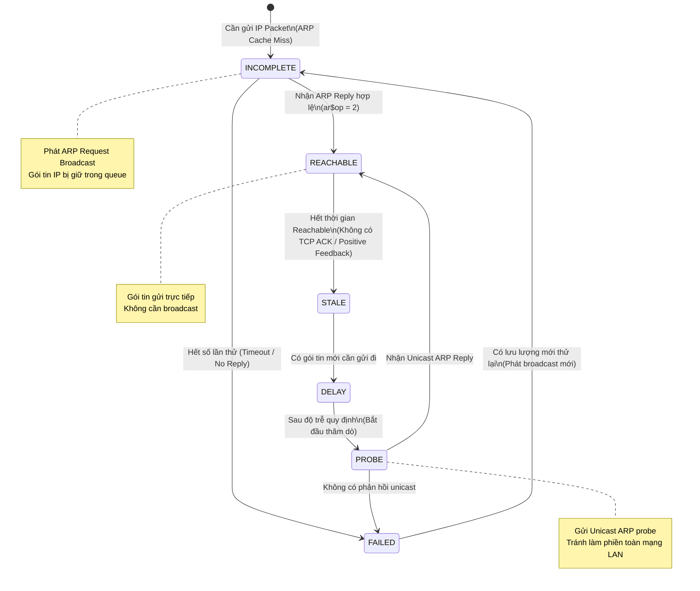
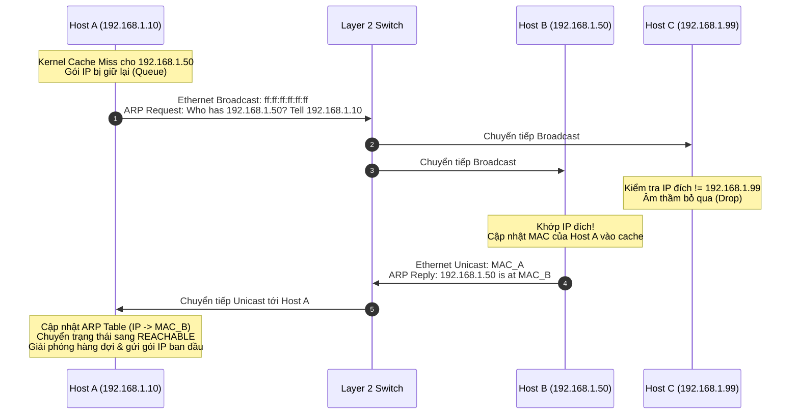

# 5_1_2 Address Resolution Inspection

> **Khóa học**: Cloud DevOps Basic — Wire-Level Diagnostics  
> **Phân nhóm**: 5 Domain 5 - Wire-Level Network Inspection and Diagnostics › 5_1 Wire-Level Inspection and Diagnostic Toolkit  
> **Chủ đề**: Phân giải địa chỉ L2/L3: Khảo sát ARP Cache, máy trạng thái NUD (Neighbor Unreachability Detection) và thao tác chẩn đoán với ip neigh / arp  
> **Trạng thái**: Draft  
> **Checklist đối chiếu**: [5_1_2](../../../CHECKLIST.md#51-wire-level-inspection-and-diagnostic-toolkit)  

---

## 1. Khái Niệm Cốt Lõi & Bản Chất Kỹ Thuật (Core Concepts & Technical Deep Dive)

Trong mạng cục bộ Ethernet (IEEE 802.3), các gói tin IP (Layer 3) không thể trực tiếp truyền dẫn trên dây cáp nếu thiếu khung đóng gói Ethernet (Layer 2). Địa chỉ logic IP phải được ánh xạ chính xác sang địa chỉ vật lý MAC (Media Access Control) của card mạng đích hoặc của Default Gateway trung gian. Giao thức giải quyết nhiệm vụ này là **ARP (Address Resolution Protocol - RFC 826)**.

Để tránh việc mỗi gói tin gửi đi đều phải phát sóng quảng bá hỏi tìm địa chỉ MAC, hệ điều hành duy trì một cấu trúc dữ liệu trong bộ nhớ hạt nhân (kernel memory) gọi là **ARP Cache** (hay **Neighbor Table** trong Linux).

```
+-------------------------------------------------------------------------+
|                  Cấu trúc phân giải địa chỉ tầng liên kết                 |
|                                                                         |
|   IP Packet (L3)  --->  Tra cứu Neighbor Table  --->  Ethernet Frame    |
|   [Dst: 192.168.1.50]   [IP -> MAC Mapping]          [Dst MAC: 52:54..] |
+-------------------------------------------------------------------------+
```

---

### 1.1 Cơ Chế Xử Lý ARP Cache Miss & Vòng Đời Bản Tin

Khi một ứng dụng gửi dữ liệu tới một địa chỉ IP cục bộ nhưng trong bộ nhớ đệm chưa có thông tin MAC tương ứng (**ARP Cache Miss**), ngăn xếp mạng của hệ điều hành sẽ thực hiện chuỗi quy trình chuẩn theo RFC 826:

1. **Tạm giữ gói tin (Packet Queuing)**: Gói tin IP xuất phát (outbound packet) được giữ lại trong hàng đợi của subsystem mạng tại kernel.
2. **Phát sóng ARP Request (Broadcast)**: Host nguồn đóng khung bản tin ARP Request với mã thao tác `ar$op = REQUEST (1)`. Địa chỉ MAC đích của khung Ethernet là địa chỉ quảng bá `ff:ff:ff:ff:ff:ff`, gửi đến mọi máy trạm trong cùng Broadcast Domain:
   > *"Ai đang nắm giữ IP 192.168.1.50, hãy trả lời về cho 192.168.1.10 kèm theo MAC của bạn!"*
3. **Phản hồi ARP Reply (Unicast)**: Nút mạng sở hữu đúng địa chỉ IP mục tiêu sẽ phản hồi bằng bản tin ARP Reply với mã thao tác `ar$op = REPLY (2)`. Bản tin này được gửi trực tiếp (unicast) về MAC của host nguồn.
4. **Cập nhật Cache & Truyền gói**: Kernel host nguồn nhận ARP Reply, ghi nhận ánh xạ IP sang MAC vào Neighbor Table, sau đó giải phóng gói tin IP đang bị xếp hàng và gửi đi trên dây.

---

### 1.2 Máy Trạng Thái NUD (Neighbor Unreachability Detection) trong Linux Kernel

Hệ điều hành Linux hiện đại không coi ARP chỉ là một danh sách bảng tĩnh mà quản lý thông qua máy trạng thái **NUD (Neighbor Unreachability Detection - RFC 4861 / ip-neighbour(8))**. Máy trạng thái này giám sát liên tục tính khả dụng của từng nút mạng lân cận:

| Trạng thái NUD | Ý nghĩa kỹ thuật | Hành vi của Kernel |
| :--- | :--- | :--- |
| **`INCOMPLETE`** | Đang trong quá trình phân giải địa chỉ. | Kernel đã phát ARP Request broadcast và đang giữ gói tin trong hàng đợi chờ ARP Reply. |
| **`REACHABLE`** | Nút lân cận hợp lệ và có thể tiếp cận được. | Bản ghi hoàn toàn tin cậy; các gói tin được đẩy trực tiếp ra card mạng mà không cần thăm dò thêm. |
| **`STALE`** | Bản ghi hợp lệ nhưng đã hết hạn xác thực gần nhất. | Kernel chưa nhận được phản hồi tích cực (positive feedback như TCP ACK) trong một khoảng thời gian. Bản ghi vẫn cho phép gửi gói tin nhưng sẽ kích hoạt kiểm tra lại khi có lưu lượng. |
| **`DELAY`** | Tạm hoãn kiểm tra lân cận trong chốc lát. | Kernel chờ tín hiệu xác nhận từ tầng trên trước khi chủ động gửi gói tin thăm dò. |
| **`PROBE`** | Đang thăm dò chủ động tính khả dụng. | Kernel gửi trực tiếp các gói thăm dò đơn hướng (**unicast ARP probes**) tới MAC đã biết để kiểm tra nút mạng còn sống hay không. |
| **`FAILED`** | Phân giải thất bại hoặc vượt quá số lần thăm dò. | Không nhận được phản hồi; bản ghi không hợp lệ, kernel hủy bỏ các gói tin đang chờ và trả mã lỗi cho ứng dụng (ví dụ: `EHOSTUNREACH`). |
| **`PERMANENT`** | Bản ghi tĩnh được gán thủ công bởi quản trị viên. | Không bao giờ hết hạn, không bị bộ gom rác (garbage collector) xóa bỏ. |
| **`NOARP`** | Giao diện mạng không cần phân giải ARP. | Áp dụng cho các giao diện ảo hoặc loopback. |

---

### 1.3 Tác Động Của Việc Xóa Cache (Cache Invalidation & Flushing)

Khi thực hiện xóa bảng lân cận bằng lệnh `ip neigh flush` (Linux) hoặc `arp -d` (Windows/Linux):
- Toàn bộ các bản ghi động (`dynamic entries`) bị xóa sổ ngay lập tức khỏi bộ nhớ RAM.
- Mọi luồng dữ liệu outbound tiếp theo đến các địa chỉ IP này sẽ bị gián đoạn tức thời: kernel đưa trạng thái bản ghi về `INCOMPLETE`.
- Kernel buộc phải phát sóng lại các gói tin ARP Request broadcast trên dây cáp mạng để học lại địa chỉ MAC.
- Trong môi trường sản xuất có lưu lượng kết nối cực lớn (High Concurrency / Microservices), việc xóa toàn bộ ARP Cache có thể gây ra **hiện tượng bão broadcast tạm thời (Broadcast Spike)** và làm tăng đột biến độ trễ (latency jitter) cho các gói tin đầu tiên của mỗi luồng.

---

## 2. Ví Dụ Đời Sống Thực Tế Dễ Hiểu (Intuitive Real-World Analogies)

### Ẩn dụ: "Cuốn Sổ Danh Bạ Bàn Thư Ký và Loa Phát Thanh Tòa Nhà"

Hãy tưởng tượng bạn là một **Thư ký văn phòng** tiếp nhận bưu phẩm hàng ngày gửi đến các nhân viên trong công ty:

1. **Cuốn sổ danh bạ tạm thời (ARP Cache)**:
   - Trên bì thư chỉ ghi tên phòng ban và chức danh logic: *"Trưởng phòng Kế toán — Nguyễn Văn A"* (Địa chỉ IP).
   - Nhưng để đưa tận tay bưu phẩm, bạn phải biết chính xác anh A đang ngồi làm việc ở **Bàn số 15, Dãy B** (Địa chỉ MAC vật lý).
   - Bạn mở cuốn sổ danh bạ trên bàn ra tra cứu. Nếu thấy tên anh A ghi kèm Bàn 15, bạn đi thẳng đến đó giao hàng mà không cần hỏi ai (`REACHABLE`).

2. **Khi không tìm thấy thông tin (ARP Cache Miss)**:
   - Một bưu phẩm mới gửi đến cho *"Chuyên viên IT — Trần B"*, nhưng tên anh B chưa có trong sổ.
   - Bạn không thể vứt bưu phẩm đi, đành phải giữ kiện hàng lại trên khay chờ (`Packet Queuing`).
   - Bạn cầm micro phát thanh lên toàn bộ loa của tòa nhà: *"Anh Trần B đang ở bàn nào, xin báo về bàn thư ký!"* (`ARP Request Broadcast`).
   - Cả công ty đều nghe thấy thông báo, nhưng chỉ riêng anh Trần B bước lại bàn thư ký nói khẽ: *"Tôi là Trần B, tôi ngồi ở Bàn 42"* (`ARP Reply Unicast`).
   - Bạn ghi ngay thông tin vào sổ (`Update Cache`), rồi lấy kiện hàng ra giao tận tay anh B.

3. **Mực bay màu và xóa danh bạ (`STALE` và `Cache Flush`)**:
   - Nhân viên có thể đổi bàn làm việc bất cứ lúc nào. Vì vậy, các dòng chữ trong sổ được viết bằng mực tự bay màu: sau vài ngày không có thư từ qua lại, dòng chữ mờ đi thành diện nghi vấn (`STALE`).
   - Nếu sếp yêu cầu: *"Xóa sạch cuốn danh bạ này đi làm lại từ đầu!"* (`ip neigh flush` / `arp -d`), toàn bộ trang sổ bị xé bỏ. Khi có kiện hàng tiếp theo đến, bạn buộc phải cầm loa phát thanh hỏi lại từng người một, gây ồn ào khắp phòng làm việc.

---

## 3. Kiến Trúc, Luồng Hoạt Động & Hình Ảnh Trực Quan (Architecture, Diagrams & Visual Media)

### Sơ Đồ Máy Trạng Thái NUD & Chu Trình Phân Giải Địa Chỉ Lân Cận



---

### Sơ Đồ Trao Đổi Gói Tin ARP Trên Đường Truyền



---

## 4. Thực Hành (Hands-on)

> ⚠️ Lệnh và đầu ra mẫu minh họa hệ thống Linux/Windows

### 4.1 Khảo Sát Bảng Lân Cận Trên Linux Bằng `ip neigh` và `arp`

Công cụ hiện đại chuẩn hóa trên toàn bộ các bản phân phối Linux thuộc bộ công cụ `iproute2` là `ip neigh`.

#### Bước 1: Liệt kê các bản ghi lân cận hiện có
```bash
ip neigh show
```
*Đầu ra mẫu:*
```text
192.168.1.1 dev eth0 lladdr 52:54:00:12:34:56 REACHABLE
192.168.1.50 dev eth0 lladdr 00:15:5d:01:aa:bb STALE
192.168.1.200 dev eth0  FAILED
10.0.0.1 dev eth1 lladdr 00:0c:29:ab:cd:ef PERMANENT
```
*Giải thích các trường đầu ra:*
- `192.168.1.1`: Địa chỉ IP logic của thiết bị lân cận.
- `dev eth0`: Giao diện mạng vật lý mà kernel dùng để liên lạc với nút này.
- `lladdr 52:54:00:12:34:56`: Địa chỉ tầng liên kết (Link-Layer Address - MAC).
- `REACHABLE` / `STALE` / `FAILED` / `PERMANENT`: Trạng thái NUD của bản ghi.

#### Bước 2: Kiểm tra với công cụ truyền thống `arp` (Net-tools)
```bash
arp -a -n
```
*Đầu ra mẫu:*
```text
? (192.168.1.1) at 52:54:00:12:34:56 [ether] on eth0
? (192.168.1.50) at 00:15:5d:01:aa:bb [ether] on eth0
```
*(Tham số `-n` ngăn chặn việc phân giải ngược DNS tên miền, giúp hiển thị ngay tức thì địa chỉ IP dạng số).*

---

### 4.2 Thao Tác Xóa Bộ Nhớ Đệm ARP và Quan Sát Phân Giải Lại

#### Bước 1: Xóa một mục cụ thể hoặc toàn bộ bộ nhớ đệm trên Linux
```bash
# Xóa bản ghi của một IP duy nhất
sudo ip neigh del 192.168.1.50 dev eth0
# Hoặc bằng lệnh net-tools truyền thống
sudo arp -d 192.168.1.50

# Xóa toàn bộ bản ghi trên giao diện eth0 (Flush)
sudo ip neigh flush dev eth0
```

#### Bước 2: Kích hoạt lưu lượng mới và quan sát trạng thái chuyển đổi
```bash
# Gửi 1 gói tin ping để kích hoạt phân giải
ping -c 1 192.168.1.50

# Kiểm tra lại bảng lân cận ngay lập tức
ip neigh show to 192.168.1.50
```
*Đầu ra mẫu sau khi ping thành công:*
```text
192.168.1.50 dev eth0 lladdr 00:15:5d:01:aa:bb REACHABLE
```

---

### 4.3 Khảo Sát và Quản Lý ARP Cache Trên Microsoft Windows

Trên hệ điều hành Windows, lệnh `arp.exe` được sử dụng thông qua Command Prompt hoặc PowerShell.

#### Bước 1: Hiển thị bảng ARP trên mọi giao diện mạng
```cmd
arp -a
```
*Đầu ra mẫu trên Windows:*
```text
Interface: 192.168.1.10 --- 0xb
  Internet Address      Physical Address      Type
  192.168.1.1           52-54-00-12-34-56     dynamic
  192.168.1.50          00-15-5d-01-aa-bb     dynamic
  192.168.1.255         ff-ff-ff-ff-ff-ff     static
  224.0.0.22            01-00-5e-00-00-16     static
```

#### Bước 2: Xóa bộ nhớ đệm ARP trên Windows
> ⚠️ **Lưu ý đặc thù Windows**: Lệnh xóa bảng ARP yêu cầu chạy trong **Elevated Prompt (Run as Administrator)**. Nếu chạy dưới quyền user thông thường, hệ thống sẽ báo lỗi `The ARP entry deletion failed: Access is denied.`

```cmd
:: Xóa một bản ghi đơn lẻ
arp -d 192.168.1.50

:: Xóa toàn bộ bảng ARP trên tất cả các interface
arp -d *
```

---

## 5. Cạm Bẫy Thực Tế & Thực Tiễn Sản Xuất (Production Gotchas & Best Practices)

### 5.1 Cạm Bẫy Lỗ Hổng Bảo Mật: ARP Spoofing / Poisoning
- **Bản chất**: Giao thức ARP nguyên bản (RFC 826) hoàn toàn **không có cơ chế xác thực** danh tính (stateless and trust-based). Bất kỳ máy trạm nào trong cùng mạng LAN cũng có thể gửi bản tin ARP Reply giả mạo (Gratuitous ARP hoặc Unsolicited ARP Reply) khẳng định địa chỉ IP của Default Gateway đang thuộc về MAC của kẻ tấn công.
- **Hậu quả**: Kẻ tấn công thực hiện thành công tấn công Man-in-the-Middle (MitM), chặn bắt toàn bộ dữ liệu ra vào mạng.
- **Thực tiễn khắc phục**:
  - Triển khai tính năng **Dynamic ARP Inspection (DAI)** trên các Switch mạng quản lý được, đối chiếu với cơ sở dữ liệu DHCP Snooping Binding Table.
  - Trong các hệ thống máy chủ tài chính hoặc gateway trọng yếu, cấu hình địa chỉ MAC cố định bằng bản ghi tĩnh (`permanent` entry):
    ```bash
    sudo ip neigh replace 192.168.1.1 lladdr 52:54:00:12:34:56 dev eth0 nud permanent
    ```

### 5.2 Sự Cố Bão Broadcast Khi Dùng `ip neigh flush` Hàng Loạt
- **Cạm bẫy**: Khi khắc phục sự cố kết nối, kỹ sư DevOps chạy lệnh `ip neigh flush dev eth0` trên các cụm máy chủ container/Kubernetes node có hàng nghìn endpoint kết nối đồng thời.
- **Hậu quả**: Toàn bộ các kết nối đồng loạt phát sinh ARP Miss, tạo ra một cơn **bão phát thanh ARP (Broadcast Storm)** làm nghẽn switch L2 và tăng CPU interrupt của toàn bộ các card mạng trong VLAN.
- **Best Practice**: Chỉ xóa có chọn lọc bản ghi cụ thể bằng `ip neigh del <IP> dev <DEV>` thay vì flush toàn bộ bảng khi chưa đánh giá lưu lượng.

### 5.3 Trạng Thái Kẹt `FAILED` Gây Mất Kết Nối Ảo
- Khi một máy chủ đích vừa tắt nguồn hoặc đổi địa chỉ IP, bản ghi lân cận trên host nguồn sẽ chuyển sang `FAILED`.
- Một số ứng dụng socket khi nhận lỗi này từ kernel sẽ không thử kết nối lại ngay mà rơi vào vòng lặp chờ vô hạn. Việc kiểm tra `ip neigh show | grep FAILED` là bước sàng lọc đầu tiên cực kỳ quan trọng khi ứng dụng báo lỗi "No route to host" hoặc "Destination Host Unreachable" trong cùng dải mạng nội bộ.

---

## 6. Câu Hỏi Củng Cố Kiến Thức (Active Recall Quiz)

### Câu hỏi 1:
Trong kết quả kiểm tra bằng lệnh `ip neigh show` trên máy chủ Linux Ubuntu, bạn thấy dòng trạng thái sau:
`192.168.1.120 dev eth0 lladdr 00:16:3e:4a:22:11 STALE`
Điều này có nghĩa là gì? Nếu ngay tại thời điểm này máy chủ của bạn gửi một gói tin HTTP GET tới `192.168.1.120`, kernel Linux sẽ làm gì đầu tiên?

<details>
<summary>Đáp án chi tiết</summary>

- **Ý nghĩa của trạng thái `STALE`**: Bản ghi ánh xạ IP-to-MAC này vẫn hợp lệ, tuy nhiên đã lâu kernel chưa nhận được phản hồi xác nhận tích cực (như TCP ACK) từ địa chỉ này nên tính khả dụng của nó đang bị đưa vào diện "nghi vấn".
- **Hành vi của Kernel**: Kernel sẽ **không** hủy gói tin cũng như **chưa phát broadcast ngay lập tức**. Kernel vẫn sử dụng địa chỉ MAC `00:16:3e:4a:22:11` hiện có để đóng khung Ethernet và gửi gói tin HTTP GET đi, đồng thời chuyển trạng thái bản ghi sang `DELAY` rồi `PROBE` để chủ động gửi gói tin unicast ARP probe thăm dò xác nhận lại thiết bị đích.

</details>

---

### Câu hỏi 2:
Một kỹ sư mạng thay thế card mạng vật lý mới cho Gateway trung tâm (`10.0.0.1`), khiến địa chỉ MAC của gateway bị thay đổi. Tuy nhiên, một số máy chủ ứng dụng chạy Windows Server trong mạng nội bộ vẫn không thể truy cập Internet và liên tục gửi gói tin tới địa chỉ MAC cũ. Bạn yêu cầu kỹ sư chạy lệnh `arp -d *` trên Windows để xóa cache nhưng bị báo lỗi `Access is denied`. Nguyên nhân là gì và cơ chế phân giải sẽ diễn ra như thế nào sau khi lệnh được chạy thành công?

<details>
<summary>Đáp án chi tiết</summary>

1. **Nguyên nhân lỗi `Access is denied`**: Trên hệ điều hành Windows, thao tác thay đổi hoặc xóa bộ nhớ đệm ARP (`arp -d`) can thiệp trực tiếp vào bảng định tuyến và giao diện tầng liên kết của kernel, do đó Windows bắt buộc lệnh phải được thực thi trong một Command Prompt hoặc PowerShell có quyền quản trị viên cao nhất (**Run as Administrator / Elevated Prompt**).
2. **Cơ chế sau khi xóa thành công**: Sau khi xóa bảng ARP, bản ghi cũ bị loại bỏ hoàn toàn. Khi máy chủ Windows gửi gói tin ra ngoài Internet, kernel phát hiện thiếu MAC của Default Gateway (`10.0.0.1`), đưa trạng thái sang cache miss, tạm giữ gói tin trong hàng đợi và phát bản tin `ARP Request broadcast` ra mạng nội bộ. Gateway mới sẽ phản hồi `ARP Reply unicast` chứa địa chỉ MAC mới, giúp máy chủ cập nhật cache và khôi phục thông tuyến Internet.

</details>

---

### Câu hỏi 3:
Tại sao trong máy trạng thái NUD của Linux kernel, khi chuyển từ `STALE` sang thăm dò tính khả dụng của nút mạng, kernel lại ưu tiên gửi **Unicast ARP Probe** thay vì gửi ngay **Broadcast ARP Request**?

<details>
<summary>Đáp án chi tiết</summary>

- **Bản chất kỹ thuật**: Gói tin ARP Request broadcast có địa chỉ MAC đích là `ff:ff:ff:ff:ff:ff`. Khi switch nhận được khung quảng bá này, nó bắt buộc phải sao chép (flood) khung tin ra toàn bộ các cổng mạng trong cùng VLAN, buộc vi xử lý và card mạng của mọi máy trạm khác trong mạng phải tiếp nhận và xử lý ngắt (interrupt) để đọc nội dung gói tin.
- **Lý do dùng Unicast ARP Probe**: Khi một bản ghi chuyển sang `PROBE`, kernel đã nắm giữ địa chỉ MAC trước đó của host đích. Việc gửi unicast probe trực tiếp tới MAC này cho phép switch chuyển tiếp khung tin thẳng tới đúng cổng của host đó mà không làm phiền đến bất kỳ máy trạm nào khác trong mạng, giúp tiết kiệm triệt để băng thông và ngăn ngừa nguy cơ bão quảng bá trong các mạng doanh nghiệp quy mô lớn.

</details>

---

## 7. 📚 Nguồn Tài Liệu Chính Thống (Tier-1 Official References)

- [RFC 826: An Ethernet Address Resolution Protocol](https://datatracker.ietf.org/doc/html/rfc826) — Đặc tả giao thức chuẩn hóa phân giải địa chỉ logic sang địa chỉ vật lý mạng cục bộ.
- [Linux Kernel Manual - ip-neighbour(8)](https://man7.org/linux/man-pages/man8/ip-neighbour.8.html) — Tài liệu chính thức về cú pháp quản trị bảng lân cận và máy trạng thái NUD trên Linux iproute2.
- [Linux Kernel Manual - arp(7)](https://man7.org/linux/man-pages/man7/arp.7.html) — Tài liệu ngăn xếp giao thức ARP trong hạt nhân Linux và các tham số điều khiển sysctl.
- [Microsoft Learn: arp command reference](https://learn.microsoft.com/en-us/windows-server/administration/windows-commands/arp) — Hướng dẫn và cú pháp tiện ích ARP chính thức trên hệ điều hành Windows Server.
