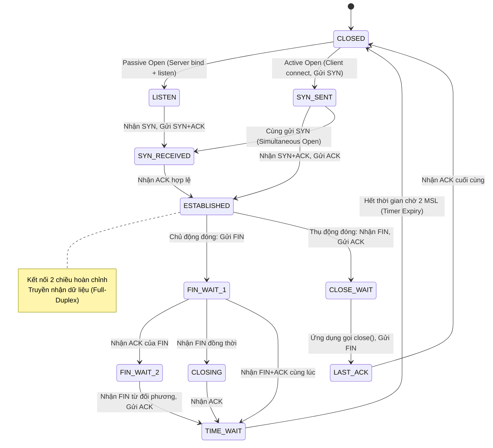
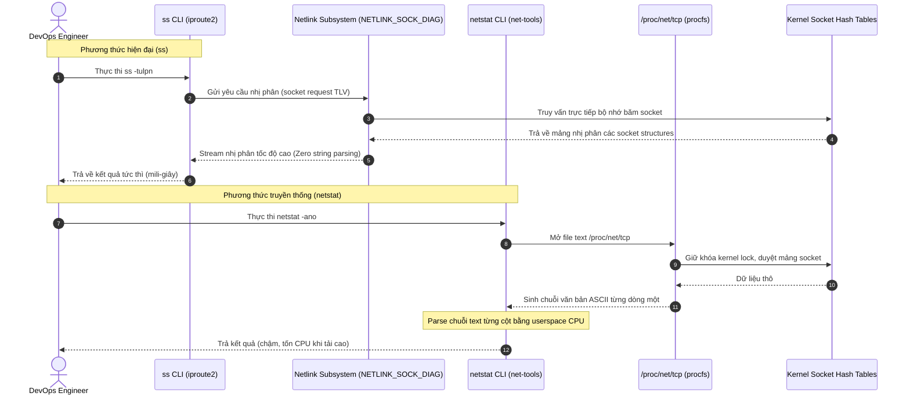

# 5_1_3 Socket and Connection Inspection

> **Khóa học**: Cloud DevOps Basic — Wire-Level Diagnostics  
> **Phân nhóm**: 5 Domain 5 - Wire-Level Network Inspection and Diagnostics › 5_1 Wire-Level Inspection and Diagnostic Toolkit  
> **Chủ đề**: Khảo sát socket và kết nối mạng: Phân tích 11 trạng thái TCP, socket 4-tuple, ánh xạ PID và so sánh ss (-tulpn) với netstat (-ano)  
> **Trạng thái**: Draft  
> **Checklist đối chiếu**: [5_1_3](../../../CHECKLIST.md#51-wire-level-inspection-and-diagnostic-toolkit)  

---

## 1. Khái Niệm Cốt Lõi & Bản Chất Kỹ Thuật (Core Concepts & Technical Deep Dive)

Trong kiến trúc mạng TCP/IP và hệ điều hành hiện đại, việc truyền tải dữ liệu giữa các tiến trình không dừng lại ở mức gói tin IP thô trên dây cáp, mà được trừu tượng hóa thông qua giao diện lập trình **Socket (Ổ cắm mạng)**. Để vận hành, gỡ lỗi và tối ưu hóa hệ thống máy chủ Cloud/DevOps chịu tải cao, kỹ sư bắt buộc phải nắm vững bản chất tầng nhân (kernel internals) của socket, chu trình 11 trạng thái TCP, cơ chế ánh xạ tiến trình và công cụ thanh tra kết nối.

---

### 1.1 Khái Niệm Socket và Cấu Trúc Định Danh 4-Tuple

Một socket mạng không phải là một thiết bị phần cứng, mà là một **điểm cuối truyền thông (communication endpoint)** được quản lý bởi nhân hệ điều hành (kernel). Một kết nối TCP hai chiều hoàn chỉnh giữa hai ứng dụng trên mạng được định danh duy nhất bởi một bộ 4 thông số gọi là **Socket 4-Tuple**:

$$\text{TCP Connection} = (\text{Source IP}, \text{Source Port}, \text{Destination IP}, \text{Destination Port})$$

*(Khi tính cả giao thức tầng mạng/vận chuyển như TCP hoặc UDP, cấu trúc này được gọi là **5-Tuple**)*.

```
+---------------------------------------------------------------------------------------+
|                                    SOCKET 4-TUPLE                                     |
|                                                                                       |
|   Client Endpoint                           Server Endpoint                           |
|   +-----------------------+                 +-----------------------+                 |
|   | IP:   192.168.1.100   | <=============> | IP:   10.0.0.15       |                 |
|   | Port: 54321           |   TCP Stream    | Port: 443 (HTTPS)     |                 |
|   +-----------------------+                 +-----------------------+                 |
|   (Ephemeral Client Port)                   (Well-Known Server Port)                  |
+---------------------------------------------------------------------------------------+
```

- **Ephemeral Port**: Phía client tự động được kernel cấp một cổng tạm thời trong dải động (thường từ $32768$ đến $60999$ trên Linux hoặc $49152$ đến $65535$ theo IANA).
- **Listening Socket vs Connected Socket**: Trên server, một cổng duy nhất (ví dụ: port 443 của NGINX) có thể phục vụ đồng thời hàng chục nghìn client khác nhau. Điều này hoàn toàn khả thi vì mỗi kết nối được phân biệt bằng địa chỉ IP nguồn và cổng nguồn của từng client trong bảng băm kết nối (connection hash table) của kernel.

---

### 1.2 Máy Trạng Thái TCP (11 Trạng Thái Chuẩn RFC 9293)

Giao thức truyền vận có bảo đảm **TCP (Transmission Control Protocol)** hoạt động theo mô hình máy trạng thái hữu hạn (**Finite State Machine - FSM**). Theo đặc tả chính thức tại **RFC 9293 (thay thế RFC 793)**, một phiên kết nối TCP trải qua tối đa 11 trạng thái kỹ thuật:

| Trạng thái TCP | Mô tả kỹ thuật tầng nhân | Vai trò thông thường |
| :--- | :--- | :--- |
| **`LISTEN`** | Socket thụ động (passive socket) đang chờ nhận yêu cầu kết nối đến từ các client từ xa. | Server Daemon |
| **`SYN-SENT`** | Phía chủ động mở kết nối (active open) đã gửi gói tin SYN kèm chuỗi Sequence ban đầu và đang chờ SYN+ACK từ phía đối diện. | Client khởi tạo |
| **`SYN-RECEIVED`** | Máy chủ nhận được gói tin SYN, đã phản hồi lại gói tin SYN+ACK và đang chờ ACK cuối cùng từ client để hoàn tất bắt tay 3 bước. | Server bắt tay |
| **`ESTABLISHED`** | Bắt tay 3 bước hoàn tất thành công. Kết nối hai chiều đã sẵn sàng; ứng dụng có thể truyền và nhận luồng dữ liệu (data stream). | Cả hai phía |
| **`FIN-WAIT-1`** | Phía chủ động đóng kết nối (active close) đã gọi hàm `close()` / `shutdown()` và gửi gói tin kết thúc `FIN` đi, đang chờ ACK từ bên kia. | Bên chủ động ngắt |
| **`FIN-WAIT-2`** | Phía chủ động ngắt đã nhận được ACK cho gói FIN của mình; hiện đang tiếp tục chờ gói tin `FIN` từ phía đối diện gửi tới. | Bên chủ động ngắt |
| **`CLOSE-WAIT`** | Phía thụ động đóng kết nối (passive close) nhận được `FIN` từ đối phương, kernel đã tự động gửi ACK và đang **chờ ứng dụng cục bộ gọi lệnh đóng socket (`close()`)**. | Bên thụ động ngắt |
| **`CLOSING`** | Cả hai đầu mút đồng thời chủ động gửi gói tin `FIN` (simultaneous close); đã nhận được FIN từ đối phương nhưng chưa nhận được ACK cho gói FIN của chính mình. | Cả hai phía |
| **`LAST-ACK`** | Phía thụ động ngắt sau khi ứng dụng cục bộ đã gọi `close()`, gửi gói tin `FIN` của mình đi và đang chờ gói ACK cuối cùng từ phía bên kia. | Bên thụ động ngắt |
| **`TIME-WAIT`** | Phía chủ động ngắt đã nhận được FIN từ đối phương và đã gửi ACK cuối cùng. Socket tạm dừng lại trong khoảng thời gian **2 MSL (Maximum Segment Lifetime)** trước khi giải phóng hoàn toàn tài nguyên. | Bên chủ động ngắt |
| **`CLOSED`** | Trạng thái ảo (fictional state) biểu thị socket không còn tồn tại hoặc đã được giải phóng hoàn toàn khỏi bộ nhớ kernel. | Điểm kết thúc |

---

### 1.3 Cơ Chế Hạt Nhân: Tại Sao `ss` Nhanh Vượt Trội So Với `netstat`?

Trong nhiều năm, công cụ truyền thống `netstat` (thuộc bộ `net-tools`) là lựa chọn mặc định. Tuy nhiên trên các máy chủ hiện đại, `netstat` đã bị loại bỏ và thay thế hoàn toàn bởi lệnh `ss` (Socket Statistics thuộc bộ `iproute2`). Sự khác biệt này bắt nguồn từ cơ chế giao tiếp sâu bên trong Linux Kernel:

```
+-----------------------------------------------------------------------------------------+
|                  CƠ CHẾ TRUY XUẤT THÔNG TIN SOCKET TRONG LINUX KERNEL                  |
|                                                                                         |
|  [ netstat ]                                      [ ss (Socket Statistics) ]            |
|       |                                                        |                        |
|       | 1. open("/proc/net/tcp")                               | 1. socket(AF_NETLINK,  |
|       v                                                        |           NETLINK_     |
|  +---------------------------+                                 |           SOCK_DIAG)   |
|  | procfs Pseudo-filesystem  |                                 v                        |
|  | - Duyệt tuần tự text      |                    +---------------------------+         |
|  | - Parse chuỗi ASCII       |                    | Kernel sock_diag module   |         |
|  | - O(N) chuỗi ký tự thô    |                    | - Cấu trúc nhị phân (TLV) |         |
|  +---------------------------+                    | - Lọc socket tại kernel   |         |
|       |                                           | - Zero-copy buffer dump   |         |
|       v                                           +---------------------------+         |
|  User Space Parsing overhead                                   |                        |
|  (Tốn CPU, rất chậm khi >10k socket)                           v                        |
|                                                   Direct Binary Stream to User Space    |
|                                                   (Nhanh gấp hàng chục đến hàng trăm lần|
+-----------------------------------------------------------------------------------------+
```

1. **Cơ chế của `netstat` qua `/proc/net/tcp`**:
   - `netstat` đọc dữ liệu từ tập tin ảo `/proc/net/tcp` và `/proc/net/tcp6`.
   - Kernel Linux phải chuyển đổi toàn bộ cấu trúc dữ liệu socket trong bộ nhớ nội bộ thành các chuỗi văn bản ASCII định dạng sẵn theo từng dòng.
   - Quá trình này đòi hỏi cấp phát bộ nhớ chuỗi, khóa hạt nhân (kernel lock) và sao chép tuần tự từng dòng văn bản lên không gian người dùng (userspace). Khi máy chủ có hàng chục nghìn đến hàng trăm nghìn socket đồng thời, thao tác đọc file `/proc` này gây nghẽn I/O ảo và ngốn CPU nghiêm trọng.

2. **Cơ chế của `ss` qua Netlink `NETLINK_SOCK_DIAG` (RFC 3549 / sock_diag(7))**:
   - `ss` thiết lập một socket Netlink chuyên dụng thuộc họ `AF_NETLINK` với giao thức `NETLINK_SOCK_DIAG`.
   - Lệnh gửi trực tiếp cấu trúc bản tin nhị phân yêu cầu kernel trích xuất dữ liệu socket.
   - Module `sock_diag` trong kernel duyệt trực tiếp các bảng băm socket nội bộ và trả về kết quả dưới dạng chuỗi các thuộc tính nhị phân **TLV (Type-Length-Value)** mà không phải định dạng văn bản trung gian.
   - Cơ chế này hỗ trợ đẩy điều kiện lọc (kernel-side filtering) xuống ngay tầng hạt nhân, giúp `ss` phản hồi gần như tức thì ngay cả trên các hệ thống có hơn 100.000 kết nối hoạt động.

---

### 1.4 Cơ Chế Ánh Xạ Giữa Socket và Tiến Trình (PID)

Làm thế nào hệ điều hành biết được kết nối nào thuộc về tiến trình (PID) nào?

```
+---------------------------------------------------------------------------------------+
|                    QUY TRÌNH ÁNH XẠ SOCKET INODE VÀ TIẾN TRÌNH (PID)                  |
|                                                                                       |
|   Kernel Socket Table                                    Filesystem procfs            |
|   +-----------------------+                              +-----------------------+    |
|   | Socket 4-Tuple        |                              | Process PID 1420      |    |
|   | 10.0.0.15:443         |                              | (nginx worker)        |    |
|   | Inode: ino:384912 <---+                              +-----------------------+    |
|   +-----------------------+                                          |                |
|                                                                      v                |
|                                                          /proc/1420/fd/               |
|                                                          |-- 0 -> /dev/null           |
|                                                          |-- 1 -> /var/log/nginx.log  |
|                                                          `-- 6 -> socket:[384912] ----+
|                                                                                       |
|   ==> Khớp số hiệu Inode (384912) xác định chính xác PID 1420 sở hữu socket!          |
+---------------------------------------------------------------------------------------+
```

1. Mọi tài nguyên I/O trong Linux (bao gồm cả socket) đều tuân theo triết lý *"Everything is a file"*. Khi hàm `socket()` được gọi, kernel cấp phát một inode mạng tương ứng với số định danh duy nhất (ví dụ: `inode = 384912`).
2. Tiến trình mở socket sẽ lưu trữ một bộ mô tả tệp tin (**File Descriptor - FD**) trỏ tới inode đó.
3. Trong thư mục ảo `/proc/<PID>/fd/`, mỗi file descriptor là một liên kết biểu tượng (symbolic link) có đích đến là `socket:[<inode>]`.
4. Khi chạy `ss -p` hoặc `netstat -p`, tiện ích sẽ đối chiếu số hiệu socket inode nhận được từ kernel với danh sách các link trong `/proc/[0-9]*/fd/` để xác định chính xác PID và tên nhị phân của tiến trình (`Process Name`).

---

### 1.5 Ý Nghĩa Các Hàng Đợi Recv-Q và Send-Q Trong Từng Trạng Thái

Hai cột `Recv-Q` (Receive Queue) và `Send-Q` (Send Queue) trong kết quả của lệnh `ss` có ngữ nghĩa kỹ thuật **hoàn toàn khác nhau** tùy thuộc vào trạng thái của socket:

```
+---------------------------------------------------------------------------------------+
|                   SỰ KHÁC BIỆT NGỮ NGHĨA CỦA Recv-Q VÀ Send-Q                         |
|                                                                                       |
|   Trạng thái LISTEN (Hàng đợi kết nối bắt tay):                                       |
|   - Recv-Q : Số kết nối đã hoàn tất bắt tay 3 bước đang chờ ứng dụng accept()         |
|   - Send-Q : Giới hạn tối đa của hàng đợi accept backlog (tham số backlog listen())   |
|                                                                                       |
|   Trạng thái ESTABLISHED (Bộ nhớ đệm luồng dữ liệu truyền dẫn):                       |
|   - Recv-Q : Số bytes dữ liệu đã nhận vào kernel buffer nhưng ứng dụng chưa read()    |
|   - Send-Q : Số bytes dữ liệu đã gửi nhưng CHƯA nhận được ACK từ máy đích             |
+---------------------------------------------------------------------------------------+
```

- **Khi Socket ở trạng thái `LISTEN`**:
  - `Send-Q`: Giới hạn dung lượng tối đa của hàng đợi kết nối (Accept Backlog limit) được thiết lập bởi tham số `backlog` trong lời gọi hệ thống `listen(int sockfd, int backlog)` và bị giới hạn bởi `net.core.somaxconn`.
  - `Recv-Q`: Số lượng kết nối hiện tại đã hoàn tất quá trình bắt tay TCP 3 bước và đang xếp hàng chờ tiến trình ứng dụng gọi hàm `accept()` để tiếp nhận. Nếu `Recv-Q` xấp xỉ hoặc vượt quá `Send-Q`, dịch vụ đang bị nghẽn (overloaded) và bắt đầu làm rơi gói SYN/ACK của các client mới.

- **Khi Socket ở trạng thái `ESTABLISHED` (hoặc non-listening)**:
  - `Recv-Q`: Kích thước dữ liệu (tính bằng byte) đã được tầng mạng tiếp nhận an toàn vào bộ đệm nhận (Socket Receive Buffer) của kernel nhưng ứng dụng tiến trình cục bộ chưa kịp gọi hàm `read()` / `recv()` để đọc ra.
  - `Send-Q`: Kích thước dữ liệu (tính bằng byte) đã được ứng dụng đẩy vào bộ đệm gửi (Socket Send Buffer) của kernel nhưng chưa nhận được gói xác nhận `ACK` từ máy trạm phía đối diện trên mạng.

---

## 2. Ví Dụ Đời Sống Thực Tế Dễ Hiểu (Intuitive Real-World Analogies)

### Ẩn dụ: "Tổng Đài Bưu Điện Thành Phố và Các Buồng Máy Điện Thoại"

Hãy hình dung tầng mạng giống như một **Tổng đài Bưu điện Viễn thông Trung tâm**:

1. **Bộ 4-Tuple (Số máy chủ, máy nhánh và đối tác)**:
   - Một doanh nghiệp có một đầu số tổng đài chính là `024-3888-9999` (Địa chỉ IP máy chủ), và chia ra nhiều số máy lẻ: Số máy lẻ 80 cho Lễ tân, số 443 cho Bộ phận Chăm sóc Khách hàng VIP (Các Well-Known Ports).
   - Khi một khách hàng từ chi nhánh Đà Nẵng dùng số điện thoại `0236-777-1234` nhấc máy lẻ 51234 gọi đến số 443 của tổng đài Hà Nội, toàn bộ cuộc gọi được định danh duy nhất bởi 4 thông số: `(0236-777-1234, máy lẻ 51234, 024-3888-9999, máy lẻ 443)`. Không thể nhầm lẫn với bất kỳ ai khác!

2. **Các trạng thái kỹ thuật**:
   - **`LISTEN`**: Nhân viên trực tổng đài tại máy lẻ 443 đã đeo tai nghe, bật công tắc đèn tín hiệu sáng xanh và ngồi chờ chuông reo.
   - **`SYN-SENT`**: Khách hàng vừa bấm xong dãy số gọi đi và đang nghe tiếng chuông tút... tút... ở đầu dây chờ phản hồi.
   - **`ESTABLISHED`**: Hai bên đã chào nhau xong (hoàn tất bắt tay 3 bước) và đang trực tiếp đàm thoại trao đổi thông tin.
   - **`TIME-WAIT`**: Sau khi một bên chủ động gác máy kết thúc cuộc gọi, nhân viên tổng đài chưa được phép gán ngay máy lẻ đó cho một cuộc gọi mới. Nhân viên phải giữ trạng thái line đó "đóng băng" trong đúng 2 phút (**2 MSL**) để bảo đảm các tín hiệu trễ hoặc tiếng vọng còn sót lại trên đường dây dây viễn thông hoàn toàn triệt tiêu, tránh việc người gọi tiếp theo vô tình nghe phải mảnh vụn của cuộc gọi trước!

3. **Sự khác biệt giữa `netstat` và `ss`**:
   - Khi Giám đốc muốn biết *"Hiện tại có bao nhiêu buồng điện thoại đang đàm thoại?"*:
     - **Cách của `netstat`**: Cử một nhân viên chạy bộ xuống tầng hầm, mở tủ hồ sơ giấy (`/proc/net/tcp`), lật từng trang giấy danh sách để ghi chép lại từng số điện thoại rồi gõ lại vào máy tính báo cáo. Nếu có 50.000 cuộc gọi, nhân viên sẽ kiệt sức và mất cả tiếng đồng hồ.
     - **Cách của `ss`**: Bấm nút tra cứu thẳng trên màn hình máy tính điều hành trung tâm kết nối trực tiếp vi mạch điện tử của tổng đài (`NETLINK_SOCK_DIAG`). Toàn bộ số liệu hiện ra trên màn hình chỉ trong 1 phần trăm giây!

---

## 3. Kiến Trúc, Luồng Hoạt Động & Hình Ảnh Trực Quan (Architecture, Diagrams & Visual Media)

### 3.1 Sơ Đồ Máy Trạng Thái TCP (FSM Architecture - RFC 9293)



---

### 3.2 Luồng Truy Vấn Netlink Của `ss` So Với Cơ Chế `netstat`



---

## 4. Thực Hành (Hands-on)

> ⚠️ Toàn bộ các câu lệnh thực chiến dưới đây có thể kiểm tra trực tiếp trên các bản phân phối Linux (Ubuntu, Debian, RHEL) và hệ điều hành Microsoft Windows Server / Desktop.

---

### 4.1 Khảo Sát Socket và Cổng Lắng Nghe Trên Linux Bằng `ss`

Lệnh `ss` cung cấp rất nhiều cờ mạnh mẽ để thanh tra trạng thái kết nối mạng:

```bash
# Cú pháp kinh điển để khảo sát toàn bộ cổng đang mở và dịch vụ sở hữu
sudo ss -tulpn
```

*Ý nghĩa các tham số kết hợp:*
- `-t`: Hiển thị socket giao thức **TCP**.
- `-u`: Hiển thị socket giao thức **UDP**.
- `-l`: Chỉ lọc các socket đang ở trạng thái **LISTEN** (cổng dịch vụ mở).
- `-p`: Hiển thị thông tin tiến trình sở hữu (**Process Name** và **PID**). *Yêu cầu quyền `sudo` để thấy tiến trình của user khác*.
- `-n`: Hiển thị địa chỉ và cổng ở dạng **số (numeric)**, không phân giải DNS hay tên dịch vụ (ví dụ hiện `443` thay vì `https`). Giúp lệnh chạy ngay tức khắc mà không bị treo do nghẽn DNS.

*Đầu ra mẫu khi chạy `ss -tulpn`:*
```text
Netid  State   Recv-Q  Send-Q   Local Address:Port   Peer Address:Port  Process
tcp    LISTEN  0       128            0.0.0.0:22          0.0.0.0:*      users:(("sshd",pid=842,fd=3))
tcp    LISTEN  0       511            0.0.0.0:80          0.0.0.0:*      users:(("nginx",pid=1230,fd=6),("nginx",pid=1231,fd=6))
tcp    LISTEN  0       4096         127.0.0.1:5432        0.0.0.0:*      users:(("postgres",pid=915,fd=7))
udp    UNCONN  0       0              0.0.0.0:53          0.0.0.0:*      users:(("systemd-resolve",pid=512,fd=12))
```

#### Lọc kết nối theo trạng thái máy trạng thái TCP:
```bash
# Xem toàn bộ kết nối đang hoạt động trao đổi dữ liệu (ESTABLISHED)
ss -t state established

# Xem các kết nối đang trong giai đoạn đóng băng chờ giải phóng (TIME-WAIT)
ss -t state time-wait

# Xem các kết nối đang kẹt chờ ứng dụng giải phóng (CLOSE-WAIT)
ss -t state close-wait
```

#### Lọc nâng cao theo cổng dịch vụ:
```bash
# Lọc toàn bộ kết nối có cổng nguồn hoặc cổng đích là 443 (HTTPS)
ss -t '( sport = :443 or dport = :443 )'

# Lọc các kết nối HTTP/HTTPS đang kết nối tới dải IP cụ thể
ss -t dst 192.168.1.0/24
```

---

### 4.2 Truy Vết Tiến Trình Chiếm Dụng Cổng (Troubleshooting Port Conflict)

Khi khởi động một dịch vụ (ví dụ: NGINX, Apache, Docker container) mà gặp thông báo lỗi kinh điển:
`bind() to 0.0.0.0:80 failed (98: Address already in use)`

Hãy thực hiện quy trình 3 bước sau để xử lý triệt để:

#### Bước 1: Xác định PID nào đang chiếm giữ cổng
```bash
sudo ss -tulpn | grep ':80 '
```
*Đầu ra mẫu:*
```text
tcp   LISTEN 0 128 0.0.0.0:80 0.0.0.0:* users:(("apache2",pid=4581,fd=4))
```

#### Bước 2: Kiểm tra chi tiết tiến trình trong hệ thống
```bash
ps -ef | grep 4581
```
*Đầu ra mẫu:*
```text
root      4581     1  0 10:00 ?        00:00:00 /usr/sbin/apache2 -k start
```

#### Bước 3: Kiểm chứng trực tiếp liên kết Socket Inode trong procfs
```bash
ls -l /proc/4581/fd/
```
*Đầu ra mẫu:*
```text
lrwx------ 1 root root 64 Nov 14 10:00 4 -> socket:[289145]
```
*(Khớp chính xác số inode `289145` được quản lý bởi kernel)*.

Dừng dịch vụ chiếm dụng không mong muốn:
```bash
sudo systemctl stop apache2
```

---

### 4.3 Khảo Sát Kết Nối Mạng Trên Microsoft Windows

Trên hệ điều hành Windows, công cụ dòng lệnh tiêu chuẩn là `netstat.exe` kết hợp cùng PowerShell hiện đại.

#### Bước 1: Khảo sát socket bằng `netstat -ano`
```cmd
netstat -ano
```
*Ý nghĩa các tham số:*
- `-a`: Hiển thị tất cả kết nối đang hoạt động và các cổng đang lắng nghe (`listening ports`).
- `-n`: Hiển thị địa chỉ và số hiệu cổng dưới dạng số (`numeric`).
- `-o`: Hiển thị cột định danh tiến trình sở hữu (`PID - Process ID`).

*Đầu ra mẫu trên Windows Command Prompt:*
```text
Active Connections

  Proto  Local Address          Foreign Address        State           PID
  TCP    0.0.0.0:135            0.0.0.0:0              LISTENING       948
  TCP    0.0.0.0:443            0.0.0.0:0              LISTENING       4120
  TCP    192.168.1.15:52410     52.178.17.2:443        ESTABLISHED     7812
  TCP    192.168.1.15:52411     20.189.173.1:443       TIME_WAIT       0
```

#### Bước 2: Lọc cổng cụ thể và tra cứu tiến trình trên Windows
```cmd
:: Tìm tiến trình nào đang chiếm giữ cổng 443
netstat -ano | findstr :443

:: Tra cứu tên chương trình tương ứng với PID tìm được (ví dụ PID 4120)
tasklist /fi "PID eq 4120"
```
*Đầu ra mẫu:*
```text
Image Name                     PID Session Name        Session#    Mem Usage
========================= ======== ================ =========== ============
httpd.exe                     4120 Services                   0     24,850 K
```

#### Bước 3: Sử dụng PowerShell hiện đại (`Get-NetTCPConnection`)
Trong môi trường Windows Server hiện đại, quản trị viên DevOps ưu tiên dùng cmdlet của PowerShell vì kết quả trả về là các đối tượng (Objects) có thể xử lý qua pipeline:

```powershell
# Liệt kê toàn bộ socket TCP đang lắng nghe kèm tên tiến trình
Get-NetTCPConnection -State Listen | 
    Select-Object LocalAddress, LocalPort, OwningProcess, @{Name="ProcessName";Expression={(Get-Process -Id $_.OwningProcess).ProcessName}} |
    Format-Table -AutoSize
```
*Đầu ra mẫu:*
```text
LocalAddress LocalPort OwningProcess ProcessName
------------ --------- ------------- -----------
0.0.0.0            443          4120 httpd
0.0.0.0           3389          1104 TermService
```

---

## 5. Cạm Bẫy Thực Tế & Thực Tiễn Sản Xuất (Production Gotchas & Best Practices)

### 5.1 Cạm Bẫy Rò Rỉ Socket Kẹt Trạng Thái `CLOSE_WAIT` (Application Bug)

- **Bản chất**: Trạng thái `CLOSE_WAIT` xuất hiện ở phía **thụ động đóng (passive close)**. Khi phía client đóng kết nối, kernel của máy chủ nhận được gói `FIN` và tự động gửi lại gói `ACK` xác nhận. Tuy nhiên, socket sẽ **mãi mãi nằm lại ở trạng thái `CLOSE_WAIT`** cho đến khi tiến trình ứng dụng máy chủ chủ động gọi hàm đóng kết nối: `socket.close()` (Java/Python) hoặc `Close()` (Go/C#).
- **Hậu quả sản xuất**: Nếu mã nguồn ứng dụng (code logic) bị lỗi (ví dụ: gặp Exception/Panic trước dòng `close()`, hoặc thread worker bị treo và bỏ quên connection pool), hàng nghìn socket sẽ tích tụ ở trạng thái `CLOSE_WAIT`. Điều này dẫn đến cạn kiệt File Descriptor (`Too many open files`) làm sập hoàn toàn máy chủ backend.
- **Dấu hiệu nhận biết**:
  ```bash
  ss -t state close-wait | wc -l
  ```
  *Nếu con số này liên tục tăng theo thời gian và không giảm, 100% đây là lỗi rò rỉ tài nguyên từ tầng mã nguồn ứng dụng, không phải lỗi hạ tầng mạng!*

---

### 5.2 Cạn Kiệt Cổng Tạm Thời (Ephemeral Port Exhaustion) và Bão `TIME_WAIT`

- **Bản chất**: Phía **chủ động đóng kết nối (active close)** bắt buộc phải chuyển sang trạng thái `TIME_WAIT` và lưu lại trong khoảng thời gian $2 \times \text{MSL}$ (thường là 60 giây trên Linux kernel theo giá trị mặc định của `TCP_TIMEWAIT_LEN`).
- **Nguy cơ với Reverse Proxy (NGINX / Envoy / HAProxy)**:
  - Khi máy chủ Reverse Proxy nhận hàng chục nghìn request mỗi giây và liên tục mở rồi đóng kết nối HTTP/1.0 hoặc HTTP/1.1 không giữ kết nối lâu dài (non-keepalive) tới backend server.
  - Phía Proxy đóng vai trò là client đối với backend, do đó Proxy là bên chủ động đóng và gánh toàn bộ các socket `TIME_WAIT`.
  - Khi số lượng socket `TIME_WAIT` chạm đến giới hạn dải cổng ephemeral port (`net.ipv4.ip_local_port_range`), proxy sẽ không thể mở thêm kết nối mới tới backend và phát sinh lỗi `Cannot assign requested address` (EADDRNOTAVAIL).
- **Thực tiễn khắc phục (Best Practices)**:
  1. Kích hoạt kết nối duy trì **HTTP Keep-Alive (Connection Pooling)** giữa Proxy và Backend để tái sử dụng kết nối TCP thay vì mở/đóng liên tục.
  2. Bật cờ tái sử dụng an toàn socket `TIME_WAIT` trong hạt nhân Linux:
     ```bash
     # Cho phép tái sử dụng socket TIME_WAIT cho kết nối mới tới cùng đích an toàn
     sudo sysctl -w net.ipv4.tcp_tw_reuse=1
     ```
  3. Mở rộng dải cổng Ephemeral Port trên Linux:
     ```bash
     sudo sysctl -w net.ipv4.ip_local_port_range="10240 65535"
     ```

---

### 5.3 Nhầm Lẫn Giữa Ý Nghĩa Recv-Q/Send-Q Ở Trạng Thái LISTEN vs ESTABLISHED

- **Cạm bẫy**: Một kỹ sư giám sát thấy `Recv-Q` của tiến trình Java bằng $128$ khi ở trạng thái `LISTEN` và vội vàng kết luận mạng đang có độ trễ cao khiến gói tin bị nghẽn.
- **Thực tế**: Khi ở trạng thái `LISTEN`, `Recv-Q` là **số lượng kết nối đã hoàn tất bắt tay 3 bước đang chờ ứng dụng gọi hàm `accept()`**. 
- Nếu `Recv-Q` chạm mốc `Send-Q` (ví dụ `Recv-Q = 128, Send-Q = 128`), điều này chứng minh rằng **ứng dụng đang bị nghẽn luồng xử lý (CPU bound, thread pool starvation hoặc database lock)**, không thể tiếp nhận kịp các kết nối mới, dẫn đến kernel bắt đầu âm thầm vứt bỏ (drop) các kết nối tiếp theo của client.

---

### 5.4 Rủi Ro Tê Liệt Khi Chạy `netstat` Trên Máy Chủ Tải Cao (High Concurrency)

- Tuyệt đối **không chạy lệnh `netstat`** hoặc các script giám sát tự động gọi `netstat` định kỳ mỗi vài giây trên các máy chủ Kubernetes Ingress, Redis Cluster, hoặc Database có hàng trăm nghìn kết nối đồng thời.
- Việc đọc `/proc/net/tcp` của `netstat` sẽ khóa bảng socket trong kernel memory, gây ra hiện tượng giật cục độ trễ (latency spikes) và nghẽn CPU. Luôn luôn cấu hình các agent giám sát (Prometheus node-exporter, Datadog...) sử dụng giao thức **Netlink Sock_Diag** hoặc lệnh `ss`.

---

## 6. Câu Hỏi Củng Cố Kiến Thức (Active Recall Quiz)

### Câu hỏi 1:
Hệ thống microservice của bạn phát cảnh báo lỗi hàng loạt: `java.io.IOException: Too many open files`. Kỹ sư vận hành chạy lệnh `ss -t state close-wait | wc -l` và nhận thấy có hơn 45.000 socket đang kẹt ở trạng thái `CLOSE_WAIT`. 
Tại sao tình trạng này lại xảy ra? Việc cấu hình tinh chỉnh tham số hạt nhân Linux như `net.ipv4.tcp_tw_reuse` có giúp giải phóng được các socket này hay không? Cần làm gì để xử lý dứt điểm?

<details>
<summary>Đáp án chi tiết</summary>

1. **Nguyên nhân cốt lõi**: Trạng thái `CLOSE_WAIT` xảy ra ở bên **thụ động đóng (passive close)**. Khách hàng/client đã gửi gói tin `FIN` để ngắt kết nối và kernel hệ điều hành đã phản hồi `ACK`. Tuy nhiên, kết nối này bắt buộc phải nằm chờ tiến trình ứng dụng cục bộ (ở đây là tiến trình Java) gọi phương thức giải phóng socket (`socket.close()`). Do đó, có hơn 45.000 socket `CLOSE_WAIT` chứng tỏ mã nguồn Java đang bị **rò rỉ kết nối (Connection Leak)** — có thể do khối lệnh xử lý bị Exception trước khi vào đoạn đóng kết nối hoặc lập trình viên quên đóng luồng trong khối `finally`/`try-with-resources`.
2. **Khả năng can thiệp của sysctl**: Tham số `net.ipv4.tcp_tw_reuse` **hoàn toàn vô tác dụng**, bởi vì tham số này chỉ áp dụng duy nhất cho các socket ở trạng thái `TIME_WAIT` (thuộc về bên chủ động đóng kết nối). Kernel Linux không có quyền tự ý hủy một socket đang ở `CLOSE_WAIT` vì kernel phải tôn trọng quyền sở hữu dữ liệu của tiến trình ứng dụng.
3. **Biện pháp xử lý dứt điểm**:
   - *Tạm thời*: Khởi động lại (restart) tiến trình Java để giải phóng toàn bộ file descriptor đang bị rò rỉ.
   - *Căn cơ*: Kiểm tra lại mã nguồn tại các vị trí gọi API/kết nối HTTP Client hoặc Database Connection Pool, đảm bảo toàn bộ socket đều được bọc trong cấu trúc tự động giải phóng tài nguyên (`try-with-resources` trong Java) và thiết lập timeout chặt chẽ cho các kết nối nhàn rỗi (idle timeouts).

</details>

---

### Câu hỏi 2:
Khi chạy lệnh `ss -lnt` trên máy chủ web, bạn nhận được dòng kết quả sau:
```text
State   Recv-Q  Send-Q   Local Address:Port   Peer Address:Port
LISTEN  129     128            0.0.0.0:80          0.0.0.0:*
```
Dựa trên kiến thức về hàng đợi socket ở trạng thái `LISTEN`, hãy phân tích hiện tượng bất thường đang diễn ra và hậu quả đối với người dùng truy cập web là gì?

<details>
<summary>Đáp án chi tiết</summary>

1. **Phân tích kỹ thuật**:
   - Ở trạng thái `LISTEN`, `Send-Q` đại diện cho kích thước hàng đợi chấp nhận kết nối tối đa (**Accept Backlog Limit**), ở đây được cấu hình là `128`.
   - `Recv-Q` đại diện cho **số lượng kết nối đã hoàn thành xong bắt tay TCP 3 bước** đang xếp hàng trong bộ đệm hạt nhân để chờ tiến trình web server gọi hàm `accept()`.
   - Hiện tại, `Recv-Q` ($129$) đã vượt quá giới hạn cho phép của `Send-Q` ($128$).
2. **Hiện tượng bất thường**: Web server đang rơi vào tình trạng quá tải nghiêm trọng (Application Thread Starvation / Busy Workers). Các tiến trình xử lý web đang bận rộn đến mức không kịp nhấc kết nối mới ra khỏi hàng đợi của kernel.
3. **Hậu quả đối với người dùng**:
   - Khi hàng đợi accept bị tràn (Backlog Overflow), kernel Linux mặc định sẽ âm thầm loại bỏ (drop) các gói tin ACK bắt tay 3 bước tiếp theo hoặc gửi gói tin RST từ chối kết nối (tùy thuộc vào thiết lập `net.ipv4.tcp_abort_on_overflow`).
   - Người dùng truy cập web từ trình duyệt sẽ cảm nhận website bị treo đơ, độ trễ phản hồi tăng đột biến hoặc nhận lỗi "Connection timed out" / "Connection refused".
4. **Hướng xử lý**: Tăng số lượng worker process/threads cho web server, tối ưu mã nguồn để giải phóng luồng nhanh hơn, và tăng tham số backlog trong cấu hình web server kết hợp tăng tham số kernel `net.core.somaxconn`.

</details>

---

### Câu hỏi 3:
Tại sao trên các hệ thống giám sát hạ tầng quy mô lớn (Large-Scale Monitoring), kỹ sư được khuyến cáo tuyệt đối không định kỳ chạy lệnh `netstat` để thu thập dữ liệu socket mà bắt buộc phải sử dụng `ss` hoặc trực tiếp giao tiếp qua Netlink `sock_diag`?

<details>
<summary>Đáp án chi tiết</summary>

1. **Cơ chế thu thập dữ liệu của `netstat`**:
   - `netstat` đọc thông tin thông qua hệ thống tệp tin ảo `/proc/net/tcp`.
   - Mỗi lần đọc, kernel phải giữ khóa (lock) để duyệt toàn bộ bảng socket, định dạng từng mục dữ liệu nhị phân thành chuỗi văn bản ASCII với dung lượng lớn.
   - Thao tác này tiêu tốn nhiều chu kỳ CPU, cấp phát bộ nhớ trung gian lớn và làm chậm trễ các luồng xử lý mạng chính của kernel.
2. **Cơ chế vượt trội của `ss` (`NETLINK_SOCK_DIAG`)**:
   - `ss` sử dụng giao diện Netlink socket nhị phân (`NETLINK_SOCK_DIAG`).
   - Kernel truyền thẳng dữ liệu nhị phân (Binary TLV format) tới không gian người dùng thông qua cơ chế Zero-Copy mà không phải format thành văn bản.
   - Hỗ trợ lọc điều kiện (filtering) ngay trong kernel space, chỉ trả về các socket cần quan tâm.
3. **Tác động thực tế**: Khi hệ thống có từ hàng chục nghìn đến hàng trăm nghìn socket đồng thời (như API Gateway, Kubernetes Nodes):
   - Chạy `netstat` có thể làm tăng vọt CPU lên 100%, gây nghẽn và làm tăng đột biến độ trễ (latency spikes) cho các gói tin người dùng.
   - Sử dụng `ss` hoặc Netlink socket trực tiếp chỉ mất vài mili-giây, CPU gần như không dao động, đảm bảo tính ổn định tối đa cho môi trường sản xuất.

</details>

---

## 7. 📚 Nguồn Tài Liệu Chính Thống (Tier-1 Official References)

- [RFC 9293: Transmission Control Protocol (TCP) Specification](https://datatracker.ietf.org/doc/html/rfc9293) — Đặc tả chuẩn hóa giao thức TCP chính thức của IETF (cập nhật và chuẩn hóa trạng thái máy FSM thay thế RFC 793).
- [Linux Kernel Manual - ss(8)](https://man7.org/linux/man-pages/man8/ss.8.html) — Tài liệu hướng dẫn chính thức về tiện ích khảo sát socket `ss` thuộc bộ công cụ `iproute2`.
- [Linux Kernel Manual - sock_diag(7)](https://man7.org/linux/man-pages/man7/sock_diag.7.html) — Đặc tả kỹ thuật về hệ thống con Netlink Socket Diagnostic trong nhân Linux.
- [Microsoft Learn: netstat command reference](https://learn.microsoft.com/en-us/windows-server/administration/windows-commands/netstat) — Tài liệu chính thức từ Microsoft về cú pháp và tham số của tiện ích `netstat` trên Windows Server.
- [Microsoft Learn: Get-NetTCPConnection (NetTCPIP)](https://learn.microsoft.com/en-us/powershell/module/nettcpip/get-nettcpconnection) — Tài liệu tham chiếu cmdlet PowerShell chính thức để truy vấn đối tượng kết nối mạng TCP trên Windows.