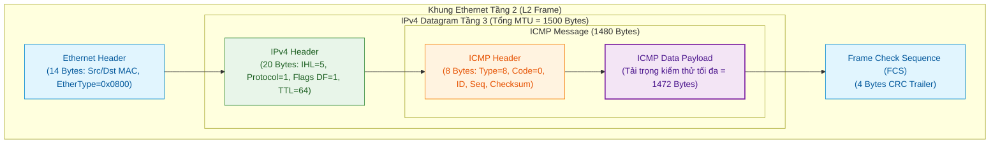
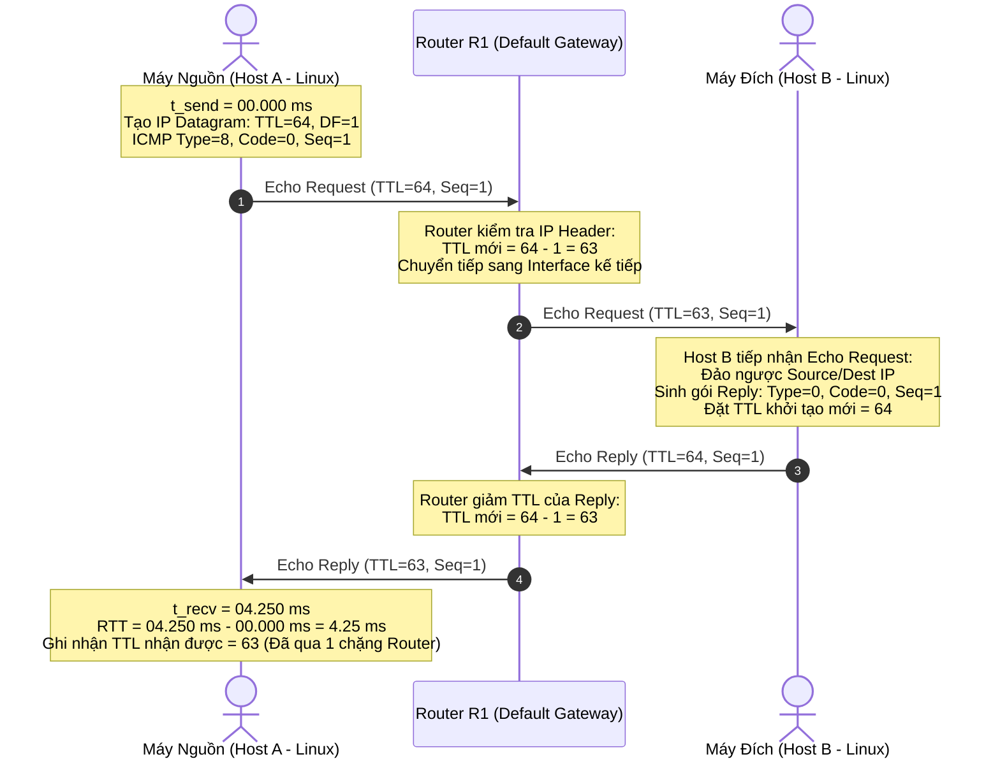
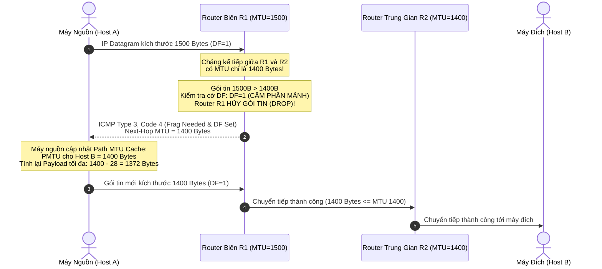

# 5_1_4 Reachability and Latency Testing with ping

> **Khóa học**: Cloud DevOps Basic — Wire-Level Diagnostics  
> **Phân nhóm**: 5 Domain 5 - Wire-Level Network Inspection and Diagnostics › 5_1 Wire-Level Inspection and Diagnostic Toolkit  
> **Chủ đề**: Kiểm tra khả năng tiếp cận và độ trễ mạng: Cơ chế ICMP Echo (Type 8/0), tính toán RTT, TTL và kiểm thử Path MTU Discovery với cờ DF (ping -s 1472 -M do)  
> **Trạng thái**: Draft  
> **Checklist đối chiếu**: [5_1_4](../../../CHECKLIST.md#51-wire-level-inspection-and-diagnostic-toolkit)  

---

## 1. Khái Niệm Cốt Lõi & Bản Chất Kỹ Thuật (Core Concepts & Technical Deep Dive)

Trong bộ công cụ chẩn đoán mạng wire-level, **`ping`** là tiện ích căn bản và phổ biến nhất được sử dụng để xác định tính sẵn sàng (reachability), độ trễ truyền dẫn (Round-Trip Time — RTT), số lượng chặng chuyển tiếp (Hop Count thông qua TTL), và kích thước đơn vị truyền tải tối đa trên đường truyền (Path MTU). Tiện ích này không vận hành trên các giao thức tầng Transport hướng ứng dụng (như TCP hay UDP) mà giao tiếp trực tiếp qua **Giao thức Điều khiển Thông điệp Internet — ICMP (Internet Control Message Protocol)** tại Tầng Mạng (Network Layer — L3).

```
+---------------------------------------------------------------------------------------+
|                    Vị trí ngăn xếp và Cấu trúc đóng gói ICMP                          |
|                                                                                       |
|  [Tầng 2 - Data Link]  Ethernet Frame Header (14 Bytes) + FCS Trailer (4 Bytes)       |
|  [Tầng 3 - Network]    IPv4 Header (20 Bytes tiêu chuẩn, IHL=5, Protocol=1 ICMP)      |
|                        +-----------------------------------------------------------+  |
|                        | ICMP Header (8 Bytes: Type, Code, Checksum, ID, Seq)     |  |
|                        | ICMP Data Payload (Timestamp, Arbitrary Padding)          |  |
|                        +-----------------------------------------------------------+  |
+---------------------------------------------------------------------------------------+
```

---

### 1.1 Cơ Chế Trao Đổi Thông Điệp ICMP Echo (RFC 792)

Theo đặc tả **RFC 792**, giao thức ICMP định nghĩa cặp thông điệp Echo chuyên biệt phục vụ mục đích kiểm thử khả năng kết nối hai chiều:

1. **ICMP Echo Request (Type 8, Code 0)**:
   - Được máy nguồn (Source Host) đóng gói vào một IP Datagram với trường `Protocol = 1` (ICMP) và gửi hướng tới máy đích.
   - Phần đầu của thông điệp ICMP (ICMP Header) có kích thước cố định là **8 bytes**, bao gồm:
     - **Type (1 byte)**: Mang giá trị `8` biểu thị yêu cầu gửi tiếng vọng (Echo Request).
     - **Code (1 byte)**: Mang giá trị `0`.
     - **Checksum (2 bytes)**: Mã kiểm tra tính toàn vẹn 16-bit của toàn bộ thông điệp ICMP (bao gồm cả header và payload).
     - **Identifier (2 bytes)**: Định danh giúp tiến trình gửi (process) ánh xạ và phân biệt các gói tin của chính nó với các tiến trình `ping` khác đang cùng chạy song song trên cùng hệ điều hành.
     - **Sequence Number (2 bytes)**: Số thứ tự tăng dần tuần tự từ gói đầu tiên ($0, 1, 2, \dots$), cho phép phát hiện mất gói (packet loss), gói tin đến sai thứ tự (out-of-order), hoặc gói tin bị lặp (duplicate packets).
   - **Data Payload**: Kích thước tùy biến (mặc định trên Linux iputils là 56 bytes dữ liệu; trên Windows là 32 bytes). Trong phần dữ liệu này, hệ điều hành thường nhúng một mốc thời gian xuất phát (timestamp) hoặc một chuỗi byte dữ liệu mẫu chuẩn để kiểm tra tính toàn vẹn.

2. **ICMP Echo Reply (Type 0, Code 0)**:
   - Khi máy đích nhận được Echo Request hợp lệ, tầng mạng của hệ điều hành đích sẽ tự động trích xuất gói tin, đảo ngược địa chỉ IP nguồn/đích (Source/Destination IP), và sinh ra một thông điệp ICMP mới với **Type = 0, Code = 0**.
   - Theo quy định bắt buộc của RFC 792, toàn bộ giá trị của trường **Identifier**, **Sequence Number**, và **Data Payload** nhận được trong Echo Request phải được **sao chép nguyên vẹn và phản hồi trở lại** cho máy nguồn.

---

### 1.2 Cơ Chế Tính Toán RTT và Giảm Trừ Trường TTL (RFC 791)

#### 1.2.1 Thời Gian Khứ Hồi (Round-Trip Time — RTT)
RTT là khoảng thời gian tính từ thời điểm máy nguồn phát gói Echo Request ra khỏi card mạng ($t_{\text{send}}$) cho đến thời điểm nhận được gói Echo Reply tương ứng dội về ($t_{\text{recv}}$):

$$\text{RTT} = t_{\text{recv}} - t_{\text{send}}$$

Tiện ích `ping` trên Linux tổng hợp chuỗi mẫu RTT sau phiên kiểm tra và công bố 4 chỉ số thống kê tiêu chuẩn:
- **`min`**: Thời gian khứ hồi ngắn nhất ghi nhận được trong toàn bộ phiên.
- **`avg`**: Thời gian khứ hồi trung bình cộng của tất cả các gói tin gửi đi và nhận về thành công.
- **`max`**: Thời gian khứ hồi dài nhất ghi nhận được (thường phản ánh độ trễ đỉnh khi xảy ra nghẽn hàng đợi tức thời).
- **`mdev` (Mean Deviation)**: Độ lệch trung bình của các mẫu RTT so với giá trị trung bình (`avg`). Chỉ số này đại diện cho mức độ biến thiên độ trễ (**Jitter**). Nếu `mdev` càng nhỏ tiệm cận 0, kết nối mạng càng đạt độ ổn định cao; nếu `mdev` cao vượt ngưỡng, đường truyền đang chịu hiện tượng jitter hoặc hàng đợi thiết bị định tuyến dao động bất thường (bufferbloat).

#### 1.2.2 Trường Giới Hạn Thời Gian Sống (Time To Live — TTL)
Theo tiêu chuẩn **RFC 791**, trường **TTL (8-bit, giá trị từ 0 đến 255)** trong IPv4 header ngăn ngừa nguy cơ các gói tin bị chuyển tiếp vô tận trong các vòng lặp định tuyến (routing loops):
- Mỗi khi một thiết bị định tuyến L3 (Router / L3 Switch) tiếp nhận và chuyển tiếp một IP datagram, nó **bắt buộc phải giảm trường TTL đi ít nhất 1 đơn vị**:

$$\text{TTL}_{\text{new}} = \text{TTL}_{\text{old}} - 1$$

- Nếu giá trị TTL giảm về **0** trước khi gói tin chạm tới máy đích, router hiện tại bắt buộc phải hủy bỏ gói tin (`drop`) và phát một thông điệp lỗi **ICMP Type 11, Code 0 (Time to Live exceeded in Transit)** ngược về máy nguồn.
- **Giá trị TTL khởi tạo mặc định theo hệ điều hành**:
  - **Linux / Android**: Giá trị khởi tạo mặc định là **64**.
  - **Microsoft Windows**: Giá trị khởi tạo mặc định là **128**.
  - **Thiết bị mạng hạ tầng (Cisco IOS, Juniper, Routers vật lý)**: Giá trị khởi tạo mặc định thường là **255**.
- **Công thức suy luận số chặng chuyển tiếp (Hop Count)**: Nếu biết trước hệ điều hành của máy đích, kỹ sư mạng có thể suy ra số lượng router trung gian mà gói tin đã đi qua trên đường về:

$$\text{Hop Count} = \text{TTL}_{\text{initial}} - \text{TTL}_{\text{received}}$$

*Ví dụ*: Nếu ping tới một máy chủ web chạy Linux ($\text{TTL}_{\text{initial}} = 64$) và nhận được dòng phản hồi ghi nhận `ttl=56`, số router trung gian mà gói phản hồi đã đi qua là: $64 - 56 = 8\text{ chặng (hops)}$.

---

### 1.3 Cơ Chế Path MTU Discovery (PMTUD) và Cờ Don't Fragment (RFC 1191)

#### 1.3.1 Cờ Don't Fragment (DF)
Trong IPv4 Header, trường **Flags** gồm 3 bits:
- **Bit 0**: Reserved (phải bằng 0).
- **Bit 1**: **DF (Don't Fragment)** — Nếu thiết lập bằng `1`, cấm tất cả các thiết bị trên toàn tuyến phân mảnh gói tin.
- **Bit 2**: **MF (More Fragments)** — Thiết lập bằng `1` nếu gói tin hiện tại là một mảnh vỡ và vẫn còn các mảnh kế tiếp phía sau.

#### 1.3.2 Cơ Chế Dò Tìm MTU Toàn Tuyến (Path MTU Discovery — PMTUD)
Theo **RFC 1191**, để tối ưu hóa hiệu năng truyền tải và tránh lãng phí tài nguyên CPU cho việc phân mảnh/tái hợp gói tin ở tầng IP, kỹ thuật PMTUD được triển khai bằng cách luôn bật cờ $DF = 1$ trên toàn bộ các gói tin phát đi:

1. Máy nguồn gửi gói tin mang cờ $DF = 1$.
2. Nếu kích thước toàn bộ gói tin IP vượt quá MTU của bất kỳ liên kết mạng trung gian nào trên tuyến:
   - Do $DF = 1$, router trung gian **không được phép chia nhỏ gói tin** và buộc phải hủy bỏ gói tin đó (`drop`).
   - Router trung gian sinh một gói tin báo lỗi **ICMP Type 3, Code 4 ("Destination Unreachable: Fragmentation Needed and DF set")** gửi ngược về máy nguồn.
3. **Trường Next-Hop MTU**: Theo đặc tả RFC 1191, router bổ sung giá trị MTU chính xác của liên kết chặng kế tiếp (Next-Hop MTU) vào trường 16-bit còn trống trong header của thông điệp ICMP Type 3 Code 4.
4. Máy nguồn đọc thông điệp này, lập tức hạ thấp kích thước gói tin gửi đi khớp chính xác với Next-Hop MTU và ghi nhớ giá trị Path MTU này trong bộ đệm định tuyến (Routing Cache) cho phiên giao tiếp tiếp theo.

```
+------------+       Gói tin IP (Size=1500, DF=1)       +---------------+
| Máy nguồn  | =======================================> | Router R1     |
| (Host A)   |                                          | (MTU in=1500) |
+------------+                                          +---------------+
      ^                                                         |
      |                                                         | Cố chuyển tiếp sang
      |                                                         | Liên kết MTU=1400
      |                                                         v
      |            ICMP Type 3 Code 4 (Next-Hop MTU=1400)       X (DROP gói tin!)
      +---------------------------------------------------------+
```

---

### 1.4 Toán Học Phân Rã Kích Thước Gói Tin (MTU Math Breakdown)

Trên mạng Ethernet tiêu chuẩn tuân theo **RFC 894**, đơn vị dữ liệu truyền tối đa của khung Ethernet là:

$$\text{MTU}_{\text{Ethernet}} = 1500\text{ bytes}$$

*(Lưu ý: 1500 bytes này là tải trọng tầng 3 của khung Ethernet, chưa tính 14 bytes Ethernet L2 Header và 4 bytes CRC/FCS Trailer).*

Một gói tin IPv4 chứa thông điệp ICMP Echo Request tiêu chuẩn bao gồm các thành phần:
1. **IPv4 Header**: Khi không có tùy chọn mở rộng (Options), trường `IHL = 5` ($5 \times 4\text{ bytes} = 20\text{ bytes}$).
2. **ICMP Header**: Chiếm cố định **8 bytes** (1B Type + 1B Code + 2B Checksum + 2B Identifier + 2B Sequence Number).
3. **Tổng chi phí phần đầu (Header Overhead)**: 

$$\text{Overhead} = \text{Header}_{\text{IPv4}} + \text{Header}_{\text{ICMP}} = 20\text{ bytes} + 8\text{ bytes} = 28\text{ bytes}$$

4. **Tải trọng dữ liệu (Payload) tối đa không bị phân mảnh**:

$$\text{Payload}_{\text{max}} = \text{MTU}_{\text{Ethernet}} - \text{Overhead} = 1500 - 28 = 1472\text{ bytes}$$

| Trường Dữ Liệu | Kích Thước (Bytes) | Ý Nghĩa Kỹ Thuật |
| :--- | :--- | :--- |
| **IPv4 Header** | 20 | Header IP tiêu chuẩn (IHL=5, Protocol=1, Flags DF=1) |
| **ICMP Header** | 8 | Type (8), Code (0), Checksum, Identifier, Sequence Number |
| **ICMP Payload** | **1472** | **Kích thước dữ liệu kiểm thử tối đa mà không gây phân mảnh** |
| **Tổng IP Datagram** | **1500** | **Khớp chính xác với giới hạn MTU Ethernet tiêu chuẩn (RFC 894)** |

- **Nếu payload được đặt thành 1473 bytes**:
  - Kích thước tổng IP Datagram: $1473 + 28 = 1501\text{ bytes}$.
  - Do $1501 > 1500$, nếu bật cờ Don't Fragment ($DF = 1$), gói tin bị từ chối phát ra card mạng hoặc bị router trung gian drop ngay lập tức với thông báo `Frag needed and DF set`.

---

## 2. Ví Dụ Đời Sống Thực Tế Dễ Hiểu (Intuitive Real-World Analogies)

### 2.1 Tiếng Vọng Âm Trong Hang Động (Echo in a Deep Cave)
Hãy tưởng tượng bạn đang đứng trước cửa một hang động sâu thăm thẳm và muốn kiểm tra xem hang này có thông suốt hay không:
- Bạn hét to một câu: *"Alo! Có ai ở đó không?"* (tương ứng với **ICMP Echo Request Type 8**).
- Sau một khoảng thời gian, vách đá dội lại nguyên vẹn âm thanh của bạn: *"Alo! Có ai ở đó không?"* (tương ứng với **ICMP Echo Reply Type 0**).
- Bạn dùng đồng hồ bấm giờ: Thời gian từ lúc âm thanh rời miệng bạn đến khi tiếng vọng dội lại tới tai chính là **RTT (Round-Trip Time)**. Nếu chỉ mất 10ms, vách hang rất gần; nếu mất 500ms, hang rất sâu.
- Nếu bạn hét nhiều lần mà âm thanh phản xạ lúc nhanh lúc chậm thất thường, điều đó chứng tỏ có luồng gió xoáy làm xáo trộn đường truyền (**Jitter / `mdev` cao**).
- Nếu bạn hét mà hoàn toàn không có âm vang dội lại, có thể hang có rèm tiêu âm ngăn cách (**Firewall DROP ICMP**) hoặc hang đã bị bịt kín lối ra (**Host Unreachable**).

---

### 2.2 Chiếc Hộp Bưu Phẩm Nguyên Khối Và Khe Cửa Hòm Thư (The Rigid Parcel & Fixed Mailbox Slot)
Hãy tưởng tượng bạn gửi một kiện hàng qua bưu điện tới một văn phòng có khe nhận thư chuẩn rộng tối đa **1500mm** (tương ứng **MTU 1500 bytes**):
- Bạn dán một nhãn tem niêm phong đỏ ghi rõ: **"Hàng nguyên khối — Nghiêm cấm tháo dỡ hoặc bẻ nhỏ"** (tương ứng với cờ **Don't Fragment — $DF = 1$**).
- Vỏ hộp carton dày và lớp xốp chống sốc bảo vệ chiếm mất **28mm** bao bì cố định (**20mm IP Header + 8mm ICMP Header**).
- Vì vậy, món đồ chơi bạn đặt bên trong hộp chỉ được phép dày tối đa:

$$1500\text{mm} - 28\text{mm} = 1472\text{mm}$$

- Nếu bạn cố tình nhét một món đồ dày **1473mm**, tổng độ dày của kiện hàng sẽ là $1473 + 28 = 1501\text{mm}$.
- Khi nhân viên bưu tá mang bưu phẩm đến khe cửa 1500mm:
  - Do có nhãn "Nghiêm cấm tháo dỡ" ($DF = 1$), bưu tá không thể cưa nhỏ kiện hàng làm hai phần.
  - Bưu tá buộc phải **vứt bỏ kiện hàng** và gửi một giấy phạt về hòm thư nhà bạn ghi rõ: *"Kiện hàng dày 1501mm không lọt qua khe cửa 1500mm, vui lòng đóng gói lại với kích thước nhỏ hơn!"* (đây chính là thông điệp **ICMP Type 3 Code 4: Fragmentation Needed and DF set**).

---

## 3. Kiến Trúc, Luồng Hoạt Động & Hình Ảnh Trực Quan (Architecture, Diagrams & Visual Media)

### 3.1 Cấu Trúc Khung Đóng Gói Dữ Liệu Tầng Wire-Level (Ethernet Frame Framing)

Sơ đồ phân rã chi tiết cấu trúc byte của khung dữ liệu truyền trên dây cáp mạng khi kiểm thử MTU tiêu chuẩn:



---

### 3.2 Luồng Hoạt Động Của ICMP Echo Request / Reply & Giảm Trừ TTL

Trình tự trao đổi gói tin giữa Máy nguồn và Máy đích đi qua Router trung gian, minh họa sự giảm trừ trường TTL và tính toán thời gian khứ hồi:



---

### 3.3 Luồng Hoạt Động Path MTU Discovery (PMTUD) Khi Vượt Ngưỡng MTU

Minh họa tình huống gói tin mang cờ $DF = 1$ chạm vào liên kết có MTU thấp hơn giới hạn gói tin:



---

## 4. Thực Hành (Hands-on)

### 4.1 Thực Hành Kiểm Tra Tiếp Cận và Độ Trễ Trên Linux (`iputils ping`)

#### Bài tập 1: Kiểm tra kết nối cơ bản với các tham số điều khiển chuẩn xác
Sử dụng các cờ lệnh kiểm soát lưu lượng để đo đạc độ trễ và tỷ lệ mất gói:
- `-c 4`: Gửi chính xác 4 gói rồi tự động thoát.
- `-i 0.5`: Đặt khoảng cách giữa các gói là 0.5 giây (mặc định là 1 giây).
- `-W 2`: Đặt thời gian timeout chờ phản hồi tối đa là 2 giây cho mỗi gói.

```bash
ping -c 4 -i 0.5 -W 2 192.168.1.1
```

*Đầu ra mẫu minh họa:*
```text
PING 192.168.1.1 (192.168.1.1) 56(84) bytes of data.
64 bytes from 192.168.1.1: icmp_seq=1 ttl=64 time=0.452 ms
64 bytes from 192.168.1.1: icmp_seq=2 ttl=64 time=0.388 ms
64 bytes from 192.168.1.1: icmp_seq=3 ttl=64 time=0.412 ms
64 bytes from 192.168.1.1: icmp_seq=4 ttl=64 time=0.395 ms

--- 192.168.1.1 ping statistics ---
4 packets transmitted, 4 received, 0% packet loss, time 1528ms
rtt min/avg/max/mdev = 0.388/0.411/0.452/0.027 ms
```

*Phân tích đầu ra kỹ thuật*:
- Dòng `56(84) bytes of data`: Linux gửi mặc định 56 bytes payload. Khi cộng thêm 8 bytes ICMP header = 64 bytes ICMP; cộng tiếp 20 bytes IP header = 84 bytes toàn khung IP.
- Dòng `ttl=64`: Máy đích gửi phản hồi với TTL gốc 64 và đến thẳng máy nguồn mà không qua router trung gian nào ($64 - 64 = 0\text{ hop}$).
- Thống kê `rtt min/avg/max/mdev`: Độ lệch trung bình `mdev = 0.027 ms` rất nhỏ cho thấy kết nối cực kỳ ổn định, không có hiện tượng jitter.

---

#### Bài tập 2: Kiểm thử giới hạn MTU 1500 bytes với cờ Don't Fragment (`-M do`)
Thực hiện kiểm tra tính toán tải trọng tối đa $1500 - 20 - 8 = 1472$ bytes:

**Bước 1: Gửi tải trọng hợp lệ 1472 bytes với cấm phân mảnh (`-M do`)**:
```bash
ping -c 2 -s 1472 -M do 192.168.1.1
```
*Đầu ra mẫu:*
```text
PING 192.168.1.1 (192.168.1.1) 1472(1500) bytes of data.
1480 bytes from 192.168.1.1: icmp_seq=1 ttl=64 time=0.842 ms
1480 bytes from 192.168.1.1: icmp_seq=2 ttl=64 time=0.791 ms

--- 192.168.1.1 ping statistics ---
2 packets transmitted, 2 received, 0% packet loss, time 1001ms
rtt min/avg/max/mdev = 0.791/0.816/0.842/0.031 ms
```
*(Ghi chú: $1472\text{ bytes payload} + 8\text{B ICMP} + 20\text{B IP} = 1500\text{ bytes MTU}$. Gói tin vừa khít khung Ethernet tiêu chuẩn và truyền thành công).*

**Bước 2: Tăng tải trọng lên 1473 bytes (Tổng kích thước IP = 1501 bytes) với `-M do`**:
```bash
ping -c 2 -s 1473 -M do 192.168.1.1
```
*Đầu ra mẫu:*
```text
PING 192.168.1.1 (192.168.1.1) 1473(1501) bytes of data.
ping: local error: message too long, mtu=1500
ping: local error: message too long, mtu=1500

--- 192.168.1.1 ping statistics ---
2 packets transmitted, 0 received, +2 errors, 100% packet loss, time 1002ms
```
*(Ghi chú: Ngay tại máy nguồn, Kernel phát hiện tổng kích thước 1501 bytes vượt quá MTU 1500 của interface cục bộ. Vì tùy chọn `-M do` cấm phân mảnh, Kernel từ chối phát gói tin và trả về lỗi `message too long`).*

**Bước 3: Cho phép phân mảnh bằng tùy chọn `-M dont`**:
```bash
ping -c 2 -s 1473 -M dont 192.168.1.1
```
*Đầu ra mẫu:*
```text
PING 192.168.1.1 (192.168.1.1) 1473(1501) bytes of data.
1481 bytes from 192.168.1.1: icmp_seq=1 ttl=64 time=0.915 ms
1481 bytes from 192.168.1.1: icmp_seq=2 ttl=64 time=0.884 ms

--- 192.168.1.1 ping statistics ---
2 packets transmitted, 2 received, 0% packet loss, time 1002ms
rtt min/avg/max/mdev = 0.884/0.899/0.915/0.021 ms
```
*(Ghi chú: Khi gỡ cờ DF bằng `-M dont`, tầng IP tự động xé nhỏ IP Datagram thành 2 mảnh: Mảnh 1 có kích thước 1500 bytes mang cờ More Fragments `MF=1`; Mảnh 2 có kích thước 29 bytes mang cờ `MF=0`. Máy đích tái hợp thành công và phản hồi bình thường).*

---

### 4.2 Thực Hành Kiểm Tra Độ Trễ và MTU Trên Windows (`ping.exe`)

#### Bài tập 1: Kiểm tra kết nối cơ bản với số lượng gói và timeout
Các tham số tương đương trên Windows:
- `/n 4`: Gửi 4 gói tin Echo Request (mặc định là 4).
- `/w 2000`: Thời gian chờ phản hồi tối đa là 2000 mili-giây (2 giây).
- `/l 32`: Kích thước buffer gửi đi (mặc định 32 bytes).

```cmd
ping /n 4 /w 2000 192.168.1.1
```

*Đầu ra mẫu minh họa:*
```text
Pinging 192.168.1.1 with 32 bytes of data:
Reply from 192.168.1.1: bytes=32 time=1ms TTL=64
Reply from 192.168.1.1: bytes=32 time<1ms TTL=64
Reply from 192.168.1.1: bytes=32 time<1ms TTL=64
Reply from 192.168.1.1: bytes=32 time=1ms TTL=64

Ping statistics for 192.168.1.1:
    Packets: Sent = 4, Received = 4, Lost = 0 (0% loss),
Approximate round trip times in milli-seconds:
    Minimum = 0ms, Maximum = 1ms, Average = 0ms
```

---

#### Bài tập 2: Dò tìm biên MTU trên Windows với cờ `/f` (Don't Fragment)
- Cờ `/f`: Thiết lập bit Don't Fragment trong IPv4 header.
- Cờ `/l <size>`: Chỉ định kích thước buffer tải trọng.

**Bước 1: Gửi gói tin chuẩn 1472 bytes với `/f`**:
```cmd
ping /n 2 /f /l 1472 192.168.1.1
```
*Đầu ra mẫu:*
```text
Pinging 192.168.1.1 with 1472 bytes of data:
Reply from 192.168.1.1: bytes=1472 time=1ms TTL=64
Reply from 192.168.1.1: bytes=1472 time=1ms TTL=64

Ping statistics for 192.168.1.1:
    Packets: Sent = 2, Received = 2, Lost = 0 (0% loss),
```

**Bước 2: Gửi gói tin vượt ngưỡng 1473 bytes với `/f`**:
```cmd
ping /n 2 /f /l 1473 192.168.1.1
```
*Đầu ra mẫu:*
```text
Pinging 192.168.1.1 with 1473 bytes of data:
Packet needs to be fragmented but DF set.
Packet needs to be fragmented but DF set.

Ping statistics for 192.168.1.1:
    Packets: Sent = 2, Received = 0, Lost = 2 (100% loss),
```
*(Ghi chú: Thông báo `Packet needs to be fragmented but DF set` trên Windows phản ánh việc gói tin vượt quá MTU 1500 bytes nhưng bị cấm phân mảnh bởi tham số `/f`).*

---

## 5. Cạm Bẫy Thực Tế & Thực Tiễn Sản Xuất (Production Gotchas & Best Practices)

### 5.1 Cạm Bẫy "Lỗ Đen PMTUD" (PMTUD Black Hole)
- **Bản chất sự cố**: Đây là một trong những sự cố mạng nguy hiểm và khó phát hiện nhất trong môi trường Cloud và Enterprise. Khi người quản trị firewall hoặc kỹ sư bảo mật cấu hình chặn toàn bộ giao thức ICMP theo chính sách "Drop all ICMP for security", họ đã vô tình chặn luôn cả gói tin **ICMP Type 3 Code 4 (Fragmentation Needed and DF set)**.
- **Hiện tượng**:
  - Khi kỹ sư dùng `ping` thông thường (mặc định gửi 56 hoặc 32 bytes payload), gói tin hoàn toàn nhỏ hơn MTU nên ping phản hồi rất tốt (0% loss, RTT thấp), khiến kỹ sư kết luận sai rằng mạng hoàn toàn bình thường.
  - Tuy nhiên, khi người dùng truy cập Web (HTTPS) hoặc thực hiện truyền tệp qua SCP/SSH, bắt tay 3 bước TCP Handshake (SYN, SYN-ACK, ACK) diễn ra thành công vì kích thước gói SYN rất nhỏ.
  - Ngay khi máy chủ bắt đầu truyền tải dữ liệu ứng dụng với kích thước gói tin lớn đạt tối đa MSS (thường là 1460 bytes + 40 bytes IP/TCP header = 1500 bytes) với cờ $DF = 1$: Router trên đường truyền có MTU nhỏ hơn (ví dụ qua hầm VPN có MTU 1400) sẽ hủy gói tin và gửi lại ICMP Type 3 Code 4. Do firewall chặn gói ICMP này, máy chủ nguồn không bao giờ nhận được thông báo lỗi, tiếp tục chờ xác nhận ACK và liên tục truyền lại (TCP Retransmission), dẫn đến kết nối của người dùng bị treo cứng vĩnh viễn (**Connection Hanging / Timeout**).
- **Thực tiễn sản xuất**:
  - Không bao giờ được cấu hình chặn vô điều kiện toàn bộ họ thông điệp ICMP. Luôn luôn cấu hình cho phép thông điệp **ICMP Type 3 Code 4** lưu thông qua tất cả các Firewall, Security Group, và ACL.
  - Trong các mô hình mạng overlay (VXLAN, GRE, IPsec VPN), triển khai cơ chế **TCP MSS Clamping** trên thiết bị định tuyến để tự động viết lại trường Maximum Segment Size trong gói tin SYN, ngăn ngừa máy trạm phát gói tin vượt MTU của tunnel:
    ```bash
    iptables -t mangle -A FORWARD -p tcp --tcp-flags SYN,RST SYN -j TCPMSS --clamp-mss-to-pmtu
    ```

---

### 5.2 Cạm Bẫy Suy Diễn Sai Số Chặng Mạng (Hop Count) Do Nhầm Lẫn TTL Gốc
- **Bản chất sự cố**: Một kỹ sư phân tích gói tin thấy dòng phản hồi `ttl=56` và vội vàng lấy $128 - 56 = 72$ hops rồi kết luận rằng mạng đang bị routing loop nghiêm trọng vì gói tin phải đi qua tới 72 chặng router.
- **Nguyên nhân**: Kỹ sư đã giả định sai rằng hệ thống đích chạy Windows ($\text{TTL}_{\text{initial}} = 128$). Trong thực tế, máy chủ đích là máy chủ Linux hoặc container Docker có TTL khởi tạo là $64$. Do đó, số chặng thực tế chỉ là $64 - 56 = 8$ router trung gian, hoàn toàn bình thường.
- **Thực tiễn sản xuất**: Luôn đối chiếu giá trị TTL với các mốc chuẩn hệ điều hành:
  - Nếu kết quả trả về trong khoảng $48 - 64$: Máy đích gần như chắc chắn là Linux / Unix / FreeBSD (khởi tạo từ 64).
  - Nếu kết quả trả về trong khoảng $100 - 128$: Máy đích chạy Microsoft Windows (khởi tạo từ 128).
  - Nếu kết quả trả về trong khoảng $240 - 255$: Máy đích là thiết bị hạ tầng mạng chuyên dụng Cisco IOS / Network Switch (khởi tạo từ 255).

---

### 5.3 Cạm Bẫy Đánh Giá Hiệu Năng Bằng ICMP Rate-Limiting và CoPP
- **Bản chất sự cố**: Khi thực hiện giám sát hoặc kiểm tra đường truyền bằng cách gửi liên tục các gói ping tần suất cao tới router hoặc firewall, kỹ sư thấy tỷ lệ mất gói lên tới 20% - 40% và RTT thỉnh thoảng nhảy vọt lên hàng trăm mili-giây. Kỹ sư vội vàng kết luận đường cáp quang bị suy hao hoặc mạng sập.
- **Nguyên nhân**: Trên các router và firewall doanh nghiệp hiện đại, lưu lượng ICMP hướng tới CPU của thiết bị (Control Plane) luôn bị kiểm soát chặt chẽ thông qua cơ chế **Control Plane Policing (CoPP)** hoặc **ICMP Rate-Limiting** để ngăn chặn các cuộc tấn công từ chối dịch vụ (DoS). CPU ưu tiên tối đa việc xử lý bảng định tuyến BGP/OSPF và chuyển mạch gói dữ liệu ứng dụng phần cứng (Data Plane), hạ thấp mức ưu tiên hoặc drop thẳng tay các gói ICMP Echo Request thừa. Trong khi đó, các luồng dữ liệu ứng dụng thực tế của người dùng (TCP/UDP) vẫn chạy trơn tru với 0% packet loss.
- **Thực tiễn sản xuất**: Tuyệt đối không dùng kết quả `ping` hướng tới router/gateway làm thước đo duy nhất để kết luận chất lượng đường truyền. Cần kết hợp kiểm tra bằng các công cụ đo tải ứng dụng thực tế trên tầng Transport (như `iperf3` hoặc đo TCP latency với `curl` / `hping3`).

---

## 6. Câu Hỏi Củng Cố Kiến Thức (Active Recall Quiz)

### Câu hỏi 1:
Hãy phân tích sự khác nhau về mặt hành vi của nhân hệ điều hành Linux khi bạn thực thi hai câu lệnh sau trên một interface mạng Ethernet tiêu chuẩn (MTU = 1500 bytes):
1. `ping -c 2 -s 1472 -M do 192.168.1.1`
2. `ping -c 2 -s 1473 -M do 192.168.1.1`
Tại sao chỉ chênh lệch 1 byte dữ liệu lại dẫn tới sự thay đổi hoàn toàn về mặt kết quả? Trình bày công thức tính toán chi tiết.

<details>
<summary>Đáp án chi tiết</summary>

- **Phân tích toán học đóng gói gói tin**:
  - Giao thức mạng Ethernet tiêu chuẩn (RFC 894) có giới hạn MTU tại tầng 3 là 1500 bytes.
  - Một gói tin ICMP Echo Request được bọc bởi:
    - IPv4 Header không có Options (IHL = 5) = 20 bytes.
    - ICMP Header cố định (Type, Code, Checksum, ID, Sequence) = 8 bytes.
    - Tổng chi phí phần đầu (Header Overhead) = $20 + 8 = 28$ bytes.
- **Trường hợp 1 (`-s 1472 -M do`)**:
  - Tổng kích thước IP Datagram = $1472\text{ bytes (payload)} + 28\text{ bytes (overhead)} = 1500\text{ bytes}$.
  - Kích thước này vừa khít với giới hạn MTU 1500 bytes của card mạng.
  - Tùy chọn `-M do` thiết lập cờ Don't Fragment ($DF = 1$). Do gói tin không vượt quá 1500 bytes, nhân Linux cho phép xuất gói tin ra card mạng và truyền tới đích thành công mà không bị phân mảnh.
- **Trường hợp 2 (`-s 1473 -M do`)**:
  - Tổng kích thước IP Datagram = $1473\text{ bytes (payload)} + 28\text{ bytes (overhead)} = 1501\text{ bytes}$.
  - Kích thước này vượt quá MTU 1500 bytes của giao diện mạng đúng 1 byte.
  - Tùy chọn `-M do` nghiêm cấm nhân Linux thực hiện phân mảnh (kể cả phân mảnh cục bộ).
  - Ngay tại tầng IP của máy nguồn, hệ điều hành phát hiện sự vi phạm này và lập tức từ chối đưa gói tin xuống hàng đợi card mạng, xuất ra lỗi hệ thống: `ping: local error: message too long, mtu=1500` và toàn bộ phiên ping thất bại (100% loss).

</details>

---

### Câu hỏi 2:
Một người dùng tại chi nhánh phàn nàn rằng họ có thể dùng lệnh `ping 10.0.100.5` tới máy chủ file server tại trụ sở chính rất mượt mà (0% packet loss, RTT 15ms), và cũng có thể thiết lập kết nối SSH tới máy chủ này. Tuy nhiên, khi họ cố gắng tải một file tài liệu dung lượng lớn qua lệnh `scp` hoặc mở một trang web nội bộ chứa nhiều hình ảnh thì kết nối lập tức bị treo cứng (hang) và sau đó báo timeout.
Dựa trên kiến thức về giao thức ICMP và cơ chế PMTUD, hãy giải thích nguyên nhân gốc rễ (root cause) của hiện tượng này và chỉ rõ giải pháp khắc phục triệt để.

<details>
<summary>Đáp án chi tiết</summary>

- **Nguyên nhân gốc rễ (Root Cause — PMTUD Black Hole)**:
  - Giữa chi nhánh và trụ sở chính có một đường hầm mạng ảo (chẳng hạn IPsec VPN hoặc GRE Tunnel). Do đường hầm bổ sung thêm phần header đóng gói mã hóa, MTU của liên kết này bị hạ thấp xuống dưới 1500 bytes (ví dụ: MTU = 1400 bytes).
  - **Vì sao Ping và SSH hoạt động**: Lệnh `ping` mặc định chỉ gửi payload rất nhỏ (56 bytes trên Linux hoặc 32 bytes trên Windows), tổng gói tin chỉ khoảng 64 - 84 bytes, nhỏ hơn rất nhiều so với MTU 1400 nên đi qua bình thường. Tương tự, quá trình TCP Handshake và xác thực SSH ban đầu chỉ trao đổi các gói tin điều khiển nhỏ nên không bị ảnh hưởng.
  - **Vì sao tải file lớn bị treo**: Khi truyền file hoặc tải web, TCP cố gắng lấp đầy khung truyền bằng cách phát các gói dữ liệu có kích thước tối đa (MSS = 1460 bytes + 40 bytes IP/TCP Header = 1500 bytes) với cờ Don't Fragment ($DF = 1$).
  - Khi gói tin 1500 bytes này chạm tới router VPN có MTU 1400: Do $DF = 1$, router buộc phải drop gói tin và tạo gói tin **ICMP Type 3 Code 4 (Fragmentation Needed and DF set)** để yêu cầu máy chủ hạ thấp Path MTU.
  - Tuy nhiên, trên tuyến truyền dẫn có một Firewall đã chặn toàn bộ gói tin ICMP. Do đó, máy chủ nguồn không bao giờ nhận được thông báo ICMP Type 3 Code 4. Máy chủ liên tục phát lại gói tin cũ vì không nhận được ACK, tạo ra hiện tượng **PMTUD Black Hole** khiến kết nối bị treo vĩnh viễn.
- **Giải pháp khắc phục**:
  1. Cấu hình lại Firewall: Mở quyền cho phép các gói tin **ICMP Type 3, Code 4** đi qua để cơ chế PMTUD hoạt động đúng chuẩn RFC 1191.
  2. Cấu hình **TCP MSS Clamping** trên router VPN/firewall để tự động can thiệp vào cờ SYN của phiên TCP, ép giảm giá trị MSS xuống tương thích với MTU của đường hầm (ví dụ: ép MSS xuống 1360 bytes), ngăn chặn hoàn toàn việc các host gửi gói tin vượt quá MTU đường hầm.

</details>

---

### Câu hỏi 3:
Khi kiểm tra một máy chủ nội bộ không rõ nguồn gốc trong hạ tầng doanh nghiệp, bạn thực hiện lệnh ping và nhận được kết quả sau:
```text
64 bytes from 172.16.50.20: icmp_seq=1 ttl=123 time=4.12 ms
```
Dựa trên giá trị TTL nhận được, hãy suy đoán:
1. Hệ điều hành đang vận hành trên máy chủ đích nhiều khả năng là gì?
2. Gói tin ICMP Echo Reply từ máy chủ đích đã đi qua bao nhiêu thiết bị định tuyến L3 trung gian trước khi tới máy của bạn?
3. Nếu giá trị RTT biến động giữa các lần ping với độ lệch `mdev` lên tới 85ms trong khi mạng nội bộ không nghẽn băng thông, nguyên nhân kỹ thuật nào tại thiết bị đích có thể giải thích hiện tượng này?

<details>
<summary>Đáp án chi tiết</summary>

1. **Hệ điều hành của máy chủ đích**:
   - Giá trị TTL nhận được là `123`.
   - Trong các hệ điều hành phổ biến, giá trị khởi tạo gần nhất lớn hơn 123 là **128** (chuẩn mặc định của các dòng hệ điều hành **Microsoft Windows**).
   - *(Lưu ý: Nếu là Linux thì giá trị khởi tạo là 64, không thể tăng lên 123; nếu là Cisco IOS khởi tạo 255 thì gói tin phải qua tới $255 - 123 = 132$ chặng, điều này bất khả thi trong mạng nội bộ).* Do đó máy đích chắc chắn chạy hệ điều hành Windows.
2. **Số chặng định tuyến (Hop Count)**:
   - Áp dụng công thức suy luận số chặng:
     $$\text{Hop Count} = \text{TTL}_{\text{initial}} - \text{TTL}_{\text{received}} = 128 - 123 = 5\text{ chặng router}$$
   - Gói Echo Reply đã đi qua **5 thiết bị định tuyến L3** (hoặc L3 switches) trung gian trên đường quay về máy nguồn.
3. **Nguyên nhân biến động RTT cao (`mdev = 85ms`)**:
   - Nếu băng thông vật lý không bị bão hòa, hiện tượng biến thiên độ trễ cao (Jitter) khi ping thường xuất phát từ cơ chế **Control Plane Policing (CoPP)** hoặc **ICMP Rate-Limiting** trên hệ điều hành / thiết bị mạng. Xử lý thông điệp ICMP Echo Reply là tác vụ phần mềm thuộc quyền của CPU hệ điều hành. Khi CPU của máy chủ đích đang chịu tải cao (high CPU load) do các tiến trình ứng dụng nặng, việc xử lý và hồi đáp ngắt ICMP bị trì hoãn ngẫu nhiên trong hàng đợi phần mềm, dẫn tới RTT đo đạc qua ICMP nhảy vọt thất thường mà không phản ánh đúng tốc độ của tầng vật lý.

</details>

---

## 7. 📚 Nguồn Tài Liệu Chính Thống (Tier-1 Official References)

- [RFC 791: Internet Protocol Specification](https://datatracker.ietf.org/doc/html/rfc791) — Tiêu chuẩn chính thức của IETF định nghĩa giao thức IPv4, cấu trúc trường Time To Live (TTL) và cờ Don't Fragment (DF).
- [RFC 792: Internet Control Message Protocol](https://datatracker.ietf.org/doc/html/rfc792) — Đặc tả kỹ thuật nền tảng của giao thức ICMP, định nghĩa cấu trúc thông điệp Echo Request (Type 8), Echo Reply (Type 0) và Destination Unreachable (Type 3).
- [RFC 1191: Path MTU Discovery](https://datatracker.ietf.org/doc/html/rfc1191) — Tiêu chuẩn kỹ thuật IETF quy định cơ chế dò tìm MTU toàn tuyến (PMTUD), thông báo lỗi ICMP Type 3 Code 4 và trường Next-Hop MTU.
- [RFC 894: A Standard for the Transmission of IP Datagrams over Ethernet Networks](https://datatracker.ietf.org/doc/html/rfc894) — Tiêu chuẩn quy định đóng gói IP Datagram trên mạng Ethernet và chuẩn hóa kích thước MTU 1500 bytes.
- [Linux Kernel Manual - ping(8)](https://man7.org/linux/man-pages/man8/ping.8.html) — Hướng dẫn tra cứu chính thức của tiện ích `ping` thuộc gói `iputils` trên Linux, giải thích chi tiết các tùy chọn `-s`, `-M`, `-c`, `-W`, `-i` và cách tính toán `rtt min/avg/max/mdev`.
- [Microsoft Learn: ping command reference](https://learn.microsoft.com/en-us/windows-server/administration/windows-commands/ping) — Tài liệu chính thức từ Microsoft Learn hướng dẫn cú pháp, các tham số `/n`, `/l`, `/f`, `/w`, `/i` của tiện ích `ping` trên môi trường Windows Server và Windows Client.
