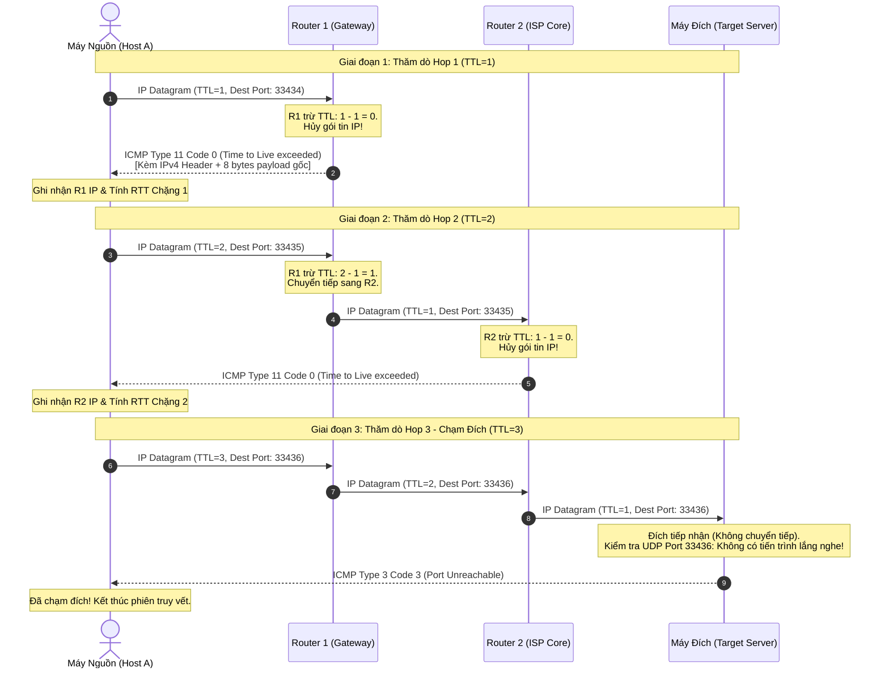
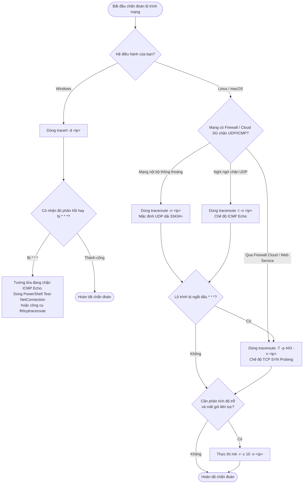

# 5_1_5 Route Path Tracing

> **Khóa học**: Cloud DevOps Basic — Wire-Level Diagnostics  
> **Phân nhóm**: 5 Domain 5 - Wire-Level Network Inspection and Diagnostics › 5_1 Wire-Level Inspection and Diagnostic Toolkit  
> **Chủ đề**: Truy vết lộ trình mạng: Cơ chế thao tác IP TTL (Type 11), so sánh thăm dò UDP vs ICMP vs TCP SYN (traceroute / tracert) và phân tích hiệu năng liên tục với mtr  
> **Trạng thái**: Draft  
> **Checklist đối chiếu**: [5_1_5](../../../CHECKLIST.md#51-wire-level-inspection-and-diagnostic-toolkit)  

---

## 1. Khái Niệm Cốt Lõi & Bản Chất Kỹ Thuật (Core Concepts & Technical Deep Dive)

Trong công tác quản trị hệ thống và vận hành hạ tầng Cloud/DevOps, khi một máy chủ hoặc dịch vụ microservice không thể kết nối tới đích, công cụ `ping` chỉ cung cấp thông tin nhị phân: đích đến có phản hồi hay không và độ trễ toàn tuyến là bao nhiêu. Nếu kết nối bị đứt hoặc nghẽn, `ping` không thể chỉ ra điểm lỗi nằm ở đâu: do router của văn phòng, do nhà cung cấp dịch vụ mạng (ISP), hay do tường lửa biên của nhà cung cấp Cloud (AWS/Azure).

Để giải quyết bài toán này, các công cụ truy vết lộ trình mạng (**Route Path Tracing**) gồm **`traceroute`** (Linux/Unix), **`tracert`** (Windows), và **`mtr`** (My Traceroute) được thiết kế nhằm bóc tách đường truyền thành từng chặng (hop-by-hop), xác định danh tính IP của từng thiết bị định tuyến trung gian và đo lường độ trễ tương ứng.

```
+---------------------------------------------------------------------------------------------------+
|                        Cơ Chế Khai Thác TTL Trong Truy Vết Lộ Trình Mạng                          |
|                                                                                                   |
|  [Máy Nguồn] --- Probe 1 (TTL=1) ---> [Router R1] (TTL=0) --> Hủy gói & Gửi ICMP Type 11 Code 0  |
|  [Máy Nguồn] <----------------------- ICMP Type 11 Code 0 --- [Router R1 phát hiện IP & RTT 1]   |
|                                                                                                   |
|  [Máy Nguồn] --- Probe 2 (TTL=2) ---> [Router R1] (TTL=1) ---> [Router R2] (TTL=0) --> Hủy gói   |
|  [Máy Nguồn] <----------------------------------------------- ICMP Type 11 Code 0 --- [Router R2] |
|                                                                                                   |
|  [Máy Nguồn] --- Probe 3 (TTL=3) ---> [Router R1] ---> [Router R2] ---> [Máy Đích] (Port / SYN)   |
|  [Máy Nguồn] <--------------------------------------------------------- Phản hồi đích (ICMP/TCP)  |
+---------------------------------------------------------------------------------------------------+
```

---

### 1.1 Cơ Chế Thao Tác IP TTL và Phản Hồi ICMP Time Exceeded (RFC 791 & RFC 792)

Trái với suy nghĩ phổ biến của người mới bắt đầu, các thiết bị định tuyến trên Internet không tự giác "thông báo" danh tính khi một gói tin bay ngang qua. Tiện ích `traceroute` hoạt động hoàn toàn dựa trên việc **cố ý kích hoạt điều kiện báo lỗi** của giao thức IP và ICMP:

1. **Trường Time To Live (TTL) theo RFC 791**:
   - Trường TTL là một số nguyên 8-bit (giá trị từ 1 đến 255) nằm trong tiêu đề gói tin IPv4.
   - Mục đích thiết kế ban đầu của TTL là ngăn ngừa hiện tượng gói tin bị chuyển tiếp vô tận trong các vòng lặp định tuyến (Routing Loops).
   - Mỗi thiết bị định tuyến tầng 3 (Router / L3 Switch) khi chuyển tiếp gói tin **bắt buộc phải giảm giá trị trường TTL đi ít nhất 1 đơn vị**:
     $$\text{TTL}_{\text{mới}} = \text{TTL}_{\text{cũ}} - 1$$
   - Nếu một router tiếp nhận một gói tin có $\text{TTL} = 1$, sau khi giảm trừ, giá trị TTL trở về $0$. Theo đặc tả RFC 791, router **bắt buộc phải tiêu hủy gói tin** (discard/destroy datagram) và không được phép chuyển tiếp tiếp.

2. **Thông điệp ICMP Time Exceeded (RFC 792)**:
   - Khi hủy gói tin vì lý do TTL giảm về 0 trên đường truyền, router tạo một thông điệp lỗi **ICMP Type 11, Code 0 (Time to Live exceeded in Transit)** gửi ngược về địa chỉ IP nguồn của gói tin bị hủy.
   - Cấu trúc thông điệp ICMP Type 11 chứa:
     - Header ICMP: Type (1 byte, giá trị `11`), Code (1 byte, giá trị `0`), Checksum (2 bytes), và 4 bytes chưa dùng (unused).
     - Payload đặc biệt: **IPv4 Header gốc** cộng với **tối thiểu 64 bits (8 bytes) đầu tiên của phần tải trọng dữ liệu (payload)** của gói tin đã bị hủy.
   - *Ý nghĩa của 8 bytes payload gốc*: Phần này chứa chính xác cặp Source Port/Destination Port (nếu là UDP/TCP) hoặc Sequence/Identifier (nếu là ICMP) của gói tin thăm dò ban đầu. Nhờ đó, nhân hệ điều hành máy nguồn khi nhận được thông điệp lỗi ICMP Type 11 có thể ánh xạ chính xác thông điệp lỗi này với tiến trình `traceroute` cụ thể đang chạy.

3. **Thuật toán tăng dần TTL tuần tự (Progressive TTL Increment)**:
   - **Chặng 1**: Máy nguồn phát gói probe đầu tiên với $\text{TTL} = 1$. Router đầu tiên trên tuyến (Gateway cục bộ) nhận gói, giảm TTL về $0$, hủy gói và gửi ICMP Type 11 Code 0 về máy nguồn. Máy nguồn trích xuất địa chỉ IP nguồn của gói ICMP (chính là IP của Router 1) và tính thời gian khứ hồi ($t_{\text{recv}} - t_{\text{send}} = \text{RTT}_1$).
   - **Chặng 2**: Máy nguồn phát gói probe tiếp theo với $\text{TTL} = 2$. Router 1 giảm TTL xuống $1$ và chuyển tiếp tới Router 2. Router 2 nhận gói, giảm TTL về $0$, hủy gói và gửi ICMP Type 11 Code 0 về máy nguồn. Máy nguồn xác định IP của Router 2 và $\text{RTT}_2$.
   - **Các chặng kế tiếp**: Quá trình tiếp diễn tuần tự với $\text{TTL} = 3, 4, 5, \dots$ cho tới khi gói tin chạm tới máy chủ đích.

4. **Dấu hiệu nhận biết đã chạm tới đích**:
   - Khi gói tin chạm tới máy chủ đích, gói tin không bị chuyển tiếp tiếp, do đó giá trị TTL không bị giảm về 0 tại router trung gian.
   - Để máy chủ đích phát tín hiệu xác nhận đã tới đích, tùy thuộc vào giao thức thăm dò:
     - **Thăm dò UDP (Linux default)**: Máy nguồn gửi tới cổng UDP dải cao bất thường (ví dụ: port 33434+). Vì không có dịch vụ nào lắng nghe trên cổng này, hệ điều hành đích hủy gói và gửi về thông điệp **ICMP Type 3, Code 3 (Destination Unreachable: Port Unreachable)**. Nhận được thông điệp này, `traceroute` biết rằng lộ trình đã hoàn tất và kết thúc phiên truy vết.
     - **Thăm dò ICMP Echo (Windows default)**: Máy nguồn gửi ICMP Echo Request. Máy đích tiếp nhận và gửi lại thông điệp **ICMP Type 0, Code 0 (Echo Reply)**.
     - **Thăm dò TCP SYN**: Máy nguồn gửi cờ SYN tới cổng dịch vụ (ví dụ port 80 hoặc 443). Nếu cổng đang mở, máy đích phản hồi **TCP SYN-ACK**; nếu cổng đóng, máy đích phản hồi **TCP RST**. Cả hai phản hồi TCP này đều xác nhận đã chạm đích thành công.

---

### 1.2 So Sánh Phương Thức Thăm Dò Mặc Định: Linux `traceroute` vs Windows `tracert`

Hai hệ điều hành phổ biến nhất hiện nay có cách tiếp cận kỹ thuật hoàn toàn khác nhau khi triển khai công cụ truy vết lộ trình:

| Tiêu Chí So Sánh | Linux `traceroute` (Mặc định) | Linux `traceroute` (Chế độ tùy chọn) | Windows `tracert` (Mặc định) |
| :--- | :--- | :--- | :--- |
| **Giao thức thăm dò** | **UDP Datagrams** | **ICMP Echo** (`-I`) hoặc **TCP SYN** (`-T`) | **ICMP Echo Request** (Type 8) |
| **Cổng đích (Destination Port)** | Cổng ngẫu nhiên dải cao: $33434, 33435, \dots$ | Không có cổng (với `-I`) hoặc cổng TCP tùy chọn (mặc định 80/tùy biến `-p 443`) | Không có cổng (ICMP Layer 3) |
| **Dấu hiệu hoàn tất chặng đích** | **ICMP Type 3 Code 3** (Port Unreachable) | **ICMP Echo Reply** (`-I`) hoặc **TCP SYN-ACK / RST** (`-T`) | **ICMP Type 0 Code 0** (Echo Reply) |
| **Tắt phân giải tên miền ngược (Reverse DNS)** | `-n` (Numeric output) | `-n` | `/d` (Do not resolve addresses) |
| **Số gói probe gửi mỗi chặng** | 3 gói (`-q 3` mặc định) | Tùy biến thông qua `-q <nqueries>` | 3 gói |
| **Thời gian chờ timeout phản hồi** | Tính bằng **giây** (`-w 5.0` mặc định) | Tính bằng giây | Tính bằng **mili-giây** (`/w 4000` mặc định) |
| **Giới hạn số chặng tối đa (Max Hops)** | 30 hops (`-m 30` mặc định) | Tùy biến thông qua `-m <max_ttl>` | 30 hops (`/h 30` mặc định) |

---

### 1.3 Thách Thức Tường Lửa Có Trạng Thái (Stateful Firewall) và Giải Pháp TCP SYN Probing

Trong hạ tầng đám mây (AWS VPC Security Groups, Azure Network Security Groups) và mạng doanh nghiệp hiện đại, các gói tin thăm dò truyền thống thường gặp trở ngại lớn:

1. **Vì sao gói UDP và ICMP bị chặn đứng?**
   - Hầu hết các tường lửa có trạng thái (Stateful Firewalls) được cấu hình theo nguyên tắc phòng thủ bề mặt (Attack Surface Reduction): Chặn toàn bộ các gói tin UDP đi vào các cổng dải cao ngẫu nhiên ($33434 - 33534$) và chặn lưu lượng ICMP Echo từ ngoài Internet.
   - Khi kỹ sư dùng Linux `traceroute` mặc định (UDP) hoặc Windows `tracert` (ICMP), gói tin có thể đi qua các router mạng công cộng của ISP (do ISP chỉ định tuyến gói IP), nhưng ngay khi chạm tới tường lửa biên của trung tâm dữ liệu hoặc VPC Cloud, toàn bộ gói tin bị chặn và thả âm thầm (silent drop). Kết quả là từ hop đó trở đi chỉ xuất hiện toàn dấu sao `* * *`.

2. **Cơ chế xuyên phá hợp chuẩn của TCP SYN Probing (`-T -p <port>`)**:
   - Mọi hệ thống Web hoặc API công khai bắt buộc phải mở các cổng TCP tiêu chuẩn như cổng 80 (HTTP) và cổng 443 (HTTPS) trên tường lửa biên để người dùng kết nối.
   - Khi sử dụng cờ `-T` trên Linux (`traceroute -T -p 443 <ip>`):
     - Gói tin probe được đóng gói dưới dạng một phân đoạn TCP mang cờ **SYN** (Synchronize Sequence Numbers) hướng tới cổng 443.
     - Tường lửa biên và Security Group nhận diện gói tin này như một nỗ lực thiết lập kết nối HTTPS hợp lệ của người dùng nên cho phép gói tin đi qua.
     - Dọc đường truyền, các router trung gian vẫn xử lý gói tin ở tầng IP Layer 3 bình thường: khi TTL giảm về 0, router hủy gói tin TCP SYN và phát ICMP Type 11 Code 0 về máy nguồn.
     - Khi gói tin chạm tới máy chủ web đích: Tầng TCP của máy đích tiếp nhận gói SYN. Nếu dịch vụ Web/Nginx/Envoy đang chạy, máy đích phản hồi bằng **TCP SYN-ACK**; nếu cổng đóng, nó phản hồi **TCP RST**. Cả hai phản hồi TCP hợp lệ này lập tức được `traceroute` ghi nhận là chặng cuối cùng đã hoàn tất, giúp kỹ sư đo đạc chính xác toàn bộ lộ trình mạng xuyên qua cả hệ thống bảo mật biên.

---

### 1.4 Kiến Trúc và Các Chỉ Số Vận Hành Của `mtr` (My Traceroute)

`traceroute` truyền thống chỉ chụp lại một bức ảnh tĩnh (single snapshot) của đường truyền tại thời điểm thực thi. Nếu mạng xảy ra hiện tượng mất gói ngắt quãng (intermittent loss) hoặc biến thiên độ trễ (jitter), `traceroute` không thể phân tích thấu đáo. Ngược lại, `ping` đo đạc liên tục độ trễ nhưng chỉ kiểm tra được máy đích đơn lẻ mà không biết chặng nào ở giữa đang gặp sự cố.

Công cụ **`mtr` (My Traceroute)** kết hợp hoàn hảo ưu điểm của cả hai: vừa bóc tách từng hop như `traceroute`, vừa liên tục gửi các chuỗi kiểm tra để tính toán thống kê chi tiết như `ping`.

```
$ mtr -r -c 10 -n 1.1.1.1
Start: 2026-11-14T08:53:00+0000
HOST: devops-workstation          Loss%   Snt   Last    Avg  Best  Wrst StDev
  1.|-- 192.168.1.1                0.0%    10    1.2    1.4   1.1   1.8   0.2
  2.|-- 10.200.0.1                 0.0%    10    4.5    4.8   4.1   6.2   0.6
  3.|-- 203.0.113.25               0.0%    10   12.3   12.7  12.0  14.5   0.8
  4.|-- 198.51.100.1              50.0%    10   28.1   28.9  27.4  31.2   1.4
  5.|-- 172.70.240.2               0.0%    10   15.4   15.8  15.1  17.0   0.5
  6.|-- 1.1.1.1                    0.0%    10   15.2   15.5  14.9  16.8   0.6
```

#### Định Nghĩa Các Cột Số Liệu Trong Báo Cáo `mtr`:
- **`HOST`**: Số thứ tự chặng (Hop Number) kèm địa chỉ IP hoặc tên miền FQDN của router trung gian.
- **`Loss%`**: Tỷ lệ phần trăm số gói tin thăm dò bị mất (Packet Loss) tại chặng này.
- **`Snt` (Sent)**: Tổng số gói tin thăm dò đã được phát đi tới chặng này trong suốt chu kỳ đo (được quy định bởi cờ `-c`).
- **`Last`**: Thời gian khứ hồi (RTT) tính bằng mili-giây (ms) của gói tin thăm dò gần đây nhất.
- **`Avg` (Average)**: Giá trị RTT trung bình cộng của toàn bộ các gói tin phản hồi thành công từ chặng này.
- **`Best`**: Giá trị RTT ngắn nhất (tối ưu nhất) ghi nhận được trong toàn bộ chu kỳ.
- **`Wrst` (Worst)**: Giá trị RTT dài nhất (tồi nhất) ghi nhận được, phản ánh mức độ trễ đỉnh khi xảy ra dồn ứ hàng đợi.
- **`StDev` (Standard Deviation)**: Độ lệch chuẩn của chuỗi giá trị RTT. Đây là chỉ số toán học chuẩn xác nhất đo lường mức độ bất ổn định (**Jitter**) của chặng mạng. Một giá trị `StDev` tiệm cận 0 chứng minh router có độ trễ cực kỳ đồng đều; ngược lại, `StDev` cao biểu thị hiện tượng jitter nghiêm trọng hoặc router đang xử lý hàng đợi chập chờn.

---

## 2. Ví Dụ Đời Sống Thực Tế Dễ Hiểu (Intuitive Real-World Analogies)

### Phép So Sánh: Đội Bồ Câu Đưa Thư Mang Bình Dưỡng Khí Có Hạn

Để hình dung trực quan cơ chế thao tác TTL và sự khác biệt giữa `traceroute` và `mtr`, hãy tưởng tượng bạn là một nhà thám hiểm đang ở Kinh Thành và muốn vẽ lại bản đồ toàn bộ các trạm canh gác dọc theo con đường dài dẫn tới một Pháo Đài xa xôi trên núi cao:

```
[Kinh Thành] ---> (Trạm Gác 1) ---> (Trạm Gác 2) ---> (Trạm Gác 3) ---> [Pháo Đài Đích]
   Máy Nguồn          Router R1          Router R2          Router R3          Destination
```

1. **Bồ câu mang bình dưỡng khí chỉ đủ 1 chặng bay (TTL = 1)**:
   - Bạn nạp dưỡng khí cho chú bồ câu thứ nhất vừa đúng để bay được 1 chặng đường.
   - Chú bồ câu bay tới **Trạm Gác 1** thì bình dưỡng khí cạn sạch ($\text{TTL} = 0$). Chú chim kiệt sức rơi xuống.
   - Người lính gác tại Trạm 1 theo quy định cứu hộ khẩn cấp phải viết một bức điện tín: *"Chim mang số hiệu X đã kiệt sức tại Trạm Gác 1 (IP: 192.168.1.1)"* (**ICMP Time Exceeded Type 11 Code 0**) rồi gửi ngựa hỏa tốc mang về cho bạn.
   - Bạn nhận được thư cứu hộ, nhìn đồng hồ bấm giờ và ghi nhận: *"Trạm 1 nằm ở tọa độ 192.168.1.1, thời gian đi-về mất 1.4 ms"*.

2. **Bồ câu mang bình dưỡng khí đủ 2 chặng bay (TTL = 2)**:
   - Bạn phóng tiếp chú bồ câu thứ hai với bình dưỡng khí đủ cho 2 chặng.
   - Khi bay ngang qua Trạm Gác 1, người lính gác vặn bớt 1 nấc dưỡng khí ($\text{TTL} = 2 - 1 = 1$) rồi thả cho chim bay tiếp.
   - Chim bay tới **Trạm Gác 2** thì bình dưỡng khí cạn kiệt ($\text{TTL} = 0$). Người lính gác tại Trạm 2 gửi thư báo: *"Chim kiệt sức tại Trạm Gác 2 (IP: 10.200.0.1)"*.
   - Bạn bấm giờ và ghi nhận: *"Trạm 2 nằm ở tọa độ 10.200.0.1, RTT mất 4.8 ms"*.

3. **Khi bồ câu tới Pháo Đài Đích**:
   - Bạn gửi bồ câu với bình dưỡng khí đủ bay tới Pháo Đài. Chim không bị cạn khí dọc đường và bay thẳng vào cổng pháo đài.
   - Người gác pháo đài không gửi thư báo kiệt sức mà trả lời bằng một thông điệp chính thức: *"Pháo đài không tiếp nhận loại chim bồ câu này!"* (**ICMP Port Unreachable Type 3 Code 3** đối với UDP) hoặc ký nhận giấy biên nhận (**TCP SYN-ACK**). Lúc này bạn biết hành trình đã chạm đích.

4. **Sự khác biệt với `mtr` — Camera Giám Sát Vệ Tinh Liên Tục**:
   - Lệnh `traceroute` giống như việc bạn chỉ thực hiện chiến dịch thả bồ câu một lần duy nhất rồi cất bản đồ vào ngăn kéo.
   - Công cụ `mtr` giống như việc bạn lắp đặt một hệ thống flycam và trạm quan sát tự động trên toàn tuyến: Cứ mỗi giây hệ thống lại gửi kiểm tra độ thông thoáng của từng trạm gác, ghi lại trạm nào đang bị tắc đường xe cộ, trạm nào làm rơi mất thư từ, và xuất ra một bảng theo dõi biến động thời gian thực trên màn hình điều khiển.

---

## 3. Kiến Trúc, Luồng Hoạt Động & Hình Ảnh Trực Quan (Architecture, Diagrams & Visual Media)

### 3.1 Sơ Đồ Trình Tự Vận Hành Của Chuỗi Gói Thăm Dò (Sequence Diagram)

Sơ đồ tuần tự dưới đây mô tả chính xác cách thức gói tin thăm dò tương tác với từng thiết bị định tuyến trung gian và cách thông điệp ICMP Type 11 được sinh ra dội ngược về máy nguồn:



---

### 3.2 Sơ Đồ Cây Quyết Định Lựa Chọn Kỹ Thuật Thăm Dò

Khi đối mặt với các môi trường mạng bị chặn bởi Firewall, kỹ sư cần đưa ra quyết định chọn giao thức thăm dò phù hợp:



---

## 4. Thực Hành (Hands-on)

### 4.1 Thực Hành Truy Vết Bằng `traceroute` Trên Linux

#### 4.1.1 Truy Vết Mặc Định Bằng UDP Datagrams và Tắt Phân Giải DNS (`-n`)
Luôn sử dụng tùy chọn `-n` để ngăn công cụ thực hiện truy vấn DNS ngược (Reverse DNS PTR) cho từng IP router. Nếu không bật `-n`, khi gặp router không cấu hình bản ghi PTR, lệnh sẽ bị treo vài giây tại mỗi hop để chờ DNS timeout.

```bash
traceroute -n 1.1.1.1
```

*Đầu ra mẫu:*
```text
traceroute to 1.1.1.1 (1.1.1.1), 30 hops max, 60 byte packets
 1  192.168.1.1  1.124 ms  1.089 ms  1.156 ms
 2  10.200.0.1  4.215 ms  4.180 ms  4.301 ms
 3  203.0.113.25  12.450 ms  12.390 ms  12.510 ms
 4  172.70.240.2  15.112 ms  15.080 ms  15.220 ms
 5  1.1.1.1  15.340 ms  15.290 ms  15.310 ms
```
*(Mỗi dòng hiển thị 3 mốc thời gian RTT tương ứng với 3 gói probe mặc định gửi tới router đó).*

#### 4.1.2 Truy Vết Bằng ICMP Echo Request (`-I`)
Khi router mạng trung gian chặn các cổng UDP dải cao, chuyển sang chế độ ICMP Echo Request tương tự như cơ chế của Windows:

```bash
traceroute -I -n 1.1.1.1
```

#### 4.1.3 Xuyên Thủng Tường Lửa Bằng TCP SYN Probing (`-T -p <port>`)
Khi truy vết tới các máy chủ chạy trên môi trường Cloud (AWS EC2, GCP Compute Engine, Azure VM) được bảo vệ bởi Stateful Firewall hoặc Security Group chỉ mở cổng web:

```bash
sudo traceroute -T -p 443 -n 1.1.1.1
```
*(Ghi chú: Lệnh yêu cầu quyền `sudo` hoặc `CAP_NET_RAW` để nhân Linux tạo raw socket gửi gói tin TCP SYN mà không hoàn tất bắt tay 3 bước thông thường).*

*Đầu ra mẫu khi so sánh giữa UDP và TCP SYN tới một máy chủ được bảo vệ bởi Firewall:*
```text
# Khi dùng UDP mặc định: Bị tường lửa chặn từ hop 4
$ traceroute -n 203.0.113.100
 1  192.168.1.1  1.210 ms  1.190 ms  1.230 ms
 2  10.200.0.1  4.310 ms  4.280 ms  4.350 ms
 3  203.0.113.1  12.110 ms  12.090 ms  12.150 ms
 4  * * *
 5  * * *
 6  * * *

# Khi chuyển sang TCP SYN tới port 443: Đi xuyên tường lửa thành công
$ sudo traceroute -T -p 443 -n 203.0.113.100
 1  192.168.1.1  1.210 ms  1.190 ms  1.230 ms
 2  10.200.0.1  4.310 ms  4.280 ms  4.350 ms
 3  203.0.113.1  12.110 ms  12.090 ms  12.150 ms
 4  198.51.100.50  14.250 ms  14.210 ms  14.300 ms
 5  203.0.113.100  14.890 ms  14.850 ms  14.920 ms
```

#### 4.1.4 Điều Chỉnh Số Gói Thăm Dò Và Thời Gian Chờ (Fast Tuning)
Để tăng tốc độ truy vết lộ trình trên các đường truyền mạng dài, giảm số lượng gói probe mỗi chặng xuống 1 (`-q 1`) và hạ thời gian chờ timeout xuống 2 giây (`-w 2`):

```bash
traceroute -n -q 1 -w 2 -m 20 1.1.1.1
```

---

### 4.2 Thực Hành Truy Vết Bằng `tracert` Trên Windows

Trên hệ điều hành Windows, công cụ `tracert` sử dụng cú pháp dấu gạch chéo `/`:

```cmd
tracert -d 1.1.1.1
```
*(Tham số `-d` hoặc `/d` ngăn chặn việc tra cứu DNS ngược, giúp câu lệnh hoàn thành tức thì).*

Để khống chế số lượng chặng tối đa là 15 hops và thời gian chờ phản hồi là 2000 mili-giây (2 giây):

```cmd
tracert -d -h 15 -w 2000 1.1.1.1
```

*Đầu ra mẫu trên Windows Command Prompt:*
```text
Tracing route to 1.1.1.1 over a maximum of 15 hops:

  1     1 ms     1 ms     1 ms  192.168.1.1
  2     4 ms     4 ms     5 ms  10.200.0.1
  3    12 ms    12 ms    12 ms  203.0.113.25
  4    15 ms    15 ms    15 ms  172.70.240.2
  5    15 ms    15 ms    15 ms  1.1.1.1

Trace complete.
```

---

### 4.3 Thực Hành Chẩn Đoán Hiệu Năng Động Bằng `mtr` (My Traceroute)

#### 4.3.1 Xuất Báo Cáo Tĩnh Chế Độ Báo Cáo Không Tương Tác (`-r`)
Trong các script tự động hóa CI/CD hoặc khi gửi bằng chứng cho bộ phận hỗ trợ nhà mạng, sử dụng chế độ Report mode `-r` kết hợp gửi 10 chu kỳ pings (`-c 10`):

```bash
mtr -r -c 10 -n 1.1.1.1
```

#### 4.3.2 Vận Hành `mtr` Qua Giao Thức TCP SYN
Tương tự như `traceroute`, `mtr` hỗ trợ thăm dò bằng gói tin TCP SYN để vượt qua các tường lửa biên chỉ mở cổng HTTPS:

```bash
sudo mtr --tcp --port 443 -r -c 10 -n 1.1.1.1
```

---

## 5. Cạm Bẫy Thực Tế & Thực Tiễn Sản Xuất (Production Gotchas & Best Practices)

### 5.1 Cạm Bẫy Hiểu Sai Dấu Sao `* * *` và Hiện Tượng Mất Gói Ảo (Artificial Loss vs True Loss)

- **Bản chất sự cố**: Một kỹ sư DevOps chạy lệnh `traceroute` hoặc `mtr` và thấy tại Hop 4 xuất hiện toàn dấu sao `* * *` hoặc tỷ lệ `Loss% = 60%`. Kỹ sư lập tức mở phiếu sự cố khẩn cấp (Incident P1) báo cáo rằng mạng bị đứt hoặc router tại hop 4 đang làm mất dữ liệu của khách hàng.
- **Nguyên nhân kỹ thuật**:
  - Trên các thiết bị định tuyến lõi của nhà mạng và doanh nghiệp (Cisco, Juniper), kiến trúc phần cứng được chia làm hai phân vùng độc lập:
    1. **Data Plane (Mặt phẳng dữ liệu)**: Được tối ưu hóa bằng chip phần cứng chuyên dụng (ASIC / NPU) để chuyển mạch hàng triệu gói tin ứng dụng thực tế mỗi giây ở tốc độ dây dẫn (wire speed).
    2. **Control Plane (Mặt phẳng điều khiển)**: Do vi xử lý trung tâm (CPU) quản lý, đảm nhiệm các tác vụ tính toán thuật toán định tuyến (BGP, OSPF) và quản trị thiết bị.
  - Việc sinh thông điệp báo lỗi ICMP Type 11 Code 0 là tác vụ đòi hỏi sự can thiệp của CPU (Control Plane). Để bảo vệ CPU không bị quá tải khi chịu các đợt tấn công từ chối dịch vụ (DoS), các nhà mạng luôn bật cơ chế **Control Plane Policing (CoPP)** hoặc **ICMP Rate-Limiting**.
  - Khi router nhận được hàng loạt gói probe có $\text{TTL} = 1$, CPU của router chỉ xử lý một số lượng nhỏ gói và âm thầm hủy (drop) phần còn lại mà không sinh thông điệp ICMP. Trong khi đó, các gói tin dữ liệu có $\text{TTL} > 1$ tiếp tục được chip phần cứng Data Plane chuyển tiếp đi thẳng với tỷ lệ mất gói là $0\%$.
- **Quy tắc vàng phân biệt mất gói trong sản xuất**:
  $$\text{Mất Gói Thật Sự (True Packet Loss) BẮT BUỘC PHẢI LAN TRUYỀN XUYÊN SUỐT}$$
  - **Mất gói ảo (ICMP CoPP Throttling)**: Hop 4 hiển thị `Loss% = 60%`, nhưng các Hop 5, 6, 7 và Đích đến (Hop 8) đều hiển thị `Loss% = 0%`. **Kết luận: Đường truyền hoàn toàn bình thường, dịch vụ ứng dụng chạy mượt mà.**
  - **Mất gói thật sự (Data-Plane Congestion / Link Degradation)**: Hop 4 bắt đầu hiển thị `Loss% = 25%`, và tỷ lệ mất gói này **tiếp tục xuất hiện ở Hop 5 (25%), Hop 6 (26%) cho tới tận máy đích (25%)**. Lúc này liên kết vật lý giữa Hop 3 và Hop 4 thực sự đang bị nghẽn hoặc suy hao sợi quang.

---

### 5.2 Cạm Bẫy Định Tuyến Bất Đối Xứng (Asymmetric Routing)

- **Bản chất sự cố**: Khi phân tích giá trị RTT trên kết quả `traceroute`, kỹ sư thấy độ trễ tăng vọt từ 5ms ở Hop 2 lên tới 80ms ở Hop 3, và kết luận rằng sợi cáp giữa Hop 2 và Hop 3 bị chậm.
- **Nguyên nhân kỹ thuật**:
  - Trên mạng Internet công cộng sử dụng giao thức BGP, đường đi từ nguồn tới đích (**Forward Path**) và đường đi từ đích quay về nguồn (**Return Path**) rất hiếm khi trùng nhau. Hiện tượng này gọi là **Định tuyến bất đối xứng (Asymmetric Routing)**.
  - Gói probe của bạn đi theo đường thẳng qua ISP A (chiều đi chỉ mất 3ms). Nhưng khi Router 3 phát thông điệp ICMP Type 11 quay về máy của bạn, bảng định tuyến BGP của ISP Router 3 lại đẩy gói tin đi vòng qua một nhà mạng khác tại một quốc gia khác (chiều về mất 77ms).
  - Giá trị RTT mà `traceroute` đo được là tổng thời gian của cả hai chiều: $\text{RTT} = t_{\text{đi (ISP A)}} + t_{\text{về (ISP B)}}$. Do đó, bạn không thể suy luận rằng liên kết chiều đi bị chậm nếu chưa kiểm tra chiều ngược lại (Reverse Trace).

---

### 5.3 Cạm Bẫy Tường Lửa Biên Thả Gói UDP/ICMP và Giá Trị Cứu Cánh Của TCP SYN

- **Bản chất sự cố**: Khi thực hiện `traceroute` tới một hệ thống vừa triển khai trên AWS hoặc Azure, kỹ sư thấy kết quả hiển thị tốt từ hop 1 đến hop 9, nhưng từ hop 10 trở đi đến máy chủ đích hoàn toàn là các dòng `* * *`. Kỹ sư phán đoán máy chủ bị sập hoặc subnet định tuyến sai.
- **Nguyên nhân kỹ thuật**:
  - Máy chủ và subnet hoàn toàn bình thường. Mặc định các Cloud Security Group không cho phép lưu lượng UDP inbound tới các cổng lạ và không mở ICMP Echo.
  - Tường lửa đám mây âm thầm hủy gói tin probe mà không phản hồi bất kỳ gói ICMP nào.
- **Thực tiễn sản xuất**:
  - Khi chẩn đoán dịch vụ đám mây, luôn sử dụng lệnh thăm dò bằng TCP SYN hướng tới cổng dịch vụ đang lắng nghe thực tế:
    ```bash
    sudo traceroute -T -p 443 -n <ip-máy-chủ-cloud>
    ```
  - Nếu `traceroute -T -p 443` chạm tới đích thành công, bạn đã chứng minh được toàn bộ hạ tầng mạng, bảng định tuyến VPC (Route Tables), Internet Gateway và Security Group cho cổng 443 đều hoạt động chuẩn xác 100%.

---

## 6. Câu Hỏi Củng Cố Kiến Thức (Active Recall Quiz)

### Câu hỏi 1:
Hãy phân tích cơ chế kỹ thuật tại sao khi truy vết mạng từ máy trạm nội bộ văn phòng ra Internet, lệnh Windows `tracert` mặc định lại vượt qua được một số firewall trung gian trong khi lệnh Linux `traceroute` mặc định lại hiển thị toàn dấu sao `* * *` ở các chặng cuối? Để Linux `traceroute` đạt được hành vi tương đương hoặc vượt trội hơn, kỹ sư cần sử dụng những cờ lệnh nào?

<details>
<summary>Đáp án chi tiết</summary>

- **Phân tích bản chất kỹ thuật**:
  - Tiện ích Linux `traceroute` truyền thống mặc định sử dụng các gói tin **UDP Datagrams** gửi tới các cổng dải cao bất thường ($33434 - 33534$).
  - Tiện ích Windows `tracert` mặc định sử dụng các gói tin **ICMP Echo Request** (Layer 3).
  - Nhiều chính sách bảo mật của các thiết bị tường lửa trung gian hoặc router biên cho phép lưu thông các gói ICMP cơ bản để kiểm tra đường truyền nhưng cấu hình chặn bỏ hoàn toàn (drop) lưu lượng UDP lạ tới các cổng dải cao. Do đó, gói probe UDP của Linux bị tường lửa âm thầm hủy dẫn tới hiển thị `* * *`, trong khi gói ICMP của Windows được phép đi qua và nhận được phản hồi ICMP Echo Reply từ máy đích.
- **Giải pháp trên Linux**:
  1. Sử dụng cờ `-I` (`--icmp`) để chuyển phương thức thăm dò sang **ICMP Echo Request**, đưa hành vi của Linux tương đồng hoàn toàn với Windows `tracert`:
     ```bash
     traceroute -I -n <ip>
     ```
  2. Để đạt hiệu quả vượt trội hơn (xuyên qua cả những firewall chặn toàn bộ ICMP lẫn UDP), sử dụng cờ `-T` (`--tcp`) với cổng dịch vụ được mở sẵn (ví dụ HTTPS port 443):
     ```bash
     sudo traceroute -T -p 443 -n <ip>
     ```
     Phương thức TCP SYN probing này được firewall nhận diện là yêu cầu khởi tạo kết nối web hợp lệ nên được phép lưu thông qua các chốt kiểm soát bảo mật biên.

</details>

---

### Câu hỏi 2:
Một kỹ sư DevOps chạy lệnh kiểm tra chất lượng kết nối tới máy chủ cơ sở dữ liệu trên Cloud bằng công cụ `mtr`:
```text
$ mtr -r -c 50 -n 10.0.12.45
HOST: app-server                 Loss%   Snt   Last    Avg  Best  Wrst StDev
  1.|-- 10.0.1.1                  0.0%    50    0.3    0.3   0.2   0.8   0.1
  2.|-- 10.0.50.12                0.0%    50    0.8    0.9   0.7   1.5   0.2
  3.|-- 172.16.100.1             60.0%    50   14.2   14.5  13.9  18.1   0.8
  4.|-- 10.0.12.45                0.0%    50    1.8    1.9   1.7   2.6   0.2
```
Kỹ sư này kết luận rằng router tại Hop 3 (`172.16.100.1`) đang bị lỗi phần cứng nghiêm trọng gây mất 60% dữ liệu của ứng dụng và có độ trễ vọt lên 14.5ms. Kết luận của kỹ sư đó là Đúng hay Sai? Hãy giải thích tường tận dựa trên kiến trúc phân tách Data Plane và Control Plane của thiết bị định tuyến.

<details>
<summary>Đáp án chi tiết</summary>

- **Kết luận của kỹ sư là HOÀN TOÀN SAI.**
- **Giải thích kỹ thuật chi tiết**:
  1. **Quy luật lan truyền mất gói (Packet Loss Propagation)**:
     - Trên một lộ trình truyền dẫn mạng nối tiếp, nếu một thiết bị trung gian thực sự làm rơi rụng các gói tin dữ liệu của khách hàng trên tầng vật lý (Data Plane), tỷ lệ mất gói đó **bắt buộc phải xuất hiện xuyên suốt và duy trì ở tất cả các chặng phía sau**.
     - Nhìn vào kết quả tại Hop 4 (máy đích `10.0.12.45`), tỷ lệ mất gói ghi nhận được là **`Loss% = 0.0%`** trên tổng số 50 gói gửi đi, và độ trễ trung bình cực kỳ thấp và ổn định (`Avg = 1.9 ms`, `StDev = 0.2`). Điều này chứng minh 100% gói tin dữ liệu đi ngang qua Hop 3 đều được chuyển tiếp trọn vẹn và thông suốt tới đích.
  2. **Bản chất của con số 60% mất gói tại Hop 3**:
     - Router tại Hop 3 phân tách phần cứng thành **Data Plane** (chuyển tiếp gói tin bằng chip ASIC tốc độ cao) và **Control Plane** (CPU quản trị).
     - Việc tạo gói tin báo lỗi ICMP Type 11 Code 0 thuộc trách nhiệm xử lý của CPU. Router kích hoạt chính sách bảo vệ CPU (**Control Plane Policing — CoPP** hoặc **ICMP Rate-Limiting**). Khi nhận được 50 gói probe liên tục có $\text{TTL} = 1$, CPU của router từ chối sinh ICMP cho 60% số gói đó để ưu tiên tài nguyên cho việc định tuyến. Trong khi đó, các gói tin có $\text{TTL} > 1$ gửi tới Hop 4 được chip Data Plane chuyển tiếp thẳng mà không cần thông qua CPU.
  3. **Về độ trễ 14.5ms tại Hop 3 so với 1.9ms tại Hop 4**:
     - Độ trễ 14.5ms phản ánh thời gian hàng đợi phần mềm của CPU trên router Hop 3 khi phải xử lý ngắt để tạo gói ICMP Type 11.
     - Trong khi đó, gói tin gửi tới đích Hop 4 được phần cứng Data Plane của Hop 3 chuyển tiếp ngay lập tức chỉ mất phần triệu giây, giúp tổng thời gian tới đích chỉ là 1.9ms.
- **Kết luận thực tế**: Tuyến mạng hoàn toàn khỏe mạnh, không có bất kỳ sự cố mất gói hay nghẽn đường truyền nào đối với lưu lượng ứng dụng.

</details>

---

### Câu hỏi 3:
Khi kiểm tra kết nối tới một máy chủ HTTPS (`203.0.113.10`), kỹ sư thực thi lần lượt ba câu lệnh:
1. `traceroute -n 203.0.113.10`
2. `traceroute -I -n 203.0.113.10`
3. `sudo traceroute -T -p 443 -n 203.0.113.10`
Hai lệnh đầu tiên hoàn tất tới hop 7 (router biên) rồi từ hop 8 đến hop 12 chỉ hiển thị toàn dấu `* * *`. Lệnh thứ ba hoàn tất trơn tru tới tận hop 10 với IP `203.0.113.10` và RTT 18ms.
Hãy giải thích luồng xử lý chi tiết của tường lửa bảo vệ máy chủ đích đối với từng câu lệnh và giải thích tại sao phản hồi ở lệnh thứ ba lại giúp kết thúc quá trình traceroute.

<details>
<summary>Đáp án chi tiết</summary>

- **Luồng xử lý đối với Câu lệnh 1 (`traceroute -n` — UDP)**:
  - Máy nguồn gửi gói tin UDP với các cổng đích ngẫu nhiên dải cao ($33434+$).
  - Gói tin đi qua các router mạng công cộng bình thường từ hop 1 đến hop 7.
  - Khi gói tin chạm tới Tường lửa biên (Hop 8) đứng trước máy chủ đích: Tường lửa có quy tắc bảo mật mặc định (Default Deny) chặn toàn bộ lưu lượng UDP lạ vào mạng nội bộ. Tường lửa âm thầm hủy gói tin mà không gửi phản hồi ICMP. Do đó máy nguồn không nhận được bất kỳ tín hiệu nào và hiển thị dấu `* * *`.
- **Luồng xử lý đối với Câu lệnh 2 (`traceroute -I -n` — ICMP Echo)**:
  - Máy nguồn gửi gói tin ICMP Echo Request (Type 8, Code 0).
  - Tường lửa biên áp dụng chính sách ẩn mình (Stealth Security Policy) cấm các yêu cầu Echo Request từ Internet để chống bị rà quét mạng (Network Scanning).
  - Tường lửa tiếp tục hủy âm thầm gói tin ICMP này, dẫn tới kết quả tương tự là các dấu `* * *`.
- **Luồng xử lý đối với Câu lệnh 3 (`traceroute -T -p 443 -n` — TCP SYN)**:
  - Máy nguồn gửi gói tin TCP mang cờ **SYN** hướng tới cổng dịch vụ 443 (HTTPS).
  - Các router từ hop 1 đến hop 7 tiếp tục trừ TTL bình thường và phản hồi ICMP Type 11 Code 0.
  - Khi gói tin mang cờ SYN chạm tới Tường lửa biên (Hop 8): Do máy chủ đích là một Web Server công khai, quy tắc tường lửa (Ingress Rule) được cấu hình cho phép lưu lượng TCP cổng 443 đi qua. Gói tin tiếp tục được chuyển tiếp vào mạng nội bộ và chạm tới máy chủ đích tại Hop 10.
  - **Cơ chế kết thúc phiên traceroute**:
    - Tầng TCP của máy chủ đích tiếp nhận gói SYN trên cổng 443 (đang lắng nghe bởi Nginx/Apache).
    - Máy chủ đích sinh một gói tin phản hồi **TCP SYN-ACK** gửi ngược về máy nguồn để chuẩn bị bắt tay 3 bước.
    - Tiến trình `traceroute` trên máy nguồn nhận được gói TCP SYN-ACK này. Đây là bằng chứng không thể chối cãi rằng gói tin đã chạm tới đích thành công. Tiện ích `traceroute` ghi nhận IP đích, tính toán RTT chặng cuối cùng và đóng phiên truy vết.

</details>

---

## 7. 📚 Nguồn Tài Liệu Chính Thống (Tier-1 Official References)

- [RFC 791: Internet Protocol Specification](https://datatracker.ietf.org/doc/html/rfc791) — Tiêu chuẩn chính thức của IETF định nghĩa cấu trúc IPv4 header, chức năng trường Time To Live (TTL) và nguyên tắc xử lý khi TTL giảm về 0.
- [RFC 792: Internet Control Message Protocol](https://datatracker.ietf.org/doc/html/rfc792) — Đặc tả kỹ thuật nền tảng của giao thức ICMP, định nghĩa cấu trúc thông điệp báo lỗi Time Exceeded (Type 11, Code 0) và Destination Unreachable: Port Unreachable (Type 3, Code 3).
- [Linux Kernel Manual - traceroute(8)](https://man7.org/linux/man-pages/man8/traceroute.8.html) — Hướng dẫn tra cứu chính thức của tiện ích `traceroute` trên Linux, giải thích chi tiết các phương thức thăm dò UDP, ICMP (`-I`), TCP SYN (`-T`), dải cổng mặc định 33434+, và các tùy chọn `-n`, `-m`, `-p`, `-w`, `-q`.
- [Debian Manual - mtr(8)](https://manpages.debian.org/testing/mtr/mtr.8.en.html) — Tài liệu chính thức về kiến trúc và tham số của công cụ `mtr`, định nghĩa chế độ xuất báo cáo `-r` (`--report`), số chu kỳ `-c`, và cách diễn giải các chỉ số thống kê `Loss%`, `Snt`, `Last`, `Avg`, `Best`, `Wrst`, `StDev`.
- [Microsoft Learn: tracert command reference](https://learn.microsoft.com/en-us/windows-server/administration/windows-commands/tracert) — Tài liệu chính thức từ Microsoft Learn hướng dẫn cú pháp và cơ chế ICMP Echo Request mặc định của lệnh `tracert` trên các phiên bản Windows và Windows Server.
